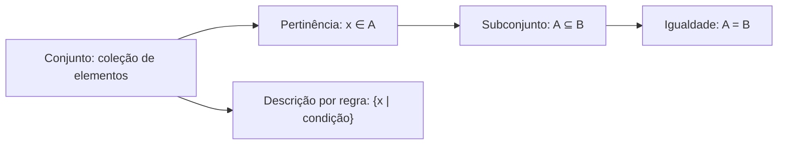
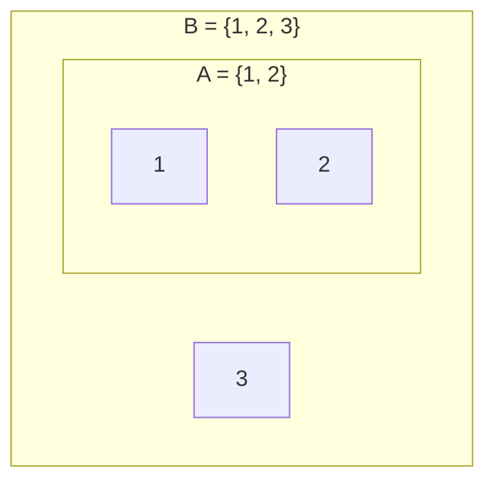

# 01 · Conjuntos

**Tempo estimado:** 30 minutos · **Pré-requisito:** Python básico (listas, `for`, `if`, funções).

**Ao final você vai conseguir:**

1. Dizer se um objeto pertence a um conjunto, usando o símbolo ∈ e o operador `in` do Python.
2. Verificar se um conjunto está contido em outro (⊆) e se dois conjuntos são iguais, a partir da definição.
3. Descrever um conjunto por uma regra, em vez de listar todos os elementos.

**Antes de começar:** este é o primeiro módulo. Você só precisa saber programar em Python.

---

## Para começar

Uma papelaria recebe pedidos como esta lista: `["caneta", "lapis", "caneta", "regua"]`. Duas perguntas aparecem logo:

- Quais produtos foram pedidos, sem contar repetido?
- Todos os produtos pedidos existem no catálogo da loja?

Para responder com precisão, precisamos de uma forma de agrupar objetos sem repetição e de perguntar, para cada objeto, se ele pertence ao grupo. Essa forma é o **conjunto** (set). Ele é a base de quase todas as ideias deste curso: relações e funções são construídas sobre conjuntos.

---

## Mapa do módulo



*Figura 1: o conjunto é a ideia central. Pertinência, subconjunto e igualdade são perguntas que fazemos sobre ele. A descrição por regra é outra maneira de escrevê-lo.*

**Como ler:** siga as setas da esquerda para a direita. Cada passo usa o anterior.

---

## Mini-aula 1: o que é um conjunto

> [!tip] Ideia
> Um conjunto é uma coleção de objetos distintos. A pergunta principal é: "este objeto está na coleção?"

Pense em uma sacola. Você coloca objetos dentro dela. Depois, para cada objeto, pergunta se ele está na sacola. Não importa quantas vezes você tentou colocar o mesmo objeto: ele está ali ou não está. Essa é a intuição de conjunto. (Esta é uma analogia para ajudar a entender, não uma definição.)

> [!info] Definição
> **Conjunto** (set): uma coleção de objetos distinguíveis, chamados **elementos** (elements). Escrevemos `A = {1, 2, 3}` para dizer que A é o conjunto cujos elementos são 1, 2 e 3.
>
> - `x ∈ A` lê-se "x pertence a A": x é um elemento de A.
> - `x ∉ A` lê-se "x não pertence a A".

Veja um exemplo mínimo. Antes de rodar, tente prever a saída de cada linha:

```python
A = {1, 2, 3}
print(2 in A)                    # 2 ∈ A?
print(5 in A)                    # 5 ∈ A?
print({1, 2, 2, 3} == {1, 2, 3}) # os dois conjuntos são iguais?
print(len({1, 2, 2, 3}))         # quantos elementos tem?
```

Saída real:

```
True
False
True
3
```

**Como ler:** no código, o `in` faz o papel do símbolo ∈. O segundo `2` dentro de `{1, 2, 2, 3}` não conta de novo. Por isso o conjunto tem 3 elementos, e não 4.

> [!warning] Armadilha comum
> Um elemento repetido não aumenta o conjunto. `{1, 2, 2, 3}` é o mesmo conjunto que `{1, 2, 3}`. Um conjunto responde "quantos diferentes?", e não "quantas vezes?".

> [!question]- Checkpoint
> 1. Quantos elementos tem o conjunto `{1, 2, 2, 3}`?
> 2. Dado `A = {1, 2, 3}`, a afirmação `7 ∈ A` é verdadeira ou falsa?
>
> > [!success]- Resposta
> > 1. Três: 1, 2 e 3. O segundo 2 não conta de novo.
> > 2. Falsa. O número 7 não é elemento de A.

---

## Mini-aula 2: subconjunto e igualdade

> [!tip] Ideia
> Um conjunto A está "dentro" de um conjunto B quando todo elemento de A também está em B.

Imagine o catálogo da papelaria como o conjunto `B = {caneta, lapis, borracha}`. Um pedido `A = {caneta, lapis}` está todo no catálogo porque cada item do pedido aparece no catálogo. (Analogia para ajudar a entender.)

> [!info] Definição
> **Subconjunto** (subset), notação `A ⊆ B`: todo elemento de A também pertence a B.
>
> **Igualdade**: `A = B` quando `A ⊆ B` e `B ⊆ A` ao mesmo tempo. Ou seja, os dois conjuntos têm exatamente os mesmos elementos.

Figura do caso `A ⊆ B`:



*Figura 2: A está dentro de B, porque todo elemento de A (1 e 2) também está em B.*

**Como ler:** a caixa menor (A) fica dentro da caixa maior (B). Se algum elemento de A ficasse fora de B, A não seria subconjunto de B.

Agora o mesmo caso no código. Antes de rodar, pense: qual é a saída de cada linha?

```python
A = {1, 2}
B = {1, 2, 3}
print(A <= B)                   # A ⊆ B?
print(B <= A)                   # B ⊆ A?
print({2, 1} == {1, 2})         # A = B? (a ordem não importa)
```

Saída real:

```
True
False
True
```

**Como ler:** no Python, `<=` entre dois conjuntos pergunta se um está contido no outro. A segunda linha dá `False` porque 3 está em B mas não em A.

> [!warning] Armadilha comum
> `2 ∈ B` e `{2} ⊆ B` são perguntas diferentes. A primeira pergunta se o número 2 é elemento de B. A segunda pergunta se o conjunto `{2}` está contido em B. Com `B = {1, 2, 3}`, as duas são verdadeiras, mas por motivos diferentes. Já `{2} ∈ B` é falsa: o conjunto `{2}` não é um dos elementos de B.

> [!question]- Checkpoint
> 1. Com `B = {1, 2, 3}`: `{1, 3} ⊆ B` é verdadeiro ou falso?
> 2. Com `B = {1, 2, 3}`: `{1, 4} ⊆ B` é verdadeiro ou falso?
> 3. `{2, 1}` e `{1, 2}` são o mesmo conjunto?
>
> > [!success]- Resposta
> > 1. Verdadeiro. 1 e 3 estão ambos em B.
> > 2. Falso. O 4 não está em B.
> > 3. Sim. Cada um está contido no outro, então são iguais.

---

## Mini-aula 3: descrever um conjunto por regra

> [!tip] Ideia
> Em vez de listar todos os elementos, descreva a regra que eles seguem.

Imagine que você precisa de "todos os números pares de 0 a 100". Listar os 51 números é trabalhoso e fácil de errar. É mais simples escrever a regra.

> [!info] Definição
> **Notação de construtor de conjuntos** (set-builder notation): `{expressão | condições}`. Lê-se "o conjunto dos valores da expressão tais que as condições valem".
>
> Exemplo: `{x * x | x ∈ {1, 2, 3}}` é o conjunto `{1, 4, 9}`, porque 1², 2² e 3² são 1, 4 e 9.

O Python tem uma forma parecida de escrever essa regra. Antes de rodar, pense: o que sai?

```python
print({x * x for x in range(1, 4)})
```

Saída real:

```
{1, 4, 9}
```

**Como ler:** `range(1, 4)` produz 1, 2 e 3. A expressão `x * x` calcula o quadrado de cada um. Essa comparação com o código é uma analogia para estudo, não uma definição matemática.

> [!warning] Armadilha comum
> `range(1, 4)` para antes do 4. Quando a regra diz "até n" (incluindo n), no código você precisa escrever `n + 1`. Esse é o erro mais comum ao traduzir regras para o Python.

> [!question]- Checkpoint
> 1. Escreva por regra o conjunto `{0, 2, 4, 6}`.
> 2. Quais elementos tem o conjunto `{x * x | x ∈ {2, 3}}`?
>
> > [!success]- Resposta
> > 1. Por exemplo, `{x | x é par e 0 ≤ x ≤ 6}`. Há outras formas corretas de escrever a mesma regra.
> > 2. `{4, 9}`, porque 2² = 4 e 3² = 9.

---

## Na prática: conferir um pedido

Problema: o pedido é `{caneta, lapis}` e o catálogo é `{caneta, lapis, borracha}`. Todo item do pedido está no catálogo?

Passo 1. Pela definição, `pedido ⊆ catalogo` quer dizer: para cada elemento do pedido, ele precisa estar no catálogo. Vamos escrever essa regra como uma função.

Passo 2. Antes de rodar o código, escreva no papel a sua previsão: a função vai devolver `True` ou `False` para o pedido acima?

```python
def e_subconjunto(A, B):
    """Devolve True se todo elemento de A também está em B."""
    for x in A:           # para cada elemento de A...
        if x not in B:    # ...se ele não estiver em B...
            return False  # ...a resposta é não
    return True           # se nenhum falhou, a resposta é sim

catalogo = {"caneta", "lapis", "borracha"}
pedido = {"caneta", "lapis"}
print(e_subconjunto(pedido, catalogo))

pedido.add("regua")       # o cliente pede também uma régua
print(e_subconjunto(pedido, catalogo))
```

Saída real:

```
True
False
```

**Como ler, linha a linha:**

- `for x in A` percorre cada elemento do primeiro conjunto.
- `if x not in B` testa se esse elemento falta no segundo conjunto. Se faltar, a resposta já é não, e a função para ali.
- `return True` só roda se nenhum elemento faltou. É o caso em que todo elemento de A está em B.
- Na segunda chamada, `"regua"` não está no catálogo. Por isso a resposta muda para `False`.

**Tente:** troque `"lapis"` por `"apontador"` no pedido e preveja o resultado antes de rodar.

---

## Exercícios

Cada exercício tem um bloco com a função a completar e os testes com `assert`. Se a função estiver errada, o Python mostra a mensagem do teste que falhou. Quando todos passarem, aparece `Passou!`. Copie o bloco para um arquivo `.py` e rode com `python nome.py` no terminal.

### Aquecimento

**A1. Pertinência.** Complete `pertence(x, A)`, que devolve `True` se x é elemento de A e `False` caso contrário.

```python
def pertence(x, A):
    """Devolve True se x é elemento de A, False caso contrário."""
    ...

assert pertence(3, {1, 2, 3}) == True, "pertence(3, {1, 2, 3}) deveria dar True"
assert pertence(5, {1, 2, 3}) == False, "pertence(5, {1, 2, 3}) deveria dar False"
assert pertence(2, {1, 2, 3}) == True, "pertence(2, {1, 2, 3}) deveria dar True"
print("Passou!")
```

> [!hint]- Dica 1
> Qual operador do Python testa se algo está dentro de um conjunto?

> [!hint]- Dica 2
> A expressão `x in A` já vale `True` ou `False`. Basta devolvê-la.

> [!example]- Solução
> ```python
> def pertence(x, A):
>     """Devolve True se x é elemento de A, False caso contrário."""
>     return x in A
> ```
> **Erro comum:** devolver `x` ou `A` em vez de uma resposta `True`/`False`. A função precisa responder à pergunta "x ∈ A?".

**A2. Subconjunto.** Complete `e_subconjunto(A, B)`, sem usar `<=`. Use a definição: todo elemento de A deve estar em B.

```python
def e_subconjunto(A, B):
    """Devolve True se todo elemento de A também está em B."""
    ...

assert e_subconjunto({1, 2}, {1, 2, 3}) == True, "{1, 2} deveria estar contido em {1, 2, 3}"
assert e_subconjunto({1, 4}, {1, 2, 3}) == False, "{1, 4} não deveria estar contido em {1, 2, 3}"
assert e_subconjunto({1, 2}, {1, 2}) == True, "todo conjunto está contido em si mesmo"
print("Passou!")
```

> [!hint]- Dica 1
> Percorra os elementos de A com `for`. Se um deles não estiver em B, você já sabe a resposta.

> [!hint]- Dica 2
> Use `if x not in B:` dentro do `for`. Dentro do `if`, `return False`. Depois do `for`, `return True`.

> [!example]- Solução
> ```python
> def e_subconjunto(A, B):
>     """Devolve True se todo elemento de A também está em B."""
>     for x in A:
>         if x not in B:
>             return False
>     return True
> ```
> **Erro comum:** colocar `return True` dentro do `for`. Assim a função responde `True` já no primeiro elemento, sem checar os outros.

**A3. Igualdade.** Complete `sao_iguais(A, B)`. A função `e_subconjunto` já está pronta. Use a definição de igualdade: `A = B` quando `A ⊆ B` e `B ⊆ A`.

```python
def e_subconjunto(A, B):
    # já pronta, do exercício anterior
    for x in A:
        if x not in B:
            return False
    return True

def sao_iguais(A, B):
    """Devolve True se A = B, usando a definição: A ⊆ B e B ⊆ A."""
    ...

assert sao_iguais({1, 2}, {2, 1}) == True, "{1, 2} e {2, 1} deveriam ser iguais"
assert sao_iguais({1, 2}, {1, 2, 3}) == False, "{1, 2} e {1, 2, 3} não deveriam ser iguais"
assert sao_iguais({1, 2, 3}, {3, 2, 1}) == True, "{1, 2, 3} e {3, 2, 1} deveriam ser iguais"
print("Passou!")
```

> [!hint]- Dica 1
> A definição já tem duas perguntas: "A ⊆ B?" e "B ⊆ A?". Ambas precisam ser verdadeiras.

> [!hint]- Dica 2
> Chame `e_subconjunto` duas vezes e combine os resultados com `and`.

> [!example]- Solução
> ```python
> def sao_iguais(A, B):
>     """Devolve True se A = B, usando a definição: A ⊆ B e B ⊆ A."""
>     return e_subconjunto(A, B) and e_subconjunto(B, A)
> ```
> **Erro comum:** verificar só `A ⊆ B`. Com `{1, 2}` e `{1, 2, 3}`, a primeira pergunta dá `True`, mas os conjuntos não são iguais. Falta a segunda metade da definição.

### Praticando

**P1. Pares até n.** Complete `pares_ate(n)`, que devolve o conjunto `{x | x é par e 0 ≤ x ≤ n}`. Escreva a regra como uma expressão de conjunto.

```python
def pares_ate(n):
    """Devolve o conjunto {x | x é par e 0 ≤ x ≤ n}."""
    ...

assert pares_ate(6) == {0, 2, 4, 6}, "pares_ate(6) deveria ser {0, 2, 4, 6}"
assert pares_ate(0) == {0}, "pares_ate(0) deveria ser {0}"
assert pares_ate(7) == {0, 2, 4, 6}, "pares_ate(7) deveria ser {0, 2, 4, 6}"
print("Passou!")
```

> [!hint]- Dica 1
> Use `{x for x in range(...) if condição}`. A condição para "par" é `x % 2 == 0`.

> [!hint]- Dica 2
> O limite é `n` incluído. Lembre da armadilha da mini-aula 3: `range(n + 1)` vai de 0 até n.

> [!example]- Solução
> ```python
> def pares_ate(n):
>     """Devolve o conjunto {x | x é par e 0 ≤ x ≤ n}."""
>     return {x for x in range(n + 1) if x % 2 == 0}
> ```
> **Erro comum:** escrever `range(n)`. Assim o próprio n fica de fora. Em `pares_ate(6)`, o 6 precisa estar no resultado.

**P2. Quadrados.** Complete `quadrados(n)`, que devolve o conjunto `{x * x | 1 ≤ x ≤ n}`.

```python
def quadrados(n):
    """Devolve o conjunto {x * x | 1 ≤ x ≤ n}."""
    ...

assert quadrados(3) == {1, 4, 9}, "quadrados(3) deveria ser {1, 4, 9}"
assert quadrados(1) == {1}, "quadrados(1) deveria ser {1}"
assert quadrados(4) == {1, 4, 9, 16}, "quadrados(4) deveria ser {1, 4, 9, 16}"
print("Passou!")
```

> [!hint]- Dica 1
> A expressão é `x * x`. O intervalo de x vai de 1 até n.

> [!hint]- Dica 2
> `range(1, n + 1)` gera de 1 até n. Use-o dentro de uma expressão de conjunto.

> [!example]- Solução
> ```python
> def quadrados(n):
>     """Devolve o conjunto {x * x | 1 ≤ x ≤ n}."""
>     return {x * x for x in range(1, n + 1)}
> ```
> **Erro comum:** começar em 0 e incluir o 0 no resultado. A regra pede 1 ≤ x.

**P3. Pedido dentro do catálogo.** Complete `todos_no_catalogo(pedidos, catalogo)`. Os dois argumentos são listas. A função deve devolver `True` se todo item de `pedidos` está em `catalogo`. A função `e_subconjunto` já está pronta.

```python
def e_subconjunto(A, B):
    # já pronta, do exercício anterior
    for x in A:
        if x not in B:
            return False
    return True

def todos_no_catalogo(pedidos, catalogo):
    """Devolve True se todo item da lista pedidos está na lista catalogo."""
    ...

assert todos_no_catalogo(["caneta", "lapis"], ["caneta", "lapis", "borracha"]) == True, "caneta e lapis estão no catálogo"
assert todos_no_catalogo(["caneta", "regua"], ["caneta", "lapis", "borracha"]) == False, "regua não está no catálogo"
assert todos_no_catalogo(["caneta", "caneta"], ["caneta"]) == True, "repetir um item não muda o resultado"
print("Passou!")
```

> [!hint]- Dica 1
> Você já tem uma função que decide se um conjunto está contido em outro. Ela precisa de dois conjuntos.

> [!hint]- Dica 2
> `set(lista)` transforma uma lista em conjunto. Passe `set(pedidos)` e `set(catalogo)` para `e_subconjunto`.

> [!example]- Solução
> ```python
> def todos_no_catalogo(pedidos, catalogo):
>     """Devolve True se todo item da lista pedidos está na lista catalogo."""
>     return e_subconjunto(set(pedidos), set(catalogo))
> ```
> **Erro comum:** passar as listas direto para `e_subconjunto`. Funciona com listas, mas o terceiro teste mostra o ponto: `["caneta", "caneta"]` vira `{"caneta"}`, e um item repetido não muda o resultado. Isso é a ideia de conjunto da mini-aula 1.

### Desafio

**D1. Famílias de conjuntos.** Complete `subconjuntos_de(familia, B)`. O argumento `familia` é uma lista de conjuntos. A função devolve, na mesma ordem, a lista dos conjuntos X da família tais que `X ⊆ B`.

```python
def e_subconjunto(A, B):
    # já pronta, do exercício anterior
    for x in A:
        if x not in B:
            return False
    return True

def subconjuntos_de(familia, B):
    """Devolve a lista dos conjuntos X de familia tais que X ⊆ B, na mesma ordem."""
    ...

assert subconjuntos_de([{1}, {1, 2}, {3}], {1, 2}) == [{1}, {1, 2}], "{1} e {1, 2} estão em {1, 2}"
assert subconjuntos_de([{3}, {4}], {1, 2}) == [], "nenhum conjunto da família está em {1, 2}"
assert subconjuntos_de([{1, 2}, {2, 1}], {1, 2}) == [{1, 2}, {2, 1}], "os dois são iguais a {1, 2}"
print("Passou!")
```

> [!hint]- Dica 1
> Percorra a família com `for`. Para cada X, pergunte `e_subconjunto(X, B)`.

> [!hint]- Dica 2
> Crie uma lista vazia antes do `for`. Dentro do `if`, use `resultado.append(X)`.

> [!example]- Solução
> ```python
> def subconjuntos_de(familia, B):
>     """Devolve a lista dos conjuntos X de familia tais que X ⊆ B, na mesma ordem."""
>     resultado = []
>     for X in familia:
>         if e_subconjunto(X, B):
>             resultado.append(X)
>     return resultado
> ```
> **Erro comum:** devolver `True` ou `False` por conjunto, em vez de montar uma lista. A pergunta é "quais" conjuntos, não "estes conjuntos estão contidos?".

---

## Mini-projeto (opcional): conferir um pedido inteiro

Objetivo: devolver quais itens de um pedido não existem no catálogo. Cada item aparece uma única vez no resultado, mesmo se for pedido mais de uma vez. O resultado sai em ordem alfabética.

```python
def itens_faltando(pedido, catalogo):
    """Devolve, em ordem alfabética, os itens do pedido que não estão no catálogo.
    Cada item aparece uma única vez no resultado, mesmo se for pedido várias vezes."""
    ...

assert itens_faltando(["caneta", "regua", "regua"], ["caneta", "lapis"]) == ["regua"], "só regua falta, e aparece uma vez"
assert itens_faltando(["lapis"], ["lapis"]) == [], "nada falta"
assert itens_faltando(["x", "y"], []) == ["x", "y"], "tudo falta com catálogo vazio"
print("Passou!")
```

> [!hint]- Dica
> Crie um conjunto vazio `faltando = set()`. Percorra o pedido. Se o item não estiver no catálogo, adicione-o com `faltando.add(item)`. No fim, devolva `sorted(faltando)`.

> [!example]- Solução
> ```python
> def itens_faltando(pedido, catalogo):
>     faltando = set()
>     for item in pedido:
>         if item not in catalogo:
>             faltando.add(item)
>     return sorted(faltando)
> ```
> **Como funciona:** o conjunto `faltando` guarda cada item uma vez só. Por isso o `"regua"` repetido no pedido aparece uma única vez no resultado. `sorted` transforma o conjunto em lista ordenada, que é o formato que o teste espera.

---

## Fechando

**Resumo**

- Um conjunto é uma coleção de elementos distinguíveis. Cada elemento conta uma vez.
- `x ∈ A` pergunta se x é elemento de A. No Python, `x in A`.
- `A ⊆ B` quer dizer que todo elemento de A também está em B.
- `A = B` quando `A ⊆ B` e `B ⊆ A`. A ordem não importa.
- A notação `{expressão | condições}` descreve um conjunto por regra.
- Não confunda `2 ∈ B` com `{2} ⊆ B`.

**Glossário rápido**

- **Conjunto** (set): coleção de elementos distinguíveis.
- **Elemento** (element): objeto que pertence a um conjunto.
- **Pertinência** (membership): a relação "x pertence a A", escrita `x ∈ A`.
- **Subconjunto** (subset): conjunto cujos elementos todos pertencem a outro, escrito `⊆`.
- **Igualdade de conjuntos**: dois conjuntos são iguais quando cada um está contido no outro.
- **Notação de construtor de conjuntos** (set-builder notation): descrição de um conjunto por regra, `{expressão | condições}`.

**Perguntas de revisão**

1. Por que `{1, 2, 2}` tem dois elementos e não três?
2. Qual é a diferença entre `2 ∈ {1, 2, 3}` e `{2} ⊆ {1, 2, 3}`?
3. Escreva por regra o conjunto dos quadrados dos números de 1 a 5.

**E agora?** O próximo módulo é **Relações**. Uma relação é um conjunto especial de pares ordenados. Para entendê-la, você só precisa do que aprendeu aqui: elementos, pertinência e subconjunto.

---

## Para ir mais fundo

- [[Set]]
