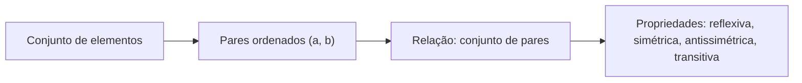

# 02 · Relações

**Tempo estimado:** 30 minutos · **Pré-requisito:** [[01 - Conjuntos]].

**Ao final você vai conseguir:**

1. Representar uma relação como um conjunto de pares ordenados e testar se um par pertence a ela.
2. Verificar as propriedades reflexiva, simétrica, antissimétrica e transitiva de uma relação sobre um conjunto.
3. Descrever uma relação por regra, usando a notação de conjuntos.

**Antes de começar:** no [[01 - Conjuntos]] você aprendeu o que é um conjunto, o símbolo ∈ e a notação `{expressão | condições}`. Este módulo usa todos eles.

---

## Para começar

Em uma rede social, a relação "segue" liga pessoas. Ana segue Bruno não significa que Bruno segue Ana. A ordem importa. Para representar isso, não basta um conjunto de pessoas: precisamos registrar **pares** de pessoas, com a ordem preservada. Perguntas como "a relação é simétrica?" ou "se A segue B e B segue C, A segue C?" só fazem sentido quando temos essa estrutura. (Analogia para ajudar a entender.)

---

## Mapa do módulo



*Figura 1: uma relação é um conjunto de pares ordenados, tomados a partir de um conjunto. As propriedades são perguntas que fazemos sobre esse conjunto de pares.*

**Como ler:** siga as setas. Cada passo usa o anterior.

---

## Mini-aula 1: relação é um conjunto de pares

> [!tip] Ideia
> Uma relação sobre um conjunto é apenas um conjunto de pares: ela registra quais elementos "se relacionam", e em que ordem.

> [!info] Definição
> **Par ordenado** (ordered pair): dois elementos em uma ordem fixa, escrito `(a, b)`. Então `(a, b)` e `(b, a)` são pares diferentes, a menos que a = b.
>
> **Relação** (relation) sobre um conjunto A: um conjunto de pares ordenados de elementos de A. Quando `(a, b)` está na relação R, escrevemos `a R b` e lemos "a se relaciona com b".

O Python representa pares ordenados com parênteses, e a relação como um conjunto deles. Antes de rodar, preveja cada saída:

```python
R = {(1, 2), (2, 3)}
print((1, 2) in R)   # 1 R 2?
print((2, 1) in R)   # 2 R 1?
```

Saída real:

```
True
False
```

**Como ler:** o par `(1, 2)` está em R, então `1 R 2`. O par `(2, 1)` não está, então `2 R 1` é falso. A ordem dentro do par importa.

> [!warning] Armadilha comum
> `a R b` não diz nada sobre `b R a`. Ter `(1, 2)` na relação não garante `(2, 1)`. Pense em "A segue B": isso não implica "B segue A".

> [!question]- Checkpoint
> 1. Seja `R = {(1, 2), (2, 3)}`. O par `(2, 3)` pertence a R?
> 2. Seja `R = {(1, 2), (2, 3)}`. Vale `3 R 2`?
>
> > [!success]- Resposta
> > 1. Sim, está no conjunto.
> > 2. Não. O par `(3, 2)` não está em R, e a ordem importa.

---

## Mini-aula 2: reflexiva e simétrica

> [!tip] Ideia
> Duas perguntas simples sobre uma relação: "todo elemento se relaciona consigo mesmo?" e "a relação vale nos dois sentidos?"

> [!info] Definição
> Seja R uma relação sobre um conjunto A.
>
> - **Reflexiva** (reflexive): para todo `a` em A, `a R a`. Em outras palavras, `(a, a)` está em R para todo a.
> - **Simétrica** (symmetric): sempre que `a R b`, vale também `b R a`.

Exemplo. Seja `A = {1, 2}` e `R = {(1, 1), (2, 2), (1, 2)}`. A relação é reflexiva: `(1, 1)` e `(2, 2)` estão em R. Não é simétrica: `(1, 2)` está, mas `(2, 1)` não.

No código, o teste de reflexiva confere cada `(a, a)`, e o teste de simétrica confere o par invertido de cada par:

```python
R = {(1, 1), (2, 2), (3, 3), (1, 2)}
print((2, 2) in R)   # 2 R 2?
print((2, 1) in R)   # 2 R 1?
```

Saída real:

```
True
False
```

**Como ler:** `(2, 2)` está em R, então 2 se relaciona consigo mesmo. `(2, 1)` não está, então a simetria falha para o par `(1, 2)`.

> [!warning] Armadilha comum
> Reflexiva exige que **todo** elemento de A tenha seu par `(a, a)`. Ter alguns deles não basta. Com `A = {1, 2}` e `R = {(1, 1)}`, a relação não é reflexiva, porque falta `(2, 2)`.

> [!question]- Checkpoint
> 1. `A = {1, 2}` e `R = {(1, 1), (2, 2), (1, 2), (2, 1)}`. R é reflexiva?
> 2. A mesma R é simétrica?
>
> > [!success]- Resposta
> > 1. Sim. Há `(1, 1)` e `(2, 2)`.
> > 2. Sim. Para cada `(a, b)` há o par `(b, a)`: `(1, 2)` e `(2, 1)` estão ambos em R.

---

## Mini-aula 3: antissimétrica e transitiva

> [!tip] Ideia
> Antissimétrica diz que dois sentidos ao mesmo tempo só são possíveis quando os elementos são iguais. Transitiva diz que relações "encadeadas" geram uma relação direta.

> [!info] Definição
> - **Antissimétrica** (antisymmetric): se `a R b` e `b R a`, então `a = b`. Dito de outro modo: para `a ≠ b`, não podemos ter os dois sentidos ao mesmo tempo.
> - **Transitiva** (transitive): se `a R b` e `b R c`, então `a R c`.

Exemplos:

- `R = {(1, 2), (2, 1)}` **não** é antissimétrica: `1 R 2` e `2 R 1`, mas `1 ≠ 2`.
- `R = {(1, 1), (2, 2)}` é antissimétrica: os pares são todos do tipo `(a, a)`, então a regra nunca é violada.
- `R = {(1, 2), (2, 3)}` **não** é transitiva: temos `1 R 2` e `2 R 3`, mas falta `(1, 3)`.

> [!warning] Armadilha comum
> Na antissimetria, o par `(a, a)` não viola a regra. Se você testar `(b, a) in R` sem checar `a != b`, o par `(1, 1)` vai parecer uma violação. Esse é o erro mais comum nesta propriedade.

> [!question]- Checkpoint
> 1. `R = {(1, 2), (2, 3), (1, 3)}` é transitiva?
> 2. `R = {(1, 2), (2, 1)}` é antissimétrica?
>
> > [!success]- Resposta
> > 1. Sim. Os únicos encadeamentos são `(1, 2)` com `(2, 3)`, e o par `(1, 3)` está em R.
> > 2. Não. Temos `1 R 2` e `2 R 1`, mas `1 ≠ 2`.

---

## Na prática: a relação "menor ou igual" sobre um conjunto

Vamos construir uma relação por regra. Ela contém os pares `(a, b)` com `a ≤ b`, e a regra fica escrita como `{(a, b) | a e b estão em A e a ≤ b}`.

Antes de rodar, pense: `(1, 2)` pertence a essa relação? `(2, 1)` pertence? `(2, 2)` pertence?

```python
A = {1, 2, 3}
R = {(a, b) for a in A for b in A if a <= b}
print((1, 2) in R)
print((2, 1) in R)
print((2, 2) in R)
```

Saída real:

```
True
False
True
```

**Como ler, linha a linha:**

- `for a in A for b in A` percorre todos os pares possíveis de elementos de A.
- `if a <= b` mantém só os pares em que o primeiro não é maior que o segundo. É a regra escrita no código.
- `(1, 2)` está, porque 1 ≤ 2. `(2, 1)` não está, porque 2 não é ≤ 1.

**Tente:** troque `<=` por `<` e preveja se `(2, 2)` continua na relação.

---

## Exercícios

Cada exercício tem um bloco com a função a completar e os testes com `assert`. Quando todos passarem, aparece `Passou!`.

### Aquecimento

**A1. Reflexiva.** Complete `e_reflexiva(A, R)`, que devolve `True` se `(a, a)` está em R para todo a de A.

```python
def e_reflexiva(A, R):
    """Devolve True se (a, a) está em R para todo a em A."""
    ...

assert e_reflexiva({1, 2}, {(1, 1), (2, 2)}) == True, "{(1, 1), (2, 2)} é reflexiva em {1, 2}"
assert e_reflexiva({1, 2}, {(1, 1)}) == False, "falta o par (2, 2)"
assert e_reflexiva({1, 2}, {(1, 1), (2, 2), (1, 2)}) == True, "o par (1, 2) não atrapalha"
print("Passou!")
```

> [!hint]- Dica 1
> Percorra os elementos de A com `for`. Para cada um, veja se o par `(a, a)` está em R.

> [!hint]- Dica 2
> Se algum `(a, a)` não estiver em R, a resposta já é `False`. Só devolva `True` depois do `for`.

> [!example]- Solução
> ```python
> def e_reflexiva(A, R):
>     """Devolve True se (a, a) está em R para todo a em A."""
>     for a in A:
>         if (a, a) not in R:
>             return False
>     return True
> ```
> **Erro comum:** devolver `True` dentro do `for`. A função responde antes de checar os outros elementos. Lembre: reflexiva vale para **todo** elemento.

**A2. Simétrica.** Complete `e_simetrica(R)`, que devolve `True` se, para todo par `(a, b)` em R, o par `(b, a)` também está em R.

```python
def e_simetrica(R):
    """Devolve True se, para todo par (a, b) em R, o par (b, a) também está em R."""
    ...

assert e_simetrica({(1, 2), (2, 1)}) == True, "{(1, 2), (2, 1)} é simétrica"
assert e_simetrica({(1, 2)}) == False, "falta o par (2, 1)"
assert e_simetrica({(1, 1)}) == True, "o par (1, 1) é o seu próprio inverso"
print("Passou!")
```

> [!hint]- Dica 1
> Percorra os pares de R com `for (a, b) in R:`.

> [!hint]- Dica 2
> Para cada par, confira se `(b, a)` está em R. Se não estiver, `return False`.

> [!example]- Solução
> ```python
> def e_simetrica(R):
>     """Devolve True se, para todo par (a, b) em R, o par (b, a) também está em R."""
>     for (a, b) in R:
>         if (b, a) not in R:
>             return False
>     return True
> ```
> **Erro comum:** comparar `(a, b)` com `(b, a)` e esquecer que `(b, a)` precisa estar **no conjunto** R. Escrever `a == b` não resolve.

**A3. Antissimétrica.** Complete `e_antissimetrica(R)`, que devolve `True` se, sempre que `(a, b)` e `(b, a)` estão em R, temos `a = b`.

```python
def e_antissimetrica(R):
    """Devolve True se, sempre que (a, b) e (b, a) estão em R, então a = b."""
    ...

assert e_antissimetrica({(1, 2), (2, 1)}) == False, "(1, 2) e (2, 1) estão ambos em R, com 1 diferente de 2"
assert e_antissimetrica({(1, 2)}) == True, "só (1, 2): nenhum par inverso"
assert e_antissimetrica({(1, 1), (2, 2)}) == True, "pares (a, a) não violam a regra"
print("Passou!")
```

> [!hint]- Dica 1
> Percorra os pares de R. A violação só acontece quando `a` é diferente de `b` e `(b, a)` também está em R.

> [!hint]- Dica 2
> Use `if a != b and (b, a) in R:`. Dentro do `if`, `return False`.

> [!example]- Solução
> ```python
> def e_antissimetrica(R):
>     """Devolve True se, sempre que (a, b) e (b, a) estão em R, então a = b."""
>     for (a, b) in R:
>         if a != b and (b, a) in R:
>             return False
>     return True
> ```
> **Erro comum:** tirar a parte `a != b`. Assim, o par `(1, 1)` seria visto como violação, porque o par invertido é ele mesmo. A condição da definição é `a = b` quando há os dois sentidos.

### Praticando

**P1. Transitiva.** Complete `e_transitiva(R)`, que devolve `True` se, sempre que `(a, b)` e `(b, c)` estão em R, o par `(a, c)` também está.

```python
def e_transitiva(R):
    """Devolve True se, sempre que (a, b) e (b, c) estão em R, então (a, c) também está."""
    ...

assert e_transitiva({(1, 2), (2, 3)}) == False, "falta (1, 3)"
assert e_transitiva({(1, 2), (2, 3), (1, 3)}) == True, "{(1, 2), (2, 3), (1, 3)} é transitiva"
assert e_transitiva({(1, 1)}) == True, "(1, 1) com (1, 1) gera (1, 1), que já está"
print("Passou!")
```

> [!hint]- Dica 1
> Você precisa de dois pares: um `(a, b)` e um `(c, d)`. Eles se encadeiam quando `b == c`. Use dois `for`, um dentro do outro.

> [!hint]- Dica 2
> Quando `b == c`, o encadeamento produz `(a, d)`. Se `(a, d)` não estiver em R, `return False`.

> [!example]- Solução
> ```python
> def e_transitiva(R):
>     """Devolve True se, sempre que (a, b) e (b, c) estão em R, então (a, c) também está."""
>     for (a, b) in R:
>         for (c, d) in R:
>             if b == c and (a, d) not in R:
>                 return False
>     return True
> ```
> **Erro comum:** comparar só um par com ele mesmo, ou esquecer o segundo `for`. Sem os dois pares, o encadeamento nunca é verificado.

**P2. Relação por regra.** Complete `relacao_por_regra(A)`, que devolve o conjunto `{(a, b) | a e b estão em A e a ≤ b}`.

```python
def relacao_por_regra(A):
    """Devolve a relação {(a, b) | a e b estão em A e a <= b}."""
    ...

assert relacao_por_regra({1, 2, 3}) == {(1, 1), (1, 2), (1, 3), (2, 2), (2, 3), (3, 3)}, "a relação ≤ sobre {1, 2, 3}"
assert relacao_por_regra({5}) == {(5, 5)}, "com um só elemento, só o par (5, 5)"
print("Passou!")
```

> [!hint]- Dica 1
> Use a mesma forma da seção "Na prática": `{(a, b) for a in A for b in A if ...}`.

> [!hint]- Dica 2
> A condição é `a <= b`.

> [!example]- Solução
> ```python
> def relacao_por_regra(A):
>     """Devolve a relação {(a, b) | a e b estão em A e a <= b}."""
>     return {(a, b) for a in A for b in A if a <= b}
> ```
> **Erro comum:** escrever `a >= b` por engano. Isso inverte a relação e gera pares que não estão na regra.

### Desafio

**D1. Quais propriedades?** Complete `lista_propriedades(A, R)`. As funções `e_reflexiva`, `e_simetrica`, `e_antissimetrica` e `e_transitiva` já estão prontas (dos exercícios anteriores). A função deve devolver, na ordem `reflexiva`, `simetrica`, `antissimetrica`, `transitiva`, a lista dos nomes das propriedades que R tem.

```python
def e_reflexiva(A, R):
    # já pronta, do exercício A1
    for a in A:
        if (a, a) not in R:
            return False
    return True

def e_simetrica(R):
    # já pronta, do exercício A2
    for (a, b) in R:
        if (b, a) not in R:
            return False
    return True

def e_antissimetrica(R):
    # já pronta, do exercício A3
    for (a, b) in R:
        if a != b and (b, a) in R:
            return False
    return True

def e_transitiva(R):
    # já pronta, do exercício P1
    for (a, b) in R:
        for (c, d) in R:
            if b == c and (a, d) not in R:
                return False
    return True

def lista_propriedades(A, R):
    """Devolve, nesta ordem, os nomes das propriedades que R tem:
    'reflexiva', 'simetrica', 'antissimetrica', 'transitiva'."""
    ...

assert lista_propriedades({1, 2}, {(1, 1), (2, 2)}) == ["reflexiva", "simetrica", "antissimetrica", "transitiva"], "esta relação tem as quatro"
assert lista_propriedades({1, 2}, {(1, 2)}) == ["antissimetrica", "transitiva"], "só antissimétrica e transitiva"
assert lista_propriedades({1, 2}, {(1, 1), (2, 2), (1, 2), (2, 1)}) == ["reflexiva", "simetrica", "transitiva"], "falha só a antissimetria"
print("Passou!")
```

> [!hint]- Dica 1
> Faça quatro `if`, um para cada propriedade, na ordem pedida. Cada `if` chama a função correspondente.

> [!hint]- Dica 2
> Crie `resultado = []` no início. Use `resultado.append("nome")` dentro de cada `if`, e devolva `resultado` no fim.

> [!example]- Solução
> ```python
> def lista_propriedades(A, R):
>     """Devolve, nesta ordem, os nomes das propriedades que R tem:
>     'reflexiva', 'simetrica', 'antissimetrica', 'transitiva'."""
>     resultado = []
>     if e_reflexiva(A, R):
>         resultado.append("reflexiva")
>     if e_simetrica(R):
>         resultado.append("simetrica")
>     if e_antissimetrica(R):
>         resultado.append("antissimetrica")
>     if e_transitiva(R):
>         resultado.append("transitiva")
>     return resultado
> ```
> **Erro comum:** esquecer que a ordem da lista é fixa. Os testes comparam a lista inteira, então `["simetrica", "reflexiva"]` falha mesmo tendo as mesmas propriedades.

---

## Mini-projeto (opcional)

**Objetivo.** Uma relação pode não ser reflexiva. O fecho reflexivo acrescenta os pares `(a, a)` que faltam, sem tirar nenhum par. Complete `fecho_reflexivo(A, R)`.

```python
def fecho_reflexivo(A, R):
    """Devolve uma cópia de R com os pares (a, a) para todo a em A."""
    ...

assert fecho_reflexivo({1, 2}, {(1, 2)}) == {(1, 2), (1, 1), (2, 2)}, "faltavam (1, 1) e (2, 2)"
assert fecho_reflexivo({1, 2}, {(1, 1), (2, 2)}) == {(1, 1), (2, 2)}, "nada faltava"
assert fecho_reflexivo({1}, set()) == {(1, 1)}, "sem pares, só o (1, 1)"
print("Passou!")
```

> [!hint]- Dica 1
> Comece com uma cópia de `R`, por exemplo `resultado = set(R)`, e percorra os elementos de `A`.

> [!hint]- Dica 2
> Para cada `a`, adicione `(a, a)` com `resultado.add((a, a))`. Devolva `resultado` no fim.

> [!example]- Solução
> ```python
> def fecho_reflexivo(A, R):
>     """Devolve uma cópia de R com os pares (a, a) para todo a em A."""
>     resultado = set(R)
>     for a in A:
>         resultado.add((a, a))
>     return resultado
> ```
> **Erro comum:** modificar `R` diretamente, com `R.add(...)`. A relação original mudaria, e a função precisa devolver uma cópia.

---

## Fechando

**Resumo**

- Uma relação sobre A é um conjunto de pares ordenados de elementos de A.
- `a R b` quer dizer que `(a, b)` está em R. A ordem dos pares importa.
- Reflexiva: todo `(a, a)` está em R.
- Simétrica: todo `(a, b)` vem acompanhado de `(b, a)`.
- Antissimétrica: os dois sentidos `(a, b)` e `(b, a)` só ocorrem quando `a = b`.
- Transitiva: todo encadeamento `(a, b)`, `(b, c)` tem o atalho `(a, c)`.

**Glossário rápido**

- **Par ordenado** (ordered pair): dois elementos em ordem fixa, `(a, b)`.
- **Relação** (relation): conjunto de pares ordenados sobre um conjunto.
- **Reflexiva** (reflexive): cada elemento se relaciona consigo mesmo.
- **Simétrica** (symmetric): a relação vale nos dois sentidos.
- **Antissimétrica** (antisymmetric): dois sentidos distintos não podem ocorrer ao mesmo tempo.
- **Transitiva** (transitive): encadeamentos geram uma relação direta.

**Perguntas de revisão**

1. Por que `(1, 2)` e `(2, 1)` são pares diferentes?
2. Uma relação com `(1, 1)` e `(2, 2)` sobre `{1, 2}` é antissimétrica? Por quê?
3. Escreva, por regra, a relação "divide" sobre `{1, 2, 3, 6}`, usando `b % a == 0`.

**E agora?** O próximo módulo é **Relações de equivalência e de ordem**. Ele junta as propriedades que você acabou de testar: uma relação reflexiva, simétrica e transitiva é de equivalência; uma reflexiva, antissimétrica e transitiva é de ordem.

---

## Para ir mais fundo

- [[Relation]]
- [[Set]]
