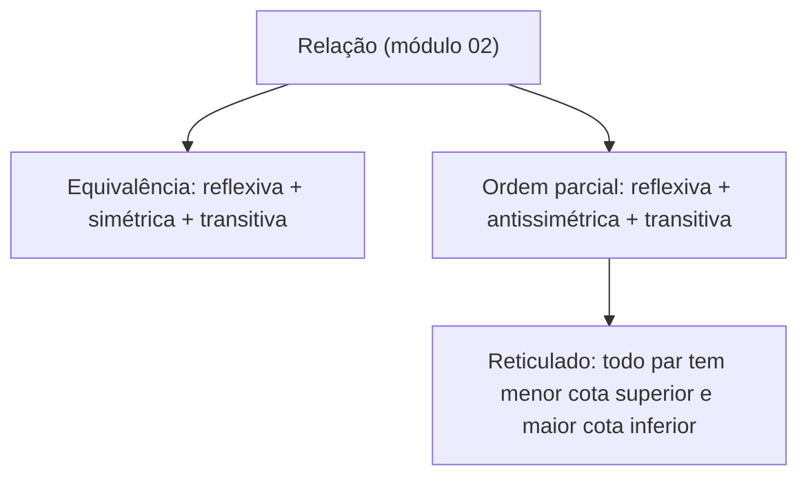
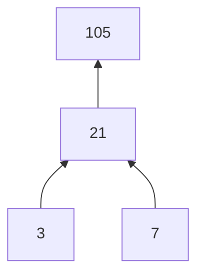

# 03 · Relações de equivalência e de ordem

**Tempo estimado:** 30 minutos · **Pré-requisito:** [[02 - Relações]].

**Ao final você vai conseguir:**

1. Reconhecer uma relação de equivalência (reflexiva, simétrica e transitiva) e testá-la.
2. Reconhecer uma ordem parcial (reflexiva, antissimétrica e transitiva) e distinguir pares comparáveis de pares incomparáveis.
3. Calcular a menor cota superior de dois elementos e entender quando um conjunto ordenado é um reticulado.

**Antes de começar:** no [[02 - Relações]] você aprendeu as quatro propriedades (reflexiva, simétrica, antissimétrica e transitiva). Aqui elas são combinadas em dois tipos de relação.

---

## Para começar

Dois pedidos de uma loja. Um cliente pergunta: "estes produtos são da mesma categoria?". Outro pergunta: "este pacote é menor ou igual àquele?". As duas perguntas são relações, mas com regras diferentes. A primeira agrupa elementos que se parecem em algum aspecto. A segunda ordena elementos, e nem sempre é possível comparar dois deles. Este módulo separa esses dois casos e mostra como uma ordem pode ter "pontos de encontro" entre dois elementos.

---

## Mapa do módulo



*Figura 1: as duas combinações de propriedades saem da relação do módulo 02. O reticulado é uma ordem parcial com uma exigência extra sobre os pares.*

**Como ler:** a seta indica "é uma especialização de". Equivalência e ordem parcial vêm direto de relação; reticulado vem de ordem parcial.

---

## Mini-aula 1: relação de equivalência

> [!tip] Ideia
> Uma relação de equivalência agrupa elementos que são "iguais em algum aspecto". Ela é reflexiva (cada um é parecido consigo mesmo), simétrica (a semelhança vale nos dois sentidos) e transitiva (semelhança se propaga).

> [!info] Definição
> Uma relação sobre um conjunto é uma **relação de equivalência** (equivalence relation) quando é reflexiva, simétrica e transitiva.

Exemplo. Sobre `{1, 2, 3}`, considere `R = {(1, 1), (2, 2), (3, 3), (1, 2), (2, 1)}`. Ela é reflexiva, porque há `(1, 1)`, `(2, 2)` e `(3, 3)`. É simétrica, porque `(1, 2)` e `(2, 1)` estão ambos lá. É transitiva, porque os únicos encadeamentos não geram pares novos. Portanto, R é uma relação de equivalência.

A figura mostra o caso acima. Como ler: os pares são "parecidos" dois a dois. O 3 só se relaciona consigo mesmo.

> [!warning] Armadilha comum
> Uma relação pode ser reflexiva e simétrica e ainda não ser de equivalência. Falta a transitividade. Exemplo: `{(1, 1), (2, 2), (3, 3), (1, 2), (2, 1), (2, 3), (3, 2)}` sobre `{1, 2, 3}`. Ela tem `(1, 2)` e `(2, 3)`, mas falta `(1, 3)`.

> [!question]- Checkpoint
> 1. A relação `{(1, 1), (2, 2), (1, 2), (2, 1)}` sobre `{1, 2}` é de equivalência?
> 2. Por que a relação com `(1, 2)`, `(2, 3)` e sem `(1, 3)` não é de equivalência?
>
> > [!success]- Resposta
> > 1. Sim. Reflexiva (há `(1, 1)` e `(2, 2)`), simétrica (há `(1, 2)` e `(2, 1)`) e transitiva (não há encadeamentos que gerem pares novos).
> > 2. Porque falta a transitividade: `(1, 2)` e `(2, 3)` geram `(1, 3)`, que não está na relação. Além disso, falta `(3, 3)` se o conjunto contém 3.

---

## Mini-aula 2: ordem parcial e comparabilidade

> [!tip] Ideia
> Uma ordem parcial organiza elementos, mas não precisa comparar todos os pares. Alguns pares ficam sem comparação.

> [!info] Definição
> Uma relação sobre um conjunto é uma **ordem parcial** (partial order) quando é reflexiva, antissimétrica e transitiva. Um conjunto com uma ordem parcial é um **conjunto parcialmente ordenado** (poset).
>
> Neste curso, usamos a versão que inclui a reflexividade, como `≤` ou `⊆`. Dois elementos são **comparáveis** quando um se relaciona com o outro em algum sentido.

Exemplo: a divisibilidade sobre `{1, 2, 3, 6}`, em que `a` se relaciona com `b` quando `a` divide `b`. Ela é ordem parcial, mas 2 e 3 não são comparáveis: nenhum divide o outro.

Veja no código. Antes de rodar, preveja cada saída:

```python
D = {1, 2, 3, 6}
R = {(a, b) for a in D for b in D if b % a == 0}
print((2, 6) in R)
print((2, 3) in R)
print((3, 2) in R)
```

Saída real:

```
True
False
False
```

**Como ler:** `(2, 6)` está em R, porque 2 divide 6. `(2, 3)` e `(3, 2)` não estão, porque 2 e 3 são incomparáveis. A ausência dos dois pares é justamente o que torna a ordem "parcial".

> [!warning] Armadilha comum
> "Parcial" não quer dizer "incompleta". Quer dizer que alguns pares não têm comparação. Uma ordem parcial pode ser completa para alguns pares e vazia para outros.

> [!question]- Checkpoint
> 1. Em `{1, 2, 3, 6}` sob divisibilidade, 1 e 6 são comparáveis?
> 2. 2 e 3 são comparáveis?
>
> > [!success]- Resposta
> > 1. Sim. 1 divide 6.
> > 2. Não. Nenhum dos dois divide o outro.

---

## Mini-aula 3: menor cota superior e reticulado

> [!tip] Ideia
> Dados dois elementos de uma ordem, procuramos o menor elemento que está "acima" dos dois. Se ele existe para todo par, o conjunto é um reticulado.

> [!info] Definição
> Sejam a e b elementos de um conjunto ordenado. Uma **cota superior** (upper bound) de a e b é um elemento c tal que a ≤ c e b ≤ c. A **menor cota superior** (least upper bound, lub), quando existe, é a cota superior que é menor que todas as outras.
>
> Um **reticulado** (lattice) é uma ordem parcial em que todo par de elementos tem menor cota superior e maior cota inferior.

Exemplo. Os divisores de 105, sob divisibilidade, são `{1, 3, 5, 7, 15, 21, 35, 105}`. Para o par 3 e 7, as cotas superiores são os múltiplos de 3 e 7 que estão no conjunto: 21 e 105. A menor é 21, porque 21 divide 105.



*Figura 2: a seta vai de um divisor para o número que ele divide. 21 é a menor cota superior de 3 e 7.*

**Como ler:** 3 e 7 "sobem" até 21. Depois, 21 sobe até 105. A menor cota superior é o primeiro ponto em que os dois caminhos se encontram.

Antes de programar, veja os números. Preveja a saída:

```python
D = {d for d in range(1, 25) if 24 % d == 0}
print(sorted(D))
ubs = [c for c in D if c % 4 == 0 and c % 6 == 0]
print(sorted(ubs))
```

Saída real:

```
[1, 2, 3, 4, 6, 8, 12, 24]
[12, 24]
```

**Como ler:** `D` são os divisores de 24. As cotas superiores de 4 e 6 são os elementos de D que são múltiplos de 4 e de 6: 12 e 24. A menor é 12, porque 12 divide 24.

> [!warning] Armadilha comum
> Nem todo par tem menor cota superior dentro de um conjunto. Em `{2, 3}`, não existe nenhum elemento do conjunto que seja múltiplo de 2 e de 3. Nesse caso, a menor cota superior não existe.

> [!question]- Checkpoint
> 1. Em `{1, 2, 3, 4, 6, 8, 12, 24}`, qual é a menor cota superior de 2 e 3?
> 2. Em `{2, 3}`, existe menor cota superior para 2 e 3?
>
> > [!success]- Resposta
> > 1. 6. As cotas superiores são 6, 12 e 24; a menor é 6, porque 6 divide 12 e 24.
> > 2. Não. Não há nenhum elemento de `{2, 3}` que seja múltiplo de 2 e de 3.

---

## Na prática: encontrar a menor cota superior

Vamos calcular a menor cota superior de 4 e 6 nos divisores de 24, passo a passo.

Passo 1. Liste as cotas superiores: elementos c de D tais que 4 divide c e 6 divide c. O código do mini-aula 3 já faz isso.

Passo 2. Escolha a menor. Entre as cotas, a menor é a que divide todas as outras. Olhe a lista `[12, 24]` e responda antes de continuar: qual dos dois divide o outro?

Passo 3. Rode a função que você vai escrever no exercício D1 para confirmar a sua resposta.

**Tente:** mude o par para 2 e 3, e preveja qual será a lista de cotas superiores.

---

## Exercícios

As funções de divisibilidade e de propriedades, dos módulos anteriores, estão prontas nos blocos que precisam delas.

### Aquecimento

**A1. Equivalência.** Complete `e_equivalencia(A, R)`, que devolve `True` se R é reflexiva, simétrica e transitiva sobre A. As três funções já estão prontas.

```python
def e_reflexiva(A, R):
    # já pronta, do módulo 02
    for a in A:
        if (a, a) not in R:
            return False
    return True

def e_simetrica(R):
    # já pronta, do módulo 02
    for (a, b) in R:
        if (b, a) not in R:
            return False
    return True

def e_transitiva(R):
    # já pronta, do módulo 02
    for (a, b) in R:
        for (c, d) in R:
            if b == c and (a, d) not in R:
                return False
    return True

def e_equivalencia(A, R):
    """Devolve True se R é reflexiva, simétrica e transitiva sobre A."""
    ...

assert e_equivalencia({1, 2, 3}, {(1, 1), (2, 2), (3, 3), (1, 2), (2, 1)}) == True, "esta relação é de equivalência"
assert e_equivalencia({1, 2, 3}, {(1, 1), (2, 2), (3, 3), (1, 2)}) == False, "falta a simetria: (2, 1)"
assert e_equivalencia({1, 2}, {(1, 1), (2, 2)}) == True, "a identidade é de equivalência"
print("Passou!")
```

> [!hint]- Dica 1
> A definição tem três condições ao mesmo tempo. Chame as três funções prontas.

> [!hint]- Dica 2
> Combine os três resultados com `and`.

> [!example]- Solução
> ```python
> def e_equivalencia(A, R):
>     """Devolve True se R é reflexiva, simétrica e transitiva sobre A."""
>     return e_reflexiva(A, R) and e_simetrica(R) and e_transitiva(R)
> ```
> **Erro comum:** testar só duas das três propriedades. A segunda assert do bloco mostra o caso: falta a simetria.

**A2. Ordem parcial.** Complete `e_ordem_parcial(A, R)`, que devolve `True` se R é reflexiva, antissimétrica e transitiva sobre A. As três funções já estão prontas.

```python
def e_reflexiva(A, R):
    # já pronta, do módulo 02
    for a in A:
        if (a, a) not in R:
            return False
    return True

def e_antissimetrica(R):
    # já pronta, do módulo 02
    for (a, b) in R:
        if a != b and (b, a) in R:
            return False
    return True

def e_transitiva(R):
    # já pronta, do módulo 02
    for (a, b) in R:
        for (c, d) in R:
            if b == c and (a, d) not in R:
                return False
    return True

def e_ordem_parcial(A, R):
    """Devolve True se R é reflexiva, antissimétrica e transitiva sobre A."""
    ...

assert e_ordem_parcial({1, 2, 3, 6}, {(a, b) for a in {1, 2, 3, 6} for b in {1, 2, 3, 6} if b % a == 0}) == True, "divisibilidade é ordem parcial"
assert e_ordem_parcial({1, 2}, {(1, 1), (2, 2), (1, 2), (2, 1)}) == False, "(1, 2) e (2, 1) violam a antissimetria"
assert e_ordem_parcial({1, 2}, {(1, 1), (2, 2)}) == True, "a identidade é ordem parcial"
print("Passou!")
```

> [!hint]- Dica 1
> Os nomes das propriedades mudaram em relação à equivalência: agora a segunda é a antissimetria.

> [!hint]- Dica 2
> Combine `e_reflexiva`, `e_antissimetrica` e `e_transitiva` com `and`.

> [!example]- Solução
> ```python
> def e_ordem_parcial(A, R):
>     """Devolve True se R é reflexiva, antissimétrica e transitiva sobre A."""
>     return e_reflexiva(A, R) and e_antissimetrica(R) and e_transitiva(R)
> ```
> **Erro comum:** usar `e_simetrica` no lugar de `e_antissimetrica`. Uma ordem parcial não é simétrica: `(1, 2)` e `(2, 1)` juntos a violam.

### Praticando

**P1. Divisores.** Complete `divisores(n)`, que devolve o conjunto dos `d` com `1 ≤ d ≤ n` que dividem `n`.

```python
def divisores(n):
    """Devolve o conjunto dos d com 1 ≤ d ≤ n que dividem n."""
    ...

assert divisores(6) == {1, 2, 3, 6}, "divisores de 6"
assert divisores(1) == {1}, "divisores de 1"
assert divisores(105) == {1, 3, 5, 7, 15, 21, 35, 105}, "divisores de 105"
print("Passou!")
```

> [!hint]- Dica 1
> Use a forma `{d for d in range(...) if condição}`, como no módulo 01.

> [!hint]- Dica 2
> A condição é `n % d == 0`. O intervalo deve incluir o n: use `range(1, n + 1)`.

> [!example]- Solução
> ```python
> def divisores(n):
>     """Devolve o conjunto dos d com 1 ≤ d ≤ n que dividem n."""
>     return {d for d in range(1, n + 1) if n % d == 0}
> ```
> **Erro comum:** testar `d % n == 0`, que inverte a divisibilidade. Com `n = 6` e `d = 2`, o teste correto é `6 % 2 == 0`.

**P2. Relação de divisibilidade.** Complete `relacao_divisibilidade(D)`, que devolve `{(a, b) | a e b estão em D e a divide b}`.

```python
def relacao_divisibilidade(D):
    """Devolve a relação {(a, b) | a e b estão em D e a divide b}."""
    ...

R = relacao_divisibilidade({1, 2, 3, 6})
assert R is not None, "a função ainda não devolve uma relação"
assert (2, 6) in R, "2 divide 6, então (2, 6) deveria estar em R"
assert (1, 6) in R, "1 divide 6, então (1, 6) deveria estar em R"
assert (2, 3) not in R, "2 não divide 3, então (2, 3) não deveria estar em R"
assert (3, 3) in R, "todo número divide a si mesmo"
print("Passou!")
```

> [!hint]- Dica 1
> A forma é igual à do módulo 02: `{(a, b) for a in D for b in D if ...}`.

> [!hint]- Dica 2
> A condição de divisibilidade é `b % a == 0`: `a` divide `b`.

> [!example]- Solução
> ```python
> def relacao_divisibilidade(D):
>     """Devolve a relação {(a, b) | a e b estão em D e a divide b}."""
>     return {(a, b) for a in D for b in D if b % a == 0}
> ```
> **Erro comum:** inverter a condição para `a % b == 0`. Isso gera `(6, 2)` no lugar de `(2, 6)`.

**P3. Comparáveis.** Complete `sao_comparaveis(a, b)`, que devolve `True` se `a` divide `b` ou `b` divide `a`.

```python
def sao_comparaveis(a, b):
    """Devolve True se a divide b ou b divide a."""
    ...

assert sao_comparaveis(2, 3) == False, "2 e 3 não são comparáveis"
assert sao_comparaveis(2, 6) == True, "2 divide 6"
assert sao_comparaveis(6, 6) == True, "6 divide 6"
print("Passou!")
```

> [!hint]- Dica 1
> São duas possibilidades: `b % a == 0` ou `a % b == 0`.

> [!hint]- Dica 2
> Combine as duas condições com `or`.

> [!example]- Solução
> ```python
> def sao_comparaveis(a, b):
>     """Devolve True se a divide b ou b divide a."""
>     return b % a == 0 or a % b == 0
> ```
> **Erro comum:** usar `and`. Com `and`, `2` e `6` seriam considerados não comparáveis, porque 6 não divide 2.

### Desafio

**D1. Menor cota superior.** Complete `lub(D, a, b)`. A função devolve a menor cota superior de `a` e `b` dentro de `D`, pela divisibilidade, ou `None` se ela não existir.

Lembre: uma cota superior é um `c` em D tal que `a` divide `c` e `b` divide `c`. A menor cota é a que divide todas as outras cotas.

```python
def lub(D, a, b):
    """Devolve a menor cota superior de a e b dentro de D, pela divisibilidade.
    Uma cota superior é um c em D tal que a divide c e b divide c.
    A menor é a que divide todas as outras cotas superiores.
    Devolve None se essa cota não existir."""
    ...

assert lub({1, 3, 5, 7, 15, 21, 35, 105}, 3, 7) == 21, "a menor cota superior de 3 e 7 em D105 é 21"
assert lub({1, 3, 5, 7, 15, 21, 35, 105}, 3, 5) == 15, "a menor cota superior de 3 e 5 é 15"
assert lub({1, 2, 3, 4, 6, 8, 12, 24}, 4, 6) == 12, "a menor cota superior de 4 e 6 em D24 é 12"
assert lub({2, 3}, 2, 3) is None, "em {2, 3} não existe cota superior"
print("Passou!")
```

> [!hint]- Dica 1
> Faça em duas etapas. Primeiro, monte uma lista `cotas` com os c de D que são múltiplos de a e de b.

> [!hint]- Dica 2
> Depois, percorra `cotas` e procure um `c` que divida todos os outros elementos de `cotas`. Se achar, devolva `c`. Se nenhum servir, devolva `None`.

> [!example]- Solução
> ```python
> def lub(D, a, b):
>     cotas = []
>     for c in D:
>         if c % a == 0 and c % b == 0:
>             cotas.append(c)
>     for c in cotas:
>         menor = True
>         for d in cotas:
>             if d % c != 0:
>                 menor = False
>         if menor:
>             return c
>     return None
> ```
> **Erro comum:** devolver a primeira cota encontrada, sem checar se ela divide as outras. Em `{1, 3, 5, 7, 15, 21, 35, 105}`, o 105 também é cota de 3 e 7; a função precisa escolher o 21.

---

## Mini-projeto (opcional): o conjunto é um reticulado?

Objetivo: verificar se todo par de elementos de D tem menor cota superior dentro de D. Um conjunto assim é um reticulado, pela definição da mini-aula 3.

```python
def lub(D, a, b):
    # já pronta, do exercício D1
    cotas = []
    for c in D:
        if c % a == 0 and c % b == 0:
            cotas.append(c)
    for c in cotas:
        menor = True
        for d in cotas:
            if d % c != 0:
                menor = False
        if menor:
            return c
    return None

def todo_par_tem_lub(D):
    """Devolve True se todo par de elementos de D tem menor cota superior dentro de D."""
    ...

assert todo_par_tem_lub({1, 2, 3, 4, 6, 8, 12, 24}) == True, "os divisores de 24 formam um reticulado"
assert todo_par_tem_lub({2, 3}) == False, "{2, 3} não tem cota superior para o par 2, 3"
assert todo_par_tem_lub({1}) == True, "um só elemento"
print("Passou!")
```

> [!hint]- Dica
> Use dois `for`, um dentro do outro, para percorrer todos os pares `a`, `b`. Se `lub(D, a, b)` for `None` em algum par, a resposta é `False`. Compare com `None` usando `is None`.

> [!example]- Solução
> ```python
> def todo_par_tem_lub(D):
>     for a in D:
>         for b in D:
>             if lub(D, a, b) is None:
>                 return False
>     return True
> ```
> **Como funciona:** a função testa todos os pares. Basta um par sem menor cota superior para que a resposta seja `False`.

---

## Fechando

**Resumo**

- Relação de equivalência: reflexiva, simétrica e transitiva. Agrupa elementos parecidos em algum aspecto.
- Ordem parcial: reflexiva, antissimétrica e transitiva. Nem todo par é comparável.
- Neste curso, a ordem parcial inclui a reflexividade, como `≤` e `⊆`.
- Cota superior de a e b: um c que está "acima" dos dois. A menor cota superior é a que divide (ou é ≤) todas as outras.
- Reticulado: ordem parcial em que todo par tem menor cota superior e maior cota inferior.
- Nem todo conjunto ordenado é um reticulado: em `{2, 3}`, o par 2, 3 não tem cota superior.

**Glossário rápido**

- **Relação de equivalência** (equivalence relation): reflexiva, simétrica e transitiva.
- **Ordem parcial** (partial order): reflexiva, antissimétrica e transitiva.
- **Conjunto parcialmente ordenado** (poset): conjunto com uma ordem parcial.
- **Comparáveis**: dois elementos em que um se relaciona com o outro.
- **Cota superior** (upper bound): elemento que está "acima" de dois elementos dados.
- **Menor cota superior** (least upper bound, lub): a menor das cotas superiores.
- **Reticulado** (lattice): poset em que todo par tem menor cota superior e maior cota inferior.

**Perguntas de revisão**

1. Uma relação reflexiva e simétrica, mas não transitiva, é de equivalência? Por quê?
2. Em `{1, 2, 3, 6}` sob divisibilidade, 2 e 3 são comparáveis? Qual é a menor cota superior de 2 e 6?
3. Por que `{2, 3}` sob divisibilidade não é um reticulado?

**E agora?** O próximo módulo é **Funções**. Uma função é um tipo especial de relação: a cada elemento do domínio, associa exatamente um elemento do contradomínio. A ideia de "exatamente um" é o que a separa das relações que você estudou.

---

## Para ir mais fundo

- [[Equivalence Relation]]
- [[Partial Order]]
- [[Lattice]]
