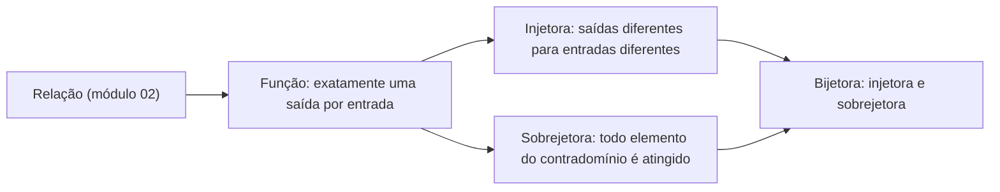

# 04 · Funções

**Tempo estimado:** 30 minutos · **Pré-requisito:** [[03 - Relações de equivalência e de ordem]].

**Ao final você vai conseguir:**

1. Dizer se uma relação é uma função, usando a regra "exatamente um".
2. Identificar se uma função é injetora e se é sobrejetora, a partir de exemplos e de testes.
3. Reconhecer uma bijeção, que é injetora e sobrejetora ao mesmo tempo.

**Antes de começar:** você já sabe o que é uma relação e os pares ordenados (módulos 02 e 03). Uma função é uma relação com uma regra extra.

---

## Para começar

Um sistema de cadastro associa a cada aluno um número de matrícula. Cada aluno tem **uma** matrícula, e a pergunta "qual é a matrícula deste aluno?" tem sempre **uma** resposta. Se um aluno tivesse duas, o sistema não saberia qual usar. Esse é o núcleo de uma função: cada entrada tem exatamente uma saída.

---

## Mapa do módulo



*Figura 1: uma função é uma relação especial. Injetora e sobrejetora são duas perguntas independentes sobre ela; a bijeção é quando as duas valem ao mesmo tempo.*

**Como ler:** as setas indicam "é um caso de" ou "é necessário para". Injetora e sobrejetora se combinam na bijetora.

---

## Mini-aula 1: função é uma relação com exatamente uma saída

> [!tip] Ideia
> Uma função é uma relação em que cada elemento do primeiro conjunto tem exatamente um parceiro no segundo.

> [!info] Definição
> Sejam A e B conjuntos. Uma **função** (function) de A em B é uma relação f em que **cada** elemento de A se relaciona com **exatamente um** elemento de B. A é o **domínio** (domain) e B é o **contradomínio** (codomain). O conjunto das saídas que realmente aparecem é a **imagem** (range), que é um subconjunto de B.

Veja um exemplo com pares ordenados. Antes de rodar, pense: `(1, "b")` está em f?

```python
f = {(1, "a"), (2, "b"), (3, "a")}
print((1, "a") in f)
print((1, "b") in f)
```

Saída real:

```
True
False
```

**Como ler:** `(1, "a")` está em f, então `1` se relaciona com `"a"`. `(1, "b")` não está, e isso é correto: a função só tem uma saída para 1.

> [!warning] Armadilha comum
> Não basta cada elemento ter *alguma* saída. Ele precisa ter *exatamente uma*. Se o 1 se relaciona com `"a"` e com `"b"`, a relação não é função.

> [!question]- Checkpoint
> 1. Em A = `{1, 2}` e B = `{"a", "b"}`, a relação `{(1, "a"), (2, "a")}` é uma função?
> 2. A relação `{(1, "a"), (1, "b"), (2, "b")}` é uma função?
>
> > [!success]- Resposta
> > 1. Sim. Cada elemento de A tem exatamente uma saída, mesmo que as duas saídas sejam iguais.
> > 2. Não. O 1 tem duas saídas, `"a"` e `"b"`.

---

## Mini-aula 2: injetora e sobrejetora

> [!tip] Ideia
> Injetora: entradas diferentes nunca vão para a mesma saída. Sobrejetora: toda saída possível é atingida por alguma entrada.

> [!info] Definição
> Seja f uma função de A em B.
>
> - **Injetora** (injective, também chamada "um-para-um"): para `a` e `b` em A, se `a ≠ b` então `f(a) ≠ f(b)`.
> - **Sobrejetora** (surjective, também chamada "sobre"): a imagem de f é igual ao contradomínio B. Todo elemento de B é saída de alguma entrada.
> - **Bijetora** (bijective): injetora e sobrejetora ao mesmo tempo.

Veja no código. Os pares `(1, "a")` e `(3, "a")` mostram duas entradas com a mesma saída.

```python
f = {(1, "a"), (2, "b"), (3, "a")}
imagens = {b for (a, b) in f}
print(len(f), len(imagens))
```

Saída real:

```
3 2
```

**Como ler:** há 3 pares, mas só 2 saídas diferentes. Duas entradas (1 e 3) compartilham a saída `"a"`. Por isso essa função não é injetora.

> [!warning] Armadilha comum
> Injetora e sobrejetora são perguntas diferentes. Uma função pode ser sobrejetora sem ser injetora, e o contrário também. O exemplo acima não é injetora; a sobrejetividade depende do contradomínio escolhido.

> [!question]- Checkpoint
> 1. A = `{1, 2}`, B = `{"a", "b"}`, f = `{(1, "a"), (2, "b")}`. f é injetora?
> 2. A mesma f é sobrejetora?
>
> > [!success]- Resposta
> > 1. Sim. Entradas diferentes (1 e 2) têm saídas diferentes (`"a"` e `"b"`).
> > 2. Sim. A imagem é `{"a", "b"}`, que é igual a B.

---

## Mini-aula 3: bijeção

> [!tip] Ideia
> Uma bijeção é uma função que "emparelha" os elementos de A com os de B, sem sobra nem repetição.

> [!info] Definição
> Uma função é **bijetora** quando é injetora e sobrejetora. Isso quer dizer que cada elemento de B é a saída de exatamente uma entrada de A.

Como ler: se A tem 2 elementos e B tem 2 elementos, uma bijeção conecta cada um de A a um de B, sem que sobre nenhum elemento de nenhum dos dois lados. Se os conjuntos têm tamanhos diferentes, não há bijeção entre eles.

> [!warning] Armadilha comum
> Ter a mesma quantidade de elementos em A e B não basta para ser bijeção. A função ainda precisa ser injetora e sobrejetora.

> [!question]- Checkpoint
> 1. Dê um exemplo de função bijetora de `{1, 2}` em `{"a", "b"}`.
> 2. A função `{(1, "a"), (2, "a")}` de `{1, 2}` em `{"a", "b"}` é bijetora?
>
> > [!success]- Resposta
> > 1. Por exemplo, `{(1, "a"), (2, "b")}`.
> > 2. Não. Não é injetora (1 e 2 vão para `"a"`) e não é sobrejetora (`"b"` não é atingido).

---

## Exercícios

Cada exercício tem um bloco com a função a completar e os testes com `assert`. Quando todos passarem, aparece `Passou!`.

### Aquecimento

**A1. Função.** Complete `e_funcao(A, B, f)`. Aqui, uma função é um conjunto de pares `(a, b)` em que cada `a` de A aparece exatamente uma vez como primeiro elemento, e todo `b` pertence a B.

```python
def e_funcao(A, B, f):
    """Devolve True se f é uma função de A em B: cada a de A tem exatamente um par (a, b) em f, com b em B."""
    ...

assert e_funcao({1, 2, 3}, {"a", "b"}, {(1, "a"), (2, "b"), (3, "a")}) == True, "esta f é função de A em B"
assert e_funcao({1, 2, 3}, {"a", "b"}, {(1, "a"), (2, "b")}) == False, "falta o 3: nem todo elemento de A tem imagem"
assert e_funcao({1, 2, 3}, {"a", "b"}, {(1, "a"), (1, "b"), (2, "b"), (3, "a")}) == False, "o 1 tem duas imagens"
print("Passou!")
```

> [!hint]- Dica 1
> Primeiro confira se todos os pares têm `a` em A e `b` em B.

> [!hint]- Dica 2
> Depois, para cada `a` de A, conte quantos pares começam com `a`. A contagem precisa dar 1.

> [!example]- Solução
> ```python
> def e_funcao(A, B, f):
>     """Devolve True se f é uma função de A em B: cada a de A tem exatamente um par (a, b) em f, com b em B."""
>     for (a, b) in f:
>         if a not in A or b not in B:
>             return False
>     for a in A:
>         contagem = 0
>         for (c, d) in f:
>             if c == a:
>                 contagem += 1
>         if contagem != 1:
>             return False
>     return True
> ```
>
> **Erro comum:** Verificar só que cada `a` aparece pelo menos uma vez. Com `(1, "a")` e `(1, "b")`, o elemento 1 teria duas imagens, e isso não é função.

**A2. Injetora.** Complete `e_injetora(f)`. Ela devolve `True` se elementos diferentes têm imagens diferentes: se `(a, b)` e `(c, b)` estão em f, então `a = c`.

```python
def e_injetora(f):
    """Devolve True se elementos diferentes têm imagens diferentes: se (a, b) e (c, b) estão em f, então a = c."""
    ...

assert e_injetora({(1, "a"), (2, "b"), (3, "c")}) == True, "imagens todas diferentes"
assert e_injetora({(1, "a"), (2, "a")}) == False, "1 e 2 têm a mesma imagem 'a'"
assert e_injetora({(1, "a")}) == True, "um único par é injetora"
print("Passou!")
```

> [!hint]- Dica 1
> Compare cada par com cada outro par. Dois pares com a mesma segunda coordenada precisam ter a mesma primeira.

> [!hint]- Dica 2
> Use dois `for`, um dentro do outro, e dentro deles `if b == d and a != c:`. Se a condição acontecer, `return False`.

> [!example]- Solução
> ```python
> def e_injetora(f):
>     """Devolve True se elementos diferentes têm imagens diferentes: se (a, b) e (c, b) estão em f, então a = c."""
>     for (a, b) in f:
>         for (c, d) in f:
>             if b == d and a != c:
>                 return False
>     return True
> ```
>
> **Erro comum:** Testar só `a != c`, sem checar `b == d`. Assim a função acusa erro em qualquer par com primeiras coordenadas diferentes.

**A3. Sobrejetora.** Complete `e_sobrejetora(B, f)`. Ela devolve `True` se todo elemento de B aparece como segunda coordenada de algum par de f.

```python
def e_sobrejetora(B, f):
    """Devolve True se todo b de B aparece como imagem: existe (a, b) em f."""
    ...

assert e_sobrejetora({"a", "b"}, {(1, "a"), (2, "b"), (3, "a")}) == True, "a e b são imagens"
assert e_sobrejetora({"a", "b", "c"}, {(1, "a"), (2, "b"), (3, "a")}) == False, "c não é imagem"
assert e_sobrejetora({"a"}, {(1, "a"), (2, "a")}) == True, "a é imagem"
print("Passou!")
```

> [!hint]- Dica 1
> Para cada `b` de B, procure um par de f cuja segunda coordenada seja `b`.

> [!hint]- Dica 2
> Use `achou = False` antes da busca. Ao encontrar, mude para `True`. Se `achou` continuar `False` no fim, `return False`.

> [!example]- Solução
> ```python
> def e_sobrejetora(B, f):
>     """Devolve True se todo b de B aparece como imagem: existe (a, b) em f."""
>     for b in B:
>         achou = False
>         for (a, c) in f:
>             if c == b:
>                 achou = True
>         if not achou:
>             return False
>     return True
> ```
>
> **Erro comum:** Verificar só se f não está vazia. A função precisa checar todo elemento de B, um a um.

### Praticando

**P1. Bijetora.** Complete `e_bijetora(A, B, f)`. Ela devolve `True` se f é função de A em B, injetora e sobrejetora. As três funções anteriores já estão prontas.

```python
def e_funcao(A, B, f):
    # já pronta, do exercício A1
    for (a, b) in f:
        if a not in A or b not in B:
            return False
    for a in A:
        contagem = 0
        for (c, d) in f:
            if c == a:
                contagem += 1
        if contagem != 1:
            return False
    return True

def e_injetora(f):
    # já pronta, do exercício A2
    for (a, b) in f:
        for (c, d) in f:
            if b == d and a != c:
                return False
    return True

def e_sobrejetora(B, f):
    # já pronta, do exercício A3
    for b in B:
        achou = False
        for (a, c) in f:
            if c == b:
                achou = True
        if not achou:
            return False
    return True

def e_bijetora(A, B, f):
    """Devolve True se f é função de A em B, injetora e sobrejetora."""
    ...

assert e_bijetora({1, 2}, {"a", "b"}, {(1, "a"), (2, "b")}) == True, "identidade de duas letras: bijetora"
assert e_bijetora({1, 2, 3}, {"a", "b"}, {(1, "a"), (2, "b"), (3, "a")}) == False, "2 e 3 não são injetores"
assert e_bijetora({1, 2}, {"a"}, {(1, "a"), (2, "a")}) == False, "as duas imagens são iguais"
print("Passou!")
```

> [!hint]- Dica 1
> Combine as três condições com `and`.

> [!example]- Solução
> ```python
> def e_bijetora(A, B, f):
>     """Devolve True se f é função de A em B, injetora e sobrejetora."""
>     return e_funcao(A, B, f) and e_injetora(f) and e_sobrejetora(B, f)
> ```
>
> **Erro comum:** Esquecer uma das três. Com `(1, "a")` e `(2, "a")` sobre `{1, 2}` e `{"a"}`, a função é válida e sobrejetora, mas não é injetora: a segunda condição é que falha.

**P2. Imagem.** Complete `imagem(f)`, que devolve o conjunto dos valores que aparecem como segunda coordenada dos pares de f. Esse conjunto é a imagem (range) de f.

```python
def imagem(f):
    """Devolve o conjunto das segundas coordenadas dos pares de f."""
    ...

assert imagem({(1, "a"), (2, "b"), (3, "a")}) == {"a", "b"}, "a imagem tem a e b, sem repetir"
assert imagem({(1, "x")}) == {"x"}, "um só par, uma só imagem"
assert imagem({(1, "a"), (2, "a")}) == {"a"}, "duas entradas, mesma saída"
print("Passou!")
```

> [!hint]- Dica 1
> Use uma expressão de conjunto, como no módulo 01, percorrendo os pares de f.

> [!hint]- Dica 2
> Guarde só a segunda coordenada de cada par.

> [!example]- Solução
> ```python
> def imagem(f):
>     """Devolve o conjunto das segundas coordenadas dos pares de f."""
>     return {b for (a, b) in f}
> ```
>
> **Erro comum:** Devolver a primeira coordenada, ou a lista de pares. A imagem é o conjunto dos valores de saída.

**P3. Função por regra.** Complete `f_quadrado(n)`, que devolve o conjunto de pares `{(x, x * x) | 1 ≤ x ≤ n}`.

```python
def f_quadrado(n):
    """Devolve o conjunto de pares {(x, x * x) | 1 ≤ x ≤ n}."""
    ...

assert f_quadrado(3) == {(1, 1), (2, 4), (3, 9)}, "f_quadrado(3) deveria ser {(1, 1), (2, 4), (3, 9)}"
assert f_quadrado(1) == {(1, 1)}, "f_quadrado(1) deveria ser {(1, 1)}"
assert f_quadrado(4) == {(1, 1), (2, 4), (3, 9), (4, 16)}, "faltou algum par até 4"
print("Passou!")
```

> [!hint]- Dica 1
> Use uma expressão de conjunto com `for x in range(...)`. O intervalo vai de 1 até n, incluindo o n.

> [!hint]- Dica 2
> A expressão do par é `(x, x * x)`.

> [!example]- Solução
> ```python
> def f_quadrado(n):
>     """Devolve o conjunto de pares {(x, x * x) | 1 ≤ x ≤ n}."""
>     return {(x, x * x) for x in range(1, n + 1)}
> ```
>
> **Erro comum:** Usar `range(n)`. Assim o 0 entra no domínio, e a regra pede de 1 até n.

### Desafio

**D1. Classificação.** Complete `classifica(A, B, f)`. A função devolve, como texto: `"nao funcao"` se f não é função de A em B; `"bijetora"` se é injetora e sobrejetora; `"injetora"` se só é injetora; `"sobrejetora"` se só é sobrejetora; e `"geral"` nos outros casos. As funções `e_funcao`, `e_injetora` e `e_sobrejetora` já estão prontas.

```python
def e_funcao(A, B, f):
    # já pronta, do exercício A1
    for (a, b) in f:
        if a not in A or b not in B:
            return False
    for a in A:
        contagem = 0
        for (c, d) in f:
            if c == a:
                contagem += 1
        if contagem != 1:
            return False
    return True

def e_injetora(f):
    # já pronta, do exercício A2
    for (a, b) in f:
        for (c, d) in f:
            if b == d and a != c:
                return False
    return True

def e_sobrejetora(B, f):
    # já pronta, do exercício A3
    for b in B:
        achou = False
        for (a, c) in f:
            if c == b:
                achou = True
        if not achou:
            return False
    return True

def classifica(A, B, f):
    """Devolve 'nao funcao', 'bijetora', 'injetora', 'sobrejetora' ou 'geral'."""
    ...

assert classifica({1, 2}, {"a", "b"}, {(1, "a"), (2, "b")}) == "bijetora", "bijetora"
assert classifica({1, 2, 3}, {"a", "b"}, {(1, "a"), (2, "b"), (3, "a")}) == "sobrejetora", "sobrejetora, não injetora"
assert classifica({1, 2}, {"a", "b", "c"}, {(1, "a"), (2, "b")}) == "injetora", "injetora, não sobrejetora"
assert classifica({1, 2, 3}, {"a", "b"}, {(1, "a"), (2, "a"), (3, "a")}) == "geral", "nem injetora, nem sobrejetora"
assert classifica({1, 2}, {"a"}, {(1, "a")}) == "nao funcao", "falta a imagem do 2"
print("Passou!")
```

> [!hint]- Dica 1
> Comece pelo teste de função. Depois calcule duas variáveis: `inj` e `sob`.

> [!hint]- Dica 2
> Teste primeiro os dois juntos. Depois, só `inj`, e só `sob`. O que sobrar é `"geral"`.

> [!example]- Solução
> ```python
> def classifica(A, B, f):
>     """Devolve 'nao funcao', 'bijetora', 'injetora', 'sobrejetora' ou 'geral'."""
>     if not e_funcao(A, B, f):
>         return "nao funcao"
>     inj = e_injetora(f)
>     sob = e_sobrejetora(B, f)
>     if inj and sob:
>         return "bijetora"
>     if inj:
>         return "injetora"
>     if sob:
>         return "sobrejetora"
>     return "geral"
> ```
>
> **Erro comum:** Testar só `inj` antes de checar os dois juntos. Assim o caso bijetora nunca aparece, porque a primeira condição já responde.


## Mini-projeto (opcional)

Um exercício maior, que junta as funções anteriores. Tente sozinho antes de abrir a solução.

**Objetivo.** Uma escola tem uma tabela de pares `(aluno, matrícula)`. Devolva a lista ordenada das matrículas, se cada matrícula pertencer a um único aluno (ou seja, se a tabela é injetora). Caso contrário, devolva `None`. A função `e_injetora`, do exercício A2, já está pronta.

```python
def e_injetora(f):
    # já pronta, do exercício A2
    for (a, b) in f:
        for (c, d) in f:
            if b == d and a != c:
                return False
    return True

def matriculas_unicas(tabela):
    """Devolve a lista ordenada das matrículas se a tabela é injetora; senão None."""
    ...

assert matriculas_unicas({("ana", 10), ("bia", 11)}) == [10, 11], "matrículas diferentes, em ordem"
assert matriculas_unicas({("ana", 10), ("bia", 10)}) is None, "duas pessoas com a mesma matrícula"
assert matriculas_unicas(set()) == [], "tabela vazia"
print("Passou!")
```

> [!hint]- Dica 1
> Comece com `if not e_injetora(tabela): return None`.

> [!hint]- Dica 2
> Use `sorted({m for (a, m) in tabela})` para pegar as matrículas em ordem, sem repetir.

> [!example]- Solução
> ```python
> def matriculas_unicas(tabela):
>     """Devolve a lista ordenada das matrículas se a tabela é injetora; senão None."""
>     if not e_injetora(tabela):
>         return None
>     return sorted({m for (a, m) in tabela})
> ```
>
> **Erro comum:** Usar `a` (o aluno) no lugar de `m` (a matrícula). A saída deve ser a segunda coordenada de cada par.


---

## Fechando

**Resumo**

- Função: relação em que cada entrada tem exatamente uma saída.
- Domínio é o conjunto de entradas; contradomínio é o conjunto de saídas possíveis; imagem é o conjunto das saídas que aparecem.
- Injetora: entradas diferentes têm saídas diferentes.
- Sobrejetora: a imagem é todo o contradomínio.
- Bijetora: injetora e sobrejetora.

**Glossário rápido**

- **Função** (function): relação em que cada elemento do domínio tem exatamente uma saída.
- **Domínio** (domain): conjunto das entradas.
- **Contradomínio** (codomain): conjunto onde as saídas devem estar.
- **Imagem** (range): conjunto das saídas que realmente aparecem.
- **Injetora** (injective): saídas diferentes para entradas diferentes.
- **Sobrejetora** (surjective): a imagem é todo o contradomínio.
- **Bijetora** (bijective): injetora e sobrejetora ao mesmo tempo.

**Perguntas de revisão**

1. Por que `{(1, "a"), (1, "b")}` não é função, mesmo que cada elemento de A apareça na relação?
2. Uma função de `{1, 2, 3}` em `{"a", "b"}` pode ser injetora? Por quê?
3. Escreva uma função de `{1, 2}` em `{"a", "b"}` que seja sobrejetora mas não injetora.

**E agora?** O próximo módulo é **Lógica proposicional**. Ele estuda como afirmações são combinadas com "não", "e" e "ou", e como decidir se um argumento é válido. Você vai usar as mesmas ideias de conjunto e de função, agora com verdadeiro e falso.

---

## Para ir mais fundo

- [[Function]]
- [[Relation]]
