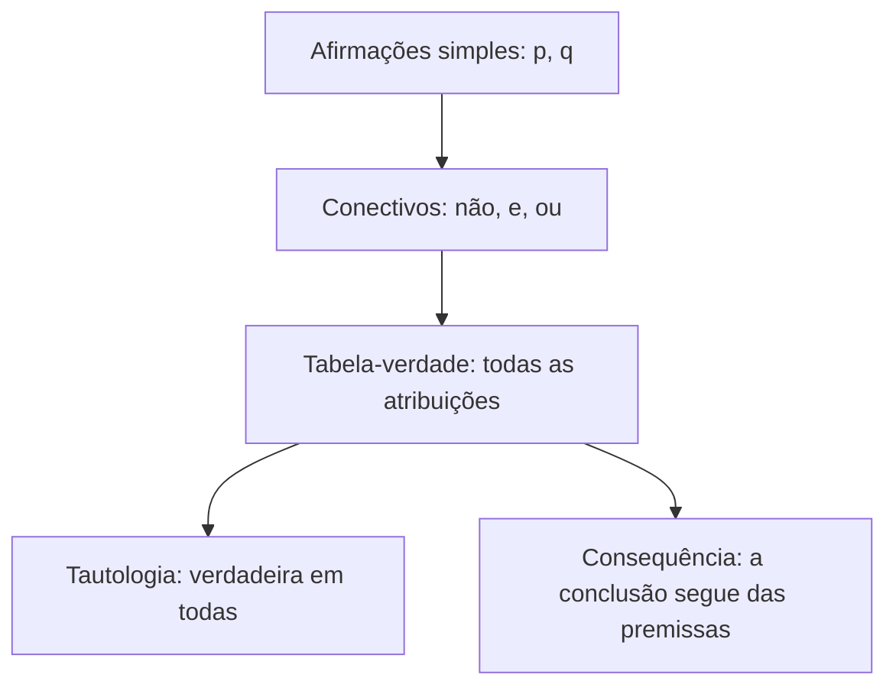

# 05 · Lógica proposicional

**Tempo estimado:** 30 minutos · **Pré-requisito:** [[01 - Conjuntos]] (a ideia de conjunto de atribuições).

**Ao final você vai conseguir:**

1. Escrever uma afirmação composta com "não", "e" e "ou", e calcular sua tabela-verdade.
2. Dizer se uma fórmula é tautologia, isto é, verdadeira em todas as atribuições.
3. Dizer se uma conclusão é consequência de premissas, procurando contraexemplos.

**Antes de começar:** você não precisa de nada além de Python básico. Este módulo é a base das provas que vêm depois.

---

## Para começar

Um amigo diz: "Ou eu estudo, ou eu jogo. Não estudo. Logo, eu jogo." Você consegue dizer se a conclusão é uma consequência necessária do que ele disse, sem depender de quem fala? A lógica proposicional responde isso com uma tabela: testamos todos os casos possíveis de verdade e vemos se a conclusão nunca falha quando as premissas valem.

---

## Mapa do módulo



*Figura 1: afirmações simples são combinadas com conectivos. A tabela-verdade mostra o valor de cada combinação em todas as atribuições, e dela saem as duas perguntas principais: tautologia e consequência.*

**Como ler:** siga as setas. Cada passo usa o anterior.

---

## Mini-aula 1: afirmações e conectivos

> [!tip] Ideia
> Uma afirmação simples é verdadeira ou falsa. Conectivos combinam afirmações em afirmações maiores.

> [!info] Definição
> Uma **variável proposicional** (propositional variable), ou letra de sentença, é um símbolo que representa uma afirmação, como `p` ou `q`. Ela tem um valor de verdade: verdadeiro ou falso.
>
> Um **conectivo** (connective) combina afirmações. A biblioteca cita, entre outros, a negação (¬, "não"), a conjunção (∧, "e") e a disjunção (∨, "ou").

Neste curso, o Python é a nossa calculadora: `not` representa ¬, `and` representa ∧ e `or` representa ∨. O código abaixo mostra os três conectivos para todas as combinações de `p` e `q`. Antes de rodar, preveja a linha em que `p` é verdadeiro e `q` é falso.

```python
for p in (True, False):
    for q in (True, False):
        print(p, q, p and q, p or q, not p)
```

Saída real:

```
True True True True False
True False False True False
False True False True True
False False False False True
```

**Como ler:** cada linha é uma atribuição, isto é, uma escolha de verdadeiro ou falso para `p` e `q`. As três colunas finais mostram `p and q`, `p or q` e `not p`, ou seja, `p e q`, `p ou q` e `não p`.

> [!warning] Armadilha comum
> `p ou q` no sentido da lógica inclui o caso em que os dois são verdadeiros. Não é o "ou" exclusivo do dia a dia, em que só um dos dois vale. Na linha `True True`, a disjunção dá `True`.

> [!question]- Checkpoint
> 1. Na linha `True False`, quanto vale `p ou q`?
> 2. Na linha `False False`, quanto vale `p e q`?
>
> > [!success]- Resposta
> > 1. `True`. Basta um dos dois ser verdadeiro.
> > 2. `False`. Para `e` ser verdadeiro, os dois precisam ser.

---

## Mini-aula 2: atribuição de verdade e tabela-verdade

> [!tip] Ideia
> Para saber se uma fórmula sempre dá um certo resultado, testamos todas as atribuições possíveis de verdade.

> [!info] Definição
> Uma **atribuição de verdade** (truth assignment) é uma função que dá um valor de verdade a cada variável proposicional. Uma **tabela-verdade** (truth table) lista o resultado de uma fórmula para todas as atribuições.

Com duas variáveis, há quatro atribuições. A tabela da mini-aula anterior é exatamente isso: cada linha é uma atribuição, e cada coluna é o resultado de uma fórmula nela.

> [!warning] Armadilha comum
> Uma tabela tem uma linha para cada atribuição, não para cada fórmula. Se você esquecer uma atribuição, pode achar que uma fórmula é sempre verdadeira quando não é.

> [!question]- Checkpoint
> 1. Liste todas as atribuições de duas variáveis `p` e `q`.
> 2. A fórmula `p e q` é verdadeira em quantas dessas atribuições?
>
> > [!success]- Resposta
> > 1. `(True, True)`, `(True, False)`, `(False, True)` e `(False, False)`.
> > 2. Em uma só: `(True, True)`.

---

## Mini-aula 3: tautologia e consequência

> [!tip] Ideia
> Uma tautologia vale sempre. Uma conclusão é consequência de premissas quando nunca falha enquanto as premissas valem.

> [!info] Definição
> - Uma fórmula é **tautologia** (tautology), ou **válida** (valid), quando é verdadeira em qualquer atribuição de verdade.
> - A fórmula A é **consequência lógica** (logical consequence) de um conjunto de premissas Γ quando toda atribuição que torna todas as premissas verdadeiras também torna A verdadeira.

Dois exemplos. "p ou não p" é tautologia: o resultado é verdadeiro nas duas linhas da tabela de uma variável. Já "p" não segue de "p ou q": na atribuição `(False, True)`, a premissa vale e a conclusão `p` falha.

> [!warning] Armadilha comum
> Um argumento válido não tem conclusão necessariamente verdadeira. Ele só garante que, se as premissas forem verdadeiras, a conclusão também será. Validade fala da forma do argumento, não da verdade das premissas.

> [!question]- Checkpoint
> 1. "p e não p" é tautologia?
> 2. A conclusão `p` é consequência de `p ou q`?
>
> > [!success]- Resposta
> > 1. Não. Na atribuição `(True, False)`, `p e não p` é falso, e portanto a fórmula não vale sempre.
> > 2. Não. Em `(False, True)`, `p ou q` vale e `p` falha.

---

## Exercícios

Cada exercício tem um bloco com a função a completar e os testes com `assert`. Quando todos passarem, aparece `Passou!`. Fórmulas de duas variáveis são escritas como funções `lambda p, q: ...`.

### Aquecimento

**A1. Negação.** Complete `neg(p)`, que devolve a negação de `p`. Use o operador do Python que representa ¬.

```python
def neg(p):
    """Devolve a negação de p: True se p é False, False se p é True."""
    ...

assert neg(True) == False, "a negação de verdadeiro é falso"
assert neg(False) == True, "a negação de falso é verdadeiro"
print("Passou!")
```

> [!hint]- Dica 1
> O operador é `not`.

> [!hint]- Dica 2
> Basta devolver `not p`.

> [!example]- Solução
> ```python
> def neg(p):
>     """Devolve a negação de p: True se p é False, False se p é True."""
>     return not p
> ```
>
> **Erro comum:** Devolver `-p`. Com `True`, o resultado é `-1`, e não `False`.

**A2. Disjunção.** Complete `disj(p, q)`, que devolve `True` quando `p` é verdadeiro, ou `q` é verdadeiro, ou ambos. Use o operador do Python que representa ∨.

```python
def disj(p, q):
    """Devolve True se p é True, ou q é True, ou os dois são."""
    ...

assert disj(False, False) == False, "nenhum dos dois é verdadeiro"
assert disj(True, False) == True, "p é verdadeiro"
assert disj(False, True) == True, "q é verdadeiro"
assert disj(True, True) == True, "os dois são verdadeiros"
print("Passou!")
```

> [!hint]- Dica 1
> O operador é `or`.

> [!hint]- Dica 2
> Basta devolver `p or q`.

> [!example]- Solução
> ```python
> def disj(p, q):
>     """Devolve True se p é True, ou q é True, ou os dois são."""
>     return p or q
> ```
>
> **Erro comum:** Usar `and`. Com `disj(True, False)`, o `and` devolve `False`, mas a disjunção deve dar `True`.

**A3. Tabela-verdade.** Complete `tabela(f)`. A função recebe uma fórmula de duas variáveis, `f(p, q)`, e devolve a lista de resultados para as quatro atribuições, nesta ordem: `(True, True)`, `(True, False)`, `(False, True)`, `(False, False)`.

```python
def tabela(f):
    """Devolve os resultados de f(p, q) para (T,T), (T,F), (F,T), (F,F), nesta ordem."""
    ...

assert tabela(lambda p, q: p and q) == [True, False, False, False], "tabela de e"
assert tabela(lambda p, q: p or q) == [True, True, True, False], "tabela de ou"
assert tabela(lambda p, q: not p) == [False, False, True, True], "tabela de não p"
print("Passou!")
```

> [!hint]- Dica 1
> Use dois `for`: o externo percorre `p` em `(True, False)`, o interno percorre `q` em `(True, False)`. Essa é a ordem pedida.

> [!hint]- Dica 2
> Dentro dos dois `for`, guarde `f(p, q)` na lista com `append`.

> [!example]- Solução
> ```python
> def tabela(f):
>     """Devolve os resultados de f(p, q) para (T,T), (T,F), (F,T), (F,F), nesta ordem."""
>     resultado = []
>     for p in (True, False):
>         for q in (True, False):
>             resultado.append(f(p, q))
>     return resultado
> ```
>
> **Erro comum:** Trocar a ordem dos `for`, ou começar por `(False, False)`. A lista sai em outra ordem, e o teste compara a lista inteira.

### Praticando

**P1. Tautologia.** Complete `e_tautologia(f)`. Ela devolve `True` se `f(p, q)` é verdadeiro em todas as quatro atribuições. A função `tabela`, do exercício anterior, já está pronta.

```python
def tabela(f):
    # já pronta, do exercício A3
    resultado = []
    for p in (True, False):
        for q in (True, False):
            resultado.append(f(p, q))
    return resultado

def e_tautologia(f):
    """Devolve True se f(p, q) é verdadeiro em todas as atribuições de p e q."""
    ...

assert e_tautologia(lambda p, q: p or not p) == True, "p ou não p vale sempre"
assert e_tautologia(lambda p, q: p and q) == False, "falha em (True, False)"
assert e_tautologia(lambda p, q: q or not q) == True, "q ou não q vale sempre"
print("Passou!")
```

> [!hint]- Dica 1
> Percorra os valores de `tabela(f)`. Se algum for falso, a resposta é `False`.

> [!hint]- Dica 2
> Dentro de um `for`, use `if not valor:`.

> [!example]- Solução
> ```python
> def e_tautologia(f):
>     """Devolve True se f(p, q) é verdadeiro em todas as atribuições de p e q."""
>     for valor in tabela(f):
>         if not valor:
>             return False
>     return True
> ```
>
> **Erro comum:** Verificar só uma atribuição, como `(True, True)`. Uma tautologia precisa valer em todas as quatro.

**P2. Consequência.** Complete `consequencia(premissas, conclusao)`. `premissas` é uma lista de fórmulas de duas variáveis, e `conclusao` é uma fórmula de duas variáveis. A função devolve `True` se, em toda atribuição que torna todas as premissas verdadeiras, a conclusão também é verdadeira.

```python
def consequencia(premissas, conclusao):
    """Devolve True se, em toda atribuição que torna as premissas verdadeiras, a conclusão também é verdadeira."""
    ...

assert consequencia([lambda p, q: p, lambda p, q: (not p) or q], lambda p, q: q) == True, "a conclusão segue das duas premissas"
assert consequencia([lambda p, q: p or q], lambda p, q: p) == False, "p ou q não garante p"
assert consequencia([], lambda p, q: p or not p) == True, "sem premissas, só vale a tautologia"
print("Passou!")
```

> [!hint]- Dica 1
> Para cada atribuição, veja primeiro se todas as premissas valem. Só então confira a conclusão.

> [!hint]- Dica 2
> Se encontrar um caso em que as premissas valem e a conclusão falha, `return False`.

> [!example]- Solução
> ```python
> def consequencia(premissas, conclusao):
>     """Devolve True se, em toda atribuição que torna as premissas verdadeiras, a conclusão também é verdadeira."""
>     for p in (True, False):
>         for q in (True, False):
>             todas = True
>             for g in premissas:
>                 if not g(p, q):
>                     todas = False
>             if todas and not conclusao(p, q):
>                 return False
>     return True
> ```
>
> **Erro comum:** Testar a conclusão em todas as atribuições, inclusive as em que alguma premissa é falsa. A definição só olha os casos em que as premissas valem.

**P3. Mesmos valores.** Complete `equivalentes(f, g)`. Ela devolve `True` se `f` e `g` dão o mesmo resultado nas quatro atribuições. Use `tabela`, que já está pronta.

```python
def tabela(f):
    # já pronta, do exercício A3
    resultado = []
    for p in (True, False):
        for q in (True, False):
            resultado.append(f(p, q))
    return resultado

def equivalentes(f, g):
    """Devolve True se f e g dão o mesmo resultado nas quatro atribuições."""
    ...

assert equivalentes(lambda p, q: not (p and q), lambda p, q: (not p) or (not q)) == True, "as duas fórmulas dão a mesma tabela"
assert equivalentes(lambda p, q: p and q, lambda p, q: p or q) == False, "diferem em (True, False)"
assert equivalentes(lambda p, q: p, lambda p, q: p) == True, "uma fórmula é igual a si mesma"
print("Passou!")
```

> [!hint]- Dica 1
> Compare as duas listas que `tabela` devolve.

> [!example]- Solução
> ```python
> def equivalentes(f, g):
>     """Devolve True se f e g dão o mesmo resultado nas quatro atribuições."""
>     return tabela(f) == tabela(g)
> ```
>
> **Erro comum:** Comparar só a primeira posição. Duas fórmulas podem coincidir em uma atribuição e discordar nas outras.

### Desafio

**D1. Contraexemplo.** Complete `contra_exemplo(premissas, conclusao)`. A função devolve o primeiro par `(p, q)`, na ordem da tabela, em que todas as premissas são verdadeiras e a conclusão é falsa. Se não houver nenhum, devolve `None`.

```python
def contra_exemplo(premissas, conclusao):
    """Devolve o primeiro (p, q) com premissas verdadeiras e conclusão falsa, ou None."""
    ...

assert contra_exemplo([lambda p, q: p or q], lambda p, q: p) == (False, True), "p falso e q verdadeiro: premissa vale, conclusão falha"
assert contra_exemplo([lambda p, q: p, lambda p, q: (not p) or q], lambda p, q: q) is None, "este argumento não tem contraexemplo"
assert contra_exemplo([], lambda p, q: p) == (False, True), "sem premissas, o primeiro caso em que p falha"
print("Passou!")
```

> [!hint]- Dica 1
> Use o mesmo percurso de `consequencia`, mas, em vez de devolver `False`, devolva `(p, q)`.

> [!hint]- Dica 2
> Se o percurso terminar sem achar nada, `return None`.

> [!example]- Solução
> ```python
> def contra_exemplo(premissas, conclusao):
>     """Devolve o primeiro (p, q) com premissas verdadeiras e conclusão falsa, ou None."""
>     for p in (True, False):
>         for q in (True, False):
>             todas = True
>             for g in premissas:
>                 if not g(p, q):
>                     todas = False
>             if todas and not conclusao(p, q):
>                 return (p, q)
>     return None
> ```
>
> **Erro comum:** Devolver `True` ou `False` em vez do par. O teste compara o par exato, então a resposta precisa dizer qual atribuição falhou.


## Mini-projeto (opcional)

Um exercício maior, que junta as funções anteriores. Tente sozinho antes de abrir a solução.

**Objetivo.** Uma lista de fórmulas de duas variáveis precisa ser checada de uma vez. Devolva, para cada fórmula, `True` se ela é tautologia e `False` caso contrário. A função `e_tautologia`, do exercício P1, já está pronta (com `tabela`).

```python
def tabela(f):
    # já pronta, do exercício A3
    resultado = []
    for p in (True, False):
        for q in (True, False):
            resultado.append(f(p, q))
    return resultado

def e_tautologia(f):
    # já pronta, do exercício P1
    for valor in tabela(f):
        if not valor:
            return False
    return True

def formulas_validas(formulas):
    """Para cada fórmula da lista, devolve True se é tautologia, False caso contrário."""
    ...

assert formulas_validas([lambda p, q: p or not p, lambda p, q: p and q]) == [True, False], "a primeira é tautologia; a segunda não"
assert formulas_validas([]) == [], "lista vazia"
assert formulas_validas([lambda p, q: q or not q]) == [True], "uma tautologia"
print("Passou!")
```

> [!hint]- Dica 1
> Percorra a lista de fórmulas com `for f in formulas:`.

> [!hint]- Dica 2
> Para cada `f`, `append(e_tautologia(f))` na lista de resultados.

> [!example]- Solução
> ```python
> def formulas_validas(formulas):
>     """Para cada fórmula da lista, devolve True se é tautologia, False caso contrário."""
>     resultado = []
>     for f in formulas:
>         resultado.append(e_tautologia(f))
>     return resultado
> ```
>
> **Erro comum:** Devolver só uma resposta para a lista inteira. O resultado precisa ter uma resposta por fórmula, na mesma ordem.


---

## Fechando

**Resumo**

- Variáveis proposicionais são afirmações com valor verdadeiro ou falso.
- Conectivos: não (¬), e (∧) e ou (∨). No Python: `not`, `and` e `or`.
- Atribuição de verdade: uma escolha de valor para cada variável.
- Tabela-verdade: o resultado de uma fórmula em todas as atribuições.
- Tautologia: verdadeira em todas as atribuições.
- Consequência: a conclusão não falha em nenhuma atribuição que torne as premissas verdadeiras.

**Glossário rápido**

- **Variável proposicional** (propositional variable): símbolo que representa uma afirmação.
- **Conectivo** (connective): operador que combina afirmações.
- **Atribuição de verdade** (truth assignment): escolha de valor para cada variável.
- **Tabela-verdade** (truth table): resultados de uma fórmula em todas as atribuições.
- **Tautologia** (tautology): fórmula verdadeira em todas as atribuições.
- **Consequência lógica** (logical consequence): conclusão que não falha quando as premissas valem.
- **Contraexemplo** (counterexample): atribuição em que as premissas valem e a conclusão falha.

**Perguntas de revisão**

1. Quantas atribuições de verdade existem para duas variáveis? Liste-as.
2. "p ou não p" é tautologia? Como você sabe, sem olhar a resposta?
3. Um argumento pode ser válido e ter conclusão falsa? Dê uma razão.

**E agora?** O próximo módulo é **Lógica de predicados**. Ele estende o que você fez aqui com "para todo" e "existe", para falar sobre elementos de um conjunto, e não apenas sobre afirmações fixas.

---

## Para ir mais fundo

- [[Propositional Logic]]
- [[Logical Validity and Consequence]]
