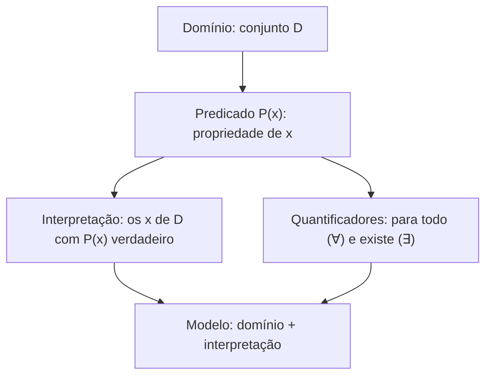

# 06 · Lógica de predicados

**Tempo estimado:** 30 minutos · **Pré-requisito:** [[05 - Lógica proposicional]] e [[01 - Conjuntos]].

**Ao final você vai conseguir:**

1. Ler um predicado como uma propriedade aplicada a elementos de um domínio, e calcular a sua interpretação.
2. Usar os quantificadores "para todo" (∀) e "existe" (∃) em testes sobre um conjunto.
3. Explicar o que é um modelo e por que testar alguns modelos não basta para provar uma consequência.

**Antes de começar:** no [[05 - Lógica proposicional]] você tratou afirmações fixas. Aqui as afirmações falam de elementos de um conjunto.

---

## Para começar

Um sistema de cadastro precisa verificar: "todo aluno tem matrícula?", "existe algum aluno sem matrícula?". A lógica proposicional não consegue expressar isso, porque trata cada aluno como uma afirmação separada. A lógica de predicados fala de **todos** os elementos de um conjunto de uma só vez.

---

## Mapa do módulo



*Figura 1: um predicado é uma propriedade. Sobre um domínio, ele seleciona uma interpretação. Juntando domínio e interpretação temos um modelo, que é o cenário em que medimos verdade.*

**Como ler:** a seta indica "é usado para obter". Um modelo é o cenário completo, e é nele que se testa uma afirmação.

---

## Mini-aula 1: predicado e interpretação

> [!tip] Ideia
> Um predicado é uma propriedade. Aplicado a um domínio, ele separa os elementos que têm a propriedade dos que não têm.

> [!info] Definição
> Um **predicado** (predicate) de uma variável, como `P(x)`, é uma propriedade ou relação que pode ser verdadeira ou falsa para um elemento x. O **domínio** (domain) `D` é o conjunto de coisas sobre as quais falamos.
>
> A **interpretação** (interpretation) de P em D é o conjunto dos elementos de D para os quais P(x) é verdadeiro.

Exemplo: no domínio `{1, 2, 3, 4}`, o predicado "é par" tem como interpretação o conjunto `{2, 4}`. Antes de rodar, preveja o resultado do código.

```python
D = {1, 2, 3, 4}
par = lambda x: x % 2 == 0
print({x for x in D if par(x)})
```

Saída real:

```
{2, 4}
```

**Como ler:** a expressão `{x for x in D if par(x)}` é a definição da interpretação. Ela percorre D e guarda só os x que satisfazem `par`.

> [!warning] Armadilha comum
> A interpretação é um conjunto de elementos do domínio, não uma lista de verdadeiro e falso. Não confunda o conjunto `{2, 4}` com a lista `[False, True, False, True]`, que também aparece no código.

> [!question]- Checkpoint
> 1. No domínio `{1, 2, 3}`, qual é a interpretação do predicado "é maior que 1"?
> 2. No mesmo domínio, qual é a interpretação de "é maior que 5"?
>
> > [!success]- Resposta
> > 1. `{2, 3}`.
> > 2. O conjunto vazio `set()`: nenhum elemento satisfaz.

---

## Mini-aula 2: para todo e existe

> [!tip] Ideia
> "Para todo" exige que o predicado valha em cada elemento. "Existe" exige só um elemento em que ele valha.

> [!info] Definição
> - **Quantificador universal** (∀, "para todo"): `∀x P(x)` é verdadeiro quando P(x) é verdadeiro para todo x do domínio.
> - **Quantificador existencial** (∃, "existe"): `∃x P(x)` é verdadeiro quando P(x) é verdadeiro para pelo menos um x do domínio.

Veja o laço que checa os elementos de um domínio, um a um. Antes de rodar, pense: o predicado "é par" vale para todo o domínio?

```python
D = {1, 2, 3, 4}
par = lambda x: x % 2 == 0
for x in sorted(D):
    print(x, par(x))
```

Saída real:

```
1 False
2 True
3 False
4 True
```

**Como ler:** a linha `1 False` mostra que o predicado falha em um elemento. Para "para todo", um único caso falso já basta para a resposta ser "não". Para "existe", bastaria um caso verdadeiro.

> [!warning] Armadilha comum
> "Nem todo x é par" não é o mesmo que "todo x não é par". No primeiro, há pelo menos um x que não é par. No segundo, nenhum é par. Essa troca de ordem entre "todo" e "não" é o erro mais comum.

> [!question]- Checkpoint
> 1. No domínio `{1, 2, 3, 4}`, "todo x é maior que 0" vale?
> 2. No mesmo domínio, "existe x que é maior que 3" vale?
>
> > [!success]- Resposta
> > 1. Sim. Todos os elementos são positivos.
> > 2. Sim. O 4 é maior que 3.

---

## Mini-aula 3: modelo e consequência

> [!tip] Ideia
> Um modelo é um cenário completo: um domínio e uma interpretação para cada predicado. Uma consequência vale quando não há cenário em que as premissas valem e a conclusão falha.

> [!info] Definição
> - Um **modelo** (model) de uma linguagem é um domínio, junto com uma interpretação dos seus símbolos. Para um predicado, a interpretação é o conjunto dos elementos do domínio que o satisfazem.
> - Uma conclusão A é **consequência lógica** de premissas Γ quando **todo** modelo de Γ também é modelo de A.

Essa definição é a versão de primeira ordem da consequência da mini-aula 3 do módulo 05. A diferença é que o "cenário" agora tem um domínio, e não só valores verdadeiro e falso.

> [!warning] Armadilha comum
> Testar alguns domínios não prova uma consequência. Se a conclusão vale em `{1, 2}` e em `{3, 4}`, ainda pode falhar em outro domínio. Testar pode **refutar** uma consequência (basta um contraexemplo), mas não **provar** que ela vale em todos os modelos.

> [!question]- Checkpoint
> 1. Em `{1, 2, 3}` o predicado "maior que 1" vale para todo x? Vale para algum x?
> 2. Se um domínio mostra um contraexemplo, a consequência é válida?
>
> > [!success]- Resposta
> > 1. Não para todo (o 1 falha), mas sim para algum (o 2 e o 3 valem).
> > 2. Não. Um contraexemplo prova que a consequência é falsa, o que é o oposto de validade.

---

## Exercícios

Cada exercício tem um bloco com a função a completar e os testes com `assert`. Quando todos passarem, aparece `Passou!`. Predicados são escritos como funções `lambda x: ...`.

### Aquecimento

**A1. Para todo.** Complete `todos_satisfazem(D, P)`. Ela devolve `True` se `P(x)` é verdadeiro para **todo** `x` do conjunto `D`. Isso é o quantificador "para todo" (∀).

```python
def todos_satisfazem(D, P):
    """Devolve True se P(x) é verdadeiro para todo x em D (quantificador 'para todo')."""
    ...

assert todos_satisfazem({2, 4, 6}, lambda x: x % 2 == 0) == True, "todos os elementos são pares"
assert todos_satisfazem({1, 2}, lambda x: x % 2 == 0) == False, "o 1 não é par"
assert todos_satisfazem({3}, lambda x: x > 0) == True, "o único elemento é positivo"
print("Passou!")
```

> [!hint]- Dica 1
> Percorra os elementos de D com `for`.

> [!hint]- Dica 2
> Se algum `P(x)` for falso, a resposta é `False` imediatamente. Só depois do laço vale `True`.

> [!example]- Solução
> ```python
> def todos_satisfazem(D, P):
>     """Devolve True se P(x) é verdadeiro para todo x em D (quantificador 'para todo')."""
>     for x in D:
>         if not P(x):
>             return False
>     return True
> ```
>
> **Erro comum:** Devolver `True` já no primeiro elemento verdadeiro. Um só caso bom não basta para "para todo".

**A2. Existe.** Complete `algum_satisfaz(D, P)`. Ela devolve `True` se `P(x)` é verdadeiro para **pelo menos um** `x` de `D`. Isso é o quantificador "existe" (∃).

```python
def algum_satisfaz(D, P):
    """Devolve True se P(x) é verdadeiro para pelo menos um x em D (quantificador 'existe')."""
    ...

assert algum_satisfaz({1, 2, 3}, lambda x: x > 2) == True, "o 3 satisfaz"
assert algum_satisfaz({1, 2}, lambda x: x > 2) == False, "ninguém em {1, 2} é maior que 2"
assert algum_satisfaz({5}, lambda x: x == 5) == True, "o único elemento satisfaz"
print("Passou!")
```

> [!hint]- Dica 1
> Percorra os elementos de D com `for`.

> [!hint]- Dica 2
> Assim que achar um `x` com `P(x)` verdadeiro, `return True`. Se o laço acabar sem achar, `return False`.

> [!example]- Solução
> ```python
> def algum_satisfaz(D, P):
>     """Devolve True se P(x) é verdadeiro para pelo menos um x em D (quantificador 'existe')."""
>     for x in D:
>         if P(x):
>             return True
>     return False
> ```
>
> **Erro comum:** Testar se todos satisfazem, em vez de se algum satisfaz. Com `{1, 2, 3}` e `x > 2`, só o 3 satisfaz, e basta um.

**A3. Interpretação.** Complete `interpretacao(D, P)`. Ela devolve o conjunto dos `x` de `D` para os quais `P(x)` é verdadeiro. Esse conjunto é a interpretação do predicado P no domínio D.

```python
def interpretacao(D, P):
    """Devolve o conjunto dos x de D para os quais P(x) é verdadeiro."""
    ...

assert interpretacao({1, 2, 3, 4}, lambda x: x % 2 == 0) == {2, 4}, "os pares de 1 a 4"
assert interpretacao({1, 2}, lambda x: x > 5) == set(), "ninguém satisfaz: conjunto vazio"
assert interpretacao({1, 2, 3}, lambda x: x > 1) == {2, 3}, "os maiores que 1"
print("Passou!")
```

> [!hint]- Dica 1
> Use uma expressão de conjunto com `for x in D` e uma condição `if`, como no módulo 01.

> [!hint]- Dica 2
> A condição é `P(x)`. Não compare com `True`: basta usar `P(x)` diretamente.

> [!example]- Solução
> ```python
> def interpretacao(D, P):
>     """Devolve o conjunto dos x de D para os quais P(x) é verdadeiro."""
>     return {x for x in D if P(x)}
> ```
>
> **Erro comum:** Devolver a lista de `P(x)` (verdadeiro ou falso para cada x). A interpretação é o conjunto dos `x`, não a lista de valores.

### Praticando

**P1. Se-então em todo.** Complete `se_entao_em_todo(D, P, Q)`. Ela devolve `True` se, para todo `x` de D, quando `P(x)` é verdadeiro, `Q(x)` também é verdadeiro.

```python
def se_entao_em_todo(D, P, Q):
    """Devolve True se, para todo x em D, quando P(x) é verdadeiro, Q(x) também é."""
    ...

assert se_entao_em_todo({2, 4, 6}, lambda x: x % 2 == 0, lambda x: x % 2 == 0) == True, "o mesmo predicado vale sempre"
assert se_entao_em_todo({1, 2, 3}, lambda x: x > 1, lambda x: x > 2) == False, "o 2 satisfaz P e não satisfaz Q"
assert se_entao_em_todo({3, 4}, lambda x: x > 2, lambda x: x > 1) == True, "quem é maior que 2 também é maior que 1"
print("Passou!")
```

> [!hint]- Dica 1
> Percorra D. Para cada `x`, procure um caso em que `P(x)` vale e `Q(x)` falha.

> [!hint]- Dica 2
> Use `if P(x) and not Q(x):`. Se a condição acontecer, `return False`.

> [!example]- Solução
> ```python
> def se_entao_em_todo(D, P, Q):
>     """Devolve True se, para todo x em D, quando P(x) é verdadeiro, Q(x) também é."""
>     for x in D:
>         if P(x) and not Q(x):
>             return False
>     return True
> ```
>
> **Erro comum:** Trocar a condição por `if not P(x) and Q(x):`. Essa checa outro caso, em que P falha, e não o caso que a regra proíbe.

**P2. Nenhum.** Complete `nenhum_satisfaz(D, P)`. Ela devolve `True` se `P(x)` é falso para **todo** `x` de `D`. Ou seja, nenhum elemento satisfaz P.

```python
def nenhum_satisfaz(D, P):
    """Devolve True se P(x) é falso para todo x em D."""
    ...

assert nenhum_satisfaz({1, 3}, lambda x: x % 2 == 0) == True, "1 e 3 não são pares"
assert nenhum_satisfaz({1, 2}, lambda x: x % 2 == 0) == False, "o 2 é par"
assert nenhum_satisfaz({5}, lambda x: x > 10) == True, "5 não é maior que 10"
print("Passou!")
```

> [!hint]- Dica 1
> Percorra D. Se algum `P(x)` for verdadeiro, a resposta é `False`.

> [!hint]- Dica 2
> Ao final do laço, `return True`.

> [!example]- Solução
> ```python
> def nenhum_satisfaz(D, P):
>     """Devolve True se P(x) é falso para todo x em D."""
>     for x in D:
>         if P(x):
>             return False
>     return True
> ```
>
> **Erro comum:** Confundir com `todos_satisfazem`: a pergunta aqui é sobre o caso em que nenhum satisfaz, e a condição do `if` é `P(x)`, sem `not`.

**P3. Mesma interpretação.** Complete `mesmas_interpretacoes(D, P, Q)`. Ela devolve `True` se P e Q são verdadeiros exatamente nos mesmos elementos de D. A função `interpretacao`, do exercício A3, já está pronta.

```python
def interpretacao(D, P):
    # já pronta, do exercício A3
    return {x for x in D if P(x)}

def mesmas_interpretacoes(D, P, Q):
    """Devolve True se P e Q são verdadeiros exatamente nos mesmos elementos de D."""
    ...

assert mesmas_interpretacoes({1, 2, 3, 4}, lambda x: x % 2 == 0, lambda x: x % 2 == 0 and x > 0) == True, "em D, os dois selecionam os mesmos elementos"
assert mesmas_interpretacoes({1, 2, 3}, lambda x: x > 1, lambda x: x > 2) == False, "o 2 está em um e não no outro"
assert mesmas_interpretacoes({1, 2}, lambda x: x > 5, lambda x: x < 0) == True, "nenhum elemento em nenhum dos dois"
print("Passou!")
```

> [!hint]- Dica 1
> Compare as interpretações de P e de Q no domínio D, usando `interpretacao`.

> [!hint]- Dica 2
> Dois conjuntos são iguais quando têm os mesmos elementos. Use `==`.

> [!example]- Solução
> ```python
> def mesmas_interpretacoes(D, P, Q):
>     """Devolve True se P e Q são verdadeiros exatamente nos mesmos elementos de D."""
>     return interpretacao(D, P) == interpretacao(D, Q)
> ```
>
> **Erro comum:** Comparar as funções P e Q diretamente com `==`. Duas funções diferentes podem dar os mesmos resultados em D: o que importa é o conjunto de elementos de D que elas selecionam.

### Desafio

**D1. Validade em domínios.** Complete `validade_em_dominios(dominios, P, Q)`. `dominios` é uma lista de conjuntos. A função devolve `True` se, em **cada** domínio da lista, vale "se P(x), então Q(x)" para todo x. A função `se_entao_em_todo`, do exercício P1, já está pronta.

```python
def se_entao_em_todo(D, P, Q):
    # já pronta, do exercício P1
    for x in D:
        if P(x) and not Q(x):
            return False
    return True

def validade_em_dominios(dominios, P, Q):
    """Devolve True se, em cada domínio da lista, vale 'se P(x), então Q(x)' para todo x."""
    ...

assert validade_em_dominios([{2, 4}, {1, 2, 3, 4}], lambda x: x % 2 == 0, lambda x: x % 2 == 0) == True, "o mesmo predicado nos dois domínios"
assert validade_em_dominios([{1, 2, 3}], lambda x: x > 1, lambda x: x > 2) == False, "falha em {1, 2, 3}"
assert validade_em_dominios([{3, 4}, {5}], lambda x: x > 2, lambda x: x > 1) == True, "vale nos dois domínios"
print("Passou!")
```

> [!hint]- Dica 1
> Percorra a lista de domínios. Para cada D, chame `se_entao_em_todo(D, P, Q)`.

> [!hint]- Dica 2
> Se algum domínio falhar, `return False`. Só depois do laço vale `True`.

> [!example]- Solução
> ```python
> def validade_em_dominios(dominios, P, Q):
>     """Devolve True se, em cada domínio da lista, vale 'se P(x), então Q(x)' para todo x."""
>     for D in dominios:
>         if not se_entao_em_todo(D, P, Q):
>             return False
>     return True
> ```
>
> **Erro comum:** Achar que `True` com alguns domínios prova a validade para todo modelo. A função só olha os domínios dados: ela pode refutar, mas um `True` não prova nada para outros domínios.


## Mini-projeto (opcional)

Um exercício maior, que junta as funções anteriores. Tente sozinho antes de abrir a solução.

**Objetivo.** Uma turma tem as notas em um dicionário `{aluno: nota}`. Devolva `True` se todas as notas são maiores ou iguais a `minima`. A função `todos_satisfazem`, do exercício A1, já está pronta.

```python
def todos_satisfazem(D, P):
    # já pronta, do exercício A1
    for x in D:
        if not P(x):
            return False
    return True

def aprovados_todos(notas, minima):
    """Devolve True se todas as notas do dicionário são maiores ou iguais a minima."""
    ...

assert aprovados_todos({"ana": 7, "bia": 8}, 6) == True, "todas as notas são de pelo menos 6"
assert aprovados_todos({"ana": 5, "bia": 8}, 6) == False, "a Ana ficou com 5"
assert aprovados_todos({}, 6) == True, "sem alunos, nenhuma nota falha"
print("Passou!")
```

> [!hint]- Dica 1
> Use `notas.values()` para ter as notas. Como `todos_satisfazem` espera uma lista, use `list(notas.values())`.

> [!hint]- Dica 2
> A condição é `lambda v: v >= minima`. Chame `todos_satisfazem(list(notas.values()), lambda v: v >= minima)`.

> [!example]- Solução
> ```python
> def aprovados_todos(notas, minima):
>     """Devolve True se todas as notas do dicionário são maiores ou iguais a minima."""
>     return todos_satisfazem(list(notas.values()), lambda v: v >= minima)
> ```
>
> **Erro comum:** Olhar as chaves com `notas.keys()`. Elas são os nomes dos alunos, e a regra fala das notas.


---

## Fechando

**Resumo**

- Predicado: propriedade de um elemento, verdadeira ou falsa.
- Domínio: o conjunto de elementos sobre os quais se fala.
- Interpretação: o conjunto dos elementos do domínio que satisfazem o predicado.
- ∀ (para todo): vale em todo elemento do domínio.
- ∃ (existe): vale em pelo menos um elemento.
- Modelo: domínio mais interpretação. Consequência: vale em todo modelo das premissas.

**Glossário rápido**

- **Predicado** (predicate): propriedade ou relação que pode ser verdadeira ou falsa para um elemento.
- **Domínio** (domain): conjunto de elementos sobre os quais se fala.
- **Interpretação** (interpretation): conjunto dos elementos do domínio que satisfazem um predicado.
- **Quantificador** (quantifier): "para todo" (∀) ou "existe" (∃).
- **Modelo** (model): domínio com a interpretação dos predicados.
- **Consequência lógica** (logical consequence): conclusão que vale em todo modelo das premissas.

**Perguntas de revisão**

1. No domínio `{1, 2, 3, 4}`, qual é a interpretação do predicado "é ímpar"?
2. "Existe x com P(x)" é o mesmo que "P(x) vale para todo x"? Dê um contraexemplo.
3. Por que um domínio que confirma uma consequência não prova que ela é válida?

**E agora?** O próximo módulo é **Provas direta e por contradição**. Você vai usar as fórmulas e os quantificadores deste módulo para escrever argumentos que valem para todos os casos, sem depender de testar cada um.

---

## Para ir mais fundo

- [[First-Order Logic]]
- [[Logical Validity and Consequence]]
