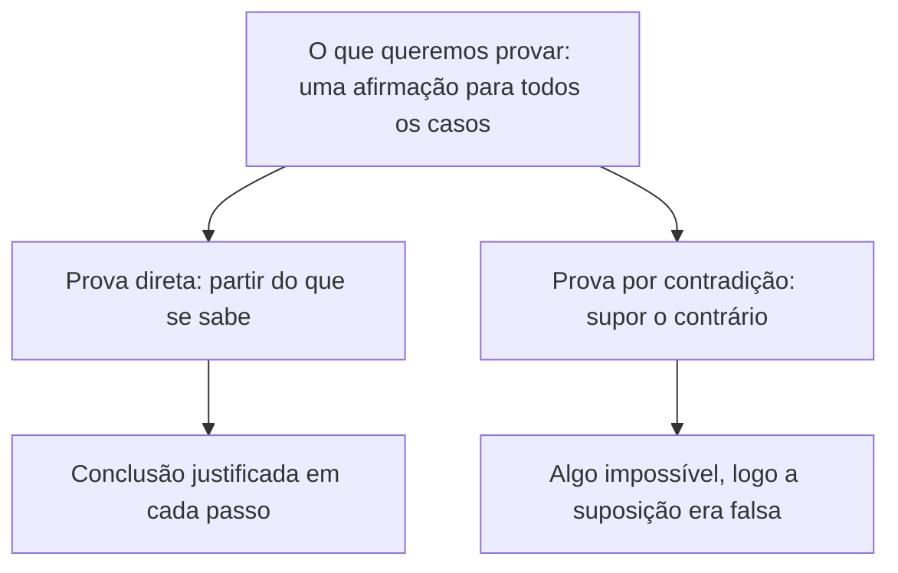

# 07 · Provas direta e por contradição

**Tempo estimado:** 30 minutos · **Pré-requisito:** [[05 - Lógica proposicional]] e [[06 - Lógica de predicados]].

**Ao final você vai conseguir:**

1. Escrever uma prova direta: partir do que se sabe e chegar à conclusão por passos justificados.
2. Escrever uma prova por contradição: supor o contrário do que se quer e chegar a algo impossível.
3. Distinguir um exemplo que confirma de uma prova que vale para todos os casos.

**Antes de começar:** você já sabe usar "para todo" e "existe" (módulo 06). Uma prova é um argumento que vale para *todos* os casos, e não apenas para os que testamos.

---

## Para começar

Você escreve uma função que calcula `n * n` e quer garantir que, se `n` é par, o resultado também é par. Testar `n = 2, 4, 6` ajuda, mas não garante o caso `n = 1000000`. Como ter certeza para todo número par, sem testar um a um? É isso que uma prova faz.

---

## Mapa do módulo



*Figura 1: as duas provas partem de lados opostos. A direta constrói a conclusão a partir dos fatos; a por contradição mostra que o contrário levaria a algo impossível.*

**Como ler:** siga a seta de cada caminho. Ambas terminam na mesma conclusão, por vias diferentes.

---

## Mini-aula 1: prova direta

> [!tip] Ideia
> Uma prova direta parte do que é conhecido e avança por passos, em que cada passo segue dos anteriores.

> [!info] Definição
> Uma **prova** (proof) é uma cadeia de raciocínio em que cada passo pode ser deduzido dos anteriores, a partir de premissas aceitas. Uma **prova direta** (direct proof) parte do que se sabe e avança diretamente, por passos positivos, até a conclusão.
>
> Dizer que `n` é **par** significa que existe um inteiro `k` com `n = 2k`.

Exemplo: se `n` é par, então `n * n` é par. Prova: como `n` é par, `n = 2k` para algum `k`. Então `n * n = 4k² = 2(2k²)`. Como `2k²` é um inteiro, `n * n` é `2` vezes um inteiro, logo é par.

Veja o que o teste faz, com alguns casos. Antes de rodar, pense: o que vai aparecer na última coluna?

```python
for n in range(0, 11, 2):
    print(n, n * n, (n * n) % 2 == 0)
```

Saída real:

```
0 0 True
2 4 True
4 16 True
6 36 True
8 64 True
10 100 True
```

**Como ler:** os casos testados (0, 2, 4, 6, 8, 10) confirmam o enunciado. Mas eles não provam nada para os outros pares. A prova é o argumento com `k`, que vale para qualquer `n` par.

> [!warning] Armadilha comum
> Verificar alguns casos não é prova. Um código que testa 10 casos pode estar certo nesses e errado no 11º. A prova cobre todos os casos porque o argumento não depende de um valor específico.

> [!question]- Checkpoint
> 1. Se `n = 2k`, qual é a forma de `n * n`?
> 2. Por que a prova vale para todo `n` par, e não só para os que aparecem no teste?
>
> > [!success]- Resposta
> > 1. `4k²`, que é igual a `2(2k²)`.
> > 2. Porque usamos só `n = 2k` para algum inteiro `k`, sem fixar um valor. O argumento vale para qualquer `k`.

---

## Mini-aula 2: prova por contradição

> [!tip] Ideia
> Para provar uma afirmação, suponha o contrário. Se isso leva a algo impossível, o contrário era falso, e a afirmação vale.

> [!info] Definição
> A **prova por contradição** (proof by contradiction, também chamada *reductio ad absurdum*) supõe a negação da afirmação. Se esse pressuposto leva a uma contradição, a suposição foi falsa, e a afirmação é verdadeira.

Exemplo clássico: `√2` não é racional, isto é, não é igual a uma fração `a/b` com `a` e `b` inteiros e sem fator comum. Supomos que `√2 = a/b`, na forma reduzida. Então `a² = 2b²`, o que torna `a²` par, e portanto `a` par. Escrevendo `a = 2c`, temos `b² = 2c²`, o que torna `b` par. Mas então `a` e `b` são ambos pares, contrariando a forma reduzida. A contradição mostra que a suposição era falsa.

Veja um teste pequeno desse caso. Antes de rodar, pense: há algum par `(a, b)` até 50 com `a² = 2b²`?

```python
achados = [(a, b) for a in range(1, 51) for b in range(1, 51) if a * a == 2 * b * b]
print(achados)
```

Saída real:

```
[]
```

**Como ler:** a lista vazia mostra que nenhum par pequeno funciona. Isso ilustra o enunciado, mas não é a prova: a prova é o argumento acima, que vale para todos os inteiros.

> [!warning] Armadilha comum
> Uma prova por contradição precisa chegar a uma contradição **de verdade**, isto é, a algo que não pode ser verdade junto com as premissas. Chegar a um resultado estranho não basta; é preciso mostrar que ele contraria algo já sabido.

> [!question]- Checkpoint
> 1. Qual é a suposição inicial no caso de `√2`?
> 2. Por que a conclusão `a` e `b` pares contradiz a suposição?
>
> > [!success]- Resposta
> > 1. Que `√2 = a/b` com `a/b` na forma reduzida, isto é, sem fator comum entre `a` e `b`.
> > 2. Porque a forma reduzida diz que `a` e `b` não podem ser ambos pares.

---

## Mini-aula 3: quando usar cada prova

> [!tip] Ideia
> Use a prova direta quando há um caminho claro dos fatos à conclusão. Use a contradição quando assumir o contrário dá um caminho mais curto até o absurdo.

> [!info] Definição
> Uma afirmação não precisa ser provada de uma única maneira. As duas técnicas são alternativas, e a escolha depende de qual caminho torna o argumento mais simples.

Como ler: no exemplo de `n * n`, a prova direta foi natural: partimos de `n = 2k`. No exemplo de `√2`, a prova direta é mais difícil, porque não há uma forma de "chegar" à irracionalidade a partir dos fatos. A contradição fornece o caminho.

> [!warning] Armadilha comum
> Exemplos confirmam o caso testado, não o enunciado inteiro. Um código que checa muitos casos é útil para descobrir erros, mas não substitui o argumento que cobre todos os casos.

> [!question]- Checkpoint
> 1. Para provar que `n * n` é par quando `n` é par, qual técnica você escolhe?
> 2. Testar 100 casos prova a afirmação para todo `n`?
>
> > [!success]- Resposta
> > 1. A direta: partir de `n = 2k` e chegar a `n * n = 2(2k²)`.
> > 2. Não. Os casos testados confirmam esses 100 casos, mas a afirmação vale para todos os inteiros, e só a prova cobre todos.

---

## Exercícios

Cada exercício tem um bloco com a função a completar e os testes com `assert`. Os exercícios verificam casos em código; a prova em si continua sendo o argumento escrito. Quando todos passarem, aparece `Passou!`.

### Aquecimento

**A1. Par.** Complete `e_par(n)`, que devolve `True` se o inteiro `n` é par.

```python
def e_par(n):
    """Devolve True se o inteiro n é par, isto é, n % 2 == 0."""
    ...

assert e_par(4) == True, "4 é par"
assert e_par(7) == False, "7 não é par"
assert e_par(0) == True, "0 é par"
print("Passou!")
```

> [!hint]- Dica 1
> Um número é par quando, dividido por 2, deixa resto zero. Em Python, o resto é `%`.

> [!hint]- Dica 2
> Basta devolver a comparação `n % 2 == 0`.

> [!example]- Solução
> ```python
> def e_par(n):
>     """Devolve True se o inteiro n é par, isto é, n % 2 == 0."""
>     return n % 2 == 0
> ```
>
> **Erro comum:** Escrever `n % 2 == 1`. Essa comparação testa se o número é ímpar.

**A2. Ímpar.** Complete `e_impar(n)`, que devolve `True` se `n` não é par. A função `e_par`, do exercício anterior, já está pronta.

```python
def e_par(n):
    # já pronta, do exercício A1
    return n % 2 == 0

def e_impar(n):
    """Devolve True se o inteiro n não é par."""
    ...

assert e_impar(3) == True, "3 é ímpar"
assert e_impar(4) == False, "4 não é ímpar"
assert e_impar(1) == True, "1 é ímpar"
print("Passou!")
```

> [!hint]- Dica 1
> Use o resultado de `e_par` e inverta-o.

> [!hint]- Dica 2
> Use `not`.

> [!example]- Solução
> ```python
> def e_impar(n):
>     """Devolve True se o inteiro n não é par."""
>     return not e_par(n)
> ```
>
> **Erro comum:** Escrever `e_par(n) == True` sem inverter. Isso devolve o mesmo resultado que `e_par`, e não o contrário.

**A3. Paridade da soma.** Complete `paridade_da_soma(a, b)`, que devolve o texto `"par"` se `a + b` é par, e `"impar"` caso contrário.

```python
def paridade_da_soma(a, b):
    """Devolve 'par' se a + b é par, e 'impar' caso contrário."""
    ...

assert paridade_da_soma(2, 4) == "par", "2 + 4 é par"
assert paridade_da_soma(3, 5) == "par", "3 + 5 é par"
assert paridade_da_soma(2, 3) == "impar", "2 + 3 é ímpar"
print("Passou!")
```

> [!hint]- Dica 1
> Calcule `a + b` e veja o resto da divisão por 2.

> [!hint]- Dica 2
> Use `"par" if (a + b) % 2 == 0 else "impar"`.

> [!example]- Solução
> ```python
> def paridade_da_soma(a, b):
>     """Devolve 'par' se a + b é par, e 'impar' caso contrário."""
>     return "par" if (a + b) % 2 == 0 else "impar"
> ```
>
> **Erro comum:** Testar só `a % 2 == 0`. O resultado depende da soma, e não de um dos números.

### Praticando

**P1. Quadrado de par.** Complete `checa_quadrado_de_par(limite)`. Ela verifica, para todo `n` par de 0 até `limite`, se `n * n` é par. Devolve `True` se nenhum caso falhar. A função `e_par` já está pronta.

```python
def e_par(n):
    # já pronta, do exercício A1
    return n % 2 == 0

def checa_quadrado_de_par(limite):
    """Devolve True se n * n é par para todo n par entre 0 e limite."""
    ...

assert checa_quadrado_de_par(10) == True, "os quadrados dos pares até 10 são pares"
assert checa_quadrado_de_par(0) == True, "só o 0 até 0"
assert checa_quadrado_de_par(1) == True, "até 1, só o 0 é par"
print("Passou!")
```

> [!hint]- Dica 1
> Percorra `n` de 0 até `limite`, incluindo o limite.

> [!hint]- Dica 2
> Use `if e_par(n):`. Dentro dele, se `n * n` não for par, `return False`.

> [!example]- Solução
> ```python
> def checa_quadrado_de_par(limite):
>     """Devolve True se n * n é par para todo n par entre 0 e limite."""
>     for n in range(0, limite + 1):
>         if e_par(n):
>             if not e_par(n * n):
>                 return False
>     return True
> ```
>
> **Erro comum:** Esquecer de incluir o limite no intervalo. Com `range(limite)`, o último valor não é testado.

**P2. Soma de pares.** Complete `checa_soma_de_pares(limite)`. Ela verifica, para todo par de números `a` e `b` pares entre 0 e `limite`, se `a + b` é par. Devolve `True` se nenhum caso falhar. A função `e_par` já está pronta.

```python
def e_par(n):
    # já pronta, do exercício A1
    return n % 2 == 0

def checa_soma_de_pares(limite):
    """Devolve True se a + b é par para todo par de pares a, b entre 0 e limite."""
    ...

assert checa_soma_de_pares(6) == True, "a soma de pares até 6 é par"
assert checa_soma_de_pares(0) == True, "só 0 + 0"
assert checa_soma_de_pares(3) == True, "até 3 vale também"
print("Passou!")
```

> [!hint]- Dica 1
> Use dois `for` aninhados, um para `a` e outro para `b`, ambos de 0 até `limite`.

> [!hint]- Dica 2
> Use `if e_par(a) and e_par(b):` e, dentro, `if not e_par(a + b): return False`.

> [!example]- Solução
> ```python
> def checa_soma_de_pares(limite):
>     """Devolve True se a + b é par para todo par de pares a, b entre 0 e limite."""
>     for a in range(0, limite + 1):
>         for b in range(0, limite + 1):
>             if e_par(a) and e_par(b):
>                 if not e_par(a + b):
>                     return False
>     return True
> ```
>
> **Erro comum:** Verificar só `a + b` sem a condição de que `a` e `b` sejam pares. A afirmação é sobre pares, e não sobre todos os números.

**P3. Soluções pequenas.** Complete `solucoes_de_a2_igual_k_b2(limite, k)`. Ela devolve, em ordem, a lista dos pares `(a, b)` com `1 ≤ a ≤ limite` e `1 ≤ b ≤ limite` que satisfazem `a * a == k * b * b`.

```python
def solucoes_de_a2_igual_k_b2(limite, k):
    """Devolve a lista dos pares (a, b), com 1 ≤ a, b ≤ limite, tais que a * a == k * b * b."""
    ...

assert solucoes_de_a2_igual_k_b2(50, 2) == [], "nenhum par pequeno: a² = 2b² não tem solução aqui"
assert solucoes_de_a2_igual_k_b2(4, 4) == [(2, 1), (4, 2)], "a² = 4b² com a e b até 4"
assert solucoes_de_a2_igual_k_b2(4, 1) == [(1, 1), (2, 2), (3, 3), (4, 4)], "a² = b² é a identidade"
print("Passou!")
```

> [!hint]- Dica 1
> Use dois `for` aninhados, `a` externo e `b` interno, e guarde os pares com `append`.

> [!hint]- Dica 2
> A condição é `a * a == k * b * b`. Lembre que o intervalo começa em 1.

> [!example]- Solução
> ```python
> def solucoes_de_a2_igual_k_b2(limite, k):
>     """Devolve a lista dos pares (a, b), com 1 ≤ a, b ≤ limite, tais que a * a == k * b * b."""
>     resultado = []
>     for a in range(1, limite + 1):
>         for b in range(1, limite + 1):
>             if a * a == k * b * b:
>                 resultado.append((a, b))
>     return resultado
> ```
>
> **Erro comum:** Usar `range(0, limite + 1)`, que inclui o zero. A regra pede `1 ≤ a` e `1 ≤ b`, então o zero não entra no intervalo. Use `range(1, limite + 1)` para `a` e para `b`.

### Desafio

**D1. Soma de ímpares.** Complete `checa_soma_de_impares(limite)`. Ela verifica, para todo par de números ímpares `a` e `b` entre 1 e `limite`, se `a + b` é par. Devolve `True` se nenhum caso falhar. A função `e_impar`, do exercício A2, já está pronta.

```python
def e_par(n):
    # já pronta, do exercício A1
    return n % 2 == 0

def e_impar(n):
    # já pronta, do exercício A2
    return not e_par(n)

def checa_soma_de_impares(limite):
    """Devolve True se a + b é par para todo par de ímpares a, b entre 1 e limite."""
    ...

assert checa_soma_de_impares(7) == True, "a soma de dois ímpares até 7 é par"
assert checa_soma_de_impares(1) == True, "só 1 + 1"
assert checa_soma_de_impares(3) == True, "até 3 também"
print("Passou!")
```

> [!hint]- Dica 1
> Percorra `a` e `b` de 1 até `limite`, e use `if e_impar(a) and e_impar(b):`.

> [!hint]- Dica 2
> Dentro do `if`, verifique se `a + b` é par com `e_par`. Se não for, `return False`.

> [!example]- Solução
> ```python
> def checa_soma_de_impares(limite):
>     """Devolve True se a + b é par para todo par de ímpares a, b entre 1 e limite."""
>     for a in range(1, limite + 1):
>         for b in range(1, limite + 1):
>             if e_impar(a) and e_impar(b):
>                 if not e_par(a + b):
>                     return False
>     return True
> ```
>
> **Erro comum:** Trocar `e_impar` por `e_par` nas condições. Assim você testa a soma de pares, que já foi feito, e não a afirmação deste exercício.


## Mini-projeto (opcional)

Um exercício maior, que junta as funções anteriores. Tente sozinho antes de abrir a solução.

**Objetivo.** Dada uma afirmação `P(n)` e um limite, devolva o menor `n` de 0 até o limite em que `P(n)` é falso, ou `None` se nenhum falhar. Esse é o contraexemplo mais simples que a busca encontra. Lembre: esse teste só confere os casos dados. Uma conjectura confirmada aqui ainda precisa de uma prova para valer para todo `n`.

```python
def primeiro_contraexemplo(predicado, limite):
    """Devolve o menor n de 0 a limite com predicado(n) falso, ou None."""
    ...

assert primeiro_contraexemplo(lambda n: n * n >= n, 20) is None, "n² ≥ n vale até 20"
assert primeiro_contraexemplo(lambda n: n < 10, 20) == 10, "o primeiro n que não é menor que 10 é 10"
assert primeiro_contraexemplo(lambda n: True, 5) is None, "uma afirmação sempre verdadeira não tem contraexemplo"
print("Passou!")
```

> [!hint]- Dica 1
> Percorra `n` de 0 até `limite`. Use `if not predicado(n):`.

> [!hint]- Dica 2
> Ao achar um `n` que falha, `return n`. Se o laço acabar, `return None`.

> [!example]- Solução
> ```python
> def primeiro_contraexemplo(predicado, limite):
>     """Devolve o menor n de 0 a limite com predicado(n) falso, ou None."""
>     for n in range(0, limite + 1):
>         if not predicado(n):
>             return n
>     return None
> ```
>
> **Erro comum:** Devolver `True` quando o predicado vale. A função procura o caso que falha, e não o que funciona.


---

## Fechando

**Resumo**

- Prova: cadeia de raciocínio em que cada passo segue dos anteriores.
- Prova direta: parte do que se sabe e avança por passos positivos até a conclusão.
- Prova por contradição: supõe a negação e chega a algo impossível.
- Ser par: existe um inteiro `k` com `n = 2k`.
- Exemplos confirmam casos; a prova cobre todos.

**Glossário rápido**

- **Prova** (proof): cadeia de passos justificados que leva a uma conclusão.
- **Prova direta** (direct proof): prova que parte do que se sabe e avança diretamente.
- **Prova por contradição** (proof by contradiction): prova que supõe o contrário e chega a algo impossível.
- **Par**: número que pode ser escrito como `2k`, para algum inteiro `k`.
- **Forma reduzida**: fração `a/b` em que `a` e `b` não têm fator comum.

**Perguntas de revisão**

1. Na prova direta de que `n * n` é par, por que a escolha `n = 2k` é suficiente?
2. Qual é a suposição inicial da prova de que `√2` não é racional?
3. Dê uma razão para que testar casos não seja prova, mesmo com 1000 casos corretos.

**E agora?** O próximo módulo é **Indução e recursão**. Ele trata de afirmações sobre *todos* os números naturais, e cobre uma terceira técnica de prova: a indução, que aproveita a própria estrutura dos números.

---

## Para ir mais fundo

- [[Direct Proof]]
- [[Proof by Contradiction]]
