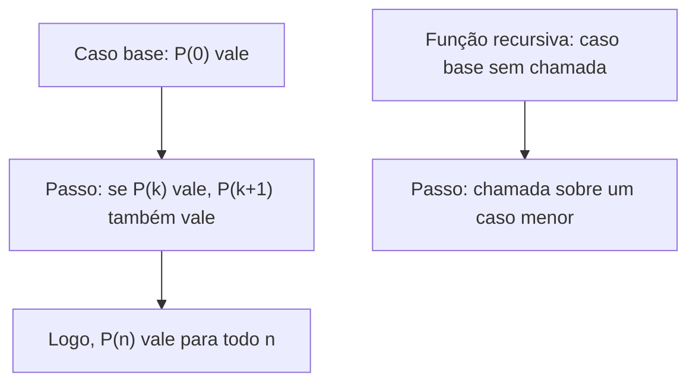

# 08 · Indução e recursão

**Tempo estimado:** 30 minutos · **Pré-requisito:** [[07 - Provas direta e por contradição]].

**Ao final você vai conseguir:**

1. Provar uma afirmação sobre todos os números naturais por indução: caso base e passo.
2. Escrever uma função recursiva com caso base e chamada recursiva.
3. Reconhecer que a forma de uma prova por indução é a mesma de uma função recursiva.

**Antes de começar:** você já escreve provas diretas e por contradição (módulo 07). A indução é uma terceira forma de prova, feita para afirmações sobre todos os números naturais.

---

## Para começar

Você escreve uma função que calcula o fatorial de um número, de forma recursiva. Ela funciona para `n = 3`, para `n = 10`? Testar valores ajuda, mas não cobre todos os `n`. A indução permite provar que a função está certa para **todo** `n`, usando a própria estrutura de `n`.

---

## Mapa do módulo



*Figura 1: a prova por indução e a função recursiva têm a mesma forma. O caso base trata o menor caso; o passo usa o caso anterior para tratar o seguinte.*

**Como ler:** as duas linhas de cima e as de baixo têm o mesmo formato. A indução prova a afirmação; a recursão calcula o resultado.

---

## Mini-aula 1: indução

> [!tip] Ideia
> Para provar algo para todo número natural, mostre o primeiro caso e mostre que cada caso leva ao seguinte.

> [!info] Definição
> Para uma afirmação P(n) sobre os números naturais, a **indução matemática** (mathematical induction) tem dois passos:
>
> 1. **Caso base** (base case): verificar P no primeiro caso.
> 2. **Passo indutivo** (inductive step): mostrar que, se P(k) vale, então P(k + 1) também vale.
>
> A suposição P(k) usada no passo chama-se **hipótese de indução** (inductive hypothesis).

Analogia para ajudar a entender: é como uma fila de peças de dominó. Derrubar a primeira (o caso base) e garantir que cada peça derruba a seguinte (o passo) faz cair a fila inteira. (Analogia, não uma prova.)

Exemplo. Seja P(n): "a função `fatorial(n)` devolve `n!`". Caso base: `fatorial(0) = 1 = 0!`. Passo: suponha, pela hipótese, que `fatorial(k) = k!`. Pela definição, `fatorial(k + 1) = (k + 1) * fatorial(k) = (k + 1) * k! = (k + 1)!`. Logo P(k + 1) vale.

> [!warning] Armadilha comum
> Esquecer o caso base. O passo, sozinho, mostra só que P(k) leva a P(k + 1). Sem o caso base, nenhum número recebe a afirmação para começar.

> [!question]- Checkpoint
> 1. Na prova do fatorial, qual é a hipótese de indução?
> 2. Por que o caso base é necessário?
>
> > [!success]- Resposta
> > 1. Que `fatorial(k) = k!` vale para algum `k`.
> > 2. Porque sem ele nenhuma afirmação recebe o primeiro passo. O passo só transporta a verdade de um caso ao seguinte.

---

## Mini-aula 2: recursão tem a mesma forma

> [!tip] Ideia
> Uma função recursiva trata um caso simples diretamente e resolve os outros chamando a si mesma com um caso menor.

> [!info] Definição
> Uma **recursão** (recursion) define ou calcula algo em termos de instâncias menores de si mesmo. Uma função recursiva tem um **caso base**, que não faz chamada, e uma **chamada recursiva**, que trabalha com um caso menor.
>
> A biblioteca descreve a relação com a indução: a parte indutiva corresponde à chamada recursiva, e o caso base impede uma cadeia infinita de chamadas.

Veja a função fatorial. Antes de rodar, preveja cada valor.

```python
def fat(n):
    if n == 0:
        return 1
    return n * fat(n - 1)

for n in range(6):
    print(n, fat(n))
```

Saída real:

```
0 1
1 1
2 2
3 6
4 24
5 120
```

**Como ler:** o caso `n == 0` é o caso base. Os outros valores são calculados pela chamada `fat(n - 1)`. Cada linha da saída usa a linha anterior.

> [!warning] Armadilha comum
> Uma chamada recursiva precisa ir para um caso **menor**. Se a função chamasse a si mesma com o mesmo valor, ou com um valor maior, não avançaria até o caso base.

> [!question]- Checkpoint
> 1. Em `fat(4)`, qual chamada leva ao caso base?
> 2. Se `fat(n)` chamasse `fat(n + 1)` em vez de `fat(n - 1)`, a função terminaria?
>
> > [!success]- Resposta
> > 1. A cadeia `fat(4)`, `fat(3)`, `fat(2)`, `fat(1)`, `fat(0)`. O caso base é `fat(0)`.
> > 2. Não. Os valores crescem e nunca chegam ao caso base.

---

## Mini-aula 3: o erro do caso base

> [!tip] Ideia
> Sem caso base, a recursão não para, e o Python encerra com `RecursionError`.

> [!info] Definição
> `RecursionError` é o erro que o Python levanta quando uma função chama a si mesma mais vezes do que o limite permitido. Ele é um sinal de que faltou um caso base, ou de que a chamada não avança.

Veja uma função sem caso base. Antes de rodar, pense: o que acontece na chamada `sem_base(3)`?

```python
def sem_base(n):
    return n * sem_base(n - 1)

try:
    sem_base(3)
except RecursionError:
    print("RecursionError: a chamada nunca para")
```

Saída real:

```
RecursionError: a chamada nunca para
```

**Como ler:** `sem_base` chama `sem_base(n - 1)` sem parar. O `try` captura o erro e imprime uma mensagem. Sem ele, o programa apenas terminaria com o erro.

> [!warning] Armadilha comum
> Testar a função com um valor que cai no caso base esconde o problema. Por isso, teste também valores que exigem muitas chamadas.

> [!question]- Checkpoint
> 1. O que faltou em `sem_base` para ela funcionar?
> 2. Qual é o primeiro valor de `n` para o qual `sem_base` chama a si mesma?
>
> > [!success]- Resposta
> > 1. Um caso base, que devolva um valor sem fazer chamada.
> > 2. O próprio `n`, na primeira chamada. Ela chama `sem_base(n - 1)` antes de terminar.

---

## Exercícios

Cada exercício tem um bloco com a função a completar e os testes com `assert`. Quando todos passarem, aparece `Passou!`. A checagem em código não substitui a prova por indução, mas ajuda a conferir a função em vários casos.

### Aquecimento

**A1. Fatorial por recursão.** Complete `fatorial(n)`, que devolve `n!`, usando recursão: `0! = 1` e `n! = n * (n - 1)!`.

```python
def fatorial(n):
    """Devolve n!, por recursão: 0! = 1 e n! = n * (n - 1)!."""
    ...

assert fatorial(0) == 1, "0! é 1"
assert fatorial(4) == 24, "4! é 24"
assert fatorial(5) == 120, "5! é 120"
print("Passou!")
```

> [!hint]- Dica 1
> O caso base é `n == 0`. Nele, devolva `1`.

> [!hint]- Dica 2
> No outro caso, devolva `n * fatorial(n - 1)`.

> [!example]- Solução
> ```python
> def fatorial(n):
>     """Devolve n!, por recursão: 0! = 1 e n! = n * (n - 1)!."""
>     if n == 0:
>         return 1
>     return n * fatorial(n - 1)
> ```
>
> **Erro comum:** Esquecer o caso base. A função chama a si mesma sem parar, e o Python acaba com `RecursionError`.

**A2. Soma até n.** Complete `soma_ate(n)`, que devolve `0 + 1 + 2 + ... + n` para `n ≥ 0`, usando recursão.

```python
def soma_ate(n):
    """Devolve 0 + 1 + ... + n, por recursão."""
    ...

assert soma_ate(0) == 0, "a soma até 0 é 0"
assert soma_ate(3) == 6, "0 + 1 + 2 + 3 = 6"
assert soma_ate(4) == 10, "0 + 1 + 2 + 3 + 4 = 10"
print("Passou!")
```

> [!hint]- Dica 1
> O caso base é `n == 0`: a soma é `0`.

> [!hint]- Dica 2
> No outro caso, some `n` com o resultado de `soma_ate(n - 1)`.

> [!example]- Solução
> ```python
> def soma_ate(n):
>     """Devolve 0 + 1 + ... + n, por recursão."""
>     if n == 0:
>         return 0
>     return n + soma_ate(n - 1)
> ```
>
> **Erro comum:** Somar `n` sem a chamada recursiva, devolvendo só `n`. Isso ignora todos os termos anteriores.

**A3. Potência.** Complete `potencia(b, n)`, que devolve `b` elevado a `n`, para `n ≥ 0`, usando recursão: `b⁰ = 1` e `bⁿ = b * b⁽ⁿ⁻¹⁾`.

```python
def potencia(b, n):
    """Devolve b elevado a n, por recursão: b^0 = 1 e b^n = b * b^(n-1)."""
    ...

assert potencia(2, 5) == 32, "2 elevado a 5 é 32"
assert potencia(7, 0) == 1, "qualquer número elevado a 0 dá 1, pela regra"
assert potencia(3, 2) == 9, "3 elevado a 2 é 9"
print("Passou!")
```

> [!hint]- Dica 1
> O caso base é `n == 0`: devolva `1`.

> [!hint]- Dica 2
> No outro caso, devolva `b * potencia(b, n - 1)`.

> [!example]- Solução
> ```python
> def potencia(b, n):
>     """Devolve b elevado a n, por recursão: b^0 = 1 e b^n = b * b^(n-1)."""
>     if n == 0:
>         return 1
>     return b * potencia(b, n - 1)
> ```
>
> **Erro comum:** Usar `n == 1` como caso base. Então `potencia(b, 0)` nunca é tratada, e a chamada continua para valores negativos.

### Praticando

**P1. Conferir o fatorial.** Complete `checa_fatorial(limite)`. Ela compara `fatorial(n)` com um cálculo feito por laço, para todo `n` de 0 até `limite`. Devolve `True` se os dois valores coincidem em todos os casos. A função `fatorial` já está pronta.

```python
def fatorial(n):
    # já pronta, do exercício A1
    if n == 0:
        return 1
    return n * fatorial(n - 1)

def checa_fatorial(limite):
    """Devolve True se fatorial(n) coincide com o produto 1 * 2 * ... * n, para n de 0 até limite."""
    ...

assert checa_fatorial(6) == True, "a recursão concorda com o laço até 6"
assert checa_fatorial(0) == True, "só o caso base"
assert checa_fatorial(1) == True, "até 1"
print("Passou!")
```

> [!hint]- Dica 1
> Para cada `n`, calcule o produto `1 * 2 * ... * n` com um `for` que começa com `produto = 1`.

> [!hint]- Dica 2
> Compare `produto` com `fatorial(n)`. Se forem diferentes, `return False`.

> [!example]- Solução
> ```python
> def checa_fatorial(limite):
>     """Devolve True se fatorial(n) coincide com o produto 1 * 2 * ... * n, para n de 0 até limite."""
>     for n in range(0, limite + 1):
>         produto = 1
>         for i in range(1, n + 1):
>             produto *= i
>         if produto != fatorial(n):
>             return False
>     return True
> ```
>
> **Erro comum:** Usar `fatorial(n)` dos dois lados da comparação. Assim a checagem sempre dá certo, e não confere nada.

**P2. Maior elemento por recursão.** Complete `maior(lista)`, que devolve o maior elemento de uma lista não vazia, usando recursão. Caso base: uma lista com um só elemento. Passo: compare o primeiro elemento com o maior do resto da lista, `lista[1:]`.

```python
def maior(lista):
    """Devolve o maior elemento de uma lista não vazia, por recursão."""
    ...

assert maior([3]) == 3, "um só elemento"
assert maior([1, 5, 2]) == 5, "o 5 está no meio"
assert maior([7, 2, 7]) == 7, "o maior aparece duas vezes"
assert maior([-1, -5]) == -1, "também funciona com negativos"
print("Passou!")
```

> [!hint]- Dica 1
> O caso base é `len(lista) == 1`: devolva `lista[0]`.

> [!hint]- Dica 2
> No passo, calcule `m = maior(lista[1:])` e devolva o maior entre `lista[0]` e `m`.

> [!example]- Solução
> ```python
> def maior(lista):
>     """Devolve o maior elemento de uma lista não vazia, por recursão."""
>     if len(lista) == 1:
>         return lista[0]
>     m = maior(lista[1:])
>     if lista[0] > m:
>         return lista[0]
>     return m
> ```
>
> **Erro comum:** Usar `lista[0] > lista` ou comparar com a lista inteira. A comparação precisa ser entre dois números.

**P3. Soma de uma lista.** Complete `soma_lista(lista)`, que devolve a soma dos elementos da lista, usando recursão. Caso base: lista vazia, com soma `0`. Passo: o primeiro elemento mais a soma do resto, `lista[1:]`.

```python
def soma_lista(lista):
    """Devolve a soma dos elementos da lista, por recursão."""
    ...

assert soma_lista([]) == 0, "lista vazia soma 0"
assert soma_lista([1, 2, 3]) == 6, "1 + 2 + 3"
assert soma_lista([5]) == 5, "um só elemento"
print("Passou!")
```

> [!hint]- Dica 1
> O caso base é `len(lista) == 0`: devolva `0`.

> [!hint]- Dica 2
> No passo, devolva `lista[0] + soma_lista(lista[1:])`.

> [!example]- Solução
> ```python
> def soma_lista(lista):
>     """Devolve a soma dos elementos da lista, por recursão."""
>     if len(lista) == 0:
>         return 0
>     return lista[0] + soma_lista(lista[1:])
> ```
>
> **Erro comum:** Esquecer o caso base da lista vazia. Ao chegar em `lista[1:]` vazia, a função tenta ler o primeiro elemento e não há nenhum.

### Desafio

**D1. Soma dos dígitos.** Complete `soma_digitos(n)`, que devolve a soma dos algarismos de um inteiro `n ≥ 0`, usando recursão. Caso base: `n < 10`, isto é, um só algarismo. Passo: o último algarismo, `n % 10`, mais a soma dos algarismos de `n // 10`.

```python
def soma_digitos(n):
    """Devolve a soma dos algarismos de n (n >= 0), por recursão."""
    ...

assert soma_digitos(7) == 7, "um só algarismo"
assert soma_digitos(123) == 6, "1 + 2 + 3"
assert soma_digitos(9999) == 36, "4 algarismos iguais a 9"
print("Passou!")
```

> [!hint]- Dica 1
> Para n menor que 10, devolva `n`.

> [!hint]- Dica 2
> Caso contrário, use `n % 10` e `soma_digitos(n // 10)`. A divisão `//` tira o último algarismo.

> [!example]- Solução
> ```python
> def soma_digitos(n):
>     """Devolve a soma dos algarismos de n (n >= 0), por recursão."""
>     if n < 10:
>         return n
>     return n % 10 + soma_digitos(n // 10)
> ```
>
> **Erro comum:** Usar `n / 10` no lugar de `n // 10`. A divisão comum gera um número quebrado, e a recursão não chega ao caso base.


## Mini-projeto (opcional)

Um exercício maior, que junta as funções anteriores. Tente sozinho antes de abrir a solução.

**Objetivo.** Confira se a função recursiva `soma_lista`, do exercício P3, dá o mesmo resultado que uma soma feita com um laço simples, para a lista dada. Devolva `True` se bate. A função `soma_lista` já está pronta.

```python
def soma_lista(lista):
    # já pronta, do exercício P3
    if len(lista) == 0:
        return 0
    return lista[0] + soma_lista(lista[1:])

def conferir_recursao(lista):
    """Devolve True se soma_lista(lista) é igual à soma feita por laço."""
    ...

assert conferir_recursao([1, 2, 3]) == True, "1 + 2 + 3 pelos dois caminhos"
assert conferir_recursao([]) == True, "lista vazia"
assert conferir_recursao([-4, 10, 7]) == True, "com negativos também"
print("Passou!")
```

> [!hint]- Dica 1
> Calcule o total com um laço: comece com `total = 0` e some cada `x` da lista.

> [!hint]- Dica 2
> Devolva `soma_lista(lista) == total`.

> [!example]- Solução
> ```python
> def conferir_recursao(lista):
>     """Devolve True se soma_lista(lista) é igual à soma feita por laço."""
>     total = 0
>     for x in lista:
>         total += x
>     return soma_lista(lista) == total
> ```
>
> **Erro comum:** Devolver só `soma_lista(lista)`, sem comparar com o laço. Aí a função não confere nada.


---

## Fechando

**Resumo**

- Indução: caso base mais passo indutivo, com a hipótese P(k).
- A indução prova a afirmação para todo número natural.
- Recursão: caso base sem chamada, e chamada recursiva sobre um caso menor.
- A forma da prova por indução é a forma da função recursiva.
- Sem caso base, a recursão não para (`RecursionError`).

**Glossário rápido**

- **Indução matemática** (mathematical induction): prova por caso base e passo indutivo.
- **Caso base** (base case): primeiro caso, verificado diretamente.
- **Passo indutivo** (inductive step): mostra que P(k) leva a P(k + 1).
- **Hipótese de indução** (inductive hypothesis): a suposição P(k) usada no passo.
- **Recursão** (recursion): definição ou cálculo em termos de instâncias menores.
- **RecursionError**: erro do Python para recursão sem fim.

**Perguntas de revisão**

1. No passo indutivo, o que você supõe e o que deve mostrar?
2. Por que `soma_ate(n)` chama `soma_ate(n - 1)`, e não `soma_ate(n)`?
3. Escreva o caso base de `potencia(b, n)` e explique por que ele é necessário.

**E agora?** O próximo módulo é **Contagem**. Você vai contar arranjos, combinações e usar o princípio da casa dos pombos. O fatorial que você acabou de calcular aparece no centro dessas contagens.

---

## Para ir mais fundo

- [[Mathematical Induction]]
- [[Induction and Recursion]]
