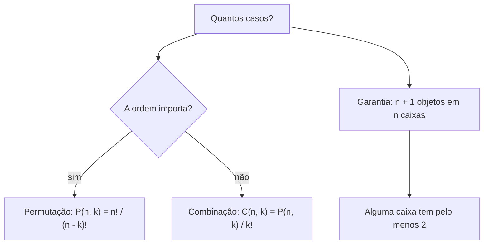

# 09 · Contagem

**Tempo estimado:** 30 minutos · **Pré-requisito:** [[08 - Indução e recursão]] (usa o fatorial).

**Ao final você vai conseguir:**

1. Contar arranjos ordenados (permutações parciais) com a fórmula `P(n, k) = n! / (n - k)!`.
2. Contar subconjuntos (combinações) com `C(n, k) = P(n, k) / k!`.
3. Aplicar o princípio da casa dos pombos para garantir uma repetição.

**Antes de começar:** o fatorial, `n!`, do módulo 08. Aqui ele aparece como a base das contagens.

---

## Para começar

Cinco atletas disputam uma corrida. Quantos pódios diferentes são possíveis, se a ordem dos três primeiros lugares importa? Agora, quantos grupos de três atletas podemos formar, sem considerar a ordem? Os dois números são diferentes, e a diferença está na palavra "ordem". Contar corretamente começa por saber o que a ordem muda.

---

## Mapa do módulo



*Figura 1: a primeira pergunta de qualquer contagem é se a ordem importa. Com ordem, usamos permutações; sem ordem, combinações. O princípio da casa dos pombos é uma garantia de existência, e não uma contagem.*

**Como ler:** siga a seta a partir da pergunta. O losango é a decisão entre "sim" e "não".

---

## Mini-aula 1: permutações

> [!tip] Ideia
> Quando a ordem importa, cada escolha muda o resultado. Contamos os arranjos ordenados de k objetos entre n.

> [!info] Definição
> Uma **permutação** (permutation) é um rearranjo ordenado de objetos. O número de maneiras de escolher e ordenar `k` objetos entre `n` é `P(n, k) = n! / (n - k)!`, com `0! = 1`.

Exemplo: 5 atletas, e queremos os três primeiros lugares em ordem. Pela fórmula, `P(5, 3) = 5! / 2! = 60`. Veja a contagem por listagem: o código conta as triplas de elementos distintos. Antes de rodar, preveja o número.

```python
X = [1, 2, 3, 4, 5]
triplas = [(a, b, c) for a in X for b in X for c in X if a != b and b != c and a != c]
print(len(triplas))
```

Saída real:

```
60
```

**Como ler:** cada tripla `(a, b, c)` é um pódio. Os três elementos precisam ser diferentes, e a ordem entre eles conta. O resultado bate com a fórmula.

> [!warning] Armadilha comum
> `(1, 2, 3)` e `(2, 1, 3)` são pódios diferentes. Se a ordem importa, cada reordenação é um novo caso.

> [!question]- Checkpoint
> 1. Quantos rearranjos de 3 objetos existem, usando todos os 3? (Ou seja, `P(3, 3)`.)
> 2. `P(4, 2)` é quanto?
>
> > [!success]- Resposta
> > 1. 6, pois `3! / 0! = 6`.
> > 2. 12, pois `4! / 2! = 24 / 2 = 12`.

---

## Mini-aula 2: combinações

> [!tip] Ideia
> Quando a ordem não importa, cada grupo aparece várias vezes entre os arranjos. Dividimos pelo número de reordenações do grupo.

> [!info] Definição
> Uma **combinação** (combination) é uma escolha de k elementos entre n, sem ordem. O número delas é o **coeficiente binomial** `C(n, k) = n! / ((n - k)! k!)`, que é `P(n, k) / k!`, porque cada grupo de k elementos aparece `k!` vezes entre os arranjos.

Exemplo: subconjuntos de 2 elementos de `{1, 2, 3, 4}`. São seis: `{1, 2}`, `{1, 3}`, `{1, 4}`, `{2, 3}`, `{2, 4}` e `{3, 4}`. Antes de rodar, conte mentalmente antes de ver a saída.

```python
X = [1, 2, 3, 4]
pares = [(a, b) for a in X for b in X if a < b]
print(len(pares), pares)
```

Saída real:

```
6 [(1, 2), (1, 3), (1, 4), (2, 3), (2, 4), (3, 4)]
```

**Como ler:** cada par `(a, b)` com `a < b` é um grupo sem ordem. Ao exigir `a < b`, cada grupo é contado uma única vez. O resultado é `C(4, 2) = 6`.

> [!warning] Armadilha comum
> Combinação não é permutação dividida por qualquer coisa. O divisor certo é `k!`, o número de reordenações de um grupo de k elementos.

> [!question]- Checkpoint
> 1. `C(4, 2)` é quanto?
> 2. `C(5, 0)` é quanto? Quantos subconjuntos tem esse caso?
>
> > [!success]- Resposta
> > 1. 6.
> > 2. 1. Há um só subconjunto com zero elementos: o vazio.

---

## Mini-aula 3: princípio da casa dos pombos

> [!tip] Ideia
> Se há mais objetos do que caixas, alguma caixa precisa ter pelo menos dois objetos.

> [!info] Definição
> **Princípio da casa dos pombos** (pigeonhole principle): se n + 1 objetos (ou mais) são colocados em n caixas, alguma caixa contém pelo menos dois objetos.
>
> Versão geral: `n (r - 1) + 1` objetos em `n` caixas garantem uma caixa com pelo menos `r` objetos.

Exemplo: 13 pessoas e 12 meses. Como há mais pessoas do que meses, duas pessoas compartilham um mês de aniversário. Antes de rodar, pense: os 13 valores têm algum repetido?

```python
objetos = [1, 2, 3, 4, 5, 6, 7, 8, 9, 10, 11, 12, 1]
print(len(objetos), len(set(objetos)))
```

Saída real:

```
13 12
```

**Como ler:** há 13 objetos, mas só 12 valores distintos. Logo, pelo menos um valor se repete.

> [!warning] Armadilha comum
> O princípio garante que existe uma caixa com dois objetos. Ele não diz **qual** caixa, nem como os objetos foram distribuídos. É uma garantia de existência, não um cálculo.

> [!question]- Checkpoint
> 1. Com 25 objetos em 12 caixas, é garantido que alguma caixa tenha 3 ou mais?
> 2. Com 12 objetos em 12 caixas, é garantido que alguma caixa tenha 2 ou mais?
>
> > [!success]- Resposta
> > 1. Sim. Pela versão geral, `12 × (3 - 1) + 1 = 25`.
> > 2. Não. Com 12 objetos e 12 caixas, eles podem ir um para cada caixa, sem repetição.

---

## Exercícios

Cada exercício tem um bloco com a função a completar e os testes com `assert`. Quando todos passarem, aparece `Passou!`.

### Aquecimento

**A1. Fatorial.** Complete `fat(n)`, que devolve `n!` com um laço: `0! = 1` e `n! = 1 * 2 * ... * n`.

```python
def fat(n):
    """Devolve n! = 1 * 2 * ... * n, com 0! = 1."""
    ...

assert fat(0) == 1, "0! é 1"
assert fat(3) == 6, "3! é 6"
assert fat(5) == 120, "5! é 120"
print("Passou!")
```

> [!hint]- Dica 1
> Comece com `produto = 1` e percorra `i` de 1 até `n`, multiplicando.

> [!hint]- Dica 2
> Para `n = 0`, o intervalo fica vazio, e o resultado deve ser `1`. Por isso o `produto` começa em 1.

> [!example]- Solução
> ```python
> def fat(n):
>     """Devolve n! = 1 * 2 * ... * n, com 0! = 1."""
>     produto = 1
>     for i in range(1, n + 1):
>         produto *= i
>     return produto
> ```
>
> **Erro comum:** Começar com `produto = 0`. Todo produto vira 0.

**A2. Permutações.** Complete `P(n, k)`, que devolve o número de arranjos ordenados de k objetos escolhidos entre n: `P(n, k) = n! / (n - k)!`. A função `fat`, do exercício anterior, já está pronta.

```python
def fat(n):
    # já pronta, do exercício A1
    produto = 1
    for i in range(1, n + 1):
        produto *= i
    return produto

def P(n, k):
    """Devolve n! / (n - k)!: arranjos ordenados de k objetos entre n."""
    ...

assert P(5, 3) == 60, "5 atletas, pódio de 3 lugares: 60 formas"
assert P(4, 0) == 1, "escolher nada: uma forma"
assert P(3, 3) == 6, "3 objetos em ordem: 6 formas"
print("Passou!")
```

> [!hint]- Dica 1
> Use `fat(n) // fat(n - k)`. O `//` faz divisão inteira, e o resultado é exato.

> [!hint]- Dica 2
> Verifique o caso `P(4, 0)`: com `k = 0`, o resultado deve ser `1`.

> [!example]- Solução
> ```python
> def P(n, k):
>     """Devolve n! / (n - k)!: arranjos ordenados de k objetos entre n."""
>     return fat(n) // fat(n - k)
> ```
>
> **Erro comum:** Usar `fat(n) / fat(n - k)`. A divisão comum devolve um número com vírgula, que não é igual ao inteiro esperado.

**A3. Combinações.** Complete `C(n, k)`, que devolve o número de subconjuntos com k elementos escolhidos entre n: `C(n, k) = P(n, k) / k!`. As funções `fat` e `P` já estão prontas.

```python
def fat(n):
    # já pronta, do exercício A1
    produto = 1
    for i in range(1, n + 1):
        produto *= i
    return produto

def P(n, k):
    # já pronta, do exercício A2
    return fat(n) // fat(n - k)

def C(n, k):
    """Devolve o número de subconjuntos de k elementos escolhidos entre n: P(n, k) / k!."""
    ...

assert C(4, 2) == 6, "pares de um conjunto de 4 elementos"
assert C(5, 0) == 1, "só o subconjunto vazio"
assert C(6, 3) == 20, "trios de um conjunto de 6 elementos"
print("Passou!")
```

> [!hint]- Dica 1
> Divida `P(n, k)` por `fat(k)`. Use `//`, como no exercício anterior.

> [!hint]- Dica 2
> Teste o caso `C(5, 0)`: escolher nenhum objeto deixa só um subconjunto, o vazio.

> [!example]- Solução
> ```python
> def C(n, k):
>     """Devolve o número de subconjuntos de k elementos escolhidos entre n: P(n, k) / k!."""
>     return P(n, k) // fat(k)
> ```
>
> **Erro comum:** Dividir por `fat(n)` em vez de `fat(k)`. A divisão correta é pelo fatorial de k, porque cada subconjunto aparece `k!` vezes em `P(n, k)`.

### Praticando

**P1. Contar pares sem ordem.** Complete `contar_pares(X)`, que conta os pares de elementos de uma lista `X` em que o primeiro vem antes do segundo, na lista. Use índices `i < j`. Assim cada subconjunto de 2 elementos é contado uma vez. As funções `fat`, `P` e `C` já estão prontas.

```python
def fat(n):
    # já pronta, do exercício A1
    produto = 1
    for i in range(1, n + 1):
        produto *= i
    return produto

def P(n, k):
    # já pronta, do exercício A2
    return fat(n) // fat(n - k)

def C(n, k):
    # já pronta, do exercício A3
    return P(n, k) // fat(k)

def contar_pares(X):
    """Conta os pares de posições i < j em X: cada subconjunto de 2 elementos é contado uma vez."""
    ...

assert contar_pares([1, 2, 3, 4]) == 6, "6 pares em 4 elementos"
assert contar_pares([7, 8]) == 1, "um par"
assert contar_pares([5]) == 0, "nenhum par com um só elemento"
assert contar_pares([1, 2, 3, 4, 5]) == C(5, 2), "deve coincidir com C(5, 2)"
print("Passou!")
```

> [!hint]- Dica 1
> Use dois `for` com índices: `for i in range(len(X))` e, dentro, `for j in range(i + 1, len(X))`.

> [!hint]- Dica 2
> Para cada par de índices, some 1 a `total`.

> [!example]- Solução
> ```python
> def contar_pares(X):
>     """Conta os pares de posições i < j em X: cada subconjunto de 2 elementos é contado uma vez."""
>     total = 0
>     for i in range(len(X)):
>         for j in range(i + 1, len(X)):
>             total += 1
>     return total
> ```
>
> **Erro comum:** Começar `j` em `0` em vez de `i + 1`. Assim o par `(X[i], X[i])` seria contado, e cada par duas vezes.

**P2. Casa dos pombos.** Complete `pombos(n_objetos, n_caixas)`, que devolve `True` quando `n_objetos` é `n_caixas + 1` ou mais. Nesse caso, pelo princípio da casa dos pombos, alguma caixa tem pelo menos dois objetos.

```python
def pombos(n_objetos, n_caixas):
    """Devolve True se há n_caixas + 1 ou mais objetos: então alguma caixa tem dois."""
    ...

assert pombos(13, 12) == True, "13 objetos em 12 caixas"
assert pombos(12, 12) == False, "12 objetos em 12 caixas podem não repetir"
assert pombos(5, 3) == True, "5 objetos em 3 caixas"
print("Passou!")
```

> [!hint]- Dica 1
> Compare `n_objetos` com `n_caixas + 1`.

> [!hint]- Dica 2
> A resposta é uma comparação, então basta devolvê-la.

> [!example]- Solução
> ```python
> def pombos(n_objetos, n_caixas):
>     """Devolve True se há n_caixas + 1 ou mais objetos: então alguma caixa tem dois."""
>     return n_objetos >= n_caixas + 1
> ```
>
> **Erro comum:** Usar `n_objetos > n_caixas + 1`. Assim o caso de exatamente `n_caixas + 1` objetos fica de fora, e ele já garante a repetição.

**P3. Há repetição?** Complete `ha_repeticao(lista)`, que devolve `True` se algum valor aparece pelo menos duas vezes na lista. Use dois índices `i < j` e compare os valores.

```python
def ha_repeticao(lista):
    """Devolve True se algum valor aparece pelo menos duas vezes em lista."""
    ...

assert ha_repeticao([1, 2, 3]) == False, "nenhum valor repetido"
assert ha_repeticao([1, 2, 1]) == True, "o 1 aparece duas vezes"
assert ha_repeticao([]) == False, "lista vazia não tem repetição"
print("Passou!")
```

> [!hint]- Dica 1
> Use dois `for` com índices, como em `contar_pares`: `for i in range(len(lista))` e `for j in range(i + 1, len(lista))`.

> [!hint]- Dica 2
> Se `lista[i] == lista[j]`, devolva `True`. Se o laço acabar, `return False`.

> [!example]- Solução
> ```python
> def ha_repeticao(lista):
>     """Devolve True se algum valor aparece pelo menos duas vezes em lista."""
>     for i in range(len(lista)):
>         for j in range(i + 1, len(lista)):
>             if lista[i] == lista[j]:
>                 return True
>     return False
> ```
>
> **Erro comum:** Comparar `lista[i]` com `lista[i]`, ou seja, o mesmo elemento. A comparação precisa ser entre posições diferentes.

### Desafio

**D1. Pelo menos r na mesma caixa.** Complete `minimo_para_r_iguais(n_caixas, r)`, que devolve o menor número de objetos que garante uma caixa com pelo menos `r` objetos, quando há `n_caixas` caixas. A regra é `n_caixas * (r - 1) + 1`.

```python
def minimo_para_r_iguais(n_caixas, r):
    """Devolve n_caixas * (r - 1) + 1: o menor número de objetos que garante uma caixa com pelo menos r."""
    ...

assert minimo_para_r_iguais(12, 2) == 13, "para repetir, 13 objetos em 12 caixas"
assert minimo_para_r_iguais(12, 3) == 25, "para ter 3 em uma caixa, 25 objetos"
assert minimo_para_r_iguais(3, 2) == 4, "3 caixas: 4 objetos garantem repetição"
print("Passou!")
```

> [!hint]- Dica 1
> Calcule `r - 1` primeiro. Multiplique pelo número de caixas e some 1.

> [!hint]- Dica 2
> Para `r = 2`, a fórmula dá `n_caixas + 1`, que é o caso da casa dos pombos.

> [!example]- Solução
> ```python
> def minimo_para_r_iguais(n_caixas, r):
>     """Devolve n_caixas * (r - 1) + 1: o menor número de objetos que garante uma caixa com pelo menos r."""
>     return n_caixas * (r - 1) + 1
> ```
>
> **Erro comum:** Escrever `n_caixas * r + 1`. Para `r = 2`, essa fórmula dá `2 * n_caixas + 1`, que é mais do que o necessário.


## Mini-projeto (opcional)

Um exercício maior, que junta as funções anteriores. Tente sozinho antes de abrir a solução.

**Objetivo.** Um campeonato tem `n` times, e queremos `k` deles. Devolva o par `(P(n, k), C(n, k))`: quantos pódios ordenados e quantos grupos sem ordem são possíveis. As funções `fat`, `P` e `C`, dos exercícios anteriores, já estão prontas.

```python
def fat(n):
    # já pronta, do exercício A1
    produto = 1
    for i in range(1, n + 1):
        produto *= i
    return produto

def P(n, k):
    # já pronta, do exercício A2
    return fat(n) // fat(n - k)

def C(n, k):
    # já pronta, do exercício A3
    return P(n, k) // fat(k)

def resumo_contagem(n, k):
    """Devolve (P(n, k), C(n, k)): arranjos ordenados e grupos sem ordem."""
    ...

assert resumo_contagem(5, 3) == (60, 10), "60 pódios e 10 grupos de 3 entre 5"
assert resumo_contagem(4, 0) == (1, 1), "escolher nada: uma forma de cada jeito"
assert resumo_contagem(3, 3) == (6, 1), "3 de 3: 6 ordens, um só grupo"
print("Passou!")
```

> [!hint]- Dica 1
> Não precisa de laço: basta chamar `P(n, k)` e `C(n, k)`.

> [!hint]- Dica 2
> Devolva uma tupla: `return (P(n, k), C(n, k))`.

> [!example]- Solução
> ```python
> def resumo_contagem(n, k):
>     """Devolve (P(n, k), C(n, k)): arranjos ordenados e grupos sem ordem."""
>     return (P(n, k), C(n, k))
> ```
>
> **Erro comum:** Inverter a ordem do par, devolvendo `(C, P)`. A ordem da tupla importa, e o teste compara o par exato.


---

## Fechando

**Resumo**

- Primeira pergunta de qualquer contagem: a ordem importa?
- Permutação: `P(n, k) = n! / (n - k)!`, com ordem.
- Combinação: `C(n, k) = P(n, k) / k!`, sem ordem.
- Casa dos pombos: `n + 1` objetos em `n` caixas garantem uma caixa com dois.
- Versão geral: `n (r - 1) + 1` objetos garantem uma caixa com `r`.
- A casa dos pombos garante existência, não diz onde.

**Glossário rápido**

- **Permutação** (permutation): rearranjo ordenado de objetos.
- **Combinação** (combination): escolha sem ordem de elementos.
- **Coeficiente binomial** (binomial coefficient): o número `C(n, k)`.
- **Princípio da casa dos pombos** (pigeonhole principle): mais objetos do que caixas garante uma caixa com dois.

**Perguntas de revisão**

1. Quantos pódios de 3 lugares existem entre 5 atletas? E quantos grupos de 3?
2. Por que `C(n, k)` divide `P(n, k)` por `k!`?
3. Quantos alunos são necessários para garantir que dois façam aniversário no mesmo dia da semana? Justifique com o princípio.

**E agora?** O próximo módulo é **Recorrências lineares**. Ele trata de sequências definidas por uma regra recursiva, como as contagens que você acabou de fazer, e de como encontrar uma fórmula fechada para elas.

---

## Para ir mais fundo

- [[Permutations and Combinations]]
- [[Pigeonhole Principle]]
