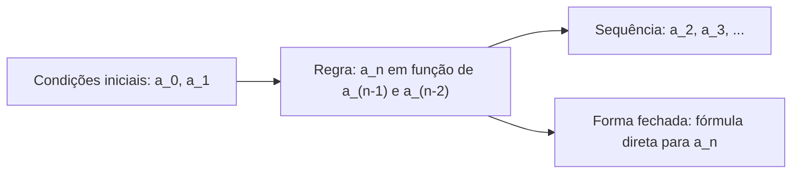

# 10 · Recorrências lineares

**Tempo estimado:** 30 minutos · **Pré-requisito:** [[08 - Indução e recursão]] e [[09 - Contagem]].

**Ao final você vai conseguir:**

1. Calcular os termos de uma recorrência a partir das condições iniciais.
2. Reconhecer uma recorrência linear com coeficientes constantes e escrever uma função que a calcula.
3. Usar a forma fechada de Fibonacci para calcular um termo diretamente, e conferir o resultado com o cálculo passo a passo.

**Antes de começar:** no módulo 08 você viu funções recursivas. Uma recorrência é a mesma ideia, escrita como uma regra para uma sequência.

---

## Para começar

Um tanque recebe 2 litros no primeiro minuto e 3 no segundo. A partir daí, a quantidade de cada minuto é a soma das duas anteriores. Quantos litros entram no minuto 10? Calcular um a um funciona, mas uma regra que relaciona cada termo aos anteriores permite calcular qualquer um deles e, às vezes, achar uma fórmula direta.

---

## Mapa do módulo



*Figura 1: a regra e as condições iniciais determinam a sequência inteira. Uma forma fechada, quando existe, calcula qualquer termo sem percorrer os anteriores.*

**Como ler:** a regra precisa de duas condições iniciais, porque cada termo depende de dois anteriores. A seta de baixo leva à fórmula direta.

---

## Mini-aula 1: recorrência

> [!tip] Ideia
> Uma recorrência define cada termo a partir de termos anteriores. Sem os valores iniciais, a regra sozinha não determina a sequência.

> [!info] Definição
> Uma **relação de recorrência** (recurrence relation) é uma definição recursiva de uma sequência, em que cada termo depende de termos anteriores. As **condições iniciais** (initial conditions) são os primeiros valores, que fixam uma única sequência.
>
> A **sequência de Fibonacci** é definida por `F_0 = 0`, `F_1 = 1` e `F_n = F_(n-1) + F_(n-2)`.

Veja os primeiros termos. Antes de rodar, escreva os oito primeiros valores no papel.

```python
a, b = 0, 1
for n in range(8):
    print(n, a)
    a, b = b, a + b
```

Saída real:

```
0 0
1 1
2 1
3 2
4 3
5 5
6 8
7 13
```

**Como ler:** o laço guarda dois valores consecutivos em `a` e `b`. A cada passo, o próximo termo é `a + b`. A saída é a sequência de Fibonacci.

> [!warning] Armadilha comum
> Uma recorrência de dois termos precisa de **dois** valores iniciais. Dar só `F_0` não basta: `F_2` depende de `F_1` e de `F_0`.

> [!question]- Checkpoint
> 1. Qual é `F_2`?
> 2. Se `F_0` e `F_1` mudassem, a sequência seria a mesma?
>
> > [!success]- Resposta
> > 1. `F_2 = F_1 + F_0 = 1 + 0 = 1`.
> > 2. Não. As condições iniciais determinam a sequência inteira.

---

## Mini-aula 2: recorrência linear e forma fechada

> [!tip] Ideia
> Uma recorrência é **linear** quando cada termo é uma combinação de termos anteriores, com coeficientes fixos. Para algumas delas, existe uma fórmula direta, a forma fechada.

> [!info] Definição
> Uma recorrência é **linear, homogênea e com coeficientes constantes** quando cada termo é uma combinação linear de alguns termos anteriores, com coeficientes fixos e sem termo extra. Por exemplo, `a_n = 2 a_(n-1) + 1` não é homogênea.
>
> Para Fibonacci, a **forma fechada** é `F_n = (1/√5) ((1 + √5)/2)^n - (1/√5) ((1 - √5)/2)^n`. Ela calcula `F_n` sem percorrer os termos anteriores.

A forma fechada tem raiz quadrada, então o resultado chega com erro de ponto flutuante. Por isso arredondamos. Antes de rodar, pense: os valores batem com a sequência da mini-aula 1?

```python
raiz = 5 ** 0.5
for n in range(8):
    f = (((1 + raiz) / 2) ** n - ((1 - raiz) / 2) ** n) / raiz
    print(n, round(f))
```

Saída real:

```
0 0
1 1
2 1
3 2
4 3
5 5
6 8
7 13
```

**Como ler:** para cada `n`, a fórmula dá um número aproximado, e `round` devolve o inteiro. Os valores são exatamente os da sequência.

> [!warning] Armadilha comum
> Sem o `round`, a forma fechada daria valores como `0.9999999999` no lugar de `1`. A forma é exata em teoria, mas não em ponto flutuante.

> [!question]- Checkpoint
> 1. A recorrência `a_n = 2 a_(n-1)` é homogênea e linear?
> 2. Por que o resultado da forma fechada precisa de `round`?
>
> > [!success]- Resposta
> > 1. Sim. Cada termo é uma combinação linear do anterior, sem termo extra.
> > 2. Porque a conta com `√5` usa aproximações, e o resultado sai um pouco diferente do inteiro.

---

## Mini-aula 3: calcular um termo

> [!tip] Ideia
> Há duas formas de calcular um termo: passo a passo, pela regra, ou direto, pela forma fechada. Os dois precisam dar o mesmo resultado.

> [!info] Definição
> A **recursão direta** segue a regra, termo a termo. A **forma fechada** calcula `F_n` com uma expressão, sem percorrer os termos anteriores.

Como ler: o exercício P2 pede a forma fechada, e o D1 usa a sequência para achar o primeiro termo maior que um valor dado. Os dois usam a mesma `F_n`, e o teste confere se a fórmula bate com o laço.

> [!warning] Armadilha comum
> A forma fechada de Fibonacci é um atalho para esta sequência. A regra continua sendo a definição, e é ela que o código segue.

> [!question]- Checkpoint
> 1. Qual é o valor de `F_6` pela regra?
> 2. Por que a forma fechada não é o único jeito de calcular `F_n`?
>
> > [!success]- Resposta
> > 1. `F_6 = 8`: a sequência é 0, 1, 1, 2, 3, 5, 8.
> > 2. Porque a regra já calcula `F_n`; a forma fechada é só um atalho, e nem toda recorrência tem uma.

---

## Exercícios

Cada exercício tem um bloco com a função a completar e os testes com `assert`. Quando todos passarem, aparece `Passou!`.

### Aquecimento

**A1. Fibonacci com laço.** Complete `fib(n)`, que devolve `F_n`, com `F_0 = 0` e `F_1 = 1`, e cada termo igual à soma dos dois anteriores. Use um laço, sem recursão.

```python
def fib(n):
    """Devolve F_n, com F_0 = 0 e F_1 = 1, usando um laço."""
    ...

assert fib(0) == 0, "F_0 é 0"
assert fib(1) == 1, "F_1 é 1"
assert fib(6) == 8, "F_6 é 8: 0, 1, 1, 2, 3, 5, 8"
print("Passou!")
```

> [!hint]- Dica 1
> Guarde dois valores: `a` começa em `F_0` e `b` em `F_1`. A cada passo, troque os dois por `b, a + b`.

> [!hint]- Dica 2
> Depois de `n` passos, `a` vale `F_n`. Devolva `a`.

> [!example]- Solução
> ```python
> def fib(n):
>     """Devolve F_n, com F_0 = 0 e F_1 = 1, usando um laço."""
>     a, b = 0, 1
>     for i in range(n):
>         a, b = b, a + b
>     return a
> ```
>
> **Erro comum:** Devolver `b` no lugar de `a`. Assim `fib(0)` daria 1, e não 0.

**A2. Fibonacci por recursão.** Complete `fib_rec(n)`, que devolve `F_n` pela própria definição da recorrência: `F_0 = 0`, `F_1 = 1` e `F_n = F_(n-1) + F_(n-2)`.

```python
def fib_rec(n):
    """Devolve F_n pela recorrência: F_0 = 0, F_1 = 1, F_n = F_(n-1) + F_(n-2)."""
    ...

assert fib_rec(0) == 0, "F_0 é 0"
assert fib_rec(5) == 5, "F_5 é 5"
assert fib_rec(7) == 13, "F_7 é 13"
print("Passou!")
```

> [!hint]- Dica 1
> O caso base são `n = 0` e `n = 1`. Nesses casos, a resposta é o próprio `n`.

> [!hint]- Dica 2
> No outro caso, devolva `fib_rec(n - 1) + fib_rec(n - 2)`.

> [!example]- Solução
> ```python
> def fib_rec(n):
>     """Devolve F_n pela recorrência: F_0 = 0, F_1 = 1, F_n = F_(n-1) + F_(n-2)."""
>     if n < 2:
>         return n
>     return fib_rec(n - 1) + fib_rec(n - 2)
> ```
>
> **Erro comum:** Esquecer um dos dois casos base. Com `n = 1`, a chamada seguiria para `n - 2 = -1`, e nunca pararia.

**A3. Os primeiros termos.** Complete `lista_fib(n)`, que devolve a lista `[F_0, F_1, ..., F_(n-1)]`. A função `fib`, do primeiro exercício, já está pronta.

```python
def fib(n):
    # já pronta, do exercício A1
    a, b = 0, 1
    for i in range(n):
        a, b = b, a + b
    return a

def lista_fib(n):
    """Devolve [F_0, F_1, ..., F_(n-1)]."""
    ...

assert lista_fib(0) == [], "nenhum termo"
assert lista_fib(1) == [0], "só F_0"
assert lista_fib(6) == [0, 1, 1, 2, 3, 5], "os seis primeiros termos"
print("Passou!")
```

> [!hint]- Dica 1
> Use uma expressão de lista: `[fib(i) for i in range(n)]`.

> [!hint]- Dica 2
> Para `n = 0`, a lista é vazia.

> [!example]- Solução
> ```python
> def lista_fib(n):
>     """Devolve [F_0, F_1, ..., F_(n-1)]."""
>     return [fib(i) for i in range(n)]
> ```
>
> **Erro comum:** Usar `range(1, n)`, que deixa de fora o `F_0`.

### Praticando

**P1. Recorrência geral.** Complete `recorrencia_linear(c1, c2, a0, a1, n)`, que devolve `a_n` para a recorrência `a_n = c1 * a_(n-1) + c2 * a_(n-2)`, com `a_0` e `a_1` dados. Fibonacci é o caso `c1 = 1`, `c2 = 1`, `a0 = 0`, `a1 = 1`.

```python
def recorrencia_linear(c1, c2, a0, a1, n):
    """Devolve a_n para a_n = c1 * a_(n-1) + c2 * a_(n-2), com a_0 = a0 e a_1 = a1."""
    ...

assert recorrencia_linear(1, 1, 0, 1, 6) == 8, "Fibonacci: a_6 é 8"
assert recorrencia_linear(2, 0, 1, 2, 3) == 8, "a_n = 2 a_(n-1): a_3 = 8"
assert recorrencia_linear(1, 1, 0, 1, 0) == 0, "o caso n = 0 devolve a_0"
print("Passou!")
```

> [!hint]- Dica 1
> Se `n == 0`, devolva `a0`. Caso contrário, guarde dois valores: `x = a0` e `y = a1`.

> [!hint]- Dica 2
> Para cada índice de 2 até `n`, troque os dois por `y, c1 * y + c2 * x`. Ao final, devolva `y`.

> [!example]- Solução
> ```python
> def recorrencia_linear(c1, c2, a0, a1, n):
>     """Devolve a_n para a_n = c1 * a_(n-1) + c2 * a_(n-2), com a_0 = a0 e a_1 = a1."""
>     if n == 0:
>         return a0
>     x, y = a0, a1
>     for i in range(2, n + 1):
>         x, y = y, c1 * y + c2 * x
>     return y
> ```
>
> **Erro comum:** Aplicar a fórmula com os índices trocados, por exemplo usando `c1 * x + c2 * y`. A recorrência depende do termo mais recente com `c1`, e do anterior com `c2`.

**P2. Forma fechada.** Complete `forma_fechada_fib(n)`, que calcula `F_n` pela fórmula fechada: `F_n = ((1 + √5)/2)^n - ((1 - √5)/2)^n`, dividida por `√5`. Como o resultado é um número com erro de ponto flutuante, devolva o inteiro mais próximo com `round`. A função `fib` já está pronta.

```python
def fib(n):
    # já pronta, do exercício A1
    a, b = 0, 1
    for i in range(n):
        a, b = b, a + b
    return a

def forma_fechada_fib(n):
    """Devolve F_n pela forma fechada, arredondado para o inteiro mais próximo."""
    ...

assert forma_fechada_fib(0) == 0, "F_0 é 0"
assert forma_fechada_fib(1) == 1, "F_1 é 1"
assert forma_fechada_fib(10) == fib(10) == 55, "F_10 é 55, pela fórmula e pelo laço"
print("Passou!")
```

> [!hint]- Dica 1
> Guarde `raiz = 5 ** 0.5` e calcule as duas potências com `**`.

> [!hint]- Dica 2
> Some ou subtraia as potências, divida por `raiz` e passe o resultado para `round`.

> [!example]- Solução
> ```python
> def forma_fechada_fib(n):
>     """Devolve F_n pela forma fechada, arredondado para o inteiro mais próximo."""
>     raiz = 5 ** 0.5
>     valor = (((1 + raiz) / 2) ** n - ((1 - raiz) / 2) ** n) / raiz
>     return round(valor)
> ```
>
> **Erro comum:** Usar `int(...)` no lugar de `round(...)`. O resultado vem um pouco abaixo do inteiro, e `int` trunca para o valor errado.

**P3. Quantas chamadas?** Complete `chamadas_fib(n)`, que conta quantas chamadas a função recursiva `fib_rec` faz para calcular `F_n`, incluindo a chamada inicial. Use a mesma estrutura de `fib_rec`: no caso base, conte 1; no outro caso, conte 1 mais as chamadas dos dois ramos.

```python
def chamadas_fib(n):
    """Conta as chamadas feitas por fib_rec(n), incluindo a chamada inicial."""
    ...

assert chamadas_fib(0) == 1, "uma chamada, no caso base"
assert chamadas_fib(1) == 1, "também uma chamada"
assert chamadas_fib(2) == 3, "fib_rec(2) chama fib_rec(1) e fib_rec(0)"
assert chamadas_fib(3) == 5, "fib_rec(3) faz cinco chamadas"
print("Passou!")
```

> [!hint]- Dica 1
> No caso base (`n < 2`), devolva `1`.

> [!hint]- Dica 2
> No outro caso, devolva `1 + chamadas_fib(n - 1) + chamadas_fib(n - 2)`.

> [!example]- Solução
> ```python
> def chamadas_fib(n):
>     """Conta as chamadas feitas por fib_rec(n), incluindo a chamada inicial."""
>     if n < 2:
>         return 1
>     return 1 + chamadas_fib(n - 1) + chamadas_fib(n - 2)
> ```
>
> **Erro comum:** Contar só os casos de cada ramo e esquecer a chamada inicial, que também conta. Por isso o caso base devolve `1`, e não `0`.

### Desafio

**D1. Primeiro termo maior que x.** Complete `primeiro_indice_maior(x)`, que devolve o menor `n` tal que `F_n > x`, com `x ≥ 0`. A função `fib` já está pronta.

```python
def fib(n):
    # já pronta, do exercício A1
    a, b = 0, 1
    for i in range(n):
        a, b = b, a + b
    return a

def primeiro_indice_maior(x):
    """Devolve o menor n tal que F_n > x."""
    ...

assert primeiro_indice_maior(10) == 7, "F_7 = 13 é o primeiro maior que 10"
assert primeiro_indice_maior(0) == 1, "F_1 = 1 é o primeiro maior que 0"
assert primeiro_indice_maior(1) == 3, "F_3 = 2 é o primeiro maior que 1"
print("Passou!")
```

> [!hint]- Dica 1
> Comece com `n = 0` e aumente `n` enquanto `fib(n) <= x`.

> [!hint]- Dica 2
> Use `while fib(n) <= x:` e, dentro, `n += 1`. Ao sair do laço, devolva `n`.

> [!example]- Solução
> ```python
> def primeiro_indice_maior(x):
>     """Devolve o menor n tal que F_n > x."""
>     n = 0
>     while fib(n) <= x:
>         n += 1
>     return n
> ```
>
> **Erro comum:** Usar `fib(n) < x` na condição. Com `x` igual a um termo, o laço para antes de achar o termo seguinte, que é o maior.


## Mini-projeto (opcional)

Um exercício maior, que junta as funções anteriores. Tente sozinho antes de abrir a solução.

**Objetivo.** Devolva a lista de pares `(n, F_n)` para todos os termos de Fibonacci que não passam de `limite`, em ordem de `n`. A função `fib`, do exercício A1, já está pronta.

```python
def fib(n):
    # já pronta, do exercício A1
    a, b = 0, 1
    for i in range(n):
        a, b = b, a + b
    return a

def tabela_fib_ate(limite):
    """Devolve os pares (n, F_n) com F_n <= limite, em ordem de n."""
    ...

assert tabela_fib_ate(10) == [(0, 0), (1, 1), (2, 1), (3, 2), (4, 3), (5, 5), (6, 8)], "até 10: os termos de 0 a 6"
assert tabela_fib_ate(0) == [(0, 0)], "só F_0 não passa de 0"
assert tabela_fib_ate(1) == [(0, 0), (1, 1), (2, 1)], "F_1 e F_2 valem 1"
print("Passou!")
```

> [!hint]- Dica 1
> Comece com `n = 0` e uma lista vazia. Enquanto `fib(n) <= limite`, adicione `(n, fib(n))` e aumente `n`.

> [!hint]- Dica 2
> Use `while fib(n) <= limite:`.

> [!example]- Solução
> ```python
> def tabela_fib_ate(limite):
>     """Devolve os pares (n, F_n) com F_n <= limite, em ordem de n."""
>     resultado = []
>     n = 0
>     while fib(n) <= limite:
>         resultado.append((n, fib(n)))
>         n += 1
>     return resultado
> ```
>
> **Erro comum:** Usar `<` em vez de `<=`. Então o termo igual ao limite ficaria de fora, e `tabela_fib_ate(1)` perderia o `F_1 = 1`.


---

## Fechando

**Resumo**

- Uma recorrência define cada termo a partir de anteriores, com condições iniciais.
- Fibonacci: `F_0 = 0`, `F_1 = 1`, `F_n = F_(n-1) + F_(n-2)`.
- Recorrência linear homogênea com coeficientes constantes: combinação linear de termos anteriores, sem termo extra.
- Forma fechada: fórmula direta para `F_n`, com `√5`, que precisa de `round` no código.
- A regra e a forma fechada dão o mesmo resultado.

**Glossário rápido**

- **Recorrência** (recurrence relation): definição de uma sequência por termos anteriores.
- **Condição inicial** (initial condition): primeiro valor que fixa a sequência.
- **Linear homogênea com coeficientes constantes**: combinação linear de termos anteriores, sem termo extra.
- **Forma fechada** (closed form): fórmula direta para o termo `n`.

**Perguntas de revisão**

1. Quais são os cinco primeiros termos da sequência com `F_0 = 1` e `F_1 = 1`?
2. Por que `a_n = 2 a_(n-1) + 1` não é linear homogênea?
3. O que mudaria no código de `recorrencia_linear` se a recorrência tivesse três termos?

**E agora?** O próximo módulo é **Divisibilidade e aritmética modular**. Ele trata de divisores, do máximo divisor comum e de contas que "dão a volta" depois de um certo número, que são a base de RSA.

---

## Para ir mais fundo

- [[Linear Recurrence Relations]]
