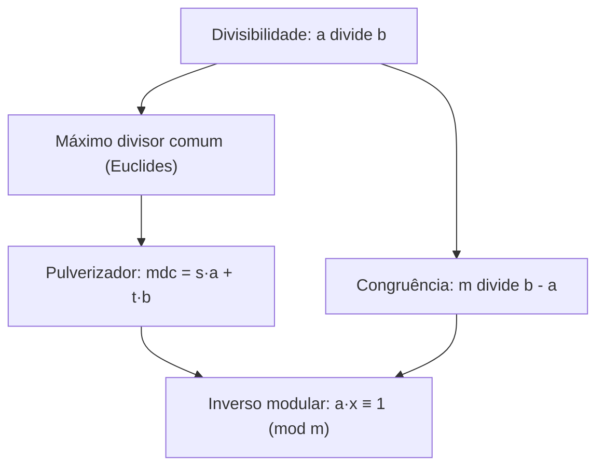

# 11 · Divisibilidade e aritmética modular

**Tempo estimado:** 30 minutos · **Pré-requisito:** [[07 - Provas direta e por contradição]] (o resto da divisão é o centro de tudo aqui).

**Ao final você vai conseguir:**

1. Dizer se um número divide outro e calcular o máximo divisor comum com o algoritmo de Euclides.
2. Testar se dois inteiros são congruentes módulo `m`.
3. Calcular um inverso modular com o Pulverizador (o algoritmo de Euclides estendido), e usar `pow` do Python para conferir.

**Antes de começar:** você já sabe o que é resto com `%`. Este módulo mostra o que esse resto significa em contas.

---

## Para começar

Um relógio de 12 horas: se são 10 horas e passam 5 horas, são 3 horas, e não 15. Os números "dão a volta" ao chegar em 12. Essa aritmética de restos é a base da criptografia de chave pública, que você vai ver no módulo 12. Para entender RSA, precisamos antes de divisibilidade e de máximo divisor comum.

---

## Mapa do módulo



*Figura 1: divisibilidade leva ao máximo divisor comum, que o Pulverizador estende com coeficientes. Com congruência, o Pulverizador dá o inverso modular.*

**Como ler:** siga as setas. O inverso modular depende de duas ideias: o mdc e a congruência.

---

## Mini-aula 1: divisibilidade

> [!tip] Ideia
> `a` divide `b` quando `b` é um múltiplo exato de `a`, sem resto.

> [!info] Definição
> `a` **divide** (divides) `b`, escrito `a | b`, quando `b = a · c` para algum inteiro `c`. O **máximo divisor comum** (greatest common divisor, gcd) de dois inteiros não nulos é o maior inteiro que divide os dois.

Em Python, `a` divide `b` quando `b % a == 0`. Antes de rodar, pense: `3` divide `12`? `5` divide `12`?

```python
print((14 - 2) % 12 == 0, (15 - 2) % 12 == 0)
```

Saída real:

```
True False
```

**Como ler:** `(14 - 2) % 12 == 0` diz que 12 divide a diferença `14 - 2`. A saída `True False` mostra que, para 15, a diferença não é múltipla de 12.

> [!warning] Armadilha comum
> Divisibilidade olha `b` em relação a `a`: `a | b` não é o mesmo que `b | a`. Com 3 e 12, `3 | 12` é verdadeiro, e `12 | 3` é falso.

> [!question]- Checkpoint
> 1. `4` divide `20`?
> 2. `20` divide `4`?
>
> > [!success]- Resposta
> > 1. Sim, porque `20 = 4 · 5`.
> > 2. Não. `4 = 20 · c` não tem solução inteira.

---

## Mini-aula 2: máximo divisor comum e Euclides

> [!tip] Ideia
> O máximo divisor comum não precisa ser achado por tentativa. A relação `mdc(a, b) = mdc(b, a % b)` faz o problema encolher a cada passo.

> [!info] Definição
> O algoritmo de Euclides usa a relação `mdc(a, b) = mdc(b, resto(a, b))`, para `b ≠ 0`, até o resto ser zero. O mdc é o último valor não nulo de `a`, antes de o resto zerar.

Veja os passos com 18 e 12. Antes de rodar, calcule o resto de 18 por 12.

```python
a, b = 18, 12
while b != 0:
    print(a, b)
    a, b = b, a % b
print("mdc:", a)
```

Saída real:

```
18 12
12 6
mdc: 6
```

**Como ler:** cada linha é um par `(a, b)`. Na primeira, `18 % 12 = 6`, e o par passa a ser `(12, 6)`. Na segunda, `12 % 6 = 0`, e o laço para. O último `a` não nulo é 6.

> [!warning] Armadilha comum
> O mdc não é o resto final. Quando o resto chega a zero, o mdc é o valor anterior, que ficou em `a`.

> [!question]- Checkpoint
> 1. Quanto vale `mdc(7, 5)`?
> 2. Quanto vale `mdc(100, 10)`?
>
> > [!success]- Resposta
> > 1. 1: não há divisor comum maior que 1.
> > 2. 10, porque 10 divide 100 e nada maior divide os dois.

---

## Mini-aula 3: congruência e inverso modular

> [!tip] Ideia
> Dois números são congruentes módulo `m` quando dão o mesmo resto por `m`, o que equivale a `m` dividir a diferença.

> [!info] Definição
> `a` e `b` são **congruentes módulo m** quando `m` divide `b - a`, escrito `a ≡ b (mod m)`.
>
> O **inverso modular** de `a` módulo `m` é um `x` tal que `a · x ≡ 1 (mod m)`. Pela biblioteca, ele existe quando `a` é primo com `m`, isto é, quando o mdc é 1.

Exemplo: `38 · 23 = 874`, e `874 mod 97 = 1`. Logo, 23 é o inverso de 38 módulo 97. O Python calcula isso com `pow` de três argumentos, desde a versão 3.8.

```python
print(pow(38, -1, 97))
print(23 * 38 % 97)
```

Saída real:

```
23
1
```

**Como ler:** a primeira linha é o inverso, `23`. A segunda confere: `23 · 38 mod 97 = 1`.

> [!warning] Armadilha comum
> Inverso modular só existe quando o mdc é 1. Para `a = 2` e `m = 4`, não há inverso: nenhum `x` faz `2x ≡ 1 (mod 4)`.

> [!question]- Checkpoint
> 1. `14` e `2` são congruentes módulo `12`?
> 2. `2` tem inverso módulo `4`?
>
> > [!success]- Resposta
> > 1. Sim, porque `14 - 2 = 12`, que é múltiplo de 12.
> > 2. Não. O mdc de 2 e 4 é 2, e não 1.

---

## Exercícios

Cada exercício tem um bloco com a função a completar e os testes com `assert`. Quando todos passarem, aparece `Passou!`.

### Aquecimento

**A1. Divide.** Complete `divide(a, b)`, que devolve `True` se `a` divide `b`, isto é, se existe um inteiro `c` com `b = a * c`. Assuma `a ≠ 0`.

```python
def divide(a, b):
    """Devolve True se a divide b, isto é, se b = a * c para algum inteiro c."""
    ...

assert divide(3, 12) == True, "3 divide 12"
assert divide(5, 12) == False, "5 não divide 12"
assert divide(1, 7) == True, "1 divide todo inteiro"
print("Passou!")
```

> [!hint]- Dica 1
> `a` divide `b` quando o resto de `b` por `a` é zero.

> [!hint]- Dica 2
> Em Python, o resto é `%`. Devolva `b % a == 0`.

> [!example]- Solução
> ```python
> def divide(a, b):
>     """Devolve True se a divide b, isto é, se b = a * c para algum inteiro c."""
>     return b % a == 0
> ```
>
> **Erro comum:** Testar `a % b == 0`, que inverte a pergunta. Com `a = 3` e `b = 12`, isso dá `3 % 12 == 3`, e a resposta sairia errada.

**A2. Máximo divisor comum.** Complete `mdc(a, b)`, que devolve o máximo divisor comum de `a` e `b`, positivos, pelo algoritmo de Euclides: enquanto `b` não é zero, troque o par `(a, b)` por `(b, a % b)`. Ao final, devolva `a`.

```python
def mdc(a, b):
    """Devolve o máximo divisor comum de a e b, pelo algoritmo de Euclides."""
    ...

assert mdc(12, 18) == 6, "o maior divisor comum de 12 e 18 é 6"
assert mdc(7, 5) == 1, "7 e 5 não têm divisor comum maior que 1"
assert mdc(100, 10) == 10, "10 divide 100"
print("Passou!")
```

> [!hint]- Dica 1
> Use `while b != 0:` e, dentro, a troca `a, b = b, a % b`.

> [!hint]- Dica 2
> Quando `b` chega a zero, `a` é o máximo divisor comum.

> [!example]- Solução
> ```python
> def mdc(a, b):
>     """Devolve o máximo divisor comum de a e b, pelo algoritmo de Euclides."""
>     while b != 0:
>         a, b = b, a % b
>     return a
> ```
>
> **Erro comum:** Devolver `b` no fim do laço. Quando o laço para, `b` vale zero, e o resultado seria sempre zero.

**A3. Congruentes módulo m.** Complete `congruentes(a, b, m)`, que devolve `True` se `a` e `b` são congruentes módulo `m`, isto é, se `m` divide `b - a`.

```python
def congruentes(a, b, m):
    """Devolve True se m divide b - a, isto é, se a e b são congruentes módulo m."""
    ...

assert congruentes(2, 14, 12) == True, "14 - 2 = 12 é múltiplo de 12"
assert congruentes(2, 15, 12) == False, "15 - 2 = 13 não é múltiplo de 12"
assert congruentes(-1, 11, 12) == True, "11 - (-1) = 12"
print("Passou!")
```

> [!hint]- Dica 1
> Calcule `b - a` e veja se o resto por `m` é zero.

> [!hint]- Dica 2
> Use `(b - a) % m == 0`.

> [!example]- Solução
> ```python
> def congruentes(a, b, m):
>     """Devolve True se m divide b - a, isto é, se a e b são congruentes módulo m."""
>     return (b - a) % m == 0
> ```
>
> **Erro comum:** Testar `(a - b) % m == 0`. Essa comparação dá o mesmo resultado, mas o erro comum é trocar `a` e `b` em outra parte da função. Mantenha a diferença `b - a`, que é a definição.

### Praticando

**P1. Pulverizador.** Complete `mdc_estendido(a, b)`, que devolve uma tripla `(g, s, t)` com `g = mdc(a, b)` e `g = s * a + t * b`. Use recursão: se `b == 0`, a tripla é `(a, 1, 0)`. Caso contrário, calcule `(g, s1, t1)` para `(b, a % b)` e devolva `(g, t1, s1 - (a // b) * t1)`.

```python
def mdc_estendido(a, b):
    """Devolve (g, s, t) com g = mdc(a, b) e g = s * a + t * b (algoritmo de Euclides estendido)."""
    ...

resultado = mdc_estendido(12, 18)
assert resultado is not None, "a função ainda não devolve uma tripla (g, s, t)"
g, s, t = resultado
assert g == 6, "o mdc de 12 e 18 é 6"
assert s * 12 + t * 18 == 6, "deve valer g = s * a + t * b"
resultado = mdc_estendido(7, 5)
assert resultado is not None, "a função ainda não devolve uma tripla (g, s, t)"
g, s, t = resultado
assert g == 1, "o mdc de 7 e 5 é 1"
assert s * 7 + t * 5 == 1, "deve valer 1 = s * 7 + t * 5"
print("Passou!")
```

> [!hint]- Dica 1
> No caso base, `(a, 1, 0)` vale porque `a = 1 * a + 0 * 0`.

> [!hint]- Dica 2
> Na chamada recursiva, desempacote o resultado com `g, s1, t1 = mdc_estendido(b, a % b)`.

> [!example]- Solução
> ```python
> def mdc_estendido(a, b):
>     """Devolve (g, s, t) com g = mdc(a, b) e g = s * a + t * b (algoritmo de Euclides estendido)."""
>     if b == 0:
>         return (a, 1, 0)
>     g, s1, t1 = mdc_estendido(b, a % b)
>     return (g, t1, s1 - (a // b) * t1)
> ```
>
> **Erro comum:** Devolver `(g, s1, t1)` sem trocar e combinar os coeficientes. Os coeficientes da chamada de baixo se referem ao par `(b, a % b)`, e precisam ser reescritos para `(a, b)`.

**P2. Inverso modular.** Complete `inverso_modular(a, m)`, que devolve `x` com `0 ≤ x < m` tal que `a * x ≡ 1 (mod m)`, ou `None` se não existir. Use `mdc_estendido`: se o mdc de `a` e `m` não for 1, não há inverso. Caso contrário, o coeficiente `s` dá o inverso, e `s % m` o coloca no intervalo.

```python
def mdc_estendido(a, b):
    # já pronta, do exercício P1
    if b == 0:
        return (a, 1, 0)
    g, s1, t1 = mdc_estendido(b, a % b)
    return (g, t1, s1 - (a // b) * t1)

def inverso_modular(a, m):
    """Devolve x em [0, m) com a * x ≡ 1 (mod m), ou None se não existir."""
    ...

assert inverso_modular(38, 97) == 23, "o inverso de 38 módulo 97 é 23"
assert inverso_modular(3, 7) == 5, "3 * 5 = 15 ≡ 1 (mod 7)"
assert inverso_modular(2, 4) is None, "2 e 4 não são primos entre si: sem inverso"
print("Passou!")
```

> [!hint]- Dica 1
> Chame `g, s, t = mdc_estendido(a, m)`.

> [!hint]- Dica 2
> Se `g != 1`, devolva `None`. Caso contrário, devolva `s % m`.

> [!example]- Solução
> ```python
> def inverso_modular(a, m):
>     """Devolve x em [0, m) com a * x ≡ 1 (mod m), ou None se não existir."""
>     g, s, t = mdc_estendido(a, m)
>     if g != 1:
>         return None
>     return s % m
> ```
>
> **Erro comum:** Devolver `s` sem o `% m`. O coeficiente `s` pode ser negativo ou maior que `m`, e o resultado deve estar entre 0 e `m - 1`.

**P3. Potência módulo m.** Complete `potencia_mod(b, e, m)`, que devolve `b^e mod m`. Calcule passo a passo, reduzindo módulo `m` a cada multiplicação, para que os números não cresçam sem controle.

```python
def potencia_mod(b, e, m):
    """Devolve b^e mod m, reduzindo módulo m a cada passo."""
    ...

assert potencia_mod(2, 10, 1000) == 24, "2^10 = 1024, e 1024 mod 1000 é 24"
assert potencia_mod(3, 0, 7) == 1, "qualquer potência de expoente 0 é 1"
assert potencia_mod(5, 3, 13) == 8, "5^3 = 125, e 125 mod 13 é 8"
print("Passou!")
```

> [!hint]- Dica 1
> Comece com `resultado = 1`. Repita `e` vezes: `resultado = resultado * b % m`.

> [!hint]- Dica 2
> Para `e = 0`, o laço não roda, e o resultado é `1`.

> [!example]- Solução
> ```python
> def potencia_mod(b, e, m):
>     """Devolve b^e mod m, reduzindo módulo m a cada passo."""
>     resultado = 1
>     for _ in range(e):
>         resultado = resultado * b % m
>     return resultado
> ```
>
> **Erro comum:** Calcular `b ** e` e só depois tirar o resto. O número fica enorme, e o resultado é o mesmo, mas o cálculo fica muito mais caro.

### Desafio

**D1. Tabela de inversos.** Complete `tabela_inversos(m)`, que devolve a lista dos pares `(a, inverso)` para cada `a` de `1` a `m - 1` que tem inverso módulo `m`, em ordem. A função `inverso_modular` já está pronta, e ela devolve `None` quando o inverso não existe.

```python
def mdc_estendido(a, b):
    # já pronta, do exercício P1
    if b == 0:
        return (a, 1, 0)
    g, s1, t1 = mdc_estendido(b, a % b)
    return (g, t1, s1 - (a // b) * t1)

def inverso_modular(a, m):
    # já pronta, do exercício P2
    g, s, t = mdc_estendido(a, m)
    if g != 1:
        return None
    return s % m

def tabela_inversos(m):
    """Devolve os pares (a, inverso) para cada a de 1 a m - 1 que tem inverso módulo m."""
    ...

assert tabela_inversos(7) == [(1, 1), (2, 4), (3, 5), (4, 2), (5, 3), (6, 6)], "todos os a de 1 a 6 têm inverso módulo 7"
assert tabela_inversos(4) == [(1, 1), (3, 3)], "o 2 não tem inverso módulo 4"
print("Passou!")
```

> [!hint]- Dica 1
> Percorra `a` de 1 até `m - 1`. Calcule `inverso_modular(a, m)`.

> [!hint]- Dica 2
> Só adicione o par se o inverso não for `None`.

> [!example]- Solução
> ```python
> def tabela_inversos(m):
>     """Devolve os pares (a, inverso) para cada a de 1 a m - 1 que tem inverso módulo m."""
>     resultado = []
>     for a in range(1, m):
>         inv = inverso_modular(a, m)
>         if inv is not None:
>             resultado.append((a, inv))
>     return resultado
> ```
>
> **Erro comum:** Adicionar o par sem testar `None`. Os `a` sem inverso entrariam na lista com valor `None`.


## Mini-projeto (opcional)

Um exercício maior, que junta as funções anteriores. Tente sozinho antes de abrir a solução.

**Objetivo.** Uma fração `a/b` é escrita como um par `(a, b)`. Devolva a fração na forma reduzida, dividindo `a` e `b` pelo máximo divisor comum. A função `mdc`, do exercício A2, já está pronta.

```python
def mdc(a, b):
    # já pronta, do exercício A2
    while b != 0:
        a, b = b, a % b
    return a

def simplifica(a, b):
    """Devolve a fração (a, b) na forma reduzida, dividindo pelo mdc."""
    ...

assert simplifica(12, 18) == (2, 3), "12/18 é 2/3"
assert simplifica(7, 5) == (7, 5), "7/5 já está reduzida"
assert simplifica(100, 10) == (10, 1), "100/10 é 10/1"
print("Passou!")
```

> [!hint]- Dica 1
> Calcule `g = mdc(a, b)` primeiro.

> [!hint]- Dica 2
> Devolva `(a // g, b // g)`.

> [!example]- Solução
> ```python
> def simplifica(a, b):
>     """Devolve a fração (a, b) na forma reduzida, dividindo pelo mdc."""
>     g = mdc(a, b)
>     return (a // g, b // g)
> ```
>
> **Erro comum:** Usar `/` em vez de `//`. O resultado vira decimal, e `(2.0, 3.0)` não é igual a `(2, 3)`.


---

## Fechando

**Resumo**

- `a | b` quando `b = a · c` para algum inteiro `c`; em Python, `b % a == 0`.
- Euclides: `mdc(a, b) = mdc(b, a % b)`, até o resto zerar.
- O Pulverizador (Euclides estendido) escreve `mdc = s·a + t·b`.
- `a ≡ b (mod m)` quando `m` divide `b - a`.
- O inverso modular de `a` existe quando `mdc(a, m) = 1`.

**Glossário rápido**

- **Divide** (divides): `a | b` quando `b = a · c` para algum inteiro `c`.
- **Máximo divisor comum** (gcd): maior inteiro que divide dois inteiros dados.
- **Algoritmo de Euclides**: cálculo do mdc pelo resto, em passos.
- **Congruente módulo m**: dois inteiros com mesmo resto módulo `m`.
- **Inverso modular**: `x` tal que `a · x ≡ 1 (mod m)`.
- **Primos entre si** (relatively prime): mdc igual a 1.

**Perguntas de revisão**

1. Por que `mdc(18, 12) = mdc(12, 6)`?
2. `17` e `2` são congruentes módulo `5`? Calcule a diferença.
3. Existe inverso modular de `3` módulo `9`? Justifique com o mdc.

**E agora?** O próximo módulo é **RSA**. Ele usa tudo o que você viu aqui: o inverso modular para gerar a chave privada, e a potência módulo `n` para cifrar e decifrar mensagens.

---

## Para ir mais fundo

- [[Divisibility and GCD]]
- [[Modular Arithmetic]]
