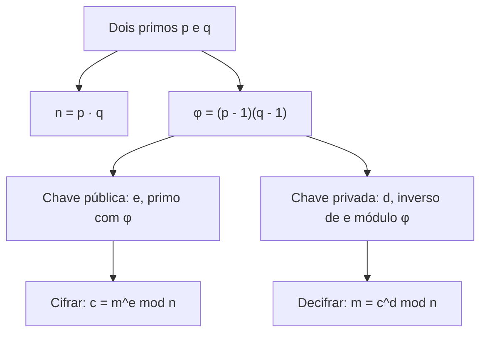

# 12 · RSA

**Tempo estimado:** 30 minutos · **Pré-requisito:** [[11 - Divisibilidade e aritmética modular]].

**Ao final você vai conseguir:**

1. Explicar a ideia de chave pública e chave privada.
2. Gerar um par de chaves RSA com números pequenos, a partir de dois primos.
3. Cifrar e decifrar uma mensagem e conferir que ela volta igual.

**Antes de começar:** o módulo 11 trouxe o mdc, o inverso modular e a potência módulo `n`. O RSA usa essas três peças.

---

## Para começar

Você quer receber mensagens sigilosas de qualquer pessoa, sem combinar uma senha antes. Se a chave que cifra for a mesma que decifra, quem a conhece lê tudo. O RSA resolve isso com duas chaves diferentes: uma pode ser divulgada, e a outra fica secreta. A ideia parece um cadeado que qualquer um fecha, mas só o dono abre. (Analogia para ajudar a entender.)

---

## Mapa do módulo



*Figura 1: os primos geram n e φ. A chave pública usa e e n; a privada usa d e n. Cifrar e decifrar são a mesma operação, com expoentes diferentes.*

**Como ler:** a parte de cima gera os números; a de baixo usa as chaves. Repare que `d` depende de `φ`, e não de `n`.

---

## Mini-aula 1: chave pública e chave privada

> [!tip] Ideia
> Duas chaves relacionadas: uma pública, que cifra; uma privada, que decifra. Quem só tem a pública não consegue decifrar.

> [!info] Definição
> No RSA, a **chave pública** (public key) é o par `(e, n)`, divulgado. A **chave privada** (private key) é o expoente `d`, mantido em segredo. Cifrar usa a chave pública; decifrar usa a privada.

Como ler: a chave pública é o que todos veem; o segredo é o `d`. A segurança do esquema depende de `d` não ser fácil de obter a partir de `(e, n)`, e a biblioteca trata essa suposição como um ponto que ainda não foi provado.

> [!warning] Armadilha comum
> A segurança do RSA não é uma prova matemática completa. A biblioteca registra que a suposição de que quebrar o RSA implica fatorar `n` é uma conjectura não provada. O algoritmo funciona; a segurança é uma suposição.

> [!question]- Checkpoint
> 1. Qual chave decifra: a pública ou a privada?
> 2. A chave pública é o par `(e, n)` ou `d`?
>
> > [!success]- Resposta
> > 1. A privada, `d`.
> > 2. O par `(e, n)`.

---

## Mini-aula 2: gerar as chaves

> [!tip] Ideia
> Escolhemos dois primos, multiplicamos para obter `n`, e calculamos `φ` com eles. Depois, `e` deve ser primo com `φ`, e `d` é o inverso de `e` módulo `φ`.

> [!info] Definição
> Com primos distintos `p` e `q`:
>
> 1. `n = p · q`.
> 2. `φ = (p - 1)(q - 1)`.
> 3. Escolha `e` com `mdc(e, φ) = 1`. A chave pública é `(e, n)`.
> 4. `d` é o inverso modular de `e` módulo `φ`, calculado pelo Pulverizador. A chave privada é `(d, n)`.

Exemplo com `p = 5` e `q = 11`. Antes de rodar, calcule `n` e `φ` no papel.

```python
p, q = 5, 11
n = p * q
phi = (p - 1) * (q - 1)
print(n, phi)
```

Saída real:

```
55 40
```

**Como ler:** `n = 55` é o módulo, e `φ = 40` é o que usamos para achar `d`. Com `e = 3`, o inverso de 3 módulo 40 é 27, porque `3 · 27 = 81 = 2 · 40 + 1`.

> [!warning] Armadilha comum
> `d` é o inverso de `e` módulo `φ`, e não módulo `n`. Trocar isso dá uma chave que não decifra. O exercício P2 testa exatamente esse erro.

> [!question]- Checkpoint
> 1. Com `p = 3` e `q = 11`, quanto vale `n`?
> 2. E `φ`?
>
> > [!success]- Resposta
> > 1. `n = 33`.
> > 2. `φ = (3 - 1)(11 - 1) = 20`.

---

## Mini-aula 3: cifrar e decifrar

> [!tip] Ideia
> Cifrar é elevar a mensagem a `e` módulo `n`. Decifrar é elevar a cifra a `d` módulo `n`. Se as chaves foram geradas corretamente, a mensagem volta.

> [!info] Definição
> A cifra é `c = m^e mod n` e a decifra é `m = c^d mod n`. A biblioteca explica a correção com o teorema de Euler, para mensagens `m` primas com `n`. Neste módulo, consideramos só essas mensagens.

Veja um exemplo com `m = 2`, usando as chaves do exemplo anterior. Antes de rodar, pense: se `c = 8`, o que `8^27 mod 55` deve dar?

```python
e, d, n = 3, 27, 55
c = pow(2, e, n)
m = pow(c, d, n)
print(c, m)
```

Saída real:

```
8 2
```

**Como ler:** a primeira saída é a cifra, `8`. A segunda é a mensagem recuperada, `2`, a mesma que foi cifrada.

> [!warning] Armadilha comum
> Os números pequenos deste módulo servem só para entender a conta. Chaves reais usam primos muito maiores, e a escolha de parâmetros é um assunto à parte, que a biblioteca não cobre.

> [!question]- Checkpoint
> 1. Com a chave pública `(3, 55)`, quanto é a cifra de `m = 2`?
> 2. Com a chave privada `(27, 55)`, o que sai da cifra `8`?
>
> > [!success]- Resposta
> > 1. `2^3 mod 55 = 8`.
> > 2. `2`, a mensagem original.

---

## Exercícios

Cada exercício tem um bloco com a função a completar e os testes com `assert`. As funções dos módulos anteriores já estão nos blocos que precisam delas. Quando todos passarem, aparece `Passou!`.

### Aquecimento

**A1. Phi do produto.** Complete `totiente(p, q)`, que devolve `(p - 1) * (q - 1)`, para `p` e `q` primos distintos. Esse valor é o φ(n) de `n = p · q` usado no RSA.

```python
def totiente(p, q):
    """Devolve (p - 1) * (q - 1), para p e q primos distintos."""
    ...

assert totiente(5, 7) == 24, "(5 - 1) * (7 - 1) = 24"
assert totiente(3, 11) == 20, "(3 - 1) * (11 - 1) = 20"
print("Passou!")
```

> [!hint]- Dica 1
> É uma conta direta com os dois números.

> [!hint]- Dica 2
> Não some: multiplique `(p - 1)` por `(q - 1)`.

> [!example]- Solução
> ```python
> def totiente(p, q):
>     """Devolve (p - 1) * (q - 1), para p e q primos distintos."""
>     return (p - 1) * (q - 1)
> ```
>
> **Erro comum:** Calcular `(p * q) - 1`. Esse é outro número, e não o que o RSA usa.

**A2. Escolher e.** Complete `escolhe_e(phi)`, que devolve o menor `e ≥ 2` com `mdc(e, phi) = 1`. A função `mdc`, do módulo 11, já está pronta.

```python
def mdc(a, b):
    # já pronta, do módulo 11
    while b != 0:
        a, b = b, a % b
    return a

def escolhe_e(phi):
    """Devolve o menor e ≥ 2 com mdc(e, phi) = 1."""
    ...

assert escolhe_e(24) == 5, "2, 3 e 4 têm mdc maior que 1 com 24; o 5 serve"
assert escolhe_e(20) == 3, "o 3 é primo com 20"
assert escolhe_e(40) == 3, "o 3 é primo com 40"
print("Passou!")
```

> [!hint]- Dica 1
> Comece com `e = 2` e aumente `e` enquanto `mdc(e, phi) != 1`.

> [!hint]- Dica 2
> Use `while mdc(e, phi) != 1:` e, dentro, `e += 1`. Ao sair do laço, devolva `e`.

> [!example]- Solução
> ```python
> def escolhe_e(phi):
>     """Devolve o menor e ≥ 2 com mdc(e, phi) = 1."""
>     e = 2
>     while mdc(e, phi) != 1:
>         e += 1
>     return e
> ```
>
> **Erro comum:** Começar em `e = 1`. O mdc de 1 com qualquer número é 1, então a função devolveria `e = 1`, que não serve para cifrar.

**A3. Cifrar.** Complete `cifra(m, e, n)`, que cifra a mensagem `m` com a chave pública `(e, n)`: `c = m^e mod n`. A função `potencia_mod`, do módulo 11, já está pronta.

```python
def potencia_mod(b, e, m):
    # já pronta, do módulo 11
    resultado = 1
    for _ in range(e):
        resultado = resultado * b % m
    return resultado

def cifra(m, e, n):
    """Cifra a mensagem m com a chave pública (e, n): c = m^e mod n."""
    ...

assert cifra(2, 3, 55) == 8, "2^3 = 8, que é menor que 55"
assert cifra(7, 3, 55) == 13, "7^3 = 343, e 343 mod 55 é 13"
assert cifra(1, 3, 55) == 1, "1 elevado a qualquer potência é 1"
print("Passou!")
```

> [!hint]- Dica 1
> Use `potencia_mod(m, e, n)`.

> [!hint]- Dica 2
> Não precisa de mais nada: a função já calcula a potência módulo `n`.

> [!example]- Solução
> ```python
> def cifra(m, e, n):
>     """Cifra a mensagem m com a chave pública (e, n): c = m^e mod n."""
>     return potencia_mod(m, e, n)
> ```
>
> **Erro comum:** Calcular `m ** e % n` com a potência inteira. Para chaves grandes, o número fica enorme. Use a versão que reduz módulo `n` a cada passo.

### Praticando

**P1. Decifrar.** Complete `decifra(c, d, n)`, que recupera a mensagem `m = c^d mod n` com a chave privada `d`.

```python
def potencia_mod(b, e, m):
    # já pronta, do módulo 11
    resultado = 1
    for _ in range(e):
        resultado = resultado * b % m
    return resultado

def decifra(c, d, n):
    """Recupera a mensagem m = c^d mod n, com a chave privada d."""
    ...

assert decifra(8, 27, 55) == 2, "8^27 mod 55 é 2"
assert decifra(13, 27, 55) == 7, "13^27 mod 55 é 7"
assert decifra(1, 27, 55) == 1, "1 continua 1"
print("Passou!")
```

> [!hint]- Dica 1
> É a mesma operação de cifrar, trocando o expoente pelo da chave privada.

> [!hint]- Dica 2
> Use `potencia_mod(c, d, n)`.

> [!example]- Solução
> ```python
> def decifra(c, d, n):
>     """Recupera a mensagem m = c^d mod n, com a chave privada d."""
>     return potencia_mod(c, d, n)
> ```
>
> **Erro comum:** Usar `e` no lugar de `d`. Só a chave privada desfaz a cifra; com a pública, a conta devolve a própria cifra.

**P2. Gerar as chaves.** Complete `gera_chaves(p, q)`, que devolve a tupla `((e, n), (d, n))`: a chave pública `(e, n)` e a chave privada `(d, n)`. Calcule `n = p · q`, `phi = totiente(p, q)`, `e = escolhe_e(phi)` e `d` como o inverso modular de `e` módulo `phi`. As funções anteriores já estão prontas.

```python
def mdc(a, b):
    # já pronta, do módulo 11
    while b != 0:
        a, b = b, a % b
    return a

def mdc_estendido(a, b):
    # já pronta, do módulo 11
    if b == 0:
        return (a, 1, 0)
    g, s1, t1 = mdc_estendido(b, a % b)
    return (g, t1, s1 - (a // b) * t1)

def inverso_modular(a, m):
    # já pronta, do módulo 11
    g, s, t = mdc_estendido(a, m)
    if g != 1:
        return None
    return s % m

def totiente(p, q):
    # já pronta, do exercício A1
    return (p - 1) * (q - 1)

def escolhe_e(phi):
    # já pronta, do exercício A2
    e = 2
    while mdc(e, phi) != 1:
        e += 1
    return e

def gera_chaves(p, q):
    """Devolve ((e, n), (d, n)): a chave pública e a chave privada."""
    ...

assert gera_chaves(5, 11) == ((3, 55), (27, 55)), "n = 55, phi = 40, e = 3, d = 27"
assert gera_chaves(3, 11) == ((3, 33), (7, 33)), "n = 33, phi = 20, e = 3, d = 7"
print("Passou!")
```

> [!hint]- Dica 1
> Calcule as quatro variáveis na ordem: `n`, `phi`, `e`, `d`.

> [!hint]- Dica 2
> Para `d`, use `inverso_modular(e, phi)`. Ela devolve `None` se o inverso não existir, mas isso não acontece com `e` escolhido por `escolhe_e`.

> [!example]- Solução
> ```python
> def gera_chaves(p, q):
>     """Devolve ((e, n), (d, n)): a chave pública e a chave privada."""
>     n = p * q
>     phi = totiente(p, q)
>     e = escolhe_e(phi)
>     d = inverso_modular(e, phi)
>     return ((e, n), (d, n))
> ```
>
> **Erro comum:** Usar `n` no lugar de `phi` ao calcular `d`. O expoente privado é o inverso de `e` módulo `phi`, e não módulo `n`.

**P3. Conferir o ciclo.** Complete `recupera_todas(p, q)`. Ela gera as chaves, e para cada mensagem `m` de 1 a `n - 1` que é prima com `n` (isto é, `mdc(m, n) = 1`), cifra e depois decifra. Devolve `True` se toda mensagem volta igual.

```python
def mdc(a, b):
    # já pronta, do módulo 11
    while b != 0:
        a, b = b, a % b
    return a

def mdc_estendido(a, b):
    # já pronta, do módulo 11
    if b == 0:
        return (a, 1, 0)
    g, s1, t1 = mdc_estendido(b, a % b)
    return (g, t1, s1 - (a // b) * t1)

def inverso_modular(a, m):
    # já pronta, do módulo 11
    g, s, t = mdc_estendido(a, m)
    if g != 1:
        return None
    return s % m

def potencia_mod(b, e, m):
    # já pronta, do módulo 11
    resultado = 1
    for _ in range(e):
        resultado = resultado * b % m
    return resultado

def totiente(p, q):
    # já pronta, do exercício A1
    return (p - 1) * (q - 1)

def escolhe_e(phi):
    # já pronta, do exercício A2
    e = 2
    while mdc(e, phi) != 1:
        e += 1
    return e

def gera_chaves(p, q):
    # já pronta, do exercício P2
    n = p * q
    phi = totiente(p, q)
    e = escolhe_e(phi)
    d = inverso_modular(e, phi)
    return ((e, n), (d, n))

def cifra(m, e, n):
    # já pronta, do exercício A3
    return potencia_mod(m, e, n)

def decifra(c, d, n):
    # já pronta, do exercício P1
    return potencia_mod(c, d, n)

def recupera_todas(p, q):
    """Para cada m de 1 a n - 1 primo com n, confere que decifrar a cifra devolve m."""
    ...

assert recupera_todas(5, 11) == True, "com p = 5 e q = 11, toda mensagem prima com 55 volta igual"
assert recupera_todas(3, 11) == True, "com p = 3 e q = 11, toda mensagem prima com 33 volta igual"
print("Passou!")
```

> [!hint]- Dica 1
> Use `(e, n), (d, _) = gera_chaves(p, q)`. O `_` marca o valor que não usamos.

> [!hint]- Dica 2
> Para cada `m` com `mdc(m, n) == 1`: `c = cifra(m, e, n)` e, se `decifra(c, d, n) != m`, devolva `False`.

> [!example]- Solução
> ```python
> def recupera_todas(p, q):
>     """Para cada m de 1 a n - 1 primo com n, confere que decifrar a cifra devolve m."""
>     (e, n), (d, _) = gera_chaves(p, q)
>     for m in range(1, n):
>         if mdc(m, n) == 1:
>             c = cifra(m, e, n)
>             if decifra(c, d, n) != m:
>                 return False
>     return True
> ```
>
> **Erro comum:** Testar todas as mensagens, inclusive as que não são primas com `n`. A propriedade que usamos, o Teorema de Euler, vale só para as mensagens primas com `n`, e a biblioteca deixa o caso restante para outra fonte.

### Desafio

**D1. Ataque por tentativa.** Complete `ataque(c, e, n)`. Ela procura, por tentativa, uma mensagem `m` de 0 a `n - 1` tal que `cifra(m, e, n) == c`, e devolve essa `m`. Se nenhuma servir, devolve `None`. Este ataque é só uma ilustração com `n` pequeno: a chave pública já mostra `e` e `n`, e a tentativa não usa a chave privada.

```python
def potencia_mod(b, e, m):
    # já pronta, do módulo 11
    resultado = 1
    for _ in range(e):
        resultado = resultado * b % m
    return resultado

def cifra(m, e, n):
    # já pronta, do exercício A3
    return potencia_mod(m, e, n)

def ataque(c, e, n):
    """Procura m de 0 a n - 1 com cifra(m, e, n) == c, por tentativa. Devolve m ou None."""
    ...

assert ataque(13, 3, 55) == 7, "cifrar 7 com (3, 55) dá 13"
assert ataque(8, 3, 55) == 2, "cifrar 2 com (3, 55) dá 8"
assert ataque(1, 3, 55) == 1, "cifrar 1 dá 1"
print("Passou!")
```

> [!hint]- Dica 1
> Percorra `m` de 0 até `n - 1`. Para cada `m`, compare `cifra(m, e, n)` com `c`.

> [!hint]- Dica 2
> Ao achar a igualdade, `return m`. Se o laço terminar, `return None`.

> [!example]- Solução
> ```python
> def ataque(c, e, n):
>     """Procura m de 0 a n - 1 com cifra(m, e, n) == c, por tentativa. Devolve m ou None."""
>     for m in range(0, n):
>         if cifra(m, e, n) == c:
>             return m
>     return None
> ```
>
> **Erro comum:** Esquecer o `return None`. Quando nenhuma mensagem serve, a função precisa avisar, e não cair sem resposta.


## Mini-projeto (opcional)

Um exercício maior, que junta as funções anteriores. Tente sozinho antes de abrir a solução.

**Objetivo.** Uma mensagem pode ter vários números, e cada um é cifrado separadamente com a mesma chave pública `(e, n)`. Devolva a lista das cifras, na mesma ordem. As funções `potencia_mod` e `cifra`, dos exercícios, já estão prontas.

```python
def potencia_mod(b, e, m):
    # já pronta, do módulo 11
    resultado = 1
    for _ in range(e):
        resultado = resultado * b % m
    return resultado

def cifra(m, e, n):
    # já pronta, do exercício A3
    return potencia_mod(m, e, n)

def cifra_lista(mensagens, e, n):
    """Cifra cada número de mensagens com a chave pública (e, n), na mesma ordem."""
    ...

assert cifra_lista([2, 7], 3, 55) == [8, 13], "2 vira 8 e 7 vira 13"
assert cifra_lista([], 3, 55) == [], "mensagem vazia"
assert cifra_lista([1], 3, 55) == [1], "1 continua 1"
print("Passou!")
```

> [!hint]- Dica 1
> Use uma lista por compreensão: `[cifra(m, e, n) for m in mensagens]`.

> [!hint]- Dica 2
> Cada `m` é cifrado sozinho. Não passe a lista inteira para `cifra`.

> [!example]- Solução
> ```python
> def cifra_lista(mensagens, e, n):
>     """Cifra cada número de mensagens com a chave pública (e, n), na mesma ordem."""
>     return [cifra(m, e, n) for m in mensagens]
> ```
>
> **Erro comum:** Passar a lista inteira para `cifra`. A função espera um número, e cada número deve ser cifrado separadamente.


---

## Fechando

**Resumo**

- RSA: chave pública `(e, n)` para cifrar, chave privada `d` para decifrar.
- `n = p · q` e `φ = (p - 1)(q - 1)`.
- `e` é primo com `φ`; `d` é o inverso de `e` módulo `φ`.
- Cifrar: `c = m^e mod n`. Decifrar: `m = c^d mod n`.
- A correção vale para mensagens primas com `n`.
- A segurança depende de uma suposição não provada, e este módulo é um exercício de aprendizado.

**Glossário rápido**

- **Chave pública** (public key): par `(e, n)`, divulgado para cifrar.
- **Chave privada** (private key): expoente `d`, mantido em segredo para decifrar.
- **φ(n)**: aqui, `(p - 1)(q - 1)` para `n = p · q`.
- **Conjectura** (conjecture): afirmação que ainda não foi provada.

**Perguntas de revisão**

1. Por que `d` depende de `φ`, e não de `n`?
2. Com `p = 5` e `q = 7`, quanto vale `φ`?
3. Por que a segurança do RSA não é uma prova completa, segundo a biblioteca?

**E agora?** O próximo módulo é **Semigrupos, monoides e grupos**. Ele generaliza as operações que você já usou, como soma e multiplicação de restos, para estruturas com regras abstratas.

---

## Para ir mais fundo

- [[RSA]]
