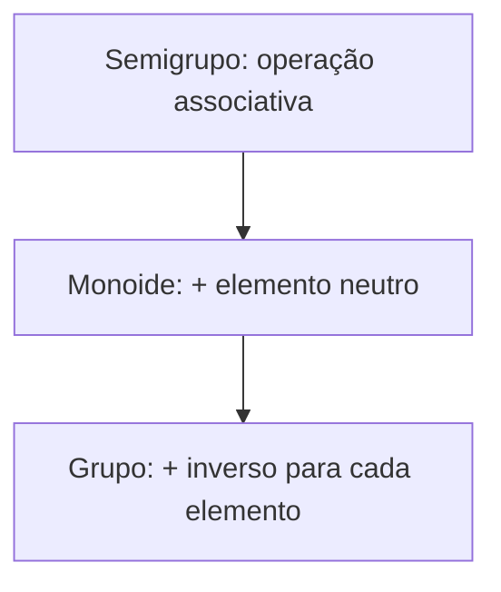

# 13 · Semigrupos, monoides e grupos

**Tempo estimado:** 30 minutos · **Pré-requisito:** [[03 - Relações de equivalência e de ordem]] e [[04 - Funções]] (uma operação é uma função de dois argumentos).

**Ao final você vai conseguir:**

1. Dizer se uma operação é associativa, e reconhecer um semigrupo.
2. Identificar um elemento neutro e reconhecer um monoide.
3. Verificar se cada elemento tem inverso e reconhecer um grupo.

**Antes de começar:** você já usou somas, produtos e concatenações de textos. Este módulo pergunta quais regras essas operações têm em comum.

---

## Para começar

Você soma horas em um relógio de 7 posições, ou concatena textos, ou calcula um produto. São contas diferentes, mas todas combinam dois valores em um só. Quais regras elas precisam obedecer para que o raciocínio funcione do mesmo jeito? Responder isso leva a três estruturas: semigrupo, monoide e grupo.

---

## Mapa do módulo



*Figura 1: cada estrutura acrescenta uma exigência à anterior. Todo grupo é um monoide, e todo monoide é um semigrupo.*

**Como ler:** a seta indica "acrescenta uma regra". Quanto mais à direita, mais regras a estrutura obedece.

---

## Mini-aula 1: operação associativa

> [!tip] Ideia
> Uma operação é associativa quando o agrupamento não muda o resultado. Com três elementos, `(a · b) · c` deve dar o mesmo que `a · (b · c)`.

> [!info] Definição
> Uma **operação binária** (binary operation) combina dois elementos de um conjunto em um terceiro. Ela é **associativa** (associative) quando `op(a, op(b, c)) = op(op(a, b), c)` para todos `a, b, c`.
>
> Um **semigrupo** (semigroup) é um conjunto com uma operação binária associativa.

Veja a subtração, que não é associativa. Antes de rodar, calcule os dois agrupamentos no papel.

```python
print((0 - 1) - 2, 0 - (1 - 2))
```

Saída real:

```
-3 1
```

**Como ler:** `(0 - 1) - 2` dá `-3`, e `0 - (1 - 2)` dá `1`. Os agrupamentos diferentes mostram que a subtração não é associativa.

> [!warning] Armadilha comum
> Associativa não é comutativa. A operação pode ser associativa e ainda assim depender da ordem dos argumentos, como a concatenação de textos: `"ab" + "c"` e `"c" + "ab"` são diferentes.

> [!question]- Checkpoint
> 1. A soma de inteiros é associativa?
> 2. A subtração é associativa?
>
> > [!success]- Resposta
> > 1. Sim.
> > 2. Não. O exemplo acima mostra dois resultados diferentes.

---

## Mini-aula 2: elemento neutro e monoide

> [!tip] Ideia
> O elemento neutro não muda nada quando combinado com outro. Um conjunto com operação associativa e elemento neutro é um monoide.

> [!info] Definição
> Um **elemento neutro** ou **identidade** (identity) `e` satisfaz `op(e, x) = x` e `op(x, e) = x` para todo `x`. Um **monóide** (monoid) é um conjunto não vazio com operação associativa e um elemento neutro.

A biblioteca dá um exemplo clássico: as cadeias de zeros e uns, com a concatenação. O elemento neutro é a cadeia vazia, porque concatená-la a qualquer cadeia não muda nada. Antes de rodar, pense: o texto vazio é neutro dos dois lados?

```python
print("01" + "" == "01", "" + "01" == "01")
```

Saída real:

```
True True
```

**Como ler:** as duas comparações mostram que `""` é neutro à esquerda e à direita de `"01"`.

> [!warning] Armadilha comum
> Um elemento que é neutro só de um lado não serve. A definição exige os dois lados.

> [!question]- Checkpoint
> 1. Qual é o elemento neutro da soma de inteiros?
> 2. Qual é o elemento neutro do produto de inteiros?
>
> > [!success]- Resposta
> > 1. `0`, porque `0 + x = x`.
> > 2. `1`, porque `1 · x = x`.

---

## Mini-aula 3: inverso e grupo

> [!tip] Ideia
> Um grupo é um monoide em que cada elemento tem um inverso: outro elemento que, combinado com ele, dá o neutro.

> [!info] Definição
> Um **grupo** (group) é um monoide em que cada `a` tem um inverso `b`, com `op(a, b) = e` e `op(b, a) = e`, onde `e` é o neutro.

Exemplo com os números de 0 a 6, somados módulo 7, que é como o relógio de 7 posições. O neutro é 0. O inverso de 3 é 4, porque `3 + 4 = 7`, que dá resto zero. Antes de rodar, pense: quem é o inverso de 3?

```python
print([b for b in range(7) if (3 + b) % 7 == 0])
```

Saída real:

```
[4]
```

**Como ler:** a lista tem um único elemento, `4`, porque é o único `b` com `(3 + b) % 7 == 0`.

> [!warning] Armadilha comum
> Nem todo monoide é grupo. Na multiplicação módulo 7, o 0 não tem inverso, porque nenhum produto por 0 dá 1. Por isso o conjunto com multiplicação, incluindo o 0, não é um grupo.

> [!question]- Checkpoint
> 1. No grupo da soma módulo 7, qual é o inverso de 5?
> 2. Os inteiros com a soma formam um grupo? (Considere o neutro 0.)
>
> > [!success]- Resposta
> > 1. 2, porque `(5 + 2) % 7 = 0`.
> > 2. Sim. Cada inteiro `a` tem inverso `-a`, e a soma é associativa, com neutro 0.

---

## Exercícios

Cada exercício tem um bloco com a função a completar e os testes com `assert`. Quando todos passarem, aparece `Passou!`. Operações são passadas como funções de dois argumentos, como `lambda a, b: a + b`.

### Aquecimento

**A1. Associatividade.** Complete `e_associativa(elementos, op)`, que devolve `True` se `op(a, op(b, c)) == op(op(a, b), c)` para todos `a, b, c` em `elementos`. Aqui `op` é uma função de dois argumentos.

```python
def e_associativa(elementos, op):
    """Devolve True se op(a, op(b, c)) == op(op(a, b), c) para todos a, b, c em elementos."""
    ...

assert e_associativa([0, 1, 2], lambda a, b: a + b) == True, "a soma é associativa"
assert e_associativa([0, 1, 2], lambda a, b: a - b) == False, "a subtração não é associativa"
assert e_associativa(["x", "y"], lambda a, b: a + b) == True, "a concatenação de textos é associativa"
print("Passou!")
```

> [!hint]- Dica 1
> Use três `for`, um dentro do outro, para `a`, `b` e `c`.

> [!hint]- Dica 2
> Dentro, se as duas formas de agrupar derem resultados diferentes, `return False`.

> [!example]- Solução
> ```python
> def e_associativa(elementos, op):
>     """Devolve True se op(a, op(b, c)) == op(op(a, b), c) para todos a, b, c em elementos."""
>     for a in elementos:
>         for b in elementos:
>             for c in elementos:
>                 if op(a, op(b, c)) != op(op(a, b), c):
>                     return False
>     return True
> ```
>
> **Erro comum:** Testar só um agrupamento, por exemplo `op(a, op(b, c))`. A associatividade exige que os dois agrupamentos sejam iguais, para qualquer escolha de `a`, `b` e `c`.

**A2. Elemento neutro.** Complete `tem_identidade(elementos, op, e)`, que devolve `True` se `e` não muda nenhum elemento: `op(e, x) == x` e `op(x, e) == x` para todo `x` em `elementos`.

```python
def tem_identidade(elementos, op, e):
    """Devolve True se e não muda nenhum x: op(e, x) == x e op(x, e) == x."""
    ...

assert tem_identidade([0, 1, 2], lambda a, b: a + b, 0) == True, "0 é neutro para a soma"
assert tem_identidade([0, 1, 2], lambda a, b: a * b, 0) == False, "0 não é neutro para o produto"
assert tem_identidade([1, 2], lambda a, b: a * b, 1) == True, "1 é neutro para o produto"
print("Passou!")
```

> [!hint]- Dica 1
> Percorra os elementos com `for x in elementos`.

> [!hint]- Dica 2
> Se algum `x` não for mantido nos dois lados, `return False`. Só depois do laço vale `True`.

> [!example]- Solução
> ```python
> def tem_identidade(elementos, op, e):
>     """Devolve True se e não muda nenhum x: op(e, x) == x e op(x, e) == x."""
>     for x in elementos:
>         if op(e, x) != x or op(x, e) != x:
>             return False
>     return True
> ```
>
> **Erro comum:** Testar só um dos lados, por exemplo `op(e, x) == x`. O elemento neutro precisa funcionar dos dois lados.

**A3. Fechado.** Complete `fechado(elementos, op)`, que devolve `True` se o resultado de `op(a, b)` pertence a `elementos` para todos `a` e `b` do conjunto. Uma operação binária sobre um conjunto precisa ser fechada: nunca deve sair dele.

```python
def fechado(elementos, op):
    """Devolve True se op(a, b) pertence a elementos para todos a, b em elementos."""
    ...

assert fechado([0, 1, 2, 3, 4, 5, 6], lambda a, b: (a + b) % 7) == True, "a soma módulo 7 fica entre 0 e 6"
assert fechado([0, 1, 2], lambda a, b: a + b) == False, "1 + 2 = 3 não está em {0, 1, 2}"
print("Passou!")
```

> [!hint]- Dica 1
> Use dois `for`, um para `a` e outro para `b`.

> [!hint]- Dica 2
> Se `op(a, b) not in elementos`, `return False`.

> [!example]- Solução
> ```python
> def fechado(elementos, op):
>     """Devolve True se op(a, b) pertence a elementos para todos a, b em elementos."""
>     for a in elementos:
>         for b in elementos:
>             if op(a, b) not in elementos:
>                 return False
>     return True
> ```
>
> **Erro comum:** Testar se `op(a, b)` está em `elementos` só para alguns pares. A regra vale para todo par.

### Praticando

**P1. Monoide.** Complete `e_monoide(elementos, op, e)`, que devolve `True` se o conjunto com a operação é um monoide com elemento neutro `e`: a operação é fechada, associativa, e `e` é neutro. As funções `fechado`, `e_associativa` e `tem_identidade` já estão prontas.

```python
def fechado(elementos, op):
    # já pronta, do exercício A3
    for a in elementos:
        for b in elementos:
            if op(a, b) not in elementos:
                return False
    return True

def e_associativa(elementos, op):
    # já pronta, do exercício A1
    for a in elementos:
        for b in elementos:
            for c in elementos:
                if op(a, op(b, c)) != op(op(a, b), c):
                    return False
    return True

def tem_identidade(elementos, op, e):
    # já pronta, do exercício A2
    for x in elementos:
        if op(e, x) != x or op(x, e) != x:
            return False
    return True

def e_monoide(elementos, op, e):
    """Devolve True se a operação é fechada, associativa e tem e como neutro."""
    ...

assert e_monoide([0, 1, 2, 3, 4, 5, 6], lambda a, b: (a + b) % 7, 0) == True, "soma módulo 7, neutro 0"
assert e_monoide([0, 1, 2, 3, 4, 5, 6], lambda a, b: (a * b) % 7, 1) == True, "produto módulo 7, neutro 1"
assert e_monoide([1, 2], lambda a, b: a + b, 0) == False, "não fecha, e o 0 nem está no conjunto"
print("Passou!")
```

> [!hint]- Dica 1
> Combine as três condições com `and`.

> [!hint]- Dica 2
> Chame as três funções prontas com os mesmos argumentos.

> [!example]- Solução
> ```python
> def e_monoide(elementos, op, e):
>     """Devolve True se a operação é fechada, associativa e tem e como neutro."""
>     return fechado(elementos, op) and e_associativa(elementos, op) and tem_identidade(elementos, op, e)
> ```
>
> **Erro comum:** Esquecer a condição de fechamento. Sem ela, a operação pode levar a elementos fora do conjunto, e a definição deixa de valer.

**P2. Grupo.** Complete `e_grupo(elementos, op, e)`, que devolve `True` se o conjunto é um grupo com neutro `e`: é um monoide, e cada `a` tem um inverso `b`, com `op(a, b) == e` e `op(b, a) == e`. A função `e_monoide` já está pronta.

```python
def fechado(elementos, op):
    # já pronta, do exercício A3
    for a in elementos:
        for b in elementos:
            if op(a, b) not in elementos:
                return False
    return True

def e_associativa(elementos, op):
    # já pronta, do exercício A1
    for a in elementos:
        for b in elementos:
            for c in elementos:
                if op(a, op(b, c)) != op(op(a, b), c):
                    return False
    return True

def tem_identidade(elementos, op, e):
    # já pronta, do exercício A2
    for x in elementos:
        if op(e, x) != x or op(x, e) != x:
            return False
    return True

def e_monoide(elementos, op, e):
    # já pronta, do exercício P1
    return fechado(elementos, op) and e_associativa(elementos, op) and tem_identidade(elementos, op, e)

def e_grupo(elementos, op, e):
    """Devolve True se é monoide com neutro e, e cada a tem inverso b com op(a, b) == e == op(b, a)."""
    ...

assert e_grupo([0, 1, 2, 3, 4, 5, 6], lambda a, b: (a + b) % 7, 0) == True, "soma módulo 7 é grupo"
assert e_grupo([0, 1, 2, 3, 4, 5, 6], lambda a, b: (a * b) % 7, 1) == False, "o 0 não tem inverso para o produto"
assert e_grupo([1, 2, 3, 4, 5, 6], lambda a, b: (a * b) % 7, 1) == True, "sem o 0, o produto módulo 7 é grupo"
print("Passou!")
```

> [!hint]- Dica 1
> Primeiro, `if not e_monoide(elementos, op, e): return False`.

> [!hint]- Dica 2
> Para cada `a`, procure um `b` nos elementos que satisfaça as duas igualdades. Se não achar, `return False`.

> [!example]- Solução
> ```python
> def e_grupo(elementos, op, e):
>     """Devolve True se é monoide com neutro e, e cada a tem inverso b com op(a, b) == e == op(b, a)."""
>     if not e_monoide(elementos, op, e):
>         return False
>     for a in elementos:
>         tem_inverso = False
>         for b in elementos:
>             if op(a, b) == e and op(b, a) == e:
>                 tem_inverso = True
>         if not tem_inverso:
>             return False
>     return True
> ```
>
> **Erro comum:** Procurar o inverso só de um lado, por exemplo `op(a, b) == e`. Para grupo, a igualdade precisa valer nos dois lados.

**P3. Reduzir uma lista.** Complete `reduz(lista, op, e)`, que combina os elementos da lista com `op`, começando pelo neutro `e`. Por exemplo, `reduz([1, 2, 3], soma, 0)` é `((0 + 1) + 2) + 3`.

```python
def reduz(lista, op, e):
    """Combina os elementos de lista com op, começando pelo neutro e."""
    ...

assert reduz([1, 2, 3], lambda a, b: a + b, 0) == 6, "0 + 1 + 2 + 3"
assert reduz(["a", "b", "c"], lambda a, b: a + b, "") == "abc", "concatenação começando do texto vazio"
assert reduz([], lambda a, b: a * b, 1) == 1, "lista vazia devolve o neutro"
print("Passou!")
```

> [!hint]- Dica 1
> Comece com `resultado = e`. Para cada `x` da lista, troque `resultado` por `op(resultado, x)`.

> [!hint]- Dica 2
> Ao final do laço, devolva `resultado`.

> [!example]- Solução
> ```python
> def reduz(lista, op, e):
>     """Combina os elementos de lista com op, começando pelo neutro e."""
>     resultado = e
>     for x in lista:
>         resultado = op(resultado, x)
>     return resultado
> ```
>
> **Erro comum:** Começar com `resultado = 0` mesmo quando `e` é outro valor. Para a multiplicação, o começo certo é `1`.

### Desafio

**D1. Comutatividade.** Complete `e_comutativa(elementos, op)`, que devolve `True` se `op(a, b) == op(b, a)` para todos `a` e `b` em `elementos`. A ordem dos argumentos não muda o resultado.

```python
def e_comutativa(elementos, op):
    """Devolve True se op(a, b) == op(b, a) para todos a, b em elementos."""
    ...

assert e_comutativa([0, 1, 2, 3, 4, 5, 6], lambda a, b: (a + b) % 7) == True, "a soma módulo 7 é comutativa"
assert e_comutativa([0, 1, 2], lambda a, b: a - b) == False, "a subtração não é comutativa"
assert e_comutativa(["x", "y"], lambda a, b: a + b) == False, "xy é diferente de yx"
print("Passou!")
```

> [!hint]- Dica 1
> Use dois `for`, um para `a` e outro para `b`.

> [!hint]- Dica 2
> Se `op(a, b) != op(b, a)`, `return False`.

> [!example]- Solução
> ```python
> def e_comutativa(elementos, op):
>     """Devolve True se op(a, b) == op(b, a) para todos a, b em elementos."""
>     for a in elementos:
>         for b in elementos:
>             if op(a, b) != op(b, a):
>                 return False
>     return True
> ```
>
> **Erro comum:** Comparar `op(a, b)` com `op(a, b)`, ou seja, consigo mesmo. A comparação precisa trocar a ordem dos argumentos.


## Mini-projeto (opcional)

Um exercício maior, que junta as funções anteriores. Tente sozinho antes de abrir a solução.

**Objetivo.** Para estudar uma operação, é útil ver a tabela completa dela. Devolva uma lista de linhas: a linha de cada `a` contém `op(a, b)` para cada `b`, na ordem dos elementos. Essa tabela é o que você usaria para conferir fechamento, neutro e inversos à vista.

```python
def tabela_operacao(elementos, op):
    """Devolve a tabela da operação: a linha de a traz op(a, b) para cada b, em ordem."""
    ...

assert tabela_operacao([0, 1, 2], lambda a, b: (a + b) % 3) == [[0, 1, 2], [1, 2, 0], [2, 0, 1]], "soma módulo 3"
assert tabela_operacao([1, 2], lambda a, b: a * b) == [[1, 2], [2, 4]], "produto de 1 e 2"
assert tabela_operacao([], lambda a, b: a) == [], "conjunto vazio"
print("Passou!")
```

> [!hint]- Dica 1
> Use uma lista de listas: uma lista por compreensão para as linhas, e outra dentro dela para as colunas.

> [!hint]- Dica 2
> A forma é `[[op(a, b) for b in elementos] for a in elementos]`.

> [!example]- Solução
> ```python
> def tabela_operacao(elementos, op):
>     """Devolve a tabela da operação: a linha de a traz op(a, b) para cada b, em ordem."""
>     return [[op(a, b) for b in elementos] for a in elementos]
> ```
>
> **Erro comum:** Trocar a ordem dos `for`. Assim as linhas viram colunas, e a tabela sai transposta.


---

## Fechando

**Resumo**

- Operação binária: combina dois elementos em um.
- Associativa: o agrupamento não muda o resultado.
- Semigrupo: conjunto com operação associativa.
- Elemento neutro: não muda nenhum elemento, dos dois lados.
- Monoide: semigrupo com elemento neutro.
- Grupo: monoide em que cada elemento tem inverso.

**Glossário rápido**

- **Operação binária** (binary operation): regra que combina dois elementos.
- **Associativa** (associative): o agrupamento não altera o resultado.
- **Semigrupo** (semigroup): conjunto com operação associativa.
- **Elemento neutro** (identity): elemento que não altera nenhum outro.
- **Monoide** (monoid): semigrupo com elemento neutro.
- **Grupo** (group): monoide em que todo elemento tem inverso.

**Perguntas de revisão**

1. A operação `a · b = a` é associativa? Teste com `a = 1`, `b = 2`, `c = 3`.
2. O conjunto `{1, 2, 3, 4, 5, 6}` com a multiplicação módulo 7 é um grupo? Qual é o neutro?
3. Por que a concatenação de textos é um monoide, mas não é um grupo?

**E agora?** O próximo módulo é **Crescimento de funções**. Ele trata de comparar o custo de algoritmos conforme a entrada cresce, usando as ideias de cota superior e inferior.

---

## Para ir mais fundo

- [[Semigroup, Monoid and Group]]
