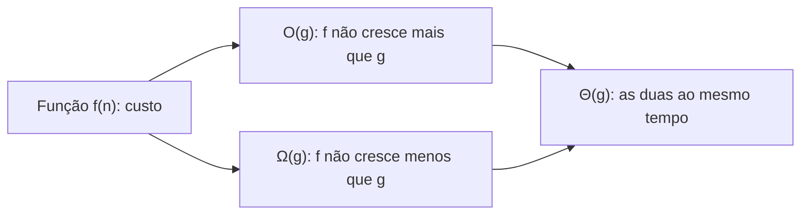

# 14 · Crescimento de funções

**Tempo estimado:** 30 minutos · **Pré-requisito:** [[04 - Funções]] e [[10 - Recorrências lineares]] (você vai comparar funções de `n`).

**Ao final você vai conseguir:**

1. Dizer qual de duas funções cresce mais, olhando o termo dominante.
2. Explicar o papel de O (cota superior), Ω (cota inferior) e Θ (as duas).
3. Verificar uma cota com constantes e encontrar o ponto a partir do qual ela vale.

**Antes de começar:** você já sabe calcular funções de `n` e comparar resultados. Aqui a pergunta muda: não é o valor de uma função, e sim como ela se comporta quando `n` cresce.

---

## Para começar

Dois algoritmos processam uma lista de `n` itens. Um faz cerca de `n²` operações, o outro faz cerca de `n`. Com 10 itens, a diferença pode parecer pequena. Com um milhão, muda tudo. Para comparar algoritmos sem depender da máquina, precisamos de uma linguagem para dizer "cresce no máximo como", "cresce pelo menos como" e "cresce como".

---

## Mapa do módulo



*Figura 1: O é uma cota superior, Ω é uma cota inferior, e Θ vale quando as duas valem juntas, com constantes diferentes.*

**Como ler:** a seta indica "é uma das duas cotas". Θ aparece onde O e Ω se encontram.

---

## Mini-aula 1: termo dominante

> [!tip] Ideia
> Para `n` grande, o termo de maior grau domina a soma. Termos menores e constantes perdem importância.

> [!info] Definição
> Dizemos que o **termo dominante** (leading term) de uma função polinomial é o termo de maior grau. Na notação de crescimento, descartamos os termos de menor ordem e as constantes multiplicativas.

Exemplo: `f(n) = 3n² + 4n - 2`. O termo dominante é `3n²`. Veja a tabela de `f(n)` e de `6n²` para os primeiros valores. Antes de rodar, pense: `f(n)` fica sempre abaixo de `6n²`?

```python
f = lambda n: 3 * n * n + 4 * n - 2
for n in range(1, 7):
    print(n, f(n), 6 * n * n)
```

Saída real:

```
1 5 6
2 18 24
3 37 54
4 62 96
5 93 150
6 130 216
```

**Como ler:** em cada linha, `f(n)` é o primeiro número e `6n²` é o segundo. A diferença vai aumentando, mas `f(n)` nunca passa de `6n²`, a partir de `n = 1`.

> [!warning] Armadilha comum
> Termos menores podem importar para `n` pequeno. Para `n` grande, o termo dominante decide, mas o limite depende das constantes escolhidas.

> [!question]- Checkpoint
> 1. Qual é o termo dominante de `5n³ + 100n²`?
> 2. `n²` e `3n² + 4n` crescem na mesma ordem?
>
> > [!success]- Resposta
> > 1. `5n³`, porque tem o maior grau.
> > 2. Sim, porque o termo dominante dos dois é `n²`, a menos de constante.

---

## Mini-aula 2: O (cota superior)

> [!tip] Ideia
> `f` é O(`g`) quando `f` não cresce mais rápido que um múltiplo de `g`, a partir de algum ponto.

> [!info] Definição
> `f(n)` é **O(g(n))** (Big-O, cota superior) quando existem constantes `c > 0` e `n0` tais que `0 ≤ f(n) ≤ c · g(n)` para todo `n ≥ n0`.

Veja por que as constantes importam. Compare `n³` com `100n²`. Antes de rodar, preveja para quais valores de `n` a primeira é maior.

```python
for n in (99, 100, 101):
    print(n, n ** 3 > 100 * n * n)
```

Saída real:

```
99 False
100 False
101 True
```

**Como ler:** para `n = 99` e `n = 100`, `n³` não passa de `100n²`. Só a partir de `n = 101` a desigualdade inverte. A biblioteca registra exatamente essa relação: `100n² < n³` se e somente se `n > 100`.

> [!warning] Armadilha comum
> O é só uma cota superior. Dizer que `n` é O(n²) é verdade, mas pouco informativo: `n` também é O(n³). A cota mais apertada é a informação útil.

> [!question]- Checkpoint
> 1. `n³` é O(n²)?
> 2. `n` é O(n²)?
>
> > [!success]- Resposta
> > 1. Não. Para qualquer constante `c`, `n³` acaba passando de `c · n²`.
> > 2. Sim. `n ≤ n²` para `n ≥ 1`.

---

## Mini-aula 3: Ω e Θ

> [!tip] Ideia
> Ω é a cota inferior: `f` não fica abaixo de um múltiplo de `g`. Θ vale quando `f` é ao mesmo tempo O e Ω de `g`.

> [!info] Definição
> - `f(n)` é **Ω(g(n))** (cota inferior) quando existem constantes `c > 0` e `n0` com `f(n) ≥ c · g(n)` para todo `n ≥ n0`.
> - `f(n)` é **Θ(g(n))** quando é O(g(n)) e Ω(g(n)) ao mesmo tempo, isto é, `c1 · g(n) ≤ f(n) ≤ c2 · g(n)` para `n` grande.

Exemplo da biblioteca: a contagem de acessos ao vetor pelo selection sort é `n² + 3n - 4`. O termo dominante é `n²`, e a análise descarta os termos menores.

> [!warning] Armadilha comum
> Θ precisa das duas cotas. Só O ou só Ω não dizem a ordem exata de crescimento.

> [!question]- Checkpoint
> 1. `n²` é Ω(n)?
> 2. `n` é Ω(n²)?
>
> > [!success]- Resposta
> > 1. Sim. `n² ≥ n` para `n ≥ 1`.
> > 2. Não. `n < n²` para `n ≥ 2`, então `n` fica abaixo de `n²`.

---

## Exercícios

Cada exercício tem um bloco com a função a completar e os testes com `assert`. As funções `f` e `g` são passadas como `lambda n: ...`. Como os testes checam só até um limite, eles confirmam os casos, sem substituir a demonstração formal.

### Aquecimento

**A1. Cota superior.** Complete `e_limitado_superior(f, g, c, n0, limite)`. Ela verifica, para cada `n` de `n0` até `limite`, se `0 ≤ f(n) ≤ c · g(n)`. Devolve `True` se a condição vale em todos esses `n`. `f` e `g` são funções de um argumento.

```python
def e_limitado_superior(f, g, c, n0, limite):
    """Devolve True se 0 <= f(n) <= c * g(n) para todo n de n0 até limite."""
    ...

assert e_limitado_superior(lambda n: 3 * n * n + 4 * n - 2, lambda n: n * n, 6, 1, 100) == True, "3n² + 4n - 2 ≤ 6n² para n ≥ 1"
assert e_limitado_superior(lambda n: 3 * n * n + 4 * n - 2, lambda n: n * n, 3, 1, 100) == False, "com c = 3 falha, porque 4n - 2 > 0"
assert e_limitado_superior(lambda n: n ** 3, lambda n: n * n, 100, 1, 50) == True, "n³ ≤ 100n² enquanto n ≤ 100"
print("Passou!")
```

> [!hint]- Dica 1
> Percorra `n` com `for n in range(n0, limite + 1):`.

> [!hint]- Dica 2
> Se `f(n) ≤ c * g(n)` não valer, `return False`. Não esqueça o limite no `range`.

> [!example]- Solução
> ```python
> def e_limitado_superior(f, g, c, n0, limite):
>     """Devolve True se 0 <= f(n) <= c * g(n) para todo n de n0 até limite."""
>     for n in range(n0, limite + 1):
>         if not (0 <= f(n) <= c * g(n)):
>             return False
>     return True
> ```
>
> **Erro comum:** Testar só para `n = n0`. A cota precisa valer para todos os `n` do intervalo.

**A2. Cota inferior.** Complete `e_limitado_inferior(f, g, c, n0, limite)`. Ela verifica, para cada `n` de `n0` até `limite`, se `f(n) ≥ c · g(n)`. Devolve `True` se a condição vale em todos esses `n`.

```python
def e_limitado_inferior(f, g, c, n0, limite):
    """Devolve True se f(n) >= c * g(n) para todo n de n0 até limite."""
    ...

assert e_limitado_inferior(lambda n: n * n, lambda n: n, 1, 1, 50) == True, "n² ≥ n para n ≥ 1"
assert e_limitado_inferior(lambda n: n, lambda n: n * n, 1, 1, 50) == False, "n < n² a partir de n = 2"
assert e_limitado_inferior(lambda n: 2 * n, lambda n: n, 2, 1, 50) == True, "2n ≥ 2n vale com igualdade"
print("Passou!")
```

> [!hint]- Dica 1
> O formato é o mesmo de `e_limitado_superior`, com a desigualdade no outro sentido.

> [!hint]- Dica 2
> Se `f(n) < c * g(n)`, `return False`.

> [!example]- Solução
> ```python
> def e_limitado_inferior(f, g, c, n0, limite):
>     """Devolve True se f(n) >= c * g(n) para todo n de n0 até limite."""
>     for n in range(n0, limite + 1):
>         if f(n) < c * g(n):
>             return False
>     return True
> ```
>
> **Erro comum:** Usar `f(n) > c * g(n)`, estrito. A cota inferior usa `≥`: quando `f(n) = c · g(n)`, a condição deve valer.

**A3. Ponto de virada.** Complete `menor_n_em_que_g_supera(f, g, limite)`. Ela devolve o menor `n` de 1 a `limite` com `g(n) > f(n)`, ou `None` se não existir nenhum.

```python
def menor_n_em_que_g_supera(f, g, limite):
    """Devolve o menor n de 1 a limite com g(n) > f(n), ou None."""
    ...

assert menor_n_em_que_g_supera(lambda n: 100 * n * n, lambda n: n ** 3, 200) == 101, "n³ passa de 100n² a partir de n = 101"
assert menor_n_em_que_g_supera(lambda n: n * n, lambda n: n, 50) is None, "n nunca supera n²"
print("Passou!")
```

> [!hint]- Dica 1
> Percorra `n` de 1 até `limite`. A cada passo, compare `g(n)` com `f(n)`.

> [!hint]- Dica 2
> Ao achar um `n` com `g(n) > f(n)`, `return n`. Se o laço acabar sem achar, `return None`.

> [!example]- Solução
> ```python
> def menor_n_em_que_g_supera(f, g, limite):
>     """Devolve o menor n de 1 a limite com g(n) > f(n), ou None."""
>     for n in range(1, limite + 1):
>         if g(n) > f(n):
>             return n
>     return None
> ```
>
> **Erro comum:** Comparar `f(n) > g(n)`, o que pergunta outra coisa. Aqui queremos o primeiro `n` em que `g` passa à frente de `f`.

### Praticando

**P1. Duas cotas.** Complete `e_theta_limitado(f, g, c1, c2, n0, limite)`. Ela verifica, para cada `n` de `n0` até `limite`, se `c1 · g(n) ≤ f(n) ≤ c2 · g(n)`. Devolve `True` se a condição vale em todos esses `n`.

```python
def e_theta_limitado(f, g, c1, c2, n0, limite):
    """Devolve True se c1 * g(n) <= f(n) <= c2 * g(n) para todo n de n0 até limite."""
    ...

assert e_theta_limitado(lambda n: 3 * n * n + 4 * n - 2, lambda n: n * n, 3, 6, 1, 100) == True, "3n² ≤ 3n² + 4n - 2 ≤ 6n²"
assert e_theta_limitado(lambda n: 3 * n * n + 4 * n - 2, lambda n: n * n, 5, 6, 1, 100) == False, "com c1 = 5 falha em n = 2"
assert e_theta_limitado(lambda n: n * n, lambda n: n * n, 1, 1, 1, 50) == True, "f = g satisfaz as duas"
print("Passou!")
```

> [!hint]- Dica 1
> Combine as duas desigualdades com `and`, ou use a cadeia `c1 * g(n) <= f(n) <= c2 * g(n)`.

> [!hint]- Dica 2
> Se a condição falhar em algum `n`, `return False`.

> [!example]- Solução
> ```python
> def e_theta_limitado(f, g, c1, c2, n0, limite):
>     """Devolve True se c1 * g(n) <= f(n) <= c2 * g(n) para todo n de n0 até limite."""
>     for n in range(n0, limite + 1):
>         if not (c1 * g(n) <= f(n) <= c2 * g(n)):
>             return False
>     return True
> ```
>
> **Erro comum:** Verificar só uma das duas desigualdades. Uma cota de cada lado é o que dá a ordem exata de crescimento.

**P2. Maior razão.** Complete `maior_razao(f, g, n0, limite)`, que devolve o maior valor de `f(n) / g(n)` para `n` de `n0` até `limite`. Essa razão ajuda a ver se `f` fica limitada por um múltiplo de `g`.

```python
def maior_razao(f, g, n0, limite):
    """Devolve o maior valor de f(n) / g(n) para n de n0 até limite."""
    ...

assert maior_razao(lambda n: 3 * n * n + 4 * n - 2, lambda n: n * n, 1, 10) == 5, "a maior razão é em n = 1: 5 / 1"
assert maior_razao(lambda n: n, lambda n: n, 1, 10) == 1, "a razão é sempre 1"
assert maior_razao(lambda n: 2 * n, lambda n: n, 3, 5) == 2, "a razão é sempre 2"
print("Passou!")
```

> [!hint]- Dica 1
> Comece com `maior = None`. Para cada `n`, calcule `r = f(n) / g(n)`.

> [!hint]- Dica 2
> Atualize `maior` quando `maior` for `None` ou quando `r > maior`. Devolva `maior` no fim.

> [!example]- Solução
> ```python
> def maior_razao(f, g, n0, limite):
>     """Devolve o maior valor de f(n) / g(n) para n de n0 até limite."""
>     maior = None
>     for n in range(n0, limite + 1):
>         r = f(n) / g(n)
>         if maior is None or r > maior:
>             maior = r
>     return maior
> ```
>
> **Erro comum:** Começar com `maior = 0`. Se todas as razões forem negativas, o resultado ficaria errado. Use `None` como começo.

**P3. Quem cresce mais?** Complete `compara(f, g, n)`, que compara `f(n)` com `g(n)` para um único `n`. Devolve `"f maior"` se `f(n) > g(n)`, `"g maior"` se `g(n) > f(n)`, e `"igual"` caso contrário.

```python
def compara(f, g, n):
    """Devolve 'f maior', 'g maior' ou 'igual', conforme f(n) e g(n)."""
    ...

assert compara(lambda n: n * n, lambda n: n, 1) == "igual", "em n = 1, os dois valem 1"
assert compara(lambda n: n * n, lambda n: n, 5) == "f maior", "em n = 5, n² = 25 > 5"
assert compara(lambda n: n, lambda n: n * n, 5) == "g maior", "em n = 5, n² = 25 > 5"
print("Passou!")
```

> [!hint]- Dica 1
> Use dois `if` seguidos, um para cada desigualdade.

> [!hint]- Dica 2
> Se nenhum dos dois valer, os valores são iguais: devolva `"igual"`.

> [!example]- Solução
> ```python
> def compara(f, g, n):
>     """Devolve 'f maior', 'g maior' ou 'igual', conforme f(n) e g(n)."""
>     if f(n) > g(n):
>         return "f maior"
>     if g(n) > f(n):
>         return "g maior"
>     return "igual"
> ```
>
> **Erro comum:** Testar só `f(n) > g(n)` e devolver `"g maior"` no outro caso. Quando os dois são iguais, a resposta correta é `"igual"`.

### Desafio

**D1. Menor constante.** Complete `menor_c(f, g, n0, limite)`. Ela devolve o menor inteiro `c` de 1 a 100 tal que `f(n) ≤ c · g(n)` para todo `n` de `n0` até `limite`, ou `None` se nenhum `c` servir. A função `e_limitado_superior` já está pronta.

```python
def e_limitado_superior(f, g, c, n0, limite):
    # já pronta, do exercício A1
    for n in range(n0, limite + 1):
        if not (0 <= f(n) <= c * g(n)):
            return False
    return True

def menor_c(f, g, n0, limite):
    """Devolve o menor c inteiro de 1 a 100 com f(n) <= c * g(n) de n0 a limite, ou None."""
    ...

assert menor_c(lambda n: 3 * n * n + 4 * n - 2, lambda n: n * n, 1, 100) == 5, "c = 4 falha em n = 1; c = 5 vale para todo n"
assert menor_c(lambda n: n ** 3, lambda n: n * n, 1, 200) is None, "n³ ≤ c n² exige c ≥ 200, fora do intervalo testado"
print("Passou!")
```

> [!hint]- Dica 1
> Percorra `c` de 1 a 100, com `for c in range(1, 101):`.

> [!hint]- Dica 2
> Para cada `c`, chame `e_limitado_superior(f, g, c, n0, limite)`. Na primeira vez que der `True`, devolva `c`.

> [!example]- Solução
> ```python
> def menor_c(f, g, n0, limite):
>     """Devolve o menor c inteiro de 1 a 100 com f(n) <= c * g(n) de n0 a limite, ou None."""
>     for c in range(1, 101):
>         if e_limitado_superior(f, g, c, n0, limite):
>             return c
>     return None
> ```
>
> **Erro comum:** Devolver `c` sem testar. A função precisa parar no menor `c` que funciona, e não no último.


## Mini-projeto (opcional)

Um exercício maior, que junta as funções anteriores. Tente sozinho antes de abrir a solução.

**Objetivo.** Para uma lista de valores de `n`, mostre quem cresce mais em cada ponto. Devolva a lista dos resultados de `compara(f, g, n)`, na mesma ordem dos valores. A função `compara`, do exercício P3, já está pronta.

```python
def compara(f, g, n):
    # já pronta, do exercício P3
    if f(n) > g(n):
        return "f maior"
    if g(n) > f(n):
        return "g maior"
    return "igual"

def tabela_comparacao(f, g, ns):
    """Devolve, para cada n da lista ns, o resultado de compara(f, g, n)."""
    ...

assert tabela_comparacao(lambda n: n * n, lambda n: n, [1, 2, 5]) == ["igual", "f maior", "f maior"], "n² contra n"
assert tabela_comparacao(lambda n: n, lambda n: n * n, [1, 5]) == ["igual", "g maior"], "n contra n²"
assert tabela_comparacao(lambda n: n, lambda n: n, []) == [], "lista vazia"
print("Passou!")
```

> [!hint]- Dica 1
> Use uma lista por compreensão: `[compara(f, g, n) for n in ns]`.

> [!hint]- Dica 2
> A lista de saída tem o mesmo tamanho da lista `ns`.

> [!example]- Solução
> ```python
> def tabela_comparacao(f, g, ns):
>     """Devolve, para cada n da lista ns, o resultado de compara(f, g, n)."""
>     return [compara(f, g, n) for n in ns]
> ```
>
> **Erro comum:** Chamar `compara` com a lista `ns` inteira. A função compara um `n` por vez.


---

## Fechando

**Resumo**

- O termo dominante decide o crescimento para `n` grande; constantes e termos menores são descartados.
- O (Big-O): cota superior, com constantes `c` e `n0`.
- Ω: cota inferior.
- Θ: O e Ω ao mesmo tempo.
- Constantes podem mudar onde a cota começa a valer, por isso o `n0`.

**Glossário rápido**

- **Termo dominante** (leading term): termo de maior grau, que decide o crescimento.
- **O** (Big-O): cota superior de crescimento.
- **Ω** (Omega): cota inferior de crescimento.
- **Θ** (Theta): crescimento de mesma ordem, com cotas superior e inferior.
- **n₀**: ponto a partir do qual a cota vale.

**Perguntas de revisão**

1. Qual é a ordem de crescimento de `4n³ + 2n`?
2. `n²` é O(n³)? E `n³` é O(n²)?
3. Por que a cota de `n` contra `100n²` depende de `n` ser maior que 100 para `n³` passar?

**E agora?** Você fechou a matemática discreta deste curso. Os módulos seguintes serão de algoritmos e estruturas de dados, e a notação deste módulo é a linguagem que eles usam para comparar custos.

---

## Para ir mais fundo

- [[Asymptotic Notation and Growth of Functions]]
- [[Function]]
