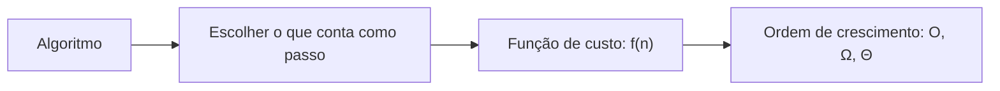

# 15 · Medindo algoritmos

**Tempo estimado:** 30 minutos · **Pré-requisito:** [[14 - Crescimento de funções]].

**Ao final você vai conseguir:**

1. Contar os passos de um algoritmo simples, escolhendo o que conta como passo.
2. Ver como o custo muda quando a entrada dobra, e reconhecer linear e quadrático.
3. Distinguir pior caso, caso médio e melhor caso, a partir de exemplos da biblioteca.

**Antes de começar:** no módulo 14 você viu O, Ω e Θ, funções de `n`. Aqui você mede um algoritmo real para chegar a essas funções.

---

## Para começar

Você tem uma lista de 1000 produtos e quer achar um pelo nome. Um algoritmo percorre a lista do começo ao fim. Outro compara cada produto com cada outro, para checar se há repetidos. Qual deles fica muito mais lento se a lista dobra? Para responder sem cronômetro, precisamos contar os passos.

---

## Mapa do módulo



*Figura 1: primeiro escolhemos o que contar, depois obtemos uma função de custo, e por fim a classificamos com a notação do módulo 14.*

**Como ler:** a seta mostra o caminho do algoritmo até a notação. Escolher o que contar vem antes de tudo.

---

## Mini-aula 1: contar passos

> [!tip] Ideia
> Para medir um algoritmo, escolha uma operação básica, como uma comparação, e conte quantas vezes ela acontece.

> [!info] Definição
> O **modelo de custo** (cost model) é a regra que diz quais operações são contadas. Na biblioteca, o custo usual é o número de comparações ou de acessos ao vetor.

Veja a busca linear, que percorre a lista até achar o alvo. Antes de rodar, preveja o número de passos quando o alvo está no fim da lista.

```python
def busca_linear(lista, alvo):
    passos = 0
    for x in lista:
        passos += 1
        if x == alvo:
            return passos
    return passos

for n in (10, 100, 1000):
    print(n, busca_linear(list(range(n)), n - 1))
```

Saída real:

```
10 10
100 100
1000 1000
```

**Como ler:** o alvo é sempre o último elemento, o caso em que a busca faz mais passos. A contagem é igual ao tamanho da lista.

> [!warning] Armadilha comum
> Contar "passos" sem dizer o que é um passo não mede nada. Um mesmo algoritmo pode dar números diferentes com modelos de custo diferentes.

> [!question]- Checkpoint
> 1. Se a lista tiver 50 elementos e o alvo for o último, quantos passos a busca linear faz?
> 2. Se o alvo for o primeiro, quantos passos?
>
> > [!success]- Resposta
> > 1. 50 passos.
> > 2. 1 passo.

---

## Mini-aula 2: como o custo cresce

> [!tip] Ideia
> Dobrar a entrada mostra o tipo de crescimento. Custo linear dobra; custo quadrático quadruplica.

> [!info] Definição
> A **ordem de crescimento** (order of growth) é a função dominante que descreve como o custo cresce com o tamanho da entrada, por exemplo `N`, `N log N` ou `N²`.

Veja dois laços. O primeiro faz um passo por elemento. O segundo compara cada par de elementos. Antes de rodar, pense: o que acontece com o total quando `n` passa de 10 para 20?

```python
def pares(lista):
    passos = 0
    for a in lista:
        for b in lista:
            passos += 1
    return passos

for n in (10, 20):
    print(n, pares(list(range(n))))
```

Saída real:

```
10 100
20 400
```

**Como ler:** dobrar `n` de 10 para 20 dobra a busca linear, e quadruplica o laço aninhado (100 para 400).

> [!warning] Armadilha comum
> O crescimento vale para entradas grandes. Para `n` pequeno, constantes e termos menores podem mudar o resultado, como vimos no módulo 14.

> [!question]- Checkpoint
> 1. Um algoritmo faz `n²` passos. Se a entrada dobra, quantas vezes mais passos ele faz?
> 2. Um algoritmo faz `n` passos. Se a entrada dobra, quantas vezes mais?
>
> > [!success]- Resposta
> > 1. Quatro vezes.
> > 2. Duas vezes.

---

## Mini-aula 3: pior caso, médio e melhor caso

> [!tip] Ideia
> O mesmo algoritmo pode custar pouco ou muito, dependendo da entrada. Por isso falamos de casos diferentes.

> [!info] Definição
> O **pior caso** (worst case) é a entrada mais custosa de um certo tamanho. O **melhor caso** (best case) é a mais barata. O **caso médio** (average case) é o custo típico. A biblioteca usa esses termos nos exemplos, mas não os define formalmente.

Exemplo da biblioteca, com a ordenação por inserção: o melhor caso, com a lista já ordenada, faz `N - 1` comparações. O pior caso faz cerca de `N²/2`.

> [!warning] Armadilha comum
> Dar um número sem dizer o caso é ambíguo. "Este algoritmo leva `N²`" só faz sentido se você disser se é o pior caso, o médio ou o melhor.

> [!question]- Checkpoint
> 1. Na busca linear, qual entrada é o pior caso?
> 2. Na busca linear, qual é o melhor caso?
>
> > [!success]- Resposta
> > 1. O alvo no fim da lista, ou ausente, com `n` comparações.
> > 2. O alvo no começo da lista, com 1 comparação.

---

## Exercícios

Cada exercício tem um bloco com a função a completar e os testes com `assert`. Quando todos passarem, aparece `Passou!`.

### Aquecimento

**A1. Passos de uma busca.** Complete `conta_passos_busca(lista, alvo)`. Ela percorre a lista do início, e conta quantos elementos foram comparados até achar `alvo`, incluindo o próprio. Se `alvo` não aparece, devolve o tamanho da lista.

```python
def conta_passos_busca(lista, alvo):
    """Devolve quantos elementos foram comparados até achar alvo; se não achar, len(lista)."""
    ...

assert conta_passos_busca([5, 7, 9], 7) == 2, "7 está na segunda posição"
assert conta_passos_busca([5, 7, 9], 4) == 3, "4 não está; foram 3 comparações"
assert conta_passos_busca([], 1) == 0, "lista vazia não faz comparação"
print("Passou!")
```

> [!hint]- Dica 1
> Use um contador `passos = 0` e um `for x in lista:` que soma 1 a cada comparação.

> [!hint]- Dica 2
> Se `x == alvo`, devolva `passos`. Se o laço terminar, devolva `len(lista)`.

> [!example]- Solução
> ```python
> def conta_passos_busca(lista, alvo):
>     """Devolve quantos elementos foram comparados até achar alvo; se não achar, len(lista)."""
>     passos = 0
>     for x in lista:
>         passos += 1
>         if x == alvo:
>             return passos
>     return len(lista)
> ```
>
> **Erro comum:** Contar a partir de zero, e não de um. Com `alvo` no primeiro elemento, a busca faz uma comparação, não zero.

**A2. Pares contados.** Complete `conta_pares(n)`, que conta os pares ordenados `(a, b)` com `a` e `b` em `range(n)`, usando dois laços aninhados e um contador. O resultado deve ser o número de pares.

```python
def conta_pares(n):
    """Conta os pares (a, b) com a e b em range(n), com dois laços aninhados."""
    ...

assert conta_pares(3) == 9, "3 × 3 pares"
assert conta_pares(0) == 0, "nenhum par"
assert conta_pares(10) == 100, "10 × 10 pares"
print("Passou!")
```

> [!hint]- Dica 1
> Use dois `for`, um dentro do outro, e some 1 ao contador dentro do segundo.

> [!hint]- Dica 2
> Devolva o contador no fim.

> [!example]- Solução
> ```python
> def conta_pares(n):
>     """Conta os pares (a, b) com a e b em range(n), com dois laços aninhados."""
>     total = 0
>     for a in range(n):
>         for b in range(n):
>             total += 1
>     return total
> ```
>
> **Erro comum:** Somar `a` ou `b` em vez de somar 1. O contador conta pares, e não a soma dos valores.

**A3. Dobrar a entrada.** Complete `razao_crescimento(f, n)`, que devolve `f(2n) / f(n)`. Essa razão mostra o quanto o custo cresce quando a entrada dobra.

```python
def razao_crescimento(f, n):
    """Devolve f(2n) / f(n): quanto o custo cresce quando a entrada dobra."""
    ...

assert razao_crescimento(lambda n: n, 10) == 2, "custo linear dobra"
assert razao_crescimento(lambda n: n * n, 10) == 4, "custo quadrático quadruplica"
assert razao_crescimento(lambda n: 5, 10) == 1, "custo constante não muda"
print("Passou!")
```

> [!hint]- Dica 1
> Calcule `f(2 * n)` e `f(n)`, e divida o primeiro pelo segundo.

> [!hint]- Dica 2
> Use `/`, a divisão comum, para obter um número real.

> [!example]- Solução
> ```python
> def razao_crescimento(f, n):
>     """Devolve f(2n) / f(n): quanto o custo cresce quando a entrada dobra."""
>     return f(2 * n) / f(n)
> ```
>
> **Erro comum:** Usar `//`. A divisão inteira apaga a parte decimal, e a razão 2.5 viraria 2.

### Praticando

**P1. Duplicata contando passos.** Complete `tem_duplicata_contando(lista)`. Ela compara cada par de posições `i < j` com dois laços, contando quantas comparações faz. Devolve `(True, passos)` na primeira igualdade encontrada, ou `(False, passos)` se nenhum par for igual.

```python
def tem_duplicata_contando(lista):
    """Devolve (True, passos) na primeira igualdade, ou (False, passos) se não há."""
    ...

assert tem_duplicata_contando([1, 2, 1]) == (True, 2), "o 1 repete na posição 2, após 2 comparações"
assert tem_duplicata_contando([1, 2, 3]) == (False, 3), "3 pares, nenhuma igualdade"
assert tem_duplicata_contando([]) == (False, 0), "lista vazia não faz comparação"
print("Passou!")
```

> [!hint]- Dica 1
> Use `passos = 0`. Dentro do laço interno, some 1 antes de comparar `lista[i] == lista[j]`.

> [!hint]- Dica 2
> Quando achar igualdade, devolva `(True, passos)` na hora.

> [!example]- Solução
> ```python
> def tem_duplicata_contando(lista):
>     """Devolve (True, passos) na primeira igualdade, ou (False, passos) se não há."""
>     passos = 0
>     for i in range(len(lista)):
>         for j in range(i + 1, len(lista)):
>             passos += 1
>             if lista[i] == lista[j]:
>                 return (True, passos)
>     return (False, passos)
> ```
>
> **Erro comum:** Contar só as igualdades, e não todas as comparações. A pergunta é quantos passos o algoritmo fez.

**P2. Iterações do laço triangular.** Complete `contar_iteracoes(n)`, que conta quantas vezes roda o laço `for j in range(i + 1, n)` aninhado em `for i in range(n)`. Use um contador e devolva o total.

```python
def contar_iteracoes(n):
    """Conta as iterações de for i in range(n): for j in range(i + 1, n)."""
    ...

assert contar_iteracoes(4) == 6, "3 + 2 + 1 + 0 = 6"
assert contar_iteracoes(1) == 0, "um elemento não tem par"
assert contar_iteracoes(5) == 10, "4 + 3 + 2 + 1 + 0 = 10"
print("Passou!")
```

> [!hint]- Dica 1
> Some 1 dentro do laço interno.

> [!hint]- Dica 2
> Pense: para `n = 4`, o laço interno roda 3, 2, 1 e 0 vezes. O total é a soma desses valores.

> [!example]- Solução
> ```python
> def contar_iteracoes(n):
>     """Conta as iterações de for i in range(n): for j in range(i + 1, n)."""
>     total = 0
>     for i in range(n):
>         for j in range(i + 1, n):
>             total += 1
>     return total
> ```
>
> **Erro comum:** Começar `j` em `0`. Assim o laço interno roda `n` vezes para cada `i`, e o total fica `n²`, não a metade.

**P3. Quem é mais barato.** Complete `compara_algoritmos(custo_a, custo_b, ns)`. Para cada `n` da lista `ns`, devolva `"A"` se `custo_a(n) <= custo_b(n)`, e `"B"` caso contrário.

```python
def compara_algoritmos(custo_a, custo_b, ns):
    """Para cada n em ns, devolve 'A' se custo_a(n) <= custo_b(n), senão 'B'."""
    ...

assert compara_algoritmos(lambda n: n, lambda n: n * n, [1, 2, 3]) == ["A", "A", "A"], "n ≤ n² para n de 1 a 3"
assert compara_algoritmos(lambda n: n * n, lambda n: 10 * n, [5, 20]) == ["A", "B"], "em 5, n² = 25 ≤ 50; em 20, n² = 400 > 200"
assert compara_algoritmos(lambda n: n, lambda n: n, [7]) == ["A"], "empate vai para A"
print("Passou!")
```

> [!hint]- Dica 1
> Use uma lista por compreensão: `[... for n in ns]`.

> [!hint]- Dica 2
> Dentro, use `"A" if custo_a(n) <= custo_b(n) else "B"`.

> [!example]- Solução
> ```python
> def compara_algoritmos(custo_a, custo_b, ns):
>     """Para cada n em ns, devolve 'A' se custo_a(n) <= custo_b(n), senão 'B'."""
>     return ["A" if custo_a(n) <= custo_b(n) else "B" for n in ns]
> ```
>
> **Erro comum:** Usar `<` no lugar de `<=`. Quando os custos são iguais, a resposta deve ser `"A"`.

### Desafio

**D1. Ponto de virada.** Complete `melhor_para(limite, custo_a, custo_b)`. Ela devolve o menor `n` de 1 a `limite` em que `custo_b(n) < custo_a(n)`, ou `None` se o algoritmo B nunca for estritamente mais barato no intervalo.

```python
def melhor_para(limite, custo_a, custo_b):
    """Devolve o menor n de 1 a limite com custo_b(n) < custo_a(n), ou None."""
    ...

assert melhor_para(50, lambda n: n * n, lambda n: 10 * n) == 11, "10n < n² começa em n = 11"
assert melhor_para(50, lambda n: n, lambda n: n + 1) is None, "B nunca é estritamente mais barato"
print("Passou!")
```

> [!hint]- Dica 1
> Percorra `n` de 1 até `limite`, e compare os dois custos a cada passo.

> [!hint]- Dica 2
> Ao achar o primeiro `n` com `custo_b(n) < custo_a(n)`, devolva `n`. Se não achar, `None`.

> [!example]- Solução
> ```python
> def melhor_para(limite, custo_a, custo_b):
>     """Devolve o menor n de 1 a limite com custo_b(n) < custo_a(n), ou None."""
>     for n in range(1, limite + 1):
>         if custo_b(n) < custo_a(n):
>             return n
>     return None
> ```
>
> **Erro comum:** Comparar com `<=`. Empate não conta como "mais barato", e o resultado sairia errado.


---

## Mini-projeto (opcional)

Um mini-projeto que junta a contagem de passos com a comparação de algoritmos. Tente sozinho antes de abrir a solução.

**Objetivo.** Duas listas guardam os mesmos dados em ordens diferentes. Para um alvo, a busca linear de cada uma faz uma quantidade de passos. Devolva `"A"` se a busca em `lista_a` faz menos passos (ou o mesmo número), e `"B"` caso contrário. A função `conta_passos_busca`, do exercício A1, já está pronta.

```python
def conta_passos_busca(lista, alvo):
    # já pronta, do exercício A1
    passos = 0
    for x in lista:
        passos += 1
        if x == alvo:
            return passos
    return len(lista)

def conta_e_compara(lista_a, lista_b, alvo):
    """Devolve 'A' se a busca em lista_a faz no máximo tantos passos quanto em lista_b, senão 'B'."""
    ...

assert conta_e_compara([1, 2, 3], [3, 1, 2], 3) == "B", "em lista_b, o 3 é o primeiro"
assert conta_e_compara([1], [1], 1) == "A", "empate vai para A"
assert conta_e_compara([9, 8, 7], [7, 8, 9], 7) == "B", "7 é o último em lista_a e o primeiro em lista_b"
print("Passou!")
```

> [!hint]- Dica 1
> Calcule `conta_passos_busca(lista_a, alvo)` e `conta_passos_busca(lista_b, alvo)`.

> [!hint]- Dica 2
> Compare os dois números com `<=`.

> [!example]- Solução
> ```python
> def conta_e_compara(lista_a, lista_b, alvo):
>     """Devolve 'A' se a busca em lista_a faz no máximo tantos passos quanto em lista_b, senão 'B'."""
>     if conta_passos_busca(lista_a, alvo) <= conta_passos_busca(lista_b, alvo):
>         return "A"
>     return "B"
> ```
>
> **Erro comum:** Trocar a ordem da comparação, e devolver `"A"` quando `lista_a` é a mais lenta.


---

## Fechando

**Resumo**

- Medir um algoritmo começa por escolher o que conta como passo.
- A função de custo `f(n)` é classificada com O, Ω e Θ.
- Dobrar a entrada mostra o tipo de crescimento: linear dobra, quadrático quadruplica.
- Pior, médio e melhor caso dependem da entrada.

**Glossário rápido**

- **Modelo de custo** (cost model): regra que diz o que é contado.
- **Ordem de crescimento** (order of growth): função dominante do custo.
- **Pior caso** (worst case): entrada mais custosa de um tamanho.
- **Melhor caso** (best case): entrada mais barata de um tamanho.
- **Caso médio** (average case): custo típico.

**Perguntas de revisão**

1. Um algoritmo faz `3n + 5` passos. Qual é a ordem de crescimento?
2. Um laço aninhado sobre a mesma lista faz quantas comparações, em função de `n`?
3. Por que dizer "o algoritmo leva N²" sem o caso é ambíguo?

**E agora?** O próximo módulo é **Invariantes de laço**. Ele mostra como provar que um laço está correto, e não só medir o custo.

---

## Para ir mais fundo

- [[Algorithm Analysis]]
- [[Asymptotic Notation and Growth of Functions]]
