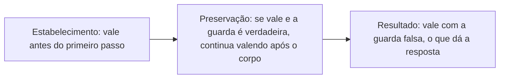

# 16 · Invariantes de laço

**Tempo estimado:** 30 minutos · **Pré-requisito:** [[15 - Medindo algoritmos]] e [[08 - Indução e recursão]].

**Ao final você vai conseguir:**

1. Escrever a invariante de um laço, isto é, uma propriedade que vale a cada passo.
2. Provar que um laço está correto, em três etapas: estabelecimento, preservação e resultado.
3. Usar uma invariante para escrever a busca binária com segurança.

**Antes de começar:** no módulo 08 você provou afirmações por indução. Uma invariante de laço é uma indução sobre as voltas do laço.

---

## Para começar

Você escreve um laço que procura um valor em uma lista ordenada. Ele para na hora certa? Acha o valor quando ele existe? Testar alguns casos ajuda, mas não garante nada para todas as listas. Uma invariante permite afirmar que o laço está certo para qualquer entrada, porque explica o que é verdade a cada passo.

---

## Mapa do módulo



*Figura 1: as três etapas de uma prova de laço. A primeira é a base, a segunda é o passo, e a terceira usa a saída do laço.*

**Como ler:** é a mesma forma de uma prova por indução: base, passo e conclusão.

---

## Mini-aula 1: invariante

> [!tip] Ideia
> Uma invariante é uma propriedade que vale no início de cada volta do laço e continua valendo no fim de cada volta.

> [!info] Definição
> Uma **invariante de laço** (loop invariant) é uma propriedade que vale no início e no fim de cada iteração. A **guarda** (guard) é a condição do laço, que decide se o corpo roda de novo.
>
> A prova tem três etapas: **estabelecimento** (a invariante vale antes do primeiro passo), **preservação** (se vale e a guarda é verdadeira, vale depois do corpo) e **resultado** (com a guarda falsa, a invariante dá a resposta).

Veja um laço que acha o maior elemento, com a invariante "`m` é o maior dos elementos já vistos". Antes de rodar, pense: a invariante vale antes de o laço começar?

```python
def maximo(lista):
    m = lista[0]
    print("inicio", m)
    for x in lista[1:]:
        if x > m:
            m = x
        print("depois de ver", x, "o maior ate agora e", m)
    return m

print(maximo([3, 9, 2]))
```

Saída real:

```
inicio 3
depois de ver 9 o maior ate agora e 9
depois de ver 2 o maior ate agora e 9
9
```

**Como ler:** a cada passo, o programa imprime o maior valor até agora. Esse é o tipo de propriedade que a invariante descreve: algo verdadeiro a cada volta.

> [!warning] Armadilha comum
> A invariante não é o que você espera no fim. Ela descreve o estado a cada volta. No fim, a invariante junto com a guarda falsa dá o resultado.

> [!question]- Checkpoint
> 1. Antes do primeiro passo de um laço de soma, quanto vale `total`?
> 2. Essa é uma invariante do tipo "soma dos vistos"?
>
> > [!success]- Resposta
> > 1. Zero, a soma de nenhum elemento.
> > 2. Sim. No início, nenhum elemento foi visto, e a soma dos vistos é zero.

---

## Mini-aula 2: a prova em três etapas

> [!tip] Ideia
> Para provar um laço, verifique a invariante no começo, mostre que cada volta a preserva, e use a saída do laço para concluir.

> [!info] Definição
> **Correção parcial** (partial correctness): se o laço termina, o resultado está certo. **Correção total** (total correctness): correção parcial mais a prova de que o laço termina, normalmente com uma variante que diminui sempre.

Exemplo: a busca de máximo. A invariante é "`m` é o maior dos elementos já vistos". No estabelecimento, `m` é o primeiro elemento, e só ele foi visto. Na preservação, o `if` troca `m` por `x` quando `x` é maior, e a invariante continua verdadeira. No resultado, o laço viu tudo, e `m` é o máximo.

> [!warning] Armadilha comum
> A preservação precisa valer para toda volta, e não só para a primeira. Uma invariante que vale só no começo não prova nada.

> [!question]- Checkpoint
> 1. Na busca de máximo, o que acontece se o `if` trocar `m` sempre, e não só quando `x > m`?
> 2. Essa mudança quebra qual etapa da prova?
>
> > [!success]- Resposta
> > 1. `m` passa a ser o último elemento, não o maior.
> > 2. A preservação: a invariante deixa de valer depois de uma volta.

---

## Mini-aula 3: a busca binária

> [!tip] Ideia
> A busca binária mantém um intervalo `l..r` em que o alvo, se existir, está. Cada volta corta o intervalo ao meio.

> [!info] Definição
> A invariante da busca binária, segundo a biblioteca, tem três partes: a lista está ordenada, `0 ≤ l ≤ r ≤ tamanho - 1`, e o alvo está em `lista[l..r]`, se existe.

Como ler: a cada volta, a comparação com o meio decide qual metade pode ser descartada, sem perder o alvo. Por isso a invariante continua verdadeira.

> [!warning] Armadilha comum
> Um erro comum é atualizar os limites com `l = meio` ou `r = meio`. Assim o intervalo pode não encolher, e a preservação falha. Use `meio + 1` e `meio - 1`.

> [!question]- Checkpoint
> 1. Se `lista[meio] < alvo`, qual metade pode ser descartada?
> 2. Quando o laço para com `l > r`, o que isso diz sobre o alvo?
>
> > [!success]- Resposta
> > 1. A metade da esquerda, incluindo o meio; com `l = meio + 1`.
> > 2. Que o intervalo está vazio: pela invariante, o alvo não está na lista.

---

## Exercícios

Cada exercício tem um bloco com a função a completar e os testes com `assert`. Quando todos passarem, aparece `Passou!`.

### Aquecimento

**A1. Soma com laço.** Complete `soma_com_laco(lista)`, que devolve a soma dos elementos. Mantenha a invariante: ao início de cada passo, `total` é a soma dos elementos já vistos.

```python
def soma_com_laco(lista):
    """Devolve a soma dos elementos. Invariante: total é a soma dos elementos já vistos."""
    ...

assert soma_com_laco([1, 2, 3]) == 6, "1 + 2 + 3"
assert soma_com_laco([]) == 0, "lista vazia: invariante vale no início e o total é 0"
assert soma_com_laco([-2, 5]) == 3, "com negativos também"
print("Passou!")
```

> [!hint]- Dica 1
> Comece com `total = 0`, que é a soma de nenhum elemento: a invariante vale no início.

> [!hint]- Dica 2
> Em cada passo, some `x` a `total`. A invariante continua valendo depois.

> [!example]- Solução
> ```python
> def soma_com_laco(lista):
>     """Devolve a soma dos elementos. Invariante: total é a soma dos elementos já vistos."""
>     total = 0
>     for x in lista:
>         total += x
>     return total
> ```
>
> **Erro comum:** Inicializar `total` com o primeiro elemento e depois percorrer a lista inteira de novo. O primeiro elemento seria somado duas vezes.

**A2. Máximo com invariante.** Complete `maximo(lista)`, que devolve o maior elemento de uma lista não vazia. Invariante: ao início de cada passo, `m` é o maior dos elementos já vistos.

```python
def maximo(lista):
    """Devolve o maior elemento de uma lista não vazia. Invariante: m é o maior já visto."""
    ...

assert maximo([3, 9, 2]) == 9, "o 9 está no meio"
assert maximo([5]) == 5, "um só elemento"
assert maximo([-1, -5, -2]) == -1, "também com negativos"
print("Passou!")
```

> [!hint]- Dica 1
> Comece com `m = lista[0]`. Esse é o único elemento visto até o momento.

> [!hint]- Dica 2
> No laço, percorra `lista[1:]`. Se `x > m`, troque `m` por `x`.

> [!example]- Solução
> ```python
> def maximo(lista):
>     """Devolve o maior elemento de uma lista não vazia. Invariante: m é o maior já visto."""
>     m = lista[0]
>     for x in lista[1:]:
>         if x > m:
>             m = x
>     return m
> ```
>
> **Erro comum:** Trocar `m` por `x` sempre, e não só quando `x` é maior. A invariante deixa de valer.

**A3. Busca binária.** Complete `busca_binaria(lista, alvo)`, para uma lista ordenada. Devolva o índice de `alvo`, ou `-1` se ele não está. Use os limites `l` e `r`, com a invariante: se `alvo` está na lista, ele está entre `l` e `r`.

```python
def busca_binaria(lista, alvo):
    """Devolve o índice de alvo em lista ordenada, ou -1. Invariante: alvo está em lista[l..r], se existe."""
    ...

assert busca_binaria([1, 3, 5, 7], 5) == 2, "o 5 está na posição 2"
assert busca_binaria([1, 3, 5, 7], 4) == -1, "o 4 não está"
assert busca_binaria([1], 1) == 0, "um elemento"
print("Passou!")
```

> [!hint]- Dica 1
> Comece com `l = 0` e `r = len(lista) - 1`. Repita enquanto `l <= r`.

> [!hint]- Dica 2
> Calcule `meio = (l + r) // 2`. Se `lista[meio] < alvo`, descarte a metade da esquerda com `l = meio + 1`; senão, descarte a da direita com `r = meio - 1`.

> [!example]- Solução
> ```python
> def busca_binaria(lista, alvo):
>     """Devolve o índice de alvo em lista ordenada, ou -1. Invariante: alvo está em lista[l..r], se existe."""
>     l, r = 0, len(lista) - 1
>     while l <= r:
>         meio = (l + r) // 2
>         if lista[meio] == alvo:
>             return meio
>         if lista[meio] < alvo:
>             l = meio + 1
>         else:
>             r = meio - 1
>     return -1
> ```
>
> **Erro comum:** Escrever `l = meio` ou `r = meio`. Assim o laço pode não avançar e rodar para sempre.

### Praticando

**P1. Primeiro negativo.** Complete `primeiro_negativo(lista)`, que devolve o índice do primeiro elemento negativo, ou `-1` se não há nenhum. Invariante: ao início de cada passo, todos os elementos já vistos são não negativos.

```python
def primeiro_negativo(lista):
    """Devolve o índice do primeiro negativo, ou -1. Invariante: os vistos são não negativos."""
    ...

assert primeiro_negativo([3, 0, -2, -5]) == 2, "o -2 está na posição 2"
assert primeiro_negativo([1, 2]) == -1, "nenhum negativo"
assert primeiro_negativo([-1]) == 0, "o primeiro elemento é negativo"
print("Passou!")
```

> [!hint]- Dica 1
> Use `for i in range(len(lista)):`. Para cada `i`, se `lista[i] < 0`, devolva `i`.

> [!hint]- Dica 2
> Se o laço terminar, devolva `-1`.

> [!example]- Solução
> ```python
> def primeiro_negativo(lista):
>     """Devolve o índice do primeiro negativo, ou -1. Invariante: os vistos são não negativos."""
>     for i in range(len(lista)):
>         if lista[i] < 0:
>             return i
>     return -1
> ```
>
> **Erro comum:** Devolver `lista[i]` em vez do índice. A pergunta é em qual posição o negativo está.

**P2. Palíndromo.** Complete `e_palindromo(texto)`, que devolve `True` se o texto lê igual de trás para frente. Use dois índices, `i` começando no início e `j` no fim. Invariante: os caracteres fora de `i..j` já foram comparados e batem.

```python
def e_palindromo(texto):
    """Devolve True se texto lê igual de trás para frente. Invariante: fora de i..j, já bate."""
    ...

assert e_palindromo("arara") == True, "arara lê igual de trás para frente"
assert e_palindromo("abc") == False, "abc não é palíndromo"
assert e_palindromo("") == True, "texto vazio"
print("Passou!")
```

> [!hint]- Dica 1
> Use `i = 0` e `j = len(texto) - 1`. Repita enquanto `i < j`.

> [!hint]- Dica 2
> Se `texto[i] != texto[j]`, devolva `False`. Senão, aproxime os índices: `i += 1` e `j -= 1`.

> [!example]- Solução
> ```python
> def e_palindromo(texto):
>     """Devolve True se texto lê igual de trás para frente. Invariante: fora de i..j, já bate."""
>     i, j = 0, len(texto) - 1
>     while i < j:
>         if texto[i] != texto[j]:
>             return False
>         i += 1
>         j -= 1
>     return True
> ```
>
> **Erro comum:** Comparar só o primeiro com o último, sem andar os índices. Um texto com mais de três letras teria as letras do meio sem checagem.

**P3. Pares na lista.** Complete `conta_pares_pares(lista)`, que conta quantos elementos da lista são pares. Invariante: `contador` é o número de pares já vistos.

```python
def conta_pares_pares(lista):
    """Conta os elementos pares da lista. Invariante: contador é o número de pares já vistos."""
    ...

assert conta_pares_pares([1, 2, 3, 4]) == 2, "2 e 4"
assert conta_pares_pares([]) == 0, "lista vazia"
assert conta_pares_pares([0, -2, 7]) == 2, "0 e -2 são pares"
print("Passou!")
```

> [!hint]- Dica 1
> Comece com `contador = 0`. Use `x % 2 == 0` para testar se `x` é par.

> [!hint]- Dica 2
> Some 1 ao contador só quando o elemento for par. Devolva `contador` no fim.

> [!example]- Solução
> ```python
> def conta_pares_pares(lista):
>     """Conta os elementos pares da lista. Invariante: contador é o número de pares já vistos."""
>     contador = 0
>     for x in lista:
>         if x % 2 == 0:
>             contador += 1
>     return contador
> ```
>
> **Erro comum:** Somar 1 para todo elemento, e não só para os pares. O contador deixa de contar pares.

### Desafio

**D1. Passos da busca binária.** Complete `busca_binaria_passos(lista, alvo)`, que devolve uma tupla `(indice, passos)`: o índice de `alvo` (ou `-1`) e o número de vezes que o laço principal rodou. Use a mesma lógica de `busca_binaria`.

```python
def busca_binaria_passos(lista, alvo):
    """Devolve (indice, passos): o índice de alvo ou -1, e as voltas do laço principal."""
    ...

assert busca_binaria_passos([1, 3, 5, 7], 5) == (2, 2), "duas voltas: meio 1 e meio 2"
assert busca_binaria_passos([1, 3, 5, 7], 7) == (3, 3), "três voltas até achar o 7"
assert busca_binaria_passos([1, 3], 4) == (-1, 2), "duas voltas, sem achar"
print("Passou!")
```

> [!hint]- Dica 1
> Use `passos = 0`, e some 1 no início de cada volta do `while`.

> [!hint]- Dica 2
> Devolva a tupla `(meio, passos)` quando achar, e `(-1, passos)` ao sair do laço.

> [!example]- Solução
> ```python
> def busca_binaria_passos(lista, alvo):
>     """Devolve (indice, passos): o índice de alvo ou -1, e as voltas do laço principal."""
>     l, r = 0, len(lista) - 1
>     passos = 0
>     while l <= r:
>         passos += 1
>         meio = (l + r) // 2
>         if lista[meio] == alvo:
>             return (meio, passos)
>         if lista[meio] < alvo:
>             l = meio + 1
>         else:
>             r = meio - 1
>     return (-1, passos)
> ```
>
> **Erro comum:** Contar os passos só quando o alvo é achado. Quando ele não existe, o número de passos também é a resposta.


---

## Mini-projeto (opcional)

Um mini-projeto com a mesma técnica: uma invariante que guarda dois valores ao mesmo tempo. Tente sozinho antes de abrir a solução.

**Objetivo.** Devolva o par `(maximo, posicao)`: o maior elemento de uma lista não vazia e a posição de sua primeira ocorrência. Use uma invariante: ao início de cada passo, `m` e `pos` são o maior valor visto e a posição de sua primeira ocorrência.

```python
def maior_e_posicao(lista):
    """Devolve (maximo, posicao) com a primeira ocorrência do maior elemento."""
    ...

assert maior_e_posicao([3, 9, 2, 9]) == (9, 1), "o primeiro 9 está na posição 1"
assert maior_e_posicao([5]) == (5, 0), "um elemento"
assert maior_e_posicao([-1, -5]) == (-1, 0), "também com negativos"
print("Passou!")
```

> [!hint]- Dica 1
> Comece com `m = lista[0]` e `pos = 0`. Percorra os índices de `1` até o fim.

> [!hint]- Dica 2
> Troque `m` e `pos` só quando `lista[i] > m`. Assim a primeira ocorrência fica guardada.

> [!example]- Solução
> ```python
> def maior_e_posicao(lista):
>     """Devolve (maximo, posicao) com a primeira ocorrência do maior elemento."""
>     m = lista[0]
>     pos = 0
>     for i in range(1, len(lista)):
>         if lista[i] > m:
>             m = lista[i]
>             pos = i
>     return (m, pos)
> ```
>
> **Erro comum:** Trocar com `>=`. O índice seria atualizado para a última ocorrência, e não a primeira.


---

## Fechando

**Resumo**

- Invariante: propriedade que vale no início e no fim de cada volta.
- Estabelecimento: vale antes do primeiro passo.
- Preservação: se vale e a guarda é verdadeira, vale depois do corpo.
- Resultado: com a guarda falsa, a invariante dá a resposta.
- Correção total = correção parcial + término.

**Glossário rápido**

- **Invariante de laço** (loop invariant): propriedade que vale a cada volta.
- **Guarda** (guard): condição que decide se o corpo roda de novo.
- **Correção parcial** (partial correctness): se termina, o resultado está certo.
- **Correção total** (total correctness): correção parcial mais término.

**Perguntas de revisão**

1. Escreva uma invariante para um laço que conta os elementos de uma lista.
2. Por que a busca binária precisa de `meio + 1` e não de `meio`?
3. Qual é a diferença entre correção parcial e correção total?

**E agora?** O próximo módulo é **Listas dinâmicas e listas ligadas**. Ele mostra duas formas de guardar uma sequência, e o custo de cada operação nelas.

---

## Para ir mais fundo

- [[Loop Invariant and Algorithm Correctness]]
- [[Mathematical Induction]]
