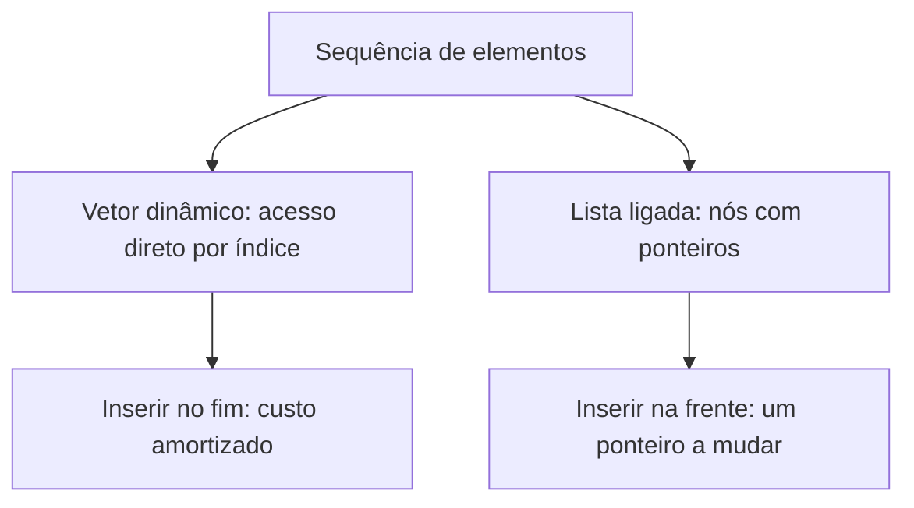

# 17 · Listas dinâmicas e listas ligadas

**Tempo estimado:** 30 minutos · **Pré-requisito:** [[16 - Invariantes de laço]].

**Ao final você vai conseguir:**

1. Explicar por que uma lista dinâmica dá acesso rápido por índice.
2. Implementar operações em uma lista ligada, ajustando ponteiros.
3. Comparar o custo de inserir e acessar nas duas estruturas, com as tabelas da biblioteca.

**Antes de começar:** no módulo 16 você aprendeu a manter invariantes em laços. Listas ligadas exigem o mesmo cuidado com os ponteiros.

---

## Para começar

Você guarda uma sequência de mensagens de um chat. Às vezes você quer a 500ª mensagem de imediato. Outras vezes quer inserir uma mensagem no começo. Uma estrutura resolve bem uma dessas tarefas e mal a outra. Entender o custo de cada operação ajuda a escolher.

---

## Mapa do módulo



*Figura 1: as duas formas de guardar uma sequência. O vetor dinâmico é rápido por índice; a lista ligada é rápida para mexer na frente.*

**Como ler:** cada estrutura tem um ponto forte. Os ramos de baixo mostram as operações em que cada uma se destaca.

---

## Mini-aula 1: vetor dinâmico

> [!tip] Ideia
> Um vetor dinâmico é um vetor que cresce quando enche. Por isso acessar qualquer posição é direto, e adicionar no fim é, em média, barato.

> [!info] Definição
> Um **vetor dinâmico** (dynamic array) é um vetor que cresce e encolhe, realocando seu armazenamento. A biblioteca cita a lista do Python como exemplo prático.

Veja a lista do Python crescendo e sendo indexada. Antes de rodar, preveja o valor de `xs[3]`.

```python
xs = []
for i in range(5):
    xs.append(i)
print(xs, xs[3])
```

Saída real:

```
[0, 1, 2, 3, 4] 3
```

**Como ler:** `xs[3]` vai direto à posição 3, sem percorrer os elementos antes dela.

> [!warning] Armadilha comum
> Um custo "amortizado" não é o custo de cada operação. Uma inserção pode ser cara, desde que as outras compensem. Isso é o tema do módulo 19.

> [!question]- Checkpoint
> 1. Quanto custa, em princípio, acessar `xs[500]`?
> 2. Quanto custa inserir na posição 0 de uma lista Python, segundo a biblioteca?
>
> > [!success]- Resposta
> > 1. Acesso direto, custo constante.
> > 2. O custo é linear no número de elementos, porque todos precisam se deslocar.

---

## Mini-aula 2: lista ligada

> [!tip] Ideia
> Uma lista ligada guarda cada elemento em um nó, que aponta para o próximo. Inserir na frente é trocar um ponteiro, sem mover os outros elementos.

> [!info] Definição
> Um **nó** (node) guarda um item e uma referência ao próximo nó. A biblioteca dá a inserção no início como a operação mais simples.

Veja uma lista de nós sendo criada e percorrida. Antes de rodar, pense: qual valor aparece primeiro?

```python
class No:
    def __init__(self, valor, proximo=None):
        self.valor = valor
        self.proximo = proximo

cabeca = No(3, No(2, No(1)))
cabeca = No(0, cabeca)
atual = cabeca
while atual is not None:
    print(atual.valor)
    atual = atual.proximo
```

Saída real:

```
0
3
2
1
```

**Como ler:** `cabeca = No(0, cabeca)` cria um nó novo que aponta para o antigo primeiro nó. Depois, o laço percorre a lista seguindo os ponteiros.

> [!warning] Armadilha comum
> Para acessar a posição `i`, é preciso andar `i` nós. A lista ligada não tem acesso direto por índice, e a biblioteca não dá uma tabela de custo para ela.

> [!question]- Checkpoint
> 1. Na lista do exemplo, qual é o nó que aponta para `None`?
> 2. Para inserir na frente, quantos ponteiros mudam?
>
> > [!success]- Resposta
> > 1. O último, com valor 1.
> > 2. Um: o do novo nó, que passa a apontar para a antiga cabeça.

---

## Mini-aula 3: escolher a estrutura

> [!tip] Ideia
> Use o vetor dinâmico quando o acesso por índice importa. Use a lista ligada quando inserções e remoções na frente são frequentes.

> [!info] Definição
> A biblioteca registra: vetor dinâmico com acesso e atualização por índice em custo constante; inserção no fim em custo amortizado constante; inserção ou remoção no meio ou no início em custo linear. Para a lista ligada, a biblioteca registra apenas a inserção na frente, sem tabela de custos.

> [!warning] Armadilha comum
> Não generalize a lista ligada. A biblioteca não dá custos para ela além da inserção na frente. A análise de outras operações fica como lacuna do material.

> [!question]- Checkpoint
> 1. Você quer guardar um histórico de mensagens e ler a mensagem de número 1000. Qual estrutura?
> 2. Você quer inserir muitos itens no começo de uma sequência. Qual estrutura?
>
> > [!success]- Resposta
> > 1. Um vetor dinâmico, pelo acesso direto por índice.
> > 2. A lista ligada, pela inserção na frente com um único ponteiro.

---

## Exercícios

Cada exercício tem um bloco com a função a completar e os testes com `assert`. Os exercícios de lista ligada usam a classe `No`, que já está pronta nos blocos. Quando todos passarem, aparece `Passou!`.

### Aquecimento

**A1. Inserir na frente.** Uma lista ligada é feita de nós com `valor` e `proximo`. Complete `inserir_na_frente(cabeca, valor)`, que cria um nó com `valor` apontando para a `cabeca` atual e devolve o novo nó, que passa a ser a cabeça. A classe `No` e a função `para_lista` já estão prontas.

```python
class No:
    def __init__(self, valor, proximo=None):
        self.valor = valor
        self.proximo = proximo

def para_lista(cabeca):
    # já pronta: converte a lista ligada em lista Python
    resultado = []
    atual = cabeca
    while atual is not None:
        resultado.append(atual.valor)
        atual = atual.proximo
    return resultado

def inserir_na_frente(cabeca, valor):
    """Cria um nó com valor apontando para cabeca e devolve o novo nó como cabeça."""
    ...

assert para_lista(inserir_na_frente(None, 1)) == [1], "lista vazia ganha um nó"
assert para_lista(inserir_na_frente(No(2, No(3)), 1)) == [1, 2, 3], "o novo nó vai para a frente"
print("Passou!")
```

> [!hint]- Dica 1
> Use `No(valor, cabeca)`. O novo nó já aponta para o antigo primeiro nó.

> [!hint]- Dica 2
> Devolva o novo nó. A cabeça muda.

> [!example]- Solução
> ```python
> def inserir_na_frente(cabeca, valor):
>     """Cria um nó com valor apontando para cabeca e devolve o novo nó como cabeça."""
>     return No(valor, cabeca)
> ```
>
> **Erro comum:** Devolver `cabeca` sem alterar. A lista não muda, porque a função não criou nenhum nó.

**A2. Tamanho.** Complete `tamanho(cabeca)`, que conta os nós da lista ligada percorrendo-a com um laço.

```python
class No:
    def __init__(self, valor, proximo=None):
        self.valor = valor
        self.proximo = proximo

def tamanho(cabeca):
    """Conta os nós da lista ligada que começa em cabeca."""
    ...

assert tamanho(None) == 0, "lista vazia"
assert tamanho(No(1, No(2, No(3)))) == 3, "três nós"
print("Passou!")
```

> [!hint]- Dica 1
> Comece com `atual = cabeca` e um contador `n = 0`. Enquanto `atual is not None`, some 1 e avance.

> [!hint]- Dica 2
> Para avançar, use `atual = atual.proximo`.

> [!example]- Solução
> ```python
> def tamanho(cabeca):
>     """Conta os nós da lista ligada que começa em cabeca."""
>     n = 0
>     atual = cabeca
>     while atual is not None:
>         n += 1
>         atual = atual.proximo
>     return n
> ```
>
> **Erro comum:** Esquecer de avançar `atual`. O laço nunca termina, porque `atual` continua apontando para o mesmo nó.

**A3. Contém valor.** Complete `contem(cabeca, valor)`, que devolve `True` se algum nó da lista tem esse `valor`, e `False` caso contrário.

```python
class No:
    def __init__(self, valor, proximo=None):
        self.valor = valor
        self.proximo = proximo

def contem(cabeca, valor):
    """Devolve True se algum nó da lista tem esse valor."""
    ...

assert contem(None, 1) == False, "lista vazia"
assert contem(No(1, No(2)), 2) == True, "o 2 está no segundo nó"
assert contem(No(1, No(2)), 9) == False, "o 9 não está"
print("Passou!")
```

> [!hint]- Dica 1
> Percorra os nós com `atual`, como no exercício anterior.

> [!hint]- Dica 2
> Se `atual.valor == valor`, devolva `True`. Se a lista acabar, devolva `False`.

> [!example]- Solução
> ```python
> def contem(cabeca, valor):
>     """Devolve True se algum nó da lista tem esse valor."""
>     atual = cabeca
>     while atual is not None:
>         if atual.valor == valor:
>             return True
>         atual = atual.proximo
>     return False
> ```
>
> **Erro comum:** Devolver `False` no primeiro nó que não bate. Ainda há outros nós para checar.

### Praticando

**P1. Remover o primeiro.** Complete `remove_primeiro(cabeca, valor)`, que remove o primeiro nó com esse `valor` e devolve a cabeça da lista. Se o valor não existe, a lista fica igual. Use `para_lista`, já pronta, para conferir.

```python
class No:
    def __init__(self, valor, proximo=None):
        self.valor = valor
        self.proximo = proximo

def para_lista(cabeca):
    # já pronta
    resultado = []
    atual = cabeca
    while atual is not None:
        resultado.append(atual.valor)
        atual = atual.proximo
    return resultado

def remove_primeiro(cabeca, valor):
    """Remove o primeiro nó com esse valor e devolve a cabeça da lista."""
    ...

assert para_lista(remove_primeiro(No(1, No(2, No(3))), 2)) == [1, 3], "remove do meio"
assert para_lista(remove_primeiro(No(1, No(2)), 1)) == [2], "remove a cabeça"
assert para_lista(remove_primeiro(No(1, No(2)), 9)) == [1, 2], "valor ausente: nada muda"
print("Passou!")
```

> [!hint]- Dica 1
> Se a cabeça tem o valor, a nova cabeça é `cabeca.proximo`.

> [!hint]- Dica 2
> Caso contrário, percorra com `atual`, olhando `atual.proximo`. Ao achar, pule o nó: `atual.proximo = atual.proximo.proximo`.

> [!example]- Solução
> ```python
> def remove_primeiro(cabeca, valor):
>     """Remove o primeiro nó com esse valor e devolve a cabeça da lista."""
>     if cabeca is None:
>         return None
>     if cabeca.valor == valor:
>         return cabeca.proximo
>     atual = cabeca
>     while atual.proximo is not None:
>         if atual.proximo.valor == valor:
>             atual.proximo = atual.proximo.proximo
>             return cabeca
>         atual = atual.proximo
>     return cabeca
> ```
>
> **Erro comum:** Olhar `atual.valor` em vez de `atual.proximo.valor`. Assim o nó errado seria removido, ou a lista não mudaria.

**P2. Acessar pelo índice.** Complete `acessar(cabeca, i)`, que devolve o valor do nó de índice `i` (começando em 0), ou `None` se `i` está fora da lista. Ao contrário de uma lista Python, não há acesso direto: é preciso andar pelos nós.

```python
class No:
    def __init__(self, valor, proximo=None):
        self.valor = valor
        self.proximo = proximo

def acessar(cabeca, i):
    """Devolve o valor do nó de índice i, ou None se i está fora da lista."""
    ...

lista3 = No(1, No(2, No(3)))
assert acessar(lista3, 0) == 1, "índice 0 é a cabeça"
assert acessar(lista3, 1) == 2, "índice 1 é o segundo nó"
assert acessar(lista3, 5) is None, "fora da lista"
print("Passou!")
```

> [!hint]- Dica 1
> Ande `i` vezes a partir da cabeça, com `atual = atual.proximo`.

> [!hint]- Dica 2
> Ao andar, se `atual` virar `None`, o índice não existe: devolva `None`.

> [!example]- Solução
> ```python
> def acessar(cabeca, i):
>     """Devolve o valor do nó de índice i, ou None se i está fora da lista."""
>     atual = cabeca
>     for _ in range(i):
>         if atual is None:
>             return None
>         atual = atual.proximo
>     if atual is None:
>         return None
>     return atual.valor
> ```
>
> **Erro comum:** Ir até `i - 1` em vez de `i`. Assim o valor devolvido seria o nó anterior.

**P3. Inverter a lista.** Complete `inverter(cabeca)`, que inverte os ponteiros da lista e devolve a nova cabeça. Use três variáveis: `anterior`, `atual` e `proximo`.

```python
class No:
    def __init__(self, valor, proximo=None):
        self.valor = valor
        self.proximo = proximo

def para_lista(cabeca):
    resultado = []
    atual = cabeca
    while atual is not None:
        resultado.append(atual.valor)
        atual = atual.proximo
    return resultado

def inverter(cabeca):
    """Inverte os ponteiros da lista e devolve a nova cabeça."""
    ...

assert para_lista(inverter(No(1, No(2, No(3))))) == [3, 2, 1], "três nós invertidos"
assert inverter(None) is None, "lista vazia continua vazia"
assert para_lista(inverter(No(7))) == [7], "um nó não muda"
print("Passou!")
```

> [!hint]- Dica 1
> Antes de mudar `atual.proximo`, guarde o próximo nó em `proximo`.

> [!hint]- Dica 2
> Em cada volta: `atual.proximo = anterior`, depois `anterior = atual`, e `atual = proximo`. No fim, devolva `anterior`.

> [!example]- Solução
> ```python
> def inverter(cabeca):
>     """Inverte os ponteiros da lista e devolve a nova cabeça."""
>     anterior = None
>     atual = cabeca
>     while atual is not None:
>         proximo = atual.proximo
>         atual.proximo = anterior
>         anterior = atual
>         atual = proximo
>     return anterior
> ```
>
> **Erro comum:** Devolver `atual` no fim. Ao sair do laço, `atual` é `None`, e a nova cabeça é `anterior`.

### Desafio

**D1. Copias de um vetor que dobra.** Modele um vetor dinâmico que começa com capacidade 1. Quando está cheio e chega um novo elemento, ele dobra a capacidade e copia os elementos antigos. Complete `quantas_copias(n)`, que devolve o total de elementos copiados ao inserir `n` elementos. Use `cap` (capacidade), `tamanho` e `copias`.

```python
def quantas_copias(n):
    """Total de elementos copiados ao inserir n elementos num vetor que dobra, começando com capacidade 1."""
    ...

assert quantas_copias(1) == 0, "um elemento cabe na capacidade 1"
assert quantas_copias(2) == 1, "o segundo elemento obriga a copiar 1"
assert quantas_copias(5) == 7, "copias de 1, 2 e 4 elementos"
print("Passou!")
```

> [!hint]- Dica 1
> Para cada um dos `n` elementos: se `tamanho == cap`, some `tamanho` em `copias` e dobre `cap`. Depois, some 1 em `tamanho`.

> [!hint]- Dica 2
> Ao inserir o segundo elemento, o vetor de capacidade 1 está cheio, então há uma cópia de 1 elemento.

> [!example]- Solução
> ```python
> def quantas_copias(n):
>     """Total de elementos copiados ao inserir n elementos num vetor que dobra, começando com capacidade 1."""
>     cap = 1
>     tamanho = 0
>     copias = 0
>     for _ in range(n):
>         if tamanho == cap:
>             copias += tamanho
>             cap *= 2
>         tamanho += 1
>     return copias
> ```
>
> **Erro comum:** Dobrar a capacidade sem somar as cópias. O total de cópias é o que a função pede.


---

## Mini-projeto (opcional)

Um mini-projeto com a lista ligada: contar, e ler o último valor. Tente sozinho antes de abrir a solução.

**Objetivo.** Devolva o valor do último nó da lista ligada, ou `None` se a lista é vazia. Percorra até achar um nó cujo `proximo` é `None`.

```python
class No:
    def __init__(self, valor, proximo=None):
        self.valor = valor
        self.proximo = proximo

def ultimo_valor(cabeca):
    """Devolve o valor do último nó, ou None se a lista é vazia."""
    ...

assert ultimo_valor(None) is None, "lista vazia"
assert ultimo_valor(No(4)) == 4, "um nó é o último"
assert ultimo_valor(No(1, No(2, No(9)))) == 9, "o último tem valor 9"
print("Passou!")
```

> [!hint]- Dica 1
> Se a lista é vazia, devolva `None`.

> [!hint]- Dica 2
> Ande com `atual = atual.proximo` enquanto `atual.proximo` não for `None`.

> [!example]- Solução
> ```python
> def ultimo_valor(cabeca):
>     """Devolve o valor do último nó, ou None se a lista é vazia."""
>     if cabeca is None:
>         return None
>     atual = cabeca
>     while atual.proximo is not None:
>         atual = atual.proximo
>     return atual.valor
> ```
>
> **Erro comum:** Parar um nó antes do último, olhando `atual.proximo is not None` no lugar de `atual.proximo is None`.


---

## Fechando

**Resumo**

- Vetor dinâmico: acesso direto por índice; cresce quando enche.
- Lista ligada: nós com ponteiros; inserir na frente troca um ponteiro.
- Acesso por índice na lista ligada exige percorrer os nós.
- A escolha depende das operações mais frequentes.

**Glossário rápido**

- **Vetor dinâmico** (dynamic array): vetor que cresce e encolhe.
- **Nó** (node): elemento de uma lista ligada, com valor e ponteiro.
- **Lista ligada** (linked list): sequência de nós encadeados por ponteiros.
- **Custo amortizado** (amortized cost): custo médio de uma sequência de operações.

**Perguntas de revisão**

1. Por que inserir no fim de um vetor dinâmico é, em média, barato?
2. O que acontece com a lista ligada se você esquecer de avançar o ponteiro num laço?
3. Qual estrutura você escolheria para uma fila de atendimento que entra no fim e sai na frente? Justifique.

**E agora?** O próximo módulo é **Pilhas e filas**. Elas são sequências com regras fixas de entrada e saída, e as duas estruturas que você viu aqui servem de base para elas.

---

## Para ir mais fundo

- [[Dynamic Array and Linked List]]
- [[Amortized Analysis]]
