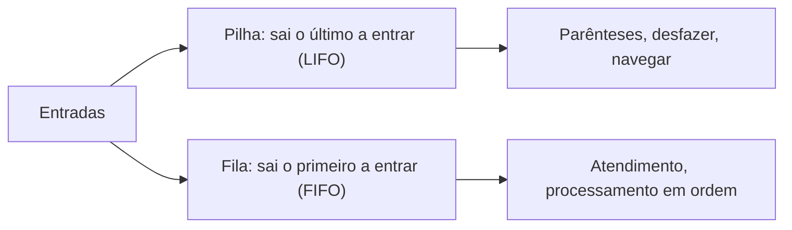

# 18 · Pilhas e filas

**Tempo estimado:** 30 minutos · **Pré-requisito:** [[17 - Listas dinâmicas e listas ligadas]].

**Ao final você vai conseguir:**

1. Explicar a regra LIFO da pilha e a regra FIFO da fila.
2. Usar uma pilha para resolver problemas como verificar parênteses.
3. Escolher a estrutura certa para a fila em Python, com `collections.deque`.

**Antes de começar:** no módulo 17 você viu listas e como o custo de inserir e remover depende da posição. Pilhas e filas são usos específicos dessas estruturas.

---

## Para começar

Você digita um texto com parênteses e quer saber se estão bem fechados. Ou atende clientes numa loja: o primeiro que chegou é o primeiro atendido. São duas regras diferentes de saída: o último a entrar sai primeiro (pilha) e o primeiro a entrar sai primeiro (fila). Cada uma resolve um tipo de problema.

---

## Mapa do módulo



*Figura 1: a mesma entrada de elementos gera saídas diferentes, conforme a regra. A pilha e a fila são definidas pela regra de saída.*

**Como ler:** a regra de saída define a estrutura. Os ramos de baixo listam problemas típicos de cada uma.

---

## Mini-aula 1: pilha (LIFO)

> [!tip] Ideia
> Na pilha, só o topo é acessível. Quem entrou por último sai primeiro.

> [!info] Definição
> Uma **pilha** (stack) é uma coleção baseada na política LIFO (last-in-first-out): o último elemento inserido é o primeiro a sair. A operação de inserir é `push`; a de remover é `pop`.

Veja uma pilha em Python, usando uma lista e as operações `append` e `pop`. Antes de rodar, preveja a ordem dos dois valores que saem.

```python
pilha = []
for x in [1, 2, 3]:
    pilha.append(x)
print(pilha.pop(), pilha.pop())
```

Saída real:

```
3 2
```

**Como ler:** o `pop` tira do fim da lista, que é o topo. Por isso sai o 3 antes do 2.

> [!warning] Armadilha comum
> Remover do começo de uma lista (`pop(0)`) não é uma pilha: é uma fila mal feita, e a biblioteca indica custo linear para essa operação.

> [!question]- Checkpoint
> 1. Empilhando 5, 6 e 7 e depois desempilhando uma vez, qual valor sai?
> 2. Qual é o topo depois dessa remoção?
>
> > [!success]- Resposta
> > 1. O 7, o último a entrar.
> > 2. O 6.

---

## Mini-aula 2: fila (FIFO)

> [!tip] Ideia
> Na fila, quem entra primeiro sai primeiro. Em Python, use `collections.deque`, que remove do começo sem custo linear.

> [!info] Definição
> Uma **fila** (queue) é uma coleção baseada na política FIFO (first-in-first-out). Um **deque** (double-ended queue) permite inserir e remover nas duas pontas.

Veja a fila com `deque`. Antes de rodar, pense: o que sai primeiro, o 1 ou o 3?

```python
from collections import deque

fila = deque()
for x in [1, 2, 3]:
    fila.append(x)
print(fila.popleft(), fila.popleft())
```

Saída real:

```
1 2
```

**Como ler:** `popleft` tira da frente, e `append` põe no fim. A ordem de saída é a mesma de entrada.

> [!warning] Armadilha comum
> `list.pop(0)` e `list.insert(0, v)` custam O(n), segundo a biblioteca. Para uma fila, use `deque`.

> [!question]- Checkpoint
> 1. Entrando em ordem os valores 5, 6 e 7, qual sai primeiro de uma fila?
> 2. Qual é o custo de `popleft` num `deque`, segundo a biblioteca?
>
> > [!success]- Resposta
> > 1. O 5.
> > 2. Custo constante nas duas pontas.

---

## Mini-aula 3: quando cada uma serve

> [!tip] Ideia
> Pilha aparece quando o problema pede o mais recente. Fila aparece quando o problema pede a ordem de chegada.

> [!info] Definição
> A biblioteca relaciona as duas estruturas à busca em profundidade (pilha, ou recursão) e à busca em largura (fila), nos módulos de grafos.

Como ler: verificar parênteses precisa do parêntese aberto mais recente, então é pilha. Atender clientes em ordem de chegada é fila.

> [!warning] Armadilha comum
> A fila de atendimento não é uma pilha, mesmo que ambas guardem elementos. A regra de saída é o que as diferencia.

> [!question]- Checkpoint
> 1. Para verificar se um `)` fecha o `(` mais recente, qual estrutura?
> 2. Para processar tarefas na ordem em que chegaram, qual estrutura?
>
> > [!success]- Resposta
> > 1. Pilha, porque o `)` fecha o último `(` aberto.
> > 2. Fila, porque a ordem de chegada define a ordem de saída.

---

## Exercícios

Cada exercício tem um bloco com a função a completar e os testes com `assert`. Quando todos passarem, aparece `Passou!`.

### Aquecimento

**A1. Operações numa pilha.** Complete `usa_pilha(operacoes)`. Cada operação é `("push", x)` (empilha `x`) ou `("pop",)` (desempilha, se a pilha não está vazia). Devolva a pilha final, como lista, com o topo no fim.

```python
def usa_pilha(operacoes):
    """Aplica as operações de pilha e devolve a pilha final, com o topo no fim."""
    ...

assert usa_pilha([("push", 1), ("push", 2), ("pop",), ("push", 3)]) == [1, 3], "sai o 2 do topo"
assert usa_pilha([("pop",)]) == [], "desempilhar pilha vazia não faz nada"
assert usa_pilha([]) == [], "sem operações"
print("Passou!")
```

> [!hint]- Dica 1
> Use `pilha = []`. Para `push`, use `append`. Para `pop`, use `pop()` só se `pilha` não estiver vazia.

> [!hint]- Dica 2
> Verifique o tipo da operação com `op[0] == "push"`.

> [!example]- Solução
> ```python
> def usa_pilha(operacoes):
>     """Aplica as operações de pilha e devolve a pilha final, com o topo no fim."""
>     pilha = []
>     for op in operacoes:
>         if op[0] == "push":
>             pilha.append(op[1])
>         elif pilha:
>             pilha.pop()
>     return pilha
> ```
>
> **Erro comum:** Remover do começo da lista com `pop(0)`. A pilha tira do topo, que é o fim da lista.

**A2. Parênteses.** Complete `parenteses_balanceados(texto)`, que devolve `True` se todo `(` tem um `)` correspondente, na ordem certa. Use uma pilha: empilhe a cada `(`, e desempilhe a cada `)`.

```python
def parenteses_balanceados(texto):
    """Devolve True se cada ( tem um ) correspondente, na ordem correta."""
    ...

assert parenteses_balanceados("(())") == True, "dois pares aninhados"
assert parenteses_balanceados("(()") == False, "falta um )"
assert parenteses_balanceados(")(") == False, "fecha antes de abrir"
assert parenteses_balanceados("") == True, "texto vazio"
print("Passou!")
```

> [!hint]- Dica 1
> Para cada caractere: se é `(`, empilhe. Se é `)`, veja se a pilha está vazia; se estiver, o texto já falhou.

> [!hint]- Dica 2
> No fim, a pilha deve estar vazia.

> [!example]- Solução
> ```python
> def parenteses_balanceados(texto):
>     """Devolve True se cada ( tem um ) correspondente, na ordem correta."""
>     pilha = []
>     for c in texto:
>         if c == "(":
>             pilha.append(c)
>         elif c == ")":
>             if not pilha:
>                 return False
>             pilha.pop()
>     return len(pilha) == 0
> ```
>
> **Erro comum:** Esquecer de checar a pilha vazia antes de desempilhar. Em `")("`, a primeira posição já é um erro.

**A3. Ordem de saída.** Complete `ultimo_a_sair(entradas)`. Empilhe todos os elementos de `entradas` em ordem, depois desempilhe todos, e devolva a lista na ordem de saída.

```python
def ultimo_a_sair(entradas):
    """Empilha tudo, depois desempilha tudo e devolve a ordem de saída."""
    ...

assert ultimo_a_sair([1, 2, 3]) == [3, 2, 1], "o último a entrar é o primeiro a sair"
assert ultimo_a_sair([]) == [], "sem elementos"
assert ultimo_a_sair(["a"]) == ["a"], "um elemento"
print("Passou!")
```

> [!hint]- Dica 1
> Use um `for` para empilhar, e um `while pilha:` para desempilhar.

> [!hint]- Dica 2
> Guarde cada valor desempilhado com `saida.append(pilha.pop())`.

> [!example]- Solução
> ```python
> def ultimo_a_sair(entradas):
>     """Empilha tudo, depois desempilha tudo e devolve a ordem de saída."""
>     pilha = []
>     for x in entradas:
>         pilha.append(x)
>     saida = []
>     while pilha:
>         saida.append(pilha.pop())
>     return saida
> ```
>
> **Erro comum:** Devolver `entradas` sem mudar. A ordem de saída é a inversa da ordem de entrada.

### Praticando

**P1. Fila com duas pilhas.** Uma fila pode ser feita com duas pilhas. Complete `fila_duas_pilhas(operacoes)`. Cada operação é `("enq", x)` (entra na fila) ou `("deq",)` (sai da fila, se há algum). Devolva a lista dos valores que saíram, na ordem em que saíram. Use `entrada` e `saida` como pilhas: quando `saida` está vazia no momento de sair, passe tudo de `entrada` para `saida`.

```python
def fila_duas_pilhas(operacoes):
    """Simula uma fila com duas pilhas e devolve os valores que saíram, na ordem."""
    ...

assert fila_duas_pilhas([("enq", 1), ("enq", 2), ("deq",), ("enq", 3), ("deq",), ("deq",)]) == [1, 2, 3], "saem na ordem em que entraram"
assert fila_duas_pilhas([("deq",)]) == [], "sair de fila vazia não produz valor"
print("Passou!")
```

> [!hint]- Dica 1
> Em `enq`, empilhe em `entrada`.

> [!hint]- Dica 2
> Em `deq`: se `saida` está vazia, passe todos de `entrada` para `saida`. Depois, se `saida` não está vazia, desempilhe e guarde o valor.

> [!example]- Solução
> ```python
> def fila_duas_pilhas(operacoes):
>     """Simula uma fila com duas pilhas e devolve os valores que saíram, na ordem."""
>     entrada = []
>     saida = []
>     resultado = []
>     for op in operacoes:
>         if op[0] == "enq":
>             entrada.append(op[1])
>         else:
>             if not saida:
>                 while entrada:
>                     saida.append(entrada.pop())
>             if saida:
>                 resultado.append(saida.pop())
>     return resultado
> ```
>
> **Erro comum:** Passar os elementos de `entrada` para `saida` a cada `deq`, mesmo quando `saida` ainda tem valores. A ordem FIFO se perde.

**P2. Girar a fila.** Complete `girar_fila(valores, k)`. Ela devolve a lista após `k` rotações: em cada rotação, o primeiro elemento vai para o fim. Use `collections.deque`, que tira e põe nas duas pontas em tempo constante.

```python
from collections import deque

def girar_fila(valores, k):
    """Gira a fila k vezes: o primeiro elemento vai para o fim, e devolve a lista."""
    ...

assert girar_fila([1, 2, 3], 1) == [2, 3, 1], "uma rotação"
assert girar_fila([1, 2, 3], 3) == [1, 2, 3], "três rotações voltam ao início"
assert girar_fila([], 5) == [], "fila vazia"
print("Passou!")
```

> [!hint]- Dica 1
> Crie `d = deque(valores)`. Repita `k` vezes: `d.append(d.popleft())`.

> [!hint]- Dica 2
> No fim, devolva `list(d)`.

> [!example]- Solução
> ```python
> def girar_fila(valores, k):
>     """Gira a fila k vezes: o primeiro elemento vai para o fim, e devolve a lista."""
>     d = deque(valores)
>     for _ in range(k):
>         if d:
>             d.append(d.popleft())
>     return list(d)
> ```
>
> **Erro comum:** Usar `list` com `pop(0)` no lugar do `deque`. Funciona, mas tira do começo de uma lista, que a biblioteca indica como custo linear.

**P3. Repetidos seguidos.** Complete `remove_consecutivos(lista)`, que remove valores repetidos seguidos, mantendo a primeira ocorrência de cada sequência. Use uma pilha: só empilhe `x` se o topo não é igual a `x`.

```python
def remove_consecutivos(lista):
    """Remove repetidos seguidos, mantendo a primeira ocorrência de cada sequência."""
    ...

assert remove_consecutivos([1, 1, 2, 2, 2, 3]) == [1, 2, 3], "repetidos seguidos somem"
assert remove_consecutivos([1, 2, 1]) == [1, 2, 1], "1 não está seguido de 1"
assert remove_consecutivos([]) == [], "lista vazia"
print("Passou!")
```

> [!hint]- Dica 1
> Comece com `pilha = []`. Para cada `x`, se `pilha` não está vazia e `pilha[-1] == x`, pule.

> [!hint]- Dica 2
> Caso contrário, empilhe `x`. No fim, devolva `pilha`.

> [!example]- Solução
> ```python
> def remove_consecutivos(lista):
>     """Remove repetidos seguidos, mantendo a primeira ocorrência de cada sequência."""
>     pilha = []
>     for x in lista:
>         if pilha and pilha[-1] == x:
>             continue
>         pilha.append(x)
>     return pilha
> ```
>
> **Erro comum:** Comparar `x` com o primeiro elemento da lista original, em vez de com o topo da pilha. Assim um valor que volta depois de outro seria removido.

### Desafio

**D1. Notação posfixa.** Na notação posfixa, os operandos vêm antes do operador: `["2", "3", "+", "4", "*"]` significa `(2 + 3) * 4`. Complete `avalia_posfixa(tokens)`, que avalia a expressão com uma pilha e devolve o resultado. Use `+`, `-` e `*`.

```python
def avalia_posfixa(tokens):
    """Avalia uma expressão posfixa com +, - e *, usando uma pilha."""
    ...

assert avalia_posfixa(["2", "3", "+", "4", "*"]) == 20, "(2 + 3) * 4"
assert avalia_posfixa(["10", "2", "-"]) == 8, "10 - 2"
assert avalia_posfixa(["5"]) == 5, "só um número"
print("Passou!")
```

> [!hint]- Dica 1
> Cada número é empilhado com `int(t)`. Cada operador desempilha dois valores: o segundo desempilhado é o primeiro operando.

> [!hint]- Dica 2
> Para `-`, calcule `a - b`, onde `b` foi o último desempilhado. O resultado final é o único valor da pilha.

> [!example]- Solução
> ```python
> def avalia_posfixa(tokens):
>     """Avalia uma expressão posfixa com +, - e *, usando uma pilha."""
>     pilha = []
>     for t in tokens:
>         if t in ("+", "-", "*"):
>             b = pilha.pop()
>             a = pilha.pop()
>             if t == "+":
>                 pilha.append(a + b)
>             elif t == "-":
>                 pilha.append(a - b)
>             else:
>                 pilha.append(a * b)
>         else:
>             pilha.append(int(t))
>     return pilha[0]
> ```
>
> **Erro comum:** Inverter os operandos de `-`, calculando `b - a`. Na expressão `["10", "2", "-"]`, o resultado é 8.


---

## Mini-projeto (opcional)

Um mini-projeto com duas pilhas: um navegador que volta e avança. Tente sozinho antes de abrir a solução.

**Objetivo.** Simule um navegador com o botão de voltar e o de avançar. Comece na página `"inicio"`. Os comandos são `"ir X"` (abre a página `X`), `"voltar"` e `"avancar"`. Use duas pilhas: uma para o que dá para voltar, outra para o que dá para avançar. Devolva a página atual no fim. Abrir uma página nova limpa a pilha de avançar.

```python
def navega(comandos):
    """Simula voltar e avançar com duas pilhas e devolve a página atual."""
    ...

assert navega(["ir a", "ir b", "voltar"]) == "a", "voltar da b para a"
assert navega(["ir a", "ir b", "voltar", "avancar"]) == "b", "avançar de volta para b"
assert navega(["ir a", "voltar", "voltar"]) == "inicio", "não há o que voltar além do início"
assert navega(["ir a", "ir b", "voltar", "ir c", "avancar"]) == "c", "abrir c limpa o avançar"
print("Passou!")
```

> [!hint]- Dica 1
> Em `"ir X"`: empilhe a página atual em `voltar_pilha`, troque `atual` por `X`, e limpe `avancar_pilha`.

> [!hint]- Dica 2
> Em `"voltar"`, se há algo em `voltar_pilha`, empilhe `atual` em `avancar_pilha` e desempilhe para `atual`. Em `"avancar"`, o caminho é o inverso.

> [!example]- Solução
> ```python
> def navega(comandos):
>     """Simula voltar e avançar com duas pilhas e devolve a página atual."""
>     atual = "inicio"
>     voltar_pilha = []
>     avancar_pilha = []
>     for c in comandos:
>         if c.startswith("ir "):
>             voltar_pilha.append(atual)
>             atual = c[3:]
>             avancar_pilha = []
>         elif c == "voltar":
>             if voltar_pilha:
>                 avancar_pilha.append(atual)
>                 atual = voltar_pilha.pop()
>         elif c == "avancar":
>             if avancar_pilha:
>                 voltar_pilha.append(atual)
>                 atual = avancar_pilha.pop()
>     return atual
> ```
>
> **Erro comum:** Esquecer de limpar a pilha de avançar ao abrir uma página nova. Depois de voltar e abrir outra página, avançar não deve levar à antiga.


---

## Fechando

**Resumo**

- Pilha: LIFO. `append` empilha; `pop` desempilha do topo.
- Fila: FIFO. Em Python, `deque` com `append` e `popleft`.
- `pop(0)` numa lista é linear; `popleft` num `deque` é constante.
- Pilha resolve problemas do mais recente; fila resolve problemas da ordem de chegada.

**Glossário rápido**

- **LIFO**: último a entrar, primeiro a sair.
- **FIFO**: primeiro a entrar, primeiro a sair.
- **Pilha** (stack): coleção LIFO.
- **Fila** (queue): coleção FIFO.
- **Deque**: fila com acesso nas duas pontas.

**Perguntas de revisão**

1. Por que uma lista Python pode ser uma pilha, mas não é uma boa fila?
2. Empilhe 1, 2, 3, depois desempilhe dois. Qual valor fica no topo?
3. Por que `parenteses_balanceados` usa uma pilha e não uma fila?

**E agora?** O próximo módulo é **Custo amortizado**. Ele explica por que uma inserção que às vezes é cara pode, mesmo assim, ser barata em média.

---

## Para ir mais fundo

- [[Stack and Queue]]
- [[Dynamic Array and Linked List]]
