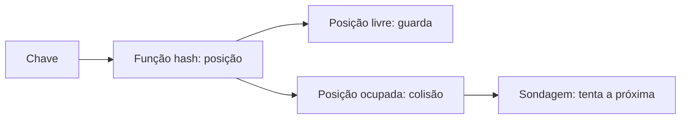

# 20 · Tabelas hash

**Tempo estimado:** 30 minutos · **Pré-requisito:** [[17 - Listas dinâmicas e listas ligadas]] e [[19 - Custo amortizado]].

**Ao final você vai conseguir:**

1. Explicar como uma tabela hash transforma uma chave em uma posição.
2. Entender o que é colisão, e como a sondagem linear resolve uma delas.
3. Usar dicionários do Python para busca por chave, e reconhecer quando a promessa de custo constante depende de suposições.

**Antes de começar:** no módulo 17 você viu que a lista exige percorrer elementos para achar um valor. Uma tabela hash busca direto pela chave.

---

## Para começar

Um estoque tem milhares de produtos. Procurar um produto pelo nome, olhando um a um, é lento. Uma tabela hash calcula, a partir do nome, a posição onde o produto deve estar. Em média, a busca toma pouco tempo, independente do tamanho do estoque. Mas há um caso em que tudo se acumula numa posição só.

---

## Mapa do módulo



*Figura 1: a chave vira posição. Se a posição está ocupada, a colisão exige uma estratégia, como a sondagem linear.*

**Como ler:** o caminho da chave até a posição passa pela função hash. A colisão é o caso em que a posição já está ocupada.

---

## Mini-aula 1: chave e posição

> [!tip] Ideia
> Uma tabela hash guarda chaves em posições de um vetor, calculadas por uma função a partir da chave. Assim a busca não precisa percorrer tudo.

> [!info] Definição
> Uma **tabela hash** (hash table) é uma tabela de símbolos que guarda chaves em um vetor, com a posição dada por uma função hash. O **fator de carga** (load factor) `α = N / M` é o número de chaves `N` dividido pelo tamanho `M` da tabela.

Em Python, o `dict` é uma tabela hash. Antes de rodar, pense: a busca `"caneta" in estoque` precisa percorrer o dicionário inteiro?

```python
estoque = {}
estoque["caneta"] = 10
estoque["lapis"] = 4
print("caneta" in estoque, estoque["lapis"])
```

Saída real:

```
True 4
```

**Como ler:** `"caneta" in estoque` e `estoque["lapis"]` buscam pela chave. A biblioteca registra custo médio constante para essas operações.

> [!warning] Armadilha comum
> O custo constante é médio. A biblioteca diz que, quando todas as chaves caem na mesma posição, cada operação passa a custar `O(n)`. A média depende de a função hash espalhar bem as chaves.

> [!question]- Checkpoint
> 1. Um dicionário com 1000 chaves precisa percorrer 1000 entradas para achar uma chave, em média?
> 2. Quando a busca vira linear?
>
> > [!success]- Resposta
> > 1. Não, em média. A busca é por posição calculada, com custo médio constante.
> > 2. Quando todas as chaves colidem na mesma posição.

---

## Mini-aula 2: colisão e sondagem linear

> [!tip] Ideia
> Duas chaves podem cair na mesma posição. A sondagem linear tenta a posição seguinte, até achar uma livre.

> [!info] Definição
> Uma **colisão** (collision) acontece quando a posição calculada para uma chave já está ocupada. Na **sondagem linear** (linear probing), a inserção tenta as posições seguintes, dando a volta quando passa do fim. A biblioteca registra fórmulas para o número médio de sondagens, com o fator de carga `α < 1`.

Veja a sondagem com uma tabela de 5 posições e as chaves 1, 6 e 11. Antes de rodar, pense: onde cada chave cai?

```python
M = 5
tabela = [None] * M
for k in [1, 6, 11]:
    i = k % M
    while tabela[i] is not None:
        i = (i + 1) % M
    tabela[i] = k
print(tabela)
```

Saída real:

```
[None, 1, 6, 11, None]
```

**Como ler:** `1 % 5 = 1`, então o 1 vai para a posição 1. O 6 também dá posição 1, ocupada; então vai para a 2. O 11 dá posição 1, ocupada, depois 2, ocupada, e vai para a 3.

> [!warning] Armadilha comum
> A sondagem linear só funciona se a tabela tiver espaço livre. A biblioteca exige `α < 1` para a sondagem linear, pois sem posição vazia a inserção não termina.

> [!question]- Checkpoint
> 1. Com `M = 5`, em qual posição cai a chave 7?
> 2. Se a tabela tem 5 posições e 5 chaves, a sondagem linear termina?
>
> > [!success]- Resposta
> > 1. Em `7 % 5 = 2`.
> > 2. Não garantidamente: com a tabela cheia, não há posição livre para a última chave.

---

## Mini-aula 3: quando a promessa vale

> [!tip] Ideia
> O custo constante médio supõe que as chaves se espalham uniformemente. Sem isso, a tabela degenera.

> [!info] Definição
> A biblioteca registra a suposição de **hashing uniforme**: cada chave tem a mesma chance de cair em qualquer posição, independentemente das outras. Sob essa suposição, a busca com encadeamento custa proporcional a `N / M`.

Como ler: a suposição é o que faz a média valer. Chaves que sempre colidem, ou um padrão previsível, quebram a promessa e levam ao caso linear.

> [!warning] Armadilha comum
> A função hash não é tratada pela biblioteca. Quais funções espalham bem não é um assunto coberto no material, e este módulo não o ensina.

> [!question]- Checkpoint
> 1. Com `α = 1/2`, quantas sondagens em média, segundo as fórmulas da biblioteca, para achar uma chave?
> 2. O que acontece com `α` se a tabela enche?
>
> > [!success]- Resposta
> > 1. Cerca de 1.5 sondagens para achar, pela fórmula de sondagem linear da biblioteca.
> > 2. `α` cresce, e as sondagens aumentam; com `α` próximo de 1, a busca fica lenta.

---

## Exercícios

Cada exercício tem um bloco com a função a completar e os testes com `assert`. Quando todos passarem, aparece `Passou!`.

### Aquecimento

**A1. Contar palavras.** Complete `contagem_palavras(palavras)`, que devolve um dicionário `{palavra: quantas vezes aparece}`. Use o dicionário como tabela de busca: consulte e atualize em tempo médio constante.

```python
def contagem_palavras(palavras):
    """Devolve um dicionário com quantas vezes cada palavra aparece."""
    ...

assert contagem_palavras(["a", "b", "a"]) == {"a": 2, "b": 1}, "a aparece duas vezes"
assert contagem_palavras([]) == {}, "lista vazia"
assert contagem_palavras(["x"]) == {"x": 1}, "uma palavra"
print("Passou!")
```

> [!hint]- Dica 1
> Comece com `contagem = {}`. Para cada palavra, se ela ainda não está no dicionário, comece com 0.

> [!hint]- Dica 2
> Use `contagem[p] = contagem.get(p, 0) + 1`, que já trata a primeira ocorrência.

> [!example]- Solução
> ```python
> def contagem_palavras(palavras):
>     """Devolve um dicionário com quantas vezes cada palavra aparece."""
>     contagem = {}
>     for p in palavras:
>         contagem[p] = contagem.get(p, 0) + 1
>     return contagem
> ```
>
> **Erro comum:** Ler `contagem[p]` sem checar se a chave existe. Com a primeira ocorrência, o Python levanta `KeyError`.

**A2. Tudo em estoque.** Complete `todos_no_estoque(pedidos, estoque)`, que devolve `True` se cada item de `pedidos` é uma chave do dicionário `estoque`. Use a busca por chave, que é a operação de tabela hash.

```python
def todos_no_estoque(pedidos, estoque):
    """Devolve True se cada item de pedidos é uma chave de estoque."""
    ...

assert todos_no_estoque(["caneta", "lapis"], {"caneta": 10, "lapis": 4}) == True, "os dois estão no estoque"
assert todos_no_estoque(["caneta", "regua"], {"caneta": 10, "lapis": 4}) == False, "régua não está"
assert todos_no_estoque([], {}) == True, "pedido vazio"
print("Passou!")
```

> [!hint]- Dica 1
> Percorra `pedidos`. Para cada item, teste `item in estoque`.

> [!hint]- Dica 2
> Se algum item não está, `return False`. Ao fim do laço, `return True`.

> [!example]- Solução
> ```python
> def todos_no_estoque(pedidos, estoque):
>     """Devolve True se cada item de pedidos é uma chave de estoque."""
>     for item in pedidos:
>         if item not in estoque:
>             return False
>     return True
> ```
>
> **Erro comum:** Testar `item in estoque.values()`. Isso procura entre as quantidades, e não entre os nomes dos produtos.

**A3. Sondagem linear.** Uma tabela tem `M` posições, e a posição inicial de uma chave `k` é `k % M`. Se a posição está ocupada, a sondagem linear tenta a seguinte, depois a seguinte, e assim por diante, dando a volta. Complete `sondagem_linear(M, chaves)`, que devolve a tabela (lista de `M` posições, com `None` nas vazias) depois de inserir as chaves em ordem.

```python
def sondagem_linear(M, chaves):
    """Insere as chaves numa tabela de M posições, com sondagem linear."""
    ...

assert sondagem_linear(5, [1, 6, 11]) == [None, 1, 6, 11, None], "6 e 11 caem nas posições seguintes"
assert sondagem_linear(5, [0]) == [0, None, None, None, None], "uma chave na posição 0"
assert sondagem_linear(5, [0, 5]) == [0, 5, None, None, None], "5 também cai na posição 0, e avança"
print("Passou!")
```

> [!hint]- Dica 1
> Comece com `tabela = [None] * M`. Para cada chave, `i = k % M`.

> [!hint]- Dica 2
> Enquanto `tabela[i]` não é `None`, avance com `i = (i + 1) % M`. Depois, `tabela[i] = k`.

> [!example]- Solução
> ```python
> def sondagem_linear(M, chaves):
>     """Insere as chaves numa tabela de M posições, com sondagem linear."""
>     tabela = [None] * M
>     for k in chaves:
>         i = k % M
>         while tabela[i] is not None:
>             i = (i + 1) % M
>         tabela[i] = k
>     return tabela
> ```
>
> **Erro comum:** Não dar a volta com `% M`. Ao chegar ao fim da tabela, o índice passa do limite.

### Praticando

**P1. Buscar na tabela.** Complete `busca_sondagem(tabela, chave)`, que devolve a posição de `chave` na tabela, ou `-1` se não está. Comece em `chave % M` e siga a sondagem linear. Pare ao encontrar a chave, ou ao encontrar uma posição vazia (`None`), que prova que a chave não está.

```python
def busca_sondagem(tabela, chave):
    """Devolve a posição de chave com sondagem linear, ou -1 se não está."""
    ...

tabela = [None, 1, 6, 11, None]
assert busca_sondagem(tabela, 11) == 3, "11 está depois de 1 e 6"
assert busca_sondagem(tabela, 6) == 2, "6 está na posição 2"
assert busca_sondagem(tabela, 4) == -1, "a posição 4 está vazia"
print("Passou!")
```

> [!hint]- Dica 1
> Use `M = len(tabela)` e `i = chave % M`. Repita `M` vezes, no máximo.

> [!hint]- Dica 2
> Em cada passo: se `tabela[i] is None`, `return -1`; se `tabela[i] == chave`, `return i`; senão, `i = (i + 1) % M`.

> [!example]- Solução
> ```python
> def busca_sondagem(tabela, chave):
>     """Devolve a posição de chave com sondagem linear, ou -1 se não está."""
>     M = len(tabela)
>     i = chave % M
>     for _ in range(M):
>         if tabela[i] is None:
>             return -1
>         if tabela[i] == chave:
>             return i
>         i = (i + 1) % M
>     return -1
> ```
>
> **Erro comum:** Continuar a busca depois de uma posição vazia. Isso faz a busca rodar sem necessidade e pode achar valores que não deveriam estar ali.

**P2. Inverter um dicionário.** Complete `inverte(d)`, que devolve um dicionário em que cada valor de `d` vira chave, e cada chave vira valor. Suponha que os valores são todos diferentes.

```python
def inverte(d):
    """Devolve o dicionário com chaves e valores trocados (valores distintos)."""
    ...

assert inverte({"a": 1, "b": 2}) == {1: "a", 2: "b"}, "troca chaves e valores"
assert inverte({}) == {}, "dicionário vazio"
print("Passou!")
```

> [!hint]- Dica 1
> Crie `resultado = {}` e percorra os pares com `for k, v in d.items():`.

> [!hint]- Dica 2
> Em cada passo, `resultado[v] = k`.

> [!example]- Solução
> ```python
> def inverte(d):
>     """Devolve o dicionário com chaves e valores trocados (valores distintos)."""
>     resultado = {}
>     for k, v in d.items():
>         resultado[v] = k
>     return resultado
> ```
>
> **Erro comum:** Trocar a ordem ao gravar: `resultado[k] = v` devolve o dicionário original, não o invertido.

**P3. Agrupar por letra.** Complete `agrupa_por_inicial(palavras)`, que devolve um dicionário em que cada chave é a primeira letra de algumas palavras, e o valor é a lista dessas palavras, na ordem em que aparecem.

```python
def agrupa_por_inicial(palavras):
    """Agrupa as palavras pela primeira letra, na ordem em que aparecem."""
    ...

assert agrupa_por_inicial(["ana", "bia", "alan"]) == {"a": ["ana", "alan"], "b": ["bia"]}, "a e b"
assert agrupa_por_inicial([]) == {}, "lista vazia"
print("Passou!")
```

> [!hint]- Dica 1
> Para cada `p`, use a letra `p[0]`. Se ela ainda não é chave, crie uma lista vazia com `setdefault`.

> [!hint]- Dica 2
> Use `grupos.setdefault(p[0], []).append(p)`.

> [!example]- Solução
> ```python
> def agrupa_por_inicial(palavras):
>     """Agrupa as palavras pela primeira letra, na ordem em que aparecem."""
>     grupos = {}
>     for p in palavras:
>         grupos.setdefault(p[0], []).append(p)
>     return grupos
> ```
>
> **Erro comum:** Substituir a lista a cada palavra, em vez de acrescentar. Só a última palavra de cada letra ficaria.

### Desafio

**D1. Contar colisões.** Complete `colisoes(M, chaves)`, que insere as chaves numa tabela de `M` posições com sondagem linear e devolve quantas vezes uma posição já ocupada foi encontrada no caminho. Cada posição ocupada que a inserção precisa pular conta como uma colisão.

```python
def colisoes(M, chaves):
    """Conta quantas posições ocupadas foram puladas na sondagem linear das inserções."""
    ...

assert colisoes(5, [1, 6, 11]) == 3, "6 pula 1; 11 pula 1 e 6"
assert colisoes(5, [0]) == 0, "sem colisão"
assert colisoes(5, [0, 5]) == 1, "5 cai na posição 0, ocupada, e pula uma vez"
print("Passou!")
```

> [!hint]- Dica 1
> Use a mesma lógica de `sondagem_linear`, com um contador `c = 0`.

> [!hint]- Dica 2
> Cada vez que `tabela[i]` não é `None` dentro do `while`, some 1 em `c`.

> [!example]- Solução
> ```python
> def colisoes(M, chaves):
>     """Conta quantas posições ocupadas foram puladas na sondagem linear das inserções."""
>     tabela = [None] * M
>     c = 0
>     for k in chaves:
>         i = k % M
>         while tabela[i] is not None:
>             c += 1
>             i = (i + 1) % M
>         tabela[i] = k
>     return c
> ```
>
> **Erro comum:** Contar só a primeira colisão de cada chave. Cada posição ocupada pulada conta, não só a primeira.


---

## Mini-projeto (opcional)

Um mini-projeto com contagem de palavras, e um desempate alfabético. Tente sozinho antes de abrir a solução.

**Objetivo.** Devolva o par `(palavra, quantidade)` da palavra que mais aparece. Em caso de empate, devolva a palavra que vem primeiro em ordem alfabética. A função `contagem_palavras`, do exercício A1, já está pronta.

```python
def contagem_palavras(palavras):
    # já pronta, do exercício A1
    contagem = {}
    for p in palavras:
        contagem[p] = contagem.get(p, 0) + 1
    return contagem

def mais_frequente(palavras):
    """Devolve (palavra, quantidade) da mais frequente; em empate, a primeira em ordem alfabética."""
    ...

assert mais_frequente(["a", "b", "a"]) == ("a", 2), "a aparece duas vezes"
assert mais_frequente(["b", "a", "b", "a"]) == ("a", 2), "empate: a vem antes de b"
assert mais_frequente(["x"]) == ("x", 1), "uma palavra"
print("Passou!")
```

> [!hint]- Dica 1
> Calcule `contagem = contagem_palavras(palavras)`. Percorra as chaves em ordem com `sorted(contagem)`.

> [!hint]- Dica 2
> Troque a melhor só quando a contagem é estritamente maior. Assim, no empate, fica a primeira em ordem alfabética.

> [!example]- Solução
> ```python
> def mais_frequente(palavras):
>     """Devolve (palavra, quantidade) da mais frequente; em empate, a primeira em ordem alfabética."""
>     contagem = contagem_palavras(palavras)
>     melhor = None
>     for p in sorted(contagem):
>         if melhor is None or contagem[p] > contagem[melhor]:
>             melhor = p
>     return (melhor, contagem[melhor])
> ```
>
> **Erro comum:** Usar `>=` na troca. O empate seria resolvido pela última palavra, e não pela primeira em ordem alfabética.


---

## Fechando

**Resumo**

- Tabela hash: chave → posição, por uma função hash.
- Custo médio constante para busca, inserção e remoção, segundo a biblioteca.
- Colisão: posição já ocupada. Sondagem linear tenta a próxima.
- No pior caso, todas as chaves colidem e a operação vira linear.
- O fator de carga `α = N / M` precisa ser menor que 1 na sondagem linear.

**Glossário rápido**

- **Tabela hash** (hash table): tabela de símbolos com posição calculada pela chave.
- **Função hash** (hash function): calcula a posição a partir da chave.
- **Colisão** (collision): duas chaves na mesma posição.
- **Sondagem linear** (linear probing): tentar as posições seguintes.
- **Fator de carga** (load factor): `α = N / M`.

**Perguntas de revisão**

1. Por que `"caneta" in estoque` não percorre o dicionário inteiro?
2. Na tabela de 5 posições com as chaves 1, 6 e 11, onde cai o 11?
3. O que quebra a promessa de custo constante médio?

**E agora?** O próximo módulo é **Dividir e conquistar**. Ele mostra como um problema é quebrado em partes independentes, e como a recorrência de custo se escreve.

---

## Para ir mais fundo

- [[Hash Table]]
- [[Amortized Analysis]]
