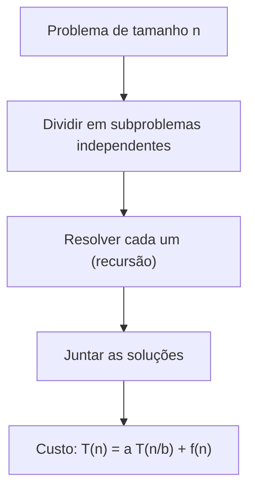

# 21 · Dividir e conquistar

**Tempo estimado:** 30 minutos · **Pré-requisito:** [[18 - Pilhas e filas]] e [[15 - Medindo algoritmos]].

**Ao final você vai conseguir:**

1. Explicar a ideia de dividir e conquistar: subproblemas independentes, resolvidos em separado.
2. Escrever o merge sort e a função que junta duas listas ordenadas.
3. Escrever a recorrência de custo do merge sort e calculá-la para valores pequenos.

**Antes de começar:** você já escreveu funções recursivas (módulo 08) e mediu custos (módulo 15). Aqui a recursão divide o problema, e a recorrência mede o custo.

---

## Para começar

Você tem 1000 notas de provas para colocar em ordem. Em vez de ordenar tudo de uma vez, você separa em duas pilhas de 500, ordena cada uma, e depois junta as duas. Cada pilha é um subproblema independente da outra. Esse é o método de dividir e conquistar, e o merge sort é a versão mais conhecida dele.

---

## Mapa do módulo



*Figura 1: dividir, resolver e juntar. A recorrência T(n) = aT(n/b) + f(n) descreve o custo de cada nível.*

**Como ler:** a recorrência do fim traduz o desenho de cima: `a` subproblemas, cada um de tamanho `n/b`, e `f(n)` para dividir e juntar.

---

## Mini-aula 1: a ideia

> [!tip] Ideia
> Divida o problema em partes que não se sobrepõem, resolva cada parte, e junte os resultados.

> [!info] Definição
> **Dividir e conquistar** (divide and conquer) quebra um problema em subproblemas não sobrepostos, resolvidos independentemente. A biblioteca cita o quicksort como exemplo. Já a programação dinâmica usa subproblemas que se sobrepõem, como vamos ver no módulo 29.

O merge sort segue a ideia: divide a lista ao meio, ordena cada metade pela mesma regra, e junta. Antes de rodar, preveja a divisão de `[5, 2, 4, 1]` e o resultado final.

```python
def divide(lista):
    meio = len(lista) // 2
    return (lista[:meio], lista[meio:])

def juntar(a, b):
    resultado = []
    i = j = 0
    while i < len(a) and j < len(b):
        if a[i] <= b[j]:
            resultado.append(a[i])
            i += 1
        else:
            resultado.append(b[j])
            j += 1
    resultado.extend(a[i:])
    resultado.extend(b[j:])
    return resultado

def merge_sort(lista):
    if len(lista) <= 1:
        return list(lista)
    esq, dir = divide(lista)
    return juntar(merge_sort(esq), merge_sort(dir))

print(divide([5, 2, 4, 1]))
print(merge_sort([5, 2, 4, 1]))
```

Saída real:

```
([5, 2], [4, 1])
[1, 2, 4, 5]
```

**Como ler:** a primeira linha mostra a divisão ao meio. A segunda, a lista ordenada: a junção de duas metades já ordenadas dá a ordenação completa.

> [!warning] Armadilha comum
> Dividir sem caso base. A recursão precisa de uma condição de parada, como listas de um elemento, que já estão ordenadas.

> [!question]- Checkpoint
> 1. Por que as duas metades são subproblemas independentes?
> 2. Qual é o caso base do merge sort?
>
> > [!success]- Resposta
> > 1. Porque ordenar uma metade não depende de ordenar a outra; só a junção usa as duas.
> > 2. Uma lista de zero ou um elemento, que já está ordenada.

---

## Mini-aula 2: a recorrência do custo

> [!tip] Ideia
> O custo do merge sort é a soma do trabalho de dividir e juntar, mais o custo das duas metades. Isso gera uma recorrência.

> [!info] Definição
> Uma **recorrência** define o custo `T(n)` em termos de `T` de entradas menores. Para o merge sort, a biblioteca dá `T(n) = 2 T(n/2) + Θ(n)`: duas metades, e custo linear para juntar.

Para estudar a forma, use a recorrência exata `T(n) = 2 T(n/2) + n`, com `T(1) = 0`. Antes de rodar, calcule `T(4)` no papel.

Como ler: `T(2) = 2 · 0 + 2 = 2`, e `T(4) = 2 · 2 + 4 = 8`. O custo cresce com `n log n`: cada nível de divisão soma cerca de `n`.

> [!warning] Armadilha comum
> `Θ(n)` é uma forma de custo, não um número. Ao calcular a recorrência com código, você precisa escolher a constante, como fizemos com `+ n`.

> [!question]- Checkpoint
> 1. Quanto vale `T(8)` com a recorrência exata?
> 2. Quantos níveis de divisão há para `n = 8`?
>
> > [!success]- Resposta
> > 1. 24: `T(8) = 2 · 8 + 8 = 24`, pois `T(4) = 8`.
> > 2. Três, pois 8 → 4 → 2 → 1.

---

## Mini-aula 3: o teorema mestre

> [!tip] Ideia
> Para recorrências no formato `T(n) = a T(n/b) + f(n)`, o teorema mestre dá o crescimento sem contar nível por nível.

> [!info] Definição
> O **teorema mestre** (Master Theorem) compara `f(n)` com `n^d`, onde `d = log_b(a)`. A biblioteca registra o caso em que `f(n) = Θ(n^d)`: o custo é `Θ(n^d log n)`. O material não registra as condições dos outros dois casos.

Para o merge sort, `a = 2`, `b = 2` e `f(n) = Θ(n)`, então `d = 1`, e o custo é `Θ(n log n)`.

> [!warning] Armadilha comum
> Aplicar o teorema sem checar o caso. Este material registra apenas o caso que dá `n^d log n`; use o caso certo, e não um atalho que não foi conferido.

> [!question]- Checkpoint
> 1. Para `T(n) = 2 T(n/2) + n`, quanto vale `d`?
> 2. Qual é o crescimento resultante?
>
> > [!success]- Resposta
> > 1. `d = log_2(2) = 1`.
> > 2. `Θ(n log n)`.

---

## Exercícios

Cada exercício tem um bloco com a função a completar e os testes com `assert`. Quando todos passarem, aparece `Passou!`.

### Aquecimento

**A1. Juntar duas listas ordenadas.** Complete `juntar(a, b)`, que recebe duas listas já ordenadas e devolve uma nova lista ordenada com todos os elementos. Use dois índices, `i` e `j`, e vá escolhendo o menor dos dois elementos atuais.

```python
def juntar(a, b):
    """Junta duas listas ordenadas numa lista ordenada, por intercalação."""
    ...

assert juntar([1, 4], [2, 3]) == [1, 2, 3, 4], "intercalar as duas"
assert juntar([], [1]) == [1], "a primeira está vazia"
assert juntar([5], []) == [5], "a segunda está vazia"
print("Passou!")
```

> [!hint]- Dica 1
> Enquanto `i < len(a)` e `j < len(b)`, compare `a[i]` com `b[j]`, e adicione o menor à saída, avançando o índice dele.

> [!hint]- Dica 2
> Quando um dos índices passa do fim, adicione o restante da outra lista com `extend`.

> [!example]- Solução
> ```python
> def juntar(a, b):
>     """Junta duas listas ordenadas numa lista ordenada, por intercalação."""
>     resultado = []
>     i = j = 0
>     while i < len(a) and j < len(b):
>         if a[i] <= b[j]:
>             resultado.append(a[i])
>             i += 1
>         else:
>             resultado.append(b[j])
>             j += 1
>     resultado.extend(a[i:])
>     resultado.extend(b[j:])
>     return resultado
> ```
>
> **Erro comum:** Esquecer o restante de uma das listas. Por exemplo, com `[1, 2]` e `[3]`, o `2` ficaria de fora se o laço parasse cedo.

**A2. Dividir ao meio.** Complete `divide(lista)`, que devolve uma tupla `(esquerda, direita)` com a primeira metade e a segunda metade da lista. Em listas de tamanho ímpar, a esquerda fica com um elemento a menos.

```python
def divide(lista):
    """Devolve (esquerda, direita): as duas metades da lista."""
    ...

assert divide([1, 2, 3, 4]) == ([1, 2], [3, 4]), "metades iguais"
assert divide([1, 2, 3]) == ([1], [2, 3]), "a esquerda fica menor"
assert divide([]) == ([], []), "lista vazia"
print("Passou!")
```

> [!hint]- Dica 1
> Calcule `meio = len(lista) // 2`.

> [!hint]- Dica 2
> Use fatias: `lista[:meio]` e `lista[meio:]`.

> [!example]- Solução
> ```python
> def divide(lista):
>     """Devolve (esquerda, direita): as duas metades da lista."""
>     meio = len(lista) // 2
>     return (lista[:meio], lista[meio:])
> ```
>
> **Erro comum:** Usar `/` no lugar de `//`. O índice sairia como número real, e a fatia falharia.

**A3. Ordenação por mistura.** Complete `merge_sort(lista)`. Ela divide a lista ao meio, ordena cada metade chamando a si mesma, e junta as duas com `juntar`. As funções `divide` e `juntar` já estão prontas.

```python
def divide(lista):
    # já pronta, do exercício A2
    meio = len(lista) // 2
    return (lista[:meio], lista[meio:])

def juntar(a, b):
    # já pronta, do exercício A1
    resultado = []
    i = j = 0
    while i < len(a) and j < len(b):
        if a[i] <= b[j]:
            resultado.append(a[i])
            i += 1
        else:
            resultado.append(b[j])
            j += 1
    resultado.extend(a[i:])
    resultado.extend(b[j:])
    return resultado

def merge_sort(lista):
    """Ordena por mistura: divide ao meio, ordena cada metade e junta."""
    ...

assert merge_sort([5, 2, 4, 1]) == [1, 2, 4, 5], "lista embaralhada"
assert merge_sort([]) == [], "lista vazia"
assert merge_sort([3, 3, 1]) == [1, 3, 3], "com repetidos"
print("Passou!")
```

> [!hint]- Dica 1
> Caso base: se a lista tem 0 ou 1 elemento, devolva uma cópia dela: `list(lista)`.

> [!hint]- Dica 2
> Caso contrário, `esq, dir = divide(lista)` e devolva `juntar(merge_sort(esq), merge_sort(dir))`.

> [!example]- Solução
> ```python
> def merge_sort(lista):
>     """Ordena por mistura: divide ao meio, ordena cada metade e junta."""
>     if len(lista) <= 1:
>         return list(lista)
>     esq, dir = divide(lista)
>     return juntar(merge_sort(esq), merge_sort(dir))
> ```
>
> **Erro comum:** Esquecer o caso base. Com um elemento, `divide` devolve uma lista vazia de um lado, e a chamada nunca para.

### Praticando

**P1. Recorrência do custo.** Pela ideia de dividir e conquistar, o custo do merge sort satisfaz `T(n) = 2 T(n/2) + n`, com `T(1) = 0`. Complete `custo_recursivo(n)`, que calcula `T(n)` para `n` potência de 2, usando `n // 2`. Para `n ≤ 1`, devolva `0`.

```python
def custo_recursivo(n):
    """Calcula T(n) = 2 T(n/2) + n, com T(n) = 0 para n <= 1."""
    ...

assert custo_recursivo(2) == 2, "T(2) = 2 T(1) + 2 = 2"
assert custo_recursivo(4) == 8, "T(4) = 2 T(2) + 4 = 8"
assert custo_recursivo(8) == 24, "T(8) = 2 T(4) + 8 = 24"
print("Passou!")
```

> [!hint]- Dica 1
> Caso base: `if n <= 1: return 0`.

> [!hint]- Dica 2
> Caso contrário: `return 2 * custo_recursivo(n // 2) + n`.

> [!example]- Solução
> ```python
> def custo_recursivo(n):
>     """Calcula T(n) = 2 T(n/2) + n, com T(n) = 0 para n <= 1."""
>     if n <= 1:
>         return 0
>     return 2 * custo_recursivo(n // 2) + n
> ```
>
> **Erro comum:** Esquecer o termo `+ n`, que é o custo de dividir e juntar em cada nível.

**P2. Quantos níveis.** Quantas vezes se pode dividir `n` ao meio, com `//`, até chegar a 1? Essa é a altura da árvore de recursão do merge sort. Complete `altura_recursao(n)`.

```python
def altura_recursao(n):
    """Conta quantas divisões ao meio, com //, são necessárias para chegar a 1."""
    ...

assert altura_recursao(8) == 3, "8 → 4 → 2 → 1"
assert altura_recursao(1) == 0, "já é 1"
assert altura_recursao(10) == 3, "10 → 5 → 2 → 1"
print("Passou!")
```

> [!hint]- Dica 1
> Use `k = 0` e `while n > 1:`. Dentro, `n = n // 2` e `k += 1`.

> [!hint]- Dica 2
> Ao sair do laço, devolva `k`.

> [!example]- Solução
> ```python
> def altura_recursao(n):
>     """Conta quantas divisões ao meio, com //, são necessárias para chegar a 1."""
>     k = 0
>     while n > 1:
>         n = n // 2
>         k += 1
>     return k
> ```
>
> **Erro comum:** Dividir por 2 com `/`. O valor vira decimal e o laço não chega a 1.

**P3. Máximo por divisão.** Complete `max_dc(lista)`, que devolve o maior elemento de uma lista não vazia, dividindo ao meio. Caso base: um elemento. Passo: o maior entre o máximo da metade esquerda e o da direita. Use `divide`, já pronta.

```python
def divide(lista):
    # já pronta, do exercício A2
    meio = len(lista) // 2
    return (lista[:meio], lista[meio:])

def max_dc(lista):
    """Devolve o maior elemento de uma lista não vazia, por divisão ao meio."""
    ...

assert max_dc([3, 9, 2]) == 9, "o 9 está na metade direita"
assert max_dc([-1]) == -1, "um elemento"
assert max_dc([4, 4, 1, 4]) == 4, "com repetidos"
print("Passou!")
```

> [!hint]- Dica 1
> Caso base: `if len(lista) == 1: return lista[0]`.

> [!hint]- Dica 2
> Caso contrário, `esq, dir = divide(lista)`, calcule `a = max_dc(esq)` e `b = max_dc(dir)` e devolva o maior dos dois com `if`.

> [!example]- Solução
> ```python
> def max_dc(lista):
>     """Devolve o maior elemento de uma lista não vazia, por divisão ao meio."""
>     if len(lista) == 1:
>         return lista[0]
>     esq, dir = divide(lista)
>     a = max_dc(esq)
>     b = max_dc(dir)
>     if a > b:
>         return a
>     return b
> ```
>
> **Erro comum:** Chamar `max_dc` com a lista inteira, sem dividir. A recursão nunca encolhe.

### Desafio

**D1. Busca por divisão.** Complete `busca_dc(lista, alvo)`, a busca binária escrita como divisão e conquista: uma função interna `procura(lo, hi)` procura `alvo` entre os índices `lo` e `hi`, e chama a si mesma com uma das metades. Devolva o índice do alvo, ou `-1`.

```python
def busca_dc(lista, alvo):
    """Busca binária por divisão e conquista; devolve o índice de alvo ou -1."""
    ...

assert busca_dc([1, 3, 5, 7], 5) == 2, "o 5 está na posição 2"
assert busca_dc([1, 3, 5, 7], 4) == -1, "o 4 não está"
assert busca_dc([], 1) == -1, "lista vazia"
print("Passou!")
```

> [!hint]- Dica 1
> Se `lo > hi`, o intervalo está vazio: devolva `-1`.

> [!hint]- Dica 2
> Calcule `meio = (lo + hi) // 2`. Se `lista[meio] < alvo`, procure em `(meio + 1, hi)`; senão, procure em `(lo, meio - 1)`.

> [!example]- Solução
> ```python
> def busca_dc(lista, alvo):
>     """Busca binária por divisão e conquista; devolve o índice de alvo ou -1."""
>     def procura(lo, hi):
>         if lo > hi:
>             return -1
>         meio = (lo + hi) // 2
>         if lista[meio] == alvo:
>             return meio
>         if lista[meio] < alvo:
>             return procura(meio + 1, hi)
>         return procura(lo, meio - 1)
>     return procura(0, len(lista) - 1)
> ```
>
> **Erro comum:** Procurar em `(lo, meio)` no caso da esquerda. O meio já foi testado, então o intervalo deve sair dele.


---

## Mini-projeto (opcional)

Um mini-projeto com a mesma divisão: menor e maior valor, em uma única passagem recursiva. Tente sozinho antes de abrir a solução.

**Objetivo.** Devolva o par `(menor, maior)` de uma lista não vazia, por divisão e conquista: divida ao meio, calcule o par de cada metade e combine. Caso base: um elemento, e o par é `(x, x)`. A função `divide`, do exercício A2, já está pronta.

```python
def divide(lista):
    # já pronta, do exercício A2
    meio = len(lista) // 2
    return (lista[:meio], lista[meio:])

def min_e_max_dc(lista):
    """Devolve (menor, maior) por divisão e conquista."""
    ...

assert min_e_max_dc([3, 9, 2, 7]) == (2, 9), "menor 2, maior 9"
assert min_e_max_dc([5]) == (5, 5), "um elemento"
assert min_e_max_dc([-1, -8, -3]) == (-8, -1), "com negativos"
print("Passou!")
```

> [!hint]- Dica 1
> Caso base: `if len(lista) == 1: return (lista[0], lista[0])`.

> [!hint]- Dica 2
> Combine com `min` e `max`: `(min(m1, m2), max(M1, M2))`, onde `(m1, M1)` e `(m2, M2)` são os pares das metades.

> [!example]- Solução
> ```python
> def min_e_max_dc(lista):
>     """Devolve (menor, maior) por divisão e conquista."""
>     if len(lista) == 1:
>         return (lista[0], lista[0])
>     esq, dir = divide(lista)
>     m1, M1 = min_e_max_dc(esq)
>     m2, M2 = min_e_max_dc(dir)
>     return (min(m1, m2), max(M1, M2))
> ```
>
> **Erro comum:** Devolver o par da metade esquerda sem combinar com a direita. O menor ou o maior pode estar na outra metade.


---

## Fechando

**Resumo**

- Dividir e conquistar: subproblemas não sobrepostos, resolvidos em separado e juntados.
- Merge sort: divide ao meio, ordena cada metade, junta.
- Recorrência: `T(n) = a T(n/b) + f(n)`.
- O teorema mestre dá o crescimento; o material registra o caso `Θ(n^d log n)`.

**Glossário rápido**

- **Dividir e conquistar** (divide and conquer): dividir em subproblemas, resolver e juntar.
- **Recorrência** (recurrence): custo definido em termos de entradas menores.
- **Teorema mestre** (Master Theorem): fórmula de crescimento para recorrências do tipo `aT(n/b) + f(n)`.
- **Merge sort** (ordenação por mistura): ordenação por divisão e junção.

**Perguntas de revisão**

1. Por que o merge sort não repete trabalho entre os subproblemas?
2. Quanto vale `T(16)` com `T(n) = 2 T(n/2) + n`, e `T(1) = 0`?
3. Qual é a diferença entre dividir e conquistar e programação dinâmica?

**E agora?** O próximo módulo é **Árvores de busca**. Ele mostra como guardar chaves em uma árvore para buscar, inserir e percorrer em ordem.

---

## Para ir mais fundo

- [[Divide and Conquer and the Master Theorem]]
- [[Linear Recurrence Relations]]
