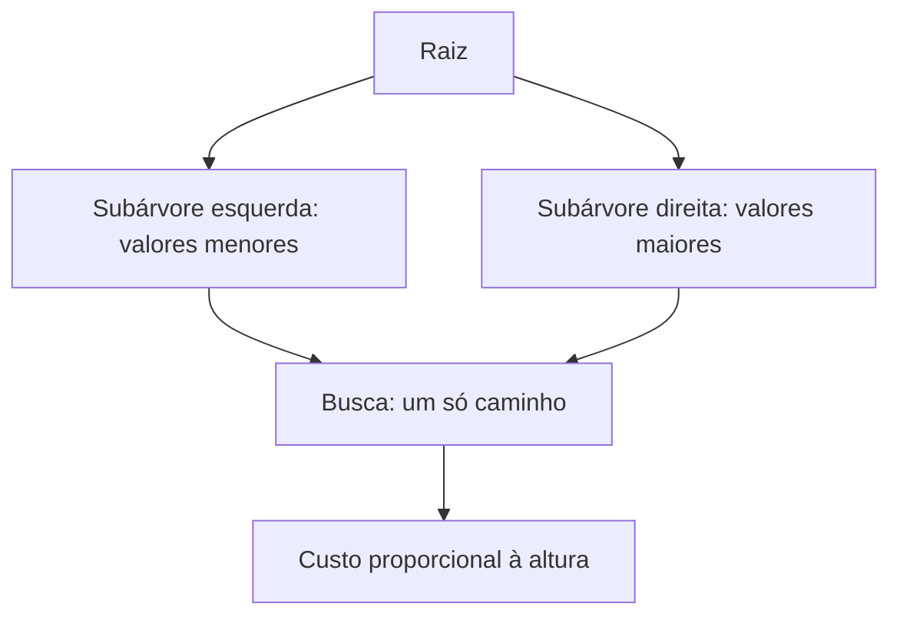

# 22 · Árvores de busca

**Tempo estimado:** 30 minutos · **Pré-requisito:** [[21 - Dividir e conquistar]] e [[20 - Tabelas hash]].

**Ao final você vai conseguir:**

1. Explicar a regra de uma árvore binária de busca e como buscar nela.
2. Percorrer a árvore em ordem e obter os valores ordenados.
3. Entender por que a altura decide o custo, e o que os balanceamentos garantem.

**Antes de começar:** no módulo 20 você buscou por chave em uma tabela hash. Aqui a busca segue um caminho na árvore, e a ordem das chaves é preservada.

---

## Para começar

Um catálogo de produtos precisa de buscas por nome e de listagem em ordem alfabética. A tabela hash acha um produto rápido, mas não lista em ordem. Uma árvore de busca faz as duas coisas: cada busca segue um caminho, e percorrê-la em ordem dá a lista ordenada.

---

## Mapa do módulo



*Figura 1: a regra de ordem separa as subárvores. A busca segue um único caminho, e o custo depende da altura.*

**Como ler:** cada nó divide a busca em um lado. Por isso o caminho até uma chave tem o tamanho da altura.

---

## Mini-aula 1: a regra da árvore de busca

> [!tip] Ideia
> Em cada nó, os valores menores ficam à esquerda e os maiores à direita. Assim, cada comparação elimina uma subárvore.

> [!info] Definição
> Uma **árvore binária de busca** (binary search tree, BST) é uma árvore binária em que a chave de cada nó é maior que todas as chaves da subárvore esquerda e menor que todas as da direita.

Aqui a árvore é representada por tuplas `(valor, esquerda, direita)`. Antes de rodar, desenhe a árvore que surge ao inserir `5, 3, 8, 1, 4`.

```python
def inserir(arv, v):
    if arv is None:
        return (v, None, None)
    val, esq, dir = arv
    if v < val:
        return (val, inserir(esq, v), dir)
    if v > val:
        return (val, esq, inserir(dir, v))
    return arv

def em_ordem(arv):
    if arv is None:
        return []
    val, esq, dir = arv
    return em_ordem(esq) + [val] + em_ordem(dir)

arv = None
for v in [5, 3, 8, 1, 4]:
    arv = inserir(arv, v)
print(em_ordem(arv))
```

Saída real:

```
[1, 3, 4, 5, 8]
```

**Como ler:** o percurso em ordem visita a esquerda, depois a raiz, depois a direita. Por isso a saída está ordenada, mesmo com a inserção desordenada.

> [!warning] Armadilha comum
> Uma árvore pode ser binária sem ser de busca. A regra das chaves é o que a torna de busca.

> [!question]- Checkpoint
> 1. Na árvore com raiz 5, onde fica o 7?
> 2. O percurso em ordem sempre devolve a lista ordenada?
>
> > [!success]- Resposta
> > 1. À direita do 5, porque 7 é maior.
> > 2. Sim, se a árvore segue a regra de busca.

---

## Mini-aula 2: altura e custo

> [!tip] Ideia
> A busca anda de um nó a outro até achar o valor. O número de passos é, no máximo, a altura da árvore.

> [!info] Definição
> A **altura** (height) é o comprimento do caminho mais longo da raiz até uma folha. A biblioteca registra que o custo de busca, inserção e remoção é proporcional à altura, e que para chaves aleatórias a busca faz cerca de `2 ln N` comparações.

Veja a mesma construção com chaves em ordem crescente. Antes de rodar, preveja a altura da árvore com 5 chaves.

```python
def inserir(arv, v):
    if arv is None:
        return (v, None, None)
    val, esq, dir = arv
    if v < val:
        return (val, inserir(esq, v), dir)
    if v > val:
        return (val, esq, inserir(dir, v))
    return arv

def altura(arv):
    if arv is None:
        return 0
    val, esq, dir = arv
    return 1 + max(altura(esq), altura(dir))

arv = None
for v in [1, 2, 3, 4, 5]:
    arv = inserir(arv, v)
print(altura(arv))
```

Saída real:

```
5
```

**Como ler:** cada chave nova vai para a direita da anterior. A árvore vira uma cadeia, e a altura é igual ao número de chaves.

> [!warning] Armadilha comum
> Inserir em ordem crescente degenera a árvore. A biblioteca registra o comportamento para chaves aleatórias; o caso ordenado é consequência direta da definição de altura.

> [!question]- Checkpoint
> 1. Com chaves `1, 2, 3, 4` inseridas nessa ordem, qual é a altura?
> 2. Com a altura igual ao número de chaves, a busca é proporcional a quê?
>
> > [!success]- Resposta
> > 1. Altura 4: a árvore é uma cadeia de quatro nós.
> > 2. Ao número de chaves, como em uma lista.

---

## Mini-aula 3: balanceamento

> [!tip] Ideia
> Árvores balanceadas evitam a cadeia: mantêm a altura pequena, mesmo com inserções em qualquer ordem.

> [!info] Definição
> Uma **árvore 2-3** (2-3 tree) é perfeitamente balanceada: busca e inserção visitam no máximo `lg N` nós. A **árvore rubro-negra** (red-black BST) implementa a 2-3 com ligações vermelhas, e garante altura de no máximo `2 lg N`.

Como ler: `lg N` é o logaritmo na base 2. Para `N = 8`, `lg N = 3`, e a árvore rubro-negra tem altura até `6`.

> [!warning] Armadilha comum
> O material não cobre as árvores AVL, nem as rotações e divisões de nós que mantêm o balanceamento. Para este curso, guarde o limite de altura.

> [!question]- Checkpoint
> 1. Quantos nós uma busca numa 2-3 com 8 chaves visita, no máximo?
> 2. Qual é o limite de altura de uma rubro-negra com 8 chaves?
>
> > [!success]- Resposta
> > 1. 3, porque `lg 8 = 3`.
> > 2. 6, porque `2 lg 8 = 6`.

---

## Exercícios

Cada exercício tem um bloco com a função a completar e os testes com `assert`. As árvores são tuplas `(valor, esquerda, direita)`, com `None` para vazio. Quando todos passarem, aparece `Passou!`.

### Aquecimento

**A1. Inserir na árvore.** Uma árvore de busca é representada por tuplas `(valor, esquerda, direita)`, com `None` para árvore vazia. Complete `inserir(arv, v)`, que devolve uma nova árvore com `v` no lugar certo: à esquerda se `v` é menor que a raiz, à direita se é maior. Se `v` já existe, devolva a árvore sem mudança.

```python
def inserir(arv, v):
    """Devolve a árvore com v inserido na posição certa; se v já existe, nada muda."""
    ...

assert inserir(None, 5) == (5, None, None), "árvore vazia"
assert inserir(inserir(None, 5), 3) == (5, (3, None, None), None), "3 vai à esquerda do 5"
assert inserir(inserir(None, 5), 5) == (5, None, None), "repetido não entra"
print("Passou!")
```

> [!hint]- Dica 1
> Se `arv is None`, a nova árvore é `(v, None, None)`.

> [!hint]- Dica 2
> Desmonte a tupla com `val, esq, dir = arv`. Insira na subárvore certa e monte a tupla de novo.

> [!example]- Solução
> ```python
> def inserir(arv, v):
>     """Devolve a árvore com v inserido na posição certa; se v já existe, nada muda."""
>     if arv is None:
>         return (v, None, None)
>     val, esq, dir = arv
>     if v < val:
>         return (val, inserir(esq, v), dir)
>     if v > val:
>         return (val, esq, inserir(dir, v))
>     return arv
> ```
>
> **Erro comum:** Modificar a tupla no lugar. Tuplas não mudam; a função precisa devolver uma nova.

**A2. Buscar na árvore.** Complete `contem(arv, v)`, que devolve `True` se `v` está na árvore. Em cada nó, vá para a esquerda se `v` é menor que o valor do nó, e para a direita se é maior.

```python
def contem(arv, v):
    """Devolve True se v está na árvore de busca."""
    ...

arv = (5, (3, (1, None, None), (4, None, None)), (8, None, None))
assert contem(arv, 4) == True, "4 está à direita do 3"
assert contem(arv, 7) == False, "7 não está na árvore"
assert contem(None, 1) == False, "árvore vazia"
print("Passou!")
```

> [!hint]- Dica 1
> Se `arv is None`, `v` não está: devolva `False`.

> [!hint]- Dica 2
> Compare `v` com `val`. Se for igual, `True`; se for menor, procure em `esq`; senão, em `dir`.

> [!example]- Solução
> ```python
> def contem(arv, v):
>     """Devolve True se v está na árvore de busca."""
>     if arv is None:
>         return False
>     val, esq, dir = arv
>     if v == val:
>         return True
>     if v < val:
>         return contem(esq, v)
>     return contem(dir, v)
> ```
>
> **Erro comum:** Procurar nos dois lados. Em uma árvore de busca, só um lado pode conter o valor, e a busca segue um único caminho.

**A3. Percorrer em ordem.** Complete `em_ordem(arv)`, que devolve a lista dos valores em ordem crescente: primeiro a subárvore esquerda, depois a raiz, depois a direita.

```python
def em_ordem(arv):
    """Devolve os valores da árvore em ordem crescente."""
    ...

assert em_ordem((5, (3, None, None), (8, None, None))) == [3, 5, 8], "três valores"
assert em_ordem(None) == [], "árvore vazia"
assert em_ordem((2, (1, None, None), (4, (3, None, None), None))) == [1, 2, 3, 4], "com subárvores"
print("Passou!")
```

> [!hint]- Dica 1
> Se `arv is None`, a lista é vazia.

> [!hint]- Dica 2
> Caso contrário, devolva `em_ordem(esq) + [val] + em_ordem(dir)`.

> [!example]- Solução
> ```python
> def em_ordem(arv):
>     """Devolve os valores da árvore em ordem crescente."""
>     if arv is None:
>         return []
>     val, esq, dir = arv
>     return em_ordem(esq) + [val] + em_ordem(dir)
> ```
>
> **Erro comum:** Trocar a ordem para raiz, esquerda, direita. A lista sai fora de ordem, mesmo com a árvore certa.

### Praticando

**P1. Altura.** Complete `altura(arv)`, que devolve a altura da árvore: o número de nós no caminho mais longo da raiz até uma folha. Árvore vazia tem altura 0.

```python
def altura(arv):
    """Devolve a altura: o número de nós no caminho mais longo até uma folha."""
    ...

assert altura(None) == 0, "árvore vazia"
assert altura((5, None, None)) == 1, "uma folha"
assert altura((5, (3, (1, None, None), None), (8, None, None))) == 3, "o caminho 5, 3, 1"
print("Passou!")
```

> [!hint]- Dica 1
> Se `arv is None`, devolva `0`.

> [!hint]- Dica 2
> Caso contrário, `1 + max(altura(esq), altura(dir))`.

> [!example]- Solução
> ```python
> def altura(arv):
>     """Devolve a altura: o número de nós no caminho mais longo até uma folha."""
>     if arv is None:
>         return 0
>     val, esq, dir = arv
>     return 1 + max(altura(esq), altura(dir))
> ```
>
> **Erro comum:** Devolver `max` sem somar 1. Assim a folha teria altura 0, e a conta não bate com a definição.

**P2. Menor valor.** Complete `minimo(arv)`, que devolve o menor valor da árvore de busca, ou `None` se a árvore é vazia. O menor valor fica sempre o mais à esquerda.

```python
def minimo(arv):
    """Devolve o menor valor da árvore de busca, ou None se vazia."""
    ...

assert minimo(None) is None, "árvore vazia"
assert minimo((5, (3, None, None), (8, None, None))) == 3, "o 3 é o mais à esquerda"
assert minimo((5, (3, (1, None, None), None), None)) == 1, "o 1 é o mais à esquerda"
print("Passou!")
```

> [!hint]- Dica 1
> Se `arv is None`, devolva `None`.

> [!hint]- Dica 2
> Se `esq is None`, a raiz é a menor: devolva `val`. Senão, devolva `minimo(esq)`.

> [!example]- Solução
> ```python
> def minimo(arv):
>     """Devolve o menor valor da árvore de busca, ou None se vazia."""
>     if arv is None:
>         return None
>     val, esq, dir = arv
>     if esq is None:
>         return val
>     return minimo(esq)
> ```
>
> **Erro comum:** Procurar à direita. A direita tem sempre valores maiores que a raiz.

**P3. Construir a árvore.** Complete `constroi(lista)`, que cria uma árvore de busca inserindo os valores da lista, um a um, na ordem dada. As funções `inserir` e `altura` estão prontas: use-as para observar a forma.

```python
def inserir(arv, v):
    # já pronta, do exercício A1
    if arv is None:
        return (v, None, None)
    val, esq, dir = arv
    if v < val:
        return (val, inserir(esq, v), dir)
    if v > val:
        return (val, esq, inserir(dir, v))
    return arv

def em_ordem(arv):
    # já pronta, do exercício A3
    if arv is None:
        return []
    val, esq, dir = arv
    return em_ordem(esq) + [val] + em_ordem(dir)

def altura(arv):
    # já pronta, do exercício P1
    if arv is None:
        return 0
    val, esq, dir = arv
    return 1 + max(altura(esq), altura(dir))

def constroi(lista):
    """Cria uma árvore de busca inserindo os valores da lista em ordem."""
    ...

assert em_ordem(constroi([4, 2, 6])) == [2, 4, 6], "o percurso em ordem sai ordenado"
assert altura(constroi([4, 2, 6])) == 2, "raiz 4 com dois filhos"
assert altura(constroi([1, 2, 3, 4])) == 4, "em ordem crescente, a árvore vira uma cadeia"
print("Passou!")
```

> [!hint]- Dica 1
> Comece com `arv = None` e, para cada `x`, faça `arv = inserir(arv, x)`.

> [!hint]- Dica 2
> Devolva `arv` no fim.

> [!example]- Solução
> ```python
> def constroi(lista):
>     """Cria uma árvore de busca inserindo os valores da lista em ordem."""
>     arv = None
>     for x in lista:
>         arv = inserir(arv, x)
>     return arv
> ```
>
> **Erro comum:** Criar uma árvore nova a cada inserção, sem passar a anterior. Assim só o último valor fica guardado.

### Desafio

**D1. É árvore de busca?** Complete `e_bst(arv, lo=None, hi=None)`, que devolve `True` se a árvore respeita a regra de busca: todo valor em cada subárvore esquerda é menor que a raiz, e todo valor da direita é maior. Use `lo` e `hi` como limites que o valor de cada nó deve respeitar.

```python
def inserir(arv, v):
    # já pronta, do exercício A1
    if arv is None:
        return (v, None, None)
    val, esq, dir = arv
    if v < val:
        return (val, inserir(esq, v), dir)
    if v > val:
        return (val, esq, inserir(dir, v))
    return arv

def constroi(lista):
    # já pronta, do exercício P3
    arv = None
    for x in lista:
        arv = inserir(arv, x)
    return arv

def e_bst(arv, lo=None, hi=None):
    """Devolve True se a árvore respeita a regra de busca, dentro dos limites lo e hi."""
    ...

assert e_bst(constroi([5, 3, 8])) == True, "árvore criada por inserções"
assert e_bst((5, (7, None, None), None)) == False, "o 7 está à esquerda do 5"
assert e_bst((5, (3, None, (6, None, None)), None)) == False, "o 6 está na subárvore do 3, mas é maior que 5"
assert e_bst(None) == True, "árvore vazia"
print("Passou!")
```

> [!hint]- Dica 1
> Se `arv is None`, devolva `True`.

> [!hint]- Dica 2
> Se `lo` não é `None` e `val <= lo`, ou se `hi` não é `None` e `val >= hi`, devolva `False`.

> [!hint]- Dica 3
> Para os filhos, passe os novos limites: `e_bst(esq, lo, val) and e_bst(dir, val, hi)`.

> [!example]- Solução
> ```python
> def e_bst(arv, lo=None, hi=None):
>     """Devolve True se a árvore respeita a regra de busca, dentro dos limites lo e hi."""
>     if arv is None:
>         return True
>     val, esq, dir = arv
>     if lo is not None and val <= lo:
>         return False
>     if hi is not None and val >= hi:
>         return False
>     return e_bst(esq, lo, val) and e_bst(dir, val, hi)
> ```
>
> **Erro comum:** Verificar só os filhos imediatos. Um valor pode estar errado a dois níveis de distância, e só os limites pegam isso.


---

## Mini-projeto (opcional)

Um mini-projeto de contagem na árvore: quantas folhas ela tem. Tente sozinho antes de abrir a solução.

**Objetivo.** Conte as folhas da árvore: nós sem filhos. Uma árvore vazia não tem folhas. A função `inserir`, do exercício A1, já está pronta.

```python
def inserir(arv, v):
    # já pronta, do exercício A1
    if arv is None:
        return (v, None, None)
    val, esq, dir = arv
    if v < val:
        return (val, inserir(esq, v), dir)
    if v > val:
        return (val, esq, inserir(dir, v))
    return arv

def conta_folhas(arv):
    """Conta os nós sem filhos da árvore."""
    ...

assert conta_folhas(None) == 0, "árvore vazia"
assert conta_folhas((1, None, None)) == 1, "uma folha"
assert conta_folhas(inserir(inserir(inserir(None, 5), 3), 8)) == 2, "o 3 e o 8 são folhas"
print("Passou!")
```

> [!hint]- Dica 1
> Se `arv is None`, devolva `0`.

> [!hint]- Dica 2
> Se `esq is None and dir is None`, o nó é uma folha: devolva `1`. Senão, some as folhas das subárvores.

> [!example]- Solução
> ```python
> def conta_folhas(arv):
>     """Conta os nós sem filhos da árvore."""
>     if arv is None:
>         return 0
>     val, esq, dir = arv
>     if esq is None and dir is None:
>         return 1
>     return conta_folhas(esq) + conta_folhas(dir)
> ```
>
> **Erro comum:** Contar todos os nós, e não só as folhas. Um nó com um filho não é folha.


---

## Fechando

**Resumo**

- Árvore de busca: valores menores à esquerda, maiores à direita.
- Busca segue um caminho; o custo é proporcional à altura.
- Percurso em ordem devolve a lista ordenada.
- Inserções em ordem crescente degeneram a árvore.
- Árvores balanceadas (2-3, rubro-negra) mantêm a altura em `O(lg N)`.

**Glossário rápido**

- **Árvore binária de busca** (BST): árvore com a regra de ordem entre subárvores.
- **Altura** (height): comprimento do caminho mais longo até uma folha.
- **Folha** (leaf): nó sem filhos.
- **Árvore 2-3**: árvore perfeitamente balanceada.
- **Árvore rubro-negra** (red-black BST): implementação de 2-3 com ligações vermelhas.

**Perguntas de revisão**

1. Por que o percurso em ordem devolve os valores ordenados?
2. Quantas folhas tem a árvore construída com `5, 3, 8`?
3. Por que a busca em uma árvore degenerada é tão lenta quanto em uma lista?

**E agora?** O próximo módulo é **Heaps**. Ele guarda elementos com prioridade, em uma árvore mais simples que a de busca, e é a base de um tipo de ordenação.

---

## Para ir mais fundo

- [[Binary Search Tree]]
- [[Balanced Search Trees]]
