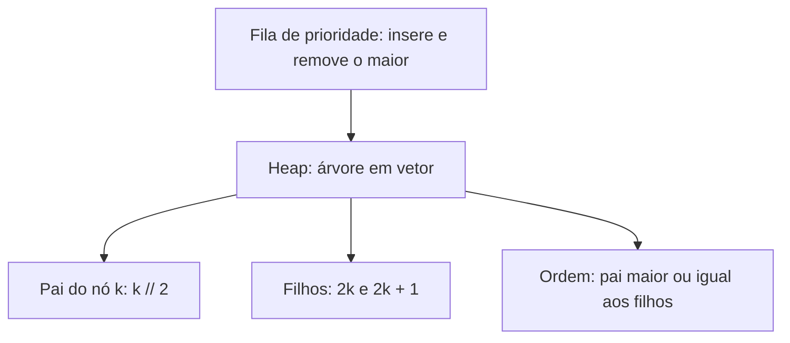

# 23 · Heaps e fila de prioridade

**Tempo estimado:** 30 minutos · **Pré-requisito:** [[22 - Árvores de busca]].

**Ao final você vai conseguir:**

1. Explicar o que é uma fila de prioridade e as duas operações que ela oferece.
2. Representar uma heap em um vetor, e calcular pais e filhos por índice.
3. Inserir e remover o maior elemento, e usar a heap para ordenar.

**Antes de começar:** no módulo 22 você viu árvores com regra entre pai e filhos. Uma heap tem uma regra mais simples, apenas de pai para filho, e isso facilita guardá-la num vetor.

---

## Para começar

Um hospital atende pacientes por gravidade, e não pela ordem de chegada. A cada momento, o próximo a ser atendido é o de maior prioridade. Uma fila comum não serve. Uma estrutura que insere e devolve o maior elemento rápido resolve, e é isso que a fila de prioridade faz.

---

## Mapa do módulo



*Figura 1: a fila de prioridade é uma operação. A heap é uma forma de implementá-la, com a ordem entre pai e filhos.*

**Como ler:** a heap é a implementação. As posições de pai e filhos são calculadas, e a ordem garante o maior na raiz.

---

## Mini-aula 1: fila de prioridade

> [!tip] Ideia
> Uma fila de prioridade guarda elementos e entrega sempre o maior. Ela não é uma fila: não segue a ordem de chegada.

> [!info] Definição
> Uma **fila de prioridade** (priority queue) é uma coleção com duas operações: inserir um elemento e remover o maior. Listas simples fazem uma dessas operações em tempo linear, no pior caso.

Antes da heap, a diferença já aparece nos exemplos de uso: o paciente mais grave sai primeiro, não o que chegou primeiro.

> [!warning] Armadilha comum
> Fila de prioridade não é fila FIFO. A regra de saída é o maior, e não o mais antigo.

> [!question]- Checkpoint
> 1. Em uma fila de prioridade, quem sai primeiro, o que entrou primeiro ou o maior?
> 2. A fila de atendimento do módulo 18 é uma fila de prioridade?
>
> > [!success]- Resposta
> > 1. O maior.
> > 2. Não. Aquela é FIFO, pela ordem de chegada.

---

## Mini-aula 2: heap no vetor

> [!tip] Ideia
> A heap é uma árvore completa guardada num vetor. Como as posições são calculadas, não é preciso guardar ponteiros.

> [!info] Definição
> Uma **heap ordenada** (heap-ordered tree) tem a chave de cada nó maior ou igual às chaves de seus dois filhos. No vetor a partir do índice 1, o pai de `k` está em `k // 2`, e os filhos em `2k` e `2k + 1`. A biblioteca registra essa disposição.

Veja as posições calculadas. Antes de rodar, preveja os índices dos filhos do nó 3.

```python
def pai(k):
    return k // 2

def filhos(k):
    return (2 * k, 2 * k + 1)

for k in (2, 3, 6):
    print(k, "pai", pai(k), "filhos", filhos(k))
```

Saída real:

```
2 pai 1 filhos (4, 5)
3 pai 1 filhos (6, 7)
6 pai 3 filhos (12, 13)
```

**Como ler:** o pai de 6 é 3, e os filhos de 3 são 6 e 7. Essas posições são fórmulas, e por isso não há ponteiros.

> [!warning] Armadilha comum
> Em vetores que começam em 0, as fórmulas mudam. Aqui o índice 0 não é usado, e o vetor começa em 1.

> [!question]- Checkpoint
> 1. Quais são os filhos do nó 2?
> 2. Qual é o pai do nó 5?
>
> > [!success]- Resposta
> > 1. Os nós 4 e 5.
> > 2. O nó 2, pois `5 // 2 = 2`.

---

## Mini-aula 3: subir, descer e custos

> [!tip] Ideia
> Depois de uma mudança, a heap é consertada subindo ou descendo o elemento até a ordem voltar.

> [!info] Definição
> **Nadar** (swim) sobe um nó trocando-o com o pai enquanto o pai é menor. **Afundar** (sink) desce um nó trocando-o com o maior filho enquanto ele é menor. A biblioteca registra: inserir usa no máximo `1 + lg n` comparações, remover o maior usa no máximo `2 lg n`, e a heapsort usa menos de `2 n lg n`.

Como ler: `lg n` cresce devagar. Por isso as operações são logarítmicas, mesmo com muitos elementos.

> [!warning] Armadilha comum
> A biblioteca dá limites superiores de comparações. O número real pode ser menor, e não é uma igualdade.

> [!question]- Checkpoint
> 1. Qual operação sobe o elemento recém-inserido?
> 2. Qual operação desce a raiz depois de uma remoção?
>
> > [!success]- Resposta
> > 1. Nadar, com a inserção.
> > 2. Afundar, com a remoção do maior.

---

## Exercícios

Cada exercício tem um bloco com a função a completar e os testes com `assert`. A heap é um vetor com o índice 0 não usado. Quando todos passarem, aparece `Passou!`.

### Aquecimento

**A1. Pai na heap.** Uma heap guarda os elementos num vetor a partir do índice 1 (o índice 0 não é usado). O pai do nó `k` está em `k // 2`. Complete `pai(k)`, que devolve esse índice.

```python
def pai(k):
    """Índice do pai do nó k, numa heap que começa em 1."""
    ...

assert pai(6) == 3, "o pai de 6 é 3"
assert pai(2) == 1, "o pai de 2 é a raiz"
assert pai(7) == 3, "o pai de 7 é 3"
print("Passou!")
```

> [!hint]- Dica 1
> Use a divisão inteira `//` por 2.

> [!hint]- Dica 2
> O pai de 6 é 3, e o pai de 2 é a raiz, 1.

> [!example]- Solução
> ```python
> def pai(k):
>     """Índice do pai do nó k, numa heap que começa em 1."""
>     return k // 2
> ```
>
> **Erro comum:** Usar `k - 1`, como em vetores que começam em 0. Aqui o vetor começa em 1.

**A2. Subir o elemento.** Complete `nadar(heap, k)`, que restaura a ordem da heap depois que o nó `k` ficou maior que o pai: enquanto `k > 1` e o pai é menor que o nó, troque os dois e suba para o pai. Devolva a heap alterada. O índice 0 da lista não é usado.

```python
def nadar(heap, k):
    """Sobe o nó k trocando com o pai enquanto o pai é menor. Devolve a heap."""
    ...

assert nadar([None, 5, 3, 9], 3) == [None, 9, 3, 5], "o 9 sobe para a raiz"
assert nadar([None, 5, 3, 1], 3) == [None, 5, 3, 1], "o 1 já está no lugar"
assert nadar([None, 2, 7, 1, 8], 4) == [None, 8, 2, 1, 7], "o 8 sobe duas vezes"
print("Passou!")
```

> [!hint]- Dica 1
> Use `while k > 1 and heap[k // 2] < heap[k]:`.

> [!hint]- Dica 2
> Dentro, troque `heap[k]` e `heap[k // 2]`, depois faça `k = k // 2`.

> [!example]- Solução
> ```python
> def nadar(heap, k):
>     """Sobe o nó k trocando com o pai enquanto o pai é menor. Devolve a heap."""
>     while k > 1 and heap[k // 2] < heap[k]:
>         heap[k], heap[k // 2] = heap[k // 2], heap[k]
>         k = k // 2
>     return heap
> ```
>
> **Erro comum:** Trocar com `<=` no lugar de `<`. Com valores iguais, a troca acontece à toa, e o laço nunca para em alguns casos.

**A3. Descer o elemento.** Complete `afundar(heap, n, k)`, que restaura a ordem da heap depois que o nó `k` ficou menor que um filho. Os elementos válidos vão de 1 a `n`. Enquanto `k` tem filhos, troque `k` com o maior filho, se ele é maior que `k`. Devolva a heap alterada.

```python
def afundar(heap, n, k):
    """Desce o nó k trocando com o maior filho enquanto ele for menor. Devolve a heap."""
    ...

assert afundar([None, 1, 9, 4], 3, 1) == [None, 9, 1, 4], "o 9 sobe e o 1 desce"
assert afundar([None, 9, 5, 7], 3, 1) == [None, 9, 5, 7], "já está em ordem"
assert afundar([None, 1, 2], 2, 1) == [None, 2, 1], "um só filho"
print("Passou!")
```

> [!hint]- Dica 1
> Use `while 2 * k <= n:`. Escolha o filho `j = 2 * k`, e troque para `j + 1` se `j < n` e `heap[j] < heap[j + 1]`.

> [!hint]- Dica 2
> Se `heap[k] >= heap[j]`, pare com `break`. Senão, troque `heap[k]` com `heap[j]` e faça `k = j`.

> [!example]- Solução
> ```python
> def afundar(heap, n, k):
>     """Desce o nó k trocando com o maior filho enquanto ele for menor. Devolve a heap."""
>     while 2 * k <= n:
>         j = 2 * k
>         if j < n and heap[j] < heap[j + 1]:
>             j += 1
>         if heap[k] >= heap[j]:
>             break
>         heap[k], heap[j] = heap[j], heap[k]
>         k = j
>     return heap
> ```
>
> **Erro comum:** Escolher o filho esquerdo sempre. A troca deve ser com o maior dos dois filhos, para manter a ordem.

### Praticando

**P1. Inserir na heap.** Complete `insere(heap, valor)`: adicione `valor` no fim do vetor e restaure a ordem subindo com `nadar`. A função `nadar` já está pronta. A heap começa como `[None]`.

```python
def nadar(heap, k):
    # já pronta, do exercício A2
    while k > 1 and heap[k // 2] < heap[k]:
        heap[k], heap[k // 2] = heap[k // 2], heap[k]
        k = k // 2
    return heap

def insere(heap, valor):
    """Adiciona valor no fim e sobe até a posição certa. Devolve a heap."""
    ...

h = [None]
insere(h, 5)
assert h == [None, 5], "primeiro elemento"
insere(h, 9)
assert h == [None, 9, 5], "o 9 subiu para a raiz"
insere(h, 7)
assert h == [None, 9, 5, 7], "o 7 fica no filho direito"
print("Passou!")
```

> [!hint]- Dica 1
> Use `heap.append(valor)`. A nova posição é `len(heap) - 1`.

> [!hint]- Dica 2
> Chame `nadar(heap, len(heap) - 1)` e devolva a heap.

> [!example]- Solução
> ```python
> def insere(heap, valor):
>     """Adiciona valor no fim e sobe até a posição certa. Devolve a heap."""
>     heap.append(valor)
>     return nadar(heap, len(heap) - 1)
> ```
>
> **Erro comum:** Usar `len(heap)` como índice do novo nó. Ele é o último, de índice `len(heap) - 1`.

**P2. Remover o maior.** Complete `remove_max(heap)`, que remove e devolve o maior valor, que está na raiz (posição 1). Para restaurar a ordem: copie o último elemento para a raiz, retire o último da lista e desça a raiz com `afundar`. A função `afundar` já está pronta. Se a heap está vazia, devolva `None`.

```python
def afundar(heap, n, k):
    # já pronta, do exercício A3
    while 2 * k <= n:
        j = 2 * k
        if j < n and heap[j] < heap[j + 1]:
            j += 1
        if heap[k] >= heap[j]:
            break
        heap[k], heap[j] = heap[j], heap[k]
        k = j
    return heap

def remove_max(heap):
    """Remove e devolve o maior valor da heap, ou None se vazia."""
    ...

h = [None, 9, 5, 7]
assert remove_max(h) == 9, "o maior é 9"
assert h == [None, 7, 5], "o último (7) foi para a raiz e desceu"
assert remove_max([None]) is None, "heap vazia"
print("Passou!")
```

> [!hint]- Dica 1
> Use `n = len(heap) - 1`. Se `n == 0`, `return None`.

> [!hint]- Dica 2
> Guarde `top = heap[1]`, faça `heap[1] = heap[n]` e `heap.pop()`. Depois, `afundar(heap, len(heap) - 1, 1)`.

> [!example]- Solução
> ```python
> def remove_max(heap):
>     """Remove e devolve o maior valor da heap, ou None se vazia."""
>     n = len(heap) - 1
>     if n == 0:
>         return None
>     top = heap[1]
>     heap[1] = heap[n]
>     heap.pop()
>     afundar(heap, len(heap) - 1, 1)
>     return top
> ```
>
> **Erro comum:** Esquecer de guardar `top` antes de substituir a raiz. O valor máximo se perde.

**P3. Ordenar com heap.** Complete `heapsort(lista)`: insira todos os valores na heap, depois remova o maior repetidamente. Como os maiores saem primeiro, devolva a lista em ordem crescente. As funções `insere` e `remove_max` já estão prontas.

```python
def nadar(heap, k):
    # já pronta, do exercício A2
    while k > 1 and heap[k // 2] < heap[k]:
        heap[k], heap[k // 2] = heap[k // 2], heap[k]
        k = k // 2
    return heap

def insere(heap, valor):
    # já pronta, do exercício P1
    heap.append(valor)
    return nadar(heap, len(heap) - 1)

def afundar(heap, n, k):
    # já pronta, do exercício A3
    while 2 * k <= n:
        j = 2 * k
        if j < n and heap[j] < heap[j + 1]:
            j += 1
        if heap[k] >= heap[j]:
            break
        heap[k], heap[j] = heap[j], heap[k]
        k = j
    return heap

def remove_max(heap):
    # já pronta, do exercício P2
    n = len(heap) - 1
    if n == 0:
        return None
    top = heap[1]
    heap[1] = heap[n]
    heap.pop()
    afundar(heap, len(heap) - 1, 1)
    return top

def heapsort(lista):
    """Ordena usando heap: insere tudo, remove o maior repetidamente, e inverte."""
    ...

assert heapsort([3, 1, 2]) == [1, 2, 3], "três valores"
assert heapsort([]) == [], "lista vazia"
assert heapsort([5, 5, 1]) == [1, 5, 5], "com repetidos"
print("Passou!")
```

> [!hint]- Dica 1
> Comece com `heap = [None]`. Use `insere(heap, x)` para cada `x`.

> [!hint]- Dica 2
> Enquanto a heap tem elementos (`len(heap) > 1`), guarde `remove_max(heap)` e, no fim, inverta a lista com `[::-1]`.

> [!example]- Solução
> ```python
> def heapsort(lista):
>     """Ordena usando heap: insere tudo, remove o maior repetidamente, e inverte."""
>     heap = [None]
>     for x in lista:
>         insere(heap, x)
>     saida = []
>     while len(heap) > 1:
>         saida.append(remove_max(heap))
>     return saida[::-1]
> ```
>
> **Erro comum:** Devolver a ordem de remoção sem inverter. Essa ordem é decrescente.

### Desafio

**D1. Verificar a heap.** Complete `e_heap(heap)`, que devolve `True` se a lista (com o índice 0 não usado) respeita a ordem da heap: para todo `k` de 2 até o último, o pai `heap[k // 2]` é maior ou igual a `heap[k]`.

```python
def e_heap(heap):
    """Devolve True se cada pai é maior ou igual aos seus filhos."""
    ...

assert e_heap([None, 9, 5, 7]) == True, "heap válida"
assert e_heap([None, 5, 9]) == False, "o 9 está abaixo do 5"
assert e_heap([None]) == True, "heap vazia"
print("Passou!")
```

> [!hint]- Dica 1
> Use `n = len(heap) - 1` e um `for k in range(2, n + 1):`.

> [!hint]- Dica 2
> Se `heap[k // 2] < heap[k]`, `return False`. Ao fim do laço, `return True`.

> [!example]- Solução
> ```python
> def e_heap(heap):
>     """Devolve True se cada pai é maior ou igual aos seus filhos."""
>     n = len(heap) - 1
>     for k in range(2, n + 1):
>         if heap[k // 2] < heap[k]:
>             return False
>     return True
> ```
>
> **Erro comum:** Comparar com o filho em vez do pai. A regra da heap é sempre do pai para o filho.


---

## Mini-projeto (opcional)

Um mini-projeto com a heap: os `k` maiores valores de uma lista, sem ordenar tudo. Tente sozinho antes de abrir a solução.

**Objetivo.** Devolva os `k` maiores valores de uma lista, em ordem decrescente, usando a heap. Se a lista tem menos de `k` elementos, devolva todos. As funções `insere` e `remove_max`, dos exercícios, já estão prontas.

```python
def nadar(heap, k):
    # já pronta, do exercício A2
    while k > 1 and heap[k // 2] < heap[k]:
        heap[k], heap[k // 2] = heap[k // 2], heap[k]
        k = k // 2
    return heap

def insere(heap, valor):
    # já pronta, do exercício P1
    heap.append(valor)
    return nadar(heap, len(heap) - 1)

def afundar(heap, n, k):
    # já pronta, do exercício A3
    while 2 * k <= n:
        j = 2 * k
        if j < n and heap[j] < heap[j + 1]:
            j += 1
        if heap[k] >= heap[j]:
            break
        heap[k], heap[j] = heap[j], heap[k]
        k = j
    return heap

def remove_max(heap):
    # já pronta, do exercício P2
    n = len(heap) - 1
    if n == 0:
        return None
    top = heap[1]
    heap[1] = heap[n]
    heap.pop()
    afundar(heap, len(heap) - 1, 1)
    return top

def k_maiores(lista, k):
    """Devolve os k maiores valores em ordem decrescente; se faltam elementos, devolve todos."""
    ...

assert k_maiores([3, 9, 1, 7], 2) == [9, 7], "os dois maiores"
assert k_maiores([1], 3) == [1], "menos elementos que k"
assert k_maiores([], 1) == [], "lista vazia"
print("Passou!")
```

> [!hint]- Dica 1
> Monte a heap com `insere` para cada valor da lista.

> [!hint]- Dica 2
> Repita `k` vezes, desde que a heap ainda tenha elementos (`len(heap) > 1`), guardando `remove_max(heap)`.

> [!example]- Solução
> ```python
> def k_maiores(lista, k):
>     """Devolve os k maiores valores em ordem decrescente; se faltam elementos, devolve todos."""
>     heap = [None]
>     for x in lista:
>         insere(heap, x)
>     saida = []
>     for _ in range(k):
>         if len(heap) > 1:
>             saida.append(remove_max(heap))
>     return saida
> ```
>
> **Erro comum:** Remover `k` vezes sem checar se a heap tem elementos. Com menos de `k` valores, a remoção falharia.


---

## Fechando

**Resumo**

- Fila de prioridade: insere e remove o maior.
- Heap: árvore completa em vetor; pai em `k // 2`, filhos em `2k` e `2k + 1`.
- Heap ordenada: pai maior ou igual aos filhos.
- Nadar sobe após inserção; afundar desce após remoção.
- Heapsort: insere tudo, remove o maior repetidamente.

**Glossário rápido**

- **Fila de prioridade** (priority queue): coleção que insere e remove o maior.
- **Heap**: árvore completa que obedece à ordem pai-filho, guardada em vetor.
- **Nadar** (swim): subir um nó na heap.
- **Afundar** (sink): descer um nó na heap.
- **Heapsort**: ordenação por heap.

**Perguntas de revisão**

1. Por que a raiz de uma heap é sempre o maior elemento?
2. Quais são os índices de pai e filhos do nó 4?
3. Por que a remoção do maior coloca o último elemento na raiz, e não o primeiro?

**E agora?** O próximo módulo é **Ordenação**. Ele compara os algoritmos de ordenação que você já viu, com os custos que a biblioteca registra para cada um.

---

## Para ir mais fundo

- [[Binary Heap and Priority Queue]]
- [[Shortest Paths and Minimum Spanning Trees]]
