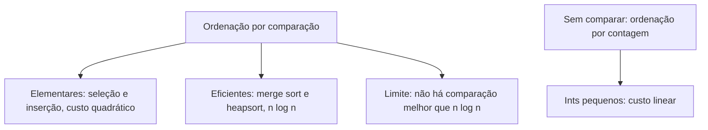

# 24 · Ordenação

**Tempo estimado:** 30 minutos · **Pré-requisito:** [[21 - Dividir e conquistar]], [[23 - Heaps e fila de prioridade]] e [[15 - Medindo algoritmos]].

**Ao final você vai conseguir:**

1. Implementar seleção e inserção, e contar suas comparações.
2. Relacionar o número de inversões com o trabalho da inserção.
3. Explicar o limite de comparações para ordenação por comparação, e quando a ordenação por contagem contorna esse limite.

**Antes de começar:** você já viu merge sort (módulo 21) e heapsort (módulo 23). Este módulo compara os principais algoritmos e seus custos.

---

## Para começar

Você tem uma pilha de 100 cartas embaralhadas e quer ordená-las. Uma estratégia é pegar a menor e colocar na frente, repetidamente. Outra é inserir cada carta no lugar certo, entre as já ordenadas. As duas funcionam, mas uma faz mais trabalho que a outra, e isso depende da entrada.

---

## Mapa do módulo



*Figura 1: algoritmos baseados em comparação têm um limite de n log n. A ordenação por contagem não compara, e por isso não está sujeita a ele.*

**Como ler:** os dois ramos de cima são comparações. O ramo de baixo é a exceção, quando os valores são inteiros pequenos.

---

## Mini-aula 1: seleção e inserção

> [!tip] Ideia
> Seleção leva o menor para a frente, um por vez. Inserção coloca cada elemento no lugar certo, entre os já ordenados.

> [!info] Definição
> Pela biblioteca: na seleção, o número de comparações é cerca de `N² / 2`. Na inserção, cerca de `N² / 4` em média, `N² / 2` no pior caso, e `N - 1` no melhor caso, quando a lista já está ordenada.

Veja quantas comparações a inserção faz numa lista já ordenada, e numa lista em ordem inversa. Antes de rodar, preveja os dois números.

```python
def comparacoes_insercao(lista):
    a = list(lista)
    comps = 0
    for i in range(1, len(a)):
        key = a[i]
        j = i - 1
        while j >= 0:
            comps += 1
            if a[j] > key:
                a[j + 1] = a[j]
                j -= 1
            else:
                break
        a[j + 1] = key
    return comps

print(comparacoes_insercao([1, 2, 3]), comparacoes_insercao([3, 2, 1]))
```

Saída real:

```
2 3
```

**Como ler:** a inserção percorre só o necessário. Numa lista ordenada, cada elemento fica no lugar com uma única comparação.

> [!warning] Armadilha comum
> Os números da biblioteca são aproximados: "cerca de `N²/4`" não é uma fórmula exata para toda entrada. O caso médio supõe chaves distintas e aleatórias.

> [!question]- Checkpoint
> 1. Quantas comparações a inserção faz numa lista ordenada de 5 elementos?
> 2. Quantas comparações a seleção faz, em cerca de, para 10 elementos?
>
> > [!success]- Resposta
> > 1. `N - 1 = 4`, uma por elemento depois do primeiro.
> > 2. Cerca de `N²/2 = 50`, pela aproximação da biblioteca.

---

## Mini-aula 2: inversões

> [!tip] Ideia
> Uma inversão é um par fora de ordem. A inserção faz um trabalho proporcional ao número de inversões.

> [!info] Definição
> Uma **inversão** (inversion) é um par de posições `i < j` com `lista[i] > lista[j]`. A biblioteca registra que as trocas da inserção são iguais ao número de inversões.

Veja a lista `[3, 2, 1]`, que tem o maior número possível de inversões para 3 elementos. Antes de ler a resposta, conte no papel quais pares estão fora de ordem.

Como ler: os pares são `(3, 2)`, `(3, 1)` e `(2, 1)`. São três inversões, e a inserção faz três trocas.

> [!warning] Armadilha comum
> Inversão é sobre pares de posições, e não sobre valores repetidos. Valores iguais não formam inversão, porque `lista[i] > lista[j]` é falso.

> [!question]- Checkpoint
> 1. Quantas inversões tem uma lista já ordenada?
> 2. Quantas inversões tem `[2, 1]`?
>
> > [!success]- Resposta
> > 1. Zero.
> > 2. Uma: o par `(2, 1)`.

---

## Mini-aula 3: o limite de comparações

> [!tip] Ideia
> Algoritmos que só comparam elementos não conseguem ser mais rápidos que `n log n` no pior caso. Para escapar, é preciso usar algo além da comparação.

> [!info] Definição
> A biblioteca registra que nenhum algoritmo baseado em comparação garante ordenar `N` itens com menos de `lg(N!)`, que é cerca de `N lg N`, comparações. Merge sort e heapsort atingem essa ordem. Para inteiros pequenos, com valores em `{0, ..., n^c - 1}`, a ordenação por contagem faz `O(cn)` passos, sem comparar.

Pense antes de continuar: a ordenação por contagem compara elementos entre si?

Como ler: a contagem não compara valores. Ela usa o próprio valor como índice, e por isso depende de os valores estarem num intervalo pequeno.

> [!warning] Armadilha comum
> A ordenação por contagem não é universal. Ela exige valores inteiros em um intervalo conhecido. Para outros dados, o limite de comparações continua valendo.

> [!question]- Checkpoint
> 1. Por que a ordenação por contagem contorna o limite de `n log n`?
> 2. Ela serve para uma lista de textos?
>
> > [!success]- Resposta
> > 1. Porque não usa comparações entre elementos; usa o valor como índice.
> > 2. Não diretamente, pois exige inteiros em um intervalo conhecido.

---

## Exercícios

Cada exercício tem um bloco com a função a completar e os testes com `assert`. Quando todos passarem, aparece `Passou!`.

### Aquecimento

**A1. Seleção.** Complete `ordenacao_selecao(lista)`, que devolve uma nova lista ordenada. Em cada passo, procure o menor elemento da parte ainda não ordenada e troque-o para a posição atual. Trabalhe sobre uma cópia: `a = list(lista)`.

```python
def ordenacao_selecao(lista):
    """Ordena por seleção: a cada passo, leva o menor da parte restante para a frente."""
    ...

assert ordenacao_selecao([3, 1, 2]) == [1, 2, 3], "três valores"
assert ordenacao_selecao([]) == [], "lista vazia"
assert ordenacao_selecao([2, 2, 1]) == [1, 2, 2], "com repetidos"
print("Passou!")
```

> [!hint]- Dica 1
> Para cada posição `i`, ache o índice `m` do menor valor em `a[i:]`, com um `for j in range(i + 1, len(a))`.

> [!hint]- Dica 2
> Troque `a[i]` com `a[m]`, usando `a[i], a[m] = a[m], a[i]`.

> [!example]- Solução
> ```python
> def ordenacao_selecao(lista):
>     """Ordena por seleção: a cada passo, leva o menor da parte restante para a frente."""
>     a = list(lista)
>     for i in range(len(a)):
>         m = i
>         for j in range(i + 1, len(a)):
>             if a[j] < a[m]:
>                 m = j
>         a[i], a[m] = a[m], a[i]
>     return a
> ```
>
> **Erro comum:** Trocar sem procurar o menor antes. A lista fica desordenada, porque a troca leva um valor qualquer para a frente.

**A2. Inserção.** Complete `ordenacao_insercao(lista)`, que devolve uma nova lista ordenada. Em cada passo, pegue o próximo valor (`key`) e desloque para a direita os valores maiores que ele, até achar seu lugar. Trabalhe sobre uma cópia: `a = list(lista)`.

```python
def ordenacao_insercao(lista):
    """Ordena por inserção: cada valor é deslocado até seu lugar na parte já ordenada."""
    ...

assert ordenacao_insercao([3, 1, 2]) == [1, 2, 3], "três valores"
assert ordenacao_insercao([]) == [], "lista vazia"
assert ordenacao_insercao([5, 4, 3, 2, 1]) == [1, 2, 3, 4, 5], "ordem inversa"
print("Passou!")
```

> [!hint]- Dica 1
> Para cada `i` de 1 até o fim, use `key = a[i]` e `j = i - 1`.

> [!hint]- Dica 2
> Enquanto `j >= 0 and a[j] > key`, faça `a[j + 1] = a[j]` e `j -= 1`. Depois, `a[j + 1] = key`.

> [!example]- Solução
> ```python
> def ordenacao_insercao(lista):
>     """Ordena por inserção: cada valor é deslocado até seu lugar na parte já ordenada."""
>     a = list(lista)
>     for i in range(1, len(a)):
>         key = a[i]
>         j = i - 1
>         while j >= 0 and a[j] > key:
>             a[j + 1] = a[j]
>             j -= 1
>         a[j + 1] = key
>     return a
> ```
>
> **Erro comum:** Esquecer de colocar `key` em `a[j + 1]` no fim. O valor some e a lista perde um elemento.

**A3. Inversões.** Uma inversão é um par de posições `i < j` com `lista[i] > lista[j]`. Complete `contar_inversoes(lista)`, que conta as inversões. A biblioteca relaciona o número de trocas da inserção com o número de inversões.

```python
def contar_inversoes(lista):
    """Conta os pares de posições i < j com lista[i] > lista[j]."""
    ...

assert contar_inversoes([2, 1, 3]) == 1, "só o par (2, 1)"
assert contar_inversoes([3, 2, 1]) == 3, "três pares fora de ordem"
assert contar_inversoes([1, 2]) == 0, "ordenada não tem inversões"
print("Passou!")
```

> [!hint]- Dica 1
> Use dois `for` aninhados: `for i in range(len(lista))` e `for j in range(i + 1, len(lista))`.

> [!hint]- Dica 2
> Some 1 quando `lista[i] > lista[j]`.

> [!example]- Solução
> ```python
> def contar_inversoes(lista):
>     """Conta os pares de posições i < j com lista[i] > lista[j]."""
>     total = 0
>     for i in range(len(lista)):
>         for j in range(i + 1, len(lista)):
>             if lista[i] > lista[j]:
>                 total += 1
>     return total
> ```
>
> **Erro comum:** Usar `j in range(i)`. Assim você conta pares na ordem errada, e a condição `i < j` não vale.

### Praticando

**P1. Contar comparações.** Complete `comparacoes_insercao(lista)`, que devolve quantas comparações `a[j] > key` a ordenação por inserção faz numa cópia da lista. Conte cada vez que a comparação é feita (com `j >= 0`).

```python
def comparacoes_insercao(lista):
    """Conta quantas comparações a ordenação por inserção faz numa cópia da lista."""
    ...

assert comparacoes_insercao([1, 2, 3]) == 2, "lista ordenada: uma comparação por inserção, N - 1 no total"
assert comparacoes_insercao([3, 2, 1]) == 3, "ordem inversa: uma comparação por inversão"
assert comparacoes_insercao([]) == 0, "lista vazia"
print("Passou!")
```

> [!hint]- Dica 1
> Use `comps = 0`. Dentro do `while`, some 1 antes de testar `a[j] > key`.

> [!hint]- Dica 2
> Para decidir se continua, use `if a[j] > key:` e, senão, `break`.

> [!example]- Solução
> ```python
> def comparacoes_insercao(lista):
>     """Conta quantas comparações a ordenação por inserção faz numa cópia da lista."""
>     a = list(lista)
>     comps = 0
>     for i in range(1, len(a)):
>         key = a[i]
>         j = i - 1
>         while j >= 0:
>             comps += 1
>             if a[j] > key:
>                 a[j + 1] = a[j]
>                 j -= 1
>             else:
>                 break
>         a[j + 1] = key
>     return comps
> ```
>
> **Erro comum:** Contar as trocas em vez das comparações. Cada passo do `while` faz uma comparação, e nem sempre há uma troca.

**P2. Conferir a ordem.** Complete `e_ordenada(lista)`, que devolve `True` se a lista está em ordem crescente, com cada elemento menor ou igual ao seguinte. Use para conferir o resultado de qualquer ordenação.

```python
def e_ordenada(lista):
    """Devolve True se cada elemento é menor ou igual ao seguinte."""
    ...

assert e_ordenada([1, 2, 2, 3]) == True, "com repetidos ainda é ordenada"
assert e_ordenada([2, 1]) == False, "o 2 vem antes do 1"
assert e_ordenada([]) == True, "lista vazia"
print("Passou!")
```

> [!hint]- Dica 1
> Percorra os índices de `0` até `len(lista) - 2`, comparando `lista[i]` com `lista[i + 1]`.

> [!hint]- Dica 2
> Se `lista[i] > lista[i + 1]`, `return False`.

> [!example]- Solução
> ```python
> def e_ordenada(lista):
>     """Devolve True se cada elemento é menor ou igual ao seguinte."""
>     for i in range(len(lista) - 1):
>         if lista[i] > lista[i + 1]:
>             return False
>     return True
> ```
>
> **Erro comum:** Comparar `lista[i]` com `lista[i]`, ou percorrer até `len(lista) - 1`, que dá `IndexError`.

**P3. Ordenar pares.** Complete `ordenar_por_chave(pares)`, que recebe uma lista de pares `(chave, valor)` e devolve a lista ordenada pela chave. Use a função `sorted` do Python, que a biblioteca registra com custo `O(n log n)`, com uma função `key` que pega a chave do par.

```python
def ordenar_por_chave(pares):
    """Devolve os pares (chave, valor) ordenados pela chave."""
    ...

assert ordenar_por_chave([(2, "b"), (1, "a")]) == [(1, "a"), (2, "b")], "ordena pela chave"
assert ordenar_por_chave([]) == [], "lista vazia"
assert ordenar_por_chave([(3, "x"), (3, "y")]) == [(3, "x"), (3, "y")], "chaves iguais mantêm a ordem"
print("Passou!")
```

> [!hint]- Dica 1
> Use `sorted(pares, key=lambda p: p[0])`.

> [!hint]- Dica 2
> A chave é o primeiro item do par, `p[0]`.

> [!example]- Solução
> ```python
> def ordenar_por_chave(pares):
>     """Devolve os pares (chave, valor) ordenados pela chave."""
>     return sorted(pares, key=lambda p: p[0])
> ```
>
> **Erro comum:** Ordenar pelo valor, `p[1]`, em vez da chave. A saída deve seguir a chave.

### Desafio

**D1. Ordenar inteiros pequenos.** Complete `ordenacao_contagem(lista, maximo)`, que ordena inteiros entre `0` e `maximo`, sem comparar elementos entre si. Conte quantas vezes cada valor aparece, e depois escreva cada valor pelo número de vezes que apareceu. Devolva a lista ordenada.

```python
def ordenacao_contagem(lista, maximo):
    """Ordena inteiros de 0 a maximo, contando as ocorrências de cada valor."""
    ...

assert ordenacao_contagem([3, 1, 2, 1], 3) == [1, 1, 2, 3], "com repetidos"
assert ordenacao_contagem([], 5) == [], "lista vazia"
assert ordenacao_contagem([0, 0], 0) == [0, 0], "só o zero"
print("Passou!")
```

> [!hint]- Dica 1
> Crie `contagem = [0] * (maximo + 1)`. Para cada `x`, some 1 em `contagem[x]`.

> [!hint]- Dica 2
> Depois, para cada `v` de 0 até `maximo`, acrescente `[v] * contagem[v]` ao resultado.

> [!example]- Solução
> ```python
> def ordenacao_contagem(lista, maximo):
>     """Ordena inteiros de 0 a maximo, contando as ocorrências de cada valor."""
>     contagem = [0] * (maximo + 1)
>     for x in lista:
>         contagem[x] += 1
>     resultado = []
>     for v in range(maximo + 1):
>         resultado += [v] * contagem[v]
>     return resultado
> ```
>
> **Erro comum:** Esquecer o `+ 1` no tamanho da contagem. O índice `maximo` ficaria fora da lista.


---

## Mini-projeto (opcional)

Um mini-projeto que usa uma ordenação pronta: encontrar o `k`-ésimo menor valor. Tente sozinho antes de abrir a solução.

**Objetivo.** Devolva o `k`-ésimo menor valor de uma lista (com `k` começando em 1). Use a função `ordenacao_selecao`, do exercício A1, para ordenar uma cópia, e escolha o elemento da posição certa.

```python
def ordenacao_selecao(lista):
    # já pronta, do exercício A1
    a = list(lista)
    for i in range(len(a)):
        m = i
        for j in range(i + 1, len(a)):
            if a[j] < a[m]:
                m = j
        a[i], a[m] = a[m], a[i]
    return a

def menor_k(lista, k):
    """Devolve o k-ésimo menor valor (k começando em 1)."""
    ...

assert menor_k([5, 1, 4], 2) == 4, "ordenada: 1, 4, 5"
assert menor_k([3, 3, 1], 1) == 1, "o menor"
assert menor_k([3, 3, 1], 3) == 3, "o maior"
print("Passou!")
```

> [!hint]- Dica 1
> Ordene com `ordenacao_selecao(lista)`.

> [!hint]- Dica 2
> O `k`-ésimo menor fica na posição `k - 1` da lista ordenada.

> [!example]- Solução
> ```python
> def menor_k(lista, k):
>     """Devolve o k-ésimo menor valor (k começando em 1)."""
>     return ordenacao_selecao(lista)[k - 1]
> ```
>
> **Erro comum:** Devolver a posição `k` em vez do valor, ou esquecer que a contagem começa em 1.


---

## Fechando

**Resumo**

- Seleção e inserção: custo quadrático no pior caso; inserção é `N - 1` no melhor caso.
- Merge sort e heapsort: `n log n`.
- Inversões: a inserção faz uma troca por inversão.
- Ordenação por comparação não passa de `N lg N` comparações no pior caso.
- Ordenação por contagem: linear para inteiros em intervalo pequeno.

**Glossário rápido**

- **Seleção** (selection sort): leva o menor para a frente, a cada passo.
- **Inserção** (insertion sort): insere cada elemento no lugar certo.
- **Inversão** (inversion): par fora de ordem.
- **Ordenação por comparação**: só compara elementos entre si.
- **Ordenação por contagem** (counting sort): usa o valor como índice.

**Perguntas de revisão**

1. Por que a inserção é rápida numa lista quase ordenada?
2. Quantas inversões tem `[1, 3, 2, 4]`?
3. Por que a ordenação por contagem não contradiz o limite de comparações?

**E agora?** O próximo módulo é **Grafos**. Eles modelam conexões entre objetos, e a busca em largura e em profundidade percorre esses modelos.

---

## Para ir mais fundo

- [[Sorting Algorithms]]
- [[Divide and Conquer and the Master Theorem]]
