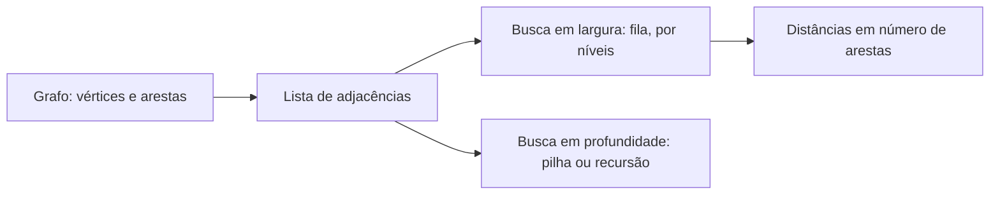

# 25 · Grafos: representação e busca

**Tempo estimado:** 30 minutos · **Pré-requisito:** [[18 - Pilhas e filas]] e [[03 - Relações de equivalência e de ordem]].

**Ao final você vai conseguir:**

1. Representar um grafo como lista de adjacências, em Python.
2. Percorrer um grafo em largura, com fila, e em profundidade, com recursão.
3. Usar a busca em largura para medir distâncias em número de arestas.

**Antes de começar:** um grafo é uma relação (módulo 02) em que os elementos são vértices. A busca percorre essa relação.

---

## Para começar

Um mapa de estradas tem cidades e estradas entre elas. Você quer saber se consegue ir de uma cidade a outra, e por quantas estradas no mínimo. Para responder, percorremos o mapa a partir de uma cidade, sem repetir as que já visitamos. Essa é a ideia da busca em grafos.

---

## Mapa do módulo



*Figura 1: a lista de adjacências é a representação. A busca em largura percorre por níveis e dá distâncias; a de profundidade vai fundo antes de voltar.*

**Como ler:** as duas buscas partem da mesma representação. A largura dá distâncias, por isso a fila; a profundidade explora um caminho até o fim.

---

## Mini-aula 1: representação

> [!tip] Ideia
> Guarde, para cada vértice, a lista dos vizinhos. Assim, achar as arestas que saem de um vértice é direto.

> [!info] Definição
> Uma **lista de adjacências** (adjacency list) é um vetor de listas, uma por vértice, com os vizinhos. Em Python, um dicionário `g` em que `g[v]` é a lista de `v`. A biblioteca registra essa representação, com `V` vértices e `E` arestas.

Veja o grafo que usaremos nos próximos exemplos, com 4 vértices. Antes de ler a saída das buscas, liste os vizinhos de cada vértice.

Como ler: `g[1] = [2, 3]` diz que há arestas de 1 para 2 e de 1 para 3.

> [!warning] Armadilha comum
> Um grafo pode ser direcionado ou não. No dicionário, uma aresta não direcionada aparece nos dois sentidos. A busca usa só a lista de quem sai.

> [!question]- Checkpoint
> 1. Quantas arestas tem `{1: [2, 3], 2: [4], 3: [4], 4: []}`?
> 2. A aresta de 2 para 4 aparece também como de 4 para 2?
>
> > [!success]- Resposta
> > 1. Quatro: `1→2`, `1→3`, `2→4`, `3→4`.
> > 2. Não. O grafo é direcionado, e só aparece no sentido de 2 para 4.

---

## Mini-aula 2: busca em largura

> [!tip] Ideia
> A busca em largura visita primeiro os vizinhos, depois os vizinhos dos vizinhos. Uma fila garante essa ordem.

> [!info] Definição
> A **busca em largura** (breadth-first search, BFS) explora os vértices em ordem crescente de distância da origem. A biblioteca registra que ela leva tempo proporcional a `V + E` no pior caso, e calcula os caminhos com menor número de arestas.

Veja a ordem de visita a partir do vértice 1. Antes de rodar, preveja a ordem: o que vem depois do 2 e do 3?

```python
from collections import deque

grafo = {1: [2, 3], 2: [4], 3: [4], 4: []}

def bfs(g, s):
    visitados = [s]
    fila = deque([s])
    while fila:
        v = fila.popleft()
        for w in g[v]:
            if w not in visitados:
                visitados.append(w)
                fila.append(w)
    return visitados

print(bfs(grafo, 1))
```

Saída real:

```
[1, 2, 3, 4]
```

**Como ler:** primeiro o 1 (origem), depois seus vizinhos 2 e 3, e só depois o 4, que está a duas arestas.

> [!warning] Armadilha comum
> Sem marcar os visitados, a busca entra em ciclos ou repete vértices. O teste de "já visitado" é essencial.

> [!question]- Checkpoint
> 1. Em que nível fica o 4 a partir do 1?
> 2. Qual estrutura de dados garante a ordem por níveis?
>
> > [!success]- Resposta
> > 1. No nível 2: são duas arestas, pelos caminhos `1→2→4` ou `1→3→4`.
> > 2. A fila, que atende o que entrou primeiro.

---

## Mini-aula 3: busca em profundidade

> [!tip] Ideia
> A busca em profundidade vai o mais fundo possível por um caminho, e só volta quando não há mais para onde ir.

> [!info] Definição
> A **busca em profundidade** (depth-first search, DFS) explora um caminho até o fim antes de voltar. Ela pode ser feita com recursão, que usa a pilha de chamadas. A biblioteca registra que a DFS marca os vértices alcançáveis em tempo proporcional à soma dos graus.

Veja a ordem da busca em profundidade no mesmo grafo. Antes de rodar, pense: depois do 2, para onde a busca vai?

```python
grafo = {1: [2, 3], 2: [4], 3: [4], 4: []}

def dfs(g, v, visitados):
    visitados.append(v)
    for w in g[v]:
        if w not in visitados:
            dfs(g, w, visitados)
    return visitados

print(dfs(grafo, 1, []))
```

Saída real:

```
[1, 2, 4, 3]
```

**Como ler:** do 1 vai ao 2, depois ao 4, que não tem saída. Só então volta e segue para o 3.

> [!warning] Armadilha comum
> A ordem da DFS é diferente da BFS. As duas visitam os mesmos vértices, mas em ordens distintas.

> [!question]- Checkpoint
> 1. Qual é a primeira saída da DFS depois do 1?
> 2. Por que o 4 não é visitado duas vezes?
>
> > [!success]- Resposta
> > 1. O 2, o primeiro vizinho de 1 na lista.
> > 2. Porque a verificação de já visitado impede a segunda visita.

---

## Exercícios

Cada exercício tem um bloco com a função a completar e os testes com `assert`. Quando todos passarem, aparece `Passou!`.

### Aquecimento

**A1. Vizinhos.** Um grafo é guardado como um dicionário `g`, em que `g[v]` é a lista dos vértices para os quais `v` tem uma aresta. Complete `vizinhos(g, v)`, que devolve a lista de `g[v]`, ou `[]` se `v` não é um vértice do grafo.

```python
def vizinhos(g, v):
    """Devolve a lista de vizinhos de v, ou [] se v não está no grafo."""
    ...

assert vizinhos({1: [2, 3], 2: []}, 1) == [2, 3], "vizinhos de 1"
assert vizinhos({1: [2, 3], 2: []}, 2) == [], "2 não tem arestas saindo"
assert vizinhos({1: [2]}, 9) == [], "vértice fora do grafo"
print("Passou!")
```

> [!hint]- Dica 1
> Use `g.get(v, [])`.

> [!hint]- Dica 2
> Devolva a lista sem copiar, ou uma cópia com `list(...)`.

> [!example]- Solução
> ```python
> def vizinhos(g, v):
>     """Devolve a lista de vizinhos de v, ou [] se v não está no grafo."""
>     return list(g.get(v, []))
> ```
>
> **Erro comum:** Usar `g[v]` sem checar a chave. Um vértice fora do grafo daria `KeyError`.

**A2. Contar arestas.** Complete `numero_arestas(g)`, que conta as arestas do grafo, somando o número de vizinhos de cada vértice.

```python
def numero_arestas(g):
    """Conta as arestas: soma o número de vizinhos de cada vértice."""
    ...

assert numero_arestas({1: [2, 3], 2: [3], 3: []}) == 3, "três arestas"
assert numero_arestas({1: [], 2: []}) == 0, "vértices sem arestas"
assert numero_arestas({}) == 0, "grafo vazio"
print("Passou!")
```

> [!hint]- Dica 1
> Percorra os valores do dicionário com `for lista in g.values():`.

> [!hint]- Dica 2
> Some `len(lista)` para cada vértice.

> [!example]- Solução
> ```python
> def numero_arestas(g):
>     """Conta as arestas: soma o número de vizinhos de cada vértice."""
>     total = 0
>     for lista in g.values():
>         total += len(lista)
>     return total
> ```
>
> **Erro comum:** Contar só os vértices. Cada vértice pode ter várias arestas saindo.

**A3. Grau de saída.** O grau de saída de um vértice é o número de arestas que saem dele. Complete `grau_saida(g)`, que devolve um dicionário `{vértice: grau}`.

```python
def grau_saida(g):
    """Devolve {vértice: número de arestas que saem dele}."""
    ...

assert grau_saida({1: [2, 3], 2: [3], 3: []}) == {1: 2, 2: 1, 3: 0}, "graus de saída"
assert grau_saida({}) == {}, "grafo vazio"
print("Passou!")
```

> [!hint]- Dica 1
> Use uma expressão de dicionário: `{v: len(lista) for v, lista in g.items()}`.

> [!hint]- Dica 2
> Cada valor é o tamanho da lista de vizinhos.

> [!example]- Solução
> ```python
> def grau_saida(g):
>     """Devolve {vértice: número de arestas que saem dele}."""
>     return {v: len(lista) for v, lista in g.items()}
> ```
>
> **Erro comum:** Trocar a chave pelo valor. O resultado deve ter o vértice como chave e o grau como valor.

### Praticando

**P1. Busca em largura.** Complete `bfs(g, s)`, que devolve a ordem em que os vértices são visitados a partir de `s`, pela busca em largura. Use uma fila (`collections.deque`), e marque os vértices já visitados, para não entrar duas vezes. A biblioteca registra que a busca em largura leva tempo proporcional a `V + E`.

```python
from collections import deque

def bfs(g, s):
    """Devolve a ordem de visita a partir de s, pela busca em largura."""
    ...

assert bfs({1: [2, 3], 2: [4], 3: [4], 4: []}, 1) == [1, 2, 3, 4], "por níveis"
assert bfs({1: []}, 1) == [1], "um vértice"
assert bfs({1: [2], 2: [1], 3: []}, 1) == [1, 2], "3 não é alcançável"
print("Passou!")
```

> [!hint]- Dica 1
> Comece com `visitados = [s]` e `fila = deque([s])`.

> [!hint]- Dica 2
> Enquanto a fila não está vazia: `v = fila.popleft()`. Para cada `w` em `g[v]` ainda não visitado, marque e enfileire.

> [!example]- Solução
> ```python
> def bfs(g, s):
>     """Devolve a ordem de visita a partir de s, pela busca em largura."""
>     visitados = [s]
>     fila = deque([s])
>     while fila:
>         v = fila.popleft()
>         for w in g[v]:
>             if w not in visitados:
>                 visitados.append(w)
>                 fila.append(w)
>     return visitados
> ```
>
> **Erro comum:** Usar `pop()` no lugar de `popleft()`. Assim a fila vira pilha, e a busca passa a ser em profundidade.

**P2. Busca em profundidade.** Complete `dfs(g, s)`, que devolve a ordem de visita a partir de `s`, pela busca em profundidade, com recursão. Visite o vizinho antes de voltar. Use uma função interna que recebe a lista de visitados.

```python
def dfs(g, s):
    """Devolve a ordem de visita a partir de s, pela busca em profundidade."""
    ...

assert dfs({1: [2, 3], 2: [4], 3: [4], 4: []}, 1) == [1, 2, 4, 3], "vai fundo antes de voltar"
assert dfs({1: [2], 2: []}, 2) == [2], "sem saída"
assert dfs({1: [2], 2: [1]}, 1) == [1, 2], "um ciclo não repete vértices"
print("Passou!")
```

> [!hint]- Dica 1
> Marque `s` como visitado, depois, para cada vizinho não visitado, chame a função interna.

> [!hint]- Dica 2
> Devolva a lista de visitados no fim.

> [!example]- Solução
> ```python
> def dfs(g, s):
>     """Devolve a ordem de visita a partir de s, pela busca em profundidade."""
>     visitados = []
>     def visita(v):
>         visitados.append(v)
>         for w in g[v]:
>             if w not in visitados:
>                 visita(w)
>     visita(s)
>     return visitados
> ```
>
> **Erro comum:** Esquecer de checar se o vizinho já foi visitado. Em um grafo com ciclos, a recursão nunca para.

**P3. Distâncias.** Complete `distancias(g, s)`, que devolve um dicionário com o número mínimo de arestas de `s` até cada vértice alcançável. A biblioteca registra que a busca em largura calcula caminhos com menor número de arestas.

```python
from collections import deque

def distancias(g, s):
    """Devolve {vértice: número mínimo de arestas a partir de s}."""
    ...

assert distancias({1: [2, 3], 2: [4], 3: [4], 4: []}, 1) == {1: 0, 2: 1, 3: 1, 4: 2}, "o 4 está a duas arestas"
assert distancias({1: []}, 1) == {1: 0}, "só o próprio vértice"
print("Passou!")
```

> [!hint]- Dica 1
> Use `dist = {s: 0}` e uma fila com `s`.

> [!hint]- Dica 2
> Para cada `w` vizinho de `v` ainda sem distância, `dist[w] = dist[v] + 1` e enfileire `w`.

> [!example]- Solução
> ```python
> def distancias(g, s):
>     """Devolve {vértice: número mínimo de arestas a partir de s}."""
>     dist = {s: 0}
>     fila = deque([s])
>     while fila:
>         v = fila.popleft()
>         for w in g[v]:
>             if w not in dist:
>                 dist[w] = dist[v] + 1
>                 fila.append(w)
>     return dist
> ```
>
> **Erro comum:** Atualizar a distância mesmo para vértices já visitados. A primeira visita dá a menor distância, e não deve ser trocada.

### Desafio

**D1. Componentes.** Num grafo em que cada aresta aparece nos dois sentidos, uma componente conexa é um conjunto de vértices que se alcançam. Complete `componentes(g)`, que devolve quantas componentes há. Para cada vértice ainda não visitado, faça uma busca a partir dele e conte uma nova componente.

```python
from collections import deque

def bfs_ordem(g, s):
    # já pronta, do exercício P1
    visitados = [s]
    fila = deque([s])
    while fila:
        v = fila.popleft()
        for w in g[v]:
            if w not in visitados:
                visitados.append(w)
                fila.append(w)
    return visitados

def componentes(g):
    """Conta as componentes conexas de um grafo com arestas nos dois sentidos."""
    ...

assert componentes({1: [2], 2: [1], 3: []}) == 2, "{1, 2} e {3}"
assert componentes({}) == 0, "grafo vazio"
assert componentes({1: [2], 2: [1, 3], 3: [2]}) == 1, "tudo ligado"
print("Passou!")
```

> [!hint]- Dica 1
> Use `visto = set()` e `total = 0`. Para cada vértice `v` do grafo que não está em `visto`, some 1 a `total`.

> [!hint]- Dica 2
> Para marcar a componente, use `alcance = bfs_ordem(g, v)` e adicione os vértices de `alcance` a `visto`. A função `bfs_ordem` está pronta.

> [!example]- Solução
> ```python
> def componentes(g):
>     """Conta as componentes conexas de um grafo com arestas nos dois sentidos."""
>     visto = set()
>     total = 0
>     for v in g:
>         if v not in visto:
>             total += 1
>             for w in bfs_ordem(g, v):
>                 visto.add(w)
>     return total
> ```
>
> **Erro comum:** Contar um vértice por componente, sem marcar os outros que a busca alcança. Assim cada componente seria contada várias vezes.


---

## Mini-projeto (opcional)

Um mini-projeto com a busca em largura: verificar se um vértice pode ser alcançado a partir de outro. Tente sozinho antes de abrir a solução.

**Objetivo.** Devolva `True` se `b` pode ser alcançado a partir de `a` no grafo. A função `bfs_ordem`, do exercício D1, já está pronta.

```python
from collections import deque

def bfs_ordem(g, s):
    # já pronta, do exercício P1
    visitados = [s]
    fila = deque([s])
    while fila:
        v = fila.popleft()
        for w in g[v]:
            if w not in visitados:
                visitados.append(w)
                fila.append(w)
    return visitados

def tem_caminho(g, a, b):
    """Devolve True se b é alcançável a partir de a."""
    ...

assert tem_caminho({1: [2], 2: [3], 3: []}, 1, 3) == True, "1 → 2 → 3"
assert tem_caminho({1: [2], 2: [], 3: []}, 1, 3) == False, "3 não é alcançável"
assert tem_caminho({1: []}, 1, 1) == True, "todo vértice alcança a si mesmo"
print("Passou!")
```

> [!hint]- Dica 1
> Calcule `bfs_ordem(g, a)`, que lista os vértices alcançáveis a partir de `a`.

> [!hint]- Dica 2
> Verifique se `b` está nessa lista com `in`.

> [!example]- Solução
> ```python
> def tem_caminho(g, a, b):
>     """Devolve True se b é alcançável a partir de a."""
>     return b in bfs_ordem(g, a)
> ```
>
> **Erro comum:** Testar se `b` é vizinho direto de `a`, em vez de alcançável por qualquer caminho.


---

## Fechando

**Resumo**

- Grafo: vértices e arestas; representado por lista de adjacências.
- Busca em largura: fila; visita por níveis; dá distâncias em número de arestas.
- Busca em profundidade: recursão ou pilha; vai fundo antes de voltar.
- Ambas custam `V + E`, segundo a biblioteca.
- Marcar os visitados impede repetições e ciclos infinitos.

**Glossário rápido**

- **Vértice** (vertex): ponto do grafo.
- **Aresta** (edge): ligação entre dois vértices.
- **Lista de adjacências** (adjacency list): vizinhos de cada vértice.
- **Busca em largura** (BFS): visita por níveis, com fila.
- **Busca em profundidade** (DFS): vai fundo antes de voltar.
- **Componente conexa**: conjunto de vértices que se alcançam.

**Perguntas de revisão**

1. Por que a BFS dá o caminho com menos arestas?
2. Se você trocar a fila por uma pilha na BFS, o que muda?
3. Um grafo com 3 vértices e 2 arestas pode ter quantas componentes, no mínimo?

**E agora?** O próximo módulo é **Ordenação topológica**. Ele ordena os vértices de um grafo sem ciclos, para que cada aresta aponte para frente.

---

## Para ir mais fundo

- [[Graph Representations and Traversal]]
- [[Stack and Queue]]
