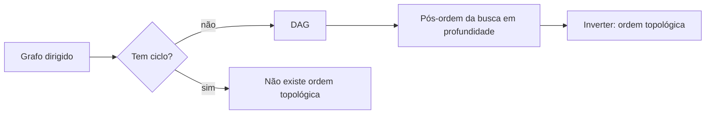

# 26 · Ordenação topológica

**Tempo estimado:** 30 minutos · **Pré-requisito:** [[25 - Representação e busca em grafos]].

**Ao final você vai conseguir:**

1. Explicar o que é um grafo dirigido acíclico (DAG) e uma ordem topológica.
2. Obter uma ordem topológica pela pós-ordem da busca em profundidade, invertida.
3. Conferir se uma ordem respeita as arestas de um grafo.

**Antes de começar:** no módulo 25 você percorreu grafos com a busca em profundidade. Aqui a ordem de término dessa busca é a ferramenta principal.

---

## Para começar

Você tem tarefas de um projeto, e algumas dependem de outras: a tarefa B só começa depois da A. Quer uma sequência em que toda tarefa venha depois das que ela depende. Isso é uma ordem topológica, que existe quando as dependências não formam um ciclo.

---

## Mapa do módulo



*Figura 1: um grafo tem ordem topológica se, e somente se, é um DAG. A pós-ordem invertida dá essa ordem.*

**Como ler:** a pergunta do losango é o que separa os dois caminhos. O ramo "não" leva à ordem; o "sim" mostra que ela não existe.

---

## Mini-aula 1: DAG e ordem topológica

> [!tip] Ideia
> Um DAG é um grafo dirigido sem ciclos. Uma ordem topológica põe cada vértice antes de todos os seus sucessores.

> [!info] Definição
> Um **DAG** (directed acyclic graph) é um grafo dirigido sem ciclo dirigido. Uma **ordem topológica** é uma ordem dos vértices em que toda aresta aponta de um vértice anterior para um posterior. A biblioteca registra: um grafo dirigido tem ordem topológica se, e somente se, é um DAG.

Como ler: se houver um ciclo, algum vértice do ciclo precisaria vir antes de si mesmo, e nenhuma ordem serve.

> [!warning] Armadilha comum
> Um grafo pode ter mais de uma ordem topológica. Não se procura "a" ordem, e sim uma que respeite as arestas.

> [!question]- Checkpoint
> 1. O grafo `{1: [2], 2: [1]}` tem ordem topológica?
> 2. O grafo `{1: [2], 2: []}` tem quantas ordens topológicas?
>
> > [!success]- Resposta
> > 1. Não. Há um ciclo entre 1 e 2.
> > 2. Uma: `[1, 2]`.

---

## Mini-aula 2: pós-ordem invertida

> [!tip] Ideia
> Um vértice termina a busca em profundidade só depois de todos os seus sucessores. Lendo os términos ao contrário, os predecessores vêm antes.

> [!info] Definição
> A **pós-ordem** (postorder) de uma busca em profundidade é a ordem em que os vértices terminam. A biblioteca registra que a pós-ordem invertida, em um DAG, é uma ordem topológica, com custo proporcional a `V + E`.

Veja a pós-ordem do grafo com 4 vértices, e a mesma lista invertida. Antes de rodar, preveja qual vértice termina primeiro.

```python
g = {1: [2, 3], 2: [4], 3: [4], 4: []}

def pos_ordem(g):
    visitados = set()
    saida = []
    def visita(v):
        visitados.add(v)
        for w in g[v]:
            if w not in visitados:
                visita(w)
        saida.append(v)
    for v in g:
        if v not in visitados:
            visita(v)
    return saida

print(pos_ordem(g))
print(pos_ordem(g)[::-1])
```

Saída real:

```
[4, 2, 3, 1]
[1, 3, 2, 4]
```

**Como ler:** o 4 termina primeiro, pois não tem saída. A lista invertida começa pelo 1, que é a origem, e cada aresta aponta para frente.

> [!warning] Armadilha comum
> Sem inverter a pós-ordem, a lista fica com os sucessores antes dos predecessores. Esse é o erro mais comum.

> [!question]- Checkpoint
> 1. Qual vértice termina primeiro numa busca que começa em 1 e não tem ciclos?
> 2. Por que invertemos a pós-ordem?
>
> > [!success]- Resposta
> > 1. Um vértice sem saída, como o 4 do exemplo.
> > 2. Porque a pós-ordem põe os sucessores antes dos predecessores; a inversão corrige isso.

---

## Mini-aula 3: quando a ordem falha

> [!tip] Ideia
> Se o grafo tem ciclo, a pós-ordem invertida não respeita todas as arestas. Conferir a ordem mostra o problema.

> [!info] Definição
> A biblioteca não cobre a detecção de ciclos. Para este curso, usamos uma regra prática: uma ordem é válida se, para cada aresta `u → v`, `u` aparece antes de `v`.

Como ler: com um ciclo, a regra falha para pelo menos uma aresta. Conferir a ordem é um teste simples, e não substitui uma demonstração.

> [!warning] Armadilha comum
> Uma ordem que passa no teste de uma aresta não é prova de nada. Confira todas as arestas.

> [!question]- Checkpoint
> 1. Numa ordem `[2, 1]` para a aresta `1 → 2`, a regra vale?
> 2. Quantas arestas precisam ser conferidas?
>
> > [!success]- Resposta
> > 1. Não. O 1 deveria vir antes do 2.
> > 2. Todas.

---

## Exercícios

Cada exercício tem um bloco com a função a completar e os testes com `assert`. Quando todos passarem, aparece `Passou!`.

### Aquecimento

**A1. Grau de entrada.** O grau de entrada de um vértice é o número de arestas que chegam nele. Complete `grau_entrada(g)`, que devolve `{vértice: grau de entrada}`, incluindo os vértices sem arestas chegando.

```python
def grau_entrada(g):
    """Devolve {vértice: número de arestas que chegam nele}."""
    ...

assert grau_entrada({1: [2, 3], 2: [3], 3: []}) == {1: 0, 2: 1, 3: 2}, "3 recebe de 1 e de 2"
assert grau_entrada({1: [], 2: []}) == {1: 0, 2: 0}, "sem arestas"
print("Passou!")
```

> [!hint]- Dica 1
> Comece com `grau = {v: 0 for v in g}`.

> [!hint]- Dica 2
> Para cada `v` e cada `w` em `g[v]`, some 1 em `grau[w]`.

> [!example]- Solução
> ```python
> def grau_entrada(g):
>     """Devolve {vértice: número de arestas que chegam nele}."""
>     grau = {v: 0 for v in g}
>     for v in g:
>         for w in g[v]:
>             grau[w] += 1
>     return grau
> ```
>
> **Erro comum:** Esquecer os vértices sem arestas chegando. Eles devem aparecer com grau 0.

**A2. Ordem de término.** Complete `pos_ordem(g)`, que devolve a ordem de término de uma busca em profundidade que parte de cada vértice não visitado, na ordem das chaves de `g`. Um vértice termina depois que todos os seus vizinhos terminam. Use uma função interna `visita(v)`.

```python
def pos_ordem(g):
    """Devolve a ordem de término da busca em profundidade a partir de cada vértice."""
    ...

assert pos_ordem({1: [2], 2: [3], 3: []}) == [3, 2, 1], "o último a terminar é a origem"
assert pos_ordem({1: [], 2: []}) == [1, 2], "dois vértices isolados"
print("Passou!")
```

> [!hint]- Dica 1
> Em `visita(v)`, marque `v`, visite os vizinhos não marcados, e só depois adicione `v` à saída.

> [!hint]- Dica 2
> No laço principal, chame `visita(v)` para cada `v` ainda não marcado.

> [!example]- Solução
> ```python
> def pos_ordem(g):
>     """Devolve a ordem de término da busca em profundidade a partir de cada vértice."""
>     visitados = set()
>     saida = []
>     def visita(v):
>         visitados.add(v)
>         for w in g[v]:
>             if w not in visitados:
>                 visita(w)
>         saida.append(v)
>     for v in g:
>         if v not in visitados:
>             visita(v)
>     return saida
> ```
>
> **Erro comum:** Adicionar `v` à saída antes de visitar os vizinhos. A ordem de término fica invertida.

**A3. Ordem topológica.** Uma ordem topológica põe cada vértice antes dos seus sucessores. A biblioteca registra que a ordem pós-ordem da busca em profundidade, lida ao contrário, é uma ordem topológica em um grafo sem ciclos. Complete `ordem_topologica(g)` usando `pos_ordem`, já pronta.

```python
def pos_ordem(g):
    # já pronta, do exercício A2
    visitados = set()
    saida = []
    def visita(v):
        visitados.add(v)
        for w in g[v]:
            if w not in visitados:
                visita(w)
        saida.append(v)
    for v in g:
        if v not in visitados:
            visita(v)
    return saida

def respeita(g, ordem):
    # já pronta: confere se cada aresta aponta para frente na ordem
    for u in g:
        for v in g[u]:
            if ordem.index(u) > ordem.index(v):
                return False
    return True

def ordem_topologica(g):
    """Devolve a pós-ordem invertida: uma ordem topológica se o grafo não tem ciclos."""
    ...

g = {1: [2, 3], 2: [4], 3: [4], 4: []}
assert ordem_topologica(g) is not None, "a função ainda não devolve uma ordem"
assert respeita(g, ordem_topologica(g)) == True, "a ordem respeita todas as arestas"
assert ordem_topologica({1: [2], 2: []}) == [1, 2], "uma cadeia"
print("Passou!")
```

> [!hint]- Dica 1
> Calcule `pos_ordem(g)` e devolva a lista ao contrário.

> [!hint]- Dica 2
> Use `[::-1]` para inverter.

> [!example]- Solução
> ```python
> def ordem_topologica(g):
>     """Devolve a pós-ordem invertida: uma ordem topológica se o grafo não tem ciclos."""
>     return pos_ordem(g)[::-1]
> ```
>
> **Erro comum:** Devolver a pós-ordem sem inverter. Ela tem os sucessores antes dos predecessores.

### Praticando

**P1. Conferir a ordem.** Complete `respeita(g, ordem)`, que devolve `True` se a lista `ordem` respeita todas as arestas de `g`: para cada aresta `u → v`, `u` aparece antes de `v` em `ordem`.

```python
def respeita(g, ordem):
    """Devolve True se cada aresta u → v tem u antes de v em ordem."""
    ...

assert respeita({1: [2], 2: []}, [1, 2]) == True, "1 antes de 2"
assert respeita({1: [2], 2: []}, [2, 1]) == False, "a aresta 1 → 2 está invertida"
assert respeita({1: [], 2: []}, [2, 1]) == True, "sem arestas, qualquer ordem serve"
print("Passou!")
```

> [!hint]- Dica 1
> Percorra `u` em `g` e `v` em `g[u]`.

> [!hint]- Dica 2
> Use `ordem.index(u) > ordem.index(v)` para detectar a violação. Se houver, `return False`.

> [!example]- Solução
> ```python
> def respeita(g, ordem):
>     """Devolve True se cada aresta u → v tem u antes de v em ordem."""
>     for u in g:
>         for v in g[u]:
>             if ordem.index(u) > ordem.index(v):
>                 return False
>     return True
> ```
>
> **Erro comum:** Comparar `u` e `v` como valores, em vez de olhar a posição na ordem. A regra fala de posição.

**P2. Alcance.** Complete `alcance(g, s)`, que devolve o conjunto de vértices alcançáveis a partir de `s`, incluindo `s`. Use a busca em profundidade com recursão, marcando os visitados num conjunto.

```python
def alcance(g, s):
    """Devolve o conjunto de vértices alcançáveis a partir de s, incluindo s."""
    ...

assert alcance({1: [2], 2: [3], 3: []}, 1) == {1, 2, 3}, "cadeia inteira"
assert alcance({1: [2], 2: [], 3: []}, 2) == {2}, "2 não tem saída"
assert alcance({1: []}, 1) == {1}, "só o próprio vértice"
print("Passou!")
```

> [!hint]- Dica 1
> Use uma função interna `visita(v)` que adiciona `v` ao conjunto e chama a si mesma para os vizinhos ainda não marcados.

> [!hint]- Dica 2
> Devolva o conjunto no fim.

> [!example]- Solução
> ```python
> def alcance(g, s):
>     """Devolve o conjunto de vértices alcançáveis a partir de s, incluindo s."""
>     marcados = set()
>     def visita(v):
>         marcados.add(v)
>         for w in g[v]:
>             if w not in marcados:
>                 visita(w)
>     visita(s)
>     return marcados
> ```
>
> **Erro comum:** Esquecer `s` no resultado. Todo vértice se alcança a si mesmo.

**P3. Vértices sem entrada.** Num grafo sem ciclos, os vértices sem arestas chegando podem começar uma ordem topológica. Complete `sem_entrada(g)`, que devolve a lista dos vértices com grau de entrada zero, em ordem crescente. A função `grau_entrada`, já pronta, calcula os graus.

```python
def grau_entrada(g):
    # já pronta, do exercício A1
    grau = {v: 0 for v in g}
    for v in g:
        for w in g[v]:
            grau[w] += 1
    return grau

def sem_entrada(g):
    """Devolve, em ordem crescente, os vértices sem arestas chegando."""
    ...

assert sem_entrada({1: [2, 3], 2: [3], 3: []}) == [1], "só 1 não recebe aresta"
assert sem_entrada({1: [], 2: []}) == [1, 2], "todos sem entrada"
assert sem_entrada({}) == [], "grafo vazio"
print("Passou!")
```

> [!hint]- Dica 1
> Use `grau = grau_entrada(g)`.

> [!hint]- Dica 2
> Devolva `sorted(v for v in g if grau[v] == 0)`.

> [!example]- Solução
> ```python
> def sem_entrada(g):
>     """Devolve, em ordem crescente, os vértices sem arestas chegando."""
>     grau = grau_entrada(g)
>     return sorted(v for v in g if grau[v] == 0)
> ```
>
> **Erro comum:** Confundir grau de entrada com grau de saída. O que importa aqui são as arestas que chegam.

### Desafio

**D1. Ordem, se for possível.** Complete `ordem_se_dag(g)`, que devolve a ordem topológica (a pós-ordem invertida) se ela respeita todas as arestas, e `None` caso contrário. Se o grafo tem ciclo, a ordem não respeita as arestas, e a função devolve `None`. As funções `pos_ordem` e `respeita` já estão prontas.

```python
def pos_ordem(g):
    # já pronta, do exercício A2
    visitados = set()
    saida = []
    def visita(v):
        visitados.add(v)
        for w in g[v]:
            if w not in visitados:
                visita(w)
        saida.append(v)
    for v in g:
        if v not in visitados:
            visita(v)
    return saida

def respeita(g, ordem):
    # já pronta, do exercício P1
    for u in g:
        for v in g[u]:
            if ordem.index(u) > ordem.index(v):
                return False
    return True

def ordem_se_dag(g):
    """Devolve a ordem topológica se ela respeita as arestas; senão, None."""
    ...

assert ordem_se_dag({1: [2], 2: []}) == [1, 2], "uma cadeia sem ciclo"
assert ordem_se_dag({1: [2], 2: [1]}) is None, "1 e 2 formam um ciclo"
assert ordem_se_dag({}) == [], "grafo vazio"
print("Passou!")
```

> [!hint]- Dica 1
> Calcule `ordem = pos_ordem(g)[::-1]`.

> [!hint]- Dica 2
> Se `respeita(g, ordem)`, devolva `ordem`. Senão, `None`.

> [!example]- Solução
> ```python
> def ordem_se_dag(g):
>     """Devolve a ordem topológica se ela respeita as arestas; senão, None."""
>     ordem = pos_ordem(g)[::-1]
>     if respeita(g, ordem):
>         return ordem
>     return None
> ```
>
> **Erro comum:** Devolver a ordem sempre, sem testar. Num grafo com ciclo, a ordem devolvida seria inválida.


---

## Mini-projeto (opcional)

Um mini-projeto que confere várias candidatas a ordem, de uma vez. Tente sozinho antes de abrir a solução.

**Objetivo.** Dada uma lista de candidatas a ordem, devolva, para cada uma, `True` se respeita todas as arestas de `g`. A função `respeita`, do exercício P1, já está pronta.

```python
def respeita(g, ordem):
    # já pronta, do exercício P1
    for u in g:
        for v in g[u]:
            if ordem.index(u) > ordem.index(v):
                return False
    return True

def ordens_validas(g, candidatas):
    """Para cada candidata, devolve True se ela respeita todas as arestas de g."""
    ...

assert ordens_validas({1: [2], 2: []}, [[1, 2], [2, 1]]) == [True, False], "só a primeira respeita a aresta"
assert ordens_validas({1: []}, []) == [], "sem candidatas"
print("Passou!")
```

> [!hint]- Dica 1
> Use uma lista por compreensão: `[respeita(g, o) for o in candidatas]`.

> [!hint]- Dica 2
> A saída tem uma resposta por candidata, na mesma ordem.

> [!example]- Solução
> ```python
> def ordens_validas(g, candidatas):
>     """Para cada candidata, devolve True se ela respeita todas as arestas de g."""
>     return [respeita(g, o) for o in candidatas]
> ```
>
> **Erro comum:** Devolver um único valor para a lista inteira, em vez de um por candidata.


---

## Fechando

**Resumo**

- DAG: grafo dirigido sem ciclos.
- Ordem topológica: cada aresta aponta para frente na ordem.
- Existe se, e somente se, o grafo é um DAG (biblioteca).
- Pós-ordem da busca em profundidade invertida dá uma ordem topológica.
- Conferir uma ordem: checar cada aresta.

**Glossário rápido**

- **DAG** (grafo dirigido acíclico): grafo dirigido sem ciclos.
- **Ordem topológica** (topological order): ordem que respeita as arestas.
- **Pós-ordem** (postorder): ordem em que os vértices terminam na busca em profundidade.
- **Grau de entrada** (in-degree): número de arestas que chegam num vértice.

**Perguntas de revisão**

1. Por que um grafo com ciclo não tem ordem topológica?
2. Num grafo com as arestas `1 → 2`, `1 → 3`, `2 → 4`, `3 → 4`, quais vértices podem começar uma ordem?
3. Por que a ordem topológica é útil para planejar tarefas com dependências?

**E agora?** O próximo módulo é **Algoritmos gulosos**. Ele faz uma escolha local a cada passo, e a biblioteca registra quando essa estratégia é ótima.

---

## Para ir mais fundo

- [[Topological Sort and DAGs]]
- [[Graph Representations and Traversal]]
