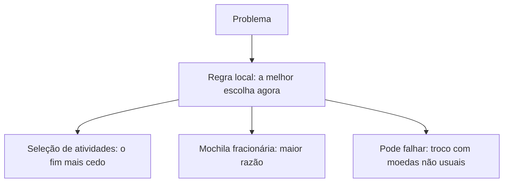

# 27 · Algoritmos gulosos

**Tempo estimado:** 30 minutos · **Pré-requisito:** [[21 - Dividir e conquistar]] e [[24 - Ordenação]].

**Ao final você vai conseguir:**

1. Explicar a estratégia gulosa: uma escolha local a cada passo.
2. Resolver seleção de atividades e mochila fracionária com a regra gulosa.
3. Reconhecer quando a regra gulosa falha, com o troco.

**Antes de começar:** você já ordena listas por uma chave (módulo 24). Quase todo algoritmo guloso começa por uma ordenação.

---

## Para começar

Você tem uma viagem com mochila limitada e quer levar o máximo de valor. Ou um dia com reuniões e quer caber o maior número delas. Em cada caso, uma regra simples escolhe a próxima coisa a fazer: pegar a de melhor razão, ou a que termina mais cedo. Essa escolha é gulosa, pois não olha o futuro.

---

## Mapa do módulo



*Figura 1: a regra local é a mesma ideia em todos os casos. Em alguns problemas ela dá a resposta ótima, e em outros não.*

**Como ler:** o ramo de cima é a escolha local. Os ramos de baixo mostram dois casos em que ela funciona, e um em que não funciona.

---

## Mini-aula 1: escolha local

> [!tip] Ideia
> Um algoritmo guloso faz, a cada passo, a escolha que parece melhor naquele momento, sem voltar atrás.

> [!info] Definição
> Um **algoritmo guloso** (greedy) constrói a solução passo a passo, otimizando um critério local. A biblioteca registra que ele nem sempre é ótimo, mas é para problemas como a árvore geradora mínima, a seleção de atividades e a mochila fracionária.

Veja o troco com as mesmas moedas, em dois conjuntos. Antes de rodar, preveja: o guloso dá o número mínimo de moedas nos dois casos?

```python
def troco_guloso(valor, moedas):
    resultado = []
    for m in sorted(moedas, reverse=True):
        while valor >= m:
            resultado.append(m)
            valor -= m
    return resultado

print(troco_guloso(30, [1, 5, 10, 25]))
print(troco_guloso(6, [1, 3, 4]))
```

Saída real:

```
[25, 5]
[4, 1, 1]
```

**Como ler:** com moedas usuais, a regra da maior moeda acerta. Com `[1, 3, 4]`, ela usa três moedas, enquanto `3 + 3` usaria duas.

> [!warning] Armadilha comum
> Um algoritmo guloso dar a resposta certa em alguns exemplos não prova que ele é ótimo. Ele precisa de um argumento que valha para todos os casos, e a biblioteca não cobre esse argumento aqui.

> [!question]- Checkpoint
> 1. Com moedas `[1, 3, 4]` e valor 6, quantas moedas o guloso usa?
> 2. Qual seria o número ótimo?
>
> > [!success]- Resposta
> > 1. Três: 4, 1 e 1.
> > 2. Duas: 3 e 3.

---

## Mini-aula 2: seleção e mochila

> [!tip] Ideia
> Na seleção de atividades, escolha a que termina mais cedo. Na mochila fracionária, escolha o item de maior razão valor/peso.

> [!info] Definição
> A **seleção de atividades** (activity selection) escolhe o maior número de atividades compatíveis. A **mochila fracionária** (fractional knapsack) leva o máximo de valor, podendo levar frações de itens. A biblioteca registra que a regra gulosa é ótima nesses dois problemas.

Como ler: escolher a atividade que termina mais cedo deixa o máximo de tempo livre para as seguintes. Na mochila, a razão mede quanto valor cada quilo rende.

> [!warning] Armadilha comum
> A mesma regra não vale para a mochila 0-1, em que o item é levado inteiro ou não. A biblioteca cita esse problema, mas o trata por programação dinâmica, no módulo 29.

> [!question]- Checkpoint
> 1. Na seleção, por que ordenar pelo início não é a regra certa?
> 2. Na mochila fracionária, o item de razão 6 vem antes ou depois do de razão 2?
>
> > [!success]- Resposta
> > 1. Uma atividade longa que começa cedo pode bloquear várias outras.
> > 2. Antes, porque a razão maior rende mais por quilo.

---

## Mini-aula 3: quando a regra falha

> [!tip] Ideia
> O guloso é rápido, mas sua regra pode deixar uma escolha ruim que não se recupera depois.

> [!info] Definição
> No problema do troco, a regra da maior moeda usada primeiro é ótima para certos conjuntos de moedas, mas não para todos. A programação dinâmica, do módulo 29, resolve o problema sem essa falha.

Como ler: o guloso escolheu o 4 no começo, e não há como voltar para usar 3 e 3. A escolha local parecia boa, mas bloqueou a solução ótima.

> [!warning] Armadilha comum
> Não generalize o guloso para qualquer problema de otimização. Antes de usá-lo, é preciso um argumento de que a escolha local leva ao ótimo.

> [!question]- Checkpoint
> 1. Por que o guloso falha no troco com `[1, 3, 4]`?
> 2. Que técnica resolve esse problema sem falhar?
>
> > [!success]- Resposta
> > 1. A escolha do 4 no começo bloqueia a combinação `3 + 3`.
> > 2. A programação dinâmica, que testa as possibilidades sem jogar fora as ótimas.

---

## Exercícios

Cada exercício tem um bloco com a função a completar e os testes com `assert`. Quando todos passarem, aparece `Passou!`.

### Aquecimento

**A1. Seleção de atividades.** Cada atividade é um par `(inicio, fim)`. Duas atividades são compatíveis se uma termina antes (ou quando) a outra começa. Complete `escolhe_atividades(atividades)`: ordene por `fim` e escolha, em ordem, cada atividade que começa depois ou quando termina a última escolhida.

```python
def escolhe_atividades(atividades):
    """Escolhe o maior número de atividades compatíveis, pela regra do fim mais cedo."""
    ...

assert escolhe_atividades([(1, 4), (3, 5), (0, 6), (5, 7), (8, 11)]) == [(1, 4), (5, 7), (8, 11)], "três atividades compatíveis"
assert escolhe_atividades([]) == [], "sem atividades"
assert escolhe_atividades([(0, 2), (2, 4)]) == [(0, 2), (2, 4)], "uma termina quando a outra começa"
print("Passou!")
```

> [!hint]- Dica 1
> Use `sorted(atividades, key=lambda a: a[1])` para ordenar pelo fim.

> [!hint]- Dica 2
> Guarde `fim_ultima = None`. Escolha `(ini, fim)` se `fim_ultima is None or ini >= fim_ultima`, e então atualize `fim_ultima = fim`.

> [!example]- Solução
> ```python
> def escolhe_atividades(atividades):
>     """Escolhe o maior número de atividades compatíveis, pela regra do fim mais cedo."""
>     escolhidas = []
>     fim_ultima = None
>     for ini, fim in sorted(atividades, key=lambda a: a[1]):
>         if fim_ultima is None or ini >= fim_ultima:
>             escolhidas.append((ini, fim))
>             fim_ultima = fim
>     return escolhidas
> ```
>
> **Erro comum:** Ordenar pelo início. Uma atividade longa que começa cedo bloquearia muitas outras. A regra gulosa é a do fim mais cedo.

**A2. Mochila fracionária.** Cada item é um par `(valor, peso)`, e podemos levar frações de um item. Complete `mochila_fracionaria(itens, capacidade)`, que devolve o maior valor possível. A regra gulosa: ordene pela razão valor/peso, do maior para o menor, e pegue o máximo de cada item, na ordem.

```python
def mochila_fracionaria(itens, capacidade):
    """Maior valor levável, com frações, pela razão valor/peso em ordem decrescente."""
    ...

assert mochila_fracionaria([(60, 10), (100, 20), (120, 30)], 50) == 240.0, "leva o item 1, o 2 e 2/3 do 3"
assert mochila_fracionaria([(10, 5)], 2) == 4.0, "só cabe uma fração"
assert mochila_fracionaria([(10, 5)], 0) == 0.0, "sem capacidade"
print("Passou!")
```

> [!hint]- Dica 1
> Ordene com `sorted(itens, key=lambda it: it[0] / it[1], reverse=True)`.

> [!hint]- Dica 2
> Se o item inteiro cabe (`peso <= restante`), leve tudo. Senão, leve a fração `valor * restante / peso` e pare.

> [!example]- Solução
> ```python
> def mochila_fracionaria(itens, capacidade):
>     """Maior valor levável, com frações, pela razão valor/peso em ordem decrescente."""
>     total = 0.0
>     restante = capacidade
>     for valor, peso in sorted(itens, key=lambda it: it[0] / it[1], reverse=True):
>         if restante <= 0:
>             break
>         if peso <= restante:
>             total += valor
>             restante -= peso
>         else:
>             total += valor * restante / peso
>             restante = 0
>     return total
> ```
>
> **Erro comum:** Ordenar por valor, e não por razão. Um item de valor alto mas peso maior pode render menos por quilo.

**A3. Troco guloso.** Dado um valor e moedas, o método guloso dá a moeda de maior valor possível, repetidamente, até fechar o valor. Complete `troco_guloso(valor, moedas)`, que devolve a lista de moedas usadas.

```python
def troco_guloso(valor, moedas):
    """Devolve as moedas usadas pelo método guloso: sempre a maior que cabe."""
    ...

assert troco_guloso(30, [1, 5, 10, 25]) == [25, 5], "com moedas usuais, dá 25 e 5"
assert troco_guloso(6, [1, 3, 4]) == [4, 1, 1], "não ótimo aqui: 3 e 3 usam menos moedas"
print("Passou!")
```

> [!hint]- Dica 1
> Percorra `sorted(moedas, reverse=True)`.

> [!hint]- Dica 2
> Para cada moeda `m`, enquanto `valor >= m`, acrescente `m` à lista e subtraia `m` do valor.

> [!example]- Solução
> ```python
> def troco_guloso(valor, moedas):
>     """Devolve as moedas usadas pelo método guloso: sempre a maior que cabe."""
>     resultado = []
>     for m in sorted(moedas, reverse=True):
>         while valor >= m:
>             resultado.append(m)
>             valor -= m
>     return resultado
> ```
>
> **Erro comum:** Parar na primeira moeda e não voltar às menores. O valor precisa ser fechado com as moedas que sobram.

### Praticando

**P1. Conflito de intervalos.** Dois intervalos `a = (i1, f1)` e `b = (i2, f2)` conflitam se há um tempo em comum, com início e fim exclusivos. Complete `intervalos_conflitam(a, b)`, que devolve `True` se eles se sobrepõem.

```python
def intervalos_conflitam(a, b):
    """Devolve True se os intervalos a e b se sobrepõem (fim exclusivo)."""
    ...

assert intervalos_conflitam((1, 4), (3, 5)) == True, "têm 3 a 4 em comum"
assert intervalos_conflitam((1, 4), (4, 6)) == False, "um termina quando o outro começa"
assert intervalos_conflitam((0, 10), (2, 3)) == True, "um contém o outro"
print("Passou!")
```

> [!hint]- Dica 1
> Dois intervalos se sobrepõem quando `i1 < f2` e `i2 < f1`.

> [!hint]- Dica 2
> Devolva `a[0] < b[1] and b[0] < a[1]`.

> [!example]- Solução
> ```python
> def intervalos_conflitam(a, b):
>     """Devolve True se os intervalos a e b se sobrepõem (fim exclusivo)."""
>     return a[0] < b[1] and b[0] < a[1]
> ```
>
> **Erro comum:** Usar `<=` no lugar de `<`. Dois intervalos que se tocam, como `(1, 4)` e `(4, 6)`, não conflitam.

**P2. Nenhum conflito.** Complete `e_nao_sobreposto(atividades)`, que devolve `True` se nenhum par de atividades conflita. A função `intervalos_conflitam` já está pronta.

```python
def intervalos_conflitam(a, b):
    # já pronta, do exercício P1
    return a[0] < b[1] and b[0] < a[1]

def e_nao_sobreposto(atividades):
    """Devolve True se nenhum par de atividades conflita."""
    ...

assert e_nao_sobreposto([(1, 4), (4, 6)]) == True, "encostam, não se sobrepõem"
assert e_nao_sobreposto([(1, 4), (3, 5)]) == False, "conflitam no 3 e 4"
assert e_nao_sobreposto([]) == True, "sem atividades"
print("Passou!")
```

> [!hint]- Dica 1
> Use dois `for` aninhados com `i < j`, para comparar cada par uma vez.

> [!hint]- Dica 2
> Se algum par conflita, `return False`. Ao fim, `return True`.

> [!example]- Solução
> ```python
> def e_nao_sobreposto(atividades):
>     """Devolve True se nenhum par de atividades conflita."""
>     for i in range(len(atividades)):
>         for j in range(i + 1, len(atividades)):
>             if intervalos_conflitam(atividades[i], atividades[j]):
>                 return False
>     return True
> ```
>
> **Erro comum:** Comparar uma atividade consigo mesma. Todo intervalo se sobrepõe a si mesmo, e a função daria `False` sempre.

**P3. Ordem pela razão.** Complete `ordenar_por_razao(itens)`, que devolve os itens `(valor, peso)` em ordem decrescente de razão `valor / peso`. Essa é a ordem usada pela mochila fracionária.

```python
def ordenar_por_razao(itens):
    """Ordena os itens (valor, peso) pela razão valor/peso, em ordem decrescente."""
    ...

assert ordenar_por_razao([(10, 5), (60, 10)]) == [(60, 10), (10, 5)], "razões 6 e 2"
assert ordenar_por_razao([]) == [], "sem itens"
print("Passou!")
```

> [!hint]- Dica 1
> Use `sorted(itens, key=lambda it: it[0] / it[1], reverse=True)`.

> [!hint]- Dica 2
> A razão é o primeiro item dividido pelo segundo.

> [!example]- Solução
> ```python
> def ordenar_por_razao(itens):
>     """Ordena os itens (valor, peso) pela razão valor/peso, em ordem decrescente."""
>     return sorted(itens, key=lambda it: it[0] / it[1], reverse=True)
> ```
>
> **Erro comum:** Ordenar pelo peso. A regra fala de valor por peso, e não só de peso.

### Desafio

**D1. Troco ótimo.** O método guloso nem sempre dá o menor número de moedas. Complete `troco_otimo_pequeno(valor, moedas)`, que devolve o menor número de moedas que soma `valor`, ou `None` se não é possível. Use recursão e teste todas as moedas, para valores pequenos.

```python
def troco_otimo_pequeno(valor, moedas):
    """Menor número de moedas que soma valor, por força bruta; None se impossível."""
    ...

assert troco_otimo_pequeno(6, [1, 3, 4]) == 2, "3 + 3 usa duas moedas; o guloso usa três"
assert troco_otimo_pequeno(30, [1, 5, 10, 25]) == 2, "25 + 5"
assert troco_otimo_pequeno(3, [2]) is None, "não dá para fechar 3 só com moedas de 2"
assert troco_otimo_pequeno(0, [1]) == 0, "valor zero"
print("Passou!")
```

> [!hint]- Dica 1
> Se `valor == 0`, devolva `0`.

> [!hint]- Dica 2
> Para cada moeda `m` com `m <= valor`, calcule `r = troco_otimo_pequeno(valor - m, moedas)`. Se `r` não é `None`, o candidato é `r + 1`. Guarde o menor.

> [!example]- Solução
> ```python
> def troco_otimo_pequeno(valor, moedas):
>     """Menor número de moedas que soma valor, por força bruta; None se impossível."""
>     if valor == 0:
>         return 0
>     melhor = None
>     for m in moedas:
>         if m <= valor:
>             r = troco_otimo_pequeno(valor - m, moedas)
>             if r is not None and (melhor is None or r + 1 < melhor):
>                 melhor = r + 1
>     return melhor
> ```
>
> **Erro comum:** Esquecer de tratar `None` nas subchamadas. Somar 1 a `None` daria um erro.


---

## Mini-projeto (opcional)

Um mini-projeto com a seleção de atividades: quantas podem ser feitas. Tente sozinho antes de abrir a solução.

**Objetivo.** Conte quantas atividades a seleção gulosa escolhe. Use `escolhe_atividades`, do exercício A1, já pronta.

```python
def escolhe_atividades(atividades):
    # já pronta, do exercício A1
    escolhidas = []
    fim_ultima = None
    for ini, fim in sorted(atividades, key=lambda a: a[1]):
        if fim_ultima is None or ini >= fim_ultima:
            escolhidas.append((ini, fim))
            fim_ultima = fim
    return escolhidas

def total_escolhido(atividades):
    """Devolve quantas atividades a seleção gulosa escolhe."""
    ...

assert total_escolhido([(1, 4), (3, 5), (0, 6), (5, 7), (8, 11)]) == 3, "três atividades"
assert total_escolhido([]) == 0, "nenhuma"
print("Passou!")
```

> [!hint]- Dica 1
> Chame `escolhe_atividades(atividades)` e devolva o tamanho da lista.

> [!hint]- Dica 2
> Use `len(...)`.

> [!example]- Solução
> ```python
> def total_escolhido(atividades):
>     """Devolve quantas atividades a seleção gulosa escolhe."""
>     return len(escolhe_atividades(atividades))
> ```
>
> **Erro comum:** Devolver a lista de atividades em vez da quantidade. A pergunta pede um número.


---

## Fechando

**Resumo**

- Guloso: escolha local a cada passo, sem voltar atrás.
- Seleção de atividades: escolher a que termina mais cedo; ótimo.
- Mochila fracionária: maior razão valor/peso primeiro; ótimo.
- Troco: pode falhar com moedas não usuais.
- Para afirmar otimalidade, é preciso um argumento.

**Glossário rápido**

- **Algoritmo guloso** (greedy algorithm): escolhe o melhor local a cada passo.
- **Seleção de atividades** (activity selection): maior número de atividades compatíveis.
- **Mochila fracionária** (fractional knapsack): maior valor com frações de itens.
- **Mochila 0-1**: cada item é levado inteiro ou não é levado.

**Perguntas de revisão**

1. Por que o guloso não é sempre ótimo?
2. Em `[(1, 4), (2, 3), (3, 5)]`, qual atividade a regra do fim mais cedo escolhe primeiro?
3. Por que a mochila 0-1 não se resolve com a mesma regra da fracionária?

**E agora?** O próximo módulo é **Caminhos mínimos e árvores geradoras**. Ele aplica a ideia gulosa a grafos com pesos, para achar o caminho mais curto e a rede de menor custo.

---

## Para ir mais fundo

- [[Greedy Algorithms]]
- [[Divide and Conquer and the Master Theorem]]
