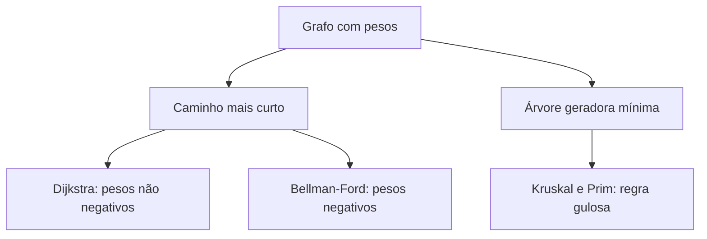

# 28 · Caminhos mínimos e árvores geradoras

**Tempo estimado:** 30 minutos · **Pré-requisito:** [[25 - Representação e busca em grafos]] e [[27 - Algoritmos gulosos]].

**Ao final você vai conseguir:**

1. Representar um grafo com pesos e calcular caminhos mínimos com Dijkstra.
2. Reconhecer quando Dijkstra não serve, e usar Bellman-Ford para pesos negativos.
3. Encontrar uma árvore geradora de peso mínimo com Kruskal ou Prim.

**Antes de começar:** no módulo 25 você percorreu grafos sem pesos, e a busca em largura dava distâncias em número de arestas. Com pesos, a distância passa a ser a soma dos custos.

---

## Para começar

Um mapa de rodovias tem distâncias em quilômetros. Você quer o caminho mais curto de uma cidade a outra, e também a menor rede de estradas que conecta todas as cidades. São dois problemas diferentes, e cada um tem seu algoritmo.

---

## Mapa do módulo



*Figura 1: os dois problemas partem de grafos com pesos. Dijkstra e Bellman-Ford tratam caminhos; Kruskal e Prim tratam a rede de menor custo.*

**Como ler:** a escolha entre Dijkstra e Bellman-Ford depende do sinal dos pesos. A árvore geradora usa a regra gulosa do módulo 27.

---

## Mini-aula 1: caminho mínimo e Dijkstra

> [!tip] Ideia
> Dijkstra fecha o vértice mais próximo ainda não fechado e melhora as distâncias de seus vizinhos. Isso só é seguro se os pesos não são negativos.

> [!info] Definição
> O **caminho mínimo** (shortest path) tem a menor soma de pesos entre dois vértices. A biblioteca registra que o algoritmo de Dijkstra exige pesos não negativos, e leva `E log V` com fila de prioridade.

Como ler: o vértice `u` escolhido tem a menor distância entre os não fechados. Se o peso fosse negativo, uma aresta futura poderia diminuir a distância de `u`, e o fechamento deixaria de ser seguro.

> [!warning] Armadilha comum
> Dijkstra com pesos negativos pode dar uma resposta errada, sem avisar. Antes de usá-lo, confira os pesos.

> [!question]- Checkpoint
> 1. Por que Dijkstra exige pesos não negativos?
> 2. Qual algoritmo você usaria com um peso negativo?
>
> > [!success]- Resposta
> > 1. Porque um vértice fechado precisa ter distância definitiva; um peso negativo quebraria isso.
> > 2. Bellman-Ford, que aceita pesos negativos sem ciclo negativo alcançável.

---

## Mini-aula 2: Bellman-Ford

> [!tip] Ideia
> Bellman-Ford relaxa todas as arestas, repetidas vezes. Como um caminho tem no máximo `V - 1` arestas, bastam essas rodadas.

> [!info] Definição
> O algoritmo de **Bellman-Ford** aceita pesos negativos, desde que não exista ciclo negativo alcançável, e leva tempo proporcional a `E · V`. A biblioteca registra essas condições.

Como ler: cada rodada pode melhorar distâncias. Com `V - 1` rodadas, todo caminho mínimo, que tem no máximo `V - 1` arestas, já foi considerado.

> [!warning] Armadilha comum
> Um ciclo de peso negativo torna o caminho mínimo indefinido. A biblioteca registra a condição, mas o exercício não a detecta.

> [!question]- Checkpoint
> 1. Por que bastam `V - 1` rodadas?
> 2. Quanto custa Bellman-Ford, em termos de `E` e `V`?
>
> > [!success]- Resposta
> > 1. Porque um caminho simples tem no máximo `V - 1` arestas.
> > 2. Proporcional a `E · V`, segundo a biblioteca.

---

## Mini-aula 3: árvore geradora mínima

> [!tip] Ideia
> Uma árvore geradora conecta todos os vértices sem ciclos. A de peso mínimo tem a menor soma de pesos. Kruskal e Prim a constroem de formas gulosas.

> [!info] Definição
> A **propriedade do corte** (cut property) diz que, com pesos distintos, a aresta de menor peso que cruza um corte pertence à árvore geradora mínima. Kruskal aplica isso ordenando as arestas e pegando as que não fecham ciclo. Prim cresce a árvore a partir de um vértice.

Como ler: Kruskal confere ciclos com rótulos de componente. Prim escolhe, a cada passo, a aresta mais barata que sai da árvore já construída.

> [!warning] Armadilha comum
> A propriedade do corte, como registrada, supõe pesos distintos. Com pesos iguais, mais de uma árvore pode ser mínima.

> [!question]- Checkpoint
> 1. Em Kruskal, quando uma aresta é descartada?
> 2. Em Prim, de onde sai a aresta escolhida?
>
> > [!success]- Resposta
> > 1. Quando fecharia um ciclo, isto é, seus extremos já estão na mesma componente.
> > 2. Da árvore construída até ali, para um vértice novo.

---

## Exercícios

Cada exercício tem um bloco com a função a completar e os testes com `assert`. Os grafos com pesos são dicionários de dicionários. Quando todos passarem, aparece `Passou!`.

### Aquecimento

**A1. Lista de arestas.** Um grafo ponderado é um dicionário `g`, em que `g[u]` é um dicionário `{v: peso}`. Complete `arestas_com_peso(g)`, que devolve a lista de todas as arestas como tuplas `(u, v, peso)`.

```python
def arestas_com_peso(g):
    """Devolve a lista de arestas como tuplas (u, v, peso)."""
    ...

assert arestas_com_peso({"a": {"b": 1}, "b": {}}) == [("a", "b", 1)], "uma aresta"
assert arestas_com_peso({"a": {}}) == [], "sem arestas"
assert arestas_com_peso({"a": {"b": 2, "c": 5}, "b": {"c": 1}, "c": {}}) == [("a", "b", 2), ("a", "c", 5), ("b", "c", 1)], "três arestas"
print("Passou!")
```

> [!hint]- Dica 1
> Use dois `for`: um para `u, vizinhos in g.items()`, e outro para `v, p in vizinhos.items()`.

> [!hint]- Dica 2
> Adicione `(u, v, p)` a uma lista.

> [!example]- Solução
> ```python
> def arestas_com_peso(g):
>     """Devolve a lista de arestas como tuplas (u, v, peso)."""
>     resultado = []
>     for u, vizinhos in g.items():
>         for v, p in vizinhos.items():
>             resultado.append((u, v, p))
>     return resultado
> ```
>
> **Erro comum:** Devolver só os pares `(u, v)`, sem o peso. A função precisa devolver as três informações.

**A2. Peso total.** Complete `peso_total(arestas)`, que soma os pesos de uma lista de arestas `(u, v, peso)`.

```python
def peso_total(arestas):
    """Soma os pesos de uma lista de arestas (u, v, peso)."""
    ...

assert peso_total([("a", "b", 2), ("b", "c", 3)]) == 5, "2 + 3"
assert peso_total([]) == 0, "sem arestas"
print("Passou!")
```

> [!hint]- Dica 1
> Percorra as arestas com `for u, v, p in arestas:`.

> [!hint]- Dica 2
> Some `p` a um total que começa em 0.

> [!example]- Solução
> ```python
> def peso_total(arestas):
>     """Soma os pesos de uma lista de arestas (u, v, peso)."""
>     total = 0
>     for u, v, p in arestas:
>         total += p
>     return total
> ```
>
> **Erro comum:** Somar `u` ou `v`, que são vértices, e não pesos.

**A3. Kruskal simples.** Complete `kruskal(vertices, arestas)`, que devolve a lista das arestas de uma árvore geradora de peso mínimo. Use a ordem crescente de peso: pegue cada aresta que não fecha ciclo. Para saber se fecha ciclo, mantenha um dicionário `rotulo` de componente de cada vértice; ao unir duas componentes, troque todos os rótulos de uma pelo da outra.

```python
def kruskal(vertices, arestas):
    """Árvore geradora mínima por Kruskal, com rótulos de componente."""
    ...

assert kruskal(["a", "b", "c"], [("a", "b", 1), ("b", "c", 2), ("a", "c", 5)]) == [("a", "b", 1), ("b", "c", 2)], "a aresta de 5 fecharia ciclo"
assert kruskal(["a", "b"], []) == [], "sem arestas, sem árvore"
print("Passou!")
```

> [!hint]- Dica 1
> Comece com `rotulo = {v: v for v in vertices}`. Ordene as arestas com `sorted(arestas, key=lambda a: a[2])`.

> [!hint]- Dica 2
> Para cada aresta `(u, v, p)`: se `rotulo[u] != rotulo[v]`, adicione à árvore e troque todos os rótulos iguais a `rotulo[v]` por `rotulo[u]`.

> [!example]- Solução
> ```python
> def kruskal(vertices, arestas):
>     """Árvore geradora mínima por Kruskal, com rótulos de componente."""
>     rotulo = {v: v for v in vertices}
>     arvore = []
>     for u, v, p in sorted(arestas, key=lambda a: a[2]):
>         if rotulo[u] != rotulo[v]:
>             arvore.append((u, v, p))
>             antigo = rotulo[v]
>             novo = rotulo[u]
>             for x in rotulo:
>                 if rotulo[x] == antigo:
>                     rotulo[x] = novo
>     return arvore
> ```
>
> **Erro comum:** Verificar só se `u` e `v` são diferentes, sem atualizar os rótulos. A aresta seguinte pode fechar um ciclo sem ser detectada.

### Praticando

**P1. Caminho mais curto.** Complete `dijkstra(g, s)`, que devolve um dicionário com a menor distância de `s` até cada vértice alcançável. Os pesos não são negativos. Use a versão simples: a cada passo, escolha o vértice ainda não fechado com menor distância, e relaxe suas arestas (se `dist[u] + p` for menor que `dist[v]`, atualize).

```python
def dijkstra(g, s):
    """Menor distância de s até cada vértice alcançável, com pesos não negativos."""
    ...

g = {"a": {"b": 1, "c": 4}, "b": {"c": 2, "d": 5}, "c": {"d": 1}, "d": {}}
assert dijkstra(g, "a") == {"a": 0, "b": 1, "c": 3, "d": 4}, "a → b → c → d é o caminho mais curto"
assert dijkstra({"a": {}}, "a") == {"a": 0}, "um vértice"
print("Passou!")
```

> [!hint]- Dica 1
> Comece com `dist = {s: 0}` e `fechados = set()`.

> [!hint]- Dica 2
> Repita: escolha `u` entre os vértices de `dist` que não estão em `fechados`, com menor `dist[u]`. Feche `u` e relaxe `g[u].items()`.

> [!example]- Solução
> ```python
> def dijkstra(g, s):
>     """Menor distância de s até cada vértice alcançável, com pesos não negativos."""
>     dist = {s: 0}
>     fechados = set()
>     while True:
>         abertos = [v for v in dist if v not in fechados]
>         if not abertos:
>             break
>         u = min(abertos, key=lambda v: dist[v])
>         fechados.add(u)
>         for v, p in g[u].items():
>             if v not in dist or dist[u] + p < dist[v]:
>                 dist[v] = dist[u] + p
>     return dist
> ```
>
> **Erro comum:** Relaxar vértices já fechados. Com pesos não negativos, a distância de um vértice fechado já é definitiva.

**P2. Com pesos negativos.** Complete `bellman_ford(g, s)`, que calcula as menores distâncias de `s` mesmo com pesos negativos (sem ciclo negativo alcançável). Repita `V - 1` vezes: relaxe todas as arestas. Devolva o dicionário de distâncias.

```python
def arestas_com_peso(g):
    # já pronta, do exercício A1
    resultado = []
    for u, vizinhos in g.items():
        for v, p in vizinhos.items():
            resultado.append((u, v, p))
    return resultado

def bellman_ford(g, s):
    """Menores distâncias a partir de s, aceitando pesos negativos sem ciclo negativo."""
    ...

g = {"a": {"b": 4, "c": 2}, "c": {"b": -1}, "b": {}}
assert bellman_ford(g, "a") == {"a": 0, "b": 1, "c": 2}, "o caminho a → c → b custa 1, menor que 4"
assert bellman_ford({"a": {}}, "a") == {"a": 0}, "um vértice"
print("Passou!")
```

> [!hint]- Dica 1
> Use `dist = {s: 0}` e `V = len(g)`.

> [!hint]- Dica 2
> Em cada uma das `V - 1` rodadas, para cada `(u, v, p)` de `arestas_com_peso(g)` com `u` em `dist`, se `v` não está em `dist` ou `dist[u] + p < dist[v]`, atualize. A função `arestas_com_peso`, do exercício A1, já está pronta.

> [!example]- Solução
> ```python
> def bellman_ford(g, s):
>     """Menores distâncias a partir de s, aceitando pesos negativos sem ciclo negativo."""
>     dist = {s: 0}
>     V = len(g)
>     arestas = arestas_com_peso(g)
>     for _ in range(V - 1):
>         for u, v, p in arestas:
>             if u in dist and (v not in dist or dist[u] + p < dist[v]):
>                 dist[v] = dist[u] + p
>     return dist
> ```
>
> **Erro comum:** Relaxar só uma vez. Um caminho com várias arestas pode precisar de várias rodadas para se fixar.

**P3. Refazer o caminho.** Os algoritmos de caminho mínimo guardam, para cada vértice, o anterior no caminho. Dado `prev` (um dicionário `{vértice: anterior}`), complete `reconstroi(prev, s, t)`, que devolve a lista de vértices do caminho de `s` até `t`, em ordem. Se `t` é `s`, o caminho é `[s]`.

```python
def reconstroi(prev, s, t):
    """Devolve o caminho de s até t, com o anterior guardado em prev."""
    ...

assert reconstroi({"b": "a", "c": "b"}, "a", "c") == ["a", "b", "c"], "a → b → c"
assert reconstroi({}, "a", "a") == ["a"], "origem igual ao destino"
print("Passou!")
```

> [!hint]- Dica 1
> Comece com `caminho = [t]` e `atual = t`. Enquanto `atual != s`, troque `atual` por `prev[atual]` e acrescente ao caminho.

> [!hint]- Dica 2
> No fim, inverta a lista com `[::-1]`.

> [!example]- Solução
> ```python
> def reconstroi(prev, s, t):
>     """Devolve o caminho de s até t, com o anterior guardado em prev."""
>     caminho = [t]
>     atual = t
>     while atual != s:
>         atual = prev[atual]
>         caminho.append(atual)
>     return caminho[::-1]
> ```
>
> **Erro comum:** Devolver a lista sem inverter. Ela sai do destino para a origem.

### Desafio

**D1. Árvore de Prim.** Num grafo não direcionado (cada aresta aparece nos dois sentidos), o algoritmo de Prim cresce uma árvore a partir de `s`: a cada passo, acrescenta a aresta de menor peso que sai da árvore para um vértice novo. Complete `prim(g, s)`, que devolve o peso total da árvore geradora mínima, com a mesma ideia.

```python
def prim(g, s):
    """Peso total da árvore geradora mínima, pelo algoritmo de Prim, a partir de s."""
    ...

g = {"a": {"b": 1, "c": 4}, "b": {"a": 1, "c": 2, "d": 5}, "c": {"a": 4, "b": 2, "d": 1}, "d": {"b": 5, "c": 1}}
assert prim(g, "a") == 4, "a-b (1), b-c (2), c-d (1)"
assert prim({"a": {}, "b": {}}, "a") is None, "grafo desconexo"
print("Passou!")
```

> [!hint]- Dica 1
> Use `dentro = {s}` e `total = 0`. Enquanto `dentro` não tem todos os vértices, escolha a aresta `(u, v, p)` de menor `p` com `u` em `dentro` e `v` fora.

> [!hint]- Dica 2
> Some `p` a `total`, adicione `v` a `dentro`. Se não há aresta para sair, o grafo é desconexo: devolva `None`.

> [!example]- Solução
> ```python
> def prim(g, s):
>     """Peso total da árvore geradora mínima, pelo algoritmo de Prim, a partir de s."""
>     dentro = {s}
>     total = 0
>     while len(dentro) < len(g):
>         candidatas = [(p, u, v) for u in dentro for v, p in g[u].items() if v not in dentro]
>         if not candidatas:
>             return None
>         p, u, v = min(candidatas)
>         total += p
>         dentro.add(v)
>     return total
> ```
>
> **Erro comum:** Escolher a aresta de menor peso entre quaisquer vértices, e não só as que saem da árvore. O resultado deixa de ser uma árvore.


---

## Mini-projeto (opcional)

Um mini-projeto que soma as distâncias de Dijkstra a todos os vértices alcançáveis. Tente sozinho antes de abrir a solução.

**Objetivo.** Devolva a soma das menores distâncias de `s` até todos os vértices alcançáveis. A função `dijkstra`, do exercício P1, já está pronta.

```python
def dijkstra(g, s):
    # já pronta, do exercício P1
    dist = {s: 0}
    fechados = set()
    while True:
        abertos = [v for v in dist if v not in fechados]
        if not abertos:
            break
        u = min(abertos, key=lambda v: dist[v])
        fechados.add(u)
        for v, p in g[u].items():
            if v not in dist or dist[u] + p < dist[v]:
                dist[v] = dist[u] + p
    return dist

def soma_menores(g, s):
    """Soma das menores distâncias de s até os vértices alcançáveis."""
    ...

assert soma_menores({"a": {"b": 1, "c": 4}, "b": {"c": 2}, "c": {}}, "a") == 0 + 1 + 3, "distâncias 0, 1 e 3"
assert soma_menores({"a": {}}, "a") == 0, "um vértice"
print("Passou!")
```

> [!hint]- Dica 1
> Calcule `dist = dijkstra(g, s)`.

> [!hint]- Dica 2
> Some todos os valores de `dist`, com `sum(dist.values())` ou com um laço.

> [!example]- Solução
> ```python
> def soma_menores(g, s):
>     """Soma das menores distâncias de s até os vértices alcançáveis."""
>     return sum(dijkstra(g, s).values())
> ```
>
> **Erro comum:** Somar as chaves, que são os vértices, em vez das distâncias.


---

## Fechando

**Resumo**

- Caminho mínimo: menor soma de pesos entre dois vértices.
- Dijkstra: pesos não negativos, `E log V` com fila de prioridade.
- Bellman-Ford: pesos negativos sem ciclo negativo; proporcional a `E · V`.
- Árvore geradora mínima: Kruskal e Prim, gulosos.
- Propriedade do corte: com pesos distintos, a aresta mais barata que cruza um corte pertence à árvore.

**Glossário rápido**

- **Caminho mínimo** (shortest path): menor soma de pesos entre dois vértices.
- **Dijkstra**: caminho mínimo com pesos não negativos.
- **Bellman-Ford**: caminho mínimo com pesos negativos.
- **Árvore geradora mínima** (minimum spanning tree): árvore que conecta tudo com menor peso.
- **Propriedade do corte** (cut property): aresta mais barata de um corte pertence à árvore.

**Perguntas de revisão**

1. Em um mapa com pesos negativos, por que Dijkstra não serve?
2. Por que Kruskal descarta a aresta que fecha ciclo?
3. Qual é a diferença entre caminho mínimo e árvore geradora mínima?

**E agora?** O próximo módulo é **Programação dinâmica**. Ela resolve problemas com subproblemas repetidos guardando cada resposta uma única vez, e corrige a falha do guloso no troco.

---

## Para ir mais fundo

- [[Shortest Paths and Minimum Spanning Trees]]
- [[Binary Heap and Priority Queue]]
