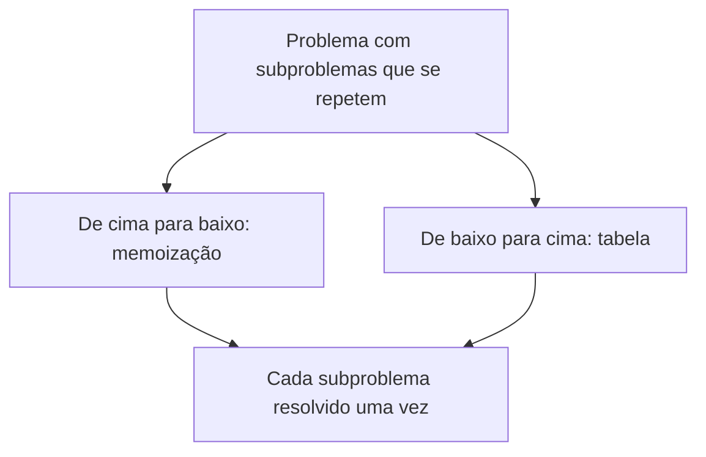

# 29 · Programação dinâmica

**Tempo estimado:** 30 minutos · **Pré-requisito:** [[27 - Algoritmos gulosos]] e [[10 - Recorrências lineares]].

**Ao final você vai conseguir:**

1. Reconhecer subproblemas que se repetem, e explicar por que isso faz uma recursão ser lenta.
2. Resolver um problema com memória (de cima para baixo) e com tabela (de baixo para cima).
3. Aplicar a tabela a problemas em que a escolha gulosa falha.

**Antes de começar:** no módulo 27 você viu a regra gulosa, e que ela falha no troco. Aqui a falha é corrigida, testando as possibilidades sem repetir cálculos.

---

## Para começar

Você calcula Fibonacci pela definição: `F_n = F_(n-1) + F_(n-2)`. Para `n = 40`, a mesma conta é refeita milhões de vezes, porque os mesmos subproblemas aparecem em muitos caminhos. Guardar cada resposta uma única vez resolve isso. Esse é o núcleo da programação dinâmica.

---

## Mapa do módulo



*Figura 1: os dois estilos resolvem o mesmo problema, cada subproblema uma única vez. A diferença é a ordem em que a tabela é preenchida.*

**Como ler:** as duas setas de baixo levam ao mesmo resultado. Escolha pelo estilo que combina com a recursão do problema.

---

## Mini-aula 1: subproblemas que se repetem

> [!tip] Ideia
> Quando o mesmo subproblema aparece em muitos lugares de uma recursão, guardar a resposta evita refazer o trabalho.

> [!info] Definição
> A **programação dinâmica** (dynamic programming) resolve problemas com **subproblemas sobrepostos**: o mesmo subproblema aparece várias vezes. A biblioteca registra que o Fibonacci tem apenas `O(n)` subproblemas distintos, e a memória evita refazer os cálculos.

Veja o Fibonacci com memória. Antes de rodar, pense: quantas vezes `fib(n)` é calculado, se o resultado é guardado?

```python
def fib(n, memo=None):
    if memo is None:
        memo = {}
    if n < 2:
        return n
    if n in memo:
        return memo[n]
    memo[n] = fib(n - 1, memo) + fib(n - 2, memo)
    return memo[n]

print(fib(20))
```

Saída real:

```
6765
```

**Como ler:** cada valor é calculado uma vez e reaproveitado. A recursão sem memória calcularia os mesmos valores muitas vezes.

> [!warning] Armadilha comum
> Programação dinâmica não é só recursão com memória. Ela exige que o problema tenha subproblemas repetidos; sem repetição, guardar não ajuda.

> [!question]- Checkpoint
> 1. No Fibonacci, quantos subproblemas distintos existem para `n`?
> 2. Por que isso importa?
>
> > [!success]- Resposta
> > 1. Cerca de `n`: os valores de 0 a `n`.
> > 2. Porque sem memória a recursão refaz subproblemas; com memória, cada um custa uma vez.

---

## Mini-aula 2: memória e tabela

> [!tip] Ideia
> Há dois jeitos de resolver: partir do problema e chamar subproblemas (de cima para baixo), ou preencher a tabela dos menores para os maiores (de baixo para cima).

> [!info] Definição
> A **memoização** (memoization) guarda, numa recursão, o resultado de cada subproblema já calculado. A **tabela** (tabulation) preenche os subproblemas na ordem dos menores para os maiores, sem recursão. A biblioteca registra os dois estilos.

Como ler: a memoização calcula só o que é preciso. A tabela calcula tudo, na ordem certa. Para Fibonacci, as duas dão o mesmo resultado, em `O(n)`.

> [!warning] Armadilha comum
> A tabela precisa ser preenchida na ordem certa: cada entrada depende de entradas já calculadas. Preencher fora da ordem dá valores errados.

> [!question]- Checkpoint
> 1. Qual estilo não usa recursão?
> 2. Por que a tabela de Fibonacci preenche de 2 em diante?
>
> > [!success]- Resposta
> > 1. A tabela, de baixo para cima.
> > 2. Porque `t[i]` depende de `t[i - 1]` e `t[i - 2]`, que precisam estar prontos.

---

## Mini-aula 3: quando a guloso falha

> [!tip] Ideia
> A programação dinâmica testa as possibilidades sem jogar fora as que podem ser ótimas, por isso resolve o troco que o guloso erra.

> [!info] Definição
> No troco, a tabela guarda o menor número de moedas para cada valor de 0 até o alvo. Cada valor usa valores menores já calculados. A biblioteca cita a mochila 0-1 e a distância de edição como exemplos clássicos, sem detalhar suas soluções.

Como ler: para o valor 6, a tabela já tem o menor número para 3, para 2 e para 5, e escolhe a melhor combinação. Não há uma escolha definitiva que impeça a melhor.

> [!warning] Armadilha comum
> A biblioteca dá os exemplos de mochila 0-1 e distância de edição, mas não a solução deles. Neste curso, eles não são resolvidos.

> [!question]- Checkpoint
> 1. Com moedas `[1, 3, 4]`, qual é o menor número para o valor 6?
> 2. A tabela de troco usa a ordem dos valores menores para os maiores?
>
> > [!success]- Resposta
> > 1. Dois, usando `3 + 3`.
> > 2. Sim, porque cada valor depende de valores menores.

---

## Exercícios

Cada exercício tem um bloco com a função a completar e os testes com `assert`. Quando todos passarem, aparece `Passou!`.

### Aquecimento

**A1. Fibonacci com memória.** Complete `fib_memo(n, memo=None)`, que calcula `F_n` pela recursão, guardando os resultados em `memo` (um dicionário). Assim, cada subproblema é resolvido uma vez só.

```python
def fib_memo(n, memo=None):
    """Calcula F_n pela recursão, guardando os subproblemas em memo."""
    ...

assert fib_memo(0) == 0, "F_0"
assert fib_memo(10) == 55, "F_10"
assert fib_memo(50) == 12586269025, "F_50, sem refazer subproblemas"
print("Passou!")
```

> [!hint]- Dica 1
> Se `memo is None`, crie `memo = {}`. Se `n < 2`, devolva `n`.

> [!hint]- Dica 2
> Se `n` já está em `memo`, devolva `memo[n]`. Senão, calcule `fib_memo(n - 1, memo) + fib_memo(n - 2, memo)`, guarde e devolva.

> [!example]- Solução
> ```python
> def fib_memo(n, memo=None):
>     """Calcula F_n pela recursão, guardando os subproblemas em memo."""
>     if memo is None:
>         memo = {}
>     if n < 2:
>         return n
>     if n in memo:
>         return memo[n]
>     memo[n] = fib_memo(n - 1, memo) + fib_memo(n - 2, memo)
>     return memo[n]
> ```
>
> **Erro comum:** Esquecer de passar `memo` nas chamadas recursivas. Cada chamada criaria um dicionário novo, e a memória não serviria.

**A2. Fibonacci com tabela.** Complete `fib_tabela(n)`, que calcula `F_n` de baixo para cima: preenche uma lista `t` com `t[0] = 0`, `t[1] = 1` e `t[i] = t[i - 1] + t[i - 2]`, e devolve `t[n]`.

```python
def fib_tabela(n):
    """Calcula F_n de baixo para cima, preenchendo uma tabela."""
    ...

assert fib_tabela(0) == 0, "F_0"
assert fib_tabela(1) == 1, "F_1"
assert fib_tabela(10) == 55, "F_10"
print("Passou!")
```

> [!hint]- Dica 1
> Crie `t = [0, 1] + [0] * max(0, n - 1)`, de modo que `t` tenha pelo menos `n + 1` posições.

> [!hint]- Dica 2
> Para `i` de 2 até `n`, preencha `t[i]`. Devolva `t[n]`.

> [!example]- Solução
> ```python
> def fib_tabela(n):
>     """Calcula F_n de baixo para cima, preenchendo uma tabela."""
>     t = [0, 1] + [0] * max(0, n - 1)
>     for i in range(2, n + 1):
>         t[i] = t[i - 1] + t[i - 2]
>     return t[n]
> ```
>
> **Erro comum:** Calcular `t[n]` sem preencher os intermediários. O valor sai errado, porque as posições ficam zeradas.

**A3. Subproblemas distintos.** Quantos valores diferentes o cálculo de `F_n` com memória precisa guardar? Complete `subproblemas(n)`, que roda `fib_memo(n, memo)` com um dicionário vazio e devolve o tamanho de `memo`. A função `fib_memo` já está pronta.

```python
def fib_memo(n, memo=None):
    # já pronta, do exercício A1
    if memo is None:
        memo = {}
    if n < 2:
        return n
    if n in memo:
        return memo[n]
    memo[n] = fib_memo(n - 1, memo) + fib_memo(n - 2, memo)
    return memo[n]

def subproblemas(n):
    """Número de subproblemas distintos guardados ao calcular F_n com memória."""
    ...

assert subproblemas(10) == 9, "os valores de 2 a 10"
assert subproblemas(2) == 1, "só o 2"
assert subproblemas(1) == 0, "caso base, nada a guardar"
print("Passou!")
```

> [!hint]- Dica 1
> Crie `memo = {}`, chame `fib_memo(n, memo)` e devolva `len(memo)`.

> [!hint]- Dica 2
> Só entram no dicionário os valores de `n` de 2 em diante.

> [!example]- Solução
> ```python
> def subproblemas(n):
>     """Número de subproblemas distintos guardados ao calcular F_n com memória."""
>     memo = {}
>     fib_memo(n, memo)
>     return len(memo)
> ```
>
> **Erro comum:** Devolver `len(memo)` antes de chamar a função. O dicionário ainda estaria vazio.

### Praticando

**P1. Caminhos numa grade.** Quantos caminhos há do canto superior esquerdo ao inferior direito de uma grade de `m` linhas e `n` colunas, andando só para a direita ou para baixo? Complete `grade_caminhos(m, n)` com uma tabela: cada célula vale 1 na primeira linha e na primeira coluna, e a soma de cima com a esquerda nas demais.

```python
def grade_caminhos(m, n):
    """Número de caminhos até o canto inferior direito de uma grade m x n, só para direita e baixo."""
    ...

assert grade_caminhos(2, 2) == 2, "duas formas"
assert grade_caminhos(3, 3) == 6, "seis formas"
assert grade_caminhos(1, 5) == 1, "uma linha só tem um caminho"
print("Passou!")
```

> [!hint]- Dica 1
> Crie `t = [[1] * n for _ in range(m)]`.

> [!hint]- Dica 2
> Para `i` de 1 a `m - 1` e `j` de 1 a `n - 1`: `t[i][j] = t[i - 1][j] + t[i][j - 1]`. Devolva `t[m - 1][n - 1]`.

> [!example]- Solução
> ```python
> def grade_caminhos(m, n):
>     """Número de caminhos até o canto inferior direito de uma grade m x n, só para direita e baixo."""
>     t = [[1] * n for _ in range(m)]
>     for i in range(1, m):
>         for j in range(1, n):
>             t[i][j] = t[i - 1][j] + t[i][j - 1]
>     return t[m - 1][n - 1]
> ```
>
> **Erro comum:** Começar a tabela com zeros. A primeira linha e a primeira coluna têm um único caminho, então valem 1.

**P2. Sem vizinhos seguidos.** Dada uma lista de números não negativos, escolha alguns, sem pegar dois elementos vizinhos, para maximizar a soma. Complete `soma_sem_vizinhos(lista)`. Use duas variáveis: `incl` (a melhor soma que pega o último) e `excl` (a melhor soma que não pega).

```python
def soma_sem_vizinhos(lista):
    """Maior soma de elementos não vizinhos de uma lista não negativa."""
    ...

assert soma_sem_vizinhos([2, 7, 9, 3, 1]) == 12, "2 + 9 + 1"
assert soma_sem_vizinhos([1, 2, 3, 1]) == 4, "1 + 3"
assert soma_sem_vizinhos([]) == 0, "lista vazia"
print("Passou!")
```

> [!hint]- Dica 1
> Em cada elemento `x`: `novo_excl = max(incl, excl)`, depois `incl = excl + x` e `excl = novo_excl`.

> [!hint]- Dica 2
> No fim, devolva `max(incl, excl)`.

> [!example]- Solução
> ```python
> def soma_sem_vizinhos(lista):
>     """Maior soma de elementos não vizinhos de uma lista não negativa."""
>     incl = 0
>     excl = 0
>     for x in lista:
>         novo_excl = max(incl, excl)
>         incl = excl + x
>         excl = novo_excl
>     return max(incl, excl)
> ```
>
> **Erro comum:** Atualizar `incl` antes de guardar o `excl` anterior. A soma usa o `excl` de antes do elemento atual.

**P3. Subsequência comum.** O tamanho da maior subsequência comum de duas palavras (os caracteres na mesma ordem, mas não necessariamente seguidos). Complete `lcs(a, b)` com uma tabela `t` de `(m + 1) x (n + 1)`, zerada na primeira linha e coluna.

```python
def lcs(a, b):
    """Tamanho da maior subsequência comum de a e b."""
    ...

assert lcs("abcde", "ace") == 3, "a, c, e"
assert lcs("abc", "def") == 0, "nenhuma letra em comum"
assert lcs("", "x") == 0, "palavra vazia"
print("Passou!")
```

> [!hint]- Dica 1
> Se `a[i - 1] == b[j - 1]`, `t[i][j] = t[i - 1][j - 1] + 1`. Senão, `t[i][j] = max(t[i - 1][j], t[i][j - 1])`.

> [!hint]- Dica 2
> Devolva `t[m][n]`.

> [!example]- Solução
> ```python
> def lcs(a, b):
>     """Tamanho da maior subsequência comum de a e b."""
>     m, n = len(a), len(b)
>     t = [[0] * (n + 1) for _ in range(m + 1)]
>     for i in range(1, m + 1):
>         for j in range(1, n + 1):
>             if a[i - 1] == b[j - 1]:
>                 t[i][j] = t[i - 1][j - 1] + 1
>             else:
>                 t[i][j] = max(t[i - 1][j], t[i][j - 1])
>     return t[m][n]
> ```
>
> **Erro comum:** Usar `a[i]` e `b[j]` com os índices da tabela, que começam em 1. A tabela tem uma linha e uma coluna a mais.

### Desafio

**D1. Moedas por tabela.** Complete `moedas_min(valor, moedas)`, que devolve o menor número de moedas que soma `valor`, ou `None` se não é possível. Preencha uma tabela `t` de `0` até `valor`, com `t[0] = 0` e `None` para o que ainda não se conseguiu.

```python
def moedas_min(valor, moedas):
    """Menor número de moedas que soma valor, por tabela; None se impossível."""
    ...

assert moedas_min(6, [1, 3, 4]) == 2, "3 + 3"
assert moedas_min(11, [1, 5, 6]) == 2, "5 + 6"
assert moedas_min(3, [2]) is None, "impossível"
assert moedas_min(0, [1]) == 0, "valor zero"
print("Passou!")
```

> [!hint]- Dica 1
> Para cada `v` de 1 até `valor`, teste cada moeda `m <= v` com `t[v - m]` diferente de `None`. O candidato é `t[v - m] + 1`.

> [!hint]- Dica 2
> Guarde o menor candidato em `t[v]`. No fim, devolva `t[valor]`.

> [!example]- Solução
> ```python
> def moedas_min(valor, moedas):
>     """Menor número de moedas que soma valor, por tabela; None se impossível."""
>     t = [0] + [None] * valor
>     for v in range(1, valor + 1):
>         for m in moedas:
>             if m <= v and t[v - m] is not None:
>                 candidato = t[v - m] + 1
>                 if t[v] is None or candidato < t[v]:
>                     t[v] = candidato
>     return t[valor]
> ```
>
> **Erro comum:** Somar 1 a `None`, quando `t[v - m]` ainda não foi calculado. Isso dá erro, e precisa ser evitado com a checagem.


---

## Mini-projeto (opcional)

Um mini-projeto que usa a tabela de Fibonacci para listar os termos até um limite. Tente sozinho antes de abrir a solução.

**Objetivo.** Devolva a lista dos termos de Fibonacci que não passam de `limite`, em ordem. A função `fib_tabela`, do exercício A2, já está pronta.

```python
def fib_tabela(n):
    # já pronta, do exercício A2
    t = [0, 1] + [0] * max(0, n - 1)
    for i in range(2, n + 1):
        t[i] = t[i - 1] + t[i - 2]
    return t[n]

def fib_ate_limite(limite):
    """Lista dos termos de Fibonacci que não passam de limite."""
    ...

assert fib_ate_limite(10) == [0, 1, 1, 2, 3, 5, 8], "até 10"
assert fib_ate_limite(0) == [0], "só o zero"
print("Passou!")
```

> [!hint]- Dica 1
> Comece com `resultado = []` e `n = 0`. Enquanto `fib_tabela(n) <= limite`, acrescente o termo e aumente `n`.

> [!hint]- Dica 2
> Use `while`, com o mesmo cuidado do módulo 22.

> [!example]- Solução
> ```python
> def fib_ate_limite(limite):
>     """Lista dos termos de Fibonacci que não passam de limite."""
>     resultado = []
>     n = 0
>     while fib_tabela(n) <= limite:
>         resultado.append(fib_tabela(n))
>         n += 1
>     return resultado
> ```
>
> **Erro comum:** Usar `<` no lugar de `<=`. O termo igual ao limite ficaria de fora.


---

## Fechando

**Resumo**

- Programação dinâmica: subproblemas sobrepostos, cada um resolvido uma vez.
- Memoização: recursão com memória, de cima para baixo.
- Tabela: preenchimento de baixo para cima, na ordem certa.
- Fibonacci tem cerca de `n` subproblemas distintos.
- Ela corrige o troco, onde o guloso falha.

**Glossário rápido**

- **Subproblemas sobrepostos** (overlapping subproblems): mesmo subproblema em vários caminhos.
- **Memoização** (memoization): guardar resultados de uma recursão.
- **Tabela** (tabulation): preencher os subproblemas de baixo para cima.
- **Mochila 0-1**: cada item é levado inteiro ou não é levado.
- **Distância de edição**: número mínimo de operações para transformar uma palavra em outra.

**Perguntas de revisão**

1. Por que a recursão de Fibonacci sem memória é lenta?
2. Qual é a diferença entre memoização e tabela?
3. Por que a programação dinâmica resolve o troco que o guloso não resolve?

**E agora?** O próximo módulo é **Union-Find**. Ele mantém conjuntos disjuntos, e é a estrutura por trás da ordenação de arestas em Kruskal.

---

## Para ir mais fundo

- [[Dynamic Programming]]
- [[Linear Recurrence Relations]]
