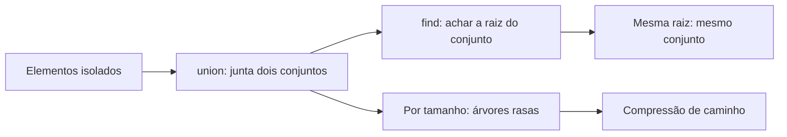

# 30 · Union-Find

**Tempo estimado:** 30 minutos · **Pré-requisito:** [[25 - Representação e busca em grafos]] e [[19 - Custo amortizado]].

**Ao final você vai conseguir:**

1. Explicar o que são conjuntos disjuntos, e as duas operações `find` e `union`.
2. Implementar a união por tamanho, que mantém as árvores rasas.
3. Entender a compressão de caminho, e o custo amortizado que a biblioteca registra.

**Antes de começar:** no módulo 25 você decidiu se dois vértices estão conectados. Union-Find faz isso de forma incremental, à medida que as conexões aparecem.

---

## Para começar

Uma rede de computadores começa com cada máquina isolada. Cada cabo conecta duas máquinas, e você quer saber, a qualquer momento, se duas delas estão na mesma rede. Refazer a busca de conexões a cada cabo é lento. Union-Find guarda os grupos e responde essa pergunta rápido.

---

## Mapa do módulo



*Figura 1: as operações partem de elementos isolados. A união por tamanho e a compressão mantêm as buscas rápidas.*

**Como ler:** `union` e `find` são as duas operações. As caixas da direita mostram as técnicas que deixam as buscas baratas.

---

## Mini-aula 1: conjuntos disjuntos

> [!tip] Ideia
> Cada conjunto tem uma raiz, que o representa. Dois elementos estão no mesmo conjunto quando suas raízes são iguais.

> [!info] Definição
> Um **union-find** (ou disjoint set union) mantém uma partição dos elementos em conjuntos disjuntos. A operação `find` diz a qual conjunto um elemento pertence; `union` junta dois conjuntos. Os conjuntos formam uma partição dos elementos: "estar no mesmo conjunto" é uma relação de equivalência (módulo 03).

Veja a estrutura: `pai[x]` aponta para o pai de `x`, e uma raiz aponta para si mesma. Antes de rodar, preveja o vetor `pai` depois de duas uniões.

```python
pai = list(range(4))
tam = [1] * 4

def achar(pai, x):
    while pai[x] != x:
        x = pai[x]
    return x

def juntar(pai, tam, a, b):
    ra, rb = achar(pai, a), achar(pai, b)
    if ra == rb:
        return
    if tam[ra] < tam[rb]:
        ra, rb = rb, ra
    pai[rb] = ra
    tam[ra] += tam[rb]

juntar(pai, tam, 0, 1)
juntar(pai, tam, 2, 3)
print(pai)
```

Saída real:

```
[0, 0, 2, 2]
```

**Como ler:** a primeira união liga 1 à raiz 0; a segunda liga 3 à raiz 2. O vetor final mostra duas árvores de tamanho dois.

> [!warning] Armadilha comum
> `union` sem usar as raízes pode criar caminhos longos. A busca fica lenta, e o ganho do union-find se perde.

> [!question]- Checkpoint
> 1. Com `pai = [0, 0, 2]`, `0` e `1` estão no mesmo conjunto?
> 2. E `0` e `2`?
>
> > [!success]- Resposta
> > 1. Sim: `1` aponta para `0`, que é raiz.
> > 2. Não: `2` é raiz de outro conjunto.

---

## Mini-aula 2: união por tamanho

> [!tip] Ideia
> Ao unir dois conjuntos, a raiz do menor passa a apontar para a raiz do maior. Assim, as árvores crescem pouco em profundidade.

> [!info] Definição
> Na **união por tamanho** (weighted quick-union), a árvore menor é pendurada na maior. A biblioteca registra que, com essa regra, a profundidade de qualquer nó é no máximo `lg n`, e portanto cada operação é logarítmica.

Como ler: a profundidade cresce só quando dois conjuntos de mesmo tamanho se unem. Por isso o limite é logarítmico.

> [!warning] Armadilha comum
> A união por tamanho não é o mesmo que ordenar elementos. Ela escolhe qual raiz fica embaixo, e não qual valor é menor.

> [!question]- Checkpoint
> 1. Ao unir um conjunto de 3 elementos com um de 1, qual raiz fica embaixo?
> 2. Qual é o limite de profundidade, pela biblioteca?
>
> > [!success]- Resposta
> > 1. A raiz do conjunto de 1 elemento, o menor.
> > 2. `lg n`, para `n` elementos.

---

## Mini-aula 3: compressão e custo

> [!tip] Ideia
> Ao achar a raiz de um elemento, faça o caminho inteiro apontar para ela. Buscas seguintes ficam quase imediatas.

> [!info] Definição
> A **compressão de caminho** (path compression) atualiza os pais no caminho até a raiz. Com união por tamanho e compressão, a biblioteca registra custo amortizado proporcional à inversa da função de Ackermann, que cresce muito lentamente. A definição dessa função não está no material.

Como ler: a compressão é uma otimização sobre a união por tamanho. Juntas, elas tornam o custo por operação praticamente constante, no sentido amortizado.

> [!warning] Armadilha comum
> O custo `α(n)` é amortizado sobre uma sequência de operações, e não o custo de uma única busca. Uma busca isolada pode ser mais longa.

> [!question]- Checkpoint
> 1. O que a compressão faz com os pais no caminho?
> 2. O custo registrado é de uma operação isolada ou amortizado?
>
> > [!success]- Resposta
> > 1. Faz todos apontarem direto para a raiz.
> > 2. Amortizado, sobre uma sequência de operações.

---

## Exercícios

Cada exercício tem um bloco com a função a completar e os testes com `assert`. Quando todos passarem, aparece `Passou!`.

### Aquecimento

**A1. Criar os conjuntos.** Uma estrutura union-find guarda, para `n` elementos, dois vetores: `pai`, em que `pai[x]` começa como `x`, e `tam`, com o tamanho de cada conjunto, que começa como `1`. Complete `criar(n)`, que devolve a tupla `(pai, tam)`.

```python
def criar(n):
    """Cria a estrutura para n elementos: cada um é a própria raiz, com tamanho 1."""
    ...

assert criar(3) is not None, "a função ainda não devolve (pai, tam)"
pai, tam = criar(3)
assert pai == [0, 1, 2], "cada elemento é a própria raiz"
assert tam == [1, 1, 1], "conjuntos unitários"
assert criar(0) == ([], []), "nenhum elemento"
print("Passou!")
```

> [!hint]- Dica 1
> Use `list(range(n))` para `pai`.

> [!hint]- Dica 2
> Use `[1] * n` para `tam`.

> [!example]- Solução
> ```python
> def criar(n):
>     """Cria a estrutura para n elementos: cada um é a própria raiz, com tamanho 1."""
>     return (list(range(n)), [1] * n)
> ```
>
> **Erro comum:** Começar `pai` com zeros. Então todos os elementos seriam raízes do mesmo conjunto.

**A2. Achar a raiz.** Complete `achar(pai, x)`, que devolve a raiz do conjunto de `x`: siga `pai[x]` até encontrar um elemento que é pai de si mesmo.

```python
def achar(pai, x):
    """Devolve a raiz do conjunto de x, seguindo os pais."""
    ...

assert achar([0, 0, 1, 2], 3) == 0, "3 → 2 → 1 → 0"
assert achar([0, 1, 2], 2) == 2, "2 é raiz"
print("Passou!")
```

> [!hint]- Dica 1
> Enquanto `pai[x] != x`, troque `x` por `pai[x]`.

> [!hint]- Dica 2
> Ao sair do laço, devolva `x`.

> [!example]- Solução
> ```python
> def achar(pai, x):
>     """Devolve a raiz do conjunto de x, seguindo os pais."""
>     while pai[x] != x:
>         x = pai[x]
>     return x
> ```
>
> **Erro comum:** Devolver `pai[x]` em vez de seguir até a raiz. Com mais de um nível, o resultado ainda não seria a raiz.

**A3. Juntar conjuntos.** Complete `juntar(pai, tam, a, b)`, que une os conjuntos de `a` e `b`. Pela união por tamanho, a raiz do menor conjunto passa a apontar para a raiz do maior. Devolva `True` se houve união, e `False` se `a` e `b` já estavam no mesmo conjunto. A função `achar`, já pronta, encontra as raízes.

```python
def achar(pai, x):
    # já pronta, do exercício A2
    while pai[x] != x:
        x = pai[x]
    return x

def juntar(pai, tam, a, b):
    """Une os conjuntos de a e b por tamanho. True se houve união, False se já estavam juntos."""
    ...

pai, tam = [0, 1, 2], [1, 1, 1]
assert juntar(pai, tam, 0, 1) == True, "dois conjuntos diferentes se unem"
assert juntar(pai, tam, 1, 0) == False, "já estavam juntos"
assert achar(pai, 1) == achar(pai, 0), "mesma raiz depois da união"
print("Passou!")
```

> [!hint]- Dica 1
> Calcule `ra = achar(pai, a)` e `rb = achar(pai, b)`. Se `ra == rb`, `return False`.

> [!hint]- Dica 2
> Se `tam[ra] < tam[rb]`, troque `ra` e `rb`. Depois, `pai[rb] = ra` e `tam[ra] += tam[rb]`.

> [!example]- Solução
> ```python
> def juntar(pai, tam, a, b):
>     """Une os conjuntos de a e b por tamanho. True se houve união, False se já estavam juntos."""
>     ra = achar(pai, a)
>     rb = achar(pai, b)
>     if ra == rb:
>         return False
>     if tam[ra] < tam[rb]:
>         ra, rb = rb, ra
>     pai[rb] = ra
>     tam[ra] += tam[rb]
>     return True
> ```
>
> **Erro comum:** Unir sem usar as raízes, ligando `a` diretamente a `b`. O conjunto pode ficar com uma árvore profunda.

### Praticando

**P1. Mesmo conjunto.** Complete `mesmo(pai, a, b)`, que devolve `True` se `a` e `b` estão no mesmo conjunto. A função `achar`, já pronta, encontra as raízes.

```python
def achar(pai, x):
    # já pronta, do exercício A2
    while pai[x] != x:
        x = pai[x]
    return x

def mesmo(pai, a, b):
    """True se a e b estão no mesmo conjunto."""
    ...

pai = [0, 0, 2]
assert mesmo(pai, 0, 1) == True, "1 aponta para 0"
assert mesmo(pai, 0, 2) == False, "2 está em outro conjunto"
assert mesmo(pai, 2, 2) == True, "todo elemento está no próprio conjunto"
print("Passou!")
```

> [!hint]- Dica 1
> Compare `achar(pai, a)` com `achar(pai, b)`.

> [!hint]- Dica 2
> Use `==` para o resultado.

> [!example]- Solução
> ```python
> def mesmo(pai, a, b):
>     """True se a e b estão no mesmo conjunto."""
>     return achar(pai, a) == achar(pai, b)
> ```
>
> **Erro comum:** Comparar `a` com `b` diretamente. Dois elementos diferentes podem estar no mesmo conjunto.

**P2. Quantos conjuntos.** Complete `numero_conjuntos(pai)`, que conta os conjuntos disjuntos. Cada conjunto tem exatamente uma raiz, que é um elemento com `pai[x] == x`.

```python
def numero_conjuntos(pai):
    """Conta os conjuntos: um por raiz, isto é, por elemento com pai[x] == x."""
    ...

assert numero_conjuntos([0, 0, 2]) == 2, "{0, 1} e {2}"
assert numero_conjuntos([0, 1, 2]) == 3, "três conjuntos unitários"
assert numero_conjuntos([]) == 0, "nenhum elemento"
print("Passou!")
```

> [!hint]- Dica 1
> Conte os `x` com `pai[x] == x`.

> [!hint]- Dica 2
> Use `sum(1 for x in range(len(pai)) if pai[x] == x)`, ou um laço.

> [!example]- Solução
> ```python
> def numero_conjuntos(pai):
>     """Conta os conjuntos: um por raiz, isto é, por elemento com pai[x] == x."""
>     total = 0
>     for x in range(len(pai)):
>         if pai[x] == x:
>             total += 1
>     return total
> ```
>
> **Erro comum:** Contar todos os elementos, e não só as raízes.

**P3. Conexões.** Complete `conjuntos_de(n, pares)`, que cria os conjuntos para `n` elementos, une cada par de `pares` e devolve quantos conjuntos restaram. As funções `criar`, `juntar` e `numero_conjuntos` já estão prontas.

```python
def criar(n):
    # já pronta, do exercício A1
    return (list(range(n)), [1] * n)

def achar(pai, x):
    # já pronta, do exercício A2
    while pai[x] != x:
        x = pai[x]
    return x

def juntar(pai, tam, a, b):
    # já pronta, do exercício A3
    ra = achar(pai, a)
    rb = achar(pai, b)
    if ra == rb:
        return False
    if tam[ra] < tam[rb]:
        ra, rb = rb, ra
    pai[rb] = ra
    tam[ra] += tam[rb]
    return True

def numero_conjuntos(pai):
    # já pronta, do exercício P2
    total = 0
    for x in range(len(pai)):
        if pai[x] == x:
            total += 1
    return total

def conjuntos_de(n, pares):
    """Une cada par e devolve quantos conjuntos restaram."""
    ...

assert conjuntos_de(4, [(0, 1), (2, 3)]) == 2, "{0, 1} e {2, 3}"
assert conjuntos_de(3, []) == 3, "sem uniões"
assert conjuntos_de(3, [(0, 1), (1, 2)]) == 1, "tudo junto"
print("Passou!")
```

> [!hint]- Dica 1
> Use `pai, tam = criar(n)`. Para cada `(a, b)` em `pares`, chame `juntar(pai, tam, a, b)`.

> [!hint]- Dica 2
> No fim, devolva `numero_conjuntos(pai)`.

> [!example]- Solução
> ```python
> def conjuntos_de(n, pares):
>     """Une cada par e devolve quantos conjuntos restaram."""
>     pai, tam = criar(n)
>     for a, b in pares:
>         juntar(pai, tam, a, b)
>     return numero_conjuntos(pai)
> ```
>
> **Erro comum:** Esquecer de passar `tam` para `juntar`. A união por tamanho depende dele.

### Desafio

**D1. Compressão de caminho.** Para deixar as buscas rápidas, ao achar a raiz de `x`, faça todos os elementos do caminho apontarem diretamente para a raiz. Complete `achar_compressao(pai, x)`, que devolve a raiz e atualiza `pai` ao longo do caminho.

```python
def achar_compressao(pai, x):
    """Devolve a raiz de x, e faz os elementos do caminho apontarem para ela."""
    ...

pai = [0, 0, 1, 2]
assert achar_compressao(pai, 3) == 0, "a raiz de 3 é 0"
assert pai[3] == 0, "3 passa a apontar direto para 0"
assert achar_compressao(pai, 0) == 0, "a raiz é ela mesma"
print("Passou!")
```

> [!hint]- Dica 1
> Se `pai[x] != x`, calcule `pai[x] = achar_compressao(pai, pai[x])`.

> [!hint]- Dica 2
> Ao final, devolva `pai[x]`. Se `x` já é raiz, a função devolve `x`.

> [!example]- Solução
> ```python
> def achar_compressao(pai, x):
>     """Devolve a raiz de x, e faz os elementos do caminho apontarem para ela."""
>     if pai[x] != x:
>         pai[x] = achar_compressao(pai, pai[x])
>     return pai[x]
> ```
>
> **Erro comum:** Devolver a raiz sem atualizar `pai[x]`. A compressão é justamente guardar o atalho.


---

## Mini-projeto (opcional)

Um mini-projeto que agrupa elementos conectados por pares. Tente sozinho antes de abrir a solução.

**Objetivo.** Dado `n` elementos e uma lista de pares unidos, devolva os grupos: cada grupo é uma lista ordenada de elementos, e a lista de grupos é ordenada pelo menor elemento de cada grupo. Use `criar`, `juntar` e `achar` já prontas.

```python
def criar(n):
    # já pronta, do exercício A1
    return (list(range(n)), [1] * n)

def achar(pai, x):
    # já pronta, do exercício A2
    while pai[x] != x:
        x = pai[x]
    return x

def juntar(pai, tam, a, b):
    # já pronta, do exercício A3
    ra = achar(pai, a)
    rb = achar(pai, b)
    if ra == rb:
        return False
    if tam[ra] < tam[rb]:
        ra, rb = rb, ra
    pai[rb] = ra
    tam[ra] += tam[rb]
    return True

def grupos(n, pares):
    """Devolve os grupos de elementos unidos, cada um ordenado, na ordem do menor elemento."""
    ...

assert grupos(4, [(0, 1), (2, 3)]) == [[0, 1], [2, 3]], "dois grupos"
assert grupos(3, []) == [[0], [1], [2]], "sem uniões"
assert grupos(3, [(2, 0)]) == [[0, 2], [1]], "a ordem dentro do grupo é crescente"
print("Passou!")
```

> [!hint]- Dica 1
> Depois das uniões, para cada `x` de `0` a `n - 1`, use `r = achar(pai, x)` como chave de um dicionário de listas.

> [!hint]- Dica 2
> Ordene cada lista de grupo e, no fim, devolva as listas ordenadas pela primeira posição.

> [!example]- Solução
> ```python
> def grupos(n, pares):
>     """Devolve os grupos de elementos unidos, cada um ordenado, na ordem do menor elemento."""
>     pai, tam = criar(n)
>     for a, b in pares:
>         juntar(pai, tam, a, b)
>     por_raiz = {}
>     for x in range(n):
>         por_raiz.setdefault(achar(pai, x), []).append(x)
>     return sorted((sorted(g) for g in por_raiz.values()), key=lambda g: g[0])
> ```
>
> **Erro comum:** Agrupar pela raiz sem ordenar. A saída depende da ordem da raiz, e não da ordem dos elementos.


---

## Fechando

**Resumo**

- Union-Find: conjuntos disjuntos com `find` e `union`.
- Raiz representa o conjunto; mesma raiz significa mesmo conjunto.
- União por tamanho: profundidade no máximo `lg n`.
- Compressão de caminho: buscas seguintes ficam mais rápidas.
- Custo amortizado registrado: inversa de Ackermann.

**Glossário rápido**

- **Union-Find** (disjoint set union): estrutura de conjuntos disjuntos.
- **Find**: achar a raiz do conjunto de um elemento.
- **Union**: juntar dois conjuntos.
- **União por tamanho** (weighted quick-union): pendurar a árvore menor na maior.
- **Compressão de caminho** (path compression): apontar o caminho direto para a raiz.

**Perguntas de revisão**

1. Por que `find` precisa seguir até a raiz, e não parar no pai?
2. Por que a união por tamanho mantém a profundidade logarítmica?
3. Como Union-Find ajuda na conectividade de um grafo que recebe arestas aos poucos?

**E agora?** O próximo e último módulo do bloco é **Tries**. Elas guardam palavras por prefixos, e servem para buscas por começo de texto.

---

## Para ir mais fundo

- [[Union-Find]]
- [[Amortized Analysis]]
