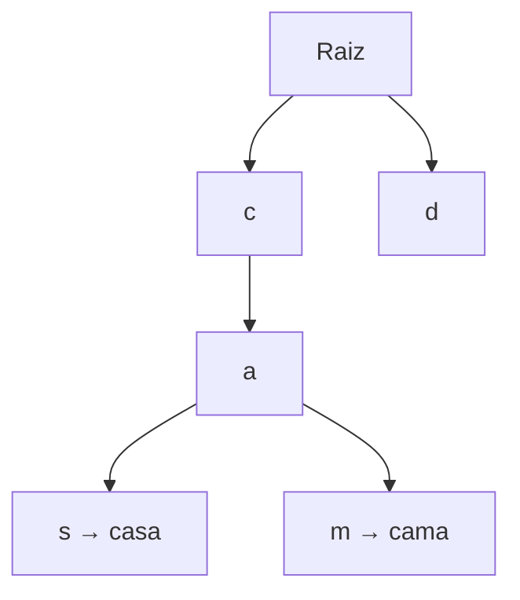

# 31 · Tries

**Tempo estimado:** 30 minutos · **Pré-requisito:** [[20 - Tabelas hash]] e [[22 - Árvores de busca]].

**Ao final você vai conseguir:**

1. Explicar como uma trie guarda palavras compartilhando prefixos.
2. Inserir, buscar palavras inteiras e buscar prefixos.
3. Usar a trie para sugestões por prefixo e para padrões com curinga.

**Antes de começar:** no módulo 20 você buscou chaves por hash, e no 22 por árvores ordenadas. Uma trie busca letra por letra, e é uma árvore cujas arestas são letras.

---

## Para começar

Você digita "ca" num campo de busca e quer ver sugestões: "casa", "cama", "caso". Uma lista de todas as palavras seria lenta. Uma trie guarda as palavras por prefixos: quem começa com "ca" fica no mesmo caminho. Sugestões saem de percorrer esse caminho.

---

## Mapa do módulo



*Figura 1: as palavras "casa" e "cama" compartilham o caminho de "ca". Cada letra é uma aresta, e cada nó é um prefixo.*

**Como ler:** os nós são prefixos. Duas palavras com o mesmo começo dividem o caminho até onde se separam.

---

## Mini-aula 1: prefixos compartilhados

> [!tip] Ideia
> Uma trie é uma árvore em que cada caminho da raiz soletra um prefixo. Palavras com o mesmo começo compartilham nós.

> [!info] Definição
> Uma **trie** é uma árvore de busca para strings, em que as chaves são soletradas ao longo dos caminhos. A biblioteca registra as variantes R-way (um filho por símbolo do alfabeto) e TST (três ligações por nó). Aqui usamos um dicionário por nó, que é uma forma de R-way.

Em Python, cada nó é um dicionário: a chave é a letra, e o valor é o nó seguinte. A chave `"$"` marca o fim de uma palavra. Depois de inserir `"ca"`, o dicionário fica `{"c": {"a": {"$": True}}}`.

Como ler: depois de inserir "ca", o caminho `c → a` existe, e o nó `a` tem a marca `"$"`, porque "ca" é uma palavra.

> [!warning] Armadilha comum
> Um prefixo com caminho na trie não é necessariamente uma palavra. Só o nó com `"$"` marca uma palavra completa.

> [!question]- Checkpoint
> 1. Depois de inserir `"casa"`, o caminho `c → a → s` existe?
> 2. `"cas"` é uma palavra inserida?
>
> > [!success]- Resposta
> > 1. Sim, e também `c → a → s → a`.
> > 2. Não, só é prefixo. A palavra foi `"casa"`.

---

## Mini-aula 2: buscar palavra e prefixo

> [!tip] Ideia
> Buscar uma palavra e buscar um prefixo percorrem o mesmo caminho. A diferença é o que se exige no fim.

> [!info] Definição
> A biblioteca registra que a trie suporta busca por prefixo e por padrão com curinga. Para a palavra inteira, o nó final precisa ter `"$"`. Para o prefixo, basta o caminho existir.

Compare as duas buscas para `"cas"`, que está na trie só como prefixo de `"casa"`. Qual delas responde `True`?

Como ler: `"cas"` existe como caminho, mas não tem `"$"`. Por isso o prefixo é verdadeiro e a palavra é falsa.

> [!warning] Armadilha comum
> A busca por prefixo custa o tamanho do prefixo, e não o número de palavras. Essa é a vantagem da trie sobre a varredura da lista.

> [!question]- Checkpoint
> 1. Qual é o custo de buscar um prefixo de 3 letras, em termos de letras?
> 2. Por que a palavra `"cas"` falha na busca de palavra?
>
> > [!success]- Resposta
> > 1. Três passos, um por letra.
> > 2. Porque o nó final não tem a marca `"$"`.

---

## Mini-aula 3: sugestões e curingas

> [!tip] Ideia
> Com a trie, as sugestões de um prefixo são as palavras da subárvore daquele nó. O curinga percorre todos os filhos quando encontra o símbolo `"."`.

> [!info] Definição
> A biblioteca registra que a trie serve para casamento por prefixo e por curinga, e que seu objetivo é ser tão rápida quanto o hash e mais flexível que a árvore de busca. Para a variante TST, a biblioteca registra que o número de nós não depende da ordem de inserção.

Como ler: o exercício de contagem de nós confere a mesma propriedade para a trie por dicionários: inserir as mesmas palavras em outra ordem não muda o número de nós.

> [!warning] Armadilha comum
> A comparação com hash e com árvores é uma intenção do material, e não uma tabela de custos completa para a trie. Não tire dela uma afirmação de custo que não está registrada.

> [!question]- Checkpoint
> 1. Qual nó é o ponto de partida das sugestões para o prefixo `"ca"`?
> 2. Com o curinga `"c.t"`, quais letras podem ocupar a posição do ponto?
>
> > [!success]- Resposta
> > 1. O nó alcançado pelo caminho `c → a`.
> > 2. Qualquer letra que tenha um caminho depois do `c`.

---

## Exercícios

Cada exercício tem um bloco com a função a completar e os testes com `assert`. As tries são dicionários aninhados, com `"$"` marcando o fim de palavra. Quando todos passarem, aparece `Passou!`.

### Aquecimento

**A1. Inserir uma palavra.** Uma trie é um dicionário aninhado: cada letra é uma chave, que leva ao nó seguinte. Uma palavra termina com a chave especial `"$"`. Complete `inserir_palavra(trie, palavra)`, que acrescenta a palavra e devolve a trie.

```python
def inserir_palavra(trie, palavra):
    """Acrescenta a palavra à trie, usando a chave '$' para marcar o fim."""
    ...

t = inserir_palavra({}, "ca")
assert t == {"c": {"a": {"$": True}}}, "a palavra 'ca' ocupa dois níveis"
t = inserir_palavra(t, "casa")
assert "s" in t["c"]["a"], "'casa' continua o caminho de 'ca'"
print("Passou!")
```

> [!hint]- Dica 1
> Use `no = trie`. Para cada letra `c`, faça `no = no.setdefault(c, {})`, que cria o nó se ele não existe.

> [!hint]- Dica 2
> No fim, marque `no["$"] = True`.

> [!example]- Solução
> ```python
> def inserir_palavra(trie, palavra):
>     """Acrescenta a palavra à trie, usando a chave '$' para marcar o fim."""
>     no = trie
>     for c in palavra:
>         no = no.setdefault(c, {})
>     no["$"] = True
>     return trie
> ```
>
> **Erro comum:** Marcar `"$"` no início, e não no fim da palavra. O prefixo ficaria marcado como palavra.

**A2. Contém a palavra.** Complete `contem_palavra(trie, palavra)`, que devolve `True` se a palavra está inteira na trie, ou seja, se o caminho existe e termina com `"$"`.

```python
def contem_palavra(trie, palavra):
    """True se a palavra inteira está na trie, isto é, o caminho termina com '$'."""
    ...

t = {"c": {"a": {"$": True, "s": {"a": {"$": True}}}}}
assert contem_palavra(t, "ca") == True, "'ca' foi inserida"
assert contem_palavra(t, "casa") == True, "'casa' também"
assert contem_palavra(t, "cas") == False, "'cas' é só prefixo"
print("Passou!")
```

> [!hint]- Dica 1
> Percorra as letras com `no = trie` e `no = no[c]`. Se uma letra não está no nó, `return False`.

> [!hint]- Dica 2
> Ao fim do caminho, devolva `"$" in no`.

> [!example]- Solução
> ```python
> def contem_palavra(trie, palavra):
>     """True se a palavra inteira está na trie, isto é, o caminho termina com '$'."""
>     no = trie
>     for c in palavra:
>         if c not in no:
>             return False
>         no = no[c]
>     return "$" in no
> ```
>
> **Erro comum:** Devolver `True` só por o caminho existir. O prefixo existe, mas a palavra inteira pode não ter sido inserida.

**A3. Tem prefixo.** Complete `tem_prefixo(trie, prefixo)`, que devolve `True` se existe algum caminho na trie que começa com o prefixo, ainda que o prefixo não seja uma palavra completa. A string vazia é prefixo de tudo.

```python
def tem_prefixo(trie, prefixo):
    """True se existe algum caminho na trie que começa com prefixo."""
    ...

t = {"c": {"a": {"$": True, "s": {"a": {"$": True}}}}}
assert tem_prefixo(t, "cas") == True, "'cas' é prefixo de 'casa'"
assert tem_prefixo(t, "cb") == False, "não há 'cb'"
assert tem_prefixo(t, "") == True, "vazio é prefixo de tudo"
print("Passou!")
```

> [!hint]- Dica 1
> Percorra as letras do prefixo, como em `contem_palavra`.

> [!hint]- Dica 2
> Se alguma letra falta, `return False`. Se todas existem, `return True`, sem olhar o `"$"`.

> [!example]- Solução
> ```python
> def tem_prefixo(trie, prefixo):
>     """True se existe algum caminho na trie que começa com prefixo."""
>     no = trie
>     for c in prefixo:
>         if c not in no:
>             return False
>         no = no[c]
>     return True
> ```
>
> **Erro comum:** Exigir o `"$"` no fim. Um prefixo não precisa ser palavra completa.

### Praticando

**P1. Completar palavras.** Complete `palavras_com_prefixo(trie, prefixo)`, que devolve, em ordem, todas as palavras da trie que começam com o prefixo. Desça até o nó do prefixo; se ele não existe, devolva `[]`. A partir dali, colete as palavras de cada caminho, com uma função interna que acrescenta letras.

```python
def palavras_com_prefixo(trie, prefixo):
    """Palavras da trie que começam com prefixo, em ordem."""
    ...

assert palavras_com_prefixo({"c": {"a": {"$": True}}}, "c") == ["ca"], "uma palavra com o prefixo"
assert palavras_com_prefixo({}, "x") == [], "prefixo que não existe"
assert palavras_com_prefixo({"c": {"a": {"$": True, "s": {"a": {"$": True}}}}}, "ca") == ["ca", "casa"], "o prefixo também pode ser palavra"
print("Passou!")
```

> [!hint]- Dica 1
> Para descer, use o mesmo laço de `tem_prefixo`, com `return []` se faltar uma letra.

> [!hint]- Dica 2
> Na função interna `coleta(no, atual)`: para cada chave `k` do nó, se `k == "$"`, guarde `atual`; senão, chame `coleta(no[k], atual + k)`.

> [!example]- Solução
> ```python
> def palavras_com_prefixo(trie, prefixo):
>     """Palavras da trie que começam com prefixo, em ordem."""
>     no = trie
>     for c in prefixo:
>         if c not in no:
>             return []
>         no = no[c]
>     resultado = []
>     def coleta(n, atual):
>         for k, filho in n.items():
>             if k == "$":
>                 resultado.append(atual)
>             else:
>                 coleta(filho, atual + k)
>     coleta(no, prefixo)
>     return sorted(resultado)
> ```
>
> **Erro comum:** Esquecer de passar o prefixo como ponto de partida de `atual`. As palavras sairiam sem o começo.

**P2. Construir a trie.** Complete `construir(palavras)`, que cria uma trie vazia e insere todas as palavras da lista, usando `inserir_palavra`. A função `contem_palavra`, já pronta, confere o resultado.

```python
def inserir_palavra(trie, palavra):
    # já pronta, do exercício A1
    no = trie
    for c in palavra:
        no = no.setdefault(c, {})
    no["$"] = True
    return trie

def contem_palavra(trie, palavra):
    # já pronta, do exercício A2
    no = trie
    for c in palavra:
        if c not in no:
            return False
        no = no[c]
    return "$" in no

def construir(palavras):
    """Cria uma trie com todas as palavras da lista."""
    ...

assert construir(["ca"]) is not None, "a função ainda não devolve a trie"
assert contem_palavra(construir(["ca", "casa"]), "ca") == True, "'ca' está na trie"
assert contem_palavra(construir(["ca", "casa"]), "cas") == False, "'cas' não foi inserida"
assert construir([]) == {}, "lista vazia gera trie vazia"
print("Passou!")
```

> [!hint]- Dica 1
> Comece com `t = {}`. Para cada palavra, `inserir_palavra(t, p)`.

> [!hint]- Dica 2
> Devolva `t` no fim.

> [!example]- Solução
> ```python
> def construir(palavras):
>     """Cria uma trie com todas as palavras da lista."""
>     t = {}
>     for p in palavras:
>         inserir_palavra(t, p)
>     return t
> ```
>
> **Erro comum:** Criar uma trie nova a cada palavra. Assim só a última palavra ficaria guardada.

**P3. Contar nós.** Complete `conta_nos(trie)`, que conta os nós da trie: o próprio nó, mais os nós de cada filho. A chave `"$"` marca fim de palavra e não é um nó filho.

```python
def conta_nos(trie):
    """Conta os nós da trie, incluindo a raiz; a chave '$' não é nó filho."""
    ...

assert conta_nos({}) == 1, "só a raiz"
assert conta_nos({"a": {"$": True}}) == 2, "raiz e a"
t = {"a": {"b": {"$": True}, "c": {"$": True}}}
assert conta_nos(t) == 4, "raiz, a, b e c"
print("Passou!")
```

> [!hint]- Dica 1
> Comece com `total = 1` (o nó atual). Para cada chave `k` diferente de `"$"`, some `conta_nos(trie[k])`.

> [!hint]- Dica 2
> Devolva `total`.

> [!example]- Solução
> ```python
> def conta_nos(trie):
>     """Conta os nós da trie, incluindo a raiz; a chave '$' não é nó filho."""
>     total = 1
>     for k, filho in trie.items():
>         if k != "$":
>             total += conta_nos(filho)
>     return total
> ```
>
> **Erro comum:** Contar a chave `"$"` como um filho. Ela guarda um valor booleano, não um nó.

### Desafio

**D1. Padrão com curinga.** Complete `curinga(trie, padrao)`, que devolve `True` se alguma palavra da trie casa com o padrão, onde `"."` casa com qualquer letra. A palavra precisa ter exatamente o mesmo tamanho do padrão.

```python
def curinga(trie, padrao):
    """True se alguma palavra da trie casa com padrao, onde '.' casa qualquer letra."""
    ...

t = {"c": {"a": {"t": {"$": True}}, "o": {"t": {"$": True}}}, "d": {"o": {"g": {"$": True}}}}
assert curinga(t, "c.t") == True, "cat e cot casam"
assert curinga(t, "c.g") == False, "nenhuma palavra c?g"
assert curinga(t, "..g") == True, "dog casa"
assert curinga(t, "c") == False, "c não é palavra"
print("Passou!")
```

> [!hint]- Dica 1
> Use uma função interna `busca(no, i)`. Se `i == len(padrao)`, devolva `"$" in no`.

> [!hint]- Dica 2
> Se `padrao[i] == "."`, tente cada filho `k` (diferente de `"$"`) com `busca(no[k], i + 1)`. Senão, siga só a letra `padrao[i]`, se existir.

> [!example]- Solução
> ```python
> def curinga(trie, padrao):
>     """True se alguma palavra da trie casa com padrao, onde '.' casa qualquer letra."""
>     def busca(no, i):
>         if i == len(padrao):
>             return "$" in no
>         c = padrao[i]
>         if c == ".":
>             for k, filho in no.items():
>                 if k != "$" and busca(filho, i + 1):
>                     return True
>             return False
>         if c in no:
>             return busca(no[c], i + 1)
>         return False
>     return busca(trie, 0)
> ```
>
> **Erro comum:** Seguir todos os filhos também para letras normais. O padrão precisa ser respeitado letra a letra, e só o `"."` abre todas as opções.


---

## Mini-projeto (opcional)

Um mini-projeto de sugestões para um campo de busca, com limite de resultados. Tente sozinho antes de abrir a solução.

**Objetivo.** Num campo de busca com sugestões, mostre no máximo `limite` palavras que começam com o texto digitado. A função `palavras_com_prefixo`, do exercício P1, já está pronta.

```python
def palavras_com_prefixo(trie, prefixo):
    # já pronta, do exercício P1
    no = trie
    for c in prefixo:
        if c not in no:
            return []
        no = no[c]
    resultado = []
    def coleta(n, atual):
        for k, filho in n.items():
            if k == "$":
                resultado.append(atual)
            else:
                coleta(filho, atual + k)
    coleta(no, prefixo)
    return sorted(resultado)

def sugestoes(trie, prefixo, limite):
    """Até limite palavras, em ordem, que começam com prefixo."""
    ...

t = {"c": {"a": {"$": True, "s": {"a": {"$": True}}, "m": {"a": {"$": True}}}}}
assert sugestoes(t, "ca", 2) == ["ca", "cama"], "as duas primeiras em ordem"
assert sugestoes(t, "ca", 10) == ["ca", "cama", "casa"], "todas, se o limite é maior"
assert sugestoes(t, "x", 3) == [], "nenhuma sugestão"
print("Passou!")
```

> [!hint]- Dica 1
> Calcule `palavras_com_prefixo(trie, prefixo)`, que já vem em ordem.

> [!hint]- Dica 2
> Devolva as `limite` primeiras, com a fatia `[:limite]`.

> [!example]- Solução
> ```python
> def sugestoes(trie, prefixo, limite):
>     """Até limite palavras, em ordem, que começam com prefixo."""
>     return palavras_com_prefixo(trie, prefixo)[:limite]
> ```
>
> **Erro comum:** Devolver todas as palavras e ignorar o limite. A função deve respeitar o número máximo de sugestões.


---

## Fechando

**Resumo**

- Trie: cada caminho soletra um prefixo; palavras com o mesmo começo compartilham nós.
- A chave `"$"` marca o fim de palavra.
- Buscar palavra exige `"$"` no fim; buscar prefixo só exige o caminho.
- Sugestões: palavras da subárvore do prefixo.
- Curinga: explora todos os filhos no ponto do `"."`.

**Glossário rápido**

- **Trie**: árvore de prefixos para strings.
- **R-way**: trie com um filho por símbolo do alfabeto.
- **TST** (ternary search trie): trie com três ligações por nó.
- **Prefixo** (prefix): começo de uma palavra.
- **Curinga** (wildcard): símbolo que casa com qualquer letra.

**Perguntas de revisão**

1. Por que a trie compartilha os nós de `"casa"` e `"cama"`?
2. Como você diferencia uma busca de palavra de uma busca de prefixo?
3. Por que sugestões de um prefixo custam o tamanho do prefixo mais o número de sugestões, e não o tamanho da lista toda?

**E agora?** Você concluiu o bloco de algoritmos e estruturas de dados. O próximo passo, se quiser, é a área de Arquitetura de Computadores, que mostra como essas estruturas são construídas com portas lógicas.

---

## Para ir mais fundo

- [[Trie]]
- [[Hash Table]]
