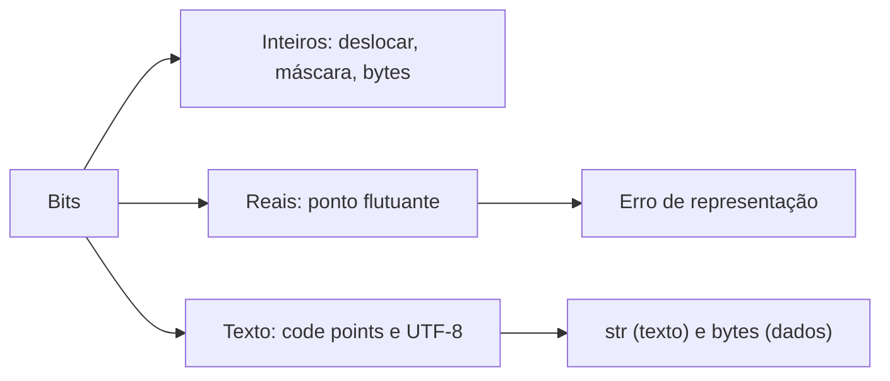

# 32 · Representação de dados

**Tempo estimado:** 40 minutos · **Pré-requisito:** [[14 - Crescimento de funções]] e a noção de base 2 do módulo 09.

**Ao final você vai conseguir:**

1. Ler e manipular inteiros pelos seus bits, com deslocamentos, máscaras e bytes.
2. Explicar por que `0.1 + 0.1 + 0.1 != 0.3` em Python.
3. Medir quantos bytes um texto ocupa em UTF-8, e separar texto (`str`) de dados codificados (`bytes`).

**Antes de começar:** o computador guarda tudo como bits. Este módulo mostra como números e textos viram bits, e onde essa tradução perde informação.

---

## Para começar

Você recebe um pacote de um sensor. Os primeiros dois bytes trazem a temperatura em um número inteiro, e os bytes seguintes trazem um nome em português, como `"São Paulo"`. Para ler o pacote, você precisa saber em que ordem os bytes vêm, quantos bits cada campo ocupa, e como o texto foi codificado. Sem essas regras, a mesma sequência de bytes significa coisas diferentes.

---

## Mapa do módulo



*Figura 1: uma sequência de bits pode ser lida como inteiro, real ou texto. A regra de leitura é o que dá significado.*

**Como ler:** cada ramo é um tipo de dado. O erro de representação vem dos reais; a separação entre `str` e `bytes` vem do texto.

---

## Mini-aula 1: inteiros em bits

> [!tip] Ideia
> Um inteiro é uma sequência de bits. Deslocar à esquerda multiplica por dois; deslocar à direita divide, arredondando para baixo.

> [!info] Definição
> O **complemento de dois** (two's complement) é uma forma de representar inteiros com sinal em que os números negativos seguem as mesmas regras bit a bit que os positivos. A nota da biblioteca registra que essa regra vem da documentação do Python, e não de uma definição de hardware.

Os operadores `<<`, `>>`, `&`, `|`, `^` e `~` atuam sobre os bits. Veja um exemplo com deslocamento, máscara e bytes. Antes de rodar, preveja o valor de `-1 & 0xFF`.

```python
x = 5
print("x << 3 =", x << 3, "| x * 2**3 =", x * 2**3)
print("x << 3 == x * 2**3:", x << 3 == x * 2**3)
print("-1 & 0xFF =", (-1) & 0xFF)
print("5 em 2 bytes, big-endian:", (5).to_bytes(2, "big"))
print("-1 em 1 byte, com sinal:", (-1).to_bytes(1, "big", signed=True))
print("bits de 255:", (255).bit_length())
```

Saída real:

```
x << 3 = 40 | x * 2**3 = 40
x << 3 == x * 2**3: True
-1 & 0xFF = 255
5 em 2 bytes, big-endian: b'\x00\x05'
-1 em 1 byte, com sinal: b'\xff'
bits de 255: 8
```

**Como ler:** `5 << 3` dá 40, igual a `5 * 2**3`. A máscara `& 0xFF` mantém só os oito bits menos significativos. Com `big`, o byte mais significativo vem primeiro.

> [!warning] Armadilha comum
> Python não tem tamanho fixo para inteiros. A máscara `& 0xFF` é o que limita um valor a oito bits. Sem ela, `-1` continua sendo `-1`, e não vira o padrão `11111111`.

> [!question]- Checkpoint
> 1. Qual é o valor de `1 << 4`?
> 2. Para que serve a máscara `& 0xFF`?
>
> > [!success]- Resposta
> > 1. Dezesseis, porque `1 << 4` equivale a `1 * 2**4`.
> > 2. Para manter só os oito bits de menor peso, e mostrar o padrão de oito bits de um valor.

---

## Mini-aula 2: números reais e erro de representação

> [!tip] Ideia
> Números reais são guardados como frações binárias com precisão limitada. Muitas frações decimais, como `0.1`, não têm forma binária exata.

> [!info] Definição
> O **erro de representação** (representation error) é a diferença entre o valor decimal pedido e a fração binária que o computador guarda. O tutorial de ponto flutuante do Python diz que quase todos os floats são do formato IEEE 754 binary64, com 53 bits de precisão.

Veja `0.1` e sua representação exata. Antes de rodar, pense: a soma de três `0.1` dá exatamente `0.3`?

```python
print("0.1 + 0.1 + 0.1 == 0.3:", 0.1 + 0.1 + 0.1 == 0.3)
print("0.1 == 3602879701896397 / 2**55:", 0.1 == 3602879701896397 / 2**55)
print("0.1 + 0.2 =", 0.1 + 0.2)
print("exatamente 0.3 com a soma de tres 0.1 (fsum):", __import__("math").fsum([0.1, 0.1, 0.1]) == 0.3)
```

Saída real:

```
0.1 + 0.1 + 0.1 == 0.3: False
0.1 == 3602879701896397 / 2**55: True
0.1 + 0.2 = 0.30000000000000004
exatamente 0.3 com a soma de tres 0.1 (fsum): False
```

**Como ler:** o tutorial diz que `0.1` é guardado como `3602879701896397 / 2**55`. A igualdade com `0.3` falha porque cada parcela já carrega um erro. A função `math.fsum`, citada no tutorial, faz a soma com menos erro.

> [!warning] Armadilha comum
> Comparar floats com `==` depois de contas é arriscado. Para comparar com tolerância, o tutorial sugere `math.isclose`.

> [!question]- Checkpoint
> 1. Por que `0.1 + 0.2` não aparece como `0.3` na impressão?
> 2. Qual ferramenta do tutorial reduz o erro de uma soma?
>
> > [!success]- Resposta
> > 1. Porque `0.1` e `0.2` não têm forma binária exata, e a soma guarda o erro de cada um.
> > 2. `math.fsum`.

---

## Mini-aula 3: texto, code points e UTF-8

> [!tip] Ideia
> Um caractere é um número (code point). A codificação, como UTF-8, diz como esse número vira bytes. Em Python, `str` é texto e `bytes` são dados codificados.

> [!info] Definição
> Um **code point** é um inteiro de 0 a 0x10FFFF que identifica um caractere. Uma **codificação** (encoding) é a regra que transforma code points em bytes. O **UTF-8** é uma codificação orientada a bytes: caracteres ASCII ocupam um byte, e os demais ocupam de dois a quatro.

Veja quatro caracteres com tamanhos diferentes. Antes de rodar, diga quantos bytes o emoji ocupa.

```python
for ch in ["A", "é", "€", "😀"]:
    print(repr(ch), "code point", ord(ch), "bytes", ch.encode("utf-8"), "=", len(ch.encode("utf-8")), "byte(s)")
```

Saída real:

```
'A' code point 65 bytes b'A' = 1 byte(s)
'é' code point 233 bytes b'\xc3\xa9' = 2 byte(s)
'€' code point 8364 bytes b'\xe2\x82\xac' = 3 byte(s)
'😀' code point 128512 bytes b'\xf0\x9f\x98\x80' = 4 byte(s)
```

**Como ler:** `ord` devolve o code point, e `encode` devolve os bytes. Cada caractere mostra o número de bytes que ocupa em UTF-8.

> [!warning] Armadilha comum
> `len("é")` vale 1, mas `len("é".encode("utf-8"))` vale 2. O primeiro conta caracteres; o segundo conta bytes, que é o que ocupa memória ou disco.

> [!question]- Checkpoint
> 1. Quantos bytes ocupa a letra `A` em UTF-8?
> 2. Qual é a diferença entre `str` e `bytes`?
>
> > [!success]- Resposta
> > 1. Um byte, igual ao ASCII.
> > 2. `str` é texto; `bytes` é o dado codificado, pronto para ser gravado ou enviado.

---

## Exercícios

Cada exercício tem um bloco com a função a completar e os testes com `assert`. Quando todos passarem, aparece `Passou!`. Se um teste falhar, a mensagem escrita nele aponta a conta que não bateu.

### Aquecimento

**A1. Deslocar à esquerda.** Complete `deslocar_esquerda(x, n)`, que devolve `x` deslocado `n` posições para a esquerda com o operador `<<`. Pela nota da biblioteca, isso equivale a multiplicar `x` por `2 ** n`.

```python
def deslocar_esquerda(x, n):
    """Devolve x deslocado n bits para a esquerda: equivale a x * 2**n."""
    ...

assert deslocar_esquerda(5, 3) == 40, "5 << 3 é 40"
assert deslocar_esquerda(1, 4) == 16, "1 << 4 é 16"
assert deslocar_esquerda(7, 0) == 7, "deslocar zero posições não muda o valor"
assert deslocar_esquerda(3, 2) == 3 * 2**2, "deslocar n é multiplicar por 2 elevado a n"
print("Passou!")
```

> [!hint]- Dica 1
> Use `x << n`. Não use `x ** n`, que é outra operação.

> [!hint]- Dica 2
> Teste com `n = 0`: nada muda, e o resultado deve ser `x`.

> [!example]- Solução
> ```python
> def deslocar_esquerda(x, n):
>     """Devolve x deslocado n bits para a esquerda: equivale a x * 2**n."""
>     return x << n
> ```
>
> **Erro comum:** Usar `**` no lugar de `<<`. `x ** n` eleva x à potência n, e o resultado é muito diferente de deslocar.

**A2. Dois bytes em ordem grande.** Complete `para_dois_bytes(x)`, que devolve os dois bytes de `x` (um inteiro de 0 a 65535) na ordem big-endian, usando o método `to_bytes` do inteiro.

```python
def para_dois_bytes(x):
    """Devolve os dois bytes de x, em ordem big-endian."""
    ...

assert para_dois_bytes(256) == b"\x01\x00", "256 = 0x0100 em big-endian"
assert para_dois_bytes(1) == b"\x00\x01", "1 ocupa o último byte"
assert para_dois_bytes(65535) == b"\xff\xff", "o maior valor de dois bytes"
print("Passou!")
```

> [!hint]- Dica 1
> O método é `x.to_bytes(comprimento, ordem)`. Aqui o comprimento é 2 e a ordem é `"big"`.

> [!hint]- Dica 2
> Para `x = 256`, o byte mais significativo é 1 e o outro é 0. O resultado é `b"\x01\x00"`.

> [!example]- Solução
> ```python
> def para_dois_bytes(x):
>     """Devolve os dois bytes de x, em ordem big-endian."""
>     return x.to_bytes(2, "big")
> ```
>
> **Erro comum:** Trocar a ordem para `"little"`. Os bytes saem invertidos, e o teste que espera `b"\x01\x00"` falha.

**A3. Soma sem erro acumulado.** Complete `soma_exata(valores)`, que soma os números de uma lista usando `math.fsum`, em vez de `sum`. A biblioteca cita `math.fsum` como ferramenta para reduzir o erro de arredondamento.

```python
import math

def soma_exata(valores):
    """Soma os valores com math.fsum, que reduz o erro de arredondamento acumulado."""
    ...

assert soma_exata([0.1] * 10) == 1.0, "fsum soma as dez parcelas com precisão"
assert soma_exata([1.5, 2.5]) == 4.0, "soma simples de dois números"
assert soma_exata([]) == 0.0, "lista vazia soma zero"
print("Passou!")
```

> [!hint]- Dica 1
> Importe o módulo com `import math` no começo do arquivo, e chame `math.fsum(valores)`.

> [!hint]- Dica 2
> Compare o resultado com `sum(valores)` e veja se a diferença aparece.

> [!example]- Solução
> ```python
> def soma_exata(valores):
>     """Soma os valores com math.fsum, que reduz o erro de arredondamento acumulado."""
>     return math.fsum(valores)
> ```
>
> **Erro comum:** Esquecer o `import math`. O código inicial falha com `NameError`, e não com AssertionError, então a verificação não passa.

### Praticando

**P1. Bytes de um caractere.** Complete `tamanho_utf8(texto)`, que devolve quantos bytes o texto ocupa quando codificado em UTF-8. A nota diz que caracteres ASCII ocupam um byte, e os demais ocupam de dois a quatro.

```python
def tamanho_utf8(texto):
    """Devolve o número de bytes do texto codificado em UTF-8."""
    ...

assert tamanho_utf8("a") == 1, "ASCII ocupa um byte"
assert tamanho_utf8("é") == 2, "é ocupa dois bytes em UTF-8"
assert tamanho_utf8("€") == 3, "o símbolo do euro ocupa três bytes"
assert tamanho_utf8("😀") == 4, "emoji ocupa quatro bytes"
print("Passou!")
```

> [!hint]- Dica 1
> Codifique o texto com `texto.encode("utf-8")` e meça o resultado com `len`.

> [!hint]- Dica 2
> `"a"` ocupa 1 byte, `"é"` ocupa 2, `"€"` ocupa 3 e `"😀"` ocupa 4.

> [!example]- Solução
> ```python
> def tamanho_utf8(texto):
>     """Devolve o número de bytes do texto codificado em UTF-8."""
>     return len(texto.encode("utf-8"))
> ```
>
> **Erro comum:** Medir `len(texto)`. Isso conta caracteres (code points), e não bytes. Para `"é"`, `len` dá 1 e o número de bytes é 2.

**P2. Oito bits de um valor com sinal.** Complete `oito_bits(x)`, que devolve o padrão de 8 bits de `x` como inteiro sem sinal (de 0 a 255). Para valores negativos, use a máscara `& 0xFF`. A nota de complemento de dois diz que o Python trata bits com sinal como se tivesse infinitos bits de sinal, então a máscara é o que limita o valor a 8 bits.

```python
def oito_bits(x):
    """Devolve o padrão de 8 bits de x como inteiro sem sinal."""
    ...

assert oito_bits(5) == 5, "positivo pequeno não muda"
assert oito_bits(-1) == 255, "-1 vira oito uns"
assert oito_bits(-128) == 128, "menor valor de 8 bits com sinal"
print("Passou!")
```

> [!hint]- Dica 1
> Use `x & 0xFF`. O resultado já fica entre 0 e 255.

> [!hint]- Dica 2
> Para `x = -1`, o resultado é `255`, que em binário são oito uns.

> [!example]- Solução
> ```python
> def oito_bits(x):
>     """Devolve o padrão de 8 bits de x como inteiro sem sinal."""
>     return x & 0xFF
> ```
>
> **Erro comum:** Esquecer a máscara e devolver `x` para negativos. O resultado sai negativo e não é um padrão de 8 bits.

**P3. Ida e volta.** Complete `ida_e_volta(texto)`, que codifica o texto em UTF-8 e depois decodifica os bytes de volta. O resultado deve ser igual ao texto original. A nota recomenda decodificar cedo e codificar tarde, então o texto fica como `str` e só vira `bytes` na hora de gravar ou transmitir.

```python
def ida_e_volta(texto):
    """Codifica em UTF-8 e decodifica de volta, devolvendo o texto."""
    ...

assert ida_e_volta("olá") == "olá", "acentos sobrevivem à ida e volta"
assert ida_e_volta("abc") == "abc", "ASCII também"
assert ida_e_volta("😀") == "😀", "caractere de quatro bytes"
print("Passou!")
```

> [!hint]- Dica 1
> `texto.encode("utf-8")` produz `bytes`. O método `.decode("utf-8")` do `bytes` volta para `str`.

> [!hint]- Dica 2
> Encadeie as duas chamadas em uma linha só.

> [!example]- Solução
> ```python
> def ida_e_volta(texto):
>     """Codifica em UTF-8 e decodifica de volta, devolvendo o texto."""
>     return texto.encode("utf-8").decode("utf-8")
> ```
>
> **Erro comum:** Tentar `str.decode`. Em Python 3, `str` não tem esse método; só `bytes` tem.

### Desafio

**D1. Fração exata.** Complete `fracao_exata(x)`, que devolve o par `(numerador, denominador)` tal que `x` é exatamente `numerador / denominador`. Use `x.as_integer_ratio()`. Isso mostra que todo float é uma fração binária, com denominador potência de dois.

```python
def fracao_exata(x):
    """Devolve (numerador, denominador) com x == numerador / denominador, exatamente."""
    ...

assert fracao_exata(0.5) == (1, 2), "meio é um sobre dois"
assert fracao_exata(0.25) == (1, 4), "um quarto"
assert fracao_exata(0.1) == (3602879701896397, 2**55), "0.1 guardado como fração binária"
print("Passou!")
```

> [!hint]- Dica 1
> O método `as_integer_ratio()` devolve uma tupla de dois inteiros.

> [!hint]- Dica 2
> Para `0.5`, o resultado é `(1, 2)`. Para `0.1`, o denominador é `2 ** 55`.

> [!example]- Solução
> ```python
> def fracao_exata(x):
>     """Devolve (numerador, denominador) com x == numerador / denominador, exatamente."""
>     return x.as_integer_ratio()
> ```
>
> **Erro comum:** Dividir `x` por `1` e tentar guardar o float. Isso não expõe a fração; o par de inteiros é o que o exercício pede.


---

## Mini-projeto (opcional)

Você vai escrever uma função que resume um valor do jeito que um depurador de hardware mostraria. Tente sozinho antes de abrir a solução.

**Mini-projeto: resumo de um valor.** Complete `resumo_bits(x)`, que devolve uma string com três partes separadas por vírgula, no formato `"<x> em 8 bits: <bits> (<sem sinal>)"`. Os `<bits>` são os oito bits em binário, com zeros à esquerda; `<sem sinal>` é o valor de `x & 0xFF`. Use `format(valor, "08b")` para os bits.

```python
def resumo_bits(x):
    """Resume x como oito bits e como inteiro sem sinal."""
    ...

assert resumo_bits(5) == "5 em 8 bits: 00000101 (5)", "positivo pequeno"
assert resumo_bits(-1) == "-1 em 8 bits: 11111111 (255)", "menos um vira oito uns"
assert resumo_bits(0) == "0 em 8 bits: 00000000 (0)", "zero"
print("Passou!")
```

> [!hint]- Dica 1
> Calcule `sem_sinal = x & 0xFF` primeiro. Depois monte a string com `f"..."`.

> [!hint]- Dica 2
> `format(5, "08b")` dá `"00000101"`.

> [!example]- Solução
> ```python
> def resumo_bits(x):
>     """Resume x como oito bits e como inteiro sem sinal."""
>     sem_sinal = x & 0xFF
>     return f"{x} em 8 bits: {format(sem_sinal, '08b')} ({sem_sinal})"
> ```
>
> **Erro comum:** Escrever os bits de `x` sem a máscara. Para `-1`, `format(-1, "08b")` mostra um sinal de menos, e não oito uns.


---

## Fechando

**Resumo**

- Um inteiro é uma sequência de bits; `<<` multiplica por potências de dois.
- O complemento de dois dá a forma de representar negativos com as mesmas regras bit a bit dos positivos.
- Números reais guardados em binário têm erro de representação; `math.fsum` e `math.isclose` ajudam.
- O UTF-8 usa de um a quatro bytes por caractere. Texto (`str`) e dados (`bytes`) são coisas diferentes.

**Glossário rápido**

- **Complemento de dois** (two's complement): forma de representar inteiros com sinal.
- **Erro de representação** (representation error): diferença entre o decimal e a fração binária guardada.
- **Code point**: número que identifica um caractere.
- **Codificação** (encoding): regra que transforma code points em bytes.
- **UTF-8**: codificação de tamanho variável, compatível com ASCII.

**Perguntas de revisão**

1. Por que `0.1 + 0.1 + 0.1 == 0.3` dá `False`?
2. Quantos bytes ocupa `"ç"` em UTF-8, e por quê?
3. O que muda se você esquecer a máscara `& 0xFF` ao mostrar um valor negativo em oito bits?

**E agora?** O próximo módulo é **Portas lógicas e álgebra booleana**. Ele mostra como as operações de bits que você usou aqui são construídas com circuitos.

---

## Para ir mais fundo

- [[Binary Integers and Two's Complement]]
- [[Floating-Point Representation]]
- [[Character Encoding and Unicode]]
