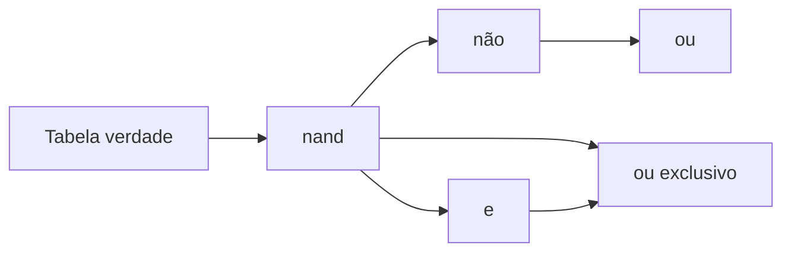

# 33 · Portas lógicas e álgebra booleana

**Tempo estimado:** 40 minutos · **Pré-requisito:** [[05 - Lógica proposicional]] e o módulo 32.

**Ao final você vai conseguir:**

1. Ler uma porta lógica pela sua tabela verdade.
2. Construir `não`, `e` e `ou` usando só a porta `nand`, como no Projeto 1 do nand2tetris.
3. Conferir por força bruta que os operadores booleanos obedecem as leis de comutatividade, associatividade e distributividade.

**Antes de começar:** no módulo 05 você viu conectivos lógicos. Aqui eles viram circuitos, com entradas e saídas que são bits.

---

## Para começar

Um sensor de porta de garagem liga o motor quando o botão está apertado **e** o portão não está fechado. Um alarme dispara quando a porta está aberta **ou** o sensor de movimento detecta algo. Cada condição é um bit, e a decisão é uma função desses bits. Um circuito faz essa função sem software: basta montar portas que implementem a tabela.

---

## Mapa do módulo



*Figura 1: a partir de `nand`, as outras portas são montadas. A seta indica "usado para construir".*

**Como ler:** `nand` está na base. `não` sai de `nand` com as duas entradas iguais. `e` é `nand` seguido de `não`. Os demais saem de combinações desses.

---

## Mini-aula 1: portas e tabelas verdade

> [!tip] Ideia
> Uma porta lógica é uma função de bits para bits. A tabela verdade lista todas as entradas e a saída correspondente.

> [!info] Definição
> Uma **porta lógica** (logic gate) é um circuito que calcula uma função booleana de suas entradas. A **tabela verdade** é a lista dessa função para todas as combinações de entradas.

Veja a tabela de `nand`, `e`, `ou` e `ou exclusivo` construídos a partir de `nand`. Antes de rodar, preveja a saída de `nand(1, 1)`.

```python
def nand(a, b):
    return 1 - (a & b)

def nao(a):
    return nand(a, a)

def e(a, b):
    return nao(nand(a, b))

def ou(a, b):
    return nand(nao(a), nao(b))

def xou(a, b):
    t = nand(a, b)
    return nand(nand(a, t), nand(b, t))

print("a b | nand e ou xou")
for a in (0, 1):
    for b in (0, 1):
        print(a, b, "|", nand(a, b), e(a, b), ou(a, b), xou(a, b))
```

Saída real:

```
a b | nand e ou xou
0 0 | 1 0 0 0
0 1 | 1 0 1 1
1 0 | 1 0 1 1
1 1 | 0 1 1 0
```

**Como ler:** a coluna `nand` dá 0 só quando as duas entradas valem 1. As demais colunas foram montadas a partir dela; o resultado bate com a definição de cada uma.

> [!warning] Armadilha comum
> `nand` é a negação do `e`, e não o `e` com outro nome. Para `(1, 1)`, `e` dá 1 e `nand` dá 0. Confundir as duas é um erro frequente.

> [!question]- Checkpoint
> 1. Quanto vale `nand(0, 1)`?
> 2. Qual linha da tabela de `ou exclusivo` dá 0?
>
> > [!success]- Resposta
> > 1. 1, porque `nand` só dá 0 quando as duas entradas valem 1.
> > 2. As linhas `(0, 0)` e `(1, 1)`, em que as entradas são iguais.

---

## Mini-aula 2: `nand` como base

> [!tip] Ideia
> Uma porta é completa quando as outras podem ser construídas a partir dela. O nand2tetris usa `nand` como base para todo o hardware do projeto.

> [!info] Definição
> A **completude funcional do nand** (functional completeness) é a propriedade de que `nand` sozinha constrói as outras portas. O Projeto 1 do nand2tetris a usa na prática, construindo `não`, `e`, `ou`, `ou exclusivo`, multiplexador e demultiplexador só com `nand`. A nota registra isso como prática, e não como uma demonstração formal.

Os exercícios A1 a P2 constroem `não`, `e`, `ou` e `ou exclusivo` a partir de `nand`, um por um. Cada função chama as anteriores, como faria um circuito em que a saída de uma porta alimenta a entrada de outra. Antes de começar, pense: quantas portas `nand` o `ou exclusivo` precisa?

> [!question]- Checkpoint
> 1. Como se faz `não` usando só `nand`?
> 2. Quantas portas `nand` o `ou exclusivo` do exercício usa?
>
> > [!success]- Resposta
> > 1. Ligando as duas entradas de `nand` à mesma entrada `a`.
> > 2. Quatro.

---

## Mini-aula 3: leis da álgebra booleana

> [!tip] Ideia
> Os operadores booleanos seguem leis que permitem reorganizar um circuito sem mudar a função. Podemos conferir essas leis por força bruta, porque só há duas entradas possíveis por bit.

> [!info] Definição
> Um operador é **comutativo** se a ordem das entradas não importa; **associativo** se o agrupamento não importa; **distributivo** se um operador se espalha sobre o outro. A nota diz, citando Kann, que os operadores booleanos podem ser associativos, comutativos e distributivos, e que isso afeta o projeto de circuitos. Ela não lista as leis uma a uma.

Veja a verificação exaustiva dessas propriedades para `e` e `ou`. Antes de rodar, diga se a lei distributiva de `ou` sobre `e` vale.

```python
from itertools import product

valores = (0, 1)

def e(a, b):
    return a & b

def ou(a, b):
    return a | b

print("comutativa de e:", all(e(a, b) == e(b, a) for a, b in product(valores, repeat=2)))
print("associativa de e:", all(e(e(a, b), c) == e(a, e(b, c)) for a, b, c in product(valores, repeat=3)))
print("e distribui sobre ou:", all(e(a, ou(b, c)) == ou(e(a, b), e(a, c)) for a, b, c in product(valores, repeat=3)))
print("ou distribui sobre e:", all(ou(a, e(b, c)) == e(ou(a, b), ou(a, c)) for a, b, c in product(valores, repeat=3)))
```

Saída real:

```
comutativa de e: True
associativa de e: True
e distribui sobre ou: True
ou distribui sobre e: True
```

**Como ler:** `all(...)` só dá `True` se a igualdade vale para todas as combinações. Com dois valores por bit, esse teste cobre todos os casos possíveis.

> [!warning] Armadilha comum
> Verificar uma lei com alguns exemplos não prova nada. Aqui funciona porque o domínio é finito: são 2, 4 ou 8 combinações, e todas foram testadas.

> [!question]- Checkpoint
> 1. Quantas combinações de entradas o teste de associatividade de três bits cobre?
> 2. O que `all` devolve se uma única combinação falhar?
>
> > [!success]- Resposta
> > 1. Oito, porque cada um dos três bits tem dois valores.
> > 2. `False`.

---

## Exercícios

Cada exercício tem um bloco com a função a completar e os testes com `assert`. Quando todos passarem, aparece `Passou!`. As funções definidas em exercícios anteriores aparecem no código inicial, prontas para usar.

### Aquecimento

**A1. A porta que tudo gera.** Complete `nand(a, b)`, que devolve 0 só quando `a` e `b` valem 1, e 1 nos outros casos. Ela é a única porta usada como base no Projeto 1 do nand2tetris.

```python
def nand(a, b):
    """Devolve 0 se a e b valem 1; caso contrário, devolve 1."""
    ...

assert nand(0, 0) == 1, "nenhum valor 1"
assert nand(0, 1) == 1, "só b vale 1"
assert nand(1, 0) == 1, "só a vale 1"
assert nand(1, 1) == 0, "os dois valem 1"
print("Passou!")
```

> [!hint]- Dica 1
> Use `a & b` para o `e` bit a bit e subtraia de 1: `1 - (a & b)`.

> [!hint]- Dica 2
> Confira a tabela: `nand(1, 1)` deve dar 0, e `nand(0, 1)` deve dar 1.

> [!example]- Solução
> ```python
> def nand(a, b):
>     """Devolve 0 se a e b valem 1; caso contrário, devolve 1."""
>     return 1 - (a & b)
> ```
>
> **Erro comum:** Inverter a saída de `a | b`. Isso é `nor`, e não `nand`.

**A2. Inverter com nand.** Complete `nao(a)`, que inverte um bit usando somente `nand`, definido acima. A saída deve ser 1 quando `a` vale 0, e 0 quando `a` vale 1.

```python
def nand(a, b):
    return 1 - (a & b)

def nao(a):
    """Inverte um bit usando apenas nand."""
    ...

assert nao(0) == 1, "not de 0 é 1"
assert nao(1) == 0, "not de 1 é 0"
print("Passou!")
```

> [!hint]- Dica 1
> Um `nand` com as duas entradas iguais a `a` inverte `a`.

> [!hint]- Dica 2
> Chame `nand(a, a)`.

> [!example]- Solução
> ```python
> def nao(a):
>     """Inverte um bit usando apenas nand."""
>     return nand(a, a)
> ```
>
> **Erro comum:** Escrever `1 - a` em vez de usar `nand`. O resultado é certo, mas o exercício pede construir a porta a partir de `nand`.

**A3. E com nand.** Complete `e(a, b)`, que devolve 1 só quando `a` e `b` valem 1. Construa a porta usando `nand` e `nao`, definidos antes.

```python
def nand(a, b):
    return 1 - (a & b)

def nao(a):
    return nand(a, a)

def e(a, b):
    """Devolve 1 só quando a e b valem 1, construído com nand e nao."""
    ...

assert e(0, 0) == 0, "00 dá 0"
assert e(0, 1) == 0, "01 dá 0"
assert e(1, 0) == 0, "10 dá 0"
assert e(1, 1) == 1, "11 dá 1"
print("Passou!")
```

> [!hint]- Dica 1
> Primeiro faça `nand(a, b)`; depois inverta o resultado com `nao`.

> [!hint]- Dica 2
> A tabela de `e` tem um 1 só na linha `(1, 1)`.

> [!example]- Solução
> ```python
> def e(a, b):
>     """Devolve 1 só quando a e b valem 1, construído com nand e nao."""
>     return nao(nand(a, b))
> ```
>
> **Erro comum:** Inverter as entradas antes do `nand`. Isso dá outra função, e não o `e`.

### Praticando

**P1. Ou exclusivo com quatro nand.** Complete `xou(a, b)`, que devolve 1 quando `a` e `b` têm valores diferentes. Construa-a com quatro `nand`: `t = nand(a, b)`, depois `nand(nand(a, t), nand(b, t))`.

```python
def nand(a, b):
    return 1 - (a & b)

def xou(a, b):
    """Devolve 1 quando a e b são diferentes, usando quatro nand."""
    ...

assert xou(0, 0) == 0, "iguais dão 0"
assert xou(1, 1) == 0, "iguais dão 0"
assert xou(0, 1) == 1, "diferentes dão 1"
assert xou(1, 0) == 1, "diferentes dão 1"
print("Passou!")
```

> [!hint]- Dica 1
> Calcule `t` primeiro e guarde em uma variável.

> [!hint]- Dica 2
> A saída deve ser 0 para `(0, 0)` e `(1, 1)`, e 1 para os outros dois casos.

> [!example]- Solução
> ```python
> def xou(a, b):
>     """Devolve 1 quando a e b são diferentes, usando quatro nand."""
>     t = nand(a, b)
>     return nand(nand(a, t), nand(b, t))
> ```
>
> **Erro comum:** Usar `ou` no lugar de `xou`. Para `(1, 1)`, `ou` dá 1, mas o ou exclusivo deve dar 0.

**P2. Ou com nand.** Complete `ou(a, b)`, que devolve 1 quando pelo menos uma das entradas vale 1. Use `nand` e `nao`, sem usar o operador `|`. Pense em inverter cada entrada e depois aplicar `nand`.

```python
def nand(a, b):
    return 1 - (a & b)

def nao(a):
    return nand(a, a)

def ou(a, b):
    """Devolve 1 quando a ou b vale 1, usando nand e nao."""
    ...

assert ou(0, 0) == 0, "nenhum vale 1"
assert ou(0, 1) == 1, "b vale 1"
assert ou(1, 0) == 1, "a vale 1"
assert ou(1, 1) == 1, "os dois valem 1"
print("Passou!")
```

> [!hint]- Dica 1
> Calcule `nao(a)` e `nao(b)`, e passe os dois resultados para `nand`.

> [!hint]- Dica 2
> Teste a tabela: `ou(0, 0)` deve dar 0, e `ou(1, 0)` deve dar 1.

> [!example]- Solução
> ```python
> def ou(a, b):
>     """Devolve 1 quando a ou b vale 1, usando nand e nao."""
>     return nand(nao(a), nao(b))
> ```
>
> **Erro comum:** Aplicar `nand(a, b)` direto. Esse é o `nand`, que dá 0 quando os dois valem 1, e não o ou.

### Desafio

**D1. Tabela verdade de uma função.** Complete `tabela_verdade(f)`, que recebe uma função `f` de dois bits e devolve uma lista de tuplas `(a, b, f(a, b))`, nesta ordem: `(0, 0)`, `(0, 1)`, `(1, 0)`, `(1, 1)`. A tabela verdade é a forma de conferir uma porta lógica contra a sua definição.

```python
def nand(a, b):
    return 1 - (a & b)

def tabela_verdade(f):
    """Devolve as linhas (a, b, f(a, b)) para a e b em (0, 1)."""
    ...

assert tabela_verdade(nand) == [(0, 0, 1), (0, 1, 1), (1, 0, 1), (1, 1, 0)], "tabela do nand"
assert tabela_verdade(lambda a, b: a) == [(0, 0, 0), (0, 1, 0), (1, 0, 1), (1, 1, 1)], "saída é a"
print("Passou!")
```

> [!hint]- Dica 1
> Use dois `for` aninhados, com `a` em `(0, 1)` e `b` em `(0, 1)`.

> [!hint]- Dica 2
> Cada linha é uma tupla com três valores; use `(a, b, f(a, b))`.

> [!example]- Solução
> ```python
> def tabela_verdade(f):
>     """Devolve as linhas (a, b, f(a, b)) para a e b em (0, 1)."""
>     linhas = []
>     for a in (0, 1):
>         for b in (0, 1):
>             linhas.append((a, b, f(a, b)))
>     return linhas
> ```
>
> **Erro comum:** Devolver só os resultados, sem `a` e `b`. Sem as entradas, a tabela não diz a qual linha cada saída pertence.


---

## Mini-projeto (opcional)

Você vai montar um circuito que compara dois bits e diz se são iguais ou se `a` é maior. Tente sozinho antes de abrir a solução.

**Mini-projeto: comparador de um bit.** Complete `comparador_1bit(a, b)`, que devolve a tupla `(igual, maior)`. `igual` vale 1 quando `a` e `b` são iguais. `maior` vale 1 quando `a` é 1 e `b` é 0. Use as portas construídas acima, em especial `xou`, `nao` e `e`.

```python
def nand(a, b):
    return 1 - (a & b)

def nao(a):
    return nand(a, a)

def e(a, b):
    return nao(nand(a, b))

def xou(a, b):
    t = nand(a, b)
    return nand(nand(a, t), nand(b, t))

def comparador_1bit(a, b):
    """Devolve (igual, maior) para dois bits a e b, usando portas lógicas."""
    ...

assert comparador_1bit(0, 0) == (1, 0), "iguais; não é maior"
assert comparador_1bit(1, 1) == (1, 0), "iguais; não é maior"
assert comparador_1bit(1, 0) == (0, 1), "a é maior"
assert comparador_1bit(0, 1) == (0, 0), "b é maior; nenhum dos dois"
print("Passou!")
```

> [!hint]- Dica 1
> `igual` é o inverso de `xou(a, b)`.

> [!hint]- Dica 2
> `maior` é `e(a, nao(b))`: `a` deve valer 1 e `b` deve valer 0.

> [!example]- Solução
> ```python
> def comparador_1bit(a, b):
>     """Devolve (igual, maior) para dois bits a e b, usando portas lógicas."""
>     igual = nao(xou(a, b))
>     maior = e(a, nao(b))
>     return (igual, maior)
> ```
>
> **Erro comum:** Trocar `igual` por `xou(a, b)`. Esse dá 1 quando os bits são diferentes, então a saída fica invertida.


---

## Fechando

**Resumo**

- Uma porta lógica é uma função de bits; a tabela verdade a descreve por completo.
- `nand` é a base do Projeto 1 do nand2tetris: `não`, `e`, `ou` e `ou exclusivo` saem dela.
- Operadores booleanos são comutativos, associativos e distributivos; em poucos bits, isso se verifica por força bruta.

**Glossário rápido**

- **Porta lógica** (logic gate): circuito que calcula uma função booleana.
- **Tabela verdade** (truth table): lista da função para todas as entradas.
- **Completude funcional** (functional completeness): uma porta basta para construir as outras.
- **HDL** (hardware description language): linguagem que descreve chips; o nand2tetris usa uma.

**Perguntas de revisão**

1. Por que `nand` serve para construir `não` e `e`, mas não serve para construir `ou` sem as negações?
2. Quantas linhas tem a tabela verdade de uma função de três entradas?
3. Por que a verificação exaustiva é uma prova para o domínio de bits?

**E agora?** O próximo módulo é **Circuitos combinacionais**. Ele junta portas em somadores, decodificadores e multiplexadores, e mostra como a ULA é montada.

---

## Para ir mais fundo

- [[Logic Gates and Boolean Algebra]]
- [[nand2tetris - Projects 1 to 5 (Nisan and Schocken)]]
- [[Kann - Digital Circuit Projects (Engineering LibreTexts)]]
