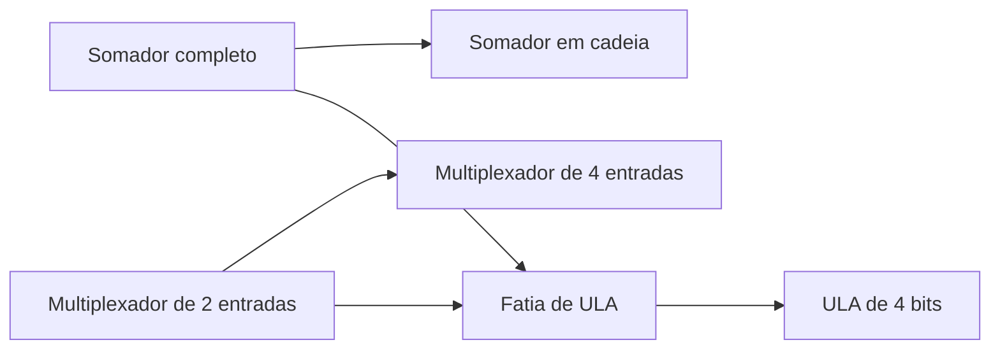

# 34 · Circuitos combinacionais

**Tempo estimado:** 45 minutos · **Pré-requisito:** [[33 - Portas lógicas e álgebra booleana]].

**Ao final você vai conseguir:**

1. Descrever um somador completo pelas suas equações e pela tabela verdade.
2. Encadear somadores completos em um somador em cadeia (ripple-carry).
3. Montar um multiplexador de quatro entradas a partir de multiplexadores de duas, e uma fatia de ULA de um bit.

**Antes de começar:** um circuito combinacional não guarda estado. A saída depende só das entradas do momento. No módulo 35 veremos o que muda quando há memória.

---

## Para começar

Você quer somar dois números de oito bits com um circuito, e não com um programa. Cada bit da soma depende do bit correspondente e do vai-um (carry) que veio da posição anterior. Se você montar um bloco que resolve uma posição, pode repeti-lo oito vezes. É isso que a ULA de um processador faz, com blocos repetidos e um seletor para escolher a operação.

---

## Mapa do módulo



*Figura 1: blocos pequenos viram blocos maiores. O somador completo serve à soma em cadeia e à fatia de ULA.*

**Como ler:** a seta indica "é usado para construir". Note que o somador completo aparece em dois lugares.

---

## Mini-aula 1: somador completo

> [!tip] Ideia
> Um somador completo soma três bits: duas entradas e um carry de entrada. Ele devolve um bit de soma e um carry de saída.

> [!info] Definição
> Um **somador completo** (full adder) calcula `S = X xor Y xor Cin` e `Cout = (X and Y) or ((X xor Y) and Cin)`, segundo Kann, seção 6.3. O nand2tetris dá o nome `FullAdder` ao chip, mas não as equações.

Veja a tabela completa do somador. Antes de rodar, conte quantas linhas a tabela tem, e quantas delas têm carry de saída igual a 1.

```python
def soma_completa(x, y, cin):
    s = x ^ y ^ cin
    cout = (x & y) | ((x ^ y) & cin)
    return s, cout

print("x y cin | s cout")
for x in (0, 1):
    for y in (0, 1):
        for cin in (0, 1):
            s, cout = soma_completa(x, y, cin)
            print(x, y, cin, "|", s, cout)
```

Saída real:

```
x y cin | s cout
0 0 0 | 0 0
0 0 1 | 1 0
0 1 0 | 1 0
0 1 1 | 0 1
1 0 0 | 1 0
1 0 1 | 0 1
1 1 0 | 0 1
1 1 1 | 1 1
```

**Como ler:** a soma `1 + 1 + 1` dá `S = 1` e `Cout = 1`, porque o resultado é `3`, que em binário é `11`. Cada linha confere a soma dos três bits.

> [!warning] Armadilha comum
> `S` é o bit da soma, e `Cout` é o carry. Em `1 + 1`, o bit `S` vale 0 e o carry vale 1; não some os dois valores como se fossem um número só.

> [!question]- Checkpoint
> 1. Quanto valem `S` e `Cout` quando `x = 1`, `y = 0` e `cin = 1`?
> 2. Quantas linhas tem a tabela verdade de um somador completo?
>
> > [!success]- Resposta
> > 1. `S = 0` e `Cout = 1`, porque `1 + 0 + 1 = 2`, que é `10` em binário.
> > 2. Oito, porque são três entradas de um bit.

---

## Mini-aula 2: somador em cadeia

> [!tip] Ideia
> Ligando o carry de saída de um somador completo ao carry de entrada do seguinte, obtemos um somador de vários bits. O carry percorre a cadeia, como uma onda.

> [!info] Definição
> Um **somador em cadeia** (ripple-carry adder) é uma sequência de somadores completos, em que o carry de saída de cada bit é a entrada de carry do bit seguinte. O carry "se propaga" pela cadeia, daí o nome.

Você vai montar essa cadeia no exercício A1. Ele usa `soma_completa`, que a demonstração já mostrou. O resultado de `n` bits é o conjunto dos `S`, e o carry final é o `Cout` do último bit.

> [!warning] Armadilha comum
> Um somador de `n` bits não tem como guardar um resultado maior que `n` bits. O carry final sinaliza que a soma saiu da faixa; ele não entra no resultado.

> [!question]- Checkpoint
> 1. Em um somador de quatro bits, o que acontece com o carry do bit 0?
> 2. Por que o carry final não entra nos quatro bits do resultado?
>
> > [!success]- Resposta
> > 1. Ele é o `cin` do bit 1, e assim por diante até o bit 3.
> > 2. Porque o resultado tem quatro bits; o carry final é um bit extra, que indica estouro.

---

## Mini-aula 3: multiplexador e decodificador

> [!tip] Ideia
> Um multiplexador escolhe uma entrada entre várias, usando bits de seleção. Um decodificador faz o caminho inverso: transforma uma entrada binária em uma saída ativa por vez.

> [!info] Definição
> Um **multiplexador** (MUX) com `s` bits de seleção escolhe uma de `2^s` entradas (Kann, seção 8.1). Um **decodificador** com `n` entradas tem `2^n` saídas, e cada saída é uma porta `e` das entradas, com algumas negadas (Kann, seção 7.2).

Veja um multiplexador de duas entradas. Antes de rodar, preveja a saída quando `s = 0`.

```python
def mux2(a, b, s):
    return (a & (1 - s)) | (b & s)

print("s | saída com a=0, b=1 | saída com a=1, b=0")
for s in (0, 1):
    print(s, "|", mux2(0, 1, s), "|", mux2(1, 0, s))
```

Saída real:

```
s | saída com a=0, b=1 | saída com a=1, b=0
0 | 0 | 1
1 | 1 | 0
```

**Como ler:** com `s = 0`, a saída é `a`; com `s = 1`, é `b`. O multiplexador de quatro entradas do exercício A2 combina três desses.

> [!warning] Armadilha comum
> O decodificador da nota tem `2^n` saídas, mas a ordem delas depende da convenção. O exercício P1 fixa uma convenção, e não a da fonte.

> [!question]- Checkpoint
> 1. Quantas entradas de seleção um multiplexador de quatro entradas tem?
> 2. Quantas saídas tem um decodificador de três entradas?
>
> > [!success]- Resposta
> > 1. Dois, porque `2^2 = 4`.
> > 2. Oito, porque `2^3 = 8`.

---

## Mini-aula 4: a ULA

> [!tip] Ideia
> A ULA (unidade lógica e aritmética) junta operações lógicas e a soma, e um seletor escolhe qual delas vale na saída. Uma ULA de `n` bits é `n` fatias iguais, com o carry passando de uma para a outra.

> [!info] Definição
> A **ULA** (ALU, arithmetic-logic unit) é o centro da CPU, e sua forma depende da arquitetura. O nand2tetris, Projeto 2, a constrói depois do somador de 16 bits. A nota não descreve os bits de controle.

Veja o exercício P2, que monta uma fatia de um bit. O mini-projeto junta quatro fatias. Antes de começar o mini-projeto, pense: qual é o resultado de `15 + 1` em quatro bits?

---

## Exercícios

Cada exercício tem um bloco com a função a completar e os testes com `assert`. Quando todos passarem, aparece `Passou!`. As funções já resolvidas em exercícios anteriores aparecem no código inicial.

### Aquecimento

**A1. Somador em cadeia.** Complete `soma_ripple(a, b, n)`, que soma dois inteiros de `n` bits, bit a bit, do bit menos significativo (posição 0) ao mais significativo. Use `soma_completa(x, y, cin)`, já definido acima, e passe o `cout` de cada bit para o `cin` do próximo. Devolva a tupla `(resultado, carry_final)`, em que `resultado` tem `n` bits.

```python
def soma_completa(x, y, cin):
    s = x ^ y ^ cin
    cout = (x & y) | ((x ^ y) & cin)
    return s, cout

def soma_ripple(a, b, n):
    """Soma a e b de n bits em cadeia de somadores completos; devolve (resultado, carry_final)."""
    ...

assert soma_ripple(3, 1, 2) == (0, 1), "3 + 1 em 2 bits dá 0 com carry 1"
assert soma_ripple(5, 6, 4) == (11, 0), "5 + 6 = 11, sem carry"
assert soma_ripple(15, 1, 4) == (0, 1), "15 + 1 estoura 4 bits"
assert soma_ripple(7, 8, 4) == (15, 0), "7 + 8 = 15 cabe em 4 bits"
print("Passou!")
```

> [!hint]- Dica 1
> Para cada posição `i` de 0 a `n - 1`, pegue o bit `(a >> i) & 1` e o bit `(b >> i) & 1`.

> [!hint]- Dica 2
> Guarde o `s` de cada bit com `resultado |= s << i`. O `carry_final` é o `cout` do último bit.

> [!example]- Solução
> ```python
> def soma_ripple(a, b, n):
>     """Soma a e b de n bits em cadeia de somadores completos; devolve (resultado, carry_final)."""
>     resultado = 0
>     cin = 0
>     for i in range(n):
>         x = (a >> i) & 1
>         y = (b >> i) & 1
>         s, cin = soma_completa(x, y, cin)
>         resultado |= s << i
>     return resultado, cin
> ```
>
> **Erro comum:** Esquecer de passar o carry para o bit seguinte. Com `cin` fixo em zero, `3 + 1` daria 2, e não 4.

**A2. Multiplexador de quatro entradas.** Complete `mux4(entradas, s1, s0)`, em que `entradas` é uma lista de quatro bits. O resultado é `entradas[2 * s1 + s0]`, mas o exercício pede que você construa a escolha com `mux2(a, b, s)`, que já está definido acima: primeiro escolha entre as entradas 0 e 1 com `s0`, depois entre as entradas 2 e 3 com `s0`, e por fim escolha entre os dois resultados com `s1`.

```python
def mux2(a, b, s):
    return (a & (1 - s)) | (b & s)

def mux4(entradas, s1, s0):
    """Escolhe uma das quatro entradas com dois seletores, usando três mux2."""
    ...

assert mux4([0, 1, 0, 0], 0, 1) == 1, "seleciona a entrada de índice 1"
assert mux4([1, 0, 0, 0], 0, 0) == 1, "seleciona a entrada de índice 0"
assert mux4([0, 0, 1, 0], 1, 0) == 1, "seleciona a entrada de índice 2"
assert mux4([0, 0, 0, 1], 1, 1) == 1, "seleciona a entrada de índice 3"
print("Passou!")
```

> [!hint]- Dica 1
> Use três chamadas de `mux2`. As duas primeiras usam `s0`; a última usa `s1`.

> [!hint]- Dica 2
> Confira com `mux4([0, 1, 0, 0], 0, 1)`: a entrada escolhida é a de índice 1, que vale 1.

> [!example]- Solução
> ```python
> def mux4(entradas, s1, s0):
>     """Escolhe uma das quatro entradas com dois seletores, usando três mux2."""
>     m0 = mux2(entradas[0], entradas[1], s0)
>     m1 = mux2(entradas[2], entradas[3], s0)
>     return mux2(m0, m1, s1)
> ```
>
> **Erro comum:** Trocar `s1` e `s0`. Com a ordem trocada, as entradas saem na ordem errada.

### Praticando

**P1. Decodificador de dois bits.** Complete `decodificador2(a, b)`, que recebe dois bits, forma o número `2 * a + b` e devolve uma lista de quatro bits em que só a posição desse número vale 1. Por exemplo, `decodificador2(1, 0)` devolve `[0, 0, 1, 0]`. Esta convenção é a deste exercício; a nota de Kann descreve a ideia, mas não fixa a ordem das saídas.

```python
def decodificador2(a, b):
    """Devolve quatro bits com 1 só na posição 2 * a + b."""
    ...

assert decodificador2(0, 0) == [1, 0, 0, 0], "entrada 00 ativa a posição 0"
assert decodificador2(0, 1) == [0, 1, 0, 0], "entrada 01 ativa a posição 1"
assert decodificador2(1, 0) == [0, 0, 1, 0], "entrada 10 ativa a posição 2"
assert decodificador2(1, 1) == [0, 0, 0, 1], "entrada 11 ativa a posição 3"
print("Passou!")
```

> [!hint]- Dica 1
> Use um `for i in range(4)`, e coloque `1 if i == 2 * a + b else 0` na lista.

> [!hint]- Dica 2
> Cada saída é uma porta `e` de todas as entradas, com as negadas quando o bit vale 0. Aqui basta comparar o número.

> [!example]- Solução
> ```python
> def decodificador2(a, b):
>     """Devolve quatro bits com 1 só na posição 2 * a + b."""
>     alvo = 2 * a + b
>     return [1 if i == alvo else 0 for i in range(4)]
> ```
>
> **Erro comum:** Devolver uma lista com a entrada em vez de quatro bits. A saída precisa ter exatamente quatro posições.

**P2. Uma fatia de ULA.** Complete `alu_1bit(x, y, op, cin)`, que faz uma operação sobre dois bits. Se `op` for `"e"`, devolva `(x & y, 0)`. Se for `"ou"`, devolva `(x | y, 0)`. Se for `"soma"`, devolva `soma_completa(x, y, cin)`. Essa é a fatia de um bit de uma ULA; a nota diz que a ULA é o centro da CPU, mas não define seus sinais de controle, então a escolha de `op` aqui é deste exercício.

```python
def soma_completa(x, y, cin):
    s = x ^ y ^ cin
    cout = (x & y) | ((x ^ y) & cin)
    return s, cout

def alu_1bit(x, y, op, cin):
    """Faz e, ou ou soma sobre bits; devolve (resultado, carry_de_saida)."""
    ...

assert alu_1bit(1, 1, "e", 0) == (1, 0), "e de dois uns"
assert alu_1bit(1, 0, "ou", 0) == (1, 0), "ou com um um"
assert alu_1bit(1, 1, "soma", 0) == (0, 1), "um mais um dá zero com carry"
assert alu_1bit(0, 1, "soma", 1) == (0, 1), "zero mais um mais carry 1 dá zero com carry"
print("Passou!")
```

> [!hint]- Dica 1
> Use `if` e `elif` para os três casos.

> [!hint]- Dica 2
> Nas operações lógicas o carry de saída é 0, porque elas não somam.

> [!example]- Solução
> ```python
> def alu_1bit(x, y, op, cin):
>     """Faz e, ou ou soma sobre bits; devolve (resultado, carry_de_saida)."""
>     if op == "e":
>         return (x & y, 0)
>     elif op == "ou":
>         return (x | y, 0)
>     elif op == "soma":
>         return soma_completa(x, y, cin)
>     raise ValueError("operação desconhecida")
> ```
>
> **Erro comum:** Devolver só o resultado, sem a tupla. O chamador espera `(resultado, carry)`.

### Desafio

**D1. Maior de dois bits.** Complete `maior(a, b)`, que devolve 1 quando `a` é maior que `b` (isto é, `a = 1` e `b = 0`) e 0 nos outros casos. Use `mux2`: se `b` vale 1, o resultado é 0; se `b` vale 0, o resultado é `a`.

```python
def mux2(a, b, s):
    return (a & (1 - s)) | (b & s)

def maior(a, b):
    """Devolve 1 quando a é 1 e b é 0; caso contrário, 0."""
    ...

assert maior(1, 0) == 1, "a vence quando b é zero"
assert maior(0, 1) == 0, "b vence"
assert maior(1, 1) == 0, "iguais: não é maior"
assert maior(0, 0) == 0, "iguais: zero"
print("Passou!")
```

> [!hint]- Dica 1
> Chame `mux2(a, 0, b)`: quando `b` vale 0 a saída é `a`, e quando `b` vale 1 a saída é 0.

> [!hint]- Dica 2
> Confira `maior(1, 0)`, que deve dar 1.

> [!example]- Solução
> ```python
> def maior(a, b):
>     """Devolve 1 quando a é 1 e b é 0; caso contrário, 0."""
>     return mux2(a, 0, b)
> ```
>
> **Erro comum:** Devolver `a` direto. Para `(0, 1)`, o resultado seria 0, mas `a` vale 0 e o valor de `b` precisa afetar a saída.


---

## Mini-projeto (opcional)

Você vai juntar quatro fatias de ULA em uma ULA de quatro bits, que aceita três operações. Tente sozinho antes de abrir a solução.

**Mini-projeto: ULA de quatro bits.** Complete `calcula4(a, b, op)`, que recebe dois inteiros de quatro bits e uma operação (`"e"`, `"ou"` ou `"soma"`). Ela aplica `alu_1bit` a cada bit, do bit 0 ao bit 3, passando o carry de um bit ao seguinte, e monta o resultado de quatro bits. O carry que sobra no fim é descartado. Assim você monta uma ULA de quatro fatias, cada uma com a mesma forma que a da fatia de um bit.

```python
def soma_completa(x, y, cin):
    s = x ^ y ^ cin
    cout = (x & y) | ((x ^ y) & cin)
    return s, cout

def alu_1bit(x, y, op, cin):
    if op == "e":
        return (x & y, 0)
    elif op == "ou":
        return (x | y, 0)
    elif op == "soma":
        return soma_completa(x, y, cin)
    raise ValueError("operação desconhecida")

def calcula4(a, b, op):
    """ULA de quatro fatias de um bit: aplica op bit a bit e descarta o carry final."""
    ...

assert calcula4(3, 5, "soma") == 8, "3 + 5 = 8"
assert calcula4(12, 10, "e") == 8, "1100 e 1010 dá 1000"
assert calcula4(12, 10, "ou") == 14, "1100 ou 1010 dá 1110"
assert calcula4(15, 1, "soma") == 0, "15 + 1 estoura quatro bits e o carry é descartado"
print("Passou!")
```

> [!hint]- Dica 1
> Para cada bit `i`, pegue `x = (a >> i) & 1` e `y = (b >> i) & 1`, chame `alu_1bit(x, y, op, cin)` e atualize `cin`.

> [!hint]- Dica 2
> Monte o resultado com `resultado |= r << i`.

> [!example]- Solução
> ```python
> def calcula4(a, b, op):
>     """ULA de quatro fatias de um bit: aplica op bit a bit e descarta o carry final."""
>     resultado = 0
>     cin = 0
>     for i in range(4):
>         x = (a >> i) & 1
>         y = (b >> i) & 1
>         r, cin = alu_1bit(x, y, op, cin)
>         resultado |= r << i
>     return resultado
> ```
>
> **Erro comum:** Passar sempre `cin = 0`. Na soma, o carry de um bit precisa chegar ao bit seguinte.


---

## Fechando

**Resumo**

- Um somador completo soma três bits e devolve soma e carry; Kann dá as equações.
- Encadear o carry de um bit ao seguinte forma um somador em cadeia.
- Multiplexadores escolhem entradas; decodificadores ativam uma saída por vez.
- A ULA é feita de fatias iguais; a nota não define seus bits de controle.

**Glossário rápido**

- **Somador completo** (full adder): soma três bits, devolve soma e carry.
- **Carry** (carry): bit de vai-um que passa de uma posição para a seguinte.
- **Somador em cadeia** (ripple-carry adder): somadores completos ligados em sequência.
- **Multiplexador** (MUX, multiplexer): escolhe uma entrada entre várias, pelos bits de seleção.
- **Decodificador** (decoder): transforma uma entrada binária em uma saída ativa.
- **ULA** (ALU, arithmetic-logic unit): unidade que faz operações lógicas e aritméticas.

**Perguntas de revisão**

1. Por que o somador em cadeia de `n` bits precisa de `n` somadores completos?
2. Um multiplexador de oito entradas tem quantos bits de seleção?
3. O que muda na ULA quando se acrescenta mais uma operação?

**E agora?** O próximo módulo é **Circuitos sequenciais e máquinas de estados**. Ele traz a memória: circuitos que guardam um bit entre um ciclo de relógio e o seguinte.

---

## Para ir mais fundo

- [[Combinational Circuits]]
- [[Logic Gates and Boolean Algebra]]
- [[Kann - Digital Circuit Projects (Engineering LibreTexts)]]
- [[nand2tetris - Projects 1 to 5 (Nisan and Schocken)]]
