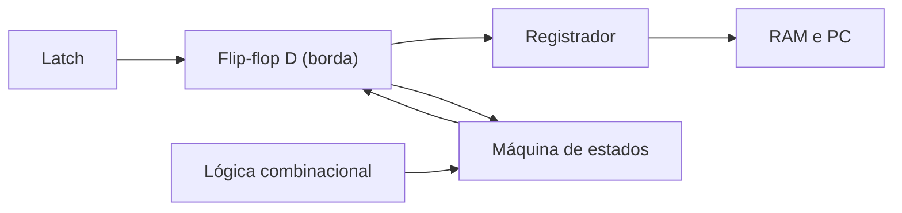

# 35 · Circuitos sequenciais e máquinas de estados

**Tempo estimado:** 45 minutos · **Pré-requisito:** [[34 - Circuitos combinacionais]].

**Ao final você vai conseguir:**

1. Diferenciar um latch de um flip-flop disparado por borda, e descrever a regra do flip-flop D.
2. Ler uma máquina de estados como "estado atual, entrada, próximo estado, saída".
3. Modelar uma memória endereçável e um contador de programa, em Python.

**Antes de começar:** no módulo 34 os circuitos não guardavam nada. Aqui você vê como um circuito guarda um bit entre um pulso de clock e o seguinte.

---

## Para começar

Um controlador de semáforo precisa lembrar em que fase está. Se a lógica só olha as entradas do momento, ela não sabe se o verde já passou. O circuito precisa de memória, e a memória precisa mudar em instantes marcados pelo relógio, e não a qualquer hora. Este módulo mostra como essa memória é construída e como ela permite contar, lembrar e avançar.

---

## Mapa do módulo



*Figura 1: o flip-flop é a peça de memória. Registradores, RAM e o contador de programa são feitos dele; a máquina de estados fecha o laço com a lógica combinacional.*

**Como ler:** a seta do final mostra a realimentação: a saída da lógica volta para o registrador de estado no próximo pulso.

---

## Mini-aula 1: latch e flip-flop

> [!tip] Ideia
> Um latch segue a entrada enquanto o clock está em nível alto. Um flip-flop disparado por borda só copia a entrada no instante da borda do clock, o que evita que a saída se mexa várias vezes num mesmo pulso.

> [!info] Definição
> Um **latch D** (D latch) guarda a entrada `D` enquanto o clock está alto (Kann, 9.3). Um **flip-flop disparado por borda** (edge-triggered flip-flop) copia `D` só na borda do clock (Kann, 9.4). A nota diz que o flip-flop é o remédio para o mau comportamento do latch quando a lógica é mais rápida que o pulso do clock.

Veja um modelo do flip-flop D. Ele copia `d` para `q` só na borda de subida, que é a transição de 0 para 1 do clock. Antes de rodar, diga em quais linhas `q` muda.

```python
class FlipFlopD:
    """Modelo simples: o valor de d é copiado para q só na borda de subida do clock."""
    def __init__(self):
        self.q = 0
        self.clk_anterior = 0

    def atualiza(self, clk, d):
        if clk == 1 and self.clk_anterior == 0:
            self.q = d
        self.clk_anterior = clk
        return self.q

ff = FlipFlopD()
sinais = [(0, 1), (1, 1), (1, 0), (0, 0), (1, 0), (0, 1), (1, 1)]
print("clk d | q")
for clk, d in sinais:
    print(clk, d, "|", ff.atualiza(clk, d))
```

Saída real:

```
clk d | q
0 1 | 0
1 1 | 1
1 0 | 1
0 0 | 1
1 0 | 0
0 1 | 0
1 1 | 1
```

**Como ler:** o valor de `q` muda só quando `clk` passa de 0 para 1. Nas outras linhas, `q` segue igual, mesmo que `d` mude. A simulação modela a borda de subida; a nota de Kann não discute a escolha da borda.

> [!warning] Armadilha comum
> Um latch muda a saída sempre que a entrada muda com o clock alto. Um flip-flop não. Confundir os dois é o erro mais comum ao ler circuitos sequenciais.

> [!question]- Checkpoint
> 1. Em qual linha da saída o valor de `q` passa de 0 para 1 pela primeira vez?
> 2. Por que a linha com `clk = 1` seguida de outra com `clk = 1` não muda `q`?
>
> > [!success]- Resposta
> > 1. Na segunda linha, quando `clk` sobe de 0 para 1 com `d = 1`.
> > 2. Porque não houve borda: o clock já estava alto na linha anterior.

---

## Mini-aula 2: máquina de estados

> [!tip] Ideia
> Uma máquina de estados guarda um número finito de estados. A cada pulso, o estado novo depende do estado atual e da entrada. Uma parte combinacional calcula o próximo estado.

> [!info] Definição
> Uma **máquina de estados finita** (finite state machine, FSM) é um registrador de `n` bits, feito de flip-flops D, ligado a uma lógica combinacional que calcula o próximo estado a partir do estado atual e das entradas. A nota diz que ela pode ser feita com portas soltas ou como uma tabela em ROM, como no contador de módulo 4 de Kann (10.3).

Veja um contador de dois bits. O estado é `(q1, q0)`, e a lógica do próximo estado está na função `proximo`. Antes de rodar, preveja o estado depois de três pulsos.

```python
def proximo(q1, q0):
    n0 = 1 - q0
    n1 = q1 ^ q0
    return n1, n0

estado = (0, 0)
print("pulso | estado (q1 q0)")
for pulso in range(1, 7):
    estado = proximo(*estado)
    print(pulso, "|", estado)
```

Saída real:

```
pulso | estado (q1 q0)
1 | (0, 1)
2 | (1, 0)
3 | (1, 1)
4 | (0, 0)
5 | (0, 1)
6 | (1, 0)
```

**Como ler:** `n0` inverte `q0` a cada pulso, e `n1` muda quando `q0` vale 1. Depois de quatro pulsos o contador volta a `(0, 0)`, porque são só quatro estados.

> [!warning] Armadilha comum
> O estado atual não é a entrada. Se você esquece que a próxima saída depende do estado, o circuito vira uma lógica sem memória, que é outra coisa.

> [!question]- Checkpoint
> 1. Quantos estados tem um contador de dois bits?
> 2. Quantos pulsos são necessários para o contador voltar ao estado inicial?
>
> > [!success]- Resposta
> > 1. Quatro, porque cada um dos dois bits tem dois valores.
> > 2. Quatro pulsos, pelo que a saída mostra.

---

## Mini-aula 3: registradores, RAM e contador de programa

> [!tip] Ideia
> Vários flip-flops formam um registrador, que guarda um valor de vários bits. Muitos registradores, endereçados, formam uma RAM. O contador de programa é um registrador que guarda o endereço da próxima instrução.

> [!info] Definição
> Um **registrador** (register) é um grupo de flip-flops que guarda um valor de vários bits. A **RAM** é uma sequência endereçável de registradores (nand2tetris, Projeto 3). O **contador de programa** (program counter, PC) é o registrador que guarda o endereço da próxima instrução; o nand2tetris monta um de 16 bits.

Veja a memória como uma lista de posições endereçadas. O endereço escolhe a posição, e a leitura devolve o que foi gravado. Antes de rodar, diga o que aparece na posição 5, que nunca foi gravada.

```python
memoria = [0] * 8

def grava(endereco, valor):
    memoria[endereco] = valor

def le(endereco):
    return memoria[endereco]

grava(3, 42)
grava(0, 7)
print("posição 3:", le(3), "| posição 0:", le(0), "| posição 5:", le(5))
```

Saída real:

```
posição 3: 42 | posição 0: 7 | posição 5: 0
```

**Como ler:** a posição 5 mostra `0`, o valor inicial. Gravar e ler são operações sobre um endereço, como na RAM da nota.

> [!warning] Armadilha comum
> A RAM não tem endereço "de nome": só existe o número do endereço. Um programa que usa o endereço errado lê outra posição sem aviso.

> [!question]- Checkpoint
> 1. Qual é o valor da posição 0 depois da gravação do exemplo?
> 2. Para que serve o PC?
>
> > [!success]- Resposta
> > 1. `7`, porque foi gravado nessa posição.
> > 2. Para guardar o endereço da próxima instrução a ser executada.

---

## Exercícios

Cada exercício tem um bloco com a função a completar e os testes com `assert`. Quando todos passarem, aparece `Passou!`. As funções definidas em exercícios anteriores aparecem no código inicial.

### Aquecimento

**A1. Copiar na borda.** Complete `proximo_q(q, d, clk, clk_anterior)`, que devolve o novo valor de `q` de um flip-flop tipo D. O valor `d` só entra em `q` quando há uma borda de subida, isto é, `clk` vale 1 e `clk_anterior` vale 0. Nos outros casos, `q` não muda. Essa é a regra de flip-flop disparado por borda, que a nota de Kann descreve como a solução para o mau comportamento do latch.

```python
def proximo_q(q, d, clk, clk_anterior):
    """Devolve o novo q: copia d só na borda de subida do clock."""
    ...

assert proximo_q(0, 1, 1, 0) == 1, "borda de subida copia d"
assert proximo_q(0, 1, 1, 1) == 0, "clock já estava alto: não há borda"
assert proximo_q(1, 0, 0, 1) == 1, "borda de descida não copia"
assert proximo_q(1, 0, 0, 0) == 1, "clock baixo mantém q"
print("Passou!")
```

> [!hint]- Dica 1
> Use um `if` com as duas condições: `clk == 1 and clk_anterior == 0`.

> [!hint]- Dica 2
> Se a condição não vale, devolva `q` sem alterar.

> [!example]- Solução
> ```python
> def proximo_q(q, d, clk, clk_anterior):
>     """Devolve o novo q: copia d só na borda de subida do clock."""
>     if clk == 1 and clk_anterior == 0:
>         return d
>     return q
> ```
>
> **Erro comum:** Copiar `d` sempre que `clk` vale 1. Isso é um latch: o valor segue a entrada durante todo o nível alto, e não só na borda.

**A2. Dois uns seguidos.** Complete `proximo_detector(estado, bit)`, uma máquina de estados com dois estados: `0` (o último bit lido não foi 1) e `1` (o último bit lido foi 1). A função recebe o estado atual e o bit novo, e devolve a tupla `(novo_estado, saida)`. A saída vale 1 só quando o estado é `1` e o bit é `1`, ou seja, quando chegam dois uns seguidos. O novo estado é `1` se o bit é `1`, e `0` caso contrário.

```python
def proximo_detector(estado, bit):
    """Devolve (novo_estado, saida); saida vale 1 quando chegam dois uns seguidos."""
    ...

assert proximo_detector(0, 1) == (1, 0), "um 1 depois de zero ainda não basta"
assert proximo_detector(1, 1) == (1, 1), "dois uns seguidos acendem a saída"
assert proximo_detector(1, 0) == (0, 0), "zero quebra a sequência"
assert proximo_detector(0, 0) == (0, 0), "zeros seguidos não fazem nada"
print("Passou!")
```

> [!hint]- Dica 1
> O novo estado é o próprio bit: `novo_estado = bit`.

> [!hint]- Dica 2
> A saída é 1 só na combinação de estado 1 com bit 1. Use `and`.

> [!example]- Solução
> ```python
> def proximo_detector(estado, bit):
>     """Devolve (novo_estado, saida); saida vale 1 quando chegam dois uns seguidos."""
>     novo_estado = bit
>     saida = 1 if estado == 1 and bit == 1 else 0
>     return novo_estado, saida
> ```
>
> **Erro comum:** Usar `saida = bit` sozinho. Isso marca qualquer 1, e não dois uns seguidos.

**A3. Gravar e ler.** Complete `gravar_e_ler(memoria, endereco, valor)`, que grava `valor` na posição `endereco` da lista `memoria` (uma RAM simples, como a da nota: uma sequência de registros endereçáveis) e devolve o valor lido de volta nessa mesma posição.

```python
def gravar_e_ler(memoria, endereco, valor):
    """Grava valor no endereço e devolve o valor lido de volta."""
    ...

m = [0, 0, 0, 0]
assert gravar_e_ler(m, 2, 9) == 9, "lê o valor que acabou de gravar"
assert m[2] == 9, "a memória guarda o valor"
assert gravar_e_ler(m, 0, 5) == 5, "outra posição, outro valor"
assert m[2] == 9, "a posição 2 não muda"
print("Passou!")
```

> [!hint]- Dica 1
> Use `memoria[endereco] = valor` para gravar.

> [!hint]- Dica 2
> Depois leia com `memoria[endereco]` e devolva o resultado.

> [!example]- Solução
> ```python
> def gravar_e_ler(memoria, endereco, valor):
>     """Grava valor no endereço e devolve o valor lido de volta."""
>     memoria[endereco] = valor
>     return memoria[endereco]
> ```
>
> **Erro comum:** Devolver `valor` sem ler a memória. O teste é o que a memória realmente guarda, e a leitura é o que importa.

### Praticando

**P1. Próximo endereço.** Complete `pc_proximo(pc, salto)`, que calcula o valor do contador de programa (PC) no próximo ciclo. Se `salto` for `None`, o PC avança para `pc + 1`. Se `salto` tiver um endereço, o PC passa a valer esse endereço. A nota diz que o PC guarda o endereço da próxima instrução; a regra de avanço e de salto é a deste exercício.

```python
def pc_proximo(pc, salto):
    """Devolve o próximo PC: pc + 1 sem salto, ou o endereço do salto."""
    ...

assert pc_proximo(0, None) == 1, "sem salto, avança um"
assert pc_proximo(7, None) == 8, "avança de novo"
assert pc_proximo(7, 0) == 0, "salto para zero também vale"
assert pc_proximo(3, 12) == 12, "salto para outro endereço"
print("Passou!")
```

> [!hint]- Dica 1
> Use `if salto is None:` para o caso sem salto.

> [!hint]- Dica 2
> Para o caso com salto, devolva `salto` diretamente.

> [!example]- Solução
> ```python
> def pc_proximo(pc, salto):
>     """Devolve o próximo PC: pc + 1 sem salto, ou o endereço do salto."""
>     if salto is None:
>         return pc + 1
>     return salto
> ```
>
> **Erro comum:** Testar `if salto:`. Um salto para o endereço 0 é falso em Python, e o PC não voltaria a zero.

**P2. Contador por ciclos.** Complete `conta_ciclos(n)`, que devolve a lista de estados do contador de dois bits após `0`, `1`, ..., `n` pulsos de clock, começando em `(0, 0)`. A função `proximo(q1, q0)`, já definida acima, dá o estado seguinte. A lista deve ter `n + 1` estados.

```python
def proximo(q1, q0):
    n0 = 1 - q0
    n1 = q1 ^ q0
    return n1, n0

def conta_ciclos(n):
    """Devolve os n + 1 estados do contador, começando em (0, 0)."""
    ...

assert conta_ciclos(0) == [(0, 0)], "sem pulsos, só o estado inicial"
assert conta_ciclos(2) == [(0, 0), (0, 1), (1, 0)], "dois pulsos"
assert conta_ciclos(4)[4] == (0, 0), "após quatro pulsos volta ao início"
print("Passou!")
```

> [!hint]- Dica 1
> Comece com `estado = (0, 0)` e uma lista com esse estado.

> [!hint]- Dica 2
> Em um `for` de `n` passos, faça `estado = proximo(*estado)` e adicione o novo estado à lista.

> [!example]- Solução
> ```python
> def conta_ciclos(n):
>     """Devolve os n + 1 estados do contador, começando em (0, 0)."""
>     estado = (0, 0)
>     estados = [estado]
>     for _ in range(n):
>         estado = proximo(*estado)
>         estados.append(estado)
>     return estados
> ```
>
> **Erro comum:** Esquecer o estado inicial na lista. Com `n = 0`, a lista deve ter um elemento: `[(0, 0)]`.

### Desafio

**D1. Só o último.** Complete `ultimo_estado(bits)`, que lê uma sequência de bits com a máquina do exercício A2, começando no estado `0`, e devolve o estado final. Use `proximo_detector` para cada bit.

```python
def proximo_detector(estado, bit):
    novo_estado = bit
    saida = 1 if estado == 1 and bit == 1 else 0
    return novo_estado, saida

def ultimo_estado(bits):
    """Lê os bits a partir do estado 0 e devolve o estado final."""
    ...

assert ultimo_estado([1, 1, 0]) == 0, "o último bit foi zero"
assert ultimo_estado([0, 1]) == 1, "o último bit foi um"
assert ultimo_estado([]) == 0, "sem bits, fica no estado inicial"
print("Passou!")
```

> [!hint]- Dica 1
> Comece com `estado = 0`, depois faça `estado, _ = proximo_detector(estado, bit)` para cada bit.

> [!hint]- Dica 2
> Para `[1, 1, 0]`, o estado final é `0`, porque o último bit foi zero.

> [!example]- Solução
> ```python
> def ultimo_estado(bits):
>     """Lê os bits a partir do estado 0 e devolve o estado final."""
>     estado = 0
>     for bit in bits:
>         estado, _ = proximo_detector(estado, bit)
>     return estado
> ```
>
> **Erro comum:** Esquecer de atualizar `estado` dentro do laço. Sem essa atribuição, o estado fica sempre `0`.


---

## Mini-projeto (opcional)

Você vai ler uma sequência de bits e marcar cada vez que dois uns seguidos aparecem, com a máquina do exercício A2. Tente sozinho antes de abrir a solução.

**Mini-projeto: detector de dois uns.** Complete `detecta_11(bits)`, que devolve a lista de saídas da máquina do exercício A2 para cada bit da sequência, começando no estado `0`. Cada posição da lista é a saída naquele bit. Para a sequência `[1, 1, 0, 1, 1, 1]`, a lista é `[0, 1, 0, 0, 1, 1]`.

```python
def proximo_detector(estado, bit):
    novo_estado = bit
    saida = 1 if estado == 1 and bit == 1 else 0
    return novo_estado, saida

def detecta_11(bits):
    """Devolve a saída da máquina para cada bit, começando no estado 0."""
    ...

assert detecta_11([1, 1, 0, 1, 1, 1]) == [0, 1, 0, 0, 1, 1], "exemplo do enunciado"
assert detecta_11([]) == [], "sem bits, sem saídas"
assert detecta_11([1]) == [0], "um único 1 não acende a saída"
print("Passou!")
```

> [!hint]- Dica 1
> Mantenha o estado em uma variável, e uma lista de saídas.

> [!hint]- Dica 2
> A cada bit, chame `proximo_detector(estado, bit)` e guarde as duas partes da tupla.

> [!example]- Solução
> ```python
> def detecta_11(bits):
>     """Devolve a saída da máquina para cada bit, começando no estado 0."""
>     estado = 0
>     saidas = []
>     for bit in bits:
>         estado, saida = proximo_detector(estado, bit)
>         saidas.append(saida)
>     return saidas
> ```
>
> **Erro comum:** Devolver só o último estado, e não a lista de saídas. A pergunta pede uma saída por bit.


---

## Fechando

**Resumo**

- Um latch segue a entrada durante o nível alto; um flip-flop D copia a entrada só na borda do clock.
- Uma máquina de estados é um registrador mais uma lógica que calcula o próximo estado.
- Registradores são grupos de flip-flops; a RAM é uma sequência endereçável deles; o PC guarda o endereço da próxima instrução.

**Glossário rápido**

- **Latch** (latch): armazena um bit enquanto o clock está em nível alto.
- **Flip-flop disparado por borda** (edge-triggered flip-flop): copia a entrada só na borda do clock.
- **Máquina de estados finita** (finite state machine, FSM): máquina com um número finito de estados.
- **Registrador** (register): grupo de flip-flops que guarda um valor de vários bits.
- **Contador de programa** (program counter, PC): registrador com o endereço da próxima instrução.

**Perguntas de revisão**

1. Por que um flip-flop D não muda a saída quando a entrada muda com o clock em nível alto e sem borda?
2. Quantos estados tem uma máquina de estados com três bits de estado?
3. Por que a RAM é uma sequência de registradores e não um único registrador?

**E agora?** O próximo módulo é **Datapath e controle**. Ele junta a ULA, os registradores e a memória em um processador que executa instruções.

---

## Para ir mais fundo

- [[Sequential Circuits and Finite State Machines]]
- [[Combinational Circuits]]
- [[Kann - Digital Circuit Projects (Engineering LibreTexts)]]
- [[nand2tetris - Projects 1 to 5 (Nisan and Schocken)]]
