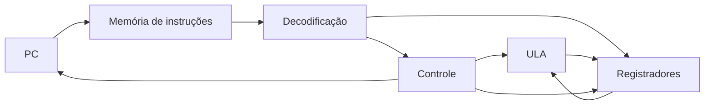

# 36 · Datapath e controle

**Tempo estimado:** 45 minutos · **Pré-requisito:** [[35 - Circuitos sequenciais e máquinas de estados]].

**Ao final você vai conseguir:**

1. Descrever o ciclo de busca, decodificação e execução de uma CPU.
2. Separar o caminho de dados (datapath), que transporta valores, do controle, que decide o que acontece.
3. Escrever, em Python, um interpretador que roda um programa com saltos.

**Antes de começar:** no módulo 35 você viu registradores, memória e o contador de programa. Aqui eles se juntam com a ULA para formar um processador.

---

## Para começar

Você recebe um programa: "guarde 1 em `r0`, guarde 2 em `r1`, some e guarde em `r2`". Quem executa isso? Um circuito que, a cada passo, lê a próxima instrução na memória, descobre o que ela pede, faz a conta na ULA e grava o resultado. As partes que transportam os valores formam o datapath; a parte que decide o que acontece em cada passo é o controle.

---

## Mapa do módulo



*Figura 1: as setas cheias são o caminho de dados; a parte de controle decide o que cada bloco faz. Desenho ilustrativo, não um esquema da nota.*

**Como ler:** o PC aponta a instrução; a decodificação separa os campos; a ULA faz a conta entre registradores; o controle liga e desliga os blocos.

---

## Mini-aula 1: o ciclo da CPU

> [!tip] Ideia
> Uma CPU repete três passos: buscar a instrução no endereço do PC, decodificá-la para saber o que é, e executá-la. Depois avança o PC.

> [!info] Definição
> O **datapath** (caminho de dados) é o conjunto de componentes por onde os valores das instruções passam: registradores, ULA e caminhos de memória. O **controle** (control unit) decide, a cada passo, quais componentes são ativados. Essa divisão é a base do desenho de processadores.

Veja um programa de quatro instruções rodando em um interpretador simples. Antes de rodar, diga quantas linhas `pc=` aparecem e qual é o último registrador escrito.

```python
registradores = [0, 0, 0, 0]

programa = [
    ("carrega", 0, 1),
    ("carrega", 1, 2),
    ("soma", 2, 0, 1),
    ("para",),
]

pc = 0
while True:
    instrucao = programa[pc]
    op = instrucao[0]
    print(f"pc={pc} instrução={instrucao}")
    pc += 1
    if op == "carrega":
        _, rd, valor = instrucao
        registradores[rd] = valor
    elif op == "soma":
        _, rd, ra, rb = instrucao
        registradores[rd] = registradores[ra] + registradores[rb]
    elif op == "para":
        break

print("registradores:", registradores)
```

Saída real:

```
pc=0 instrução=('carrega', 0, 1)
pc=1 instrução=('carrega', 1, 2)
pc=2 instrução=('soma', 2, 0, 1)
pc=3 instrução=('para',)
registradores: [1, 2, 3, 0]
```

**Como ler:** cada linha `pc=` é uma busca. As duas primeiras instruções carregam valores; a terceira soma `r0` e `r1` em `r2`; `para` encerra. O resultado final é `[1, 2, 3, 0]`.

> [!warning] Armadilha comum
> O PC é atualizado antes da execução neste interpretador. Em um processador real, a ordem depende do desenho. A nota não descreve esse detalhe, então o interpretador é um modelo, e não uma especificação.

> [!question]- Checkpoint
> 1. Qual instrução grava 3 em um registrador?
> 2. Quantas vezes o laço executa a busca para este programa?
>
> > [!success]- Resposta
> > 1. A `soma` em `r2`, que recebe `r0 + r1 = 1 + 2`.
> > 2. Quatro, uma para cada instrução, incluindo a `para`.

---

## Mini-aula 2: controle como tabela

> [!tip] Ideia
> O controle pode ser visto como uma tabela: para cada tipo de instrução, quais blocos são ativados. No hardware, essa tabela vira lógica combinacional, feita de portas.

> [!info] Definição
> Um **sinal de controle** (control signal) é um bit que liga ou desliga um bloco do datapath, como "escreve no registrador" ou "usa a ULA". A nota de Kann e a do nand2tetris não descrevem a tabela de uma CPU real; a tabela abaixo é uma ilustração.

Veja uma tabela de sinais para três instruções. Antes de rodar, diga quais instruções escrevem em registrador.

```python
sinais = {
    "carrega": {"usa_alu": 0, "escreve_reg": 1},
    "soma":    {"usa_alu": 1, "escreve_reg": 1},
    "para":    {"usa_alu": 0, "escreve_reg": 0},
}

for op, s in sinais.items():
    print(op, "->", s)
```

Saída real:

```
carrega -> {'usa_alu': 0, 'escreve_reg': 1}
soma -> {'usa_alu': 1, 'escreve_reg': 1}
para -> {'usa_alu': 0, 'escreve_reg': 0}
```

**Como ler:** `carrega` não usa a ULA, porque o valor vem direto da instrução; `soma` usa a ULA e escreve no registrador; `para` não faz nada no datapath.

> [!warning] Armadilha comum
> A tabela não é o hardware. Ela é uma especificação de como o hardware deve se comportar. Projetar o hardware que a implementa é outra etapa, que este módulo não cobre.

> [!question]- Checkpoint
> 1. Qual instrução usa a ULA, segundo a tabela?
> 2. Por que `para` tem os dois sinais em zero?
>
> > [!success]- Resposta
> > 1. `soma`.
> > 2. Porque ela só encerra a execução e não escreve nem calcula nada.

---

## Mini-aula 3: saltos e laços

> [!tip] Ideia
> Um salto troca o PC por outro endereço, em vez de avançar para o seguinte. Com um salto condicional, o programa decide por qual caminho seguir, e assim repete trechos.

> [!info] Definição
> Um **salto condicional** (conditional jump) escolhe o próximo PC com base em um valor. Os desvios do RISC-V aparecem no módulo 37; aqui a regra é a deste exercício.

O mini-projeto monta um laço que soma `3 + 2 + 1` usando um salto. O registrador `r3` vale sempre zero, o que transforma o salto condicional em um salto incondicional.

---

## Exercícios

Cada exercício tem um bloco com a função a completar e os testes com `assert`. Quando todos passarem, aparece `Passou!`. As funções definidas em exercícios anteriores aparecem no código inicial.

### Aquecimento

**A1. Soma entre registradores.** Complete `executa_add(regs, rd, ra, rb)`, que grava em `regs[rd]` a soma de `regs[ra]` e `regs[rb]`, e devolve a lista `regs` atualizada. Esse é o caminho de dados de uma instrução `soma`: as duas leituras vão para a ULA, e o resultado volta para um registrador.

```python
def executa_add(regs, rd, ra, rb):
    """Grava regs[ra] + regs[rb] em regs[rd] e devolve a lista."""
    ...

r = [0, 2, 3, 0]
assert executa_add(r, 0, 1, 2) == [5, 2, 3, 0], "2 + 3 vai para o registrador 0"
assert executa_add([1, 1, 1], 2, 0, 1) == [1, 1, 2], "o destino pode ser um terceiro registrador"
print("Passou!")
```

> [!hint]- Dica 1
> Leia `regs[ra]` e `regs[rb]`, some e atribua a `regs[rd]`.

> [!hint]- Dica 2
> Não crie uma lista nova; altere a que recebeu.

> [!example]- Solução
> ```python
> def executa_add(regs, rd, ra, rb):
>     """Grava regs[ra] + regs[rb] em regs[rd] e devolve a lista."""
>     regs[rd] = regs[ra] + regs[rb]
>     return regs
> ```
>
> **Erro comum:** Trocar `rd` por `ra` na atribuição. Isso grava a soma em um dos operandos, e não no destino.

**A2. Buscar a instrução.** Complete `busca(programa, pc)`, que devolve a tupla `(instrucao, proximo_pc)`: a instrução que está na posição `pc` do programa, e o endereço da instrução seguinte, que é `pc + 1`. Esse é o passo de busca do ciclo da CPU.

```python
def busca(programa, pc):
    """Devolve (instrução na posição pc, pc + 1)."""
    ...

prog = [("carrega", 0, 5), ("para",)]
assert busca(prog, 0) == (("carrega", 0, 5), 1), "primeira instrução, PC avança para 1"
assert busca(prog, 1) == (("para",), 2), "segunda instrução"
print("Passou!")
```

> [!hint]- Dica 1
> Pegue `programa[pc]` para a instrução.

> [!hint]- Dica 2
> O próximo PC é `pc + 1`, mesmo que a instrução seja um salto (isso será tratado depois).

> [!example]- Solução
> ```python
> def busca(programa, pc):
>     """Devolve (instrução na posição pc, pc + 1)."""
>     return programa[pc], pc + 1
> ```
>
> **Erro comum:** Devolver só a instrução. O ciclo precisa do próximo PC para continuar.

**A3. Operação da ULA.** Complete `alu(op, a, b)`, que faz uma operação sobre dois inteiros. Use `"soma"` para `a + b`, `"sub"` para `a - b`, `"e"` para `a & b` e `"ou"` para `a | b`. Para qualquer outro `op`, levante `ValueError`. A ULA recebe o código da operação e devolve o resultado, como no datapath da nota.

```python
def alu(op, a, b):
    """Executa op sobre a e b: soma, sub, e, ou; outro código levanta ValueError."""
    ...

assert alu("soma", 3, 4) == 7, "3 + 4"
assert alu("sub", 3, 4) == -1, "3 - 4"
assert alu("e", 12, 10) == 8, "1100 e 1010"
assert alu("ou", 12, 10) == 14, "1100 ou 1010"
try:
    alu("xor", 1, 1)
    assert False, "deveria ter levantado ValueError"
except ValueError:
    pass
print("Passou!")
```

> [!hint]- Dica 1
> Use `if` e `elif` para cada operação.

> [!hint]- Dica 2
> Para o caso desconhecido, use `raise ValueError("operação desconhecida")`.

> [!example]- Solução
> ```python
> def alu(op, a, b):
>     """Executa op sobre a e b: soma, sub, e, ou; outro código levanta ValueError."""
>     if op == "soma":
>         return a + b
>     elif op == "sub":
>         return a - b
>     elif op == "e":
>         return a & b
>     elif op == "ou":
>         return a | b
>     raise ValueError("operação desconhecida")
> ```
>
> **Erro comum:** Esquecer o `else` ou o `raise`. Sem ele, a função devolve `None` para operações inválidas, e isso passa despercebido.

### Praticando

**P1. Rodar um programa.** Complete `executa_programa(programa)`, que roda um programa de instruções `("carrega", rd, valor)`, `("soma", rd, ra, rb)` e `("para",)`, começando com quatro registradores zerados. O laço deve buscar a instrução no PC, decodificar pelo primeiro campo, executar e avançar o PC, até encontrar `para`. Devolva a lista de registradores.

```python
def busca(programa, pc):
    return programa[pc], pc + 1

def executa_programa(programa):
    """Roda o programa e devolve os registradores quando encontra 'para'."""
    ...

assert executa_programa([("carrega", 0, 5), ("carrega", 1, 7), ("soma", 2, 0, 1), ("para",)]) == [5, 7, 12, 0], "5 + 7 em r2"
assert executa_programa([("para",)]) == [0, 0, 0, 0], "programa vazio para na primeira"
print("Passou!")
```

> [!hint]- Dica 1
> Comece com `regs = [0, 0, 0, 0]` e `pc = 0`. Use `while True:` e `busca` (já definida acima).

> [!hint]- Dica 2
> Use `if` e `elif` para `carrega`, `soma` e `para`. No `para`, use `break`.

> [!example]- Solução
> ```python
> def executa_programa(programa):
>     """Roda o programa e devolve os registradores quando encontra 'para'."""
>     regs = [0, 0, 0, 0]
>     pc = 0
>     while True:
>         instrucao, pc = busca(programa, pc)
>         op = instrucao[0]
>         if op == "carrega":
>             _, rd, valor = instrucao
>             regs[rd] = valor
>         elif op == "soma":
>             _, rd, ra, rb = instrucao
>             regs[rd] = regs[ra] + regs[rb]
>         elif op == "para":
>             break
>     return regs
> ```
>
> **Erro comum:** Esquecer de avançar o `pc`. O laço repete a mesma instrução para sempre.

**P2. Decidir o próximo PC.** Complete `salta_se_zero(regs, r, alvo, pc)`, que devolve o próximo PC para a instrução de salto condicional. Se `regs[r]` vale zero, devolva `alvo`; caso contrário, devolva `pc + 1`. Essa regra é a do exercício, pois a nota não descreve o conjunto de instruções desta CPU.

```python
def salta_se_zero(regs, r, alvo, pc):
    """Devolve alvo se regs[r] é zero; caso contrário, pc + 1."""
    ...

assert salta_se_zero([0, 5], 0, 9, 3) == 9, "registrador zero: salta"
assert salta_se_zero([0, 5], 1, 9, 3) == 4, "registrador 5: segue"
assert salta_se_zero([0, -1], 1, 9, 3) == 4, "negativo também segue"
print("Passou!")
```

> [!hint]- Dica 1
> Use `if regs[r] == 0:` e devolva `alvo`; no `else`, devolva `pc + 1`.

> [!hint]- Dica 2
> Use `==` para zero; um valor vazio ou `None` não serve aqui.

> [!example]- Solução
> ```python
> def salta_se_zero(regs, r, alvo, pc):
>     """Devolve alvo se regs[r] é zero; caso contrário, pc + 1."""
>     if regs[r] == 0:
>         return alvo
>     return pc + 1
> ```
>
> **Erro comum:** Usar `if not regs[r]`. Para zero funciona, mas a intenção fica implícita. Escrever `== 0` deixa claro o que se testa.

### Desafio

**D1. Quantas instruções rodaram?** Complete `conta_instrucoes(programa)`, que roda o programa com a mesma regra de `executa_programa` e devolve quantas instruções foram executadas, contando a `para`. Use `busca` (já definida acima) e não altere a lista de registradores.

```python
def busca(programa, pc):
    return programa[pc], pc + 1

def conta_instrucoes(programa):
    """Devolve quantas instruções são executadas até 'para', incluindo a própria 'para'."""
    ...

assert conta_instrucoes([("para",)]) == 1, "só a para"
assert conta_instrucoes([("carrega", 0, 1), ("carrega", 1, 2), ("soma", 2, 0, 1), ("para",)]) == 4, "quatro instruções"
print("Passou!")
```

> [!hint]- Dica 1
> Use um contador começando em 0 e some 1 a cada instrução buscada.

> [!hint]- Dica 2
> Para `[("para",)]`, o resultado é 1, porque a `para` também conta.

> [!example]- Solução
> ```python
> def conta_instrucoes(programa):
>     """Devolve quantas instruções são executadas até 'para', incluindo a própria 'para'."""
>     total = 0
>     pc = 0
>     while True:
>         instrucao, pc = busca(programa, pc)
>         total += 1
>         if instrucao[0] == "para":
>             break
>     return total
> ```
>
> **Erro comum:** Não contar a instrução `para`. O contador deve somar antes de testar o tipo da instrução.


---

## Mini-projeto (opcional)

Você vai completar o interpretador com saltos e rodar um laço que soma os primeiros números. Tente sozinho antes de abrir a solução.

**Mini-projeto: laço com salto.** Complete `executa_com_salto(programa)`, que roda um programa com as quatro instruções `carrega`, `soma`, `salta_zero` e `para`. A instrução `("salta_zero", r, alvo)` salta para `alvo` quando `regs[r]` vale zero, e segue para a próxima quando não vale. Use `r3` como registrador que sempre vale zero, para fazer um salto incondicional. Com esse recurso, um programa pode repetir trechos.

```python
def executa_com_salto(programa):
    """Roda carrega, soma, salta_zero e para; devolve os registradores."""
    ...

soma_1_a_3 = [
    ("carrega", 0, 3),
    ("carrega", 1, 0),
    ("carrega", 2, -1),
    ("salta_zero", 0, 7),
    ("soma", 1, 1, 0),
    ("soma", 0, 0, 2),
    ("salta_zero", 3, 3),
    ("para",),
]
assert executa_com_salto(soma_1_a_3) == [0, 6, -1, 0], "3 + 2 + 1 = 6 no registrador 1"
assert executa_com_salto([("para",)]) == [0, 0, 0, 0], "programa vazio"
print("Passou!")
```

> [!hint]- Dica 1
> Trate `salta_zero` como um `if` sobre `regs[r]`. Use `pc = alvo` no caso de salto, e `pc += 1` no outro.

> [!hint]- Dica 2
> Em `soma` e `carrega`, avance `pc` em 1 depois da execução.

> [!example]- Solução
> ```python
> def executa_com_salto(programa):
>     """Roda carrega, soma, salta_zero e para; devolve os registradores."""
>     regs = [0, 0, 0, 0]
>     pc = 0
>     while True:
>         instrucao = programa[pc]
>         op = instrucao[0]
>         if op == "carrega":
>             _, rd, valor = instrucao
>             regs[rd] = valor
>             pc += 1
>         elif op == "soma":
>             _, rd, ra, rb = instrucao
>             regs[rd] = regs[ra] + regs[rb]
>             pc += 1
>         elif op == "salta_zero":
>             _, r, alvo = instrucao
>             if regs[r] == 0:
>                 pc = alvo
>             else:
>                 pc += 1
>         elif op == "para":
>             break
>     return regs
> ```
>
> **Erro comum:** Não atualizar `pc` no caso de salto. O laço fica preso na mesma instrução.


---

## Fechando

**Resumo**

- A CPU repete busca, decodificação e execução, e avança o PC.
- O datapath transporta valores; o controle decide o que cada bloco faz.
- Sinais de controle ligam e desligam blocos; a tabela deste módulo é ilustração.
- Saltos condicionais permitem laços. O nand2tetris monta uma CPU completa no Projeto 5.

**Glossário rápido**

- **Datapath** (datapath): componentes por onde os valores passam.
- **Controle** (control unit): parte que decide o que os blocos fazem.
- **Sinal de controle** (control signal): bit que liga ou desliga um bloco.
- **Salto** (jump): troca o PC por outro endereço.
- **Hack**: CPU de ensino do nand2tetris, não uma arquitetura comercial.

**Perguntas de revisão**

1. Qual é a diferença entre o datapath e o controle?
2. Por que o interpretador precisa atualizar o PC em cada passo?
3. O que muda no laço do mini-projeto se o salto para `alvo` for trocado por `pc += 1` em todos os casos?

**E agora?** O próximo módulo é **Conjunto de instruções e interface com o software**. Ele mostra as instruções reais de uma arquitetura, e como o montador e o ligador transformam texto em código de máquina.

---

## Para ir mais fundo

- [[Processor Datapath and Control]]
- [[nand2tetris - Projects 1 to 5 (Nisan and Schocken)]]
- [[Brown CSCI 1952y - Pipelined CPU Notes]]
- [[USFCA CS 315 - Processor Pipeline Hazards]]
