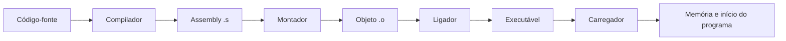

# 37 · Conjunto de instruções e interface com o software

**Tempo estimado:** 50 minutos · **Pré-requisito:** [[36 - Datapath e controle]] e o módulo 32 (inteiros com sinal).

**Ao final você vai conseguir:**

1. Descrever o que é uma ISA (arquitetura do conjunto de instruções) e dar exemplos das regras do RV32I.
2. Explicar por que imediatos são estendidos com sinal, e checar se um valor cabe em um campo.
3. Descrever o caminho de um programa até a memória: compilador, montador, ligador e carregador.
4. Montar um montador de duas passagens que resolve rótulos, inclusive os que aparecem depois do salto.

**Antes de começar:** no módulo 36 você viu uma CPU com instruções simples. Aqui vemos a interface que o software enxerga: nomes de registradores, formatos e regras do conjunto de instruções.

---

## Para começar

Um programa escrito em C vira um arquivo binário que roda em um processador. Entre o texto e o binário, há um caminho de ferramentas, e cada uma precisa entender a mesma regra: quais instruções existem, quantos bits cada campo tem e como endereços são calculados. Quando um salto aponta para um rótulo que só aparece mais adiante no arquivo, alguém precisa descobrir o endereço antes de gerar a instrução.

---

## Mapa do módulo



*Figura 1: cada etapa troca uma representação por outra. O montador e o ligador resolvem nomes; o carregador copia o programa para a memória.*

**Como ler:** o montador é a etapa em que o texto de instruções vira bits. O ligador junta arquivos e corrige endereços. O carregador os coloca na memória.

---

## Mini-aula 1: a ISA e o RV32I

> [!tip] Ideia
> A ISA é o contrato entre software e hardware. Ela diz quais instruções existem, quantos registradores há e como as instruções são codificadas em bits.

> [!info] Definição
> No **RV32I** (RISC-V, base de inteiros de 32 bits), cada instrução tem 32 bits. Há 32 registradores inteiros, de `x0` a `x31`, e `x0` vale sempre zero. Os imediatos (valores embutidos na instrução) são estendidos com sinal. O manual distingue quatro formatos base: R, I, S e U.

Veja a regra de `x0`: a escrita é ignorada e a leitura devolve zero. Antes de rodar, diga qual valor fica em `x0` depois de `escreve(0, 99)`.

```python
regs = [0] * 32

def escreve(rd, valor):
    if rd != 0:
        regs[rd] = valor

escreve(5, 42)
escreve(0, 99)
print("x5 =", regs[5], "| x0 =", regs[0], "| número de registradores =", len(regs))
```

Saída real:

```
x5 = 42 | x0 = 0 | número de registradores = 32
```

**Como ler:** o registrador `x5` guarda 42, e `x0` continua zero. A lista tem 32 posições, uma por registrador.

> [!warning] Armadilha comum
> `x0` não é uma posição comum de memória. Um programa que espera guardar um valor ali perde o valor sem erro aparente. Isso é uma regra da ISA, e não um bug.

> [!question]- Checkpoint
> 1. Quantos registradores inteiros o RV32I tem?
> 2. Qual é o valor de `x0` depois de qualquer escrita?
>
> > [!success]- Resposta
> > 1. Trinta e dois, de `x0` a `x31`.
> > 2. Zero, porque escritas em `x0` são ignoradas.

---

## Mini-aula 2: imediatos com sinal e faixas

> [!tip] Ideia
> Um imediato é um número codificado dentro da instrução. Para usá-lo como número negativo, o hardware copia o bit de sinal para os bits que faltam. Esse processo é a extensão de sinal.

> [!info] Definição
> A **extensão de sinal** (sign extension) é copiar o bit mais significativo de um campo para as posições acima, para preservar o valor com sinal. A nota diz que o imediato comum do RV32I tem 12 bits, e que o bit de sinal fica sempre na posição 31 da instrução.

Você vai escrever `estende_sinal` no exercício A1. A função `cabe_em_bits` do exercício A2 mostra o outro lado: se um valor cabe no campo antes de ser codificado. Antes de começar, pense: qual é o maior valor positivo que cabe em 12 bits com sinal?

> [!warning] Armadilha comum
> `0x800` em 12 bits não é `+2048`. Com sinal, é o menor valor, `-2048`. O mesmo padrão de bits tem dois significados, e a regra de leitura é o que os separa.

> [!question]- Checkpoint
> 1. Qual é o maior valor que cabe em 12 bits com sinal?
> 2. Qual padrão de 12 bits representa `-1`?
>
> > [!success]- Resposta
> > 1. `2047`, porque o intervalo vai de `-2048` a `2047`.
> > 2. Doze uns, `0xFFF`.

---

## Mini-aula 3: do código ao programa em memória

> [!tip] Ideia
> O programa passa por quatro etapas até rodar: o compilador gera assembly, o montador gera objeto, o ligador junta os objetos em um executável, e o carregador o coloca na memória.

> [!info] Definição
> O **montador** (assembler) traduz assembly em código de máquina. O **ligador** (linker) resolve símbolos entre arquivos objeto e bibliotecas, e ajusta endereços (relocação). O **carregador** (loader) copia o programa para a memória, prepara a pilha e chama `main`. A nota diz que o montador tem duas passagens: a primeira registra os rótulos, e a segunda gera o código, o que permite usar um rótulo antes de defini-lo.

Veja um montador de duas passagens. A primeira monta a tabela de símbolos; a segunda gera a saída. Antes de rodar, diga qual endereço recebe o rótulo `fim`.

```python
linhas = [
    "inicio:",
    "carrega 5",
    "laco:",
    "soma",
    "salta laco",
    "salta fim",
    "fim:",
    "para",
]

# 1ª passagem: tabela de símbolos, com o endereço de cada rótulo
tabela = {}
endereco = 0
for linha in linhas:
    if linha.endswith(":"):
        tabela[linha[:-1]] = endereco
    else:
        endereco += 4
print("tabela de símbolos:", tabela)

# 2ª passagem: gera a saída; a tabela já tem 'fim', que aparece depois do salto
endereco = 0
for linha in linhas:
    if linha.endswith(":"):
        continue
    partes = linha.split()
    if partes[0] == "salta":
        print(f"{endereco:3} salta -> {tabela[partes[1]]}")
    else:
        print(f"{endereco:3} {linha}")
    endereco += 4
```

Saída real:

```
tabela de símbolos: {'inicio': 0, 'laco': 4, 'fim': 16}
  0 carrega 5
  4 soma
  8 salta -> 4
 12 salta -> 16
 16 para
```

**Como ler:** `laco` vale 4, porque a instrução `carrega` ocupa o endereço 0. `fim` vale 16, e aparece depois do salto que o usa: a segunda passagem já conhece o endereço. Este programa de exemplo usa 4 bytes por instrução, uma escolha de exemplo.

> [!warning] Armadilha comum
> Os endereços da tabela de símbolos são de instruções, e não de linhas. No exemplo, só as instruções somam 4 ao endereço; a linha de rótulo não soma.

> [!question]- Checkpoint
> 1. Por que o montador precisa de duas passagens?
> 2. Quantos bytes ocupa cada instrução no exemplo?
>
> > [!success]- Resposta
> > 1. Porque um salto pode usar um rótulo que aparece mais adiante; só depois da primeira passagem o endereço é conhecido.
> > 2. Quatro, nessa escolha de exemplo.

---

## Exercícios

Cada exercício tem um bloco com a função a completar e os testes com `assert`. Quando todos passarem, aparece `Passou!`. As funções definidas em exercícios anteriores aparecem no código inicial.

### Aquecimento

**A1. Estender o sinal de um imediato.** Complete `estende_sinal(valor, bits)`, que interpreta `valor` como um número com sinal de `bits` bits. Se o bit mais significativo (o bit de sinal) vale 1, o valor é negativo e deve ser `valor - 2**bits`. Caso contrário, devolva `valor`. A nota diz que os imediatos do RV32I são estendidos com sinal, e que o bit de sinal fica sempre na posição 31 da instrução.

```python
def estende_sinal(valor, bits):
    """Interpreta valor como número com sinal de bits bits."""
    ...

assert estende_sinal(0x7FF, 12) == 2047, "maior positivo de 12 bits"
assert estende_sinal(0x800, 12) == -2048, "menor negativo de 12 bits"
assert estende_sinal(0xFFF, 12) == -1, "todos os bits em 1 é -1"
assert estende_sinal(5, 8) == 5, "positivo não muda"
assert estende_sinal(0xFF, 8) == -1, "oito bits com sinal"
print("Passou!")
```

> [!hint]- Dica 1
> O bit de sinal é `valor & (1 << (bits - 1))`. Se ele for diferente de zero, o valor é negativo.

> [!hint]- Dica 2
> Para 12 bits, `0xFFF` vira `-1`, e `0x800` vira `-2048`.

> [!example]- Solução
> ```python
> def estende_sinal(valor, bits):
>     """Interpreta valor como número com sinal de bits bits."""
>     if valor & (1 << (bits - 1)):
>         return valor - (1 << bits)
>     return valor
> ```
>
> **Erro comum:** Subtrair `2 ** (bits - 1)` em vez de `2 ** bits`. O número sai com a metade do valor certo.

**A2. Cabe no campo?** Complete `cabe_em_bits(valor, bits)`, que devolve `True` se `valor` cabe em um campo de `bits` bits com sinal, e `False` caso contrário. O intervalo é de `-2**(bits - 1)` até `2**(bits - 1) - 1`. Isso serve para checar se um imediato ou um deslocamento de salto cabe na instrução.

```python
def cabe_em_bits(valor, bits):
    """True se valor cabe em um campo com sinal de bits bits."""
    ...

assert cabe_em_bits(2047, 12) is True, "maior valor de 12 bits"
assert cabe_em_bits(2048, 12) is False, "2048 não cabe em 12 bits com sinal"
assert cabe_em_bits(-2048, 12) is True, "menor valor de 12 bits"
assert cabe_em_bits(-2049, 12) is False, "abaixo do menor não cabe"
print("Passou!")
```

> [!hint]- Dica 1
> Use `-2 ** (bits - 1) <= valor <= 2 ** (bits - 1) - 1`.

> [!hint]- Dica 2
> Para 12 bits, o maior valor é `2047` e o menor é `-2048`.

> [!example]- Solução
> ```python
> def cabe_em_bits(valor, bits):
>     """True se valor cabe em um campo com sinal de bits bits."""
>     return -(2 ** (bits - 1)) <= valor <= 2 ** (bits - 1) - 1
> ```
>
> **Erro comum:** Usar `2 ** bits` como limite superior. O valor `2048` não cabe em 12 bits com sinal, mas `2 ** 12` deixaria passar.

**A3. Registrador zero.** Complete `le_registrador(regs, n)`, que devolve o valor do registrador `n` de uma lista de 32 registradores. O registrador `x0` está sempre em zero: se `n` for 0, devolva 0, mesmo que a lista tenha outro valor ali. A nota diz que x0 é fixo em zero.

```python
def le_registrador(regs, n):
    """Devolve o valor do registrador n; x0 (n = 0) sempre vale zero."""
    ...

valores = [9] * 32
assert le_registrador(valores, 0) == 0, "x0 é zero, mesmo com 9 na lista"
assert le_registrador(valores, 5) == 9, "x5 devolve o valor guardado"
assert le_registrador(valores, 31) == 9, "último registrador"
print("Passou!")
```

> [!hint]- Dica 1
> Use `if n == 0:` para o caso especial.

> [!hint]- Dica 2
> Nos outros casos, devolva `regs[n]`.

> [!example]- Solução
> ```python
> def le_registrador(regs, n):
>     """Devolve o valor do registrador n; x0 (n = 0) sempre vale zero."""
>     if n == 0:
>         return 0
>     return regs[n]
> ```
>
> **Erro comum:** Devolver `regs[0]` direto. Se alguém gravou algo na posição 0 da lista, esse valor vazaria para a leitura.

### Praticando

**P1. Deslocamento de salto.** Complete `resolve_salto(rotulo, tabela, endereco_atual)`, que devolve o deslocamento de um salto relativo ao PC: o endereço do rótulo menos o endereço da própria instrução de salto. A nota diz que os desvios são relativos ao PC. O sinal do resultado mostra se o salto vai para trás (negativo) ou para a frente (positivo).

```python
def resolve_salto(rotulo, tabela, endereco_atual):
    """Devolve o deslocamento relativo ao PC: endereço do rótulo menos o endereço atual."""
    ...

tabela = {"laco": 4, "fim": 16}
assert resolve_salto("laco", tabela, 8) == -4, "salto para trás"
assert resolve_salto("fim", tabela, 12) == 4, "salto para a frente"
assert resolve_salto("laco", tabela, 4) == 0, "salto para a própria instrução"
print("Passou!")
```

> [!hint]- Dica 1
> Busque o endereço do rótulo em `tabela[rotulo]`.

> [!hint]- Dica 2
> Subtraia `endereco_atual` do valor encontrado.

> [!example]- Solução
> ```python
> def resolve_salto(rotulo, tabela, endereco_atual):
>     """Devolve o deslocamento relativo ao PC: endereço do rótulo menos o endereço atual."""
>     return tabela[rotulo] - endereco_atual
> ```
>
> **Erro comum:** Devolver o endereço absoluto do rótulo. Um desvio relativo ao PC precisa do deslocamento, não do endereço final.

**P2. Nome do registrador.** Complete `codifica_registrador(nome)`, que recebe um nome como `"x5"` e devolve o número inteiro `5`. Só são válidos nomes de `x0` a `x31`. Para qualquer outro nome, levante `ValueError`. Isso reflete os 32 registradores inteiros do RV32I, citados na nota.

```python
def codifica_registrador(nome):
    """Devolve o número do registrador x0..x31; outro nome levanta ValueError."""
    ...

assert codifica_registrador("x0") == 0, "x0"
assert codifica_registrador("x5") == 5, "x5"
assert codifica_registrador("x31") == 31, "último registrador"
for ruim in ("x32", "a0", "x"):
    try:
        codifica_registrador(ruim)
        assert False, "deveria ter levantado ValueError para " + ruim
    except ValueError:
        pass
print("Passou!")
```

> [!hint]- Dica 1
> Verifique se o nome começa com `"x"` e se o restante é um número: `nome[1:].isdigit()`.

> [!hint]- Dica 2
> Converta o restante com `int(nome[1:])`, e levante erro se o número for maior que 31.

> [!example]- Solução
> ```python
> def codifica_registrador(nome):
>     """Devolve o número do registrador x0..x31; outro nome levanta ValueError."""
>     if not nome.startswith("x") or not nome[1:].isdigit():
>         raise ValueError("nome inválido")
>     n = int(nome[1:])
>     if n > 31:
>         raise ValueError("registrador inexistente")
>     return n
> ```
>
> **Erro comum:** Aceitar `"a0"` ou `"x32"`. Este exercício só aceita a forma x seguida de número; nomes de outra forma são recusados, e `x32` não existe na lista de 32.


---

## Mini-projeto (opcional)

Você vai montar um pequeno montador com as duas passagens e saltos relativos ao PC. Tente sozinho antes de abrir a solução.

**Mini-projeto: montador de duas passagens.** Complete `montador(linhas)`, que recebe uma lista de linhas (rótulos terminados em `:`, instruções e saltos `salta ROTULO`) e devolve uma lista de textos `"endereco instrucao"`. Na primeira passagem, monte a tabela de símbolos, com 4 bytes por instrução. Na segunda, troque cada `salta ROTULO` pelo deslocamento relativo ao PC, usando `resolve_salto` (já definida acima). Rótulos não entram na saída.

```python
def resolve_salto(rotulo, tabela, endereco_atual):
    return tabela[rotulo] - endereco_atual

def montador(linhas):
    """Duas passagens: tabela de símbolos e depois saltos relativos ao PC."""
    ...

prog = ["inicio:", "carrega 5", "laco:", "soma", "salta laco", "salta fim", "fim:", "para"]
assert montador(prog) == ["0 carrega 5", "4 soma", "8 salta -4", "12 salta 4", "16 para"], "saltos relativos"
assert montador(["para"]) == ["0 para"], "sem rótulos"
print("Passou!")
```

> [!hint]- Dica 1
> A primeira passagem é igual à da demonstração: rótulo guarda o endereço atual, e cada instrução soma 4.

> [!hint]- Dica 2
> Na segunda passagem, para cada salto escreva `f"{endereco} salta {resolve_salto(partes[1], tabela, endereco)}"`.

> [!example]- Solução
> ```python
> def montador(linhas):
>     """Duas passagens: tabela de símbolos e depois saltos relativos ao PC."""
>     tabela = {}
>     endereco = 0
>     for linha in linhas:
>         if linha.endswith(":"):
>             tabela[linha[:-1]] = endereco
>         else:
>             endereco += 4
>     saida = []
>     endereco = 0
>     for linha in linhas:
>         if linha.endswith(":"):
>             continue
>         partes = linha.split()
>         if partes[0] == "salta":
>             saida.append(f"{endereco} salta {resolve_salto(partes[1], tabela, endereco)}")
>         else:
>             saida.append(f"{endereco} {linha}")
>         endereco += 4
>     return saida
> ```
>
> **Erro comum:** Esquecer de somar 4 ao endereço depois de cada instrução. Todos os endereços saem iguais e os saltos ficam errados.


---

## Fechando

**Resumo**

- A ISA é o contrato entre software e hardware. No RV32I, há 32 registradores de 32 bits, com `x0` fixo em zero.
- Imediatos são estendidos com sinal; o imediato comum tem 12 bits.
- Compilador, montador, ligador e carregador levam o programa até a memória.
- O montador usa duas passagens para resolver rótulos. Saltos são relativos ao PC.

**Glossário rápido**

- **ISA** (instruction set architecture): contrato entre software e hardware.
- **Extensão de sinal** (sign extension): copia o bit de sinal para preservar o valor.
- **Montador** (assembler): traduz assembly em código de máquina.
- **Ligador** (linker): resolve símbolos e ajusta endereços.
- **Carregador** (loader): coloca o programa na memória e o inicia.
- **Tabela de símbolos** (symbol table): mapa de rótulos para endereços.

**Perguntas de revisão**

1. Por que `x0` ser sempre zero simplifica o software?
2. Um salto de 3 instruções para trás, de 4 bytes cada, tem deslocamento negativo ou positivo?
3. O que o ligador faz que o montador não faz?

**E agora?** O próximo módulo é **Exceções e interrupções**. Ele trata de eventos que desviam a execução para um tratador, e mostra como o RISC-V registra a causa.

---

## Para ir mais fundo

- [[Instruction Set Architecture]]
- [[Assembler, Linker and Loader]]
- [[RISC-V ISA Manual - RV32I Base Integer ISA]]
- [[Rochester CSC 252 - Linking Notes]]
