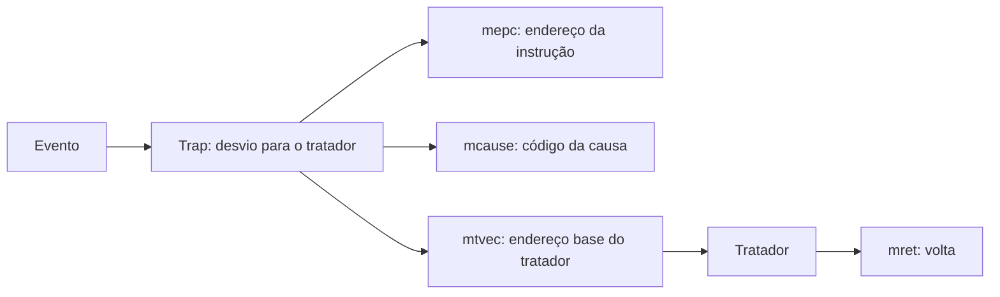

# 38 · Exceções e interrupções

**Tempo estimado:** 40 minutos · **Pré-requisito:** [[37 - Conjunto de instruções e interface com o software]].

**Ao final você vai conseguir:**

1. Separar exceção (causada por uma instrução) de interrupção (vinda de fora da sequência de instruções), e ler o código de causa.
2. Identificar o bit que marca uma interrupção no `mcause` e extrair o código.
3. Calcular o endereço do tratador nos modos direto e vetorizado.
4. Descrever a sequência de trap: guardar o `mepc`, desviar para o tratador e voltar com `mret`.

**Antes de começar:** no módulo 36 o PC avançava sempre. Aqui vemos o que acontece quando a execução é desviada de forma inesperada, e para onde ela volta.

---

## Para começar

Um programa divide por zero, ou tenta executar um código que o processador não conhece. Ao mesmo tempo, um relógio de hardware avisa que o tempo acabou. Em ambos os casos, a execução normal é interrompida, e um trecho de código especial, o tratador, assume o controle. Depois, a execução pode voltar ao ponto de partida, ou seguir para outro lugar. O processador precisa saber a causa para escolher o tratador certo.

---

## Mapa do módulo



*Figura 1: o trap guarda a causa e o endereço, e desvia para o tratador. O mret devolve a execução.*

**Como ler:** `mepc`, `mcause` e `mtvec` são registradores de controle (CSR). O trap os preenche, e o `mret` encerra o tratador.

---

## Mini-aula 1: exceção e interrupção

> [!tip] Ideia
> Uma exceção vem de uma instrução específica. Uma interrupção vem de fora e pode chegar a qualquer momento. Nos dois casos, a execução desvia para um tratador.

> [!info] Definição
> Um **trap** é o desvio de controle para um tratador, causado por uma exceção ou por uma interrupção. Uma **exceção** (exception) é um evento ligado a uma instrução. Uma **interrupção** (interrupt) é um evento externo ao fluxo de instruções.

Veja um pequeno processador que encontra uma instrução ilegal, desvia para um tratador e volta. Antes de rodar, diga qual endereço o tratador vê em `mepc`.

```python
programa = {0: "nop", 1: "ilegal", 2: "para", 100: "trata", 101: "retorna"}

pc = 0
mepc = None
mcause = None
while True:
    instr = programa[pc]
    print(f"pc={pc}: {instr}")
    if instr == "nop":
        pc += 1
    elif instr == "ilegal":
        mepc = pc
        mcause = 2
        pc = 100
    elif instr == "trata":
        print("  tratador: mcause =", mcause, "| mepc =", mepc)
        mepc += 1
        pc = 101
    elif instr == "retorna":
        pc = mepc
    elif instr == "para":
        break
print("fim em pc =", pc)
```

Saída real:

```
pc=0: nop
pc=1: ilegal
pc=100: trata
  tratador: mcause = 2 | mepc = 1
pc=101: retorna
pc=2: para
fim em pc = 2
```

**Como ler:** a instrução `ilegal` na posição 1 ativa o trap. O tratador lê `mcause = 2` e `mepc = 1`, e o `mret` devolve a execução. O salto de volta para a instrução seguinte é uma escolha deste exemplo: o tratador soma 1 a `mepc`.

> [!warning] Armadilha comum
> `mret` volta para `mepc`. Se o tratador não mudar `mepc`, a mesma instrução ilegal dispara de novo, e o programa fica em laço. O exemplo corrige isso de propósito.

> [!question]- Checkpoint
> 1. Qual é o valor de `mcause` que o tratador lê?
> 2. Por que o tratador soma 1 a `mepc`?
>
> > [!success]- Resposta
> > 1. `2`, o código de instrução ilegal citado pela nota.
> > 2. Para que o `mret` não reexecute a instrução ilegal.

---

## Mini-aula 2: `mcause` e o bit de interrupção

> [!tip] Ideia
> O `mcause` tem um bit que separa interrupções de exceções, e os bits restantes dão o código da causa. Com 32 bits, o bit de interrupção é o 31.

> [!info] Definição
> Em modo máquina, o bit mais alto de `mcause` é 1 nas interrupções. Os demais bits dão o código: `2` é instrução ilegal (exceção), e `7` é interrupção de timer da máquina (interrupção). Os códigos vêm da nota, que cita a especificação.

Veja os dois códigos da nota, e o valor de `mcause` que uma interrupção de timer tem. Antes de rodar, diga qual é o valor hexadecimal de um `mcause` com bit de interrupção e código 7.

```python
nomes = {2: "instrução ilegal (exceção)", 7: "timer da máquina (interrupção)"}
for codigo in (2, 7):
    print(codigo, "->", nomes[codigo])

bit_de_interrupcao = 1 << 31
print("mcause de interrupção com código 7:", hex(bit_de_interrupcao | 7))
```

Saída real:

```
2 -> instrução ilegal (exceção)
7 -> timer da máquina (interrupção)
mcause de interrupção com código 7: 0x80000007
```

**Como ler:** o código `7` com o bit 31 em 1 vira `0x80000007`. Sem o bit, `7` seria outra coisa, e o mesmo código teria significado diferente.

> [!warning] Armadilha comum
> O código sozinho não diz se é exceção ou interrupção. Um `7` sem o bit de interrupção não é o timer.

> [!question]- Checkpoint
> 1. Qual bit de um `mcause` de 32 bits indica interrupção?
> 2. Qual é o código da instrução ilegal?
>
> > [!success]- Resposta
> > 1. O bit 31.
> > 2. `2`.

---

## Mini-aula 3: endereço do tratador

> [!tip] Ideia
> O `mtvec` guarda o endereço base do tratador e o modo. No modo direto, todo trap vai para a base. No modo vetorizado, cada interrupção vai para uma entrada diferente da tabela, a base mais quatro vezes o código.

> [!info] Definição
> No **modo direto** (direct), o PC recebe a base de `mtvec`. No **modo vetorizado** (vectored), a nota diz que as interrupções vão para `BASE + 4 × causa`. O caso das exceções no modo vetorizado não é descrito na nota, e o exercício A3 fixa uma convenção.

Você vai calcular esse endereço no exercício A3.

> [!warning] Armadilha comum
> A tabela de vetores tem entradas de 4 bytes. Se o código é 7 e a base é `0x1000`, o endereço é `0x1000 + 28`, e não `0x1000 + 7`.

> [!question]- Checkpoint
> 1. No modo direto, para onde vai o PC depois de um trap?
> 2. Qual é o endereço vetorizado de uma interrupção de código 7, com base `0x1000`?
>
> > [!success]- Resposta
> > 1. Para a base de `mtvec`.
> > 2. `0x1000 + 4 × 7 = 0x1000 + 28 = 4124`.

---

## Exercícios

Cada exercício tem um bloco com a função a completar e os testes com `assert`. Quando todos passarem, aparece `Passou!`. As funções definidas em exercícios anteriores aparecem no código inicial.

### Aquecimento

**A1. Interrupção ou exceção?** Complete `eh_interrupcao(mcause)`, que devolve `True` quando o valor de `mcause` é de uma interrupção, e `False` quando é de uma exceção. A nota diz que, no RISC-V em modo máquina, o bit mais alto de `mcause` fica em 1 nas interrupções. Esse é o bit 31 de um valor de 32 bits.

```python
def eh_interrupcao(mcause):
    """True se o bit mais alto de mcause (bit 31) está em 1, o que indica interrupção."""
    ...

assert eh_interrupcao(2) is False, "instrução ilegal é exceção"
assert eh_interrupcao(0x80000007) is True, "timer é interrupção"
assert eh_interrupcao(0x80000000) is True, "só o bit de interrupção"
assert eh_interrupcao(0) is False, "zero não é interrupção"
print("Passou!")
```

> [!hint]- Dica 1
> Use `mcause & 0x80000000`. O resultado é diferente de zero se o bit 31 estiver em 1.

> [!hint]- Dica 2
> Devolva o resultado da comparação com zero, para ter `True` ou `False`.

> [!example]- Solução
> ```python
> def eh_interrupcao(mcause):
>     """True se o bit mais alto de mcause (bit 31) está em 1, o que indica interrupção."""
>     return (mcause & 0x80000000) != 0
> ```
>
> **Erro comum:** Testar `mcause >= 0`. Todo valor guardado sem sinal é maior ou igual a zero, então esse teste não separa interrupção de exceção.

**A2. Código da causa.** Complete `codigo_causa(mcause)`, que devolve o código da causa sem o bit de interrupção. Para `0x80000007`, o código é `7`; para `2`, o código é `2`. Use a máscara dos 31 bits de baixo.

```python
def codigo_causa(mcause):
    """Devolve o código da causa, sem o bit de interrupção."""
    ...

assert codigo_causa(0x80000007) == 7, "código do timer"
assert codigo_causa(2) == 2, "código de instrução ilegal"
assert codigo_causa(0x80000000) == 0, "só o bit de interrupção"
print("Passou!")
```

> [!hint]- Dica 1
> A máscara é `0x7FFFFFFF`, com o bit 31 em zero e os outros em um.

> [!hint]- Dica 2
> Aplique `mcause & 0x7FFFFFFF`.

> [!example]- Solução
> ```python
> def codigo_causa(mcause):
>     """Devolve o código da causa, sem o bit de interrupção."""
>     return mcause & 0x7FFFFFFF
> ```
>
> **Erro comum:** Usar `mcause % 2**31` e confundir o resultado. Para o valor certo, a máscara é mais direta, e não há ambiguidade com negativos.

**A3. Para onde o desvio vai.** Complete `endereco_tratador(base, modo, mcause)`, que devolve o endereço do tratador. No modo `"direto"`, é sempre `base`. No modo `"vetorizado"`, uma interrupção vai para `base + 4 * código`, e uma exceção vai para `base`. A nota descreve o modo vetorizado só para interrupções; o caso das exceções é uma convenção deste exercício, a conferir na especificação. Use as funções `eh_interrupcao` e `codigo_causa`, já definidas acima.

```python
def eh_interrupcao(mcause):
    return (mcause & 0x80000000) != 0

def codigo_causa(mcause):
    return mcause & 0x7FFFFFFF

def endereco_tratador(base, modo, mcause):
    """Endereço do tratador: direto usa base; vetorizado usa base + 4*código para interrupções."""
    ...

assert endereco_tratador(0x1000, "direto", 0x80000007) == 0x1000, "modo direto ignora a causa"
assert endereco_tratador(0x1000, "vetorizado", 0x80000007) == 4124, "timer vetorizado: base + 28"
assert endereco_tratador(0x1000, "vetorizado", 2) == 0x1000, "exceção no modo vetorizado usa base (convenção deste exercício)"
print("Passou!")
```

> [!hint]- Dica 1
> Primeiro, separe os dois casos de `modo`. Dentro do vetorizado, teste `eh_interrupcao(mcause)`.

> [!hint]- Dica 2
> Para a interrupção do timer, `base = 0x1000` e código 7 dão `0x1000 + 28`, que é 4124.

> [!example]- Solução
> ```python
> def endereco_tratador(base, modo, mcause):
>     """Endereço do tratador: direto usa base; vetorizado usa base + 4*código para interrupções."""
>     if modo == "direto":
>         return base
>     if eh_interrupcao(mcause):
>         return base + 4 * codigo_causa(mcause)
>     return base
> ```
>
> **Erro comum:** Esquecer de multiplicar o código por 4. A tabela de vetores tem uma entrada de 4 bytes por causa.

### Praticando

**P1. Primeira instrução ilegal.** Complete `primeiro_ilegal(programa)`, que percorre a lista de instruções (strings `"nop"`, `"ilegal"` e `"para"`) do início ao fim. Quando achar `"ilegal"`, devolva a tupla `(mepc, mcause)`, em que `mepc` é a posição dessa instrução e `mcause` é `2`, o código de instrução ilegal. Se não houver, devolva `None`. A nota diz que `mepc` guarda o endereço da instrução que causou o trap.

```python
def primeiro_ilegal(programa):
    """Devolve (mepc, mcause) da primeira instrução ilegal, ou None se não houver."""
    ...

assert primeiro_ilegal(["nop", "ilegal", "para"]) == (1, 2), "ilegal na posição 1"
assert primeiro_ilegal(["ilegal", "ilegal"]) == (0, 2), "a primeira vence"
assert primeiro_ilegal(["nop", "para"]) is None, "sem ilegal não há trap"
print("Passou!")
```

> [!hint]- Dica 1
> Use `for i, instr in enumerate(programa):`. Quando `instr == "ilegal"`, devolva `(i, 2)`.

> [!hint]- Dica 2
> Se o laço terminar sem achar, devolva `None`.

> [!example]- Solução
> ```python
> def primeiro_ilegal(programa):
>     """Devolve (mepc, mcause) da primeira instrução ilegal, ou None se não houver."""
>     for i, instr in enumerate(programa):
>         if instr == "ilegal":
>             return (i, 2)
>     return None
> ```
>
> **Erro comum:** Devolver a posição de `"nop"` ou da última instrução. A pergunta é sobre a primeira ilegal.

**P2. Exceção ou interrupção.** Complete `tipo_de_trap(mcause)`, que devolve a palavra `"interrupção"` quando o valor de `mcause` indica interrupção, e `"exceção"` nos outros casos. Use `eh_interrupcao`, já definida acima.

```python
def eh_interrupcao(mcause):
    return (mcause & 0x80000000) != 0

def tipo_de_trap(mcause):
    """Devolve 'interrupção' ou 'exceção', conforme o bit 31 de mcause."""
    ...

assert tipo_de_trap(2) == "exceção", "instrução ilegal"
assert tipo_de_trap(0x80000007) == "interrupção", "timer"
assert tipo_de_trap(0) == "exceção", "zero conta como exceção aqui"
print("Passou!")
```

> [!hint]- Dica 1
> Use `if eh_interrupcao(mcause):` e devolva a palavra da interrupção.

> [!hint]- Dica 2
> No `else` (ou depois do `if`), devolva `"exceção"`.

> [!example]- Solução
> ```python
> def tipo_de_trap(mcause):
>     """Devolve 'interrupção' ou 'exceção', conforme o bit 31 de mcause."""
>     if eh_interrupcao(mcause):
>         return "interrupção"
>     return "exceção"
> ```
>
> **Erro comum:** Devolver `"interrupção"` para todo valor diferente de 2. Interrupções e exceções são decididas pelo bit 31, e não pelo código.

### Desafio

**D1. Retorno do tratador.** Complete `retorno_mret(mepc, pular)`, que devolve o endereço para onde o `mret` leva o PC. Se `pular` for `True`, o tratador escolheu avançar uma instrução, e o retorno é `mepc + 4`. Se for `False`, o retorno é o próprio `mepc`. Esta regra de `pular` é uma convenção deste exercício; a nota não a descreve.

```python
def retorno_mret(mepc, pular):
    """Endereço de retorno do mret: mepc + 4 se o tratador pulou a instrução, senão mepc."""
    ...

assert retorno_mret(8, True) == 12, "pula a instrução de 4 bytes"
assert retorno_mret(8, False) == 8, "volta para a mesma instrução"
assert retorno_mret(0, True) == 4, "a partir do início"
print("Passou!")
```

> [!hint]- Dica 1
> Use `mepc + 4 if pular else mepc`.

> [!hint]- Dica 2
> Confira `retorno_mret(8, True)`, que deve dar 12.

> [!example]- Solução
> ```python
> def retorno_mret(mepc, pular):
>     """Endereço de retorno do mret: mepc + 4 se o tratador pulou a instrução, senão mepc."""
>     return mepc + 4 if pular else mepc
> ```
>
> **Erro comum:** Esquecer os parênteses ou inverter `pular`. Com `pular = True`, o retorno tem que ser o endereço seguinte, e não o mesmo.


---

## Mini-projeto (opcional)

Você vai montar um despachante que recebe causas de trap e diz qual é cada uma. Tente sozinho antes de abrir a solução.

**Mini-projeto: despachante de traps.** Complete `despacha_eventos(causas)`, que recebe uma lista de valores de `mcause` e devolve uma lista de nomes, um por evento. Use `codigo_causa` e `eh_interrupcao` (já definidas acima). Para interrupção com código `7`, devolva `"timer"`. Para exceção com código `2`, devolva `"ilegal"`. Qualquer outra combinação devolve `"desconhecido"`.

```python
def eh_interrupcao(mcause):
    return (mcause & 0x80000000) != 0

def codigo_causa(mcause):
    return mcause & 0x7FFFFFFF

def despacha_eventos(causas):
    """Nomeia cada trap: timer (interrupção 7), ilegal (exceção 2) ou desconhecido."""
    ...

assert despacha_eventos([0x80000007, 2, 9]) == ["timer", "ilegal", "desconhecido"], "três eventos"
assert despacha_eventos([7]) == ["desconhecido"], "código 7 sem o bit de interrupção é exceção, não timer"
assert despacha_eventos([]) == [], "sem eventos"
print("Passou!")
```

> [!hint]- Dica 1
> Calcule `codigo = codigo_causa(c)` e `interrupcao = eh_interrupcao(c)` para cada evento.

> [!hint]- Dica 2
> Use `if` com as duas condições: interrupção com código 7; exceção com código 2.

> [!example]- Solução
> ```python
> def despacha_eventos(causas):
>     """Nomeia cada trap: timer (interrupção 7), ilegal (exceção 2) ou desconhecido."""
>     nomes = []
>     for c in causas:
>         codigo = codigo_causa(c)
>         interrupcao = eh_interrupcao(c)
>         if interrupcao and codigo == 7:
>             nomes.append("timer")
>         elif not interrupcao and codigo == 2:
>             nomes.append("ilegal")
>         else:
>             nomes.append("desconhecido")
>     return nomes
> ```
>
> **Erro comum:** Ignorar o bit de interrupção e testar só o código. O código 7 sem o bit seria uma exceção, e não o timer.


---

## Fechando

**Resumo**

- Trap é o desvio para um tratador, causado por exceção (ligada a uma instrução) ou interrupção (externa).
- `mepc` guarda o endereço da instrução afetada; `mcause` guarda a causa; `mtvec` guarda a base do tratador; `mret` volta.
- O bit 31 de `mcause` marca interrupções. Os códigos da nota são 2 (instrução ilegal) e 7 (timer).
- No modo vetorizado, interrupções usam `BASE + 4 × causa`. As exceções nesse modo seguem a convenção do exercício A3.

**Glossário rápido**

- **Trap**: desvio de controle para um tratador.
- **Exceção** (exception): evento causado por uma instrução.
- **Interrupção** (interrupt): evento externo ao fluxo de instruções.
- **CSR** (control and status register): registrador de controle e estado, como `mepc`, `mcause` e `mtvec`.
- **mret**: instrução que volta do tratador em modo máquina.

**Perguntas de revisão**

1. Por que o tratador precisa de `mcause`, e não só de `mepc`?
2. Um trap no modo direto e um trap de interrupção no modo vetorizado vão para o mesmo endereço?
3. O que acontece se o tratador não altera `mepc` antes do `mret` de uma instrução ilegal?

**E agora?** O próximo módulo é **Pipelining e hazards**. Ele mostra como a CPU começa uma instrução antes de a anterior terminar, e os problemas que isso causa. A interação dos traps com o pipeline (exceções precisas) ficou de fora da nota de exceções.

---

## Para ir mais fundo

- [[Exceptions and Interrupts]]
- [[RISC-V ISA Manual - Machine-Level ISA (Traps)]]
- [[Instruction Set Architecture]]
