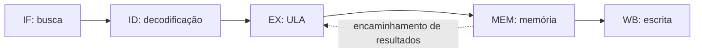

# 39 · Pipelining e hazards

**Tempo estimado:** 50 minutos · **Pré-requisito:** [[36 - Datapath e controle]] e [[38 - Exceções e interrupções]].

**Ao final você vai conseguir:**

1. Ler uma linha do tempo de pipeline e dizer em que estágio cada instrução está em cada ciclo.
2. Reconhecer uma dependência de dados (RAW) entre instruções vizinhas.
3. Decidir, para cada caso, se o encaminhamento basta ou se é preciso uma pausa (bolha).

**Antes de começar:** no módulo 36 uma instrução só começava depois que a anterior terminava. Aqui várias instruções ocupam a CPU ao mesmo tempo, cada uma em um estágio diferente.

---

## Para começar

Uma linha de montagem tem cinco postos. Um carro passa pelo primeiro posto, e enquanto ele está no segundo, o próximo já entra no primeiro. Assim, o número de carros prontos por hora sobe, mesmo que cada carro leve o mesmo tempo para ficar pronto. O problema aparece quando um posto precisa de uma peça que o posto anterior ainda não terminou de montar.

---

## Mapa do módulo



*Figura 1: os cinco estágios do pipeline. A linha tracejada mostra o encaminhamento de MEM de volta para a ULA. A carga seguida de uso não usa esse caminho a tempo, e precisa de pausa.*

**Como ler:** cada seta é o caminho de uma instrução. O valor de uma carga só fica pronto em MEM, por isso o encaminhamento não basta para ela.

---

## Mini-aula 1: linha do tempo do pipeline

> [!tip] Ideia
> Com cinco estágios, uma nova instrução pode entrar a cada ciclo. Assim, cada ciclo mostra cinco instruções ocupadas, uma em cada estágio, e a vazão (throughput) sobe.

> [!info] Definição
> Um **pipeline** é a sobreposição da execução de instruções, com registradores de pipeline entre os estágios. Cada instrução ainda leva cinco ciclos (Brown). Os cinco estágios da nota são IF (busca), ID (decodificação), EX (execução), MEM (memória) e WB (escrita do resultado).

Veja a linha do tempo de três instruções. Antes de rodar, diga em qual estágio a instrução `i2` está no ciclo 3.

```python
etapas = ["IF", "ID", "EX", "MEM", "WB"]
instrucoes = ["i1", "i2", "i3"]
ciclos = len(instrucoes) + len(etapas) - 1

print("ciclo:", " ".join(f"{c:>3}" for c in range(1, ciclos + 1)))
for k, nome in enumerate(instrucoes):
    linha = []
    for c in range(ciclos):
        s = c - k
        linha.append(etapas[s] if 0 <= s < len(etapas) else ".")
    print(f"{nome:>5}:", " ".join(f"{x:>3}" for x in linha))
```

Saída real:

```
ciclo:   1   2   3   4   5   6   7
   i1:  IF  ID  EX MEM  WB   .   .
   i2:   .  IF  ID  EX MEM  WB   .
   i3:   .   .  IF  ID  EX MEM  WB
```

**Como ler:** cada linha é uma instrução, e cada coluna é um ciclo. Na coluna 3, `i1` está em EX, `i2` está em ID e `i3` está em IF: três instruções ocupam a CPU ao mesmo tempo.

> [!warning] Armadilha comum
> O pipeline não torna uma instrução mais rápida. Ele faz várias instruções terminarem em ritmo mais alto. A primeira instrução ainda leva cinco ciclos.

> [!question]- Checkpoint
> 1. Em que estágio está `i2` no ciclo 2?
> 2. Quantos ciclos a `i1` leva, do início ao fim?
>
> > [!success]- Resposta
> > 1. Em IF, porque `i2` entra no ciclo 2 (contando de 1).
> > 2. Cinco, um por estágio.

---

## Mini-aula 2: dependência de dados e encaminhamento

> [!tip] Ideia
> Quando uma instrução lê um registrador que a anterior ainda não escreveu, o valor não está pronto. O encaminhamento leva o resultado direto para a ULA, sem esperar a escrita no registrador.

> [!info] Definição
> Um **hazard de dados** (data hazard) do tipo RAW (read after write) acontece quando uma instrução lê um valor que a instrução anterior ainda vai escrever. O **encaminhamento** (forwarding, ou bypassing) envia o resultado para a entrada da ULA assim que ele existe. A nota diz que o produtor mais recente tem prioridade.

Veja quais pares de instruções têm dependência. Antes de rodar, diga quais instruções leem um registrador escrito pela vizinha anterior.

```python
# cada instrução: (operação, registrador escrito, registradores lidos)
programa = [
    ("lw", 5, [1]),
    ("add", 6, [5, 2]),
    ("add", 7, [6, 2]),
    ("add", 8, [4, 3]),
]

for i in range(1, len(programa)):
    op_ant, rd_ant, _ = programa[i - 1]
    op, _, lidos = programa[i]
    if rd_ant in lidos:
        print(f"instrução {i} ({op}) lê x{rd_ant}, escrito pela instrução {i - 1} ({op_ant})")
    else:
        print(f"instrução {i} ({op}) não lê o que a anterior escreve")
```

Saída real:

```
instrução 1 (add) lê x5, escrito pela instrução 0 (lw)
instrução 2 (add) lê x6, escrito pela instrução 1 (add)
instrução 3 (add) não lê o que a anterior escreve
```

**Como ler:** `i1` é um `lw`, e escreve `x5`. `i2` lê `x5`, então é dependente. `i3` lê `x6`, que `i2` escreve. `i4` não depende de nada da vizinha. O demo mostra só os fatos; a decisão de pausa ou encaminhamento vem a seguir.

> [!warning] Armadilha comum
> Dependência não é sempre pausa. Entre operações da ULA, o encaminhamento resolve. A pausa é necessária só no caso de carga seguida de uso.

> [!question]- Checkpoint
> 1. Qual instrução do exemplo lê `x6`, e de qual outra ela depende?
> 2. Por que `i2` depende de `x5`?
>
> > [!success]- Resposta
> > 1. `i3`, que depende de `i2`.
> > 2. Porque `i1` é um `lw` que escreve `x5`, e `i2` lê `x5`.

---

## Mini-aula 3: pausa, bolha e carga seguida de uso

> [!tip] Ideia
> Se a dependência vem de uma carga, o valor só existe depois de MEM. O pipeline então pausa um ciclo, e insere uma bolha (bubble), que é uma operação vazia.

> [!info] Definição
> A **carga seguida de uso** (load-use) é uma carga cujo resultado é lido pela instrução imediatamente seguinte. O encaminhamento não basta, porque o valor fica pronto só em MEM. A **bolha** (bubble) é uma instrução vazia inserida por uma pausa. A nota diz que o Brown insere um NOP e segura o PC por um ciclo; o USFCA chama isso de uma pausa de um ciclo.

Veja o caso do exemplo: `i2` usa o resultado de `i1`, um `lw`. Antes de começar o exercício P1, diga qual é a decisão para `i2`.

> [!warning] Armadilha comum
> O desvio condicional tem resolução em estágios diferentes conforme o desenho (MEM no Brown, EX no USFCA). Quando o desvio é tomado, as instruções seguidas erradas são descartadas (flush). Cada projeto escolhe onde resolver o desvio.

> [!question]- Checkpoint
> 1. Por que o encaminhamento não resolve a carga seguida de uso?
> 2. O que é uma bolha?
>
> > [!success]- Resposta
> > 1. Porque o valor da carga só fica pronto em MEM, depois de a instrução seguinte já precisar dele em EX.
> > 2. Uma instrução vazia inserida pela pausa.

---

## Exercícios

Cada exercício tem um bloco com a função a completar e os testes com `assert`. Quando todos passarem, aparece `Passou!`. As funções definidas em exercícios anteriores aparecem no código inicial.

### Aquecimento

**A1. Dependência entre vizinhas.** Uma instrução é representada como a tupla `(operação, registrador_escrito, registradores_lidos)`. Complete `tem_dependencia(anterior, atual)`, que devolve `True` quando a instrução `atual` lê o registrador que a instrução `anterior` escreve. Esse é o caso de dependência de dados que causa um hazard de dados (RAW), segundo a nota.

```python
def tem_dependencia(anterior, atual):
    """True se a instrução atual lê o registrador escrito pela anterior."""
    ...

assert tem_dependencia(("add", 5, [1, 2]), ("add", 6, [5, 3])) is True, "a segunda lê x5"
assert tem_dependencia(("add", 5, [1, 2]), ("add", 6, [1, 3])) is False, "a segunda não lê x5"
assert tem_dependencia(("lw", 4, [1]), ("sub", 7, [4, 4])) is True, "dependência de carga também conta"
print("Passou!")
```

> [!hint]- Dica 1
> O registrador escrito por `anterior` é `anterior[1]`; os lidos por `atual` são `atual[2]`.

> [!hint]- Dica 2
> Use `anterior[1] in atual[2]`.

> [!example]- Solução
> ```python
> def tem_dependencia(anterior, atual):
>     """True se a instrução atual lê o registrador escrito pela anterior."""
>     return anterior[1] in atual[2]
> ```
>
> **Erro comum:** Comparar `anterior[1]` com `atual[1]`. Isso compara dois destinos, e não o que a segunda instrução lê.

**A2. Instrução de carga.** Complete `e_carga(instrucao)`, que devolve `True` quando a operação da instrução é `"lw"` (carga de memória para registrador). Esse tipo de instrução é o que causa o caso de carga seguida de uso, em que o encaminhamento não basta.

```python
def e_carga(instrucao):
    """True se a operação é uma carga da memória (lw)."""
    ...

assert e_carga(("lw", 5, [1])) is True, "lw é carga"
assert e_carga(("add", 6, [5, 2])) is False, "add não é carga"
print("Passou!")
```

> [!hint]- Dica 1
> A operação é o primeiro elemento da tupla: `instrucao[0]`.

> [!hint]- Dica 2
> Compare com `"lw"`.

> [!example]- Solução
> ```python
> def e_carga(instrucao):
>     """True se a operação é uma carga da memória (lw)."""
>     return instrucao[0] == "lw"
> ```
>
> **Erro comum:** Comparar com `"load"`. A operação do exercício se chama `"lw"`, e outro nome devolve `False` para toda carga.

**A3. Pausas de carga seguida de uso.** Complete `pausas_load_use(programa)`, que conta quantas vezes uma instrução depende de uma carga (`lw`) que está imediatamente antes dela. Esse é o caso em que o encaminhamento não resolve, e o pipeline precisa pausar um ciclo, segundo a nota. A lista `programa` tem tuplas no formato de A1. Use `tem_dependencia` e `e_carga`, já definidas acima.

```python
def tem_dependencia(anterior, atual):
    return anterior[1] in atual[2]

def e_carga(instrucao):
    return instrucao[0] == "lw"

def pausas_load_use(programa):
    """Conta os pares em que uma instrução usa o resultado de um lw imediatamente anterior."""
    ...

prog = [
    ("lw", 5, [1]),
    ("add", 6, [5, 2]),
    ("add", 7, [6, 2]),
    ("add", 8, [4, 3]),
]
assert pausas_load_use(prog) == 1, "só o par lw -> add exige pausa"
assert pausas_load_use([("add", 5, [1]), ("add", 6, [5])]) == 0, "dependência aritmética não conta"
assert pausas_load_use([]) == 0, "programa vazio"
print("Passou!")
```

> [!hint]- Dica 1
> Percorra os pares de instruções consecutivas com `for i in range(1, len(programa)):`.

> [!hint]- Dica 2
> Conte quando `e_carga(programa[i - 1])` e `tem_dependencia(programa[i - 1], programa[i])` valem ao mesmo tempo.

> [!example]- Solução
> ```python
> def pausas_load_use(programa):
>     """Conta os pares em que uma instrução usa o resultado de um lw imediatamente anterior."""
>     total = 0
>     for i in range(1, len(programa)):
>         if e_carga(programa[i - 1]) and tem_dependencia(programa[i - 1], programa[i]):
>             total += 1
>     return total
> ```
>
> **Erro comum:** Contar toda dependência, e não só as que vêm de uma carga. Dependências entre operações aritméticas são resolvidas com encaminhamento, e não contam como pausa.

### Praticando

**P1. Pausa ou encaminhamento.** Complete `decisoes(programa)`, que devolve uma lista de textos com uma decisão por instrução. A primeira instrução recebe `"nada"`. Para as demais: `"pausa"` se depende de um `lw` imediatamente antes; `"encaminha"` se depende de outra instrução imediatamente antes; `"nada"` nos outros casos. Use `tem_dependencia` e `e_carga`, já definidas acima.

```python
def tem_dependencia(anterior, atual):
    return anterior[1] in atual[2]

def e_carga(instrucao):
    return instrucao[0] == "lw"

def decisoes(programa):
    """Uma decisão por instrução: nada, encaminha ou pausa."""
    ...

prog = [
    ("lw", 5, [1]),
    ("add", 6, [5, 2]),
    ("add", 7, [6, 2]),
    ("add", 8, [4, 3]),
]
assert decisoes(prog) == ["nada", "pausa", "encaminha", "nada"], "exemplo com carga"
assert decisoes([("add", 5, [1]), ("add", 6, [5])]) == ["nada", "encaminha"], "aritmética encaminha"
assert decisoes([]) == [], "programa vazio não tem decisões"
print("Passou!")
```

> [!hint]- Dica 1
> Se o programa estiver vazio, devolva `[]`. Caso contrário, comece com `resultado = ["nada"]` e percorra as instruções a partir da segunda.

> [!hint]- Dica 2
> Para cada `i`, primeiro teste a dependência; se ela existir, escolha entre `"pausa"` e `"encaminha"` conforme `e_carga(programa[i - 1])`.

> [!example]- Solução
> ```python
> def decisoes(programa):
>     """Uma decisão por instrução: nada, encaminha ou pausa."""
>     if not programa:
>         return []
>     resultado = ["nada"]
>     for i in range(1, len(programa)):
>         if tem_dependencia(programa[i - 1], programa[i]):
>             resultado.append("pausa" if e_carga(programa[i - 1]) else "encaminha")
>         else:
>             resultado.append("nada")
>     return resultado
> ```
>
> **Erro comum:** Dar `"encaminha"` também para o caso de `lw`. Nesse caso, a pausa é necessária, porque o valor só fica pronto depois da etapa de memória.

**P2. Onde está a instrução?** Complete `estagio_no_ciclo(i, ciclo)`, que devolve o nome do estágio em que a instrução `i` está no ciclo `ciclo`, em um pipeline de cinco estágios sem pausas. Ambos começam em zero. Os estágios são `"IF"`, `"ID"`, `"EX"`, `"MEM"` e `"WB"`. Se a instrução ainda não entrou no pipeline, ou já saiu, devolva `None`. A figura do exemplo mostra o padrão: a instrução `k` entra no ciclo `k`.

```python
def estagio_no_ciclo(i, ciclo):
    """Estágio da instrução i no ciclo, sem pausas; None se fora do pipeline."""
    ...

assert estagio_no_ciclo(0, 0) == "IF", "primeira instrução entra em IF"
assert estagio_no_ciclo(0, 4) == "WB", "e sai em WB"
assert estagio_no_ciclo(0, 5) is None, "já saiu"
assert estagio_no_ciclo(1, 0) is None, "ainda não entrou"
assert estagio_no_ciclo(2, 3) == "ID", "terceira instrução no ciclo 3 está em ID"
print("Passou!")
```

> [!hint]- Dica 1
> Calcule `s = ciclo - i`. Se `0 <= s < 5`, o estágio é a lista de estágios no índice `s`.

> [!hint]- Dica 2
> Para a instrução 0 no ciclo 0, o resultado é `"IF"`.

> [!example]- Solução
> ```python
> def estagio_no_ciclo(i, ciclo):
>     """Estágio da instrução i no ciclo, sem pausas; None se fora do pipeline."""
>     etapas = ["IF", "ID", "EX", "MEM", "WB"]
>     s = ciclo - i
>     if 0 <= s < len(etapas):
>         return etapas[s]
>     return None
> ```
>
> **Erro comum:** Não tratar o caso de fora do intervalo. Sem o `None`, `s = -1` daria o último estágio, e a resposta fica errada.

### Desafio

**D1. Onde começa a pausa.** Complete `primeira_pausa(programa)`, que devolve o índice da primeira instrução que causa pausa (carga seguida de uso), ou `None` se não houver pausa. Use `decisoes`, já definida acima.

```python
def tem_dependencia(anterior, atual):
    return anterior[1] in atual[2]

def e_carga(instrucao):
    return instrucao[0] == "lw"

def decisoes(programa):
    resultado = ["nada"]
    for i in range(1, len(programa)):
        if tem_dependencia(programa[i - 1], programa[i]):
            resultado.append("pausa" if e_carga(programa[i - 1]) else "encaminha")
        else:
            resultado.append("nada")
    return resultado

def primeira_pausa(programa):
    """Índice da primeira instrução com pausa, ou None."""
    ...

assert primeira_pausa([("lw", 5, [1]), ("add", 6, [5, 2])]) == 1, "a pausa é na instrução que usa"
assert primeira_pausa([("add", 5, [1]), ("add", 6, [5])]) is None, "sem pausa"
assert primeira_pausa([]) is None, "programa vazio"
print("Passou!")
```

> [!hint]- Dica 1
> Percorra a lista de decisões com `enumerate`.

> [!hint]- Dica 2
> Quando achar `"pausa"`, devolva o índice `i`.

> [!example]- Solução
> ```python
> def primeira_pausa(programa):
>     """Índice da primeira instrução com pausa, ou None."""
>     for i, d in enumerate(decisoes(programa)):
>         if d == "pausa":
>             return i
>     return None
> ```
>
> **Erro comum:** Devolver o índice da carga, e não o da instrução que depende dela. A pausa acontece na instrução que usa o valor.


---

## Mini-projeto (opcional)

Você vai estimar quantos ciclos um programa leva no pipeline, somando pausas. Tente sozinho antes de abrir a solução.

**Mini-projeto: ciclos com pausas.** Complete `ciclos_totais(programa)`, que estima quantos ciclos o programa leva no pipeline de cinco estágios. O modelo é o da figura: `n` instruções levam `n + 4` ciclos sem pausas; cada pausa de carga seguida de uso soma um ciclo. Use `pausas_load_use`, já definida acima. Este modelo é uma simplificação do exercício, e não uma medida de um processador real.

```python
def tem_dependencia(anterior, atual):
    return anterior[1] in atual[2]

def e_carga(instrucao):
    return instrucao[0] == "lw"

def pausas_load_use(programa):
    total = 0
    for i in range(1, len(programa)):
        if e_carga(programa[i - 1]) and tem_dependencia(programa[i - 1], programa[i]):
            total += 1
    return total

def ciclos_totais(programa):
    """Modelo simplificado: n + 4 ciclos sem pausas, mais uma por pausa de carga."""
    ...

prog = [
    ("lw", 5, [1]),
    ("add", 6, [5, 2]),
    ("add", 7, [6, 2]),
    ("add", 8, [4, 3]),
]
assert ciclos_totais(prog) == 9, "4 instruções + 4 + 1 pausa"
assert ciclos_totais([("add", 5, [1])]) == 5, "uma instrução leva cinco ciclos"
assert ciclos_totais([]) == 0, "programa vazio"
print("Passou!")
```

> [!hint]- Dica 1
> Calcule `n = len(programa)`, e some `pausas_load_use(programa)`.

> [!hint]- Dica 2
> Para lista vazia, o resultado é zero, e não quatro. Trate esse caso antes.

> [!example]- Solução
> ```python
> def ciclos_totais(programa):
>     """Modelo simplificado: n + 4 ciclos sem pausas, mais uma por pausa de carga."""
>     if not programa:
>         return 0
>     return len(programa) + 4 + pausas_load_use(programa)
> ```
>
> **Erro comum:** Esquecer o caso de lista vazia. Pela fórmula, `0 + 4` daria quatro ciclos para um programa sem instruções.


---

## Fechando

**Resumo**

- Um pipeline de cinco estágios (IF, ID, EX, MEM, WB) sobrepõe instruções; cada uma ainda leva cinco ciclos.
- Dependência de dados RAW: o encaminhamento resolve, exceto na carga seguida de uso.
- A carga seguida de uso pausa um ciclo, e insere uma bolha.
- Desvios podem ser resolvidos em MEM ou EX, conforme o desenho; instruções erradas são descartadas.

**Glossário rápido**

- **Pipeline** (pipeline): sobreposição da execução de instruções em estágios.
- **Hazard de dados** (data hazard): instrução lê valor que a anterior ainda vai escrever.
- **Encaminhamento** (forwarding ou bypassing): envia o resultado direto para a ULA.
- **Bolha** (bubble): operação vazia inserida por uma pausa.
- **Carga seguida de uso** (load-use): carga cujo resultado é lido pela instrução seguinte.

**Perguntas de revisão**

1. Por que o pipeline não reduz o tempo da primeira instrução?
2. Dê um exemplo de dependência que o encaminhamento resolve sem pausa.
3. Por que a resolução do desvio em MEM, e não em EX, muda quantas instruções podem ser descartadas?

**E agora?** O próximo módulo é **Hierarquia de memória e caches**. Ele mostra por que o pipeline depende de uma memória rápida, e como os caches escondem a lentidão da memória principal.

---

## Para ir mais fundo

- [[Pipelining and Hazards]]
- [[Brown CSCI 1952y - Pipelined CPU Notes]]
- [[USFCA CS 315 - Processor Pipeline Hazards]]
- [[Processor Datapath and Control]]
