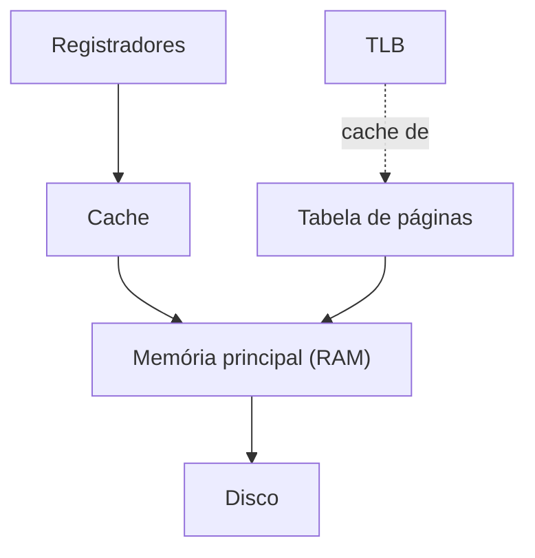

# 40 · Hierarquia de memória e caches

**Tempo estimado:** 50 minutos · **Pré-requisito:** [[39 - Pipelining e hazards]] e [[35 - Circuitos sequenciais e máquinas de estados]] (registradores e RAM).

**Ao final você vai conseguir:**

1. Explicar por que a memória é organizada em níveis, e o que um cache guarda.
2. Ler uma sequência de acessos e contar acertos e faltas.
3. Descrever o papel do TLB como cache da tabela de páginas, e seguir uma tradução de endereço.

**Antes de começar:** no módulo 35 você viu a RAM como uma sequência de registros endereçáveis. Aqui a RAM é só um dos níveis; há outros, mais lentos, e caches, mais rápidos, entre eles.

---

## Para começar

Você abre um arquivo de texto de dez megabytes. O programa lê as linhas uma a uma. Se cada leitura fosse ao disco, o programa levaria muito mais tempo. Se o sistema guarda as linhas recentes em uma memória menor e mais rápida, as leituras seguintes são mais rápidas. Essa ideia de guardar cópias de dados perto de quem usa é o cache. Ela aparece em vários níveis do computador.

---

## Mapa do módulo



*Figura 1: cada nível é mais lento que o anterior. O TLB é um cache da tabela de páginas, e a tabela mapeia páginas virtuais para quadros da memória física.*

**Como ler:** a seta indica "acessa o próximo nível quando não encontra". A linha tracejada é a relação de cache do TLB com a tabela de páginas.

---

## Mini-aula 1: níveis e acertos

> [!tip] Ideia
> Uma memória pequena e rápida, guardando cópias de dados de uma memória maior e lenta, acelera os acessos que se repetem. Quando o dado está lá, é um acerto; quando não está, é uma falta.

> [!info] Definição
> Um **cache** (cache) é uma memória pequena e rápida que guarda cópias de dados de uma memória maior e mais lenta, como a nota define. Um **acerto** (hit) é quando o dado procurado já está no cache; uma **falta** (miss) é quando não está e precisa ser buscado no nível seguinte.

Veja um cache de dois lugares, com a política de descartar o mais antigo quando cheio. A nota não detalha essa política; a demonstração a usa só para ilustrar. Antes de rodar, preveja quais acessos são acertos.

```python
capacidade = 2
cache = []
memoria_lenta = {"a": 10, "b": 20, "c": 30}

def acessa(chave):
    if chave in cache:
        return "acerto", memoria_lenta[chave]
    if len(cache) == capacidade:
        cache.pop(0)
    cache.append(chave)
    return "falta", memoria_lenta[chave]

for chave in ["a", "b", "a", "c", "b"]:
    estado, valor = acessa(chave)
    print(chave, estado, valor, "| cache:", cache)
```

Saída real:

```
a falta 10 | cache: ['a']
b falta 20 | cache: ['a', 'b']
a acerto 10 | cache: ['a', 'b']
c falta 30 | cache: ['b', 'c']
b acerto 20 | cache: ['b', 'c']
```

**Como ler:** `a` falta, `b` falta, `a` acerta. Quando `c` chega, o cache está cheio, e `a` sai. Por isso, o último `b` acerta.

> [!warning] Armadilha comum
> Uma taxa de acertos alta não diz, sozinha, quanto tempo cada acesso leva. Esta lição conta acertos e faltas, e não tempo.

> [!question]- Checkpoint
> 1. Qual é o primeiro acesso que é acerto?
> 2. Por que `a` sai do cache no acesso a `c`?
>
> > [!success]- Resposta
> > 1. O terceiro, `a`, porque `a` já estava no cache desde o primeiro acesso.
> > 2. Porque o cache tinha dois lugares, estava cheio, e `a` era o mais antigo.

---

## Mini-aula 2: endereços, páginas e TLB

> [!tip] Ideia
> A memória virtual usa a memória principal como cache do disco: as páginas ficam na RAM quando são necessárias. A tabela de páginas faz o papel de índice, e o TLB guarda entradas dessa tabela para acelerar a tradução.

> [!info] Definição
> Uma **página** é um bloco de endereços; o endereço se divide em número de página e deslocamento. A **tabela de páginas** (page table) mapeia páginas para quadros da memória física. O **TLB** (translation lookaside buffer) é um cache de entradas da tabela de páginas, segundo a aula (`A TLB is a cache of the page table`). Na **paginação por demanda** (demand paging), uma página é carregada do disco quando é necessária. A aula diz que a tabela de páginas faz o papel das etiquetas (tags) de um cache.

Veja a tradução de quatro endereços, com páginas de tamanho quatro. Antes de rodar, diga em qual página está o endereço 9.

```python
TAM = 4
tabela = {0: 7, 1: 3, 2: 9}
tlb = {}

def traduz(endereco):
    pagina, deslocamento = divmod(endereco, TAM)
    if pagina in tlb:
        origem = "TLB"
    else:
        origem = "tabela"
        tlb[pagina] = tabela[pagina]
    fisico = tlb[pagina] * TAM + deslocamento
    return fisico, origem

for e in [5, 6, 9, 5]:
    fisico, origem = traduz(e)
    print(f"virtual {e} -> físico {fisico} via {origem}")
```

Saída real:

```
virtual 5 -> físico 13 via tabela
virtual 6 -> físico 14 via TLB
virtual 9 -> físico 37 via tabela
virtual 5 -> físico 13 via TLB
```

**Como ler:** o endereço 5 está na página 1, que a tabela manda para o quadro 3; o físico é `3 × 4 + 1 = 13`. A primeira vez consulta a tabela; as seguintes para a mesma página acham a entrada no TLB.

> [!warning] Armadilha comum
> O deslocamento não muda na tradução. Só o número da página é trocado pelo número do quadro; o resto do endereço é o mesmo.

> [!question]- Checkpoint
> 1. Em que página está o endereço 9, com páginas de tamanho 4?
> 2. Por que o endereço 6 aparece como acerto no TLB?
>
> > [!success]- Resposta
> > 1. Na página 2, com deslocamento 1.
> > 2. Porque a página 1 já tinha sido copiada para o TLB pelo endereço 5.

---

## Mini-aula 3: associatividade e políticas

> [!tip] Ideia
> Associatividade diz em quantos lugares um bloco pode ser guardado no cache. A paginação usa associatividade total: uma página pode ocupar qualquer quadro.

> [!info] Definição
> Um cache pode ser **de mapeamento direto** (direct-mapped), **associativo por conjuntos de n vias** (n-way set-associative) ou **totalmente associativo** (fully associative), conforme a nota. As **políticas de escrita** citadas são a escrita direta (write-through) e a escrita com retorno (write-back). A aula as nomeia; este módulo não as detalha.

> [!question]- Checkpoint
> 1. Qual tipo de associatividade a paginação usa?
> 2. As duas políticas de escrita citadas são de qual tipo?
>
> > [!success]- Resposta
> > 1. Totalmente associativa.
> > 2. Políticas de escrita: escrita direta e escrita com retorno.

---

## Exercícios

Cada exercício tem um bloco com a função a completar e os testes com `assert`. Quando todos passarem, aparece `Passou!`. As funções definidas em exercícios anteriores aparecem no código inicial.

### Aquecimento

**A1. Acerto ou falta.** Complete `e_acerto(cache, chave)`, que devolve `True` quando `chave` já está no cache, e `False` quando não está. Um cache é um nível pequeno e rápido que guarda cópias de dados de um nível maior e mais lento, como a nota define.

```python
def e_acerto(cache, chave):
    """True se a chave já está no cache (acerto); False caso contrário (falta)."""
    ...

assert e_acerto(["a", "b"], "a") is True, "a está no cache"
assert e_acerto(["a", "b"], "c") is False, "c não está"
assert e_acerto([], "a") is False, "cache vazio sempre falta"
print("Passou!")
```

> [!hint]- Dica 1
> Use o operador `in` sobre a lista `cache`.

> [!hint]- Dica 2
> Devolva o resultado da expressão diretamente.

> [!example]- Solução
> ```python
> def e_acerto(cache, chave):
>     """True se a chave já está no cache (acerto); False caso contrário (falta)."""
>     return chave in cache
> ```
>
> **Erro comum:** Confundir acerto com falta e inverter o resultado. Um acerto é quando o dado já está no cache.

**A2. Página e deslocamento.** Complete `endereco_pagina(endereco, tamanho)`, que divide um endereço em duas partes: o número da página e o deslocamento dentro dela. Devolva a tupla `(pagina, deslocamento)`. A nota diz que a tabela de páginas faz o papel de um cache de memória, e essa divisão é o primeiro passo para acessá-la.

```python
def endereco_pagina(endereco, tamanho):
    """Devolve (pagina, deslocamento) para um endereço e um tamanho de página."""
    ...

assert endereco_pagina(9, 4) == (2, 1), "9 = 2 * 4 + 1"
assert endereco_pagina(0, 4) == (0, 0), "início da primeira página"
assert endereco_pagina(4, 4) == (1, 0), "início da segunda página"
print("Passou!")
```

> [!hint]- Dica 1
> Use `divmod(endereco, tamanho)`, que já devolve `(quociente, resto)`.

> [!hint]- Dica 2
> Para `endereco = 9` e `tamanho = 4`, o resultado é `(2, 1)`.

> [!example]- Solução
> ```python
> def endereco_pagina(endereco, tamanho):
>     """Devolve (pagina, deslocamento) para um endereço e um tamanho de página."""
>     return divmod(endereco, tamanho)
> ```
>
> **Erro comum:** Calcular `endereco % tamanho` como página, e `endereco // tamanho` como deslocamento. As partes saem trocadas.

**A3. A página está na tabela?** Complete `falta_de_pagina(endereco, tabela, tamanho)`, que devolve `True` quando a página do endereço não está na tabela de páginas, e `False` quando está. Use `endereco_pagina`, já definida acima, para achar a página.

```python
def endereco_pagina(endereco, tamanho):
    return divmod(endereco, tamanho)

def falta_de_pagina(endereco, tabela, tamanho):
    """True se a página do endereço não está na tabela de páginas."""
    ...

tabela = {0: 7, 1: 3}
assert falta_de_pagina(5, tabela, 4) is False, "página 1 está na tabela"
assert falta_de_pagina(9, tabela, 4) is True, "página 2 não está na tabela"
assert falta_de_pagina(0, tabela, 4) is False, "página 0 está"
print("Passou!")
```

> [!hint]- Dica 1
> Calcule `pagina, _ = endereco_pagina(endereco, tamanho)`.

> [!hint]- Dica 2
> Use `pagina not in tabela` como resposta.

> [!example]- Solução
> ```python
> def falta_de_pagina(endereco, tabela, tamanho):
>     """True se a página do endereço não está na tabela de páginas."""
>     pagina, _ = endereco_pagina(endereco, tamanho)
>     return pagina not in tabela
> ```
>
> **Erro comum:** Testar o endereço e não a página. A tabela é indexada por página.

### Praticando

**P1. Taxa de acertos.** Complete `taxa_acertos(sequencia, capacidade)`, que simula um cache com `capacidade` lugares sobre uma sequência de chaves, e devolve a fração de acessos que foram acertos. Quando o cache está cheio e chega uma chave nova, descarte a mais antiga. A nota não detalha a política de substituição; esta regra é a do exercício. Se a sequência for vazia, devolva `0.0`.

```python
def taxa_acertos(sequencia, capacidade):
    """Fração de acessos que acertam um cache de capacidade lugares, com descarte do mais antigo."""
    ...

assert taxa_acertos(["a", "a", "a", "a"], 1) == 0.75, "primeira é falta; as outras três acertam"
assert taxa_acertos(["a", "b", "c", "a"], 2) == 0.0, "a volta de a não acha no cache"
assert taxa_acertos(["a", "b", "a", "b"], 2) == 0.5, "as duas últimas acertam"
assert taxa_acertos([], 2) == 0.0, "sequência vazia"
print("Passou!")
```

> [!hint]- Dica 1
> Mantenha uma lista `cache` com as chaves. Para cada chave, conte um acerto se ela já está ali; senão, conte uma falta, descarte a mais antiga se estiver cheio, e adicione a chave.

> [!hint]- Dica 2
> Ao final, divida o número de acertos pelo tamanho da sequência.

> [!example]- Solução
> ```python
> def taxa_acertos(sequencia, capacidade):
>     """Fração de acessos que acertam um cache de capacidade lugares, com descarte do mais antigo."""
>     if not sequencia:
>         return 0.0
>     cache = []
>     acertos = 0
>     for chave in sequencia:
>         if chave in cache:
>             acertos += 1
>         else:
>             if len(cache) == capacidade:
>                 cache.pop(0)
>             cache.append(chave)
>     return acertos / len(sequencia)
> ```
>
> **Erro comum:** Contar a falta como acerto, ou esquecer o caso de sequência vazia, que divide por zero.

**P2. Consultas à tabela.** Complete `consultas_a_tabela(enderecos, tamanho)`, que conta quantas vezes a tabela de páginas precisa ser consultada, supondo um TLB sem limite de tamanho: cada página é consultada uma única vez, na primeira vez que aparece, e depois fica no TLB. Devolva esse número. Use `endereco_pagina`, já definida acima.

```python
def endereco_pagina(endereco, tamanho):
    return divmod(endereco, tamanho)

def consultas_a_tabela(enderecos, tamanho):
    """Número de consultas à tabela com um TLB sem limite: uma por página distinta."""
    ...

assert consultas_a_tabela([5, 6, 9, 5], 4) == 2, "páginas 1 e 2"
assert consultas_a_tabela([0, 1, 2, 3], 4) == 1, "todos na página 0"
assert consultas_a_tabela([], 4) == 0, "sem acessos"
print("Passou!")
```

> [!hint]- Dica 1
> Guarde as páginas já vistas em um conjunto (`set`).

> [!hint]- Dica 2
> Para cada endereço, calcule a página; se ela não está no conjunto, conte uma consulta e adicione a página.

> [!example]- Solução
> ```python
> def consultas_a_tabela(enderecos, tamanho):
>     """Número de consultas à tabela com um TLB sem limite: uma por página distinta."""
>     vistas = set()
>     consultas = 0
>     for e in enderecos:
>         pagina, _ = endereco_pagina(e, tamanho)
>         if pagina not in vistas:
>             consultas += 1
>             vistas.add(pagina)
>     return consultas
> ```
>
> **Erro comum:** Contar todos os endereços. Com o TLB, só a primeira visita a cada página consulta a tabela.

### Desafio

**D1. Taxa por tamanho de cache.** Complete `taxas_por_capacidade(sequencia)`, que devolve a lista `[taxa(1), taxa(2), taxa(3)]`, em que `taxa(c)` é a taxa de acertos com capacidade `c`, pela mesma regra do exercício P1. Use `taxa_acertos`, já definida acima. A pergunta é como a taxa muda com o tamanho do cache.

```python
def taxa_acertos(sequencia, capacidade):
    if not sequencia:
        return 0.0
    cache = []
    acertos = 0
    for chave in sequencia:
        if chave in cache:
            acertos += 1
        else:
            if len(cache) == capacidade:
                cache.pop(0)
            cache.append(chave)
    return acertos / len(sequencia)

def taxas_por_capacidade(sequencia):
    """Lista [taxa com capacidade 1, 2 e 3] para a mesma sequência."""
    ...

assert taxas_por_capacidade(["a", "a", "a", "a"]) == [0.75, 0.75, 0.75], "sequência de uma só chave"
assert taxas_por_capacidade(["a", "b", "c", "a"]) == [0.0, 0.0, 0.25], "só com capacidade 3 o a de volta acerta"
print("Passou!")
```

> [!hint]- Dica 1
> Use uma list comprehension sobre `c` em `(1, 2, 3)`.

> [!hint]- Dica 2
> Cada elemento é `taxa_acertos(sequencia, c)`.

> [!example]- Solução
> ```python
> def taxas_por_capacidade(sequencia):
>     """Lista [taxa com capacidade 1, 2 e 3] para a mesma sequência."""
>     return [taxa_acertos(sequencia, c) for c in (1, 2, 3)]
> ```
>
> **Erro comum:** Passar a capacidade fixa, e não o valor de `c`. Assim, as três taxas saem iguais.


---

## Mini-projeto (opcional)

Você vai simular o TLB sobre uma sequência de endereços e contar acertos e faltas. Tente sozinho antes de abrir a solução.

**Mini-projeto: simulador de TLB.** Complete `simula_tlb(enderecos, tabela, tamanho)`, que traduz uma lista de endereços virtuais em endereços físicos, usando um TLB sem limite, como em P2. Devolva a tupla `(fisicos, acertos, faltas)`: `fisicos` é a lista de endereços físicos, `acertos` conta as traduções achadas no TLB, e `faltas` conta as que consultaram a tabela. Cada página da tabela vale `quadro`, e o endereço físico é `quadro * tamanho + deslocamento`.

```python
def endereco_pagina(endereco, tamanho):
    return divmod(endereco, tamanho)

def simula_tlb(enderecos, tabela, tamanho):
    """Devolve (fisicos, acertos, faltas) com um TLB sem limite de tamanho."""
    ...

tab = {1: 3, 2: 9}
assert simula_tlb([5, 6, 9, 5], tab, 4) == ([13, 14, 37, 13], 2, 2), "duas faltas e dois acertos"
assert simula_tlb([], tab, 4) == ([], 0, 0), "sem acessos"
print("Passou!")
```

> [!hint]- Dica 1
> Mantenha um dicionário `tlb = {}`. Para cada endereço, calcule `(pagina, desl)`; se `pagina` está no TLB, conte um acerto, senão conte uma falta e copie `tabela[pagina]` para o TLB.

> [!hint]- Dica 2
> Monte o físico com `tlb[pagina] * tamanho + desl` e adicione à lista.

> [!example]- Solução
> ```python
> def simula_tlb(enderecos, tabela, tamanho):
>     """Devolve (fisicos, acertos, faltas) com um TLB sem limite de tamanho."""
>     tlb = {}
>     fisicos = []
>     acertos = 0
>     faltas = 0
>     for e in enderecos:
>         pagina, desl = endereco_pagina(e, tamanho)
>         if pagina in tlb:
>             acertos += 1
>         else:
>             faltas += 1
>             tlb[pagina] = tabela[pagina]
>         fisicos.append(tlb[pagina] * tamanho + desl)
>     return fisicos, acertos, faltas
> ```
>
> **Erro comum:** Calcular a falta depois de achar o quadro. A contagem tem que acontecer antes de copiar a entrada para o TLB.


---

## Fechando

**Resumo**

- A memória é organizada em níveis; cada nível é mais lento e maior que o anterior.
- Um cache guarda cópias de dados de um nível mais lento; acertos e faltas são contados em uma sequência de acessos.
- A memória virtual usa a RAM como cache do disco (paginação por demanda); a tabela de páginas mapeia páginas em quadros.
- O TLB é um cache das entradas da tabela de páginas.
- Associatividade e políticas de escrita são nomeadas, mas não detalhadas aqui.

**Glossário rápido**

- **Cache**: memória pequena e rápida que guarda cópias de dados de uma memória mais lenta.
- **Acerto** (hit) e **falta** (miss): o dado estava ou não estava no cache.
- **Página** (page) e **quadro** (frame): bloco de endereços virtuais e bloco de memória física.
- **TLB** (translation lookaside buffer): cache de entradas da tabela de páginas.
- **Paginação por demanda** (demand paging): carregar uma página do disco quando é preciso.

**Perguntas de revisão**

1. Por que um cache de dois lugares pode ter pouca taxa de acertos mesmo com acessos repetidos?
2. Num TLB com acesso repetido à mesma página, quantas consultas à tabela ocorrem?
3. Por que a tradução mantém o deslocamento e troca só a página?

**E agora?** Este é o último módulo do bloco 3, Arquitetura de computadores. O próximo bloco é **Sistemas operacionais**, que usa a memória virtual e o TLB deste módulo para gerenciar processos.

---

## Para ir mais fundo

- [[Memory Hierarchy and Caches]]
- [[NYU Gottlieb - Computer Architecture Lecture 23 (Caches and Virtual Memory)]]
- [[nand2tetris - Projects 1 to 5 (Nisan and Schocken)]]
- [[Hash Table]] (ligação conceitual da nota, uma inferência própria)
