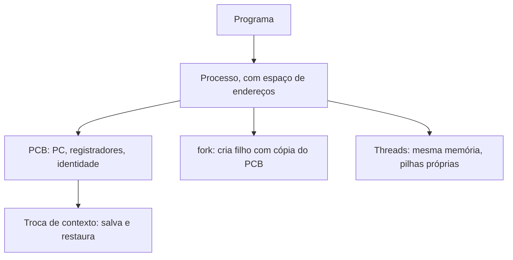

# 41 · Processos, threads e fork

**Tempo estimado:** 45 minutos · **Pré-requisito:** [[38 - Exceções e interrupções]] (o sistema recupera o controle por trap ou interrupção) e o módulo 40 (memória).

**Ao final você vai conseguir:**

1. Explicar o que é um processo e o que o PCB guarda para retomá-lo depois.
2. Simular uma troca de contexto que salva e restaura o estado de dois processos.
3. Dizer o que um `fork` copia, e por que o filho não enxerga as mudanças do pai.
4. Diferenciar threads de processos quanto à memória compartilhada.

**Antes de começar:** no módulo 40 cada programa tinha um endereço virtual. Aqui cada programa em execução ganha um processo, com o próprio espaço de endereços e um registro de estado.

---

## Para começar

Você abre o navegador, um editor e um player de música ao mesmo tempo. Há um único processador, mas cada programa avança um pouco de cada vez. Para que o editor possa parar e voltar exatamente de onde estava, o sistema precisa guardar o que ele estava fazendo: o endereço da próxima instrução e os valores dos registradores. Essa informação fica em um registro próprio do processo.

---

## Mapa do módulo



*Figura 1: o processo é a unidade do sistema operacional. O PCB guarda o que a troca de contexto precisa para retomá-lo.*

**Como ler:** `fork` e threads são duas formas de criar execução paralela. A diferença está na memória: o fork copia, a thread compartilha.

---

## Mini-aula 1: processo e PCB

> [!tip] Ideia
> Um processo é um programa em execução, com o próprio espaço de endereços, imposto pelo sistema operacional. Para parar e retomar um processo, o sistema guarda o estado dele.

> [!info] Definição
> O **PCB** (process control block) é o registro, por processo, que guarda o estado salvo: o contador de programa (PC), a palavra de estado do processador (PSW) e os registradores. O despachante usa esse registro para retomar o processo. No Linux, o PCB também carrega a identidade, como o PID, o PPID e os IDs de usuário e grupo.

Veja duas tarefas com PCBs próprios. A demonstração troca a CPU entre elas, salvando e restaurando o estado. Antes de rodar, diga qual é o PC do processo 1 depois da primeira troca de volta para ele.

```python
class PCB:
    def __init__(self, pid):
        self.pid = pid
        self.pc = 0
        self.registradores = [0, 0]

tabela = {1: PCB(1), 2: PCB(2)}
cpu = {"pc": 0, "regs": [0, 0]}
executando = None

def troca_para(pid):
    global executando
    if executando is not None:
        atual = tabela[executando]
        atual.pc = cpu["pc"]
        atual.registradores = list(cpu["regs"])
    proximo = tabela[pid]
    cpu["pc"] = proximo.pc
    cpu["regs"] = list(proximo.registradores)
    executando = pid
    print(f"troca para processo {pid}: pc={cpu['pc']}")

for pid in [1, 2, 1, 2]:
    troca_para(pid)
    cpu["pc"] += 3
    cpu["regs"][0] += 1

print("PCB 1:", tabela[1].pc, tabela[1].registradores)
print("PCB 2:", tabela[2].pc, tabela[2].registradores)
```

Saída real:

```
troca para processo 1: pc=0
troca para processo 2: pc=0
troca para processo 1: pc=3
troca para processo 2: pc=3
PCB 1: 6 [2, 0]
PCB 2: 3 [1, 0]
```

**Como ler:** a CPU avança o PC em 3 e incrementa `r0` em 1 a cada execução. Ao sair, o estado vai para o PCB. Ao voltar, é restaurado. Note a última linha do PCB do processo 2: ela mostra o estado de quando ele saiu pela última vez, e não o estado atual. A CPU ainda está com ele.

> [!warning] Armadilha comum
> O PCB só é atualizado na troca. Se o processo ainda está na CPU, o PCB guarda um estado antigo. Por isso o despachante precisa salvar o último processo antes de terminar, como no mini-projeto.

> [!question]- Checkpoint
> 1. Qual é o PC do processo 1 quando ele sai da CPU pela segunda vez?
> 2. Por que o PCB do processo 2 aparece desatualizado no fim?
>
> > [!success]- Resposta
> > 1. Seis: o processo 1 avançou de 0 para 3 na primeira vez e de 3 para 6 na segunda.
> > 2. Porque ele ainda estava na CPU quando o programa terminou, e a troca não tinha salvo o estado dele.

---

## Mini-aula 2: fork

> [!tip] Ideia
> O `fork` cria um processo novo duplicando o que chama. O filho começa com a mesma memória e com o mesmo PC, mas tem seu próprio PID.

> [!info] Definição
> O `fork` (fork(2) no Linux) cria um processo filho com um PID próprio e uma thread, que é a thread que fez a chamada. O filho recebe cópias dos descritores de arquivo abertos. Pai e filho rodam em espaços de memória separados. No Linux, a cópia é feita por **copy-on-write**: pai e filho dividem as páginas até que um deles escreva. Antes disso, a cópia de memória é adiada.

Veja que o filho enxerga a memória do pai como ela estava no momento da criação, e depois segue com a própria. Antes de rodar, diga se o filho vê `10` ou `1` no contador do pai.

```python
import multiprocessing as mp

contador = [0]

def trabalha(nome):
    contador[0] += 1
    print(nome, "viu contador =", contador[0])

if __name__ == "__main__":
    contador[0] = 10
    p = mp.Process(target=trabalha, args=("filho",))
    p.start()
    p.join()
    print("pai: contador =", contador[0])
```

Saída real:

```
filho viu contador = 1
pai: contador = 10
```

**Como ler:** o filho começa com o contador do pai? Não: o módulo é reimportado no novo processo, e o filho começa com `0`. A mudança do filho não aparece no pai, que ainda mostra `10`. Cada processo tem o próprio espaço de endereços.

> [!warning] Armadilha comum
> O filho não compartilha memória com o pai mesmo quando parece ter a mesma variável. Qualquer alteração fica só no processo que a fez.

> [!question]- Checkpoint
> 1. Por que o filho imprime `1` e não `11`?
> 2. O que o pai imprime no final?
>
> > [!success]- Resposta
> > 1. Porque o filho começa com a própria cópia do contador, que é `0` neste exemplo, e soma `1`.
> > 2. `10`, porque a alteração do filho não chega ao pai.

---

## Mini-aula 3: threads

> [!tip] Ideia
> Threads de um mesmo processo compartilham a memória global, mas cada uma tem a própria pilha e os próprios registradores. Por isso elas podem trocar dados diretamente, e também podem se atrapalhar.

> [!info] Definição
> Uma **thread** é um fluxo de execução dentro de um processo. No pthreads(7), as threads compartilham os segmentos de dados e de heap, mas cada uma tem a sua própria pilha. Atributos como o PID, os descritores de arquivo e os limites de recursos são do processo, e não de cada thread. Em Python, o GIL (global interpreter lock) faz com que apenas uma thread execute bytecode por vez no CPython.

Veja uma thread alterando uma variável global do programa principal. Antes de rodar, diga o que o programa principal imprime no final.

```python
import threading

contador = [0]

def trabalha(nome):
    contador[0] += 1
    print(nome, "viu contador =", contador[0])

contador[0] = 10
t = threading.Thread(target=trabalha, args=("thread",))
t.start()
t.join()
print("principal: contador =", contador[0])
```

Saída real:

```
thread viu contador = 11
principal: contador = 11
```

**Como ler:** a thread vê o mesmo `contador` do programa principal e o altera. O resultado final é `11`, e não `10`. Esse é o contraste com o `fork`, em que a mudança ficava no filho.

> [!warning] Armadilha comum
> O GIL do CPython não é uma propriedade de threads em geral. É um detalhe do interpretador Python. Sistemas operacionais permitem threads que rodam em paralelo; o GIL impede isso só dentro do CPython.

> [!question]- Checkpoint
> 1. Qual valor a thread vê ao começar?
> 2. Por que a alteração da thread aparece no programa principal?
>
> > [!success]- Resposta
> > 1. `10`, o valor que o programa principal deixou antes de criar a thread.
> > 2. Porque as threads de um processo compartilham a memória global.

---

## Exercícios

Cada exercício tem um bloco com a função a completar e os testes com `assert`. Quando todos passarem, aparece `Passou!`. As funções definidas em exercícios anteriores aparecem no código inicial.

### Aquecimento

**A1. Salvar o contexto.** Quando o processador deixa um processo, o sistema guarda o PC e os registradores no PCB desse processo. Complete `salva_contexto(pc, regs)`, que devolve a tupla `(pc, copia_de_regs)`. A lista de registradores devolvida deve ser uma cópia: alterar `regs` depois não pode mudar o que foi salvo.

```python
def salva_contexto(pc, regs):
    """Devolve (pc, cópia dos registradores): a foto do estado no momento da troca."""
    ...

regs = [1, 2]
salvo = salva_contexto(7, regs)
regs[0] = 99
assert salvo == (7, [1, 2]), "o salvo não muda quando a CPU muda"
assert salva_contexto(0, []) == (0, []), "contexto vazio"
print("Passou!")
```

> [!hint]- Dica 1
> Devolva `(pc, list(regs))`. O `list` faz a cópia.

> [!hint]- Dica 2
> Teste alterando `regs` depois da chamada e confira que o resultado não muda.

> [!example]- Solução
> ```python
> def salva_contexto(pc, regs):
>     """Devolve (pc, cópia dos registradores): a foto do estado no momento da troca."""
>     return (pc, list(regs))
> ```
>
> **Erro comum:** Devolver `regs` sem copiar. O PCB passa a apontar para a mesma lista da CPU, e a troca deixa de ser uma foto do momento.

**A2. Restaurar o contexto.** Complete `restaura_contexto(pcb)`, que recebe um PCB representado como dicionário com as chaves `"pc"` e `"registradores"`, e devolve a tupla `(pc, copia_dos_registradores)`. É o caminho inverso de salvar: o estado guardado volta para a CPU.

```python
def restaura_contexto(pcb):
    """Devolve (pc, cópia dos registradores) a partir do PCB."""
    ...

pcb = {"pc": 12, "registradores": [3, 4]}
assert restaura_contexto(pcb) is not None, "a função devolve o contexto"
pc, regs = restaura_contexto(pcb)
assert pc == 12, "o PC volta"
regs[0] = 0
assert pcb["registradores"] == [3, 4], "o PCB não muda com a CPU"
assert restaura_contexto({"pc": 0, "registradores": []}) == (0, []), "estado vazio"
print("Passou!")
```

> [!hint]- Dica 1
> Leia `pcb["pc"]` e `pcb["registradores"]`.

> [!hint]- Dica 2
> Copie a lista com `list(...)`, para que a CPU não altere o PCB sem querer.

> [!example]- Solução
> ```python
> def restaura_contexto(pcb):
>     """Devolve (pc, cópia dos registradores) a partir do PCB."""
>     return (pcb["pc"], list(pcb["registradores"]))
> ```
>
> **Erro comum:** Devolver a própria lista do PCB. Se a CPU alterar os registradores, o PCB muda junto, sem ter sido salvo.

**A3. Crescimento com fork.** Suponha que, em cada rodada, todo processo existente chama `fork` uma vez, criando um filho com sua cópia. Começando com um processo, complete `processos_apos_forks(n)`, que devolve quantos processos existem depois de `n` rodadas. O `fork` duplica o processo que o chama, e a nota descreve essa duplicação.

```python
def processos_apos_forks(n):
    """Número de processos depois de n rodadas em que cada processo faz fork uma vez."""
    ...

assert processos_apos_forks(0) == 1, "começa com um"
assert processos_apos_forks(1) == 2, "um fork cria um filho"
assert processos_apos_forks(3) == 8, "três rodadas: oito"
print("Passou!")
```

> [!hint]- Dica 1
> Cada rodada dobra o número de processos.

> [!hint]- Dica 2
> Com `n = 0`, o resultado é `1`. Use `2 ** n`.

> [!example]- Solução
> ```python
> def processos_apos_forks(n):
>     """Número de processos depois de n rodadas em que cada processo faz fork uma vez."""
>     return 2 ** n
> ```
>
> **Erro comum:** Somar um processo por rodada. Como cada processo faz fork, o número dobra, e não cresce em uma unidade.

### Praticando

**P1. Quem vê a mesma memória?** Cada entidade é representada por uma tupla `(tipo, pid)`, em que `tipo` é `"thread"` ou `"processo"`, e `pid` é o identificador do processo a que pertence. Complete `memoria_compartilhada(a, b)`, que devolve `True` quando as duas entidades compartilham a memória global. Threads de um mesmo processo compartilham; processos diferentes não compartilham, e uma tupla com `"processo"` nunca compartilha com outra.

```python
def memoria_compartilhada(a, b):
    """True se as duas entidades são threads do mesmo processo."""
    ...

assert memoria_compartilhada(("thread", 1), ("thread", 1)) is True, "mesmo processo"
assert memoria_compartilhada(("thread", 1), ("thread", 2)) is False, "processos diferentes"
assert memoria_compartilhada(("processo", 1), ("thread", 1)) is False, "processo não compartilha"
print("Passou!")
```

> [!hint]- Dica 1
> Duas threads do mesmo `pid` compartilham. Qualquer outro caso devolve `False`.

> [!hint]- Dica 2
> Use `a[0] == "thread" and b[0] == "thread" and a[1] == b[1]`.

> [!example]- Solução
> ```python
> def memoria_compartilhada(a, b):
>     """True se as duas entidades são threads do mesmo processo."""
>     return a[0] == "thread" and b[0] == "thread" and a[1] == b[1]
> ```
>
> **Erro comum:** Comparar só os `pid`. Dois processos com o mesmo pid, em instantes diferentes, não são a mesma entidade, e um `"processo"` não compartilha memória com ninguém.

**P2. Memória do filho.** Complete `filho_de_fork(memoria)`, que devolve uma cópia da memória do pai, como o `fork` faz para o filho. A cópia tem que ser independente: alterar o filho não muda o pai. Use `copy.deepcopy`, com `import copy` no começo do arquivo.

```python
import copy

def filho_de_fork(memoria):
    """Cópia independente da memória do pai, como o fork cria para o filho."""
    ...

pai = {"dados": [1, 2], "heap": [9]}
assert filho_de_fork(pai) is not None, "a função devolve a cópia"
filho = filho_de_fork(pai)
filho["dados"].append(3)
assert pai["dados"] == [1, 2], "o pai não vê a mudança do filho"
assert filho["dados"] == [1, 2, 3], "o filho tem a própria cópia"
assert filho_de_fork({}) == {}, "memória vazia"
print("Passou!")
```

> [!hint]- Dica 1
> Importe `copy` e devolva `copy.deepcopy(memoria)`.

> [!hint]- Dica 2
> Teste alterando uma lista interna do filho e confira o pai.

> [!example]- Solução
> ```python
> def filho_de_fork(memoria):
>     """Cópia independente da memória do pai, como o fork cria para o filho."""
>     return copy.deepcopy(memoria)
> ```
>
> **Erro comum:** Devolver `memoria` ou `dict(memoria)`. A cópia rasa ainda compartilha as listas internas, e a alteração do filho aparece no pai.

### Desafio

**D1. PCB do filho.** Complete `fork_pcb(pcb, novo_pid)`, que cria o PCB do filho a partir do PCB do pai. O filho recebe um PID novo, guarda o PID do pai em `"ppid"`, e começa com o mesmo PC e cópias dos mesmos registradores. A nota diz que o fork copia o PCB do pai; os campos de identidade são uma escolha deste exercício.

```python
def fork_pcb(pcb, novo_pid):
    """PCB do filho: PID novo, ppid igual ao PID do pai, mesmo PC e cópia dos registradores."""
    ...

pai = {"pid": 10, "pc": 4, "registradores": [7, 8]}
filho = fork_pcb(pai, 11)
assert filho == {"pid": 11, "ppid": 10, "pc": 4, "registradores": [7, 8]}, "filho com PID novo"
filho["registradores"][0] = 0
assert pai["registradores"] == [7, 8], "a lista do pai não muda"
print("Passou!")
```

> [!hint]- Dica 1
> Monte um dicionário com `"pid"`, `"ppid"`, `"pc"` e `"registradores"`.

> [!hint]- Dica 2
> Copie a lista de registradores com `list(...)`.

> [!example]- Solução
> ```python
> def fork_pcb(pcb, novo_pid):
>     """PCB do filho: PID novo, ppid igual ao PID do pai, mesmo PC e cópia dos registradores."""
>     return {
>         "pid": novo_pid,
>         "ppid": pcb["pid"],
>         "pc": pcb["pc"],
>         "registradores": list(pcb["registradores"]),
>     }
> ```
>
> **Erro comum:** Usar o PID do pai como PID do filho. Dois processos não podem ter o mesmo PID.


---

## Mini-projeto (opcional)

Você vai escrever o despachante que roda uma lista de processos, salvando o estado a cada troca. Tente sozinho antes de abrir a solução.

**Mini-projeto: despachante com salvamento.** A tabela `tabela` associa cada PID a um PCB, representado por `{"pc": ..., "regs": [...]}`. Há uma única CPU, com `cpu = {"pc": ..., "regs": [...]}` e uma variável `atual` com o PID que está na CPU. Complete `executa_em_ordem(tabela, ordem)`. Para cada PID de `ordem`, salve o estado do processo que sai no PCB dele, restaure o estado do que entra, e execute um passo: `pc` aumenta 1 e `regs[0]` aumenta 1. Ao final, salve o estado do último processo e devolva `tabela`.

```python
def executa_em_ordem(tabela, ordem):
    """Despacha os PIDs na ordem dada, salvando e restaurando o estado da CPU a cada troca."""
    ...

t = {1: {"pc": 0, "regs": [0]}, 2: {"pc": 0, "regs": [0]}}
assert executa_em_ordem(t, [1, 2, 1]) == {1: {"pc": 2, "regs": [2]}, 2: {"pc": 1, "regs": [1]}}, "salva ao sair e ao final"
assert executa_em_ordem({1: {"pc": 5, "regs": [9]}}, [1]) == {1: {"pc": 6, "regs": [10]}}, "um processo só"
print("Passou!")
```

> [!hint]- Dica 1
> Comece com `cpu = {"pc": 0, "regs": [0]}` e `atual = None`.

> [!hint]- Dica 2
> A cada troca, se `atual` não for `None`, copie `cpu` para `tabela[atual]`; depois carregue `tabela[pid]` em `cpu`, com cópias.

> [!example]- Solução
> ```python
> def executa_em_ordem(tabela, ordem):
>     """Despacha os PIDs na ordem dada, salvando e restaurando o estado da CPU a cada troca."""
>     cpu = {"pc": 0, "regs": [0]}
>     atual = None
>     for pid in ordem:
>         if atual is not None:
>             tabela[atual] = {"pc": cpu["pc"], "regs": list(cpu["regs"])}
>         proximo = tabela[pid]
>         cpu = {"pc": proximo["pc"], "regs": list(proximo["regs"])}
>         cpu["pc"] += 1
>         cpu["regs"][0] += 1
>         atual = pid
>     if atual is not None:
>         tabela[atual] = {"pc": cpu["pc"], "regs": list(cpu["regs"])}
>     return tabela
> ```
>
> **Erro comum:** Esquecer de salvar o último processo antes de devolver. Ele ficaria com um estado desatualizado, como o PCB 2 do exemplo.


---

## Fechando

**Resumo**

- Um processo tem espaço de endereços próprio; o PCB guarda o estado salvo, como PC e registradores.
- O despachante restaura o estado do processo que entra; a troca de contexto é o mecanismo, e a escolha do próximo é a política.
- `fork` cria um filho com PID próprio e cópia da memória; pai e filho não se enxergam depois.
- Threads de um processo compartilham a memória global e têm pilhas próprias.

**Glossário rápido**

- **Processo** (process): programa em execução, com espaço de endereços próprio.
- **PCB** (process control block): registro de estado de um processo.
- **Fork**: criação de um processo filho pela duplicação do que chama.
- **Copy-on-write**: cópia de páginas adiada até uma escrita.
- **Thread**: fluxo de execução dentro de um processo.
- **GIL** (global interpreter lock): trava do CPython que permite um thread por vez no bytecode.

**Perguntas de revisão**

1. Por que o despachante precisa salvar o PCB do processo que sai, e não só restaurar o do que entra?
2. Se o pai cria um filho e depois altera uma variável, o filho vê a alteração? Por quê?
3. Quais dados uma thread compartilha com as outras do mesmo processo, e quais são próprios dela?

**E agora?** O próximo módulo é **Escalonamento de CPU**. Ele decide qual processo ganha a CPU, e usa as trocas de contexto que você acabou de simular.

---

## Para ir mais fundo

- [[Process and Process Control Block]]
- [[Process Creation - fork]]
- [[Threads]]
- [[Context Switch and Dispatching]]
- [[Kernel and User Mode]]
