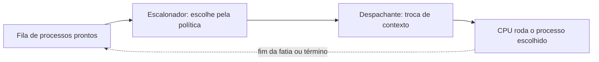

# 42 · Escalonamento de CPU

**Tempo estimado:** 50 minutos · **Pré-requisito:** [[41 - Processos, threads e fork]].

**Ao final você vai conseguir:**

1. Separar o mecanismo (despachante e troca de contexto) da política (escalonador).
2. Calcular os tempos de espera de FCFS, SJF e round robin para um mesmo conjunto de processos.
3. Mostrar, com números, por que um processo longo na frente atrasa os curtos (efeito comboio).
4. Explicar o problema da inanição e a correção pelo envelhecimento.

**Antes de começar:** no módulo 41 o despachante trocava o processo na CPU. Aqui a pergunta é outra: quem deve ser o próximo?

---

## Para começar

Um caixa de supermercado atende três pessoas. Uma tem um carrinho cheio, as outras têm um item cada. Se o carrinho cheio é atendido primeiro, as duas outras esperam muito. Se os itens são atendidos primeiro, a média de espera cai. O escalonador de CPU enfrenta o mesmo dilema, com processos no lugar de clientes.

---

## Mapa do módulo



*Figura 1: o escalonador é a política, que escolhe o próximo. O despachante é o mecanismo, que faz a troca.*

**Como ler:** a seta tracejada mostra o retorno à fila. Um processo que não terminou volta para a fila, e a política decide quando ele roda de novo.

---

## Mini-aula 1: política e mecanismo

> [!tip] Ideia
> O sistema separa duas coisas: o despachante executa a troca, e o escalonador escolhe quem entra. Trocar a política não muda o mecanismo.

> [!info] Definição
> O **escalonador** (scheduler) é a política: decide qual processo pronto recebe a CPU. O **despachante** (dispatcher) é o mecanismo: faz a troca de contexto, restaurando o PCB do processo escolhido. A nota da Wisc usa essa mesma divisão: a política é o escalonador, e a troca de contexto é o trabalho do despachante.

Veja FCFS aplicado a um conjunto de rajadas, e a média de espera que ele produz. Antes de rodar, diga qual é a espera do primeiro processo em FCFS.

```python
def espera_fcfs(rajadas):
    espera = []
    t = 0
    for r in rajadas:
        espera.append(t)
        t += r
    return espera

rajadas = [24, 3, 3]
esperas = espera_fcfs(rajadas)
print("tempos de espera (FCFS):", esperas)
print("média:", sum(esperas) / len(esperas))
```

Saída real:

```
tempos de espera (FCFS): [0, 24, 27]
média: 17.0
```

**Como ler:** em FCFS, os processos rodam na ordem da lista. O primeiro não espera, o segundo espera 24 unidades, e o terceiro espera 27. A média é 17.

> [!warning] Armadilha comum
> O tempo de espera não é o tempo total no sistema. Para este modelo, todos chegam no instante zero, e a espera é o tempo até começar a rodar.

> [!question]- Checkpoint
> 1. Quanto espera o terceiro processo em FCFS?
> 2. Por que a média é o critério usado?
>
> > [!success]- Resposta
> > 1. 27 unidades, a soma das rajadas dos dois anteriores.
> > 2. A média resume o desempenho do conjunto com um único número, para comparar políticas.

---

## Mini-aula 2: efeito comboio

> [!tip] Ideia
> Em FCFS, um processo longo na frente bloqueia todos os curtos atrás dele. Essa situação chama-se efeito comboio (convoy effect), e a ordem da fila muda a média de forma grande.

> [!info] Definição
> O **efeito comboio** (convoy effect) é o atraso de processos curtos atrás de um processo longo, que ocorre em FCFS.

Veja o mesmo conjunto de rajadas em duas ordens. Antes de rodar, diga qual das duas ordens tem média menor.

```python
def espera_fcfs(rajadas):
    espera = []
    t = 0
    for r in rajadas:
        espera.append(t)
        t += r
    return espera

def media(valores):
    return sum(valores) / len(valores)

print("longo primeiro:", espera_fcfs([24, 3, 3]), "média", media(espera_fcfs([24, 3, 3])))
print("curtos primeiro:", espera_fcfs([3, 3, 24]), "média", media(espera_fcfs([3, 3, 24])))
```

Saída real:

```
longo primeiro: [0, 24, 27] média 17.0
curtos primeiro: [0, 3, 6] média 3.0
```

**Como ler:** colocar as rajadas curtas primeiro reduz a média de 17 para 3. A política é a mesma; só a ordem muda. Esse é o motivo de SJF existir.

> [!warning] Armadilha comum
> FCFS é simples e previsível. A média alta não vem de um defeito de implementação: vem de a ordem de chegada ignorar a duração.

> [!question]- Checkpoint
> 1. Qual é a média quando o longo vem primeiro?
> 2. Qual política escolhe a ordem das rajadas curtas primeiro?
>
> > [!success]- Resposta
> > 1. 17.
> > 2. SJF (shortest job first).

---

## Mini-aula 3: SJF, round robin e prioridade

> [!tip] Ideia
> SJF escolhe a rajada mais curta. Round robin dá uma fatia de tempo a cada processo, e volta para o fim da fila se não terminou. Prioridade roda primeiro quem tem o número mais baixo.

> [!info] Definição
> No **SJF** (shortest job first), a rajada seguinte é a mais curta. No **round robin**, cada processo roda no máximo um quantum, e a escolha do tamanho do quantum é uma troca: fatias pequenas dão resposta rápida, mas aumentam o número de trocas (Aspnes). Na **prioridade**, o processo de prioridade mais alta roda primeiro. Prioridade baixa pode levar à **inanição** (starvation), e o **envelhecimento** (aging) corrige isso aumentando, aos poucos, a prioridade de quem espera (CSUStan).

No exercício P2 você simula round robin com quantum 4. As rajadas são as mesmas do exemplo. Antes de começar, pense: o processo longo termina antes ou depois dos curtos?

> [!warning] Armadilha comum
> SJF só é ótimo quando a duração é conhecida. Na prática, o sistema estima a próxima rajada com uma média exponencial das anteriores (Aspnes). Esta lição usa a duração exata.

> [!question]- Checkpoint
> 1. Em round robin com quantum grande demais, o que se aproxima de?
> 2. Como o envelhecimento combate a inanição?
>
> > [!success]- Resposta
> > 1. De FCFS, porque cada processo roda quase inteiro antes da troca.
> > 2. Aumentando, a cada passo, a prioridade de quem espera, até ele ser escolhido.

---

## Exercícios

Cada exercício tem um bloco com a função a completar e os testes com `assert`. Quando todos passarem, aparece `Passou!`. As funções definidas em exercícios anteriores aparecem no código inicial.

### Aquecimento

**A1. Média de espera.** Complete `tempo_medio(esperas)`, que devolve a média de uma lista de tempos de espera. Para uma lista vazia, devolva `0.0`. A média é o critério que a demonstração usou para comparar as políticas.

```python
def tempo_medio(esperas):
    """Média dos tempos de espera; 0.0 para lista vazia."""
    ...

assert tempo_medio([0, 24, 27]) == 17.0, "a média do exemplo FCFS"
assert tempo_medio([5]) == 5.0, "um só elemento"
assert tempo_medio([]) == 0.0, "lista vazia"
print("Passou!")
```

> [!hint]- Dica 1
> Some os valores com `sum` e divida pelo tamanho da lista.

> [!hint]- Dica 2
> Trate o caso vazio antes da divisão.

> [!example]- Solução
> ```python
> def tempo_medio(esperas):
>     """Média dos tempos de espera; 0.0 para lista vazia."""
>     if not esperas:
>         return 0.0
>     return sum(esperas) / len(esperas)
> ```
>
> **Erro comum:** Dividir sem checar lista vazia. Isso dá `ZeroDivisionError`, e o teste falha com essa mensagem, e não com AssertionError.

**A2. Hora de término.** Complete `fim_fcfs(rajadas)`, que devolve, para cada processo, o instante em que termina no escalonamento FCFS, com todos chegando no instante zero. O primeiro termina em `rajadas[0]`; o seguinte termina quando o anterior acaba mais a sua própria rajada.

```python
def fim_fcfs(rajadas):
    """Instante de término de cada processo em FCFS, todos chegando em zero."""
    ...

assert fim_fcfs([24, 3, 3]) == [24, 27, 30], "exemplo com três processos"
assert fim_fcfs([5]) == [5], "um processo"
assert fim_fcfs([]) == [], "sem processos"
print("Passou!")
```

> [!hint]- Dica 1
> Mantenha `t = 0` e, para cada rajada `r`, faça `t += r` e adicione `t` à lista.

> [!hint]- Dica 2
> Para `[24, 3, 3]`, o resultado é `[24, 27, 30]`.

> [!example]- Solução
> ```python
> def fim_fcfs(rajadas):
>     """Instante de término de cada processo em FCFS, todos chegando em zero."""
>     fins = []
>     t = 0
>     for r in rajadas:
>         t += r
>         fins.append(t)
>     return fins
> ```
>
> **Erro comum:** Devolver as rajadas, e não os instantes de término. O término é a soma acumulada.

**A3. Quem é o mais curto.** Complete `ordem_sjf(rajadas)`, que devolve a lista dos índices dos processos, ordenada da rajada mais curta para a mais longa. Em caso de empate, mantenha a ordem original. Esse é o critério da política SJF (shortest job first).

```python
def ordem_sjf(rajadas):
    """Índices dos processos da rajada mais curta para a mais longa; empates na ordem original."""
    ...

assert ordem_sjf([24, 3, 3]) == [1, 2, 0], "as duas rajadas de 3 vêm primeiro"
assert ordem_sjf([2, 1]) == [1, 0], "a menor primeiro"
assert ordem_sjf([]) == [], "sem processos"
print("Passou!")
```

> [!hint]- Dica 1
> Use `sorted(range(len(rajadas)), key=...)`, com uma chave que dê a rajada de cada índice.

> [!hint]- Dica 2
> `sorted` é estável: empates mantêm a ordem original.

> [!example]- Solução
> ```python
> def ordem_sjf(rajadas):
>     """Índices dos processos da rajada mais curta para a mais longa; empates na ordem original."""
>     return sorted(range(len(rajadas)), key=lambda i: rajadas[i])
> ```
>
> **Erro comum:** Ordenar as rajadas e devolver os valores. O exercício pede os índices, para saber de qual processo se trata.

### Praticando

**P1. SJF sem preempção.** Complete `espera_sjf(rajadas)`, que devolve o tempo de espera de cada processo, na ordem original, quando o escalonador escolhe sempre a rajada mais curta, sem interromper quem está rodando. Todos chegam no instante zero. Use `ordem_sjf`, já definida acima.

```python
def ordem_sjf(rajadas):
    return sorted(range(len(rajadas)), key=lambda i: rajadas[i])

def espera_sjf(rajadas):
    """Espera de cada processo em SJF sem preempção, na ordem original."""
    ...

assert espera_sjf([24, 3, 3]) == [6, 0, 3], "o de 3 roda primeiro; o de 24 espera 6"
assert espera_sjf([2, 1]) == [1, 0], "o menor não espera"
assert espera_sjf([]) == [], "sem processos"
print("Passou!")
```

> [!hint]- Dica 1
> Percorra `ordem_sjf(rajadas)`. Para cada índice `i`, a espera é o `t` atual, e depois `t` cresce pela rajada de `i`.

> [!hint]- Dica 2
> Guarde a espera na posição `i` de uma lista de zeros, para devolver na ordem original.

> [!example]- Solução
> ```python
> def espera_sjf(rajadas):
>     """Espera de cada processo em SJF sem preempção, na ordem original."""
>     espera = [0] * len(rajadas)
>     t = 0
>     for i in ordem_sjf(rajadas):
>         espera[i] = t
>         t += rajadas[i]
>     return espera
> ```
>
> **Erro comum:** Devolver as esperas na ordem de execução. O teste pede a ordem dos processos no enunciado.

**P2. Round robin.** Complete `espera_rr(rajadas, quantum)`, que simula o escalonamento round robin: cada processo roda no máximo `quantum` unidades e volta para o fim da fila se não terminou. Todos chegam no instante zero. Devolva a espera de cada processo, na ordem original, calculada como `instante_de_termino - rajada`. Use `deque` da biblioteca `collections`.

```python
from collections import deque

def espera_rr(rajadas, quantum):
    """Espera de cada processo em round robin, todos chegando em zero, na ordem original."""
    ...

assert espera_rr([24, 3, 3], 4) == [6, 4, 7], "quantum 4: esperas 6, 4 e 7"
assert espera_rr([3], 4) == [0], "um processo curto não espera"
assert espera_rr([], 4) == [], "sem processos"
print("Passou!")
```

> [!hint]- Dica 1
> Use uma fila com `deque(range(n))` e uma cópia das rajadas restantes.

> [!hint]- Dica 2
> A cada fatia, `t` cresce pela fatia; se o processo ainda tem rajada, volte com ele para o fim da fila.

> [!example]- Solução
> ```python
> def espera_rr(rajadas, quantum):
>     """Espera de cada processo em round robin, todos chegando em zero, na ordem original."""
>     restante = list(rajadas)
>     fila = deque(range(len(rajadas)))
>     fim = [0] * len(rajadas)
>     t = 0
>     while fila:
>         i = fila.popleft()
>         fatia = min(quantum, restante[i])
>         t += fatia
>         restante[i] -= fatia
>         if restante[i] == 0:
>             fim[i] = t
>         else:
>             fila.append(i)
>     return [fim[i] - rajadas[i] for i in range(len(rajadas))]
> ```
>
> **Erro comum:** Esquecer de devolver o processo não terminado à fila. Ele some da simulação e a espera sai errada.

**P3. Escalonamento por prioridade.** Complete `espera_prioridade(rajadas, prios)`, em que um número menor de `prios` significa prioridade mais alta. O escalonador roda os processos em ordem de prioridade, sem preempção, e devolve a espera de cada um na ordem original. Em empate, mantenha a ordem original. Use `espera_sjf` como modelo, mas com a ordem dada por `prios`.

```python
def espera_prioridade(rajadas, prios):
    """Espera em escalonamento por prioridade (menor número primeiro), sem preempção."""
    ...

assert espera_prioridade([10, 1, 2], [3, 1, 2]) == [3, 0, 1], "prioridade 1 roda primeiro"
assert espera_prioridade([5, 5], [1, 1]) == [0, 5], "empate mantém a ordem original"
assert espera_prioridade([], []) == [], "sem processos"
print("Passou!")
```

> [!hint]- Dica 1
> Ordene os índices com `sorted(range(len(prios)), key=lambda i: prios[i])`.

> [!hint]- Dica 2
> Depois, o cálculo da espera é o mesmo de `espera_sjf`, com essa ordem.

> [!example]- Solução
> ```python
> def espera_prioridade(rajadas, prios):
>     """Espera em escalonamento por prioridade (menor número primeiro), sem preempção."""
>     ordem = sorted(range(len(prios)), key=lambda i: prios[i])
>     espera = [0] * len(rajadas)
>     t = 0
>     for i in ordem:
>         espera[i] = t
>         t += rajadas[i]
>     return espera
> ```
>
> **Erro comum:** Ordenar pelas rajadas, e não pelas prioridades. Isso dá o SJF, e não a política pedida.

### Desafio

**D1. Envelhecimento.** Em escalonamento por prioridade, um processo de prioridade baixa pode ficar esperando sem fim. O envelhecimento (aging) corrige isso: a cada passo, o número de prioridade de todo processo que espera diminui em 1, até no mínimo `0`. Complete `envelhecimento(prioridades, passos)`, que devolve as prioridades depois de `passos` passos.

```python
def envelhecimento(prioridades, passos):
    """Prioridades depois de passos de envelhecimento; cada uma diminui em 1 por passo, até 0."""
    ...

assert envelhecimento([5, 1], 3) == [2, 0], "a segunda chega a zero e para"
assert envelhecimento([4], 0) == [4], "sem passos, nada muda"
assert envelhecimento([1], 10) == [0], "nunca fica negativa"
print("Passou!")
```

> [!hint]- Dica 1
> Repita `passos` vezes um laço que faz `p = max(0, p - 1)` para cada prioridade.

> [!hint]- Dica 2
> Para `[5, 1]` e `3` passos, o resultado é `[2, 0]`.

> [!example]- Solução
> ```python
> def envelhecimento(prioridades, passos):
>     """Prioridades depois de passos de envelhecimento; cada uma diminui em 1 por passo, até 0."""
>     atuais = list(prioridades)
>     for _ in range(passos):
>         atuais = [max(0, p - 1) for p in atuais]
>     return atuais
> ```
>
> **Erro comum:** Deixar a prioridade ficar negativa. O mínimo é zero, e `max(0, ...)` garante isso.


---

## Mini-projeto (opcional)

Você vai comparar as três políticas para as mesmas rajadas e ver qual tem a menor média. Tente sozinho antes de abrir a solução.

**Mini-projeto: comparando políticas.** Complete `compara_politicas(rajadas, quantum)`, que devolve um dicionário com a média de espera de três políticas para as mesmas rajadas, todos chegando no instante zero: `"fcfs"` (espera na ordem de chegada, que é a ordem da lista), `"sjf"` (sem preempção) e `"rr"` (com o quantum dado). A média é `tempo_medio` das esperas de cada política.

```python
from collections import deque

def espera_fcfs(rajadas):
    espera = []
    t = 0
    for r in rajadas:
        espera.append(t)
        t += r
    return espera

def tempo_medio(esperas):
    if not esperas:
        return 0.0
    return sum(esperas) / len(esperas)

def ordem_sjf(rajadas):
    return sorted(range(len(rajadas)), key=lambda i: rajadas[i])

def espera_sjf(rajadas):
    espera = [0] * len(rajadas)
    t = 0
    for i in ordem_sjf(rajadas):
        espera[i] = t
        t += rajadas[i]
    return espera

def espera_rr(rajadas, quantum):
    restante = list(rajadas)
    fila = deque(range(len(rajadas)))
    fim = [0] * len(rajadas)
    t = 0
    while fila:
        i = fila.popleft()
        fatia = min(quantum, restante[i])
        t += fatia
        restante[i] -= fatia
        if restante[i] == 0:
            fim[i] = t
        else:
            fila.append(i)
    return [fim[i] - rajadas[i] for i in range(len(rajadas))]

def compara_politicas(rajadas, quantum):
    """Média de espera de FCFS, SJF e RR para as mesmas rajadas."""
    ...

r = compara_politicas([24, 3, 3], 4)
assert r is not None, "a função devolve o dicionário"
assert r["fcfs"] == 17.0, "FCFS: média 17"
assert r["sjf"] == 3.0, "SJF: média 3"
assert round(r["rr"], 2) == 5.67, "RR com quantum 4: média 5.67"
print("Passou!")
```

> [!hint]- Dica 1
> Escreva as funções auxiliares com os mesmos nomes do começo do arquivo. Para `"fcfs"`, a espera de cada processo é a soma das rajadas anteriores.

> [!hint]- Dica 2
> Para `[24, 3, 3]` e quantum 4, as médias são 17.0, 3.0 e 5.67, com round.

> [!example]- Solução
> ```python
> def compara_politicas(rajadas, quantum):
>     """Média de espera de FCFS, SJF e RR para as mesmas rajadas."""
>     return {
>         "fcfs": tempo_medio(espera_fcfs(rajadas)),
>         "sjf": tempo_medio(espera_sjf(rajadas)),
>         "rr": tempo_medio(espera_rr(rajadas, quantum)),
>     }
> ```
>
> **Erro comum:** Calcular a média de uma política e repetir para as outras, sem usar as funções. Isso dificulta corrigir uma delas depois.


---

## Fechando

**Resumo**

- O escalonador escolhe o próximo processo pela política; o despachante faz a troca pelo mecanismo.
- FCFS roda na ordem de chegada e sofre o efeito comboio; SJF roda a rajada mais curta.
- Round robin divide a CPU em fatias; o quantum é um compromisso entre resposta e número de trocas.
- Prioridade pode causar inanição; o envelhecimento aumenta, aos poucos, a prioridade de quem espera.

**Glossário rápido**

- **Escalonador** (scheduler): política que escolhe o próximo processo.
- **Despachante** (dispatcher): mecanismo que faz a troca de contexto.
- **Efeito comboio** (convoy effect): processos curtos esperando atrás de um longo.
- **Quantum**: fatia de tempo dada a um processo no round robin.
- **Inanição** (starvation): processo que nunca recebe a CPU.
- **Envelhecimento** (aging): aumento gradual da prioridade de quem espera.

**Perguntas de revisão**

1. Por que a média de espera cai quando as rajadas curtas vêm primeiro, sem mudar a política?
2. Num round robin com um único processo, qual é a espera dele?
3. O que muda na média de espera se o quantum vai de 4 para 1?

**E agora?** Com isso, o bloco de Sistemas operacionais tem processos, escalonamento e troca de contexto. Os próximos temas da área são sincronização e memória virtual, com paginação e substituição de páginas.

---

## Para ir mais fundo

- [[CPU Scheduling Algorithms]]
- [[Context Switch and Dispatching]]
- [[Linux Scheduling Policies]]
- [[Process and Process Control Block]]
