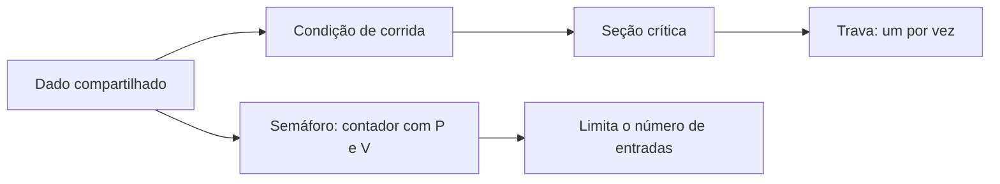

# 43 · Seções críticas e semáforos

**Tempo estimado:** 45 minutos · **Pré-requisito:** [[41 - Processos, threads e fork]] e [[42 - Escalonamento de CPU]].

**Ao final você vai conseguir:**

1. Mostrar, com uma sequência de passos, como duas atividades perdem uma atualização.
2. Explicar o que é uma seção crítica e por que só um processo pode estar nela por vez.
3. Usar uma trava para tornar um contador compartilhado exato.
4. Descrever um semáforo como um contador com as operações P e V, e usá-lo para limitar o acesso.

**Antes de começar:** no módulo 41 as threads compartilhavam a memória global. Quando há compartilhamento, as operações de dois fluxos podem se intercalar, e o resultado depende dessa ordem.

---

## Para começar

Duas pessoas dividem uma conta bancária. Cada uma lê o saldo, soma um depósito e grava o novo saldo. Se as duas leem antes de qualquer gravação, uma delas perde o depósito, mesmo que ambas tenham feito a operação corretamente. O problema não está na soma: está na intercalação das leituras e gravações.

---

## Mapa do módulo



*Figura 1: a condição de corrida surge do compartilhamento. A seção crítica e a trava resolvem o problema de exclusão; o semáforo generaliza para limitar quantos entram.*

**Como ler:** a seta indica "leva a". Note que a trava é o caso particular do semáforo que aceita só uma entrada.

---

## Mini-aula 1: a atualização perdida

> [!tip] Ideia
> Uma operação como `contador += 1` tem três passos: ler, somar e gravar. Se dois fluxos fazem esses passos intercalados, um incremento se perde.

> [!info] Definição
> Uma **condição de corrida** (race condition) é um erro que depende da ordem em que os fluxos executam seus passos. Uma **seção crítica** (critical section) é um trecho de código em que só um processo pode estar executando por vez. A nota de Wisc usa exatamente essa definição de seção crítica.

Veja a sequência de passos com duas atividades que leem o mesmo valor. Antes de rodar, diga qual é o valor final do contador.

```python
contador = 0
print("sem trava: A e B leem o mesmo valor e depois escrevem")
lido_a = contador
lido_b = contador
contador = lido_a + 1
print("A escreveu:", contador)
contador = lido_b + 1
print("B escreveu:", contador, "(a atualização de A se perdeu)")
```

Saída real:

```
sem trava: A e B leem o mesmo valor e depois escrevem
A escreveu: 1
B escreveu: 1 (a atualização de A se perdeu)
```

**Como ler:** `A` e `B` leem `0`. Cada um grava `1`, e a gravação de `B` sobrescreve a de `A`. O contador deveria valer `2`, mas vale `1`.

> [!warning] Armadilha comum
> O erro não aparece em todas as execuções. Ele depende de quando o escalonador troca de processo. Por isso é difícil de reproduzir, e não pode ser descartado só porque um teste passou.

> [!question]- Checkpoint
> 1. Por que o valor final é `1`, e não `2`?
> 2. Qual dos três passos de `contador += 1` estava intercalado?
>
> > [!success]- Resposta
> > 1. Porque `B` lê antes de `A` gravar; então os dois gravam `0 + 1`.
> > 2. A leitura: os dois leram antes de qualquer gravação.

---

## Mini-aula 2: trava e seção crítica

> [!tip] Ideia
> Uma trava (lock) faz quem chega esperar até que o outro saia. Assim, o trecho entre a leitura e a gravação vira uma seção crítica, executada por um de cada vez.

> [!info] Definição
> Uma **trava** (lock) é uma primitiva com duas operações: adquirir e liberar. Enquanto um processo a tem, os outros que tentam adquirir ficam bloqueados. Em Python, `threading.Lock` é usado com `with`, que libera a trava mesmo se houver exceção. A nota de Wisc diz que travas fazem os outros esperar.

Veja quatro threads incrementando o mesmo contador mil vezes cada, com trava. Antes de rodar, diga o valor final esperado.

```python
import threading

contador = 0
trava = threading.Lock()

def trabalha():
    global contador
    for _ in range(1000):
        with trava:
            contador += 1

threads = [threading.Thread(target=trabalha) for _ in range(4)]
for t in threads:
    t.start()
for t in threads:
    t.join()
print("contador com trava:", contador)
```

Saída real:

```
contador com trava: 4000
```

**Como ler:** o total é exato porque cada incremento acontece dentro da trava. Sem a trava, o mesmo programa poderia perder incrementos.

> [!warning] Armadilha comum
> A trava só protege o que está dentro dela. Se uma thread lê o contador fora da trava, pode ver um valor intermediário.

> [!question]- Checkpoint
> 1. Por que o resultado é exatamente `4000`?
> 2. O que acontece se uma thread esquece de liberar a trava?
>
> > [!success]- Resposta
> > 1. Porque os quatro mil incrementos acontecem um por vez, dentro da trava.
> > 2. As outras threads ficam esperando para sempre; o programa trava.

---

## Mini-aula 3: semáforo

> [!tip] Ideia
> Um semáforo é um contador. A operação P diminui o contador se ele é positivo, e espera se é zero. A operação V aumenta o contador e libera quem espera.

> [!info] Definição
> Um **semáforo** (semaphore) é um contador usado para sincronização. A biblioteca `threading` oferece `Semaphore`, com contador, e `BoundedSemaphore`, que não deixa o contador passar do valor inicial. Com contador inicial 1, o semáforo funciona como uma trava. A nota de Wisc diz que semáforos misturam exclusão e escalonamento numa só estrutura, o que os monitores separam.

Veja um semáforo com duas vagas. A terceira tentativa é negada até que uma vaga seja liberada. Antes de rodar, diga qual é a resposta da quarta tentativa.

```python
import threading

sem = threading.Semaphore(2)
print("primeira tentativa:", sem.acquire(blocking=False))
print("segunda tentativa:", sem.acquire(blocking=False))
print("terceira tentativa:", sem.acquire(blocking=False))
sem.release()
print("depois de liberar:", sem.acquire(blocking=False))
```

Saída real:

```
primeira tentativa: True
segunda tentativa: True
terceira tentativa: False
depois de liberar: True
```

**Como ler:** as duas primeiras tentativas entram. A terceira é recusada, porque o contador chegou a zero. Depois de `release`, uma nova tentativa entra.

> [!warning] Armadilha comum
> `acquire(blocking=False)` devolve `False` na hora, em vez de esperar. Num programa real, a espera é o comportamento padrão; o demo usa a versão sem espera para mostrar a resposta de cada tentativa.

> [!question]- Checkpoint
> 1. Quantas tentativas entram antes do primeiro `release`?
> 2. Um semáforo de valor 1 faz o papel de qual primitiva?
>
> > [!success]- Resposta
> > 1. Duas.
> > 2. De uma trava.

---

## Exercícios

Cada exercício tem um bloco com a função a completar e os testes com `assert`. Quando todos passarem, aparece `Passou!`. As funções definidas em exercícios anteriores aparecem no código inicial.

### Aquecimento

**A1. Ordem das operações.** Cada passo é uma tupla `(processo, ação)`, em que a ação é `"ler"` (copia o valor do contador para uma variável local do processo) ou `"escrever"` (grava na variável compartilhada o valor local mais 1). O contador começa em 0. Complete `resultado_intercalado(ordem)`, que devolve o valor final do contador depois de executar os passos na ordem dada.

```python
def resultado_intercalado(ordem):
    """Valor final do contador depois de executar os passos de ler e escrever na ordem dada."""
    ...

intercalada = [("A", "ler"), ("B", "ler"), ("A", "escrever"), ("B", "escrever")]
sequencial = [("A", "ler"), ("A", "escrever"), ("B", "ler"), ("B", "escrever")]
assert resultado_intercalado(intercalada) == 1, "a atualização de A se perde"
assert resultado_intercalado(sequencial) == 2, "sem sobreposição, os dois incrementos contam"
assert resultado_intercalado([]) == 0, "sem passos, o contador fica em zero"
print("Passou!")
```

> [!hint]- Dica 1
> Guarde os valores lidos em um dicionário `locais`, indexado pelo nome do processo.

> [!hint]- Dica 2
> Na escrita, use `locais[processo] + 1`, não o valor atual do contador.

> [!example]- Solução
> ```python
> def resultado_intercalado(ordem):
>     """Valor final do contador depois de executar os passos de ler e escrever na ordem dada."""
>     contador = 0
>     locais = {}
>     for processo, acao in ordem:
>         if acao == "ler":
>             locais[processo] = contador
>         elif acao == "escrever":
>             contador = locais[processo] + 1
>     return contador
> ```
>
> **Erro comum:** Ler o contador na hora de escrever. Isso esconde a condição de corrida que o exercício quer mostrar.

**A2. Contador com trava.** Complete `contador_com_trava(n_threads, n_incrementos)`, que cria `n_threads` threads. Cada uma incrementa um contador compartilhado `n_incrementos` vezes, sempre dentro de uma trava (`threading.Lock`). Devolva o valor final. Com a trava, o resultado é exato: `n_threads * n_incrementos`.

```python
import threading

def contador_com_trava(n_threads, n_incrementos):
    """Threads incrementam um contador compartilhado dentro de uma trava; devolve o total."""
    ...

assert contador_com_trava(4, 1000) == 4000, "quatro threads de mil incrementos"
assert contador_com_trava(1, 5) == 5, "uma thread só"
assert contador_com_trava(3, 0) == 0, "sem incrementos"
print("Passou!")
```

> [!hint]- Dica 1
> Crie a trava antes das threads, e use `with trava:` dentro do laço de cada thread.

> [!hint]- Dica 2
> Use `t.join()` em todas as threads antes de devolver o contador.

> [!example]- Solução
> ```python
> def contador_com_trava(n_threads, n_incrementos):
>     """Threads incrementam um contador compartilhado dentro de uma trava; devolve o total."""
>     contador = [0]
>     trava = threading.Lock()
>     def trabalha():
>         for _ in range(n_incrementos):
>             with trava:
>                 contador[0] += 1
>     threads = [threading.Thread(target=trabalha) for _ in range(n_threads)]
>     for t in threads:
>         t.start()
>     for t in threads:
>         t.join()
>     return contador[0]
> ```
>
> **Erro comum:** Esquecer o `join`. O valor pode ser devolvido antes de as threads terminarem, e o resultado sai menor que o esperado.

**A3. Entradas no semáforo.** Um semáforo com capacidade `capacidade` começa com essa quantidade de vagas. Cada evento `"entrar"` tenta pegar uma vaga: se há vaga, ela é ocupada e a resposta é `True`; se não há, a resposta é `False` e a entrada é negada. Cada evento `"sair"` libera uma vaga e não gera resposta. Complete `permitidos(capacidade, eventos)`, que devolve a lista de respostas dos eventos `"entrar"`, na ordem.

```python
def permitidos(capacidade, eventos):
    """Respostas às tentativas de entrar em um semáforo de capacidade vagas."""
    ...

assert permitidos(2, ["entrar", "entrar", "entrar", "sair", "entrar"]) == [True, True, False, True], "a terceira espera; depois da saída, uma vaga"
assert permitidos(1, []) == [], "sem eventos"
assert permitidos(1, ["sair"]) == [], "sair não gera resposta"
print("Passou!")
```

> [!hint]- Dica 1
> Guarde as vagas em `vagas = capacidade`.

> [!hint]- Dica 2
> Para `"entrar"`, se `vagas > 0`, diminua `vagas` e registre `True`; senão registre `False`.

> [!example]- Solução
> ```python
> def permitidos(capacidade, eventos):
>     """Respostas às tentativas de entrar em um semáforo de capacidade vagas."""
>     vagas = capacidade
>     respostas = []
>     for ev in eventos:
>         if ev == "entrar":
>             if vagas > 0:
>                 vagas -= 1
>                 respostas.append(True)
>             else:
>                 respostas.append(False)
>         elif ev == "sair":
>             vagas += 1
>     return respostas
> ```
>
> **Erro comum:** Registrar uma resposta também para `"sair"`. A lista deve ter só as respostas de entrada.

### Praticando

**P1. Leitores e escritores.** Um leitor pode entrar quando não há escritor ativo. Um escritor só pode entrar quando não há leitores nem escritor ativos. Complete `pode_entrar(leitores, escritor_ativo, tipo)`, em que `leitores` é o número de leitores ativos, `escritor_ativo` é `True` ou `False`, e `tipo` é `"leitor"` ou `"escritor"`. Devolva `True` se pode entrar.

```python
def pode_entrar(leitores, escritor_ativo, tipo):
    """True se o leitor ou escritor pode entrar, pela regra de leitores e escritores."""
    ...

assert pode_entrar(2, False, "leitor") is True, "vários leitores podem ler juntos"
assert pode_entrar(0, True, "leitor") is False, "leitor espera o escritor"
assert pode_entrar(1, False, "escritor") is False, "escritor espera os leitores"
assert pode_entrar(0, False, "escritor") is True, "escritor sozinho entra"
print("Passou!")
```

> [!hint]- Dica 1
> Para leitor: `not escritor_ativo`.

> [!hint]- Dica 2
> Para escritor: `leitores == 0 and not escritor_ativo`.

> [!example]- Solução
> ```python
> def pode_entrar(leitores, escritor_ativo, tipo):
>     """True se o leitor ou escritor pode entrar, pela regra de leitores e escritores."""
>     if tipo == "leitor":
>         return not escritor_ativo
>     return leitores == 0 and not escritor_ativo
> ```
>
> **Erro comum:** Deixar o escritor entrar com leitores ativos. Isso permite que ele altere um dado que outro leitor está lendo.

**P2. Operações P e V.** Um semáforo tem um valor inteiro. A operação `"P"` (espera) só passa se o valor é maior que zero; nesse caso, diminui o valor e a resposta é `True`. Se o valor é zero, a resposta é `False`, e o processo ficaria bloqueado. A operação `"V"` (sinal) aumenta o valor em 1. Complete `semaforo_p_v(eventos, valor_inicial)`, que devolve a lista de respostas dos eventos `"P"`, na ordem.

```python
def semaforo_p_v(eventos, valor_inicial):
    """Respostas às operações P de um semáforo de valor inicial dado."""
    ...

assert semaforo_p_v(["P", "P", "P", "V", "P"], 2) == [True, True, False, True], "o terceiro P bloqueia; o V libera"
assert semaforo_p_v(["V", "P"], 0) == [True], "V antes de P permite a passagem"
assert semaforo_p_v([], 1) == [], "sem eventos"
print("Passou!")
```

> [!hint]- Dica 1
> Use a mesma lógica de `permitidos`, mas com `valor` no lugar de `vagas`.

> [!hint]- Dica 2
> `"V"` não gera resposta, então só `"P"` entra na lista.

> [!example]- Solução
> ```python
> def semaforo_p_v(eventos, valor_inicial):
>     """Respostas às operações P de um semáforo de valor inicial dado."""
>     valor = valor_inicial
>     respostas = []
>     for ev in eventos:
>         if ev == "P":
>             if valor > 0:
>                 valor -= 1
>                 respostas.append(True)
>             else:
>                 respostas.append(False)
>         elif ev == "V":
>             valor += 1
>     return respostas
> ```
>
> **Erro comum:** Diminuir o valor quando a resposta é `False`. Um P bloqueado não consome nada.

### Desafio

**D1. Atualização perdida.** Uma ordem de passos (no formato de A1) perde atualização quando o valor final do contador é menor que o número de processos que incrementam. Complete `perde_atualizacao(ordem)`, que devolve `True` se isso acontece. Use `resultado_intercalado`, já definida acima, e conte os processos distintos da ordem.

```python
def resultado_intercalado(ordem):
    contador = 0
    locais = {}
    for processo, acao in ordem:
        if acao == "ler":
            locais[processo] = contador
        elif acao == "escrever":
            contador = locais[processo] + 1
    return contador

def perde_atualizacao(ordem):
    """True se o valor final é menor que o número de processos que incrementam."""
    ...

intercalada = [("A", "ler"), ("B", "ler"), ("A", "escrever"), ("B", "escrever")]
sequencial = [("A", "ler"), ("A", "escrever"), ("B", "ler"), ("B", "escrever")]
assert perde_atualizacao(intercalada) is True, "a intercalada perde uma"
assert perde_atualizacao(sequencial) is False, "a sequencial não perde"
print("Passou!")
```

> [!hint]- Dica 1
> O número de processos é `len(set(p for p, _ in ordem))`.

> [!hint]- Dica 2
> Compare `resultado_intercalado(ordem)` com esse número.

> [!example]- Solução
> ```python
> def perde_atualizacao(ordem):
>     """True se o valor final é menor que o número de processos que incrementam."""
>     processos = len(set(p for p, _ in ordem))
>     return resultado_intercalado(ordem) < processos
> ```
>
> **Erro comum:** Comparar com o número de passos, e não de processos. Cada processo tem dois passos, e a conta sairia errada.


---

## Mini-projeto (opcional)

Você vai medir a ocupação máxima de um recurso com capacidade limitada, dado uma sequência de entradas e saídas. Tente sozinho antes de abrir a solução.

**Mini-projeto: ocupação máxima.** Complete `max_simultaneo(eventos, capacidade)`. Os eventos são `"entrar"` e `"sair"`. Um `"entrar"` só ocupa uma vaga se há vaga livre; caso contrário, é negado e não conta. Devolva a maior ocupação alcançada durante a sequência, que nunca passa da capacidade.

```python
def max_simultaneo(eventos, capacidade):
    """Maior ocupação de um semáforo de capacidade vagas ao longo dos eventos."""
    ...

assert max_simultaneo(["entrar", "entrar", "entrar", "sair", "entrar"], 2) == 2, "a terceira é negada"
assert max_simultaneo(["entrar", "sair", "entrar"], 1) == 1, "uma vaga, usada e liberada"
assert max_simultaneo([], 3) == 0, "sem eventos"
print("Passou!")
```

> [!hint]- Dica 1
> Mantenha `ocupados` e `maximo`. Ao ocupar, atualize `maximo = max(maximo, ocupados)`.

> [!hint]- Dica 2
> Um `"sair"` só diminui `ocupados`.

> [!example]- Solução
> ```python
> def max_simultaneo(eventos, capacidade):
>     """Maior ocupação de um semáforo de capacidade vagas ao longo dos eventos."""
>     ocupados = 0
>     maximo = 0
>     for ev in eventos:
>         if ev == "entrar":
>             if ocupados < capacidade:
>                 ocupados += 1
>                 maximo = max(maximo, ocupados)
>         elif ev == "sair":
>             ocupados -= 1
>     return maximo
> ```
>
> **Erro comum:** Contar as entradas negadas. Elas não ocupam vaga, e o máximo sairia acima da capacidade.


---

## Fechando

**Resumo**

- Uma condição de corrida acontece quando a ordem dos passos afeta o resultado.
- Uma seção crítica é executada por um processo por vez; uma trava garante isso.
- Um semáforo é um contador com P (espera) e V (sinal). Com valor inicial 1, age como trava.
- A regra de leitores e escritores permite vários leitores, mas um escritor sozinho.

**Glossário rápido**

- **Condição de corrida** (race condition): erro que depende da ordem de execução.
- **Seção crítica** (critical section): trecho que só um processo executa por vez.
- **Trava** (lock): primitiva que faz os outros esperarem.
- **Semáforo** (semaphore): contador com operações P e V.

**Perguntas de revisão**

1. Por que testar um programa concorrente uma vez não prova que ele está correto?
2. Qual é a diferença entre um semáforo de valor 1 e uma trava?
3. Por que uma leitura feita fora da trava ainda pode ver um valor intermediário?

**E agora?** O próximo módulo é **Monitores e deadlock**. Ele mostra como agrupar dados com a sua sincronização, e o que acontece quando dois processos esperam um pelo outro.

---

## Para ir mais fundo

- [[Critical Sections and Semaphores]]
- [[Monitors and Python Synchronization Primitives]]
- [[Threads]]
