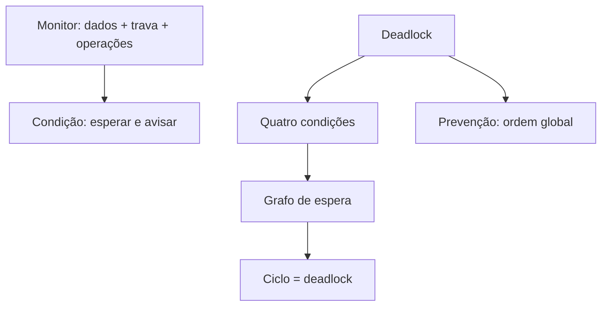

# 44 · Monitores e deadlock

**Tempo estimado:** 45 minutos · **Pré-requisito:** [[43 - Seções críticas e semáforos]].

**Ao final você vai conseguir:**

1. Descrever um monitor como dados, operações e sincronização agrupados, com trava na entrada e na saída.
2. Usar `threading.Condition` com um laço `while` para esperar uma condição.
3. Listar as quatro condições do deadlock e dizer o que cada uma exige.
4. Representar esperas como um grafo e encontrar um ciclo com busca em profundidade.
5. Evitar deadlock impondo uma ordem global aos recursos.

**Antes de começar:** no módulo 43 você protegeu um contador com uma trava solta. Um monitor coloca a trava dentro da classe que guarda os dados, para que ninguém consiga acessá-los sem ela.

---

## Para começar

Uma impressora e um scanner são usados por dois programas. O programa A pega a impressora e pede o scanner. O programa B pega o scanner e pede a impressora. Nenhum libera o que tem antes de receber o que quer. Os dois ficam parados para sempre. Esse é um deadlock, e ele não depende de erro de código: depende da ordem em que os pedidos acontecem.

---

## Mapa do módulo



*Figura 1: o monitor organiza a sincronização dentro de uma classe. O deadlock se reconhece pelas quatro condições e pelo ciclo no grafo de espera.*

**Como ler:** as duas partes são independentes. A primeira trata de como proteger dados; a segunda, de como esperas se fecham em um ciclo.

---

## Mini-aula 1: monitor

> [!tip] Ideia
> Um monitor junta dados, operações e a trava que protege os dados. Quem quer usar os dados passa pelas operações, e a trava é tomada na entrada e liberada na saída.

> [!info] Definição
> Um **monitor** (monitor) é uma estrutura que agrupa dados, operações sobre eles e a sincronização. A trava é adquirida ao entrar e liberada ao sair. Uma **variável de condição** (condition variable) permite esperar por uma condição dentro do monitor: `wait` libera a trava enquanto espera, e `notify` avisa quem espera. A nota de Wisc diz que semáforos misturam exclusão e escalonamento, e que monitores separam essas duas coisas.

Veja um contador dentro de uma classe, com trava interna em cada operação. Antes de rodar, diga quantas vezes o método `incrementa` é chamado.

```python
import threading

class Contador:
    def __init__(self):
        self._trava = threading.Lock()
        self._valor = 0

    def incrementa(self):
        with self._trava:
            self._valor += 1

    def valor(self):
        with self._trava:
            return self._valor

c = Contador()
for _ in range(3):
    c.incrementa()
print("valor do monitor:", c.valor())
```

Saída real:

```
valor do monitor: 3
```

**Como ler:** `incrementa` e `valor` tomam a trava internamente. Quem usa a classe não precisa lembrar de travar; o monitor garante isso.

> [!warning] Armadilha comum
> Em `Condition.wait`, a condição deve ser testada em um laço `while`, e não em um `if`. Ao acordar, a condição pode ter mudado de novo, e o laço testa outra vez antes de seguir.

> [!question]- Checkpoint
> 1. Quem toma a trava quando `valor()` é chamado?
> 2. Por que o `while` é melhor que o `if` para esperar uma condição?
>
> > [!success]- Resposta
> > 1. O próprio método, com `with self._trava`.
> > 2. Porque, ao acordar, a condição pode já ter mudado; o laço testa de novo.

---

## Mini-aula 2: as quatro condições do deadlock

> [!tip] Ideia
> Um deadlock exige quatro coisas ao mesmo tempo: exclusão mútua, ausência de preempção, posse e espera, e espera circular.

> [!info] Definição
> As quatro condições (Wisc): **exclusão mútua** (um recurso só é usado por um processo); **sem preempção** (o recurso não pode ser tirado à força); **posse e espera** (o processo segura recursos enquanto pede outros); **espera circular** (cada processo espera outro, fechando um ciclo). "Posse e espera" é o nome usual dessa condição nos livros-texto.

No exemplo do início, as quatro estão presentes. Antes de começar o exercício P1, pense: se a impressora pudesse ser compartilhada, qual condição deixaria de valer?

> [!warning] Armadilha comum
> Quatro condições presentes são um cenário de deadlock, mas a nota não resolve se elas são também suficientes. Não trate a lista como uma receita que sempre prende o programa.

> [!question]- Checkpoint
> 1. Qual condição é quebrada se o sistema pode tirar um recurso à força?
> 2. Qual condição é quebrada quando um processo pede todos os recursos de uma vez?
>
> > [!success]- Resposta
> > 1. A de ausência de preempção.
> > 2. A de posse e espera.

---

## Mini-aula 3: grafo de espera e ciclo

> [!tip] Ideia
> Desenhe um grafo: cada processo é um nó, e uma seta vai de quem espera para quem segura o recurso. Um ciclo nesse grafo é um deadlock.

> [!info] Definição
> O **grafo de espera** tem uma seta de `p` para `q` quando `p` espera um recurso que `q` segura. Um **ciclo** nesse grafo corresponde à espera circular. A busca em profundidade marca cada nó como "em uso" ao entrar e "concluído" ao sair; achar um nó "em uso" pelo caminho atual indica ciclo. A nota de Wisc não desenha o grafo; a representação aqui é uma ilustração da condição de espera circular.

Veja o grafo do exemplo de deadlock. Antes de rodar, diga quantas setas saem de cada processo.

```python
espera = {"P1": "R2", "P2": "R1"}
posse = {"R1": "P1", "R2": "P2"}

grafo = {p: [posse[r]] for p, r in espera.items()}
print("grafo de espera (processo -> processo que segura o recurso):", grafo)
```

Saída real:

```
grafo de espera (processo -> processo que segura o recurso): {'P1': ['P2'], 'P2': ['P1']}
```

**Como ler:** `P1` espera `R2`, que está com `P2`; `P2` espera `R1`, que está com `P1`. As setas formam um ciclo de dois processos.

> [!warning] Armadilha comum
> Um ciclo no grafo não é só um problema de tamanho. Com dois processos ou com dez, a regra é a mesma: uma sequência fechada de esperas.

> [!question]- Checkpoint
> 1. Quantas setas saem de `P1`?
> 2. Por que o ciclo caracteriza o deadlock?
>
> > [!success]- Resposta
> > 1. Uma, para `P2`.
> > 2. Porque nenhum processo do ciclo pode avançar sem que outro do ciclo libere algo.

---

## Mini-aula 4: prevenção pela ordem

> [!tip] Ideia
> Se todos os processos pedem os recursos na mesma ordem, um ciclo de espera não pode se fechar. Esse é um dos caminhos de prevenção que Wisc lista.

> [!info] Definição
> A **prevenção** nega uma das quatro condições. A nota lista três maneiras: pedir tudo de uma vez, ordenar os recursos hierarquicamente, ou permitir preempção. A ordem hierárquica nega a espera circular. A nota também cita o algoritmo do banqueiro, de Dijkstra, que evita entrar em estados inseguros, mas não o descreve aqui.

Você vai impor essa ordem no exercício A3.

> [!question]- Checkpoint
> 1. Qual condição a ordem hierárquica nega?
> 2. A nota descreve o algoritmo do banqueiro em detalhe?
>
> > [!success]- Resposta
> > 1. A espera circular.
> > 2. Não. Ela só menciona o algoritmo, e este módulo também não o detalha.

---

## Exercícios

Cada exercício tem um bloco com a função a completar e os testes com `assert`. Quando todos passarem, aparece `Passou!`. As funções definidas em exercícios anteriores aparecem no código inicial.

### Aquecimento

**A1. Grafo de espera.** Um processo `p` espera um recurso `espera[p]`. Esse recurso está com um processo, dado por `posse[recurso]`. Complete `grafo_de_espera(espera, posse)`, que devolve um dicionário em que cada processo que espera aponta para uma lista com o processo que segura o recurso que ele quer. Essa é a estrutura em que um ciclo indica deadlock.

```python
def grafo_de_espera(espera, posse):
    """Cada processo que espera aponta para o processo que segura o recurso pedido."""
    ...

assert grafo_de_espera({"P1": "R2", "P2": "R1"}, {"R1": "P1", "R2": "P2"}) == {"P1": ["P2"], "P2": ["P1"]}, "dois processos esperando um pelo outro"
assert grafo_de_espera({}, {}) == {}, "ninguém espera"
assert grafo_de_espera({"P1": "R1"}, {"R1": "P2"}) == {"P1": ["P2"]}, "uma espera, sem ciclo"
print("Passou!")
```

> [!hint]- Dica 1
> Percorra `espera.items()`. Para cada par `(p, r)`, o valor é `[posse[r]]`.

> [!hint]- Dica 2
> Para o exemplo da demonstração, o grafo é `{"P1": ["P2"], "P2": ["P1"]}`.

> [!example]- Solução
> ```python
> def grafo_de_espera(espera, posse):
>     """Cada processo que espera aponta para o processo que segura o recurso pedido."""
>     return {p: [posse[r]] for p, r in espera.items()}
> ```
>
> **Erro comum:** Apontar o processo para o recurso, e não para o dono dele. Um ciclo só aparece quando as arestas ligam processos.

**A2. Ciclo no grafo.** Complete `tem_ciclo(grafo)`, que devolve `True` se o grafo dirigido tem um ciclo, e `False` caso contrário. Um ciclo de espera circular é o que a nota de Wisc chama de condição de espera circular. Use busca em profundidade, marcando os nós que estão no caminho atual.

```python
def tem_ciclo(grafo):
    """True se o grafo dirigido tem um ciclo, por busca em profundidade."""
    ...

assert tem_ciclo({"P1": ["P2"], "P2": ["P1"]}) is True, "dois processos esperando um pelo outro"
assert tem_ciclo({"P1": ["P2"], "P2": []}) is False, "P2 não espera ninguém"
assert tem_ciclo({"A": ["B"], "B": ["C"], "C": ["B"]}) is True, "ciclo fora do primeiro nó"
assert tem_ciclo({}) is False, "grafo vazio"
print("Passou!")
```

> [!hint]- Dica 1
> Marque cada nó como `"cinza"` ao entrar e como `"preto"` ao sair. Se encontrar um vizinho `"cinza"`, há ciclo.

> [!hint]- Dica 2
> Percorra todos os nós do grafo, não só um, porque o ciclo pode estar em outra parte.

> [!example]- Solução
> ```python
> def tem_ciclo(grafo):
>     """True se o grafo dirigido tem um ciclo, por busca em profundidade."""
>     estado = {}
>     def dfs(n):
>         estado[n] = "cinza"
>         for m in grafo.get(n, []):
>             if estado.get(m) == "cinza":
>                 return True
>             if m not in estado and dfs(m):
>                 return True
>         estado[n] = "preto"
>         return False
>     for n in grafo:
>         if n not in estado and dfs(n):
>             return True
>     return False
> ```
>
> **Erro comum:** Testar só o primeiro nó. Um grafo com ciclo fora do primeiro nó devolveria `False` de forma errada.

**A3. Ordem global de recursos.** Uma forma de evitar deadlock é impor uma ordem global aos recursos, e pedir sempre na mesma ordem. Complete `ordem_segura(recursos)`, que recebe uma lista de nomes de recursos e devolve a lista sem repetições, em ordem crescente. Essa é a ordem em que um processo deve pedi-los.

```python
def ordem_segura(recursos):
    """Recursos sem repetição, em ordem crescente, para que todos peçam na mesma ordem."""
    ...

assert ordem_segura(["R2", "R1", "R2"]) == ["R1", "R2"], "sem repetição e em ordem"
assert ordem_segura([]) == [], "nenhum recurso"
assert ordem_segura(["R3"]) == ["R3"], "um recurso só"
print("Passou!")
```

> [!hint]- Dica 1
> Use `sorted(set(recursos))`.

> [!hint]- Dica 2
> Com `["R2", "R1", "R2"]`, o resultado é `["R1", "R2"]`.

> [!example]- Solução
> ```python
> def ordem_segura(recursos):
>     """Recursos sem repetição, em ordem crescente, para que todos peçam na mesma ordem."""
>     return sorted(set(recursos))
> ```
>
> **Erro comum:** Devolver a lista na ordem de chegada. Cada processo teria a própria ordem, e a espera circular continuaria possível.

### Praticando

**P1. As quatro condições.** Wisc descreve quatro condições que caracterizam o deadlock: exclusão mútua, sem preempção, posse e espera (um processo segura recursos enquanto pede outros) e espera circular. Complete `deadlock_possivel(exclusao, sem_preempcao, posse_e_espera, espera_circular)`, que devolve `True` quando as quatro condições estão presentes ao mesmo tempo, e `False` nos outros casos.

```python
def deadlock_possivel(exclusao, sem_preempcao, posse_e_espera, espera_circular):
    """True quando as quatro condições de deadlock estão presentes ao mesmo tempo."""
    ...

assert deadlock_possivel(True, True, True, True) is True, "as quatro presentes"
assert deadlock_possivel(True, True, True, False) is False, "sem espera circular"
assert deadlock_possivel(False, True, True, True) is False, "recurso compartilhável"
print("Passou!")
```

> [!hint]- Dica 1
> Use `all([...])` com as quatro condições.

> [!hint]- Dica 2
> Se uma condição for `False`, o resultado é `False`.

> [!example]- Solução
> ```python
> def deadlock_possivel(exclusao, sem_preempcao, posse_e_espera, espera_circular):
>     """True quando as quatro condições de deadlock estão presentes ao mesmo tempo."""
>     return all([exclusao, sem_preempcao, posse_e_espera, espera_circular])
> ```
>
> **Erro comum:** Usar `any`. Com `any`, basta uma condição para dar `True`, e isso não corresponde à descrição das quatro condições juntas.

**P2. Qual ciclo?** Complete `ciclo_encontrado(grafo)`, que devolve a lista de processos de um ciclo, se houver, ou `None` se não houver. Use a mesma busca em profundidade de A2, mas guarde o caminho atual em uma pilha, para extrair o ciclo quando ele aparecer.

```python
def ciclo_encontrado(grafo):
    """Lista de processos de um ciclo do grafo, ou None se não houver ciclo."""
    ...

ciclo = ciclo_encontrado({"P1": ["P2"], "P2": ["P1"]})
assert ciclo is not None and sorted(ciclo) == ["P1", "P2"], "o ciclo envolve os dois"
assert ciclo_encontrado({"P1": ["P2"], "P2": []}) is None, "sem ciclo"
print("Passou!")
```

> [!hint]- Dica 1
> Mantenha uma lista `pilha` com o caminho atual. Quando um vizinho cinza `m` aparece, o ciclo é `pilha[pilha.index(m):]`.

> [!hint]- Dica 2
> Remova o nó da pilha ao terminar de visitá-lo.

> [!example]- Solução
> ```python
> def ciclo_encontrado(grafo):
>     """Lista de processos de um ciclo do grafo, ou None se não houver ciclo."""
>     estado = {}
>     pilha = []
>     def dfs(n):
>         estado[n] = "cinza"
>         pilha.append(n)
>         for m in grafo.get(n, []):
>             if estado.get(m) == "cinza":
>                 return pilha[pilha.index(m):]
>             if m not in estado:
>                 achado = dfs(m)
>                 if achado:
>                     return achado
>         pilha.pop()
>         estado[n] = "preto"
>         return None
>     for n in grafo:
>         if n not in estado:
>             achado = dfs(n)
>             if achado:
>                 return achado
>     return None
> ```
>
> **Erro comum:** Devolver só `True`. A pergunta pede os processos envolvidos, para mostrar quem está preso.

### Desafio

**D1. Pedidos na ordem global.** Cada processo pede recursos em uma lista, na ordem em que os pede. Complete `aquisicoes_em_ordem(ordem_global, pedidos)`, em que `ordem_global` é uma lista de recursos e `pedidos` é um dicionário que associa cada processo à sua lista de recursos. Devolva `True` se, para todo processo, os recursos pedidos aparecem em ordem crescente segundo `ordem_global`. Essa é a condição que impede a espera circular pela ordem.

```python
def aquisicoes_em_ordem(ordem_global, pedidos):
    """True se cada processo pede seus recursos na ordem crescente de ordem_global."""
    ...

assert aquisicoes_em_ordem(["R1", "R2", "R3"], {"P1": ["R1", "R3"], "P2": ["R2"]}) is True, "tudo em ordem"
assert aquisicoes_em_ordem(["R1", "R2"], {"P1": ["R2", "R1"]}) is False, "P1 pede R2 antes de R1"
assert aquisicoes_em_ordem(["R1"], {}) is True, "sem pedidos"
print("Passou!")
```

> [!hint]- Dica 1
> Para cada lista, compare `ordem_global.index(r)` de um recurso com o do seguinte; a posição precisa crescer.

> [!hint]- Dica 2
> Use `all(...)` sobre todos os processos.

> [!example]- Solução
> ```python
> def aquisicoes_em_ordem(ordem_global, pedidos):
>     """True se cada processo pede seus recursos na ordem crescente de ordem_global."""
>     for lista in pedidos.values():
>         posicoes = [ordem_global.index(r) for r in lista]
>         if any(posicoes[i] >= posicoes[i + 1] for i in range(len(posicoes) - 1)):
>             return False
>     return True
> ```
>
> **Erro comum:** Verificar só a ordem dos primeiros recursos. Um pedido fora de ordem no fim da lista também quebra a regra.


---

## Mini-projeto (opcional)

Você vai juntar o grafo de espera e a busca de ciclo em um detector que recebe a situação de espera e posse. Tente sozinho antes de abrir a solução.

**Mini-projeto: detector de deadlock.** Complete `detector(espera, posse)`, que devolve `True` se a situação de espera e posse tem um ciclo, ou seja, um deadlock. Use `grafo_de_espera` e `tem_ciclo`, já definidas acima.

```python
def grafo_de_espera(espera, posse):
    return {p: [posse[r]] for p, r in espera.items()}

def tem_ciclo(grafo):
    estado = {}
    def dfs(n):
        estado[n] = "cinza"
        for m in grafo.get(n, []):
            if estado.get(m) == "cinza":
                return True
            if m not in estado and dfs(m):
                return True
        estado[n] = "preto"
        return False
    for n in grafo:
        if n not in estado and dfs(n):
            return True
    return False

def detector(espera, posse):
    """True se a espera e a posse formam um ciclo, isto é, um deadlock."""
    ...

assert detector({"P1": "R2", "P2": "R1"}, {"R1": "P1", "R2": "P2"}) is True, "deadlock do exemplo"
assert detector({"P1": "R1"}, {"R1": "P2"}) is False, "P1 espera P2, que não espera ninguém"
assert detector({}, {}) is False, "sem esperas"
print("Passou!")
```

> [!hint]- Dica 1
> Monte o grafo com `grafo_de_espera(espera, posse)` e depois passe-o para `tem_ciclo`.

> [!hint]- Dica 2
> Teste com o exemplo da demonstração: `{"P1": "R2", "P2": "R1"}` e `{"R1": "P1", "R2": "P2"}` dão `True`.

> [!example]- Solução
> ```python
> def detector(espera, posse):
>     """True se a espera e a posse formam um ciclo, isto é, um deadlock."""
>     return tem_ciclo(grafo_de_espera(espera, posse))
> ```
>
> **Erro comum:** Testar o ciclo sobre `espera` ou `posse` em vez do grafo. Esses dicionários não têm a forma de um grafo de processos.


---

## Fechando

**Resumo**

- Um monitor agrupa dados, operações e trava; a condição permite esperar dentro dele, com `while`.
- O deadlock exige exclusão mútua, ausência de preempção, posse e espera, e espera circular.
- Um grafo de espera com ciclo representa a espera circular.
- Pedir recursos sempre na mesma ordem impede o ciclo.

**Glossário rápido**

- **Monitor** (monitor): dados, operações e sincronização agrupados.
- **Variável de condição** (condition variable): permite esperar e avisar dentro de um monitor.
- **Deadlock** (deadlock): processos que esperam uns pelos outros para sempre.
- **Grafo de espera** (wait-for graph): processos ligados a quem segura o recurso que eles querem.
- **Prevenção** (prevention): negar uma das quatro condições.

**Perguntas de revisão**

1. Por que o monitor é menos sujeito a erro que uma trava solta?
2. Um grafo com três processos em fila, sem volta, tem deadlock?
3. Se os processos pedem R1 e R2 sempre nessa ordem, pode haver espera circular entre eles?

**E agora?** O próximo módulo é **Memória virtual e substituição de páginas**. Ele mostra como a tradução de endereços lida com páginas ausentes da RAM, e como escolher quem sai quando a memória está cheia.

---

## Para ir mais fundo

- [[Monitors and Python Synchronization Primitives]]
- [[Deadlock]]
- [[Critical Sections and Semaphores]]
