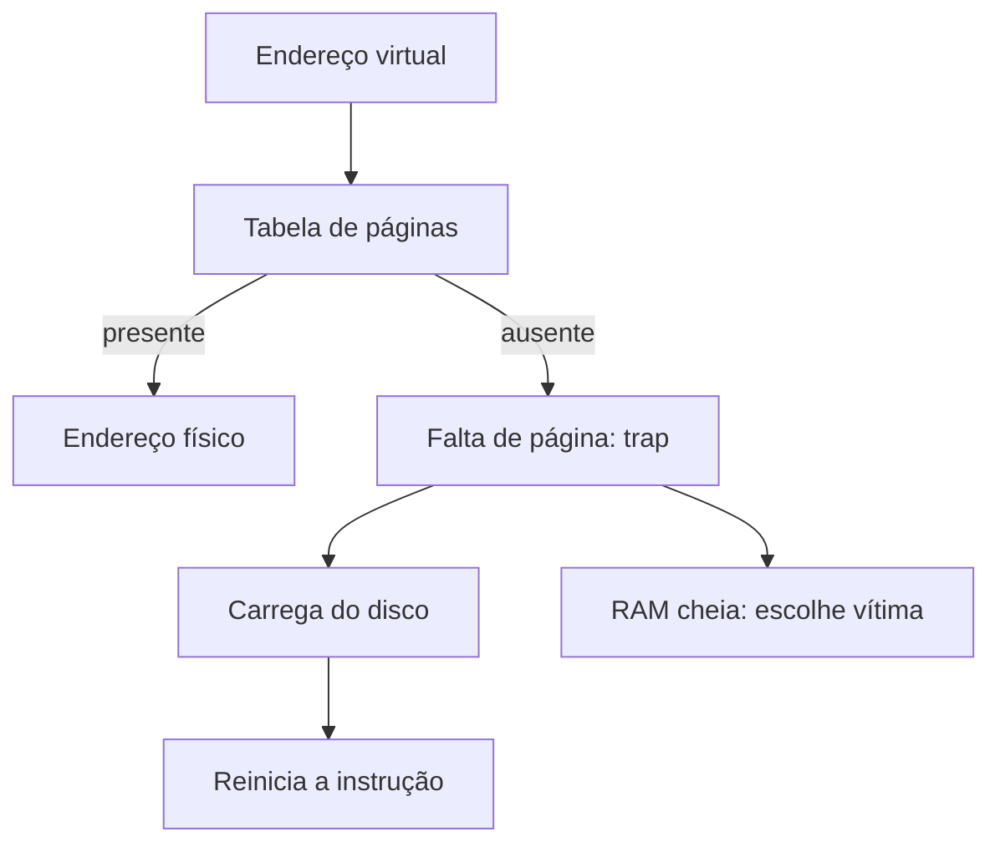

# 45 · Memória virtual e substituição de páginas

**Tempo estimado:** 50 minutos · **Pré-requisito:** [[40 - Hierarquia de memória e caches]] e [[44 - Monitores e deadlock]].

**Ao final você vai conseguir:**

1. Traduzir um endereço virtual em físico, e reconhecer quando a página está ausente da RAM.
2. Dizer o que acontece na falta de página: trap, carga do disco e reinício da instrução.
3. Contar as faltas de FIFO, LRU e segunda chance para uma mesma sequência de referências.
4. Explicar a anomalia de Belady e o que é o conjunto de trabalho.
5. Calcular o tempo efetivo de acesso com a fórmula da nota.

**Antes de começar:** no módulo 40 a tabela de páginas era consultada e o TLB acelerava a consulta. Aqui a página pode nem estar na RAM, e então o sistema precisa agir.

---

## Para começar

Você abre um arquivo grande, e o programa só usa uma parte dele de cada vez. O sistema não carrega tudo na RAM de uma vez: carrega as páginas quando são necessárias. Quando a RAM enche, alguma página precisa sair para dar lugar a outra. A escolha de qual sair afeta quantas vezes o disco é consultado, e isso pesa muito no tempo total.

---

## Mapa do módulo



*Figura 1: a falta de página é um trap. Se a RAM está cheia, a política escolhe a página que sai.*

**Como ler:** o caminho feliz vai direto da tabela ao endereço físico. A falta desvia para o sistema, que carrega a página e tenta a instrução de novo.

---

## Mini-aula 1: tradução com bit de presença

> [!tip] Ideia
> Cada entrada da tabela tem um bit de presença. Se a página não está na RAM, o acesso falha, e o sistema precisa carregá-la antes de continuar.

> [!info] Definição
> A **falta de página** (page fault) é o trap gerado quando uma página referenciada não está presente. A nota de Wisc descreve o caminho: o sistema carrega a página do armazenamento de apoio e reinicia a instrução. A **paginação por demanda** (demand paging) carrega páginas só quando são necessárias, e exige suporte do hardware para reiniciar a instrução.

Veja uma tabela com três páginas, sendo que a página 2 não está na RAM. Antes de rodar, diga em qual quadro está o endereço `4`.

```python
PAGINA = 4
tabela = {0: (7, True), 1: (3, True), 2: (None, False)}

def traduz(endereco):
    pagina, desl = divmod(endereco, PAGINA)
    if pagina not in tabela:
        return "falta: página não mapeada"
    quadro, presente = tabela[pagina]
    if not presente:
        return f"falta de página: página {pagina} não está na RAM"
    return quadro * PAGINA + desl

for e in [1, 9, 4]:
    print(e, "->", traduz(e))
```

Saída real:

```
1 -> 29
9 -> falta de página: página 2 não está na RAM
4 -> 12
```

**Como ler:** o endereço `1` está na página `0`, no quadro `7`: `7 × 4 + 1 = 29`. O endereço `9` está na página `2`, ausente, e causa falta. O endereço `4` está na página `1`, no quadro `3`.

> [!warning] Armadilha comum
> A falta não é um erro do programa. É um evento normal da paginação por demanda. O erro seria acessar uma página que o sistema não reconhece como válida.

> [!question]- Checkpoint
> 1. Qual é o endereço físico do endereço `1`?
> 2. O que o sistema faz depois de carregar a página ausente?
>
> > [!success]- Resposta
> > 1. `29`, porque `7 × 4 + 1`.
> > 2. Reinicia a instrução que causou a falta.

---

## Mini-aula 2: políticas de substituição

> [!tip] Ideia
> Quando a RAM está cheia e chega uma página nova, uma página precisa sair. A política decide qual. A escolha muda quantas faltas acontecem.

> [!info] Definição
> A nota de Cornell lista as políticas: aleatória, FIFO (a mais antiga sai), ótima de Belady (a que será usada mais tarde, só possível com o futuro conhecido), LRU (a usada há mais tempo sai), MRU, LFU e segunda chance (ou relógio), que usa um bit de uso. A **anomalia de Belady** é o caso em que, com FIFO, mais quadros aumentam as faltas.

Veja FIFO com três e com quatro quadros, para a mesma sequência. Antes de rodar, diga se a segunda contagem será maior ou menor que a primeira.

```python
def faltas_fifo(refs, quadros):
    memoria = []
    faltas = 0
    for p in refs:
        if p not in memoria:
            faltas += 1
            if len(memoria) == quadros:
                memoria.pop(0)
            memoria.append(p)
    return faltas

refs = [1, 2, 3, 4, 1, 2, 5, 1, 2, 3, 4, 5]
for q in (3, 4):
    print(f"FIFO com {q} quadros: {faltas_fifo(refs, q)} faltas")
```

Saída real:

```
FIFO com 3 quadros: 9 faltas
FIFO com 4 quadros: 10 faltas
```

**Como ler:** com quatro quadros, FIFO faz mais faltas do que com três. Essa é a anomalia de Belady: mais memória não garante menos faltas.

> [!warning] Armadilha comum
> A anomalia descrita aqui é de FIFO. O que vale para uma política não se transfere automaticamente às outras; compare sempre com a mesma sequência.

> [!question]- Checkpoint
> 1. Quantas faltas FIFO faz com três quadros nessa sequência?
> 2. Qual é o nome do efeito em que mais quadros aumentam as faltas?
>
> > [!success]- Resposta
> > 1. Nove.
> > 2. Anomalia de Belady.

---

## Mini-aula 3: conjunto de trabalho e thrashing

> [!tip] Ideia
> O conjunto de trabalho é o que um processo está usando agora. Se os conjuntos de todos os processos não cabem na RAM, o sistema passa o tempo trocando páginas. Isso é o thrashing.

> [!info] Definição
> O **conjunto de trabalho** (working set) é o conjunto de páginas acessadas nas últimas `n` unidades de tempo, segundo Cornell. O **thrashing** acontece quando processos usam mais memória do que existe fisicamente, e a maior parte do tempo vai para trocar páginas. A nota de Cornell não detalha os tamanhos de janela usados na prática.

Veja a janela de referências que você vai calcular no exercício A3. Antes de começar, pense: quantas páginas distintas há nas três últimas referências de `[1, 2, 3, 1, 2]`?

> [!warning] Armadilha comum
> Um processo com muitas páginas não é um problema por si só. O problema aparece quando o conjunto de trabalho de vários processos somados ultrapassa a RAM.

> [!question]- Checkpoint
> 1. O que o conjunto de trabalho mede?
> 2. O que é thrashing?
>
> > [!success]- Resposta
> > 1. As páginas acessadas nas últimas `n` unidades de tempo.
> > 2. Passar a maior parte do tempo trocando páginas, porque a memória não comporta os conjuntos de trabalho.

---

## Mini-aula 4: custo de acesso

> [!tip] Ideia
> Uma falta custa muito mais que um acerto. O tempo efetivo de acesso mistura os dois, ponderado pela taxa de acertos.

> [!info] Definição
> O **tempo efetivo de acesso** é `EAT = h × t_mem + (1 − h) × t_disco`, em que `h` é a fração de acessos com a página na RAM. A fórmula é a da nota de Wisc. O `t_disco` aqui é o tempo de atender uma falta, que é bem maior que o acesso à memória.

Você vai usar essa fórmula no exercício P1.

> [!question]- Checkpoint
> 1. Se `h` vale 1, qual é o tempo efetivo?
> 2. Por que uma taxa de acertos de 90% ainda pode dar um tempo alto?
>
> > [!success]- Resposta
> > 1. É `t_mem`, porque nenhum acesso vai ao disco.
> > 2. Porque cada falta custa muito mais que um acerto; 10% de faltas podem dominar o total.

---

## Exercícios

Cada exercício tem um bloco com a função a completar e os testes com `assert`. Quando todos passarem, aparece `Passou!`. As funções definidas em exercícios anteriores aparecem no código inicial.

### Aquecimento

**A1. Falta de página.** A tabela de páginas associa cada página a um par `(quadro, presente)`. Complete `ha_falta(tabela, endereco, tam)`, que devolve `True` quando o acesso causa falta de página: a página não está na tabela, ou está, mas com `presente` igual a `False`. Caso contrário, devolve `False`.

```python
def ha_falta(tabela, endereco, tam):
    """True se o acesso causa falta de página: página ausente da tabela ou não presente na RAM."""
    ...

t = {0: (7, True), 1: (3, True), 2: (None, False)}
assert ha_falta(t, 1, 4) is False, "página 0 está na RAM"
assert ha_falta(t, 9, 4) is True, "página 2 não está na RAM"
assert ha_falta(t, 20, 4) is True, "página 5 nem está na tabela"
print("Passou!")
```

> [!hint]- Dica 1
> Calcule a página com `endereco // tam`.

> [!hint]- Dica 2
> Use `pagina not in tabela or not tabela[pagina][1]`.

> [!example]- Solução
> ```python
> def ha_falta(tabela, endereco, tam):
>     """True se o acesso causa falta de página: página ausente da tabela ou não presente na RAM."""
>     pagina = endereco // tam
>     return pagina not in tabela or not tabela[pagina][1]
> ```
>
> **Erro comum:** Olhar só se a página está na tabela. Uma entrada com `presente = False` também causa falta, porque a página não está na RAM.

**A2. Substituição LRU.** Na política LRU (least recently used), quando a memória está cheia, sai a página usada há mais tempo. Complete `faltas_lru(refs, quadros)`, que conta as faltas de uma sequência de referências com essa política. A nota cita o LRU entre as políticas de substituição, sem detalhar a implementação.

```python
def faltas_lru(refs, quadros):
    """Número de faltas com substituição LRU: sai a página usada há mais tempo."""
    ...

classico = [1, 2, 3, 4, 1, 2, 5, 1, 2, 3, 4, 5]
assert faltas_lru(classico, 3) == 10, "LRU com três quadros"
assert faltas_lru(classico, 4) == 8, "LRU com quatro quadros"
assert faltas_lru([1, 2, 3, 1, 2], 3) == 3, "os acessos repetidos acertam"
print("Passou!")
```

> [!hint]- Dica 1
> Mantenha uma lista `memoria` com a página menos recente no início. Num acerto, mova a página para o fim.

> [!hint]- Dica 2
> Numa falta com memória cheia, remova o primeiro elemento antes de adicionar a nova página.

> [!example]- Solução
> ```python
> def faltas_lru(refs, quadros):
>     """Número de faltas com substituição LRU: sai a página usada há mais tempo."""
>     memoria = []
>     faltas = 0
>     for p in refs:
>         if p in memoria:
>             memoria.remove(p)
>             memoria.append(p)
>         else:
>             faltas += 1
>             if len(memoria) == quadros:
>                 memoria.pop(0)
>             memoria.append(p)
>     return faltas
> ```
>
> **Erro comum:** Não atualizar a posição num acerto. Então a política vira FIFO, e a contagem sai diferente.

**A3. Conjunto de trabalho.** A nota de Cornell define o conjunto de trabalho como as páginas acessadas nas últimas `n` unidades de tempo. Complete `conjunto_de_trabalho(refs, i, n)`, que devolve o conjunto de páginas referenciadas entre as posições `i - n + 1` e `i`, inclusive. Se `i - n + 1` for negativo, comece em zero.

```python
def conjunto_de_trabalho(refs, i, n):
    """Páginas referenciadas nas últimas n posições, até a posição i inclusive."""
    ...

r = [1, 2, 3, 1, 2]
assert conjunto_de_trabalho(r, 4, 3) == {1, 2, 3}, "as três últimas referências"
assert conjunto_de_trabalho(r, 1, 5) == {1, 2}, "início da sequência, janela maior que o passado"
assert conjunto_de_trabalho([], 0, 2) == set(), "sem referências"
print("Passou!")
```

> [!hint]- Dica 1
> Use `refs[max(0, i - n + 1): i + 1]` como fatia e converta para `set`.

> [!hint]- Dica 2
> Para `refs = [1, 2, 3, 1, 2]`, `i = 4` e `n = 3`, a fatia é `[3, 1, 2]`.

> [!example]- Solução
> ```python
> def conjunto_de_trabalho(refs, i, n):
>     """Páginas referenciadas nas últimas n posições, até a posição i inclusive."""
>     return set(refs[max(0, i - n + 1): i + 1])
> ```
>
> **Erro comum:** Esquecer o `+ 1` no fim da fatia. Assim, a referência da posição `i` fica de fora.

### Praticando

**P1. Tempo médio de acesso.** A nota de Wisc dá a fórmula do tempo efetivo de acesso com paginação: `EAT = h * t_mem + (1 - h) * t_disco`, em que `h` é a fração de acessos em que a página está na RAM. Complete `eat(h, t_mem, t_disco)`, que devolve esse valor.

```python
def eat(h, t_mem, t_disco):
    """Tempo efetivo de acesso: h * t_mem + (1 - h) * t_disco."""
    ...

assert eat(1, 100, 1000) == 100, "todos os acessos na RAM"
assert eat(0, 100, 1000) == 1000, "todos os acessos no disco"
assert eat(0.5, 100, 1000) == 550.0, "metade e metade"
print("Passou!")
```

> [!hint]- Dica 1
> Escreva a fórmula em uma linha, usando as três variáveis.

> [!hint]- Dica 2
> Com `h = 1`, o resultado é `t_mem`; com `h = 0`, é `t_disco`.

> [!example]- Solução
> ```python
> def eat(h, t_mem, t_disco):
>     """Tempo efetivo de acesso: h * t_mem + (1 - h) * t_disco."""
>     return h * t_mem + (1 - h) * t_disco
> ```
>
> **Erro comum:** Trocar `h` por `1 - h`. Assim, uma taxa alta de acertos daria um tempo alto.

**P2. Mais quadros, mais faltas?** Com FIFO, é possível que mais quadros aumentem as faltas: é a anomalia de Belady, citada pela nota de Cornell. Complete `anomalia_belady(refs)`, que devolve `True` quando FIFO com 4 quadros tem mais faltas que FIFO com 3. Use a contagem de faltas FIFO, que está definida abaixo.

```python
def faltas_fifo(refs, quadros):
    memoria = []
    faltas = 0
    for p in refs:
        if p not in memoria:
            faltas += 1
            if len(memoria) == quadros:
                memoria.pop(0)
            memoria.append(p)
    return faltas

def anomalia_belady(refs):
    """True se FIFO com 4 quadros tem mais faltas que com 3."""
    ...

assert anomalia_belady([1, 2, 3, 4, 1, 2, 5, 1, 2, 3, 4, 5]) is True, "o caso clássico"
assert anomalia_belady([1, 2, 1, 2]) is False, "sem anomalia nessa sequência"
print("Passou!")
```

> [!hint]- Dica 1
> Compare `faltas_fifo(refs, 4) > faltas_fifo(refs, 3)`.

> [!hint]- Dica 2
> A sequência `[1, 2, 3, 4, 1, 2, 5, 1, 2, 3, 4, 5]` é o caso clássico.

> [!example]- Solução
> ```python
> def anomalia_belady(refs):
>     """True se FIFO com 4 quadros tem mais faltas que com 3."""
>     return faltas_fifo(refs, 4) > faltas_fifo(refs, 3)
> ```
>
> **Erro comum:** Inverter a comparação. A anomalia é o caso em que o número de faltas sobe com o número de quadros.

### Desafio

**D1. Segunda chance.** A política de segunda chance (ou relógio, clock) percorre os quadros em círculo com um ponteiro. Cada quadro tem um bit de uso, que vai para 1 quando a página é acessada. Na falta com memória cheia, se o quadro apontado tem bit 1, o bit vira 0 e o ponteiro avança; se tem bit 0, a página é substituída. Quadros vazios são ocupados primeiro. Complete `faltas_segunda_chance(refs, quadros)`, que devolve o número de faltas. A nota de Cornell lista essa política, e a regra acima é a deste exercício.

```python
def faltas_segunda_chance(refs, quadros):
    ...

assert faltas_segunda_chance([1, 2, 3, 1], 3) == 3, "o retorno de 1 é acerto"
assert faltas_segunda_chance([1, 2, 3, 4], 3) == 4, "quatro páginas distintas com três quadros"
assert faltas_segunda_chance([1, 1, 1], 1) == 1, "uma página repetida"
print("Passou!")
```

> [!hint]- Dica 1
> Mantenha `quadro_pag` (lista de páginas, com `None` para vazio), `bit` (lista de bits) e `ponteiro`.

> [!hint]- Dica 2
> Num acerto, marque `bit[quadro_pag.index(p)] = 1`.

> [!example]- Solução
> ```python
> def faltas_segunda_chance(refs, quadros):
>     quadro_pag = [None] * quadros
>     bit = [0] * quadros
>     ponteiro = 0
>     faltas = 0
>     for p in refs:
>         if p in quadro_pag:
>             bit[quadro_pag.index(p)] = 1
>             continue
>         faltas += 1
>         if None in quadro_pag:
>             i = quadro_pag.index(None)
>         else:
>             while bit[ponteiro] == 1:
>                 bit[ponteiro] = 0
>                 ponteiro = (ponteiro + 1) % quadros
>             i = ponteiro
>             ponteiro = (ponteiro + 1) % quadros
>         quadro_pag[i] = p
>         bit[i] = 1
>     return faltas
> ```
>
> **Erro comum:** Não avançar o ponteiro depois de substituir. A próxima falta escolheria o mesmo quadro.


---

## Mini-projeto (opcional)

Você vai comparar FIFO e LRU para a mesma sequência de referências. Tente sozinho antes de abrir a solução.

**Mini-projeto: duas políticas lado a lado.** Complete `simula(refs, quadros)`, que devolve um dicionário com o número de faltas de FIFO (chave `"fifo"`) e de LRU (chave `"lru"`) para a mesma sequência. Use `faltas_fifo` e `faltas_lru`, já definidas acima.

```python
def faltas_fifo(refs, quadros):
    memoria = []
    faltas = 0
    for p in refs:
        if p not in memoria:
            faltas += 1
            if len(memoria) == quadros:
                memoria.pop(0)
            memoria.append(p)
    return faltas

def faltas_lru(refs, quadros):
    memoria = []
    faltas = 0
    for p in refs:
        if p in memoria:
            memoria.remove(p)
            memoria.append(p)
        else:
            faltas += 1
            if len(memoria) == quadros:
                memoria.pop(0)
            memoria.append(p)
    return faltas

def simula(refs, quadros):
    """Faltas de FIFO e de LRU para a mesma sequência e o mesmo número de quadros."""
    ...

classico = [1, 2, 3, 4, 1, 2, 5, 1, 2, 3, 4, 5]
r = simula(classico, 3)
assert r is not None, "a função devolve o dicionário"
assert r["fifo"] == 9, "FIFO com três quadros"
assert r["lru"] == 10, "LRU com três quadros"
print("Passou!")
```

> [!hint]- Dica 1
> Basta montar o dicionário com as duas chamadas.

> [!hint]- Dica 2
> Para a sequência clássica com 3 quadros, FIFO dá 9 e LRU dá 10.

> [!example]- Solução
> ```python
> def simula(refs, quadros):
>     """Faltas de FIFO e de LRU para a mesma sequência e o mesmo número de quadros."""
>     return {"fifo": faltas_fifo(refs, quadros), "lru": faltas_lru(refs, quadros)}
> ```
>
> **Erro comum:** Calcular só uma das políticas e copiar o número para a outra chave. As duas precisam ser calculadas.


---

## Fechando

**Resumo**

- A tabela de páginas tem um bit de presença; a falta de página é um trap que carrega a página e reinicia a instrução.
- Quando a RAM está cheia, uma política escolhe a página que sai: FIFO, LRU, segunda chance e outras.
- Com FIFO, mais quadros podem aumentar as faltas (anomalia de Belady).
- O conjunto de trabalho guia a quantidade de memória necessária; sua falta leva ao thrashing.
- O tempo efetivo de acesso pondera acertos e faltas.

**Glossário rápido**

- **Falta de página** (page fault): trap por acesso a página ausente.
- **Paginação por demanda** (demand paging): carregar páginas só quando necessárias.
- **Anomalia de Belady**: mais quadros, mais faltas, com FIFO.
- **Conjunto de trabalho** (working set): páginas usadas recentemente.
- **Thrashing**: tempo gasto trocando páginas, em vez de executar.

**Perguntas de revisão**

1. Por que a falta de página não é tratada como erro do programa?
2. Por que comparar duas políticas exige usar a mesma sequência de referências?
3. Se a RAM comporta só um conjunto de trabalho, o que acontece com dois processos ativos?

**E agora?** O próximo módulo é **Arquivos e journaling**. Ele mostra como um arquivo é localizado no disco pelo inode e como o sistema se recupera de uma queda.

---

## Para ir mais fundo

- [[Paging and Virtual Memory]]
- [[Page Replacement and Thrashing]]
- [[Memory Hierarchy and Caches]]
