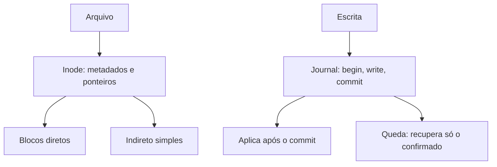

# 46 · Arquivos, inodes e journaling

**Tempo estimado:** 45 minutos · **Pré-requisito:** [[45 - Memória virtual e substituição de páginas]].

**Ao final você vai conseguir:**

1. Dizer o que é um arquivo do ponto de vista do disco, e o que o inode guarda.
2. Calcular quantos blocos um arquivo ocupa, e onde fica cada bloco pelos ponteiros do inode clássico.
3. Ler os bits de permissão do modo do arquivo.
4. Explicar como um journal recupera o sistema de arquivos depois de uma queda, aplicando só transações confirmadas.

**Antes de começar:** no módulo 45 a memória virtual mapeava páginas para quadros. Aqui o disco é dividido em blocos, e o inode faz esse mapeamento para cada arquivo.

---

## Para começar

Você salva um documento e, no meio da gravação, a energia cai. Ao ligar o computador, o sistema de arquivos precisa ser consistente: nenhum bloco pode estar, ao mesmo tempo, livre e em uso por um arquivo. Há duas formas de fazer isso: varrer o disco inteiro para conferir, ou manter um registro das alterações e reaplicar só o que terminou. A segunda é o journal.

---

## Mapa do módulo



*Figura 1: o inode localiza os blocos de um arquivo. O journal registra as escritas antes de aplicá-las, e na recuperação só as confirmadas são reaplicadas.*

**Como ler:** os dois ramos são independentes. O primeiro mostra como achar os dados; o segundo, como garantir que eles não fiquem pela metade.

---

## Mini-aula 1: arquivo e inode

> [!tip] Ideia
> Um arquivo é um conjunto nomeado de bits no disco. O inode é o descritor que guarda os metadados do arquivo e o caminho até os blocos.

> [!info] Definição
> O **inode** (i-node) é o descritor de um arquivo em Unix; seu índice em um vetor fixo é o i-number. A nota de man7 descreve os metadados que o inode traz: número do inode, tipo e modo, contagem de links, dono, tamanho, blocos alocados e tempos de acesso e modificação. Segundo Wisc, no inode clássico há ponteiros diretos e indiretos para os blocos de dados.

Veja a localização de alguns blocos em um inode clássico com dez ponteiros diretos e um indireto simples de quatro entradas. Antes de rodar, diga em que tipo de ponteiro fica o bloco `13`.

```python
DIRETOS = 10
POR_INDIRETO = 4

def localiza(bloco):
    if bloco < DIRETOS:
        return f"ponteiro direto {bloco}"
    resto = bloco - DIRETOS
    if resto < POR_INDIRETO:
        return f"indireto simples, entrada {resto}"
    return "fora deste exemplo (indireto duplo)"

for b in [0, 9, 10, 13, 14]:
    print("bloco", b, "->", localiza(b))
```

Saída real:

```
bloco 0 -> ponteiro direto 0
bloco 9 -> ponteiro direto 9
bloco 10 -> indireto simples, entrada 0
bloco 13 -> indireto simples, entrada 3
bloco 14 -> fora deste exemplo (indireto duplo)
```

**Como ler:** os blocos de `0` a `9` estão nos ponteiros diretos. O bloco `10` é a primeira entrada do bloco indireto, e o `13` é a última. O `14` ficaria fora deste exemplo.

> [!warning] Armadilha comum
> O tamanho do inode e a quantidade de ponteiros são parâmetros do sistema. O exemplo usa valores pequenos para caber na tela. Não os tome como números fixos de um sistema real.

> [!question]- Checkpoint
> 1. Em que ponteiro fica o bloco `9`?
> 2. Por que o bloco `10` é o primeiro do indireto?
>
> > [!success]- Resposta
> > 1. Em um ponteiro direto, porque os diretos são de `0` a `9`.
> > 2. Porque os dez primeiros blocos já cabem nos ponteiros diretos.

---

## Mini-aula 2: modo e permissões

> [!tip] Ideia
> O modo do arquivo é um número em que cada bit representa uma permissão. Em notação octal, os três últimos dígitos agrupam leitura, escrita e execução de dono, grupo e outros.

> [!info] Definição
> O **modo** (mode) é parte dos metadados do inode. Segundo man7, ele guarda o tipo do arquivo e as permissões. O bit de leitura do dono vale `0o400`. A regra de acesso completa, com identidades e capacidades, é tratada no módulo de proteção.

Você vai testar esse bit no exercício A3.

> [!question]- Checkpoint
> 1. Qual é o valor do bit de leitura do dono?
> 2. O modo `0o644` dá leitura ao dono?
>
> > [!success]- Resposta
> > 1. `0o400`.
> > 2. Sim, porque `0o644` tem o bit `0o400` ligado.

---

## Mini-aula 3: journal e recuperação

> [!tip] Ideia
> Antes de gravar as mudanças no lugar certo, o sistema registra no journal o que pretende fazer. Depois de uma queda, a recuperação reaplica só o que tem um registro de commit.

> [!info] Definição
> Um **journal** (log) é uma sequência de registros de transações. Cada transação começa com `begin`, grava blocos com `write` e termina com `commit`. A nota de ext4 diz que uma transação que não termina com commit é descartada na recuperação. A alternativa que Wisc cita é varrer o sistema inteiro com `fsck`.

Veja o log de duas transações: a primeira confirma, a segunda cai antes do commit. Antes de rodar, diga qual valor de `A` aparece no disco depois da recuperação.

```python
log = []
disco = {"A": 0, "B": 0}

log.append(("begin", 1))
log.append(("write", 1, "A", 10))
log.append(("write", 1, "B", 20))
log.append(("commit", 1))
log.append(("begin", 2))
log.append(("write", 2, "A", 99))

print("log:", log)

commitadas = {r[1] for r in log if r[0] == "commit"}
for r in log:
    if r[0] == "write" and r[1] in commitadas:
        disco[r[2]] = r[3]
print("disco após recuperação:", disco)
```

Saída real:

```
log: [('begin', 1), ('write', 1, 'A', 10), ('write', 1, 'B', 20), ('commit', 1), ('begin', 2), ('write', 2, 'A', 99)]
disco após recuperação: {'A': 10, 'B': 20}
```

**Como ler:** a transação 1 tem commit, então `A` vira `10` e `B` vira `20`. A transação 2 gravou `99` em `A`, mas sem commit ela não é aplicada. O disco fica consistente.

> [!warning] Armadilha comum
> O journal não guarda o estado do disco, só as intenções. Por isso a recuperação precisa dos commits: uma escrita sem commit pode ter chegado ao disco pela metade.

> [!question]- Checkpoint
> 1. Qual valor de `A` está no disco depois da recuperação?
> 2. O que aconteceria se a transação 2 tivesse commit?
>
> > [!success]- Resposta
> > 1. `10`, o valor da transação 1.
> > 2. Então `A` valeria `99`, porque a escrita seria aplicada.

---

## Exercícios

Cada exercício tem um bloco com a função a completar e os testes com `assert`. Quando todos passarem, aparece `Passou!`. As funções definidas em exercícios anteriores aparecem no código inicial.

### Aquecimento

**A1. Blocos de um arquivo.** Um arquivo de `tamanho` bytes ocupa blocos de `tam_bloco` bytes. Complete `blocos_necessarios(tamanho, tam_bloco)`, que devolve quantos blocos são necessários. Um arquivo de tamanho zero não ocupa bloco. Um arquivo que sobra alguns bytes em um bloco ocupa um bloco inteiro.

```python
def blocos_necessarios(tamanho, tam_bloco):
    """Número de blocos de tam_bloco bytes para guardar tamanho bytes, arredondando para cima."""
    ...

assert blocos_necessarios(0, 4) == 0, "arquivo vazio"
assert blocos_necessarios(1, 4) == 1, "um byte ocupa um bloco"
assert blocos_necessarios(8, 4) == 2, "exatamente dois blocos"
assert blocos_necessarios(9, 4) == 3, "sobra um byte, ocupa mais um bloco"
print("Passou!")
```

> [!hint]- Dica 1
> Use divisão inteira com arredondamento para cima: `(tamanho + tam_bloco - 1) // tam_bloco`.

> [!hint]- Dica 2
> Para `tamanho = 9` e `tam_bloco = 4`, o resultado é `3`.

> [!example]- Solução
> ```python
> def blocos_necessarios(tamanho, tam_bloco):
>     """Número de blocos de tam_bloco bytes para guardar tamanho bytes, arredondando para cima."""
>     return (tamanho + tam_bloco - 1) // tam_bloco
> ```
>
> **Erro comum:** Usar `tamanho // tam_bloco`. Essa divisão arredonda para baixo e perde o bloco parcial.

**A2. Onde fica o bloco?** Um inode tem alguns ponteiros diretos, que apontam para blocos de dados, e um ponteiro indireto simples, que aponta para um bloco com mais ponteiros. Complete `localiza_bloco(i, diretos, por_indireto)`, que recebe o índice `i` do bloco do arquivo e devolve uma tupla: `("direto", i)` se `i` está nos ponteiros diretos; `("indireto", j)` se cabe no indireto simples, com `j` sendo a entrada dentro dele; `("fora", None)` nos outros casos. A nota descreve o inode clássico com ponteiros diretos e indiretos.

```python
def localiza_bloco(i, diretos, por_indireto):
    """Onde fica o bloco i: ponteiro direto, entrada do indireto simples, ou fora."""
    ...

assert localiza_bloco(0, 10, 4) == ("direto", 0), "primeiro bloco é direto"
assert localiza_bloco(9, 10, 4) == ("direto", 9), "último direto"
assert localiza_bloco(10, 10, 4) == ("indireto", 0), "primeira entrada do indireto"
assert localiza_bloco(13, 10, 4) == ("indireto", 3), "última entrada do indireto"
assert localiza_bloco(14, 10, 4) == ("fora", None), "além do indireto simples"
print("Passou!")
```

> [!hint]- Dica 1
> Se `i < diretos`, o caso é direto.

> [!hint]- Dica 2
> Para o indireto, `j = i - diretos`, e o caso vale se `j < por_indireto`.

> [!example]- Solução
> ```python
> def localiza_bloco(i, diretos, por_indireto):
>     """Onde fica o bloco i: ponteiro direto, entrada do indireto simples, ou fora."""
>     if i < diretos:
>         return ("direto", i)
>     j = i - diretos
>     if j < por_indireto:
>         return ("indireto", j)
>     return ("fora", None)
> ```
>
> **Erro comum:** Contar o indireto a partir de `i`, e não de `i - diretos`. A entrada do indireto começa em zero, logo depois dos diretos.

**A3. Permissão de leitura.** Os bits de modo de um arquivo, em notação octal, guardam as permissões. O bit de leitura do dono vale `0o400`. Complete `dono_le(modo)`, que devolve `True` quando esse bit está ligado. A nota de man7 descreve o modo como parte dos metadados do inode.

```python
def dono_le(modo):
    """True se o bit de leitura do dono (0o400) está ligado no modo do arquivo."""
    ...

assert dono_le(0o644) is True, "dono com leitura"
assert dono_le(0o200) is False, "dono só com escrita"
assert dono_le(0o400) is True, "só leitura do dono"
print("Passou!")
```

> [!hint]- Dica 1
> Use `modo & 0o400`, e converta o resultado para `bool`.

> [!hint]- Dica 2
> `0o644` tem o bit de leitura do dono ligado; `0o200` não tem.

> [!example]- Solução
> ```python
> def dono_le(modo):
>     """True se o bit de leitura do dono (0o400) está ligado no modo do arquivo."""
>     return bool(modo & 0o400)
> ```
>
> **Erro comum:** Testar `modo == 0o400`. Isso só é verdade quando o dono tem só a leitura, e não quando há outras permissões também.

### Praticando

**P1. Recuperação pelo journal.** O journal é uma lista de registros: `("begin", tx)`, `("write", tx, bloco, valor)` e `("commit", tx)`. Após uma queda, só as transações com `commit` devem ser aplicadas, na ordem do log. Complete `aplica_journal(log, disco)`, que devolve uma cópia de `disco` com as escritas das transações confirmadas. A nota de ext4 diz que uma transação que não termina com commit é descartada.

```python
def aplica_journal(log, disco):
    """Cópia do disco com as escritas das transações que têm commit, na ordem do log."""
    ...

log = [("begin", 1), ("write", 1, "A", 10), ("commit", 1), ("begin", 2), ("write", 2, "A", 99)]
assert aplica_journal(log, {"A": 0, "B": 0}) == {"A": 10, "B": 0}, "a transação 2 não tem commit"
assert aplica_journal([], {"A": 5}) == {"A": 5}, "log vazio não muda o disco"
print("Passou!")
```

> [!hint]- Dica 1
> Primeiro, descubra o conjunto de transações com `commit`.

> [!hint]- Dica 2
> Copie o disco com `dict(disco)` e aplique só os `write` dessas transações, na ordem do log.

> [!example]- Solução
> ```python
> def aplica_journal(log, disco):
>     """Cópia do disco com as escritas das transações que têm commit, na ordem do log."""
>     confirmadas = {r[1] for r in log if r[0] == "commit"}
>     novo = dict(disco)
>     for r in log:
>         if r[0] == "write" and r[1] in confirmadas:
>             novo[r[2]] = r[3]
>     return novo
> ```
>
> **Erro comum:** Aplicar todas as escritas. As de transações sem commit deixariam o disco em um estado parcial.

**P2. Transações pendentes.** Complete `nao_commitadas(log)`, que devolve a lista ordenada dos identificadores de transações que têm `begin` mas não têm `commit` no log. Essas são as transações que a recuperação deve descartar.

```python
def nao_commitadas(log):
    """Transações iniciadas que não têm registro de commit, em ordem crescente."""
    ...

assert nao_commitadas([("begin", 1), ("commit", 1), ("begin", 2)]) == [2], "só a 2 ficou pendente"
assert nao_commitadas([("begin", 3), ("begin", 1)]) == [1, 3], "ordem crescente"
assert nao_commitadas([]) == [], "log vazio"
print("Passou!")
```

> [!hint]- Dica 1
> Monte o conjunto dos `begin` e o dos `commit`, e faça a diferença.

> [!hint]- Dica 2
> Use `sorted(...)` para devolver a lista em ordem.

> [!example]- Solução
> ```python
> def nao_commitadas(log):
>     """Transações iniciadas que não têm registro de commit, em ordem crescente."""
>     iniciadas = {r[1] for r in log if r[0] == "begin"}
>     confirmadas = {r[1] for r in log if r[0] == "commit"}
>     return sorted(iniciadas - confirmadas)
> ```
>
> **Erro comum:** Devolver as transações que têm `commit`. A pergunta pede as que não confirmaram.

### Desafio

**D1. Ordem de confirmação.** Complete `ordem_dos_commits(log)`, que devolve a lista de identificadores de transações na ordem em que aparecem seus registros de `commit`. A ordem de confirmação pode diferir da ordem de início, e a recuperação precisa respeitar a ordem do log.

```python
def ordem_dos_commits(log):
    """Identificadores das transações na ordem em que aparecem os commits."""
    ...

assert ordem_dos_commits([("begin", 1), ("begin", 2), ("commit", 2), ("commit", 1)]) == [2, 1], "commit de 2 vem antes"
assert ordem_dos_commits([("begin", 1)]) == [], "sem commit"
print("Passou!")
```

> [!hint]- Dica 1
> Percorra o log e guarde `r[1]` de cada registro cujo tipo é `"commit"`.

> [!hint]- Dica 2
> Para `[("begin", 1), ("begin", 2), ("commit", 2), ("commit", 1)]`, o resultado é `[2, 1]`.

> [!example]- Solução
> ```python
> def ordem_dos_commits(log):
>     """Identificadores das transações na ordem em que aparecem os commits."""
>     return [r[1] for r in log if r[0] == "commit"]
> ```
>
> **Erro comum:** Devolver a ordem dos `begin`. Ela é diferente quando as transações terminam em outra ordem.


---

## Mini-projeto (opcional)

Você vai checar se algum bloco aparece em mais de um inode, como faz uma checagem de consistência. Tente sozinho antes de abrir a solução.

**Mini-projeto: blocos com dono duplo.** Na checagem de consistência (o que o fsck faz, segundo Wisc), um bloco não pode pertencer a dois inodes. Complete `conflitos(alocacao)`, em que `alocacao` é um dicionário que associa cada inode à lista de blocos que ele usa. Devolva a lista ordenada dos blocos usados por mais de um inode.

```python
def conflitos(alocacao):
    """Blocos usados por mais de um inode, em ordem crescente."""
    ...

assert conflitos({1: [1, 2], 2: [3, 4]}) == [], "sem blocos compartilhados"
assert conflitos({1: [1, 2], 2: [2, 3]}) == [2], "o bloco 2 tem dois donos"
assert conflitos({1: [5, 5]}) == [], "repetição dentro do mesmo inode não conta"
print("Passou!")
```

> [!hint]- Dica 1
> Conte, para cada bloco, em quantos inodes ele aparece. Um conjunto por inode ajuda a não contar o mesmo bloco duas vezes no mesmo inode.

> [!hint]- Dica 2
> Use `sorted(...)` para o resultado.

> [!example]- Solução
> ```python
> def conflitos(alocacao):
>     """Blocos usados por mais de um inode, em ordem crescente."""
>     contagem = {}
>     for blocos in alocacao.values():
>         for b in set(blocos):
>             contagem[b] = contagem.get(b, 0) + 1
>     return sorted(b for b, n in contagem.items() if n > 1)
> ```
>
> **Erro comum:** Contar um bloco repetido dentro do mesmo inode como conflito. Um inode que aponta duas vezes para o mesmo bloco ainda não compartilha com outro.


---

## Fechando

**Resumo**

- Um arquivo é um conjunto nomeado de blocos; o inode guarda metadados e ponteiros para eles.
- O inode clássico tem ponteiros diretos e indiretos; a localização depende de quantos blocos já foram passados.
- O modo guarda as permissões em bits; o de leitura do dono vale `0o400`.
- O journal registra `begin`, `write` e `commit`; na recuperação, só transações confirmadas são aplicadas.

**Glossário rápido**

- **Inode**: descritor de arquivo com metadados e ponteiros para os blocos.
- **Ponteiro indireto**: ponteiro para um bloco que contém mais ponteiros.
- **Journal**: registro de transações para recuperar o sistema após uma queda.
- **Commit**: registro que confirma uma transação no journal.
- **fsck**: varredura que confere a consistência do sistema de arquivos.

**Perguntas de revisão**

1. Por que o journal só reaplica transações com commit?
2. Quantos blocos ocupa um arquivo de 17 bytes, com blocos de 4 bytes?
3. O que o `fsck` faz de diferente do journal, segundo a nota de Wisc?

**E agora?** Com este módulo, o bloco 4 (Sistemas operacionais) está completo. O próximo bloco é **Redes de computadores**, que começa pela pilha de camadas e pelo atraso de rede.

---

## Para ir mais fundo

- [[Files and Inodes]]
- [[File System Journaling and Crash Recovery]]
- [[man7 - inode(7)]]
