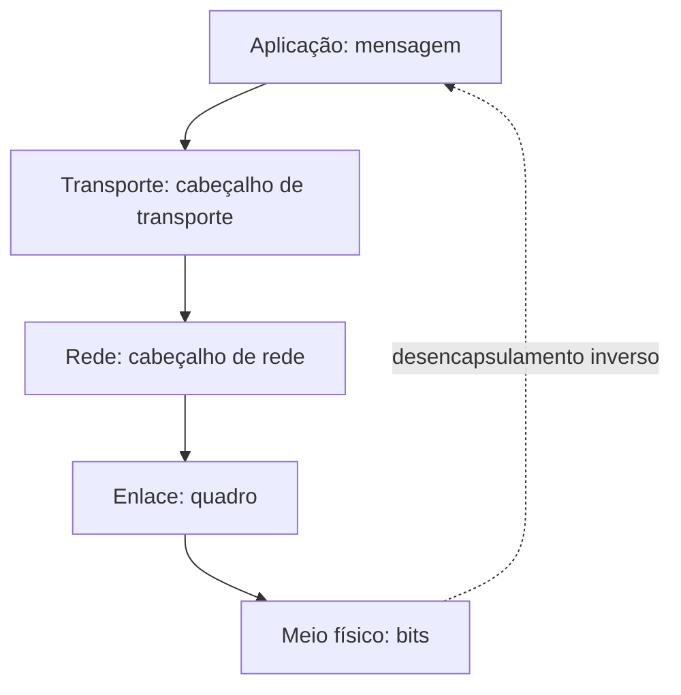

# 47 · Camadas, encapsulamento e atraso

**Tempo estimado:** 45 minutos · **Pré-requisito:** [[44 - Monitores e deadlock]] e [[38 - Exceções e interrupções]] (controle de dispositivos e interrupções).

**Ao final você vai conseguir:**

1. Explicar por que a rede é organizada em camadas, e quantas camadas cada modelo usa.
2. Mostrar, com cabeçalhos, como uma mensagem é encapsulada ao descer as camadas e desencapsulada ao subir.
3. Diferenciar comutação por circuitos de comutação por pacotes.
4. Calcular o produto atraso × banda e somar as três partes da latência.

**Antes de começar:** no módulo 46 o sistema de arquivos tinha camadas de blocos e inodes. Aqui a rede tem camadas em que cada uma usa o serviço da de baixo e esconde seus detalhes.

---

## Para começar

Você escreve uma mensagem no navegador e ela chega a um servidor do outro lado do mundo. Entre os dois, há cabos, roteadores, placas de rede e programas com regras próprias. Ninguém escreve um único programa para tudo isso. O que se faz é dividir o problema em camadas, cada uma com um trabalho e um contrato com a de cima e a de baixo.

---

## Mapa do módulo



*Figura 1: cada camada envolve a mensagem com seu cabeçalho ao descer; no receptor, os cabeçalhos saem na ordem inversa.*

**Como ler:** a seta cheia desce a pilha, e a tracejada volta do meio físico até a aplicação.

---

## Mini-aula 1: camadas e modelos

> [!tip] Ideia
> Cada camada oferece um serviço à de cima e usa o serviço da de baixo, sem precisar conhecer os detalhes dela. Isso deixa cada parte trocável.

> [!info] Definição
> A **camada** (layer) é uma função da comunicação que oferece um serviço à camada superior. Os modelos diferem na contagem: OSI tem 7 camadas; o modelo de ensino de Bonaventure tem 5, separando física e enlace; TCP/IP tem 4, segundo a RFC 1122: aplicação, transporte, internet e enlace. A nota diz que a contagem depende do modelo, e não há uma só resposta.

Veja a contagem de camadas de cada modelo. Antes de começar o exercício D1, diga qual modelo tem menos camadas.

> [!warning] Armadilha comum
> Os nomes das camadas não batem entre os modelos. A camada de internet de TCP/IP corresponde à de rede de Bonaventure. Compare sempre pelo papel, não pelo nome.

> [!question]- Checkpoint
> 1. Quantas camadas tem o modelo TCP/IP segundo a RFC 1122?
> 2. Qual camada do TCP/IP corresponde à de rede de Bonaventure?
>
> > [!success]- Resposta
> > 1. Quatro: aplicação, transporte, internet e enlace.
> > 2. A camada de internet.

---

## Mini-aula 2: encapsulamento

> [!tip] Ideia
> Ao descer a pilha, cada camada põe um cabeçalho por fora da mensagem. Ao subir, o receptor tira os cabeçalhos na ordem inversa, o mais externo primeiro.

> [!info] Definição
> O **encapsulamento** (encapsulation) é envolver os dados de uma camada, com seu cabeçalho, na mensagem da camada de baixo. A nota de Peterson e Davie descreve o processo em que a mensagem original vira carga útil (payload) do protocolo de baixo.

Veja uma mensagem descendo três camadas, com o cabeçalho de cada uma. Antes de rodar, diga qual cabeçalho fica mais externo ao final.

```python
mensagem = "GET /index.html"
pacote = mensagem
for cab in ["TCP", "IP", "Ethernet"]:
    pacote = f"[{cab}]" + pacote
    print("após", cab, "->", pacote)
print("no receptor, o cabeçalho mais externo é o de", pacote[1:pacote.index("]")])
```

Saída real:

```
após TCP -> [TCP]GET /index.html
após IP -> [IP][TCP]GET /index.html
após Ethernet -> [Ethernet][IP][TCP]GET /index.html
no receptor, o cabeçalho mais externo é o de Ethernet
```

**Como ler:** a cada passo um cabeçalho novo envolve o pacote. Ethernet é o mais externo, porque foi o último a ser posto. O receptor começaria por ele.

> [!warning] Armadilha comum
> O cabeçalho mais recente não fica no fim da mensagem. Ele envolve tudo o que já existia, e por isso fica do lado de fora.

> [!question]- Checkpoint
> 1. Qual cabeçalho o receptor remove primeiro?
> 2. Onde o cabeçalho de TCP fica em relação à mensagem?
>
> > [!success]- Resposta
> > 1. O mais externo, Ethernet.
> > 2. Logo antes da mensagem, dentro do cabeçalho de IP e de Ethernet.

---

## Mini-aula 3: comutação por circuitos e por pacotes

> [!tip] Ideia
> Na comutação por circuitos, o caminho é reservado antes de os dados fluírem. Na comutação por pacotes, os dados são divididos em pacotes que dividem os enlaces sob demanda.

> [!info] Definição
> A **comutação por circuitos** reserva um caminho dedicado antes de enviar. A **comutação por pacotes** divide os dados em pacotes roteados separadamente, com enlaces compartilhados; é a multiplexação estatística. A nota de Peterson e Davie usa a rede telefônica como exemplo de circuito.

No exercício P1, cada chamada reserva uma fatia fixa, e a conta mostra quantas cabem. Antes de começar, pense: na comutação por pacotes, quantas chamadas caberiam numa capacidade de 10 com reserva de 4?

> [!warning] Armadilha comum
> A multiplexação estatística não garante a banda de cada fluxo. Ela funciona bem quando nem todos transmitem ao mesmo tempo; se todos transmitem, os fluxos disputam o enlace.

> [!question]- Checkpoint
> 1. O que a comutação por circuitos reserva antes de enviar?
> 2. Por que a comutação por pacotes compartilha os enlaces?
>
> > [!success]- Resposta
> > 1. Um caminho dedicado.
> > 2. Porque os pacotes são enviados sob demanda, e um enlace livre pode ser usado por outro fluxo.

---

## Mini-aula 4: atraso e produto atraso × banda

> [!tip] Ideia
> A latência é a soma de três partes: o tempo de propagação no meio, o tempo de transmissão para pôr o pacote no enlace, e o tempo de espera nas filas dos roteadores.

> [!info] Definição
> O **produto atraso × banda** é o número máximo de bits em trânsito no caminho ao mesmo tempo. O exemplo de Peterson e Davie é 50 ms de atraso em um enlace de 45 Mbps, que dá 2,25 milhões de bits. O **RTT** (round-trip time) é o tempo de ida e volta de uma mensagem, e aparece como medida básica de atraso. A nota de Newman-Wolfe diz que as três partes da latência são propagação, transmissão e fila.

Veja o produto para o exemplo do livro. Antes de rodar, diga se a banda ou o atraso pesa mais no resultado.

```python
atraso = 0.05
banda = 45e6
print("bits em trânsito no caminho:", round(atraso * banda))
print("bits em trânsito, em bits:", atraso * banda)
```

Saída real:

```
bits em trânsito no caminho: 2250000
bits em trânsito, em bits: 2250000.0
```

**Como ler:** o produto multiplica o atraso em segundos pela banda em bits por segundo. O resultado é o máximo de bits que podem estar no caminho ao mesmo tempo.

> [!warning] Armadilha comum
> Latência e banda são grandezas diferentes. Um enlace pode ter muita banda e alta latência, e o produto mostra a combinação dos dois.

> [!question]- Checkpoint
> 1. Quantos bits cabem em um caminho de 1 segundo a 10 bits por segundo?
> 2. Quais são as três partes da latência?
>
> > [!success]- Resposta
> > 1. Dez bits.
> > 2. Propagação, transmissão e fila.

---

## Exercícios

Cada exercício tem um bloco com a função a completar e os testes com `assert`. Quando todos passarem, aparece `Passou!`. As funções definidas em exercícios anteriores aparecem no código inicial.

### Aquecimento

**A1. Encapsulamento.** Complete `empilha(mensagem, cabecalhos)`, que aplica o encapsulamento. A lista `cabecalhos` vai da camada mais baixa para a mais alta, na ordem em que cada uma envolve a anterior. Cada cabeçalho é posto por fora: o primeiro da lista fica mais perto da mensagem, e o último fica por fora de todos. Devolva o pacote resultante, com cada cabeçalho entre colchetes.

```python
def empilha(mensagem, cabecalhos):
    """Envolve a mensagem com cada cabeçalho, na ordem da lista; o último fica por fora."""
    ...

assert empilha("oi", ["TCP", "IP"]) == "[IP][TCP]oi", "TCP primeiro, IP por fora"
assert empilha("dados", []) == "dados", "sem cabeçalhos, nada muda"
assert empilha("x", ["Ethernet"]) == "[Ethernet]x", "um cabeçalho"
print("Passou!")
```

> [!hint]- Dica 1
> Comece com `pacote = mensagem` e, para cada cabeçalho da lista, faça `pacote = f"[{cab}]" + pacote`.

> [!hint]- Dica 2
> Para `"oi"` e `["TCP", "IP"]`, o resultado é `"[IP][TCP]oi"`.

> [!example]- Solução
> ```python
> def empilha(mensagem, cabecalhos):
>     """Envolve a mensagem com cada cabeçalho, na ordem da lista; o último fica por fora."""
>     pacote = mensagem
>     for cab in cabecalhos:
>         pacote = f"[{cab}]" + pacote
>     return pacote
> ```
>
> **Erro comum:** Pôr o cabeçalho por dentro, somando no fim da mensagem. Encapsulamento envolve a mensagem; o cabeçalho vai antes dela.

**A2. Cabeçalho mais externo.** Um pacote encapsulado começa pelo cabeçalho mais externo, entre colchetes. Complete `camada_externa(pacote)`, que devolve o nome desse cabeçalho. Se o pacote não começa com `[`, devolva `None`.

```python
def camada_externa(pacote):
    """Nome do cabeçalho mais externo do pacote, ou None se não começa com um cabeçalho."""
    ...

assert camada_externa("[IP][TCP]oi") == "IP", "o externo é IP"
assert camada_externa("[TCP]oi") == "TCP", "um cabeçalho só"
assert camada_externa("oi") is None, "sem cabeçalho"
print("Passou!")
```

> [!hint]- Dica 1
> Use `pacote.index("]")` para achar o fim do primeiro cabeçalho.

> [!hint]- Dica 2
> O nome é o trecho entre o primeiro `[` (posição 0) e o primeiro `]`.

> [!example]- Solução
> ```python
> def camada_externa(pacote):
>     """Nome do cabeçalho mais externo do pacote, ou None se não começa com um cabeçalho."""
>     if not pacote.startswith("["):
>         return None
>     return pacote[1:pacote.index("]")]
> ```
>
> **Erro comum:** Devolver o último cabeçalho em vez do primeiro. O mais externo é o que aparece primeiro no texto.

**A3. Bits em trânsito.** A nota de Peterson e Davie chama de produto atraso × banda o número máximo de bits que podem estar no caminho ao mesmo tempo. Complete `produto_atraso_banda(atraso_s, banda_bps)`, que devolve esse produto, com o atraso em segundos e a banda em bits por segundo.

```python
def produto_atraso_banda(atraso_s, banda_bps):
    """Bits em trânsito no caminho: atraso em segundos vezes banda em bits por segundo."""
    ...

assert produto_atraso_banda(0.05, 45e6) is not None, "a função devolve um número"
assert round(produto_atraso_banda(0.05, 45e6)) == 2250000, "o exemplo do livro"
assert produto_atraso_banda(1, 10) == 10, "um segundo a dez bits por segundo"
assert produto_atraso_banda(0, 100) == 0, "atraso zero: nenhum bit em trânsito"
print("Passou!")
```

> [!hint]- Dica 1
> Multiplique os dois argumentos.

> [!hint]- Dica 2
> Para `0.05` s e `45e6` bps, o resultado é `2250000.0`.

> [!example]- Solução
> ```python
> def produto_atraso_banda(atraso_s, banda_bps):
>     """Bits em trânsito no caminho: atraso em segundos vezes banda em bits por segundo."""
>     return atraso_s * banda_bps
> ```
>
> **Erro comum:** Dividir a banda pelo atraso. Isso dá outra grandeza, e não o número de bits.

### Praticando

**P1. Reserva de circuito.** Na comutação por circuitos, cada chamada reserva uma fatia fixa da capacidade antes de os dados fluírem. Complete `aceitos_circuito(capacidade, reserva, pedidos)`, que devolve quantos pedidos são aceitos, na ordem: cada pedido é aceito enquanto a reserva acumulada não ultrapassa a capacidade. O primeiro pedido que não cabe, e todos os seguintes, são recusados.

```python
def aceitos_circuito(capacidade, reserva, pedidos):
    """Quantos pedidos cabem na capacidade, com reserva fixa por chamada; o primeiro que não cabe encerra."""
    ...

assert aceitos_circuito(10, 4, 5) == 2, "cabem dois de quatro"
assert aceitos_circuito(10, 5, 2) == 2, "exatamente cabem"
assert aceitos_circuito(3, 4, 1) == 0, "nenhum cabe"
print("Passou!")
```

> [!hint]- Dica 1
> Use um contador `aceitos = 0` e um laço que, para cada pedido, testa se `(aceitos + 1) * reserva <= capacidade`.

> [!hint]- Dica 2
> Para `capacidade = 10`, `reserva = 4` e 5 pedidos, o resultado é `2`.

> [!example]- Solução
> ```python
> def aceitos_circuito(capacidade, reserva, pedidos):
>     """Quantos pedidos cabem na capacidade, com reserva fixa por chamada; o primeiro que não cabe encerra."""
>     aceitos = 0
>     for _ in range(pedidos):
>         if (aceitos + 1) * reserva <= capacidade:
>             aceitos += 1
>         else:
>             break
>     return aceitos
> ```
>
> **Erro comum:** Continuar aceitando pedidos depois do primeiro recusado. Como a reserva é fixa e sequencial, depois de um não cabe, o próximo também não caberia.

**P2. Latência.** A nota de Peterson e Davie e a de Newman-Wolfe dizem que a latência tem três partes: atraso de propagação, atraso de transmissão e atraso de fila. Complete `latencia_total(propagacao, transmissao, fila)`, que devolve a soma das três.

```python
def latencia_total(propagacao, transmissao, fila):
    """Latência: soma do atraso de propagação, de transmissão e de fila."""
    ...

assert latencia_total(0.02, 0.001, 0) is not None, "a função devolve um número"
assert round(latencia_total(0.02, 0.001, 0), 3) == 0.021, "sem fila"
assert latencia_total(1, 2, 3) == 6, "soma simples"
assert latencia_total(0, 0, 0) == 0, "tudo zero"
print("Passou!")
```

> [!hint]- Dica 1
> Some os três argumentos.

> [!hint]- Dica 2
> Com `0.02`, `0.001` e `0`, o resultado é `0.021`.

> [!example]- Solução
> ```python
> def latencia_total(propagacao, transmissao, fila):
>     """Latência: soma do atraso de propagação, de transmissão e de fila."""
>     return propagacao + transmissao + fila
> ```
>
> **Erro comum:** Esquecer uma das três parcelas. Cada uma representa um lugar onde o tempo se perde.

### Desafio

**D1. Modelos de camadas.** A nota de camadas dá a contagem de cada modelo: OSI tem 7, o modelo de ensino de Bonaventure tem 5 e TCP/IP tem 4, segundo a RFC 1122. Complete `numero_de_camadas(modelo)`, que devolve a contagem para `"OSI"`, `"Bonaventure"` ou `"TCP/IP"`. Para outro nome, levante `ValueError`.

```python
def numero_de_camadas(modelo):
    """Número de camadas do modelo: OSI, Bonaventure ou TCP/IP."""
    ...

assert numero_de_camadas("OSI") == 7, "OSI"
assert numero_de_camadas("TCP/IP") == 4, "TCP/IP"
try:
    numero_de_camadas("X")
    assert False, "deveria levantar ValueError"
except ValueError:
    pass
print("Passou!")
```

> [!hint]- Dica 1
> Use um dicionário com as três contagens.

> [!hint]- Dica 2
> Para um nome que não está no dicionário, `raise ValueError("modelo desconhecido")`.

> [!example]- Solução
> ```python
> def numero_de_camadas(modelo):
>     """Número de camadas do modelo: OSI, Bonaventure ou TCP/IP."""
>     contagem = {"OSI": 7, "Bonaventure": 5, "TCP/IP": 4}
>     if modelo not in contagem:
>         raise ValueError("modelo desconhecido")
>     return contagem[modelo]
> ```
>
> **Erro comum:** Devolver `None` para nome desconhecido. A função precisa avisar o erro, e não esconder com `None`.


---

## Mini-projeto (opcional)

Você vai fazer um pacote descer as camadas e subir de volta pelo receptor, conferindo que a mensagem chega intacta. Tente sozinho antes de abrir a solução.

**Mini-projeto: ida e volta.** Complete `ida_e_volta(mensagem, cabecalhos)`. O emissor encapsula a mensagem com `empilha`, como em A1, e o receptor remove os cabeçalhos na ordem inversa, cada um tirando o cabeçalho mais externo. Devolva a tupla `(pacote, recuperada)`, em que `pacote` é o resultado do encapsulamento e `recuperada` é a mensagem que chegou ao receptor. Use `empilha` e `desempilha`, que está no começo do arquivo.

```python
def empilha(mensagem, cabecalhos):
    pacote = mensagem
    for cab in cabecalhos:
        pacote = f"[{cab}]" + pacote
    return pacote

def desempilha(pacote, cab):
    prefixo = f"[{cab}]"
    assert pacote.startswith(prefixo), "cabeçalho esperado não está no pacote"
    return pacote[len(prefixo):]

def ida_e_volta(mensagem, cabecalhos):
    """Encapsula, depois desencapsula na ordem inversa; devolve (pacote, mensagem recuperada)."""
    ...

assert ida_e_volta("oi", ["TCP", "IP"]) == ("[IP][TCP]oi", "oi"), "a mensagem volta intacta"
assert ida_e_volta("dados", []) == ("dados", "dados"), "sem cabeçalhos"
print("Passou!")
```

> [!hint]- Dica 1
> O receptor percorre `reversed(cabecalhos)`, e para cada um chama `desempilha(pacote, cab)`.

> [!hint]- Dica 2
> `desempilha` tira o prefixo `[cab]` do pacote e devolve o restante.

> [!example]- Solução
> ```python
> def ida_e_volta(mensagem, cabecalhos):
>     """Encapsula, depois desencapsula na ordem inversa; devolve (pacote, mensagem recuperada)."""
>     pacote = empilha(mensagem, cabecalhos)
>     recuperada = pacote
>     for cab in reversed(cabecalhos):
>         recuperada = desempilha(recuperada, cab)
>     return (pacote, recuperada)
> ```
>
> **Erro comum:** Remover os cabeçalhos na mesma ordem em que foram postos. O cabeçalho externo é o último posto, então ele sai primeiro.


---

## Fechando

**Resumo**

- Camadas dividem a rede em serviços; a contagem depende do modelo: 7 (OSI), 5 (Bonaventure), 4 (TCP/IP).
- O encapsulamento põe cabeçalhos por fora da mensagem; o receptor os tira na ordem inversa.
- A comutação por circuitos reserva caminho; a por pacotes compartilha enlaces sob demanda.
- O produto atraso × banda mede os bits em trânsito; a latência soma propagação, transmissão e fila.

**Glossário rápido**

- **Camada** (layer): função da comunicação que oferece um serviço à camada de cima.
- **Encapsulamento** (encapsulation): envolver os dados de uma camada com seu cabeçalho.
- **Comutação por circuitos** (circuit switching): reserva um caminho dedicado.
- **Comutação por pacotes** (packet switching): dados divididos em pacotes que compartilham enlaces.
- **RTT** (round-trip time): tempo de ida e volta.

**Perguntas de revisão**

1. Por que o receptor tira os cabeçalhos na ordem inversa da que foram postos?
2. Numa rede por circuitos, o que acontece com uma chamada que não cabe na reserva?
3. Por que dois enlaces de mesma banda podem ter produtos atraso × banda diferentes?

**E agora?** O próximo módulo é **Enquadramento, detecção de erro e Ethernet**. Ele mostra como a camada de enlace separa quadros no fio e detecta erros com CRC.

---

## Para ir mais fundo

- [[Network Layering - OSI and TCP-IP]]
- [[Circuit vs Packet Switching and Network Delay]]
- [[Peterson and Davie - Computer Networks A Systems Approach]]
