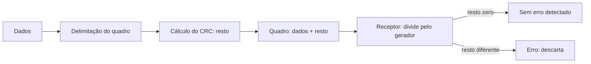

# 48 · Enquadramento, detecção de erro e Ethernet

**Tempo estimado:** 50 minutos · **Pré-requisito:** [[47 - Camadas, encapsulamento e atraso]] e o módulo 33 (operações bit a bit e ou exclusivo).

**Ao final você vai conseguir:**

1. Explicar por que um quadro precisa de delimitação, e o que é o preenchimento de bits (bit stuffing).
2. Calcular o resto de um CRC por divisão em módulo 2.
3. Conferir um quadro no receptor e reconhecer um erro de um bit.
4. Dizer os limites de payload de um quadro Ethernet e o que é o preenchimento.

**Antes de começar:** no módulo 33 você viu o ou exclusivo como operação. Na divisão em módulo 2 do CRC, a subtração é exatamente o ou exclusivo bit a bit.

---

## Para começar

Um fio transmite uma sequência contínua de bits. Como o receptor sabe onde começa e termina cada quadro? E como sabe se algum bit chegou trocado? A camada de enlace resolve as duas perguntas: marca os limites de cada quadro e acrescenta uma verificação que se confere no destino.

---

## Mapa do módulo



*Figura 1: o emissor acrescenta o resto; o receptor divide tudo pelo mesmo gerador. Resto zero indica que não houve erro detectado.*

**Como ler:** o cálculo de resto aparece nos dois lados. O emissor calcula, o receptor confere.

---

## Mini-aula 1: delimitação do quadro

> [!tip] Ideia
> Um flag marca o início e o fim do quadro. Se o dado contém o mesmo padrão do flag, é preciso inserir um bit extra para não confundir.

> [!info] Definição
> O **enquadramento** (framing) delimita o início e o fim de um quadro. O **preenchimento de bits** (bit stuffing), usado no HDLC, insere um bit `0` depois de cinco `1` seguidos, para que o padrão do flag não apareça no dado. A nota cita os três estilos: orientado a bytes (PPP), orientado a bits (HDLC) e baseado em relógio (SONET). Bonaventure cobre flags e preenchimento de bits e de caracteres.

Veja a regra de preenchimento de bits. Antes de começar o exercício P1, pense: por que o receptor remove um bit `0` depois de cinco `1`?

> [!warning] Armadilha comum
> O receptor também precisa remover o bit inserido. Se ele não o fizer, o dado chega com um bit a mais.

> [!question]- Checkpoint
> 1. Em que caso o emissor insere um bit extra?
> 2. Por que o preenchimento é necessário?
>
> > [!success]- Resposta
> > 1. Depois de cinco `1` seguidos no dado.
> > 2. Para que o padrão do flag não apareça dentro dos dados e não seja confundido com o fim do quadro.

---

## Mini-aula 2: CRC

> [!tip] Ideia
> O CRC trata o quadro como um polinômio. O emissor acrescenta zeros, divide pelo gerador e envia o resto. O receptor divide tudo de novo, e um resto diferente de zero mostra erro.

> [!info] Definição
> O **CRC** (cyclic redundancy check) é um código de detecção de erro baseado em divisão de polinômios módulo 2. Segundo a nota de Peterson e Davie, o receptor divide o polinômio recebido pelo gerador e, se o resto é zero, conclui que não houve erro. A nota de Bonaventure diz que um CRC de N bits detecta todos os erros que afetam uma rajada de menos de N bits. O CRC-32 é usado no Ethernet.

Veja o exemplo clássico: dados `101110` e gerador `1001`. Antes de rodar, diga qual é o resto que o emissor calcula.

```python
def divide(bits, gerador):
    r = list(bits)
    n = len(gerador)
    for i in range(len(bits) - n + 1):
        if r[i] == "1":
            for j in range(n):
                r[i + j] = str(int(r[i + j]) ^ int(gerador[j]))
    return "".join(r[-(n - 1):])

dados = "101110"
gerador = "1001"
resto = divide(dados + "0" * (len(gerador) - 1), gerador)
print("resto calculado no emissor:", resto)
enviado = dados + resto
print("quadro enviado:", enviado, "| resto no receptor:", divide(enviado, gerador))
recebido = "101110010"
print("quadro com erro:", recebido, "| resto no receptor:", divide(recebido, gerador))
```

Saída real:

```
resto calculado no emissor: 011
quadro enviado: 101110011 | resto no receptor: 000
quadro com erro: 101110010 | resto no receptor: 001
```

**Como ler:** o emissor calcula `011` e envia `101110011`. O receptor, que recebe a mesma sequência, obtém resto `000`. Quando um bit muda, o resto deixa de ser zero.

> [!warning] Armadilha comum
> O CRC detecta erro, mas não corrige. E há erros que passam: se o erro for um múltiplo do gerador, o resto continua zero.

> [!question]- Checkpoint
> 1. Quantos zeros o emissor acrescenta aos dados `101110` com gerador `1001`?
> 2. O que o receptor faz se o resto não é zero?
>
> > [!success]- Resposta
> > 1. Três, porque o gerador tem 4 bits e são `n - 1` zeros.
> > 2. Detecta erro; a nota não descreve a correção.

---

## Mini-aula 3: Ethernet e limites de quadro

> [!tip] Ideia
> O quadro Ethernet tem um payload entre 46 e 1500 bytes. Dados menores são completados até 46, e dados maiores que 1500 não cabem em um quadro.

> [!info] Definição
> Segundo Peterson e Davie, o quadro Ethernet tem um preâmbulo de 64 bits, endereços de 48 bits, payload de 46 a 1500 bytes e CRC-32. Bonaventure dá os mesmos limites de payload. Os endereços MAC têm 48 bits. A nota diz que o Ethernet usa CSMA/CD, e o 802.11 usa CSMA/CA, com disputa pelo meio.

Veja o preenchimento de payloads pequenos. Antes de rodar, diga quantos bytes de preenchimento o payload de 10 bytes recebe.

```python
MINIMO = 46

def preenchimento(tamanho):
    return max(0, MINIMO - tamanho)

for t in (10, 46, 60):
    print("payload de", t, "bytes precisa de", preenchimento(t), "byte(s) de preenchimento")
```

Saída real:

```
payload de 10 bytes precisa de 36 byte(s) de preenchimento
payload de 46 bytes precisa de 0 byte(s) de preenchimento
payload de 60 bytes precisa de 0 byte(s) de preenchimento
```

**Como ler:** payloads menores que 46 recebem o preenchimento até chegar a 46; a partir daí não há preenchimento.

> [!warning] Armadilha comum
> O preenchimento é do payload, e não do endereço nem do CRC. Os 46 bytes são o mínimo do campo de dados.

> [!question]- Checkpoint
> 1. Quantos bytes de preenchimento um payload de 60 bytes recebe?
> 2. Qual é o máximo de payload de um quadro Ethernet?
>
> > [!success]- Resposta
> > 1. Nenhum, porque 60 já passa de 46.
> > 2. 1500 bytes.

---

## Exercícios

Cada exercício tem um bloco com a função a completar e os testes com `assert`. Quando todos passarem, aparece `Passou!`. As funções definidas em exercícios anteriores aparecem no código inicial.

### Aquecimento

**A1. Tamanho do payload.** A nota de Peterson e Davie e a de Bonaventure dão os limites do payload de um quadro Ethernet: entre 46 e 1500 bytes. Quando o dado é menor que 46, o quadro é completado com preenchimento. Complete `payload_ethernet(tamanho)`, que devolve o tamanho final do payload: `46` se o dado tem menos que isso, o próprio tamanho se está entre os limites, e levanta `ValueError` se passa de 1500.

```python
def payload_ethernet(tamanho):
    """Tamanho final do payload: completa até 46 bytes e recusa mais de 1500."""
    ...

assert payload_ethernet(10) == 46, "completado até 46"
assert payload_ethernet(46) == 46, "no limite inferior"
assert payload_ethernet(1500) == 1500, "no limite superior"
try:
    payload_ethernet(1501)
    assert False, "deveria levantar ValueError"
except ValueError:
    pass
print("Passou!")
```

> [!hint]- Dica 1
> Use `max(46, tamanho)` depois de testar o limite superior.

> [!hint]- Dica 2
> Para 1501, a função levanta o erro; para 10, devolve 46.

> [!example]- Solução
> ```python
> def payload_ethernet(tamanho):
>     """Tamanho final do payload: completa até 46 bytes e recusa mais de 1500."""
>     if tamanho > 1500:
>         raise ValueError("payload acima de 1500 bytes")
>     return max(46, tamanho)
> ```
>
> **Erro comum:** Esquecer o limite superior. Um payload de 1501 bytes não cabe no quadro, e a função precisa avisar.

**A2. Resto com erro.** No receptor, um resto de divisão diferente de zero indica que o quadro chegou com erro. Complete `tem_erro(resto)`, que recebe o resto como string de bits e devolve `True` se há algum `"1"`, e `False` se todos são zero.

```python
def tem_erro(resto):
    """True se o resto da divisão tem algum bit 1: o quadro chegou com erro."""
    ...

assert tem_erro("000") is False, "resto zero, sem erro"
assert tem_erro("011") is True, "resto diferente de zero"
assert tem_erro("1") is True, "um único bit"
print("Passou!")
```

> [!hint]- Dica 1
> Use `"1" in resto`.

> [!hint]- Dica 2
> `"000"` dá `False`; `"011"` dá `True`.

> [!example]- Solução
> ```python
> def tem_erro(resto):
>     """True se o resto da divisão tem algum bit 1: o quadro chegou com erro."""
>     return "1" in resto
> ```
>
> **Erro comum:** Comparar `resto == "1"`. O resto tem mais de um bit, e o teste precisa olhar todos.

**A3. Soma sem vai-um.** A divisão do CRC usa soma módulo 2, que é o ou exclusivo bit a bit. Complete `soma_mod2(a, b)`, que recebe duas strings de bits do mesmo tamanho e devolve a string com o ou exclusivo de cada posição.

```python
def soma_mod2(a, b):
    """Ou exclusivo bit a bit de duas strings de mesmo tamanho: soma módulo 2."""
    ...

assert soma_mod2("1010", "0110") == "1100", "o exemplo"
assert soma_mod2("11", "11") == "00", "1 + 1 dá zero, sem vai-um"
assert soma_mod2("", "") == "", "vazio"
print("Passou!")
```

> [!hint]- Dica 1
> Para cada posição `i`, o bit resultante é `"1"` se `a[i] != b[i]`, e `"0"` se são iguais.

> [!hint]- Dica 2
> Para `"1010"` e `"0110"`, o resultado é `"1100"`.

> [!example]- Solução
> ```python
> def soma_mod2(a, b):
>     """Ou exclusivo bit a bit de duas strings de mesmo tamanho: soma módulo 2."""
>     return "".join("1" if x != y else "0" for x, y in zip(a, b))
> ```
>
> **Erro comum:** Somar os bits como inteiros e manter o vai-um. A soma módulo 2 não tem vai-um: 1 + 1 dá 0.

### Praticando

**P1. Resto da divisão.** A nota de Peterson e Davie diz que o receptor divide o polinômio recebido pelo gerador e, se o resto é zero, conclui que não houve erro. Complete `divide_resto(bits, gerador)`, que faz essa divisão em módulo 2 sobre a string de bits, sem acrescentar zeros, e devolve o resto com `len(gerador) - 1` bits. Use `soma_mod2`, já definida acima, para subtrair o gerador deslocado.

```python
def soma_mod2(a, b):
    return "".join("1" if x != y else "0" for x, y in zip(a, b))

def divide_resto(bits, gerador):
    """Resto da divisão em módulo 2 de bits pelo gerador, com len(gerador) - 1 bits."""
    ...

assert divide_resto("101110011", "1001") == "000", "quadro sem erro"
assert divide_resto("101110010", "1001") == "001", "quadro com erro"
assert divide_resto("1001", "1001") == "000", "o próprio gerador divide"
print("Passou!")
```

> [!hint]- Dica 1
> Percorra as posições `i` de `0` até `len(bits) - len(gerador)`. Quando o bit `i` é `"1"`, troque os próximos `len(gerador)` bits pela soma com o gerador.

> [!hint]- Dica 2
> O resto são os últimos `len(gerador) - 1` bits do resultado.

> [!example]- Solução
> ```python
> def divide_resto(bits, gerador):
>     """Resto da divisão em módulo 2 de bits pelo gerador, com len(gerador) - 1 bits."""
>     r = list(bits)
>     n = len(gerador)
>     for i in range(len(bits) - n + 1):
>         if r[i] == "1":
>             trecho = soma_mod2("".join(r[i:i + n]), gerador)
>             r[i:i + n] = list(trecho)
>     return "".join(r[-(n - 1):])
> ```
>
> **Erro comum:** Devolver o quociente, e não o resto. O exercício pede só o resto, que é o que o receptor confere.

**P2. CRC do emissor.** O emissor acrescenta `len(gerador) - 1` zeros aos dados e calcula o resto da divisão. Complete `crc_resto(dados, gerador)`, que devolve esse resto. Use `divide_resto`, já definida acima.

```python
def soma_mod2(a, b):
    return "".join("1" if x != y else "0" for x, y in zip(a, b))

def divide_resto(bits, gerador):
    r = list(bits)
    n = len(gerador)
    for i in range(len(bits) - n + 1):
        if r[i] == "1":
            trecho = soma_mod2("".join(r[i:i + n]), gerador)
            r[i:i + n] = list(trecho)
    return "".join(r[-(n - 1):])

def crc_resto(dados, gerador):
    """Resto do CRC: divide os dados com zeros acrescentados pelo gerador."""
    ...

assert crc_resto("101110", "1001") == "011", "exemplo clássico"
assert crc_resto("0", "1001") == "000", "dados zero dão resto zero"
assert len(crc_resto("1111", "1001")) == 3, "o resto tem len(gerador) - 1 bits"
print("Passou!")
```

> [!hint]- Dica 1
> Monte `dados + "0" * (len(gerador) - 1)` e passe o resultado para `divide_resto`.

> [!hint]- Dica 2
> Para `dados = "101110"` e `gerador = "1001"`, o resto é `"011"`.

> [!example]- Solução
> ```python
> def crc_resto(dados, gerador):
>     """Resto do CRC: divide os dados com zeros acrescentados pelo gerador."""
>     return divide_resto(dados + "0" * (len(gerador) - 1), gerador)
> ```
>
> **Erro comum:** Dividir os dados sem os zeros acrescentados. Assim o resto sai errado e o receptor rejeita quadros corretos.

**P3. Quadro transmitido.** O emissor envia os dados seguidos do resto. Complete `bits_com_crc(dados, gerador)`, que devolve a string `dados + resto`, com o resto calculado por `crc_resto`.

```python
def soma_mod2(a, b):
    return "".join("1" if x != y else "0" for x, y in zip(a, b))

def divide_resto(bits, gerador):
    r = list(bits)
    n = len(gerador)
    for i in range(len(bits) - n + 1):
        if r[i] == "1":
            trecho = soma_mod2("".join(r[i:i + n]), gerador)
            r[i:i + n] = list(trecho)
    return "".join(r[-(n - 1):])

def crc_resto(dados, gerador):
    return divide_resto(dados + "0" * (len(gerador) - 1), gerador)

def bits_com_crc(dados, gerador):
    """Quadro a transmitir: os dados seguidos do resto do CRC."""
    ...

assert bits_com_crc("101110", "1001") == "101110011", "o exemplo clássico"
assert bits_com_crc("0", "1001") == "0000", "dados zero"
print("Passou!")
```

> [!hint]- Dica 1
> Some `dados` com `crc_resto(dados, gerador)`.

> [!hint]- Dica 2
> Para `"101110"` e `"1001"`, o resultado é `"101110011"`.

> [!example]- Solução
> ```python
> def bits_com_crc(dados, gerador):
>     """Quadro a transmitir: os dados seguidos do resto do CRC."""
>     return dados + crc_resto(dados, gerador)
> ```
>
> **Erro comum:** Enviar só o resto, sem os dados. O receptor precisa dos dados para conferir o quadro.

### Desafio

**D1. Conferência no receptor.** O receptor divide o quadro recebido pelo gerador; se o resto é zero, não há erro detectado. Complete `recebido_ok(bits, gerador)`, que devolve `True` quando o resto de `bits` é zero, e `False` caso contrário. Use `divide_resto`, já definida acima.

```python
def soma_mod2(a, b):
    return "".join("1" if x != y else "0" for x, y in zip(a, b))

def divide_resto(bits, gerador):
    r = list(bits)
    n = len(gerador)
    for i in range(len(bits) - n + 1):
        if r[i] == "1":
            trecho = soma_mod2("".join(r[i:i + n]), gerador)
            r[i:i + n] = list(trecho)
    return "".join(r[-(n - 1):])

def recebido_ok(bits, gerador):
    """True se o resto da divisão é zero: nenhum erro detectado."""
    ...

assert recebido_ok("101110011", "1001") is True, "quadro íntegro"
assert recebido_ok("101110010", "1001") is False, "quadro com erro"
assert recebido_ok("1001", "1001") is True, "múltiplo do gerador"
print("Passou!")
```

> [!hint]- Dica 1
> Compare `divide_resto(bits, gerador)` com `"0" * (len(gerador) - 1)`.

> [!hint]- Dica 2
> Para `"101110011"`, a resposta é `True`; para `"101110010"`, é `False`.

> [!example]- Solução
> ```python
> def recebido_ok(bits, gerador):
>     """True se o resto da divisão é zero: nenhum erro detectado."""
>     return divide_resto(bits, gerador) == "0" * (len(gerador) - 1)
> ```
>
> **Erro comum:** Comparar só o primeiro bit do resto com zero. Um erro pode aparecer em qualquer posição do resto.


---

## Mini-projeto (opcional)

Você vai transmitir um quadro com CRC, inverter um bit e ver se o receptor percebe. Tente sozinho antes de abrir a solução.

**Mini-projeto: envio com erro.** Complete `verifica(dados, gerador, posicao)`. Monte o quadro com `bits_com_crc`, depois inverta o bit na posição `posicao` (contando do zero, da esquerda) para simular um erro no meio do caminho. Devolva a tupla `(ok_sem_erro, ok_com_erro)`: o primeiro é `recebido_ok` do quadro íntegro, e o segundo é `recebido_ok` do quadro com o bit invertido.

```python
def soma_mod2(a, b):
    return "".join("1" if x != y else "0" for x, y in zip(a, b))

def divide_resto(bits, gerador):
    r = list(bits)
    n = len(gerador)
    for i in range(len(bits) - n + 1):
        if r[i] == "1":
            trecho = soma_mod2("".join(r[i:i + n]), gerador)
            r[i:i + n] = list(trecho)
    return "".join(r[-(n - 1):])

def crc_resto(dados, gerador):
    return divide_resto(dados + "0" * (len(gerador) - 1), gerador)

def bits_com_crc(dados, gerador):
    return dados + crc_resto(dados, gerador)

def recebido_ok(bits, gerador):
    return divide_resto(bits, gerador) == "0" * (len(gerador) - 1)

def verifica(dados, gerador, posicao):
    """Confere o quadro íntegro e o quadro com o bit na posição invertido."""
    ...

assert verifica("101110", "1001", 2) == (True, False), "um bit invertido é detectado"
assert verifica("1", "1001", 0) == (True, False), "também em quadro pequeno"
print("Passou!")
```

> [!hint]- Dica 1
> Para inverter, troque `"0"` por `"1"` e vice-versa na posição, com uma lista de caracteres.

> [!hint]- Dica 2
> Para `"101110"`, `"1001"` e posição `2`, o resultado é `(True, False)`.

> [!example]- Solução
> ```python
> def verifica(dados, gerador, posicao):
>     """Confere o quadro íntegro e o quadro com o bit na posição invertido."""
>     quadro = bits_com_crc(dados, gerador)
>     lista = list(quadro)
>     lista[posicao] = "0" if lista[posicao] == "1" else "1"
>     return (recebido_ok(quadro, gerador), recebido_ok("".join(lista), gerador))
> ```
>
> **Erro comum:** Inverter o bit antes de calcular o quadro. O erro precisa acontecer depois do envio, no quadro já pronto.


---

## Fechando

**Resumo**

- O enquadramento delimita quadros; o preenchimento de bits (HDLC) evita que o flag apareça nos dados.
- O CRC é o resto da divisão em módulo 2 pelo gerador; resto zero no receptor indica ausência de erro detectado.
- Um CRC de N bits detecta rajadas menores que N bits, segundo Bonaventure.
- O payload Ethernet fica entre 46 e 1500 bytes, e o endereço MAC tem 48 bits.

**Glossário rápido**

- **Enquadramento** (framing): delimitação de quadros.
- **Preenchimento de bits** (bit stuffing): inserção de bits para não confundir o flag.
- **CRC** (cyclic redundancy check): código de detecção de erro por divisão de polinômios.
- **Gerador** (generator): polinômio usado na divisão do CRC.
- **CSMA/CD**: acesso ao meio do Ethernet com detecção de colisão.

**Perguntas de revisão**

1. Por que o CRC acrescenta zeros antes de dividir?
2. Um erro que é múltiplo do gerador é detectado? Justifique com a regra de resto.
3. Qual é a diferença entre o enquadramento, que marca o quadro, e o CRC, que confere seu conteúdo?

**E agora?** O próximo módulo é **Endereçamento IP, sub-redes e roteamento**. Ele mostra como o endereço IP é dividido em rede e host, e como o roteador escolhe o próximo salto.

---

## Para ir mais fundo

- [[Framing and Error Detection]]
- [[Ethernet, MAC Addresses and Medium Access]]
- [[Bonaventure - Computer Networking Principles Protocols and Practice]]
- [[Peterson and Davie - Computer Networks A Systems Approach]]
