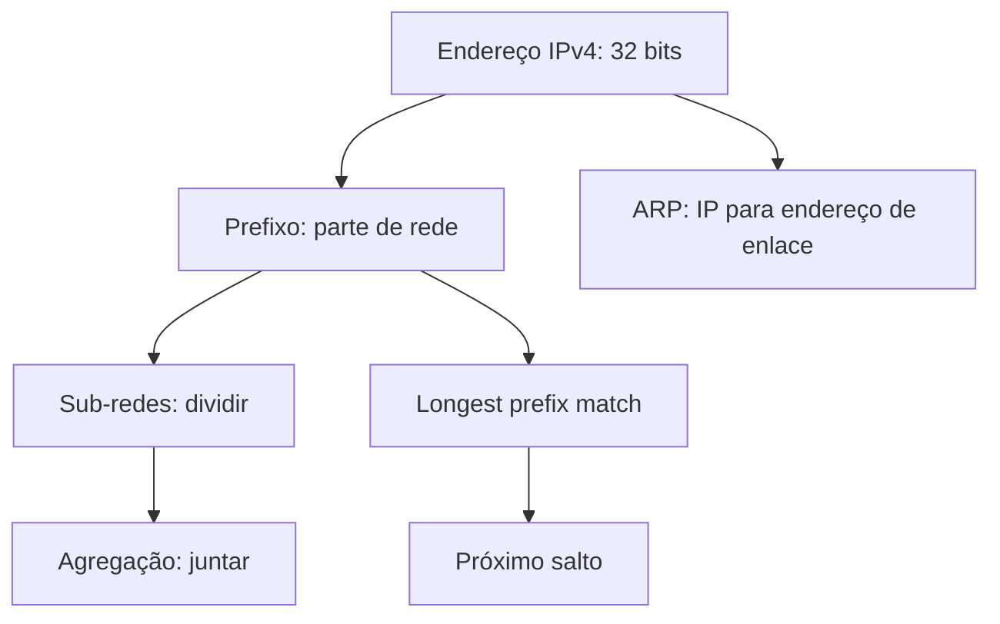

# 49 · Endereçamento IP, sub-redes e roteamento

**Tempo estimado:** 50 minutos · **Pré-requisito:** [[48 - Enquadramento, detecção de erro e Ethernet]] e o módulo 32 (inteiros e bits).

**Ao final você vai conseguir:**

1. Ler um endereço IPv4 com prefixo e dizer quantos endereços a rede tem.
2. Decidir se dois endereços estão na mesma sub-rede.
3. Dividir uma rede em sub-redes e agregar sub-redes vizinhas.
4. Escolher a rota pelo prefixo mais longo, que é a regra de encaminhamento.
5. Explicar o cache ARP, que liga um endereço IP a um endereço de enlace.

**Antes de começar:** no módulo 48 o quadro tinha endereço MAC de enlace. Aqui o pacote tem endereço IP, e o roteador decide o próximo salto a partir dele.

---

## Para começar

Um pacote sai do seu computador com um endereço de destino. Ele atravessa vários roteadores, e em cada um a decisão é a mesma: para onde seguir. O roteador não conhece o caminho inteiro; ele só olha o destino e uma tabela com prefixos. A regra é escolher o prefixo mais específico que contém o destino.

---

## Mapa do módulo



*Figura 1: o prefixo separa rede e host. O encaminhamento usa o prefixo mais longo; o ARP traduz o endereço IP para o endereço de enlace do próximo nó.*

**Como ler:** o prefixo aparece em três usos: dividir, agregar e casar com o destino.

---

## Mini-aula 1: prefixo e sub-redes

> [!tip] Ideia
> O prefixo, escrito depois da barra, diz quantos bits do endereço formam a rede. O resto são bits de host. Mais bits de rede, menos hosts.

> [!info] Definição
> Um **prefixo** (prefix) é a parte inicial do endereço que identifica a rede; `/24` quer dizer 24 bits de rede e 8 de host. A **máscara de sub-rede** (subnet mask) é o AND com o endereço, que extrai a parte de rede. O **CIDR** (classless inter-domain routing), descrito na RFC 4632, substitui as classes A, B e C por prefixos de comprimento variável, de 0 a 32.

Veja uma rede `/24` dividida em quatro `/26`. Antes de rodar, diga quantos endereços tem cada `/26`.

```python
import ipaddress

rede = ipaddress.ip_network("192.168.99.0/24")
print("rede:", rede, "| endereços:", rede.num_addresses)
for sub in rede.subnets(new_prefix=26):
    print("sub-rede:", sub)
print("hosts úteis em uma /26:", len(list(ipaddress.ip_network("192.168.99.0/26").hosts())))
```

Saída real:

```
rede: 192.168.99.0/24 | endereços: 256
sub-rede: 192.168.99.0/26
sub-rede: 192.168.99.64/26
sub-rede: 192.168.99.128/26
sub-rede: 192.168.99.192/26
hosts úteis em uma /26: 62
```

**Como ler:** a `/24` tem 256 endereços. Dividida em `/26`, cada sub-rede tem 64 endereços, e são quatro. Em cada `/26`, 62 endereços são utilizáveis como host, porque `hosts()` deixa de fora o endereço de rede e o de broadcast.

> [!warning] Armadilha comum
> Número de endereços não é número de hosts. O endereço de rede e o de broadcast não são atribuídos a máquinas.

> [!question]- Checkpoint
> 1. Quantos endereços tem uma `/26`?
> 2. Quantos hosts utilizáveis tem uma `/26`?
>
> > [!success]- Resposta
> > 1. 64, porque `2 ** (32 - 26)`.
> > 2. 62, porque o endereço de rede e o de broadcast ficam de fora.

---

## Mini-aula 2: longest prefix match

> [!tip] Ideia
> Quando mais de um prefixo contém o destino, vence o mais longo, porque é o mais específico. A rota padrão `0.0.0.0/0` só entra se nenhuma outra casa.

> [!info] Definição
> O **longest prefix match** é a regra de encaminhamento da Internet: entre as rotas que contêm o destino, usa-se a de prefixo mais longo. A nota de Peterson e Davie e a RFC 4632 descrevem a mesma regra. A nota de Bonaventure a apresenta também para IPv6.

Veja uma tabela com três rotas. Antes de rodar, diga qual roteador recebe o pacote para `192.168.99.7`.

```python
import ipaddress

tabela = [
    ("0.0.0.0/0", "rota padrão"),
    ("192.168.0.0/16", "roteador R2"),
    ("192.168.99.0/24", "roteador R3"),
]

def escolhe(destino):
    d = ipaddress.ip_address(destino)
    candidatas = [(ipaddress.ip_network(p), nome) for p, nome in tabela if d in ipaddress.ip_network(p)]
    rede, nome = max(candidatas, key=lambda c: c[0].prefixlen)
    return nome

for d in ["192.168.99.7", "192.168.5.1", "8.8.8.8"]:
    print(d, "->", escolhe(d))
```

Saída real:

```
192.168.99.7 -> roteador R3
192.168.5.1 -> roteador R2
8.8.8.8 -> rota padrão
```

**Como ler:** `192.168.99.7` casa com as três rotas, e a `/24` vence por ser a mais longa. `192.168.5.1` não casa com a `/24`, e segue para a `/16`. `8.8.8.8` só casa com a rota padrão.

> [!warning] Armadilha comum
> A ordem da tabela não decide nada. Uma rota padrão escrita primeiro não vence as mais específicas: o prefixo mais longo é que decide.

> [!question]- Checkpoint
> 1. Qual rota recebe `192.168.5.1`?
> 2. Qual rota recebe `8.8.8.8`?
>
> > [!success]- Resposta
> > 1. O roteador R2, da `/16`.
> > 2. A rota padrão, porque nenhuma rota mais específica casa.

---

## Mini-aula 3: agregação de rotas

> [!tip] Ideia
> Duas sub-redes vizinhas podem ser anunciadas como uma só, com um prefixo mais curto. Isso reduz a tabela de roteamento.

> [!info] Definição
> A **agregação de rotas** (route aggregation) é anunciar um bloco maior no lugar de vários blocos menores. A RFC 4632 diz que o provedor anuncia uma única rota agregada para o bloco maior. A nota diz que a multihoming enfraquece a agregação, e que uma rota agregada pode precisar de uma rota de descarte para evitar laços.

No exercício D1, a rede de cima e a de baixo se juntam numa `/24`. Antes de começar, pense: a rede `192.168.99.128/25` agrega com qual outra para formar a `/24`?

> [!warning] Armadilha comum
> Anunciar um bloco mais específico que o real pode desviar o tráfego de outros. A RFC 4632 cita esse risco de sequestro de tráfego.

> [!question]- Checkpoint
> 1. Qual rede agrega com `192.168.99.128/25` para formar a `/24`?
> 2. Por que a agregação reduz a tabela?
>
> > [!success]- Resposta
> > 1. Com `192.168.99.0/25`.
> > 2. Porque um anúncio cobre o que antes eram dois.

---

## Mini-aula 4: ARP

> [!tip] Ideia
> Para enviar ao endereço IP de um vizinho, o host precisa do endereço de enlace dele. O ARP responde essa pergunta com cache, consulta em broadcast e resposta.

> [!info] Definição
> O **ARP** (address resolution protocol) mapeia um endereço IPv4 para um endereço de enlace. Segundo Peterson e Davie, o host consulta o cache; se não acha, faz uma consulta em broadcast, o dono responde, e as entradas expiram depois de cerca de 15 minutos. O **DHCP** entrega configurações ao host, e os endereços podem ser alugados.

No mini-projeto você simula o cache ARP.

> [!question]- Checkpoint
> 1. O que o host faz quando o endereço não está no cache?
> 2. Quem responde à consulta ARP?
>
> > [!success]- Resposta
> > 1. Faz uma consulta em broadcast.
> > 2. O dono do endereço IP consultado.

---

## Exercícios

Cada exercício tem um bloco com a função a completar e os testes com `assert`. Quando todos passarem, aparece `Passou!`. As funções definidas em exercícios anteriores aparecem no código inicial.

### Aquecimento

**A1. Tamanho de uma rede.** Em IPv4, um endereço tem 32 bits, e um prefixo de comprimento `p` deixa `32 - p` bits para os hosts. Complete `numero_de_enderecos(prefixo)`, que devolve quantos endereços a rede tem. A nota diz que o comprimento do prefixo vai de 0 a 32.

```python
def numero_de_enderecos(prefixo):
    """Endereços de uma rede IPv4 com prefixo de comprimento dado: 2 elevado a 32 menos o prefixo."""
    ...

assert numero_de_enderecos(24) == 256, "uma /24"
assert numero_de_enderecos(32) == 1, "uma /32 tem um endereço"
assert numero_de_enderecos(0) == 2 ** 32, "a rede inteira"
print("Passou!")
```

> [!hint]- Dica 1
> Use `2 ** (32 - prefixo)`.

> [!hint]- Dica 2
> Para `/24`, são 256 endereços; para `/32`, é 1.

> [!example]- Solução
> ```python
> def numero_de_enderecos(prefixo):
>     """Endereços de uma rede IPv4 com prefixo de comprimento dado: 2 elevado a 32 menos o prefixo."""
>     return 2 ** (32 - prefixo)
> ```
>
> **Erro comum:** Usar `2 ** prefixo`. Isso inverte a conta: quanto maior o prefixo, menor a rede.

**A2. Mesma sub-rede?** Dois endereços estão na mesma rede quando, com o mesmo prefixo, a parte de rede é igual: é o AND com a máscara. Complete `mesma_rede(ip_a, ip_b, prefixo)`, que devolve `True` se os dois endereços pertencem à mesma rede com esse prefixo. Use o módulo `ipaddress`, com `strict=False` para aceitar um endereço de host como base.

```python
import ipaddress

def mesma_rede(ip_a, ip_b, prefixo):
    """True se os dois endereços estão na mesma rede com o prefixo dado."""
    ...

assert mesma_rede("192.168.1.5", "192.168.1.200", 24) is True, "mesma /24"
assert mesma_rede("192.168.1.5", "192.168.2.5", 24) is False, "redes /24 diferentes"
assert mesma_rede("10.0.0.1", "10.0.0.1", 32) is True, "o mesmo endereço"
print("Passou!")
```

> [!hint]- Dica 1
> Crie `ipaddress.ip_network(f"{ip_a}/{prefixo}", strict=False)` e veja se `ip_b` está nela.

> [!hint]- Dica 2
> Use `ipaddress.ip_address(ip_b) in rede`.

> [!example]- Solução
> ```python
> def mesma_rede(ip_a, ip_b, prefixo):
>     """True se os dois endereços estão na mesma rede com o prefixo dado."""
>     rede = ipaddress.ip_network(f"{ip_a}/{prefixo}", strict=False)
>     return ipaddress.ip_address(ip_b) in rede
> ```
>
> **Erro comum:** Comparar os endereços inteiros. Dois endereços diferentes podem estar na mesma rede, e comparar o texto não diz nada sobre a parte de rede.

**A3. Hosts utilizáveis.** A documentação do módulo `ipaddress` diz que `hosts()` devolve os hosts utilizáveis de uma rede, sem o endereço de rede e o de broadcast. Complete `hosts_uteis(prefixo)`, que conta os hosts de uma rede `10.0.0.0/prefixo` usando `hosts()`.

```python
import ipaddress

def hosts_uteis(prefixo):
    """Número de hosts utilizáveis em 10.0.0.0/prefixo, segundo hosts() do módulo ipaddress."""
    ...

assert hosts_uteis(24) == 254, "uma /24"
assert hosts_uteis(30) == 2, "uma /30"
assert hosts_uteis(26) == 62, "uma /26"
print("Passou!")
```

> [!hint]- Dica 1
> Use `len(list(ipaddress.ip_network(f"10.0.0.0/{prefixo}").hosts()))`.

> [!hint]- Dica 2
> Para `/24`, o resultado é `254`; para `/30`, é `2`.

> [!example]- Solução
> ```python
> def hosts_uteis(prefixo):
>     """Número de hosts utilizáveis em 10.0.0.0/prefixo, segundo hosts() do módulo ipaddress."""
>     return len(list(ipaddress.ip_network(f"10.0.0.0/{prefixo}").hosts()))
> ```
>
> **Erro comum:** Calcular `2 ** (32 - prefixo)` sem subtrair os dois endereços reservados. A rede tem esse total de endereços, mas nem todos são hosts.

### Praticando

**P1. Maior prefixo.** Um roteador escolhe a rota cujo prefixo casa com o destino e é o mais longo: é o *longest prefix match*, que a nota de Peterson e Davie e a RFC 4632 descrevem. Complete `proximo_salto(tabela, destino)`, em que `tabela` é uma lista de pares `(cidr, rota)`. Devolva o nome da rota de maior prefixo que contém o destino, ou `None` se nenhuma contém. Use `ipaddress`.

```python
import ipaddress

def proximo_salto(tabela, destino):
    """Nome da rota de maior prefixo que contém o destino; None se nenhuma contém."""
    ...

tab = [("0.0.0.0/0", "padrão"), ("192.168.0.0/16", "R2"), ("192.168.99.0/24", "R3")]
assert proximo_salto(tab, "192.168.99.7") == "R3", "o prefixo /24 é o mais longo"
assert proximo_salto(tab, "192.168.5.1") == "R2", "só a /16 casa"
assert proximo_salto(tab, "8.8.8.8") == "padrão", "só a rota padrão casa"
assert proximo_salto([("10.0.0.0/8", "X")], "8.8.8.8") is None, "nenhuma rota casa"
print("Passou!")
```

> [!hint]- Dica 1
> Para cada entrada, teste `ipaddress.ip_address(destino) in ipaddress.ip_network(cidr)` e guarde as que casam.

> [!hint]- Dica 2
> Escolha a de maior `prefixlen` com `max(..., key=...)`.

> [!example]- Solução
> ```python
> def proximo_salto(tabela, destino):
>     """Nome da rota de maior prefixo que contém o destino; None se nenhuma contém."""
>     d = ipaddress.ip_address(destino)
>     candidatas = [(ipaddress.ip_network(cidr), rota) for cidr, rota in tabela if d in ipaddress.ip_network(cidr)]
>     if not candidatas:
>         return None
>     rede, rota = max(candidatas, key=lambda c: c[0].prefixlen)
>     return rota
> ```
>
> **Erro comum:** Escolher a primeira rota que casa. A tabela pode trazer a rota padrão antes de rotas mais específicas, e a regra pede a mais específica.

**P2. Dividir uma rede.** Complete `subredes(rede, novo_prefixo)`, que divide a rede dada em sub-redes de prefixo `novo_prefixo` e devolve a lista de textos, na ordem. Use `ipaddress.ip_network(rede).subnets(new_prefix=novo_prefixo)`.

```python
import ipaddress

def subredes(rede, novo_prefixo):
    """Lista de sub-redes de rede com o novo prefixo, como texto."""
    ...

assert subredes("192.168.99.0/24", 26) is not None, "a função devolve a lista"
assert len(subredes("192.168.99.0/24", 26)) == 4, "quatro sub-redes de /26"
assert subredes("192.168.99.0/24", 26)[0] == "192.168.99.0/26", "a primeira"
assert subredes("192.168.99.0/24", 26)[3] == "192.168.99.192/26", "a última"
print("Passou!")
```

> [!hint]- Dica 1
> Converta cada sub-rede para texto com `str(...)`.

> [!hint]- Dica 2
> Para `"192.168.99.0/24"` e `26`, a primeira sub-rede é `"192.168.99.0/26"`.

> [!example]- Solução
> ```python
> def subredes(rede, novo_prefixo):
>     """Lista de sub-redes de rede com o novo prefixo, como texto."""
>     return [str(s) for s in ipaddress.ip_network(rede).subnets(new_prefix=novo_prefixo)]
> ```
>
> **Erro comum:** Passar o comprimento de bits a acrescentar (2) no lugar do novo prefixo (26). O argumento é o prefixo final.

### Desafio

**D1. Rota agregada.** Duas sub-redes vizinhas podem ser anunciadas como uma só, com um prefixo mais curto: é a agregação de rotas, que a RFC 4632 descreve para reduzir a tabela de roteamento. Complete `agregado(rede)`, que devolve, como texto, a rede que contém a dada com um bit a menos no prefixo. Use `supernet()` do módulo `ipaddress`.

```python
import ipaddress

def agregado(rede):
    """Rede imediatamente maior que contém a dada: prefixo com um bit a menos."""
    ...

assert agregado("192.168.99.128/25") == "192.168.99.0/24", "a metade de cima agrega com a de baixo"
assert agregado("192.168.99.0/25") == "192.168.99.0/24", "a metade de baixo também"
print("Passou!")
```

> [!hint]- Dica 1
> Chame `ipaddress.ip_network(rede).supernet()` e converta para `str`.

> [!hint]- Dica 2
> Para `"192.168.99.128/25"`, o resultado é `"192.168.99.0/24"`.

> [!example]- Solução
> ```python
> def agregado(rede):
>     """Rede imediatamente maior que contém a dada: prefixo com um bit a menos."""
>     return str(ipaddress.ip_network(rede).supernet())
> ```
>
> **Erro comum:** Subtrair 1 do endereço em vez de mexer no prefixo. A agregação muda o comprimento do prefixo, e o endereço base é o da rede maior.


---

## Mini-projeto (opcional)

Você vai simular o cache ARP: uma consulta vira broadcast, e as seguintes vêm do cache. Tente sozinho antes de abrir a solução.

**Mini-projeto: cache ARP.** Complete `arp_resolve(ip, cache, respostas)`. Se `ip` já está em `cache`, devolva `(cache[ip], "cache")`, sem consultar a rede. Senão, simule a consulta por broadcast: pegue o endereço de `respostas[ip]`, guarde-o em `cache` e devolva `(mac, "broadcast")`. A nota de Peterson e Davie descreve exatamente essa sequência: cache, consulta em broadcast e resposta.

```python
def arp_resolve(ip, cache, respostas):
    """Resolve ip para endereço de enlace: cache primeiro; senão, broadcast e guarda a resposta."""
    ...

respostas = {"192.168.1.1": "aa:bb:cc:00:00:01"}
cache = {}
assert arp_resolve("192.168.1.1", cache, respostas) == ("aa:bb:cc:00:00:01", "broadcast"), "primeira vez: broadcast"
assert arp_resolve("192.168.1.1", cache, respostas) == ("aa:bb:cc:00:00:01", "cache"), "segunda vez: cache"
assert cache == {"192.168.1.1": "aa:bb:cc:00:00:01"}, "a cache guardou a resposta"
print("Passou!")
```

> [!hint]- Dica 1
> Verifique `ip in cache` primeiro.

> [!hint]- Dica 2
> Ao guardar na `cache`, a próxima consulta ao mesmo `ip` responde do cache.

> [!example]- Solução
> ```python
> def arp_resolve(ip, cache, respostas):
>     """Resolve ip para endereço de enlace: cache primeiro; senão, broadcast e guarda a resposta."""
>     if ip in cache:
>         return (cache[ip], "cache")
>     mac = respostas[ip]
>     cache[ip] = mac
>     return (mac, "broadcast")
> ```
>
> **Erro comum:** Não guardar a resposta no cache. Então toda consulta vira broadcast, e a cache não serve para nada.


---

## Fechando

**Resumo**

- O prefixo separa rede e host; `/24` tem 256 endereços, e `hosts()` tira o de rede e o de broadcast.
- O longest prefix match escolhe a rota mais específica que contém o destino.
- A agregação anuncia um bloco maior; a multihoming enfraquece essa vantagem.
- O ARP traduz IP para enlace com cache e broadcast; o DHCP entrega configurações.

**Glossário rápido**

- **Prefixo** (prefix): parte do endereço que identifica a rede.
- **CIDR**: endereçamento sem classes, com prefixos de tamanho variável.
- **Longest prefix match**: regra de escolha da rota mais específica.
- **Agregação de rotas** (route aggregation): anúncio de um bloco maior.
- **ARP**: resolução de endereço IP para endereço de enlace.

**Perguntas de revisão**

1. Por que a rota padrão `0.0.0.0/0` não vence uma rota `/16` para o mesmo destino?
2. Quantos endereços de host tem uma `/30`, usando `hosts()`?
3. Por que o cache ARP evita um broadcast a cada pacote?

**E agora?** O próximo módulo é **Transporte: UDP, TCP e sockets**. Ele mostra como a porta identifica a aplicação e como TCP entrega dados em ordem e com controle de congestionamento.

---

## Para ir mais fundo

- [[IP Addressing, Subnetting and CIDR]]
- [[Routing - Distance Vector, Link State and BGP]]
- [[ARP and DHCP]]
- [[NAT]]
