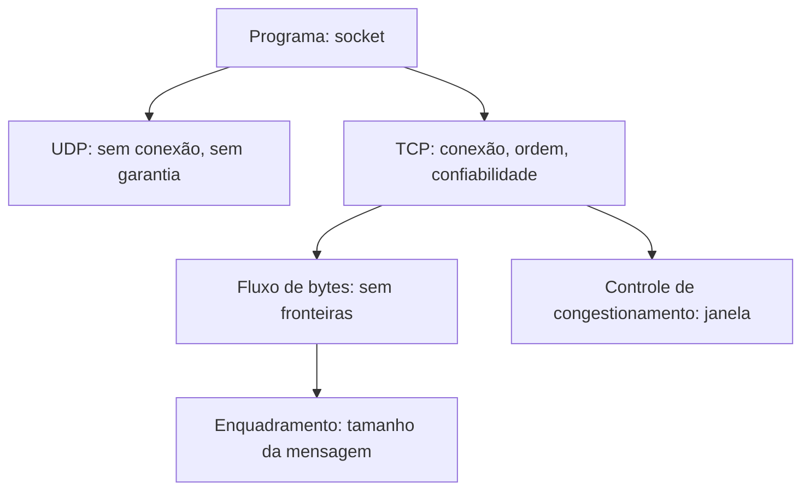

# 50 · Transporte, TCP e sockets

**Tempo estimado:** 50 minutos · **Pré-requisito:** [[49 - Endereçamento IP, sub-redes e roteamento]] e o módulo 47 (camadas).

**Ao final você vai conseguir:**

1. Dizer o que a camada de transporte acrescenta ao IP: portas, e entre UDP e TCP, a confiabilidade e a ordem.
2. Calcular como a janela de congestionamento cresce na partida lenta.
3. Enquadrar mensagens sobre um fluxo de bytes, usando o tamanho de cada uma.
4. Reconhecer o fim de uma conexão pelo `recv` que devolve zero bytes.

**Antes de começar:** no módulo 47 a mensagem ganhava cabeçalhos ao descer as camadas. Aqui o cabeçalho de transporte identifica a aplicação pela porta, e o TCP cuida da entrega.

---

## Para começar

Dois programas conversam pela rede. Um envia uma foto, o outro uma mensagem de chat. A rede entrega pacotes ao computador, mas não sabe qual programa deve recebê-los, nem se eles chegaram. A camada de transporte resolve as duas coisas: a porta indica o programa, e o protocolo escolhido decide o nível de garantia.

---

## Mapa do módulo



*Figura 1: o programa usa um socket. UDP entrega datagramas sem garantias; TCP entrega um fluxo ordenado, que a aplicação precisa enquadrar.*

**Como ler:** o socket é a porta de entrada para o transporte. A diferença entre UDP e TCP começa aí.

---

## Mini-aula 1: UDP e TCP

> [!tip] Ideia
> UDP envia datagramas sem conexão e sem garantia de entrega. TCP estabelece uma conexão e entrega um fluxo ordenado e confiável. A escolha depende do que a aplicação precisa.

> [!info] Definição
> UDP é não confiável e sem conexão, com cabeçalho de quatro campos e soma de verificação. TCP é confiável e orientado a conexão, segundo a RFC 1122. A nota de Linux (tcp(7)) diz que TCP garante a ordem dos dados e retransmite os pacotes perdidos. As portas identificam as aplicações.

Veja a escolha de protocolo no exercício D1. Antes de começar, pense: uma videoconferência prefere UDP ou TCP, se um quadro atrasado já não serve?

> [!warning] Armadilha comum
> TCP não tem fronteiras de mensagem. Ele entrega bytes, e o que vira mensagem depende da aplicação. Esperar que cada `recv` devolva uma mensagem inteira é um erro frequente.

> [!question]- Checkpoint
> 1. O que identifica o programa de destino dentro do computador?
> 2. Qual protocolo entrega um fluxo ordenado?
>
> > [!success]- Resposta
> > 1. A porta.
> > 2. TCP.

---

## Mini-aula 2: controle de congestionamento

> [!tip] Ideia
> O TCP limita quantos segmentos envia sem confirmação, pela janela. Na partida lenta, a janela dobra a cada RTT, até o congestionamento começar.

> [!info] Definição
> A **janela de congestionamento** é o número de segmentos que o emissor pode ter sem confirmação. Na partida lenta, a nota de Bonaventure diz que ela dobra a cada RTT. O `ssthresh` marca a troca para a fase de evitação de congestionamento, que usa AIMD (aumento aditivo, redução multiplicativa). O controle de fluxo, em contraste, protege o receptor pela janela anunciada.

Veja a janela crescer em cinco RTTs. Antes de rodar, diga qual é o tamanho da janela no quarto RTT.

```python
janela = 1
for rtt in range(5):
    print(f"RTT {rtt}: janela = {janela} segmento(s)")
    janela *= 2
```

Saída real:

```
RTT 0: janela = 1 segmento(s)
RTT 1: janela = 2 segmento(s)
RTT 2: janela = 4 segmento(s)
RTT 3: janela = 8 segmento(s)
RTT 4: janela = 16 segmento(s)
```

**Como ler:** a janela começa em 1 e dobra: 1, 2, 4, 8, 16. O crescimento é exponencial nessa fase, e por isso se chama partida lenta, apesar do nome.

> [!warning] Armadilha comum
> A partida lenta não é lenta no sentido de crescer devagar, e sim no sentido de começar pequena. A janela pode crescer muito depois de poucos RTTs.

> [!question]- Checkpoint
> 1. Qual é a janela no RTT 3?
> 2. Qual mecanismo protege o receptor, e não a rede?
>
> > [!success]- Resposta
> > 1. Oito segmentos.
> > 2. O controle de fluxo, pela janela anunciada pelo receptor.

---

## Mini-aula 3: fluxo de bytes e enquadramento

> [!tip] Ideia
> Como TCP entrega bytes sem fronteiras, a aplicação precisa dizer onde cada mensagem termina. Um jeito é prefixar o tamanho.

> [!info] Definição
> O **enquadramento de aplicação** é a forma como a aplicação separa mensagens sobre um fluxo de bytes. A nota de Python diz que mensagens precisam ser de tamanho fixo, delimitadas, ou indicar o próprio tamanho, e que a última opção é a melhor. Um `recv` que devolve zero bytes significa que o outro lado fechou a conexão.

Veja um prefixo de tamanho de quatro bytes, seguido por duas mensagens. Antes de rodar, diga quantos bytes o prefixo de `ola` ocupa.

```python
def enquadra(mensagem):
    return len(mensagem).to_bytes(4, "big") + mensagem

def recebe_uma(fluxo, inicio):
    tam = int.from_bytes(fluxo[inicio:inicio + 4], "big")
    return fluxo[inicio + 4:inicio + 4 + tam], inicio + 4 + tam

fluxo = enquadra(b"ola") + enquadra(b"mundo!")
print("fluxo:", fluxo)
primeira, prox = recebe_uma(fluxo, 0)
segunda, _ = recebe_uma(fluxo, prox)
print("recebidas:", primeira, segunda)
```

Saída real:

```
fluxo: b'\x00\x00\x00\x03ola\x00\x00\x00\x06mundo!'
recebidas: b'ola' b'mundo!'
```

**Como ler:** cada mensagem começa com quatro bytes que dizem seu tamanho. `ola` tem três, e `mundo!` tem seis. O receptor lê o tamanho, pega exatamente aquela quantidade e avança.

> [!warning] Armadilha comum
> Um `recv` pode devolver menos bytes do que o pedido. Em código real, o receptor repete a leitura até completar o tamanho.

> [!question]- Checkpoint
> 1. Quantos bytes ocupa o prefixo de tamanho?
> 2. Por que o receptor precisa do tamanho antes de ler a mensagem?
>
> > [!success]- Resposta
> > 1. Quatro.
> > 2. Porque o TCP não delimita mensagens; sem o tamanho, o receptor não sabe onde uma termina.

---

## Exercícios

Cada exercício tem um bloco com a função a completar e os testes com `assert`. Quando todos passarem, aparece `Passou!`. As funções definidas em exercícios anteriores aparecem no código inicial.

### Aquecimento

**A1. Partida lenta.** Na fase de partida lenta (slow start), a nota de Bonaventure diz que a janela de congestionamento dobra a cada RTT. Complete `janela_slow_start(n_rtts)`, que devolve a lista do tamanho da janela, em segmentos, em cada um dos `n_rtts` primeiros RTTs, começando em 1.

```python
def janela_slow_start(n_rtts):
    """Tamanho da janela em cada RTT na partida lenta: dobra a cada RTT, começando em 1."""
    ...

assert janela_slow_start(5) == [1, 2, 4, 8, 16], "dobra a cada RTT"
assert janela_slow_start(1) == [1], "um RTT só"
assert janela_slow_start(0) == [], "nenhum RTT"
print("Passou!")
```

> [!hint]- Dica 1
> Use `[2 ** k for k in range(n_rtts)]`.

> [!hint]- Dica 2
> Para 5 RTTs, o resultado é `[1, 2, 4, 8, 16]`.

> [!example]- Solução
> ```python
> def janela_slow_start(n_rtts):
>     """Tamanho da janela em cada RTT na partida lenta: dobra a cada RTT, começando em 1."""
>     return [2 ** k for k in range(n_rtts)]
> ```
>
> **Erro comum:** Somar 1 a cada RTT, em vez de dobrar. Isso é crescimento linear, e não a partida lenta.

**A2. Mensagem com tamanho.** A nota de Peterson e Davie diz que mensagens sobre TCP precisam ser delimitadas ou indicar seu tamanho, e que indicar o tamanho é melhor. Complete `enquadra(mensagem)`, que devolve os 4 bytes do tamanho, em ordem grande (big-endian), seguidos da mensagem.

```python
def enquadra(mensagem):
    """Prefixa a mensagem com seu tamanho em 4 bytes big-endian."""
    ...

assert enquadra(b"ola") == b"\x00\x00\x00\x03ola", "três bytes"
assert enquadra(b"") == b"\x00\x00\x00\x00", "mensagem vazia"
assert len(enquadra(b"x" * 10)) == 14, "4 bytes de tamanho e 10 de mensagem"
print("Passou!")
```

> [!hint]- Dica 1
> O tamanho é `len(mensagem)`. Use `.to_bytes(4, "big")`.

> [!hint]- Dica 2
> Para `b"ola"`, o resultado é `b"\x00\x00\x00\x03ola"`.

> [!example]- Solução
> ```python
> def enquadra(mensagem):
>     """Prefixa a mensagem com seu tamanho em 4 bytes big-endian."""
>     return len(mensagem).to_bytes(4, "big") + mensagem
> ```
>
> **Erro comum:** Escrever o tamanho em texto, como `"3"`. O receptor espera exatamente 4 bytes binários.

**A3. Ler o fluxo.** Como TCP é um fluxo de bytes sem fronteiras, o receptor separa as mensagens lendo o tamanho de cada uma. Complete `recebe_todas(fluxo)`, que recebe bytes formados por mensagens enquadradas com `enquadra` (definida no começo do arquivo) e devolve a lista das mensagens, na ordem.

```python
def enquadra(mensagem):
    return len(mensagem).to_bytes(4, "big") + mensagem

def recebe_todas(fluxo):
    """Separa as mensagens de um fluxo de bytes enquadrado, lendo o tamanho de cada uma."""
    ...

assert recebe_todas(enquadra(b"a") + enquadra(b"bc")) == [b"a", b"bc"], "duas mensagens"
assert recebe_todas(enquadra(b"")) == [b""], "uma mensagem vazia"
assert recebe_todas(b"") == [], "fluxo vazio"
print("Passou!")
```

> [!hint]- Dica 1
> Comece com `pos = 0`. Leia 4 bytes com `int.from_bytes(fluxo[pos:pos + 4], "big")`, pegue o trecho seguinte e avance `pos`.

> [!hint]- Dica 2
> Repita enquanto `pos` for menor que o tamanho do fluxo.

> [!example]- Solução
> ```python
> def recebe_todas(fluxo):
>     """Separa as mensagens de um fluxo de bytes enquadrado, lendo o tamanho de cada uma."""
>     mensagens = []
>     pos = 0
>     while pos < len(fluxo):
>         tam = int.from_bytes(fluxo[pos:pos + 4], "big")
>         mensagens.append(fluxo[pos + 4:pos + 4 + tam])
>         pos = pos + 4 + tam
>     return mensagens
> ```
>
> **Erro comum:** Avançar `pos` só 1 byte. O tamanho ocupa 4, e a leitura seguinte cairia no meio da mensagem.

### Praticando

**P1. Fim da conexão.** Quando `recv` devolve zero bytes, a nota de Python diz que o outro lado fechou a conexão. Complete `fecha_conexao(retornos)`, que recebe a lista de resultados sucessivos de `recv` (cada um é um `bytes`) e devolve o índice do primeiro resultado vazio, que é o momento do fechamento. Se nenhum é vazio, devolva `None`.

```python
def fecha_conexao(retornos):
    """Índice do primeiro recv que devolve zero bytes, indicando que o outro lado fechou."""
    ...

assert fecha_conexao([b"ab", b"", b"x"]) == 1, "o vazio na posição 1"
assert fecha_conexao([b"ab", b"c"]) is None, "nenhum vazio, sem fechamento"
assert fecha_conexao([b""]) == 0, "fecha logo no início"
print("Passou!")
```

> [!hint]- Dica 1
> Percorra com `enumerate`. Um resultado vazio é `b""`.

> [!hint]- Dica 2
> Para `[b"ab", b"", b"x"]`, o resultado é `1`.

> [!example]- Solução
> ```python
> def fecha_conexao(retornos):
>     """Índice do primeiro recv que devolve zero bytes, indicando que o outro lado fechou."""
>     for i, r in enumerate(retornos):
>         if r == b"":
>             return i
>     return None
> ```
>
> **Erro comum:** Parar no primeiro resultado curto. Um resultado com poucos bytes não é o fechamento; só o vazio é.

**P2. Ordem de entrega.** A nota de tcp(7) diz que TCP garante que os dados chegam em ordem. Os segmentos, porém, podem chegar fora de ordem pela rede. Complete `entregas_tcp(segmentos)`, em que `segmentos` é uma lista de pares `(numero_de_sequencia, dado)`. Devolva os dados concatenados na ordem do número de sequência.

```python
def entregas_tcp(segmentos):
    """Concatena os dados dos segmentos na ordem do número de sequência."""
    ...

assert entregas_tcp([(3, b"c"), (1, b"a"), (2, b"b")]) == b"abc", "fora de ordem chega em ordem"
assert entregas_tcp([(1, b"ola")]) == b"ola", "um segmento"
assert entregas_tcp([]) == b"", "sem segmentos"
print("Passou!")
```

> [!hint]- Dica 1
> Ordene os pares pelo primeiro elemento com `sorted`.

> [!hint]- Dica 2
> Junte os dados com `b"".join(...)`.

> [!example]- Solução
> ```python
> def entregas_tcp(segmentos):
>     """Concatena os dados dos segmentos na ordem do número de sequência."""
>     return b"".join(dado for _, dado in sorted(segmentos, key=lambda s: s[0]))
> ```
>
> **Erro comum:** Concatenar na ordem de chegada. Esse é o erro que o número de sequência existe para evitar.

### Desafio

**D1. UDP ou TCP.** A nota diz que TCP é confiável, ordenado e orientado a conexão, e UDP é sem conexão e sem garantia de entrega. Complete `escolhe_protocolo(precisa_ordem, precisa_confiabilidade)`, que devolve `"TCP"` se a aplicação precisa de ordem ou de confiabilidade, e `"UDP"` se não precisa de nenhuma das duas. A regra de escolha é a deste exercício, e não uma regra da nota.

```python
def escolhe_protocolo(precisa_ordem, precisa_confiabilidade):
    """TCP se a aplicação precisa de ordem ou de confiabilidade; UDP caso contrário."""
    ...

assert escolhe_protocolo(False, False) == "UDP", "nenhuma exigência"
assert escolhe_protocolo(True, False) == "TCP", "ordem basta"
assert escolhe_protocolo(False, True) == "TCP", "confiabilidade basta"
print("Passou!")
```

> [!hint]- Dica 1
> Use `"TCP" if precisa_ordem or precisa_confiabilidade else "UDP"`.

> [!hint]- Dica 2
> Para `False` e `False`, o resultado é `"UDP"`.

> [!example]- Solução
> ```python
> def escolhe_protocolo(precisa_ordem, precisa_confiabilidade):
>     """TCP se a aplicação precisa de ordem ou de confiabilidade; UDP caso contrário."""
>     return "TCP" if precisa_ordem or precisa_confiabilidade else "UDP"
> ```
>
> **Erro comum:** Exigir as duas condições para escolher TCP. Basta uma delas, porque cada uma sozinha já pede TCP.


---

## Mini-projeto (opcional)

Você vai ler uma sessão de mensagens enquadradas até o marcador de fim. Tente sozinho antes de abrir a solução.

**Mini-projeto: sessão de mensagens.** Complete `chat_protocolo(fluxo)`, que lê mensagens enquadradas, como em A3, e para na primeira mensagem vazia, que marca o fim da sessão. Devolva a lista das mensagens lidas antes dessa mensagem vazia, sem incluí-la. Se o fluxo acaba sem a mensagem vazia, devolva todas as mensagens.

```python
def enquadra(mensagem):
    return len(mensagem).to_bytes(4, "big") + mensagem

def chat_protocolo(fluxo):
    """Lê mensagens enquadradas até a primeira vazia (fim da sessão); devolve as lidas antes dela."""
    ...

assert chat_protocolo(enquadra(b"oi") + enquadra(b"tchau") + enquadra(b"")) == [b"oi", b"tchau"], "para na vazia"
assert chat_protocolo(enquadra(b"a") + enquadra(b"b")) == [b"a", b"b"], "sem marcador, lê tudo"
assert chat_protocolo(enquadra(b"")) == [], "sessão vazia"
print("Passou!")
```

> [!hint]- Dica 1
> Leia as mensagens com a mesma lógica de A3, e pare quando `dado == b""`.

> [!hint]- Dica 2
> Não inclua a mensagem vazia de fim de sessão na lista.

> [!example]- Solução
> ```python
> def chat_protocolo(fluxo):
>     """Lê mensagens enquadradas até a primeira vazia (fim da sessão); devolve as lidas antes dela."""
>     mensagens = []
>     pos = 0
>     while pos < len(fluxo):
>         tam = int.from_bytes(fluxo[pos:pos + 4], "big")
>         dado = fluxo[pos + 4:pos + 4 + tam]
>         pos = pos + 4 + tam
>         if dado == b"":
>             break
>         mensagens.append(dado)
>     return mensagens
> ```
>
> **Erro comum:** Incluir a mensagem vazia na lista. Ela é o marcador, e não um dado da sessão.


---

## Fechando

**Resumo**

- A porta identifica a aplicação; UDP não garante entrega nem ordem, e TCP garante ambas.
- Na partida lenta, a janela de congestionamento dobra a cada RTT; AIMD rege a fase seguinte.
- Como TCP é um fluxo de bytes, a aplicação enquadra as mensagens, por exemplo com o tamanho.
- `recv` que devolve zero bytes indica que o outro lado fechou a conexão.

**Glossário rápido**

- **Porta** (port): identifica a aplicação no computador.
- **Janela de congestionamento** (congestion window): segmentos que podem estar sem confirmação.
- **Partida lenta** (slow start): crescimento da janela, dobrando a cada RTT.
- **AIMD**: aumento aditivo e redução multiplicativa da janela.
- **Socket**: ponto de comunicação entre dois programas.

**Perguntas de revisão**

1. Por que UDP pode ser melhor que TCP para uma aplicação que tolera perdas?
2. Qual é a janela no RTT 4, na partida lenta?
3. Por que o receptor de TCP precisa de enquadramento, se a rede já entrega os bytes em ordem?

**E agora?** Com este módulo, o bloco 5 (Redes de computadores) está completo, com camadas, enlace, IP e transporte. O próximo bloco é **Teoria da computação**, que trata de máquinas abstratas e linguagens.

---

## Para ir mais fundo

- [[UDP vs TCP]]
- [[TCP Flow and Congestion Control]]
- [[Sockets and Socket Programming in Python]]
- [[Bonaventure - Computer Networking Principles Protocols and Practice]]
