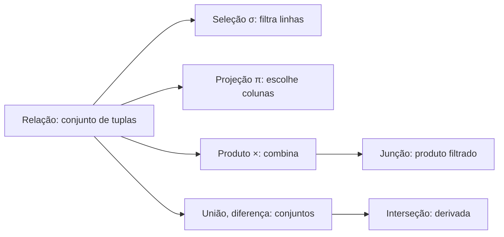

# 51 · Modelo relacional, chaves e álgebra relacional

**Tempo estimado:** 50 minutos · **Pré-requisito:** [[09 - Contagem]] (produto cartesiano) e [[01 - Conjuntos]].

**Ao final você vai conseguir:**

1. Descrever uma relação como um conjunto de tuplas sobre domínios de atributos.
2. Distinguir superchave, chave candidata, chave primária e chave alternativa.
3. Aplicar seleção, projeção, produto e junção natural a relações pequenas.
4. Construir a interseção a partir de união e diferença.

**Antes de começar:** os módulos 01 e 09 deram os conjuntos e o produto cartesiano. Uma relação de banco de dados é um desses conjuntos, com colunas nomeadas.

---

## Para começar

Você tem uma tabela de alunos e quer a lista dos nomes de quem tem mais de 26 anos. Escrever a consulta em SQL é fácil, mas o que ela faz por dentro? Um banco de dados responde a perguntas aplicando operações a conjuntos de linhas. A álgebra relacional é o conjunto dessas operações, com regras exatas sobre o que cada uma devolve.

---

## Mapa do módulo



*Figura 1: as operações básicas recebem relações e devolvem relações. A interseção sai de união e diferença.*

**Como ler:** toda operação devolve uma relação, por isso elas se compõem.

---

## Mini-aula 1: relação e chaves

> [!tip] Ideia
> Uma relação é um conjunto de tuplas, e não há duas tuplas iguais. Uma chave é um conjunto de colunas que identifica cada linha.

> [!info] Definição
> Uma **relação** é um subconjunto do produto cartesiano dos domínios dos atributos; cada linha é uma **tupla**. Uma **superchave** é um conjunto de atributos que não repete valores entre duas tuplas. Uma **chave candidata** é uma superchave mínima. A **chave primária** é a candidata escolhida; as outras são chaves alternativas. A nota de Watt e Eng e a de The Guide to Database Systems concordam nesses termos.

Veja a seleção, a projeção e o produto sobre uma relação pequena. Antes de rodar, diga quantas linhas a seleção de idade maior que 26 devolve.

```python
alunos = {(1, "Ana", 30), (2, "Bruno", 25), (3, "Carla", 30)}

selecionados = {t for t in alunos if t[2] > 26}
nomes = {t[1] for t in alunos}
print("σ idade > 26:", sorted(selecionados))
print("π nome:", sorted(nomes))
print("idades distintas:", sorted({(t[2],) for t in alunos}))
```

Saída real:

```
σ idade > 26: [(1, 'Ana', 30), (3, 'Carla', 30)]
π nome: ['Ana', 'Bruno', 'Carla']
idades distintas: [(25,), (30,)]
```

**Como ler:** a seleção mantém duas tuplas de idade 30. A projeção de nome devolve um conjunto, e nomes repetidos sumiriam. Cada operação gerou uma nova relação.

> [!warning] Armadilha comum
> Em SQL, o resultado pode ter linhas repetidas, porque SQL usa multiconjuntos (bags). A álgebra relacional usa conjuntos. A nota de RPI registra essa diferença.

> [!question]- Checkpoint
> 1. Quantas tuplas a seleção `idade > 26` devolve?
> 2. Por que a projeção de `nome` tem menos linhas que a relação original?
>
> > [!success]- Resposta
> > 1. Duas, as de Ana e Carla.
> > 2. Porque nomes repetidos são removidos do conjunto resultante.

---

## Mini-aula 2: produto e junção

> [!tip] Ideia
> O produto cartesiano forma todas as combinações de tuplas. A junção natural mantém só as combinações em que a coluna comum tem o mesmo valor.

> [!info] Definição
> A **junção natural** é o produto seguido de uma seleção que exige igualdade nas colunas de junção, e depois de uma projeção que remove a coluna repetida. A nota de RPI lista o produto, a seleção, a projeção, a união, a diferença, a junção theta e a natural, e a renomeação como os operadores básicos.

Veja um produto entre duas relações de duas tuplas. Antes de rodar, diga quantas tuplas o produto tem.

```python
r = {(1, "Ana"), (2, "Bruno")}
s = {(1, "BD"), (2, "IA")}

produto = {a + b for a in r for b in s}
print("tamanho de R × S:", len(produto))
juncao = {a + (b[1],) for a in r for b in s if a[0] == b[0]}
print("junção natural em 1ª coluna:", sorted(juncao))
```

Saída real:

```
tamanho de R × S: 4
junção natural em 1ª coluna: [(1, 'Ana', 'BD'), (2, 'Bruno', 'IA')]
```

**Como ler:** o produto tem 4 tuplas, uma para cada par. A junção natural pela primeira coluna mantém só os pares de mesmo código, e cada um traz a disciplina.

> [!warning] Armadilha comum
> O produto cresce depressa: duas relações de mil linhas dão um milhão de combinações. Por isso a junção vem sempre com uma condição, e não como produto puro.

> [!question]- Checkpoint
> 1. Quantas tuplas tem o produto de duas relações de 2 tuplas cada?
> 2. Que condição a junção natural impõe?
>
> > [!success]- Resposta
> > 1. Quatro.
> > 2. Igualdade nas colunas de junção.

---

## Exercícios

Cada exercício tem um bloco com a função a completar e os testes com `assert`. Quando todos passarem, aparece `Passou!`. As funções definidas em exercícios anteriores aparecem no código inicial.

### Aquecimento

**A1. Seleção.** Na álgebra relacional, a seleção σ devolve as tuplas de uma relação que satisfazem um predicado. Uma relação é um conjunto de tuplas, então o resultado também é um conjunto. Complete `selecao(relacao, predicado)`, que devolve o conjunto das tuplas de `relacao` para as quais `predicado(t)` é verdadeiro.

```python
def selecao(relacao, predicado):
    """Conjunto das tuplas de relacao que satisfazem predicado (σ)."""
    ...

r = {(1, 1), (2, 3), (3, 5)}
assert selecao(r, lambda t: t[1] > 1) == {(2, 3), (3, 5)}, "tuplas com segunda coluna maior que 1"
assert selecao(r, lambda t: False) == set(), "nenhuma tupla satisfaz"
assert selecao(set(), lambda t: True) == set(), "relação vazia"
print("Passou!")
```

> [!hint]- Dica 1
> Use uma comprehension de conjunto: `{t for t in relacao if predicado(t)}`.

> [!hint]- Dica 2
> Com `predicado = lambda t: t[1] > 1`, a seleção de `{(1, 1), (2, 3)}` é `{(2, 3)}`.

> [!example]- Solução
> ```python
> def selecao(relacao, predicado):
>     """Conjunto das tuplas de relacao que satisfazem predicado (σ)."""
>     return {t for t in relacao if predicado(t)}
> ```
>
> **Erro comum:** Devolver uma lista. A álgebra trabalha com conjuntos, e duplicatas não existem no resultado.

**A2. Projeção.** A projeção π escolhe colunas e remove as duplicatas, porque o resultado também é um conjunto de tuplas. Complete `projecao(relacao, indices)`, que devolve o conjunto das tuplas formadas apenas pelas posições em `indices`, nessa ordem.

```python
def projecao(relacao, indices):
    """Conjunto das tuplas formadas pelas colunas indicadas (π), sem duplicatas."""
    ...

r = {(1, "a"), (2, "a")}
assert projecao(r, [1]) == {("a",)}, "a coluna 1 tem um só valor"
assert projecao(r, [0, 1]) == r, "projetar todas as colunas não muda a relação"
assert projecao(set(), [0]) == set(), "relação vazia"
print("Passou!")
```

> [!hint]- Dica 1
> Para cada tupla `t`, monte `tuple(t[i] for i in indices)`.

> [!hint]- Dica 2
> A projeção de `{(1, "a"), (2, "a")}` na coluna 1 é `{("a",)}`, com uma só tupla.

> [!example]- Solução
> ```python
> def projecao(relacao, indices):
>     """Conjunto das tuplas formadas pelas colunas indicadas (π), sem duplicatas."""
>     return {tuple(t[i] for i in indices) for t in relacao}
> ```
>
> **Erro comum:** Devolver uma lista com as tuplas projetadas. As repetidas precisam sumir do resultado.

**A3. Produto cartesiano.** O produto R × S forma todas as combinações de uma tupla de `R` com uma de `S`, concatenadas. Complete `produto(r, s)`, que devolve o conjunto dessas tuplas concatenadas.

```python
def produto(r, s):
    """Produto cartesiano R × S: todas as concatenações de tuplas de r com tuplas de s."""
    ...

assert produto({(1,), (2,)}, {("x",), ("y",)}) == {(1, "x"), (1, "y"), (2, "x"), (2, "y")}, "quatro combinações"
assert produto(set(), {(1,)}) == set(), "com relação vazia o produto é vazio"
assert len(produto({(1, 2)}, {(3, 4), (5, 6)})) == 2, "uma tupla por tupla de s"
print("Passou!")
```

> [!hint]- Dica 1
> Use dois `for`: `{a + b for a in r for b in s}`.

> [!hint]- Dica 2
> Com duas tuplas de tamanho 2 em cada relação, cada resultado tem tamanho 4.

> [!example]- Solução
> ```python
> def produto(r, s):
>     """Produto cartesiano R × S: todas as concatenações de tuplas de r com tuplas de s."""
>     return {a + b for a in r for b in s}
> ```
>
> **Erro comum:** Fazer `a + b` com as tuplas como listas. Use tuplas, para o resultado continuar hashable e poder entrar no conjunto.

### Praticando

**P1. Junção natural.** A junção natural combina tuplas de `R` e de `S` que têm o mesmo valor na coluna de junção. Complete `juncao_natural(r, s, i, j)`, em que `i` é a coluna de `r` e `j` a coluna de `s`. Cada resultado é a tupla de `r` seguida da tupla de `s` sem a coluna `j`. Use a mesma ideia de `produto`, mas filtre pelas colunas de junção.

```python
def juncao_natural(r, s, i, j):
    """Junção natural de r e s pelas colunas i e j; a coluna j de s aparece uma vez só."""
    ...

r = {(1, "Ana"), (2, "Bruno")}
s = {(1, "BD"), (2, "IA"), (3, "SO")}
assert juncao_natural(r, s, 0, 0) == {(1, "Ana", "BD"), (2, "Bruno", "IA")}, "a chave 3 não tem par em r"
assert juncao_natural(r, set(), 0, 0) == set(), "sem tuplas em s"
print("Passou!")
```

> [!hint]- Dica 1
> Para cada par `(a, b)`, só concatene se `a[i] == b[j]`.

> [!hint]- Dica 2
> Ao concatenar, use `b[:j] + b[j + 1:]` para tirar a coluna repetida.

> [!example]- Solução
> ```python
> def juncao_natural(r, s, i, j):
>     """Junção natural de r e s pelas colunas i e j; a coluna j de s aparece uma vez só."""
>     return {a + b[:j] + b[j + 1:] for a in r for b in s if a[i] == b[j]}
> ```
>
> **Erro comum:** Manter a coluna de junção duas vezes. A junção natural mostra essa coluna uma vez só.

**P2. Interseção derivada.** A nota de RPI diz que a interseção não é um operador básico: `R ∩ S = (R ∪ S) − ((R − S) ∪ (S − R))`. Complete `interseccao(r, s)` usando essa fórmula, com as operações de conjunto do Python.

```python
def interseccao(r, s):
    """R ∩ S construído a partir de união e diferença: (R ∪ S) − ((R − S) ∪ (S − R))."""
    ...

assert interseccao({1, 2}, {2, 3}) == {2}, "o elemento comum"
assert interseccao({1}, {2}) == set(), "nada em comum"
assert interseccao({("a", 1)}, {("a", 1)}) == {("a", 1)}, "tuplas iguais"
print("Passou!")
```

> [!hint]- Dica 1
> Use `|` para união, `-` para diferença e parênteses para a ordem.

> [!hint]- Dica 2
> Para `{1, 2}` e `{2, 3}`, o resultado é `{2}`.

> [!example]- Solução
> ```python
> def interseccao(r, s):
>     """R ∩ S construído a partir de união e diferença: (R ∪ S) − ((R − S) ∪ (S − R))."""
>     return (r | s) - ((r - s) | (s - r))
> ```
>
> **Erro comum:** Usar `r & s` do Python sem a fórmula. O exercício pede a construção com os operadores básicos.

### Desafio

**D1. Superchave.** Uma superchave é um conjunto de atributos que nunca repete valores entre duas tuplas. Complete `e_superchave(linhas, indices)`, que devolve `True` se as posições `indices` identificam cada linha de forma única, isto é, se o número de combinações distintas dos valores dessas colunas é igual ao número de linhas. A nota de The Guide to Database Systems usa essa definição.

```python
def e_superchave(linhas, indices):
    """True se as colunas indicadas identificam cada linha de forma única."""
    ...

alunos = [(1, "ana@x", "Ana"), (2, "bruno@x", "Bruno"), (3, "carla@x", "Ana")]
assert e_superchave(alunos, [0]) is True, "o id é único"
assert e_superchave(alunos, [2]) is False, "o nome se repete"
assert e_superchave(alunos, [2, 0]) is True, "nome com id é superchave"
print("Passou!")
```

> [!hint]- Dica 1
> Use `len({tuple(l[i] for i in indices) for l in linhas}) == len(linhas)`.

> [!hint]- Dica 2
> Para uma lista vazia, a resposta é `True`.

> [!example]- Solução
> ```python
> def e_superchave(linhas, indices):
>     """True se as colunas indicadas identificam cada linha de forma única."""
>     return len({tuple(l[i] for i in indices) for l in linhas}) == len(linhas)
> ```
>
> **Erro comum:** Testar só a primeira coluna. Uma superchave pode precisar de duas ou mais colunas para ser única.


---

## Mini-projeto (opcional)

Você vai encontrar as chaves candidatas de uma tabela, testando combinações de colunas. Tente sozinho antes de abrir a solução.

**Mini-projeto: chaves candidatas.** Complete `chaves_candidatas(linhas, n_colunas)`, que devolve a lista de chaves candidatas: as superchaves mínimas, em que nenhum subconjunto próprio também é superchave. Cada chave é uma tupla de índices de colunas. Use `combinations` de `itertools` por tamanho crescente, e `e_superchave`, já definida acima.

```python
from itertools import combinations

def e_superchave(linhas, indices):
    return len({tuple(l[i] for i in indices) for l in linhas}) == len(linhas)

def chaves_candidatas(linhas, n_colunas):
    """Superchaves mínimas: nenhum subconjunto próprio delas é superchave."""
    ...

assert chaves_candidatas([(1, "a"), (2, "a")], 2) == [(0,)], "a única chave é a primeira coluna"
assert chaves_candidatas([(1, "ana", "x"), (2, "bruno", "x"), (3, "ana", "y")], 3) == [(0,), (1, 2)], "id, e nome com a outra coluna"
assert chaves_candidatas([], 2) == [(0,), (1,)], "sem linhas, toda coluna é chave"
print("Passou!")
```

> [!hint]- Dica 1
> Teste os tamanhos de 1 até `n_colunas`. Só aceite uma combinação se não contém uma chave já encontrada.

> [!hint]- Dica 2
> Para `[(1, "a"), (2, "a")]` com 2 colunas, a única chave é `(0,)`.

> [!example]- Solução
> ```python
> def chaves_candidatas(linhas, n_colunas):
>     """Superchaves mínimas: nenhum subconjunto próprio delas é superchave."""
>     encontradas = []
>     for tam in range(1, n_colunas + 1):
>         for comb in combinations(range(n_colunas), tam):
>             if any(set(k) <= set(comb) for k in encontradas):
>                 continue
>             if e_superchave(linhas, comb):
>                 encontradas.append(comb)
>     return encontradas
> ```
>
> **Erro comum:** Aceitar superchaves que têm uma chave menor dentro. Isso não é candidata, porque a chave menor já basta.


---

## Fechando

**Resumo**

- Uma relação é um conjunto de tuplas sobre domínios; não há duas tuplas iguais.
- Chave candidata é superchave mínima; a primária é uma delas, e as outras são alternativas.
- Seleção filtra linhas, projeção escolhe colunas, produto combina; junção natural é produto filtrado.
- A interseção é derivada de união e diferença.

**Glossário rápido**

- **Tupla** (tuple): uma linha da relação.
- **Superchave** (superkey): conjunto de atributos que identifica tuplas.
- **Chave candidata** (candidate key): superchave mínima.
- **Chave primária** (primary key): a chave candidata escolhida.
- **Junção natural** (natural join): produto com igualdade nas colunas comuns.

**Perguntas de revisão**

1. Por que a álgebra relacional não tem linhas repetidas no resultado?
2. Uma superchave com duas colunas pode ser candidata se uma delas já é superchave? Justifique.
3. Por que a junção natural pode ser vista como produto seguido de seleção?

**E agora?** O próximo módulo é **Modelo entidade-relacionamento e mapeamento**. Ele mostra como desenhar os dados antes das tabelas, e como passar esse desenho para relações.

---

## Para ir mais fundo

- [[Relational Model and Keys]]
- [[Relational Algebra]]
- [[Database Management System and Data Independence]]
